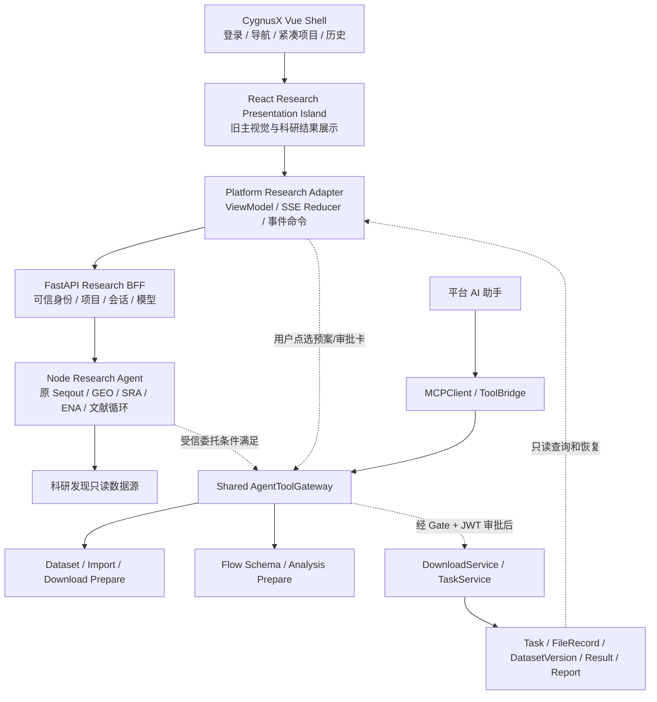

# CygnusX BioOps · Treasure Mouse Experience Restoration & Native Integration

## 科研寻宝鼠原生体验恢复与平台深度融合：六阶段实施总任务书（Codex 可执行）

- 文档日期：2026-10-15
- 实施模式：**单份总任务书、分阶段提交成果、逐 Gate 验收、阶段失败即停止后续依赖工作**
- 目标入口：CygnusX「科研寻宝鼠」页面
- 目标服务：平台 Vue Shell / Research BFF / Node Research Agent / Shared AgentToolGateway / Dataset / Download / Flow / Task
- 依据：`docs/audits/cygnusx-treasure-mouse-ui-regression-and-mcp-integration-audit-2026-10-15.md`；以及当前仓库 Phase 0A–4/0B Closure 的真实代码与报告
- 核心约束：**保留旧版产品体验；复用新平台身份、项目、会话、MCP/工具与任务服务；写操作须经过真实运行准入，不得只开前端按钮。**

> 本文的目录、配置和行号只是 2026-10-15 审计时的代码定位线索。Codex 必须先在当前工作树复核，不得假定所有阶段已验收，也不得把 `HEAD` 当作包含脏工作树的可复现运行来源。

---

# 0. 目标与非目标

## 0.1 必须实现的用户体验

**未发起聊天时**：保留旧版 Research Treasure Mouse 首页——鼠形象、品牌、Fraunces/Noto/JetBrains 等适用字体与配色、研究问题大输入框、模型选择、四大探索场景（Data Discovery / Accession Tracing / Dataset Insights / Literature Search）、每卡示例问题、来源可信度说明。项目选择器应紧凑；历史侧栏可折叠；不存在重复全站导航或独立账号入口。

**开始聊天后**：保留旧版 DatasetCard、LiteratureCard、ToolTrace、GroundingNotice、SuggestionBlock/Next Shovel、Polariseq 引导，完整消费 Node SSE，确保即时消息和历史恢复呈现一致。

**发现数据/文献后**：从真实 accession、文件、元数据及来源证据生成平台受控数据/分析预案；用户选定项目和候选 Run/附件后，才允许按权限进入审批；下载、任务状态、分析执行经现有服务复用，不能依赖模型文字称“已完成”。文献 DOI/PMID 不能直接等同于可下载测序数据，须完成文献→数据库 accession 的证据映射。

**长时间任务**：离开聊天仍能从 Task / Dataset / Project 中恢复真实状态；运行失败、审批过期、权限撤销、数据类型不匹配须明确展示原因。

## 0.2 不做的事

- 不重新开发 GEO/SRA/ENA/文献检索工具、LLM 循环或整个 Agent Runtime。
- 不为追求“都使用 MCP”而让 Node 直接调用任意外部 MCP。允许 Node 固定受信回调→共享 Gateway；平台 AI 走 MCPClient→ToolBridge→同一 Gateway，**业务服务和执行安全契约统一**即可。
- 不把整套旧 React SPA（账号、Router、游客 localStorage、Supabase、chatStore）嵌入 Vue，也不将 iframe 作为最终交付。
- 不另建下载引擎、Flow 执行器、任务表或文件管理系统；复用 DownloadService、AnalysisFlowToolService、TaskService、FileRecord、Dataset 等。
- 不假设现有 Phase 0B Closure、真实 Worker、Redis、PG、外部 MCP、BioReport 已 READY；不以改 flag 代替运行验收。
- 不为修 403 关闭鉴权、伪造项目权限、恢复旧公开 chat/auth/history 路由。

## 0.3 基线：已知事实、阻断与不可验证事项

1. 旧 UI 保留于 `pipelines/Treasure-Seeking_Mouse/src/components/chat/EmptyState.tsx`、`Composer.tsx`、`ChatMessage.tsx`、`DatasetCard.tsx`、`ToolTrace.tsx`、`GroundingNotice.tsx`、`SuggestionBlock.tsx` 等，角色/i18n/字体亦在。Vue Native 工作台未移植完整视觉及信息。
2. `TreasureMouseView.vue` 在审计时未提交工作树中默认恢复 iframe，另一工作台 `TreasureResearchWorkbench.vue` 未跟踪；旧 iframe 与 `TREASURE_MOUSE_PLATFORM_ONLY=true` 的旧 API 不兼容。先冻结真正的入口，避免双 UI 长期并存。
3. 已隔离复现：`GET /api/v1/research-agent/sessions` 在 `treasure_native_ui_enabled=False` 时 403 `FEATURE_DISABLED`，但用户现场 403 根因仅为 Suspected，仍需脱敏 Network/日志佐证。
4. Vue→Research BFF→Node `/cygnusx/discovery`→Seqout/GEO/SRA/ENA/文献循环有代码；原结果经 BFF mapper/前端 mapper 损失卡片 meta、文献链接、具体 grounding、即时事件和 follow-up。
5. Node 有固定受信 callback→Gateway 适配增量，但源码在脏子仓，镜像默认 tag `1ea2f79` 与 build context 子模块 `88dae95e` 不一致；真实发布镜像证据未知。
6. Gateway、ToolConfirmationService、DownloadService、AnalysisFlowToolService、Dataset Handoff、TaskService 已有基础代码；实际写操作被 `WRITE_RUNTIME_ACCEPTED=False` 与 `worker_paths_verified=false` 等保护；Phase 0B/2/3 的真实运行 Gate 未闭合。
7. Node platform-tools.ts 与部分 callback/协议、Research BFF、Dataset Workspace 已存在；不得重复造 Schema，也不得将旧 `DownloadBoostCard` 的 CLI 提示当成下载功能。

---

# 1. 分层架构与责任边界



实线为设计或已实现的服务逻辑；虚线涉及尚未验收或有副作用的路径，**图示不构成运行通过证明**。后续报告必须另附“当前实际实现图”，以实际代码为准。

## 1.1 前端数据所有权

- Vue Shell 独占登录、项目选择、平台会话、工具授权交互以及导航。
- React Island 仅负责科研发现展示、输入、已授权数据卡片操作的回调；不得持有 JWT/API Key、旧 Supabase session 或独立持久存储。
- Research Adapter 负责转换平台 DTO 与旧视图所需的 ViewModel；**仅一个**规范化转换管线，避免实时与历史各造一份 mapper。
- Agent 不可信输出只能作为提议（Proposal），不能指定 owner_id、project_id、内部文件路径或直接宣布任务完成。

## 1.2 业务工具统一性

- Node 固定回调只接受平台签发的有限委托，Gateway 验 issuer/audience/exp/token_version/session/project/scopes/Redis nonce；失败关闭。
- 平台 AI 的 MCPClient / ToolBridge 同样进入 Gateway 的业务适配服务。
- 准备工具与执行工具分离；审批只能由可信 JWT 人类 API 发起。
- Source accession → DatasetImport Proposal → DatasetVersion → Flow Prepare → Task 要各有可溯源 ID。

---

# 2. 施工规则与阶段门禁

1. 首先读取最新审计、活动架构文档与当前工作树：`git status --short`、`git diff --stat`、`git submodule status --recursive`、当前分支/HEAD、当前 Compose/Vite 和 feature flags。
2. 先标记已有未提交文件的所有权，不进行 `reset --hard`、`clean`、`checkout -- .`、强制覆盖、自动提交、推送或生产部署。
3. **允许在隔离开发环境修改代码与添加测试**；任何 DB 迁移、容器重建、网络/Redis/真实用户数据操作须按运行风险另外审批。
4. 各阶段报告记录 `PASS / FAIL / BLOCKED / SKIPPED / NOT TESTED`，区分 Unit、Contract、Integration、Runtime Smoke、E2E。
5. 阶段失败的依赖不可跳过；可以在只读/展示范围做不依赖写执行的工作，但不得宣称阶段整体 READY。
6. 针对新的 React 依赖，先在 PoC 判断兼容性，再改 package/lock；不允许“为了能 build”整体升级前端生态。
7. 每个阶段至少提供改动清单、前后对照、测试命令与结果、剩余问题、回退方案。

## 2.1 总阶段清单与验收门槛

| 阶段 | 目标 | 关键 Gate | 未通过后处置 |
|---|---|---|---|
| P0 | 403、capability、BFF 模块鉴权、入口统一、可靠只读会话 | G-P0：可诊断 + 权限负例 + 只读入口安全 | 停止公开 native 入口；继续纯本地 UI PoC 可用 |
| P1-A | React Island 最小可运行 PoC、CSS/Portal/生命周期隔离 | G-P1A：主视觉对照、无独立认证、构建及卸载无泄漏 | 转入经评审的 Vue 等价方案，不强制 React |
| P1-B | 原生科研完整结果适配、SSE、文献/数据卡、Next Shovel | G-P1B：字段/事件/交互无损，实时与恢复等价 | 不用旧 SPA 替代，只修 adapter |
| P1-C | 平台项目、模型、历史、取消、恢复与竞态处理 | G-P1C：双用户双项目、异步乱序/断流隔离 | 保持安全降级，禁误报完成 |
| P2 | Dataset Import、Download Prepare、Flow Prepare 与卡片融合 | G-P2：只读 + prepare + 人类审批分离，无 Task 副作用 | 保留准备能力，执行按钮后端阻断 |
| Release Gate | Redis/PG/Worker/镜像/MCP/下载安全/真实 E2E | G-R：全部 P0 运行证据与双用户小型案例通过 | 始终不开放 Agent 下载/分析写操作 |

---

# 3. 阶段 P0 —— 403 诊断、Capabilities 预检、BFF 权限与统一入口

## P0-1. 403 的现场证据与精确归因

**目标**：不要把“403”当单一错误；识别具体路由、返回服务、code、是否由 native gate 或项目权限触发。

**实现任务**：

1. 在开发构建或测试中记录页面首屏请求时序：`GET /api/v1/projects`、`GET /api/v1/research-agent/sessions`、`GET /research-agent/capabilities`（确认实际前缀）、SSE 调用；不得记录 token 值。
2. 对照 `frontend/src/api/researchAgent.ts`、`frontend/src/api/client.ts`、`frontend/src/views/TreasureResearchWorkbench.vue`，追踪 axios 错误与 fetch SSE 错误如何展示。
3. 通过隔离 ASGI 验证 `treasure_native_ui_enabled=false` 的 `403 FEATURE_DISABLED`；区分 `401 AUTHENTICATION`、`403 PROJECT/MODULE`、`422`、`503 PROVIDER/DOWNSTREAM`；网络现场证据不足则维持 Suspected。
4. 给用户明确中文错误与下一步建议（入口关闭、无权限、项目变更、模型不可用、节点不可达）。不要暴露内部密钥/堆栈。
5. 检查 Nginx `/api/`、`/treasure-mouse/` 和 Vite proxy 的实际转发；不要将 Node SSE 内 error 和 API HTTP 403 混为一谈。

**验证条件**：关 native flag 时页面不直接请求 sessions；capability 预检成功/失败有确定状态；拒绝从后端而不是仅靠按钮 disabled。

## P0-2. Capability 单一来源

**目标**：前端先问“当前身份在当前环境可做什么”，再决定请求、隐藏或解释。

**实现任务**：

1. 检查现有 `/api/v1/research-agent/capabilities` 是否已存在，优先复用并明确其在 native gate 关闭时仍可读取的契约；否则增加不泄漏敏感状态的只读端点。
2. 返回机器可读 `enabled/read_discovery/read_sessions/prepare_import/prepare_analysis/write_execution` 等能力或等效现有结构，包含 `reason_code`（非敏感）；**实际字段以真实配置/服务校验为准，不能仅回显前端 env**。
3. Native 关闭时展示功能状态；原 iframe 仅允许作为开发回退，不能在 `platform-only` 阻断旧 API 时误报“可用”。
4. 模块许可/权限撤销后可及时刷新 capability；失败时保持安全状态，避免继续调用写工具。

## P0-3. BFF 后端模块授权

**目标**：路由级后端权限完整，不因 Vue UI 隐藏而让直接 HTTP 访问绕过模块禁用。

**实现任务**：

1. 核查 `src/cygnusx/api/v1/research_agent.py`、`application/services/research_treasure_service.py`、`data/MODULE_LOCKED.yaml`、统一 ModuleGate 和用户 active 状态。
2. 将 Research BFF 的“treasure-mouse 模块禁用/许可”检查纳入统一授权路径；勿仅依赖 route requiresAuth。
3. 保留 `project_id=null` 的全局只读发现；项目相关 import/analysis prepare 仍需服务端可信 Project/Owner。
4. 确保用户 A 无法读取用户 B 的研究会话/项目、编辑/删除非 owner 记录；管理员权限仅按项目真实模型授权，不能由 Agent 输入赋予。
5. 加入负例：模块禁用用户直接 GET/POST、禁用与 native flag 组合、非 owner 项目/会话、撤权之后的请求。

## P0-4. 消除 iframe / native 两套产品入口冲突

**目标**：最终只有一个面向用户的寻宝鼠入口，而非两个长期平行应用。

**实现任务**：

1. 在有审计记录的前提下保护当前未提交 `TreasureMouseView.vue`、`TreasureResearchWorkbench.vue` 和 Nginx 差异。
2. 明确 native 展示入口与旧 iframe 开发回退的条件，禁止用户默认进入无法认证的旧 chat API。
3. 保留独立 Node 科研后端作为内部科研 Agent，不恢复公开旧 `/auth/history/chat` 绕过平台身份。
4. 明确启动/访问日志中的 build SHA、base path 与请求路由（不含凭据）。
5. 对跨请求 cancel 的不可靠内存事件先标记实际限制，后续 P1-C 修复；不在 P0 假装已经跨进程取消。

**主要代码线索**：`frontend/src/views/TreasureMouseView.vue`、`TreasureResearchWorkbench.vue`、`frontend/src/api/researchAgent.ts`、`src/cygnusx/api/v1/research_agent.py`、`research_treasure_service.py`、`src/cygnusx/core/config.py`、`deploy/docker/nginx/nginx.conf`、`docker-compose.yml`。

**测试**：路由/capability 表格驱动单测；JWT/模块/项目 ASGI 负例；首屏页面 DOM；不可使用生产凭据复现。

**G-P0 验收**：403 分类明确；前端能正确处理 disabled/unauthorized/unavailable；BFF 直接访问权限正确；无项目只读发现合法；没有开放任何 Agent 写功能。

**P0 交付**：`docs/implementation/treasure-native-p0-access-and-entry.md`、测试与 Git diff、403 现场归因级别、入口选择 ADR。

---

# 4. 阶段 P1-A —— React Island 最小 PoC 与样式隔离

## P1-A-1. 构建最小而真实的 React 展示 Island

**目标**：证明旧 UI 不用整个 React SPA 也能在 Vue Shell 原生呈现。

**实现任务**：

1. 在旧子仓中抽取展示层入口，不直接 import `src/routes/index.tsx`；优先复用 `EmptyState`、`Composer`、`BrandMark`、`src/assets/pet`、i18n；明确提供 `mount(container, props)` / `update(props)` / `unmount()` 或等效 React root 生命周期。
2. Vue Shell 维护平台登录、项目、路由和会话；React 展示层使用由 Vue 传入的**非敏感** ViewModel 与回调函数。
3. 设计 typed adapter API：`context`, `messages`, `modelOptions`, `selectedModel`, `onSubmit`, `onPickExample`, `onCancel`, `onSelectModel`, `onOpenDataset`。不向 React 暴露浏览器访问 token 的接口。
4. 检查 `frontend/package.json`、Vite Vue 插件、`vite.config.ts`、旧 React build 配置和包锁；只在 PoC 明确可行后引入必要的 React/ReactDOM 构建依赖，不复制整套 SPA 依赖。
5. 禁止跨框架“双写状态”：消息和项目在 Vue/adapter 单一 store；React 只消费 props 和发事件。

## P1-A-2. 保留旧视觉并隔离 CSS

1. 对比旧 `src/styles.css` 中 `:root/.dark`、Tailwind preflight、全局标签样式和字体，与现有 CygnusX Vue tokens 冲突情况。
2. 优先验证 ShadowRoot 或经过命名空间隔离的 CSS；针对 Popover/Dialog/Portal 指定合法挂载根；处理工具提示层级、滚动锁定、Focus Trap、暗色模式、字体加载与资源相对路径。
3. 视觉验收至少涵盖桌面大屏、普通笔记本宽度、平板/手机窄屏；英文/中文；明暗主题如旧实现支持。
4. 以用户提供的旧版首页截图和旧 React 实际渲染为基准，保留四场景卡片的结构、示例、标题、主输入区、角色和信息密度，不自行重做成普通聊天页。
5. UI 层必须无旧登录、独立 Header、旧浏览器路由和旧历史系统；仅保留科研内容。

## P1-A-3. PoC 验收与替代路径

**必要测试**：

- Vue build、vue-tsc/TS 构建、旧 React 展示编译通过；PoC 不引入循环依赖。
- Vue 路由进入/离开重复至少两次，React root 正确卸载，无累积事件监听、订阅、计时器与 SSE。
- 点击四大场景→传给 Vue `onPick`→填入/提交输入，不触发旧 API。
- Dialog/Popover/focus、字体/图片、层级、滚动不污染平台其他页面。
- 截图比对：旧版首页与 native Island；明显结构回归必须修复，不用“编译通过”代替视觉通过。

**G-P1A**：原首页与角色/四卡恢复，平台构建通过，旧认证和 store 完全隔离，mount/unmount 与 CSS 无明显风险，用户视觉确认。

**若失败**：写出 React Island PoC ADR，保留其产物但不进一步耦合；转为 Vue 严格等价还原，必须按旧组件功能矩阵逐项验收，**不能只用旧截图画一张静态首页**。

**交付**：`docs/implementation/treasure-react-island-poc.md`、PoC 组件/测试、旧新版截图、方案 ADR、必要依赖变更与锁文件检查。

---

# 5. 阶段 P1-B —— SSE 事件、科研卡片与完整旧版交互

## P1-B-1. 定义 canonical Research Message ViewModel

**目标**：实时流、落库结果和历史加载经过同一个无损协议映射。

1. 审计 Node `functions/seqout-chat/index.ts` 产生的 `delta/tool/cards/polariseq/grounding/platform_tool/end/error` 及实际 payload 字段，并核查 `src/cygnusx/application/services/research_treasure_service.py` 的 BFF 转发/落库；不要按名字猜 schema。
2. 建立类型化 `ResearchMessageView`, `ResearchDatasetCard`, `ResearchLiteratureCard`, `ResearchToolTrace`, `ResearchGrounding`, `ResearchFollowUp` 等（名称可按既有项目命名调整），明确 `schema_version`、来源/作用范围、可选字段、未知事件处理策略。
3. 明确保留 accession、organism、assay、sample count 的 **已知/未知状态**，不能把不存在字段编造成事实；保留 Node 提供的原始 meta/reference/source provenance 作为受限结构化字段。
4. 统一 BFF→前端实时 SSE 与 GET 历史消息的 reducer/mapper；避免现有 BFF mapper 与 `frontend/src/api/researchAgent.ts` 二次有损转换。
5. SSE 支持事件增量、重复/乱序的安全处理、同消息 tool call 合并、提前 cards 与 end.cards 去重；Node/BFF 出错应留下清晰状态，不假装消息完成。
6. `platform_tool` / `Invocation` 事件要按可信平台记录处理；模型文字中出现“Task succeeded”不能变成真实任务状态。

## P1-B-2. 恢复科研结果组件

- `ChatMessage.tsx`：Markdown、研究回答和卡片组合；内容防 XSS / HTML 注入。
- `DatasetCard.tsx`：完整 accession、Title、物种/研究设计/样本字段和真实源链接；GSE 不应默认生成不准确的 BioProject 直达 URL。
- `LiteratureCard.tsx` / `IdLink.tsx`：DOI、PMID、作者、期刊、年份、可靠链接；详情优先走 BFF 只读适配，不强迫调用旧公开 Node API。
- `ToolTrace.tsx`：逐消息 tools，running/done/error/耗时，历史可恢复，不只在页面顶部展示一个全局 loading。
- `GroundingNotice.tsx`：展示具体未确认/缺失 accession 与核验来源；Grounding 只是 ID/来源核对，不能泛化成科学结论已证实。
- `SuggestionBlock.tsx`：解析 `:::followup` / Next Shovel，并将点击转换为平台受控“继续提问”。
- `DownloadBoostCard.tsx`：保留 Polariseq 使用提示，但不要将 CLI 外链升级为模型直接下载；平台数据获取改用 P2 的 Import Proposal。

## P1-B-3. 信息不丢失验收案例

至少构造 fixture：

1. GEO 数据集含多个 accession、物种/样本数/assay metadata；即时 cards 与历史 cards 相同。
2. PubMed/DOI 论文含多个来源、期刊作者年份；URL 安全检查后正确显示。
3. `cards` 先于 `end`，`end` 重复 cards：不重复卡片。
4. 工具调用 3 步分别成功/失败/超时，历史恢复保留各条状态。
5. Grounding 中 2 个具体未核验 ID，UI 不退化成“部分内容未核验”的泛文案。
6. Next Shovel 点击续问必须沿用同一平台 conversation/session 和项目范围。
7. 极长流/浏览器断开/后端超时状态可诊断，不把 partial 当完整结果。
8. 任何源 URL、Markdown 和元数据不得注入脚本或未经验证的内部 URL。

**G-P1B**：原科研功能矩阵完整通过；实时/历史同源结构；文献与组学卡片信息无损；研究结果事件可恢复；无旧公开 API 依赖。

**交付**：`docs/contracts/treasure-research-message-v1.md`、字段映射表、无损 fixture、DOM/SSE/历史回归和视觉对照。

---

# 6. 阶段 P1-C —— 项目、模型、历史、会话与可靠性

## P1-C-1. 可信平台身份和项目作用域

1. Vue 从平台授权项目目录读取 Project，项目选择只改变前端上下文；BFF 每次重新校验 owner、active、模块权限。
2. `project_id=null` 的 global read-only 允许科研发现，但**不得**准备需要项目路径的下载/分析操作；UI 说明并引导选择项目。
3. 项目切换立即取消/丢弃旧的前端消息流，不允许旧项目响应覆盖新项目状态；session 列表请求也要 generation/Abort 防乱序。
4. 选择历史会话时显示其真实归属项目，避免 UI 当前选中 A 但实际消息属于 B；跨用户/项目只读 API 必须返回拒绝。
5. 不允许从 Agent tool 参数中信任 `user_id/project_id/owner_id`，Gateway 必须由可信 session/context 推导。

## P1-C-2. 模型选取和权限

1. 找到当前平台 AIProviderConfig 与允许使用的模型目录；向 UI 展示实际可用模型，而不是简单复制旧 Node 自带 `GET /models`。
2. 验证 model_id→Node model 名称映射、用户授权、模型不可用与计费策略；Node 内部仍可独立执行 LLM，但不要声称已与平台 Provider/额度完全统一，除非实际验证。
3. 模型切换只影响后续请求，历史保留实际模型/版本；未知模型显示明确错误，不 silently fallback 到未经确认的其他模型。

## P1-C-3. 会话和中断恢复

1. 统一新平台 ChatSession/ChatMessage 持久化与 owner/project marker 过滤；历史会话仅用于平台用户，不主动合并旧 Supabase/游客 localStorage/自托管账号。
2. 完成用户可见的重命名、归档/恢复、会话选择及路由刷新行为；优先复用既有 Chat 服务/字段，不重造历史表。
3. 修复现有 `_active_cancels` 随单个 Service 实例重建导致跨请求 cancel 不生效的问题。最小方案必须识别前端 Abort 与服务端工具/LLM 真取消的区别；如无法在当前跨实例状态下实现可靠取消，提供受控取消请求关联和明确 UI 限制，不能假装成功。
4. 断流后保存 partial + 完成状态；重进会话不重复发送和不显示虚假的成功结论；明确是否支持事件游标重放，如不支持就声明“恢复已保存快照”。
5. 多会话/多项目切换、重新认证、权限撤销和重复点击时不泄露其他项目内容。

## P1-C-4. 必须测试

- 两个用户、各两个项目：session 与消息严密隔离。
- A/B 项目连续快速切换，响应逆序、旧 SSE 晚到、新请求先返回，最终 UI 只能显示当前选择的项目。
- 历史会话切回必须使上下文匹配，不能将 A 的 tool proposal 发往 B。
- 登出/过期 token/被撤销模块权限：停止现有调用，后端拒绝后续请求。
- 首次进入“无历史”与 403/网络失败严格区分；不要出现 403 时侧栏仍显示“历史 0”的假空状态。
- 跨请求取消、浏览器断开、Node 长请求、重新进入后显示正确 partial/status；无法满足则将服务器取消标 BLOCKED。
- 模型目录无可用项、已下线模型、Node 侧不支持所选模型，显示可解释状态。

**G-P1C**：身份/project/session 可信，跨项目竞态可控，旧历史不误合并，用户可恢复新会话，取消能力状态真实可解释。

**交付**：`docs/implementation/treasure-project-session-reliability.md`、授权/并发测试、模型适配说明及限制列表。

---

# 7. 阶段 P2 —— Dataset Import / Download Prepare / Flow Prepare 原位融合

> 这一阶段的首要交付是**受控预案和用户可见的审批/追踪**，不是立即开放真实下载或分析。所有 write execution 仍由源码 Gate、服务端权限、JWT 人类审批、共享确认存储、Worker readiness 共同决定。

## P2-1. 发现结果→平台数据候选

1. 在原 DatasetCard / LiteratureCard 增加原位动作：`查看详情`、`选择加入项目`、`准备获取`、`查看适用分析`；基于真实 card accession 和来源证据，而非根据摘要自然语言推测编号。
2. 无项目时只读查询正常，但“加入项目/准备下载/准备分析”提供“选择项目”引导；项目一旦选定，后端重新校验 owner。
3. 用户选真实 GSE/GSM/SRR/关联文献后，重新查询 GEO/ENA 权威元数据并展示 Run/文件候选、样本、体积、许可/访问状态和置信度缺口。
4. 文献只有 DOI/PMID、无法证实对应组学 accession 时只能做文献证据关联/进一步检索，不允许直接提交“数据下载”。
5. 复用现有 DatasetImportService、DatasetWorkspace、DiscoveryProposal、DatasetVersion；原卡片不等于真实 Dataset，也不自动标记 READY。

## P2-2. Import / Download Prepare 卡片

1. 利用 `dataset.discover`、`dataset.prepare_import`、`downloads.prepare` 等已有 Gateway/catalog/DTO；避免第二套工具 Schema。
2. 呈现原始 FASTQ 与 processed-data 两条路径，允许用户选择可核实的 SRR 与 supplementary；不把 GSE/PRJNA 盲传只认 SRR 的旧下载引擎。
3. 预览下载来源、文件列表、大小与上限、目标**平台项目存储**、校验与重试策略、授权需求；不要承诺服务器任意路径或直接写本机用户目录。
4. `prepare` 只创建受控预案/审计/确认请求（确有持久预案记录时允许该记录写入），不得产生 Download Task、文件落盘或排队副作用。
5. JWT 可信审批与 Agent prepare 分离；模型不能发送 `user_confirmed=True` 或自行批准。
6. Phase Gate 关闭时：“查看/准备/审批”（前提是对应准备依赖已具备）与“真正 execute”分别标示；真实执行持续后端拒绝。

## P2-3. Flow Prepare 原位卡片

1. 仅在有已验证 DatasetVersion、受控 Handoff、样本/分组和可用文件时提供 `准备分析`；没有数据不得将 accession 直接传 TaskService。
2. `analysis.list_workflows` / `analysis.prepare_from_dataset` 使用现有 AnalysisFlowToolService、FlowSubmissionValidator 和 DatasetAnalysisService。
3. FASTQ → RNAFlow；具有可信来源且审阅合格的原始整数 counts → CountsDEGFlow（如当前 catalog/执行 Gate 允许 prepare）；TPM/FPKM/Series Matrix 不能直接进入 DESeq2。
4. 参考基因组、链特异性、配对关系、分组、对比、资源配置由可信元数据及用户确认提供；不得由 LLM 无证据猜测。
5. 展示候选 Flow、需要补齐的参数、配置预览、输入 SHA、worker_paths_verified/readiness；无法执行要说明原因。

## P2-4. 审批、Task 和会话追踪

1. Node Agent 保留自己的只读科研 tool loop；受控平台能力通过有限委托 HTTP callback 进入已有 AgentToolGateway，平台 AI 的 MCPClient/ToolBridge 进入**相同业务服务**。
2. 任何实际 execute 由服务端校验当前开关、可信 owner/project、确认哈希、TTL、权限、输入文件、预算与 Worker readiness；禁止前端绕过。
3. 仅在运行 Gate 允许且用户明确批准时，返回真实 `task_id`；关联到 session、Project、DatasetIngestion/AnalysisLink/Invocation 等已有记录。
4. Task 查询、下载进度和分析状态必须从已有 TaskService/记录读取；未知进度显示“暂不可用”，不得模拟时间或虚构百分比。
5. 使用用户/项目/request_key 和实际服务幂等约束避免刷新、重复点击和 Agent 重试创建重复昂贵任务；投递不确定时不自动重放。
6. 任务产物及报告只有真实 FileRecord/Manifest/Report 关联后可链接；完成状态不由 Agent 文案决定。

## P2-5. 测试矩阵

| ID | 场景 | 预期 |
|---|---|---|
| P2-T01 | global 发现可读取 GEO/文献 | 无需项目，完全只读 |
| P2-T02 | global 点击准备下载 | 明示选项目，后端拒绝无项目预案 |
| P2-T03 | DOI 论文无可确认 accession | 仅文献/溯源，不产生下载对象 |
| P2-T04 | GSE 多 SRR / 附件 | 用户必须显式选择候选与预算 |
| P2-T05 | Download prepare | 没有 Task/队列或真实文件写入 |
| P2-T06 | Agent 尝试自我批准 | 拒绝，记录必要审计 |
| P2-T07 | 跨 owner/project 准备与查看 | 拒绝，不泄露来源资产/任务 |
| P2-T08 | 原始 counts/TPM/FPKM | 仅合格原始 counts 可准备对应 DEG Flow |
| P2-T09 | FASTQ 输入与 Flow 参数 | 受控目录/样本/参考输入一致 |
| P2-T10 | 执行 Gate 关闭 | execute 失败且无 Task 副作用 |
| P2-T11 | task_id 不存在/属于别人 | 不显示“运行成功”/不越权 |
| P2-T12 | 重复 prepare/刷新/中断 | 幂等、状态恢复，不重复执行 |
| P2-T13 | 两 Agent 共享工具 schema | 服务端执行同一校验与审批流程 |
| P2-T14 | 阶段后端运行 Gate 全部通过的隔离环境 | 经批准的小数据真实任务可追踪（未通过则 BLOCKED） |

**G-P2**：旧 DatasetCard/LiteratureCard 可创建结构化 Dataset/Download/Flow 预案并正确显示审批/阻断；无自证授权；Agent 写门禁关闭时无下载和 Task 副作用；通过真实准入才允许隔离小数据写 E2E。

**交付**：`docs/implementation/treasure-discovery-to-workflow-integration.md`、工具契约 diff、项目/会话关联链、测试与可见状态截图。

---

# 8. 独立发布门禁 —— Runtime Closure / 受控写操作准入

**这是独立于 UI 开发的发布工作流**。既往 Phase 0B Closure、Phase 2/3/4 的隔离实现并不能自动使真实下载/分析 READY。禁止以“前端工作完了”为由启用写操作。

## R-1. 源码、子仓、镜像一致性

- 检查主仓、子模块、脏工作树实际构建内容和提交版本；固定寻宝鼠真正采用的源码；解决 tag `1ea2f79` 与 build context `88dae95e` 的差异，不仅仅改 tag。
- 在经授权隔离部署中从实际容器读取 image ID/digest/label/revision，验证构建与配置；不要以宿主 HEAD 代替容器。
- 检查 Node callback `platform-tools.ts` 确实包含在构建镜像中、内部 token/委托配置安全生效，并证明旧公开 API 被关闭。

## R-2. Redis 真实双进程确认

- 使用隔离 Redis，跨两个独立进程验证 `PENDING→APPROVED→SUBMITTING/CONSUMED` 的 CAS、TTL、重放拒绝、并发仅一次执行、Redis 不可用 fail-closed、恢复后状态一致。
- 不接受生产确认静默回退进程内存。对于任务已提交但确认状态写回失败的 `SUBMITTING`，需明确 task_id/队列对账 runbook，不自动重跑。

## R-3. PostgreSQL、迁移和双用户权限

- 在备份的隔离 PostgreSQL 执行既有 Dataset/报告/会话迁移升级与回滚演练，检查迁移冲突、并发与外键；不得直接修改生产数据库。
- 两个真实隔离用户、两个项目验证会话、Dataset、Task、FileRecord、审批、导出链接的 owner/project 权限。
- 所有“已登录用户”必须在服务端绑定，而不是来自 Agent 参数/header 自证。

## R-4. 外部 MCP / Gateway Transport 和业务适配

- 在可用的隔离网络环境实测 FastMCP STDIO initialize、loopback SSE/HTTP、认证、拒绝假 token/伪 owner，工具 discover 与 prepare/确认，并保证不把 token 暴露给模型。
- 如果 Node 使用内部固定 callback，单独验证 Node→Gateway 委托 token、Redis nonce 与输入 scope，**无需强迫 Node 任意直接连接外部 MCP**。
- 不安全公共监听保持关闭。

## R-5. Worker / 数据下载 / Flow / 结果与报告

- 从真正 Worker 容器核实 EBIDownload/Polariseq 二进制 version/digest/CLI、RNAFlow/ATACFlow/CountsDEGFlow 实际来源、参考与环境、目录挂载、权限、执行输入路径与校验路径一致。
- GEO download 的来源选择、重定向控制、目标路径、容量预算、校验和与部分失败语义，真实的小型公开或隔离 fixture 下载可验证；不能直接用大数据 E2E。
- 在非生产环境走一次合法小项目：发现→真实 Dataset/文件→冻结 Handoff→用户确认→任务→Worker→Result Manifest→BioReport/执行证据报告；可缺的证据明确写 gap，不虚构。
- 验证退出、断网、重试、失败/部分成功、报告失败不会自动重跑已经成功的分析。

## R-6. 全量回归与发布治理

- 测试 UI 视觉对照（旧首页、卡片、Next Shovel）、前端 build/类型、后端 targeted + 全量已知失败、MCP/Worker 容器 smoke、真实双用户 E2E；明确存量质量错误与本轮引入错误。
- 记录 config SHA、镜像 digests、服务版本、迁移 revision、运行环境、测试时间、测试用户（匿名 ID）、任务/报告 IDs。
- 渐进开放：先只读、再 prepare/审批、最后人工白名单受控小数据 execute；出现异常优先关闭写入口，保留只读。

## G-R 独立准入清单

| Gate | 必须证据 | 状态 |
|---|---|---|
| R01 | Node/BFF/Frontend 实际 image/source digest 对齐 | 待验收 |
| R02 | Redis 双进程 CAS/TTL/故障恢复 | 待验收 |
| R03 | PostgreSQL 迁移与并发验证 | 待验收 |
| R04 | 双用户双项目授权负例 | 待验收 |
| R05 | MCP/Node callback 真实 Transport、鉴权与审计 | 待验收 |
| R06 | Worker 下载二进制/Flow 版本/共享路径一致 | 待验收 |
| R07 | 下载预算、URL/重定向、文件登记/指纹 | 待验收 |
| R08 | 正常与失败/重试状态机符合预期 | 待验收 |
| R09 | DatasetVersion→任务→产物→报告真实小数据闭环 | 待验收 |
| R10 | 前端/后端关键回归与实际用户操作演练 | 待验收 |
| R11 | 上述每项有运行日志、版本、命令及安全回滚策略 | 待验收 |

**准入决策**：

- `READY`：全部写执行强制门禁 PASS，明确开放范围/配额与回滚。
- `CONDITIONAL`：允许已验收只读/prepare/审批；受影响的写操作仍 BLOCKED。
- `BLOCKED`：任一关键强制门禁缺实证或 FAIL；不得真实下载或提交分析。

**交付**：`docs/implementation/treasure-native-runtime-release-readiness.md`、machine-readable gate matrix、运行版本 Manifest、非生产 E2E evidence、状态对账 runbook；不擅自发布。

---

# 9. 阶段交付与验收模板（每阶段必填）

```markdown
## Phase [P0/P1-A/P1-B/P1-C/P2/Release]
- Git baseline / dirty files / submodule SHA:
- Implemented / changed files:
- Reused services/components:
- Public contract changes:
- Database migrations (if any):
- Feature flags and safety gates (before/after):
- Tests: command / environment / PASS/FAIL/BLOCKED:
- Visual snapshots / API fixtures / logs:
- New and existing regressions:
- Security checks and negative tests:
- Rollback steps (preserve original user data and permissions):
- Acceptance gate decision and evidence:
- Next stage dependency status:
```

一个 Gate 失败就不能将该阶段标记完成。只读设计/PoC 可以在写 Gate 未通过时推进，但没有任何通过情况可以自动推导生产 READY。

---

# 10. 单次交给 Codex 的完整总控提示词

> 以下内容可独立复制给 Codex。六个工作包的具体要求以上文为准，实施过程中必须在每道 Gate 停止并保留可审查产物。若用户希望一次长任务，可以要求“按序执行所有不被 Gate 阻断的安全开发工作”，但绝不能绕过 PoC 决策和运行准入。

```text
# Role
你是 CygnusX BioOps 科研寻宝鼠原生体验恢复项目的资深前端架构师、科研 Agent/MCP 架构师、FastAPI 工程师和 DevSecOps 验收负责人。

# Mission
请完整阅读本文《CygnusX · 科研寻宝鼠原生体验恢复与平台深度融合：六阶段实施总任务书》，以及仓库最新的 cygnusx-treasure-mouse-ui-regression-and-mcp-integration-audit-2026-10-15.md。

目标：原版 Research Treasure Mouse 的鼠形象、主视觉、四大探索卡、示例、Composer、Dataset/Literature Card、ToolTrace、Grounding、Next Shovel 等体验必须得到恢复；同时继承 CygnusX 原生身份、项目、平台会话与共享 Tool Gateway；让 GEO/文献发现转成数据导入/下载与 Flow 分析预案，并在真实安全准入通过后允许审批的任务执行。

# Hard constraints
- 不把整个旧 React SPA、旧账号、旧本地历史、旧公开 Node chat/auth API 或 iframe 当作最终方案。
- 保留原 Node 科研 LLM/tool loop，不重新开发 GEO/SRA/ENA/文献工具。
- 共享 Gateway 是权威业务执行边界。Node 通过可信委托 callback，平台 AI 通过 MCPClient/ToolBridge，最终复用同一 DownloadService、AnalysisFlowToolService、TaskService、ToolConfirmationService。
- 任何写操作必须过后端源码 Gate、身份/项目权限、可信人工审批、Redis 共享确认、文件与 Worker readiness 等全部门禁。若 Phase0B Closure 仍 BLOCKED，Agent 下载/分析/取消真实写入必须保持关闭。
- 保护未提交代码和子模块成果；不擅自 git reset/clean/checkout/push/commit，不自行部署或操作生产数据/密钥。

# Sequence
P0：追踪并精确分类 403；原生 capability 预检；补充 BFF 模块授权；统一页面入口、去除 iframe 与 platform-only 冲突；完成负例和隔离只读测试。
G-P0 不通过则不得将 native 声称 READY。

P1-A：以最小可运行 PoC 验证 Vue Shell + React 科研展示 Island：仅抽取旧展示组件与资源，Vue 持有登录/项目/会话，隔离 React CSS/Portal/生命周期/打包。与旧截图逐项对照，PoC 失败则写 ADR 后选 Vue 严格等价重建，禁止退化成普通聊天框。
G-P1A 不通过不得进行完整 Island 迁移。

P1-B：完成 canonical ResearchMessage/ViewModel、Node SSE/BFF/前端单一无损 reducer，恢复 DatasetCard、LiteratureCard、ToolTrace、GroundingNotice、Next Shovel 与 Polariseq 原有提示。保障 DOI/PMID/meta/来源、实时历史等价、XSS/URL 防护和中断状态。

P1-C：完成 Project Context、平台会话、模型授权、历史重命名归档、跨项目列表请求乱序、切会话竞态、取消与断流恢复的可靠性。全局只读不要求项目，任何下载/分析预案必须有授权项目。旧独立历史不得未经核验合并。

P2：在旧风格 Dataset/Literature 卡内加入原位查看详情、选择项目、准备获取、分析适用性、人工审批/任务状态卡。复用现有 DatasetImportService、DatasetVersion、Handoff、Gateway、DownloadService、Flow prepare。只有数据集真实校验后才允许进入兼容工作流预案；raw FASTQ/counts 与 TPM/FPKM 正确分流。写 Gate 关闭时必须后端拒绝执行，且不得产生真实 Task/下载副作用。

Release Gate：独立进行隔离 PG、Redis 双进程、真实 MCP/Node 委托、镜像 digest/源码、Worker 二进制/路径/Flow、下载预算与小型双用户真实 E2E 验收。全部通过后形成 READY/CONDITIONAL/BLOCKED；没有正式授权不得上线或默认放开写操作。

# For every stage
实际改代码与测试；输出阶段实施报告、修改文件清单、API/schema contract diff、验收表、视觉/功能回归、实际测试命令与结果、剩余阻断及可回滚策略。只允许把真实执行过的测试标记 PASS；依赖不可用时标记 BLOCKED。

# Final output
统一汇总：阶段 G-P0 / G-P1A / G-P1B / G-P1C / G-P2 / G-R；当前实际入口；已恢复的旧 UI；已接通的共享服务；不能执行的任务及原因；完整源码/测试证据；是否允许受控 Agent 写操作；最小后续任务。完成允许范围后停止，等待人工验收。
```

---

# 11. 作为使用者的最终验收场景

## 场景 U1：恢复原版首页

进入「科研寻宝鼠」看到熟悉的鼠形象、大标题、四个科研探索卡片、可点击示例、模型选择和来源说明。页面仍使用 CygnusX 登录/导航，历史可折叠，不重复出现旧登录/导航。

## 场景 U2：真实文献与组学检索

输入“寻找肝脏病毒感染相关 RNA-seq 并核验有健康对照组”，原 Node Agent 检索后呈现数据卡/论文/证据与 Next Shovel；无法核实的实验条件明确标记未知，不产生假的科研结论。

## 场景 U3：查看下载预案

选有真实 GSE/SRR 证据的数据集→选择项目→查看 SRR/附件与下载预算→生成预案→申请审批。此时不应出现已下载文件；Gate 未通过则清晰解释不能执行。

## 场景 U4：已有合格 Dataset 进行分析准备

在项目中选择已有且审阅合格 DatasetVersion→列出兼容 RNAFlow/CountsDEGFlow→展示输入、样本、对比、参考和缺失项→生成 prepare 卡。不得直接把 TPM 给 DESeq2，也不得把 GEO 编号当 raw_data_path。

## 场景 U5：真实任务追踪与可追溯结果（仅 G-R 通过后）

用户可信批准后才产生 Task ID；跨页面恢复真实进度、FileRecord、Handoff、Result Manifest 与 BioReport。报告失败不得自动重跑已成功计算；未运行成功不得显示“任务完成”。

## 场景 U6：负例

功能未启用、项目无权、历史会话 0、Node 不可达、SSE 中断、下载超预算、无 Redis、审批过期、任务重复、Worker 未认证，都应出现准确、安全、可诊断的状态，而不是普通英文 403 或虚假完成。

---

# 12. 最终检查点

**保留科研寻宝鼠原来的样子，恢复原来的科研探索信息密度；让它通过受控平台上下文和共享 Gateway 使用 CygnusX 已经存在的数据、下载和分析能力，而不是另建系统。**

**UI 恢复与受控执行分别验收：视觉恢复成功 ≠ 平台下载/分析运行环境已经准备好。**

---

# 附录 A：六段独立 Codex 提示词（可按阶段分别执行）

> 使用方式：如果希望一次提交总任务书，就使用第 10 章总控提示词；如果希望降低 Codex 的单轮改动风险，就把对应阶段的以下提示词连同本文作为上下文逐段运行。**两种方式都必须遵守各阶段 Gate，不能一次性绕过安全阻断。**

## Prompt A1 · P0：403、能力预检与入口授权

```text
在 CygnusX BioOps 当前主仓根目录开始 Treasure Native P0 实施。
先读取 docs/audits/cygnusx-treasure-mouse-ui-regression-and-mcp-integration-audit-2026-10-15.md，以及《六阶段实施总任务书》的第 0–3 章。记录 git status / HEAD / submodule status / dirty paths，禁止覆盖现有未提交成果。

本轮仅处理研究寻宝鼠 native 入口可靠性：
1. 核实真实 frontend/src/views/TreasureMouseView.vue、TreasureResearchWorkbench.vue、api/researchAgent.ts、FastAPI research_agent.py / research_treasure_service.py、capability 与 MODULE_LOCKED 的当前实现。
2. 修复“native flag 关闭但前端直接 GET sessions 返回 403 FEATURE_DISABLED”的可诊断性：先查询可信 capability；关闭时禁不必要的会话请求；区分 401/403/422/503、Node SSE error、项目无权；无现场脱敏 Network 不能把截图现场根因写成已证实。
3. 对 Research BFF 补齐实际平台模块/owner/session 授权；无项目允许全局只读发现，项目导入与分析准备必须要求真实已授权 project。
4. 明确单一 native 产品入口，旧 iframe 只作为隔离开发回退，不恢复旧公开 Node auth/chat/history 绕过平台。
5. 添加 ASGI 鉴权/feature flag/项目负例及前端首屏/权限错误测试。

不得开启 Agent 下载/分析写操作，不修改科研检索内核、不部署生产。交付 docs/implementation/treasure-native-p0-access-and-entry.md、变更索引、测试结果、403 证据级别和 G-P0 结论。若没有可信现场证据，保持 Suspected，不伪称 Root Cause Verified。完成后停止。
```

## Prompt A2 · P1-A：React Island PoC / 视觉恢复

```text
开始 Treasure Native P1-A。先确认 G-P0 是否通过（如果没有，PoC 可在完全隔离的前端环境进行，但不得发布 native）。阅读总任务书第 4 章与旧 React 子仓实际源码。

目标：在现有 Vue Shell 内不通过 iframe 展示旧 Research Treasure Mouse 样式，以抽取的 React 展示 Island 恢复鼠形象、品牌、大输入框、模型区域、四大探索场景及可点击示例；Vue 独占认证、项目、平台历史。

先用最小 mount/update/unmount + typed callbacks PoC，不导入旧 SPA Router、Supabase、chatStore、独立账号。严格验证：CSS/Tailwind v4 token 与 Vue 平台的隔离、字体、资源路径、Portal/弹窗、Focus/滚动、移动端布局、生命周期卸载、Vite 构建、依赖锁文件。给出旧新版截图和对照矩阵，禁止只用静态截图冒充完整交互。

如 PoC 失败，停止 React Island 扩张，写 ADR，按同等视觉与功能标准推荐 Vue 严格等价还原；不得退化为普通聊天框。不得打开写 Gate、不得恢复 iframe 为最终方案、不得擅自提交部署。交付 docs/implementation/treasure-react-island-poc.md、PoC 代码与测试、G-P1A 结论，然后停止。
```

## Prompt A3 · P1-B：科研事件与结果展示等价恢复

```text
开始 Treasure Native P1-B，前置条件 G-P1A 通过，或已有经批准的 Vue 等价展示决策。阅读总任务书第 5 章和最近审计的 UI 回归矩阵。

复用旧 ChatMessage、DatasetCard、LiteratureCard、ToolTrace、GroundingNotice、SuggestionBlock/Next Shovel、DownloadBoostCard 的完整科研显示逻辑。追踪 Node seqout-chat.ts → FastAPI research BFF → SSE → 前端与历史消息的真实协议，建立唯一 canonical ViewModel 和 reducer。

必须无损传递：accession、organism、assay、sample metadata（真实有则保留，缺失标未知）、DOI/PMID/作者/期刊/年份/安全来源链接、逐消息 ToolTrace、具体 Grounding 未核实编号、Next Shovel 动作、cards/polariseq/tool/end/error 事件。即时 cards 与 end cards 去重；历史恢复与即时显示一致。文献详情改平台受控只读适配，不调用独立旧公共 API；外部 Markdown/URL 安全校验。

交付字段表、SSE fixture、无损映射/旧版视觉/交互测试、docs/contracts/treasure-research-message-v1.md 与 G-P1B 验收。严禁假造科研证据或将 CLI 提示当下载执行。完成后停止。
```

## Prompt A4 · P1-C：平台项目、会话与可靠性

```text
开始 Treasure Native P1-C。阅读总任务书第 6 章，并在当前仓库确认实际平台 Project、ChatSession、Research BFF、Provider、SSE 与取消逻辑。

目标：旧科研展示的所有会话、模型及项目上下文以 CygnusX 为唯一来源。项目 global=null 只读合法；项目相关下载/分析 prepare 必须选真实 owner project。修复 loadSessions 项目 A→B 倒序响应、选择历史 session 与 project 不匹配、旧流晚到、会话历史空/403混淆。接入平台授权模型列表与服务端权限，不能把模型切换当作已实现 Provider 计费统一。

增加或复用平台会话重命名/归档与恢复入口。严谨处理浏览器 abort、服务端跨请求 cancel、断流存 partial、会话刷新与历史。旧 Supabase/localStorage/独立账号历史保持隔离，未经映射审查不合并。

使用双用户双项目/权限撤销/并发乱序/断流/模型不可用测试证明；跨请求取消若仍无可信实现必须标 BLOCKED，不得报告成功。交付 docs/implementation/treasure-project-session-reliability.md、G-P1C 结论、测试、回退。不得开启 Agent 写操作。完成后停止。
```

## Prompt A5 · P2：科研卡片与 Dataset/下载/分析预案融合

```text
开始 Treasure Native P2，先核实 G-P0、G-P1A、G-P1B、G-P1C 的真正状态。阅读总任务书第 7 章和现有 AgentToolGateway、DatasetImportService、DatasetAnalysisService、ToolConfirmationService、DownloadService、AnalysisFlowToolService、TaskService 代码。

在保留旧版 DatasetCard/LiteratureCard 体验下，加上原位按钮：查看详情、选择项目、查看 GEO/ENA Run/附件、准备下载、查看可用工作流、准备分析、查看已有真实任务状态。文献 DOI/PMID 不能自动冒充 GEO accession；必须通过权威关联证据和人工选择。

继续沿用 Node 固定委托 HTTP callback→共享 Gateway、平台 AI MCPClient→ToolBridge→同 Gateway，不新建工具 schema、下载或任务引擎。只读与 prepare 按真实身份/project 检查，展示预算、元数据、缺口和人工审批；Agent 不能自证批准。DatasetVersion/Handoff 必须满足样本和数据类型约束，FASTQ→RNAFlow、可信原始整数 counts→CountsDEGFlow，TPM/FPKM/Series Matrix 不进入 DESeq2。

注意当前 WRITE_RUNTIME_ACCEPTED=false、worker_paths_verified=false 等门禁：未经真实准入不能启用 execute。测试 Gate 关闭时真实业务 repo/queue 不产生 Task/下载，双用户不越权，重复 prepare 幂等，Task 状态不造假。交付 docs/implementation/treasure-discovery-to-workflow-integration.md、工具契约 diff、DOM 与后端隔离测试、G-P2 结论。完成后停止。
```

## Prompt A6 · Release：Redis、PostgreSQL、Worker、MCP 与真实受控写准入

```text
开始 Treasure Native 独立 Release Gate 验收。请先核查实际 Phase 0B Closure 与 P0/P1/P2 的 Gate，阅读总任务书第 8 章；本轮先形成非生产隔离测试计划与证据清单，不得直接部署或开启生产写工具。

按 R01–R11 核实：干净源码与镜像 digest/运行 revision（尤其寻宝鼠 tag 与 build context 漂移）；真实独立 Redis 的双进程 CAS/TTL/失败恢复；隔离 PostgreSQL 迁移/并发/双用户项目授权；FastMCP 的 STDIO/loopback HTTP、安全委托回调与鉴权；Worker 的 EBIDownload/Polariseq 实际二进制和 Flow/共享存储/执行权限；下载体积预算、来源 URL、校验和、幂等与部分失败；合法小数据的 DatasetVersion→Task→Result Manifest→BioReport/执行证据报告闭环。

所有运行证据须记录测试命令、环境/构建 SHA/digest、日志、状态、缺口和退路。若当前机器 Docker socket/Redis/PG/Socket 被限制，只标 BLOCKED，提供在经授权隔离机器执行的步骤，不能使用 mocks 凑生产 READY。写 gate 必须在所有强制项通过并取得批准之后才允许针对受控测试用户有限开放；未经批准保持关闭。

输出 docs/implementation/treasure-native-runtime-release-readiness.md、机器可读 R01–R11 验收表、manifest、运行日志索引、任务对账 runbook、READY/CONDITIONAL/BLOCKED 总结。不要改变生产密钥，不自动执行部署或提交推送，完成后停止。
```
