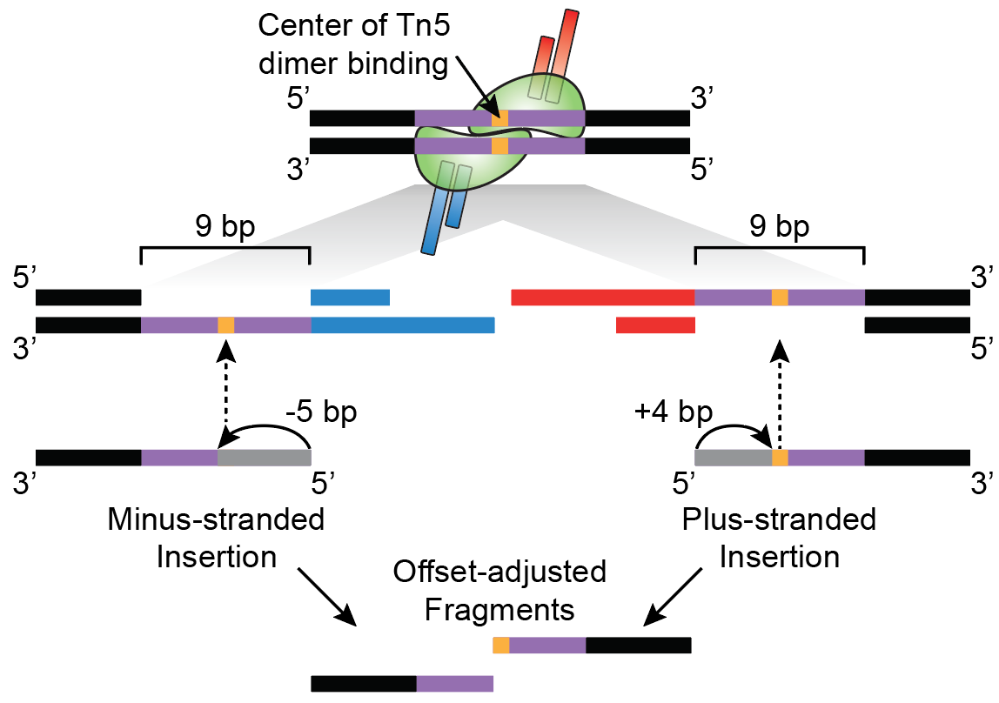
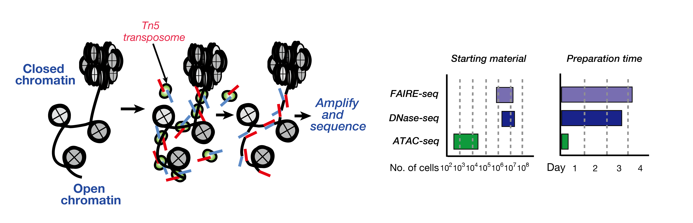
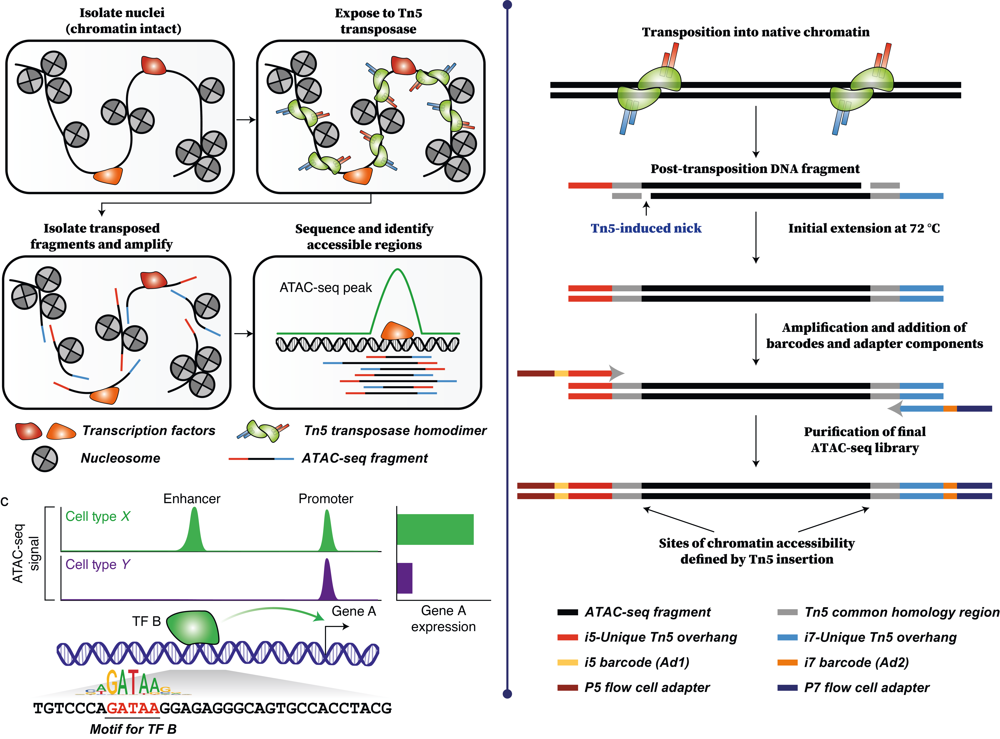
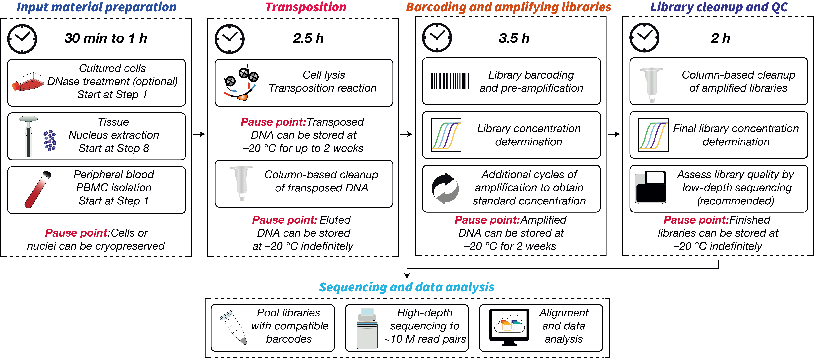
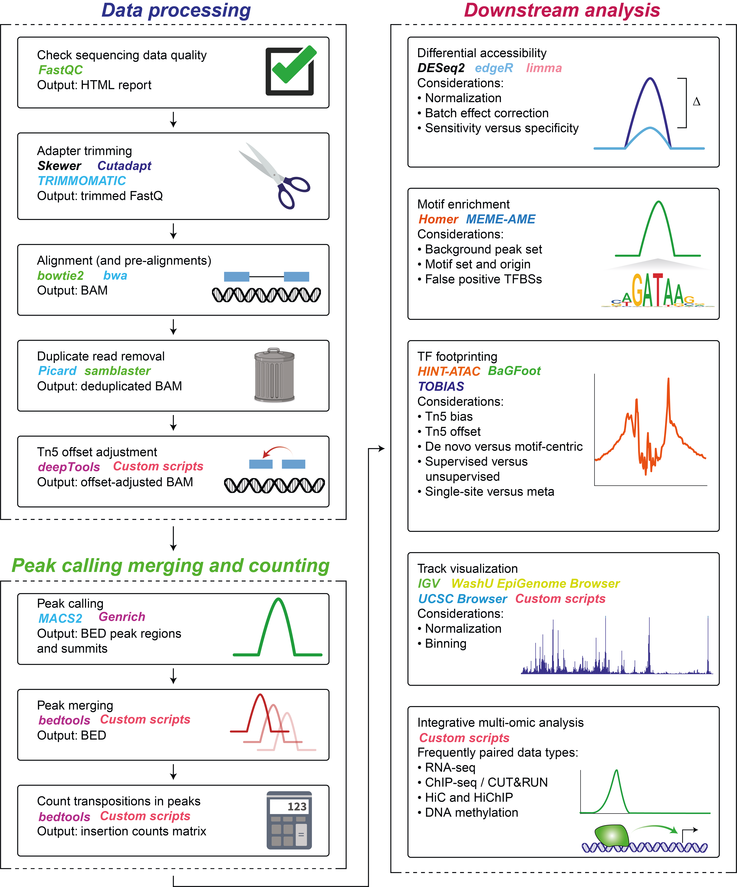
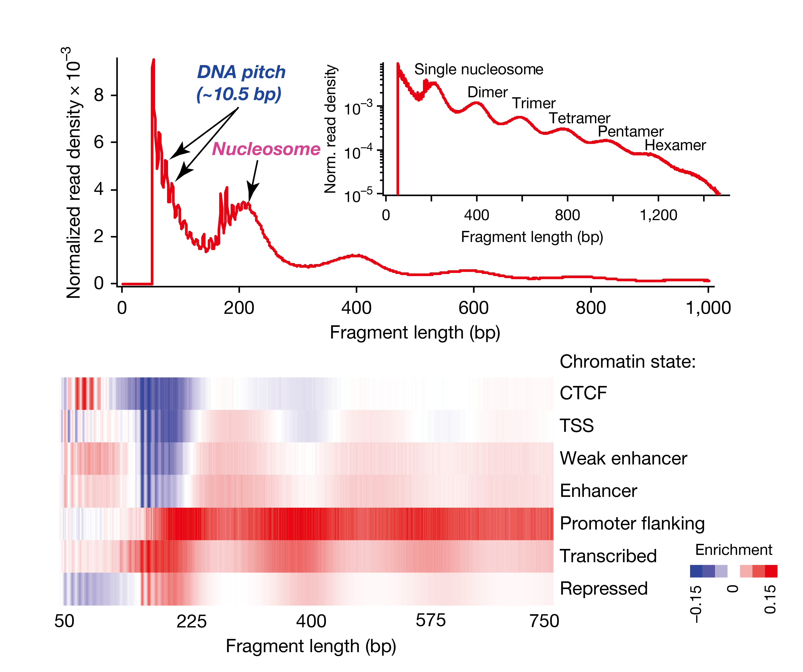
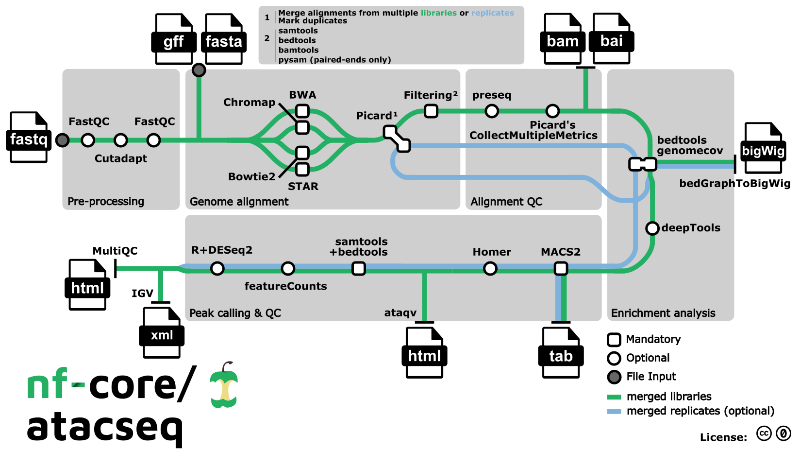

# ATAC-seq

## 目录

- [1 introduce](#1-introduce)
  - [1.1 ATAC-seq](#11-ATAC-seq)
  - [1.2 Tn5 transposase](#12-Tn5-transposase)
  - [1.3 ATAC-seq workflow ](#13-ATAC-seq-workflow-)
  - [1.4 Data analysis](#14-Data-analysis)
    - [1.4.1 Upsteam analysis](#141-Upsteam-analysis)
  - [1.5 ATAC-Seq Coverage](#15-ATAC-Seq-Coverage)
- [2 tutorial](#2-tutorial)
  - [2.1 Test data](#21-Test-data)
  - [2.2 ATAC-seq analysis pipeline](#22-ATAC-seq-analysis-pipeline)
  - [2.3 Pre-alignment quality control](#23-Pre-alignment-quality-control)
  - [2.4 Alignment](#24-Alignment)
  - [2.5 Post-alignment processing and quality control](#25-Post-alignment-processing-and-quality-control)
    - [2.5.1 Filtering](#251-Filtering)
    - [2.5.2 Insert Size](#252-Insert-Size)
      - [2.5.2.1 Insert Size periodicity](#2521-Insert-Size-periodicity)
      - [2.5.2.2 Insert Size  & gene element](#2522-Insert-Size---gene-element)
    - [2.5.3 TSS ](#253-TSS-)
  - [2.6 Core analysis: peak calling](#26-Core-analysis-peak-calling)
  - [2.7 Advanced analysis](#27-Advanced-analysis)
    - [2.7.1 Peak differential analysis](#271-Peak-differential-analysis)
    - [2.7.2 Peak annotation](#272-Peak-annotation)
    - [2.7.3 Motif database and scan Motif](#273-Motif-database-and-scan-Motif)
    - [2.7.4 Motif enrichment and activity analysis](#274-Motif-enrichment-and-activity-analysis)
    - [2.7.5 De novo tools](#275-De-novo-tools)
    - [2.7.6 Motif-centric tools](#276-Motif-centric-tools)
    - [2.7.7 Nucleosome positionin](#277-Nucleosome-positionin)
  - [2.8 Integration with multiomics data to reconstruct regulatory networks](#28-Integration-with-multiomics-data-to-reconstruct-regulatory-networks)
  - [2.9 Pipeline](#29-Pipeline)
- [3 source](#3-source)
- [4 reference](#4-reference)

***

***Author***\*\* : zhang jian\*\*​

***Date***\*\* : 2025-8-15\*\*​

***Version***\*\* : 1.0v\*\*​

***

ataqv: ATAC-seq QC and visualization[^1]

[Chromatin accessibility profiling by ATAC-seq.pdf](<file/Chromatin accessibility profiling by ATAC-seq_D1Xn.pdf> "Chromatin accessibility profiling by ATAC-seq.pdf")

> 🫏**Tn5 Shift :**
>
> 
>
> `Tn5 shift` : 当使用 `Tn5` 转座酶进行 `ATAC-seq` 建库时，`Tn5` 转座酶二聚体会与开放的染色质区域结合并切割 `DNA`。由于转座酶二聚体的两个催化位点在空间上相隔，它会在目标 `DNA` 双链上产生一个 `9 bp` 的交错切割（`staggered cut`）。在随后的末端修复和扩增过程中，这会导致插入位点产生`9 bp` 的序列复制（此处以紫色和金色表示）。因此，下机的原始数据中 `read` 的起始坐标并不能精确代表 `Tn5` 结合（即染色质真正开放）的中心位置。为了获得最准确的染色质开放中心，必须对每条 read 的比对坐标进行偏移调整，以消除这 `9 bp` 序列复制带来的偏差。具体操作标准为：比对到正链上的 `read` 片段需要延伸（坐标增加）`4 bp`；比对到负链上的 read 片段需要缩减（坐标减少）`5 bp`[^2]。

## 1 introduce

### 1.1 ATAC-seq

ATAC-seq（Assay for Transposase-Accessible Chromatin using sequencing）

> 进行ATAC-Seq时，基因组DNA会暴露在**高活性转座酶Tn5**中。Tn5会优先插入到开放染色质位点，使DNA片段化，并同时添加测序引物（该过程名为转座酶片段化）。测序的DNA即代表开放的染色质，我们即可通过数据分析深入了解基因调控[^3]。



[ATAC-seq-library.pdf](file/ATAC-seq-library_IWIcEwhsuN.pdf "ATAC-seq-library.pdf")

The hyperactivity of Tn5 transposase makes the ATAC-seq protocol a simple, time-efficient method that requires 500–50,000 cells. The sensitivity and specificity are comparable to DNase-seq but superior to FAIRE-seq where both methods require millions of cells as input material[^4].

> ATAC-seq 测序依赖于经过改造 & 并且链接有建库接头的Tn5转座酶，其可以高效的对基因组中的染色体开放区域进行切割 & 建库。同时其与其他染色体开放测序相比具有细胞需求 & 建库时间优势!&#x20;

[ATAC-SEQ.pdf](file/ATAC-SEQ_lytlsHKBI3.pdf "ATAC-SEQ.pdf")



Because ATAC-seq does not involve rigorous size selection during library preparation, it can also identify nucleosome positions using fragments representing nucleosome monomer and multi-mers[^5].

> ATAC-seq 建库中不存在严格的长度筛选，因此可以通过对检测到的片段的长度(insert size)来对单核小体与多核小体进行区分。

### 1.2 Tn5 transposase

[Tn5 transposase](https://www.wolai.com/6hxJRhyW8Egc8fY1wtSCHP "Tn5 transposase")

### 1.3 ATAC-seq workflow&#x20;

The ATAC-seq workflow has five main steps: sample preparation, transposition, library preparation, sequencing, and data analysis.

1. \*\*sample preparation \*\*:
2. \*\*transposition \*\*:
3. **library preparation** :
4. **sequencing** :
5. **data analysis** :



[building-library.pdf](file/building-library_qDXJ-SE98N.pdf "building-library.pdf")

### 1.4 Data analysis

#### 1.4.1 Upsteam analysis


(1) pre-analysis (quality control (QC) and alignment), (2) core analysis (peak calling)

> ATAC-seq 数据分析
>
> [ATAC-seq upsteam-analysis.pdf](<file/ATAC-seq upsteam-analysis_BL8NUSbvJL.pdf> "ATAC-seq upsteam-analysis.pdf")


(3) advanced analysis at the level of peaks, motifs, nucleosomes, and TF footprints

>

&#x20;(4) integration with multiomics data to reconstruct regulatory networks.

>

[downsteam-analysis.pdf](file/downsteam-analysis_xnComJZQ4x.pdf "downsteam-analysis.pdf")

[ATAC-analysis.pdf](file/ATAC-analysis_E01C5eeyzq.pdf "ATAC-analysis.pdf")

### 1.5 ATAC-Seq Coverage

| **研究目标**            | **推荐的测序深度**           |
| ------------------- | --------------------- |
| 鉴别人类样本的开放染色质差异      | ≥ 50M的双端read          |
| 进行转录因子足迹分析来构建基因调控网络 | > 200M的双端read         |
| 单细胞分析               | 每个细胞核/细胞25–50 K双端read |

***

## 2 tutorial

### 2.1 Test data

> 可以使用[EMBL-EBI Download ](https://www.wolai.com/4HFzXFqK83v5yzwE9rri4X "EMBL-EBI Download ") `EBIDownload.py` 脚本下载PRJNA521351 测试数据！
>
> ```python 
> nohup EBIDownload.py -A PRJNA521351 -p 5 -m False -o ./PRJNA521351 &
> ```
>

### 2.2 ATAC-seq analysis pipeline



### 2.3 Pre-alignment quality control

### 2.4 Alignment

### 2.5 Post-alignment processing and quality control

#### 2.5.1 Filtering

```r 
 # remove mitochondrial reads and low-quality alignments
 samtools view -h -q 30 ${i}.sorted.bam \
  | grep -v chrM \
  | samtools sort -o ${i}.rmchrM.bam
```


```r 
 # remove duplicates
 sambamba markdup --remove-duplicates --nthreads 10 ${i}.rmchrM.bam ${i}.rmDup.bam
```


```r 
# 
remove ENCODE blacklist regions
 bedtools intersect -nonamecheck -v -abam ${i}.rmDup.bam \
      -b hg19-blacklist.v2.bed > ${i}.tmp.bam
```


#### 2.5.2 Insert Size

##### 2.5.2.1 Insert Size periodicity



High quality ATAC-seq data will coincide with a low percentage of mitochondrial reads, and a distribution of insert sizes that depicts a five to six nucleosomal array along with ten bp periodicity of insert sizes[^4].

> 高质量的ATAC-seq  其insert size metric plots 会存在对个核小体峰 & 并且插入片段存在10bp周期性！
>
> [nuclesome.pdf](file/nuclesome_qT7ajGF73N.pdf "nuclesome.pdf")
>
> **10nt的周期性** ： DNA 的螺距

A good indication of the quality of the ATAC-seq data is given by the profile of insert sizes.

1. Typical insert size of 50-300 bp.
   > ATAC-seq插入片段的范围在50-300bp之间；
2. The first peak of 50 basepairs correspond to nucleosome-free regions.
   > Insert Size 图中50bp的peak与核小体开放区域相关；
3. The second peak that is a bit less than 200 basepairs corresponds to a single nucleosome.
   > Insert Size 图中200bp的peak与单核小体相关；
4. We expect to see a high peak centered around 50bp which corresponds to nucleosome-free fragments and a second bump around 200bp corresponding to fragments exactly around a nucleosome.
   > Insert Size 图中主要存在两个峰 50bp  & 200bp
5. The third one (around 400bp) is where Tn5 inserted around two adjacent nucleosomes and the fourth one (around 600bp) is where Tn5 inserted around three adjacent nucleosomes.
   > 人类染色质测序片段的插入片段大小分布具有大约 200 个碱基对的明显周期性，表明许多片段受到整数倍核小体的保护。

##### 2.5.2.2 Insert Size  & gene element

CTCF-bound regions are enriched for short fragments of DNA, while transcription start sites are differentially depleted for mono-, di- and tri-nucleosome associated fragments. Transcribed and promoter flanking regions are enriched for longer multi-nucleosomal fragments, suggesting they may represent more compacted forms of chromatin. Finally, prior studies have shown that certain DNA sequences are refractory to nuclease digestion and released as large, multi-nucleosome-sized fragments.

> CTCF[^注释1] 结合区域富集到了ATAC-seq数据的短Insert Size区域 （因为转录因子发挥作用于需要与染色质开放区域结合）；

> 转录起始位点存在与单、二和三核小体相关片段区域；

> 转录和启动子侧翼区域富含较长的多核小体片段区域；

#### 2.5.3 TSS&#x20;

### 2.6 Core analysis: peak calling

### 2.7 Advanced analysis

Because by its nature ATAC-seq reveals multiple aspects of transcriptional regulation, the third major step involves interpretation at four different levels: **peak**, **motif**, **nucleosome**, and **TF footprint**. However, only a few tools are designed specifically for ATAC-seq.

#### 2.7.1 Peak differential analysis

#### 2.7.2 Peak annotation

#### 2.7.3 Motif database and scan Motif

#### 2.7.4 Motif enrichment and activity analysis

#### 2.7.5 De novo tools

#### 2.7.6 Motif-centric tools

#### 2.7.7 Nucleosome positionin

### 2.8 Integration with multiomics data to reconstruct regulatory networks

### 2.9 Pipeline

**nf-core/atacseq** is a bioinformatics analysis pipeline used for ATAC-seq data[^6].

[ atacseq: Introduction ATAC-seq peak-calling and QC analysis pipeline https://nf-co.re/atacseq/2.1.2/](https://nf-co.re/atacseq/2.1.2/ " atacseq: Introduction ATAC-seq peak-calling and QC analysis pipeline https://nf-co.re/atacseq/2.1.2/")



***

## 3 source

[Chromatin accessibility profiling by ATAC-seq.pdf](<file/Chromatin accessibility profiling by ATAC-seq_-L1C.pdf> "Chromatin accessibility profiling by ATAC-seq.pdf")

[Chromatin Accessibility Profiling and Data Analysis using ATAC-seq in Nothobranchius furzeri.pdf](<file/Chromatin Accessibility Profiling and Data Analysi.pdf> "Chromatin Accessibility Profiling and Data Analysis using ATAC-seq in Nothobranchius furzeri.pdf")

[Transposition of native chromatin for fast and sensitive epigenomic profiling of open chromatin, DNA-binding proteins and nucleosome position.pdf](<file/Transposition of native chromatin for fast and sen.pdf> "Transposition of native chromatin for fast and sensitive epigenomic profiling of open chromatin, DNA-binding proteins and nucleosome position.pdf")

***

## 4 reference

[downsteam-analysis.pdf](file/downsteam-analysis_xnComJZQ4x.pdf "downsteam-analysis.pdf")

Motif enrichment and activity analysis

[ATACSeq Pipeline.pdf](<file/ATACSeq Pipeline_93Woz7CDR_.pdf> "ATACSeq Pipeline.pdf")


[^1]: [https://github.com/ParkerLab/ataqv](https://github.com/ParkerLab/ataqv "https://github.com/ParkerLab/ataqv")

[^2]: Grandi, Fiorella C., et al. "Chromatin accessibility profiling by ATAC-seq." Nature protocols 17.6 (2022): 1518-1552.

[^3]: [https://www.illumina.com.cn/techniques/multiomics/epigenetics/atac-seq-chromatin-accessibility.html](https://www.illumina.com.cn/techniques/multiomics/epigenetics/atac-seq-chromatin-accessibility.html "https://www.illumina.com.cn/techniques/multiomics/epigenetics/atac-seq-chromatin-accessibility.html")

[^4]: Transposition of native chromatin for multimodal regulatory analysis and personal epigenomics

[^5]: From reads to insight: a hitchhiker’s guide to ATAC-seq data analysis

[^注释1]: 转录阻抑物CTCF，也被称为11锌指蛋白或CCCTC结合因子，是由人类CTCF基因编码的转录因子。CTCF参与多个细胞进程，包括转录调控、绝缘子活性调控、V(D)J重组、染色质结构调控等。

[^6]: [https://github.com/nf-core/atacseq](https://github.com/nf-core/atacseq "https://github.com/nf-core/atacseq")
