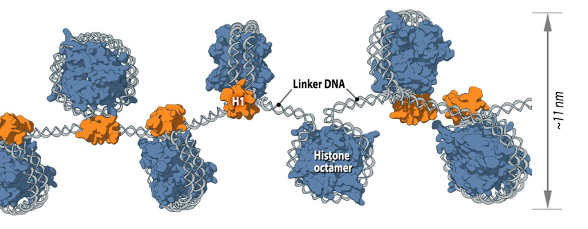
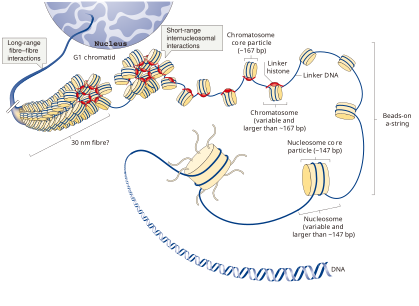
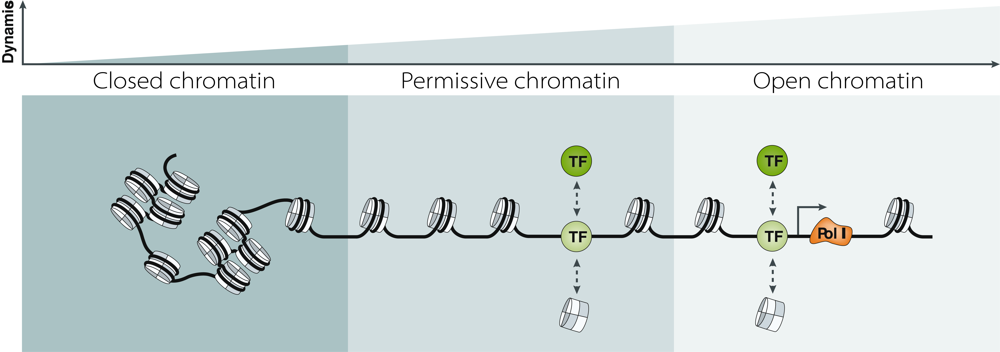
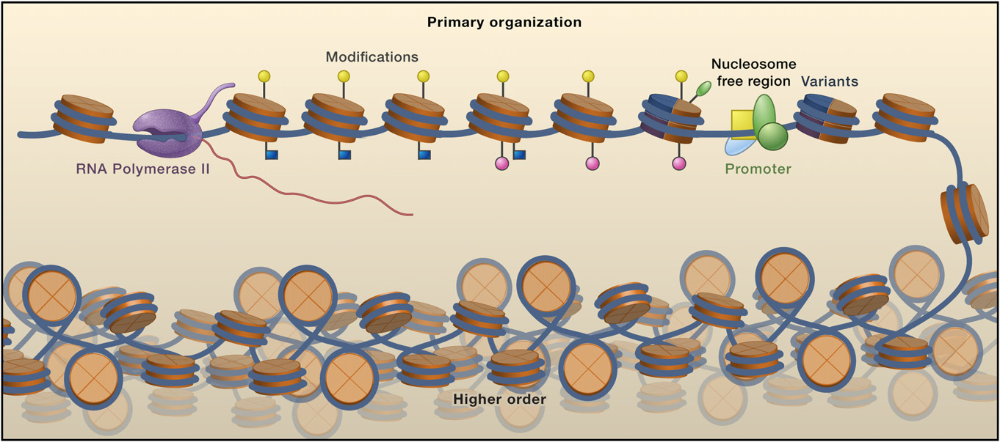
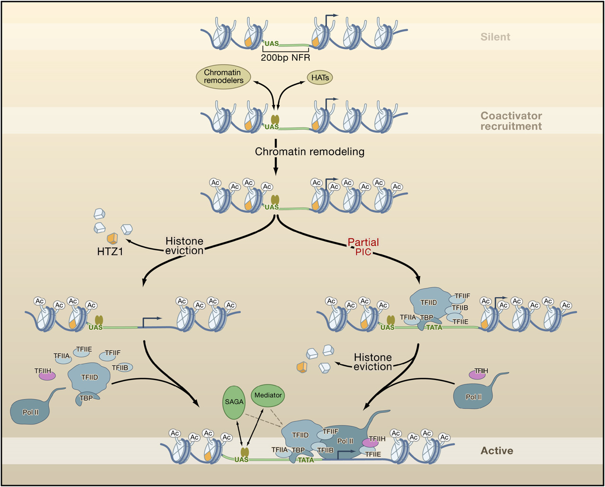
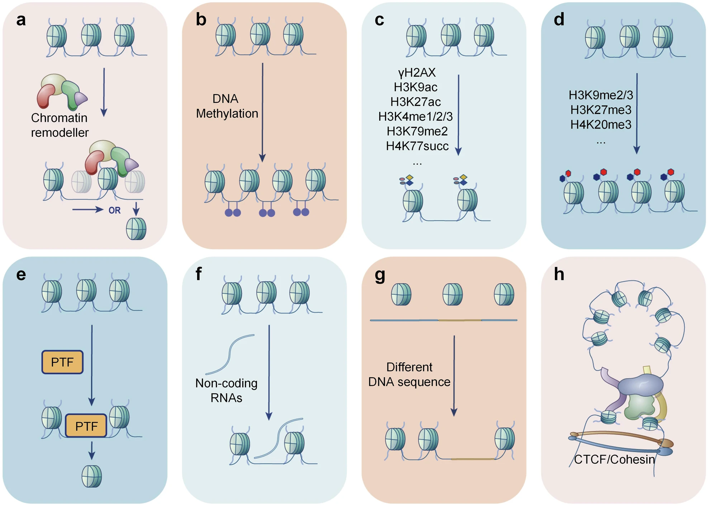
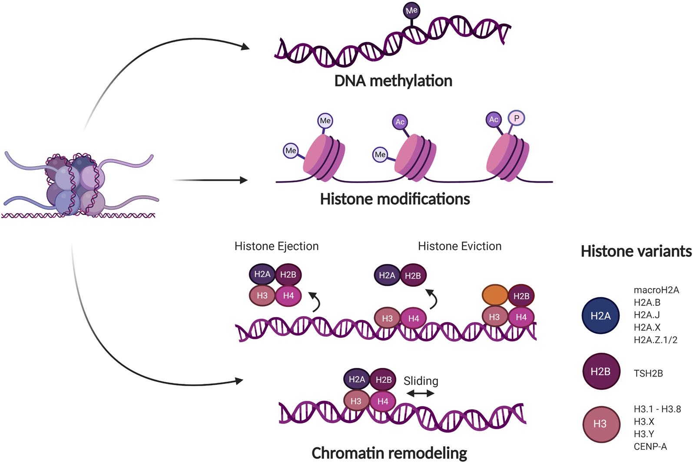

# Chromatin Accessibility

## 目录

- [1 Introduce](#1-Introduce)
  - [1.1 Nucleosome](#11-Nucleosome)
  - [Nucleosome Occupancy & Chromatin Accessibility](#Nucleosome-Occupancy--Chromatin-Accessibility)
  - [1.3 Accessible Chromatin & TF](#13-Accessible-Chromatin--TF)
    - [Pioneer Factor Action](#Pioneer-Factor-Action)
  - [1.4 Regulation of chromatin accessibility](#14-Regulation-of-chromatin-accessibility)
  - [1.5  Methods for Chromatin Accessibility Assays](#15--Methods-for-Chromatin-Accessibility-Assays)
  - [1.6 Chromatin Accessibility analysis](#16-Chromatin-Accessibility-analysis)
- [2 tutorial](#2-tutorial)
  - [2.1 ATAC-seq](#21-ATAC-seq)
    - [2.1.1 scATA-seq](#211-scATA-seq)
- [3 Source](#3-Source)
- [4 Reference](#4-Reference)

***

***Author***\*\* : zhang jian\*\*​

***Date***\*\* : 2025-8-25\*\*​

***Version***\*\* : \*\***`1.0.1v`**

***

## 1 Introduce

### 1.1 Nucleosome

核小体(`Nucleosome` )是由一段约`147bp` `DNA`( ps : 不同的文章中提到的该`DNA`长度在`146-147bp`范围)以及其所缠绕在由**八个组蛋白 (****`histone protein`****)组成的核心上，形态上就像线缠绕在线轴上一样。核小体是**染色质 (`chromatin`) 的基本组成单位[^1]。

除了缠绕核小体的`DNA`外,相邻的核小体还是通过约`38-53 bp`的双链`linker DNA`与核小体`H1`组蛋白结合实现相邻核小体的连接[^2]。

由 `linker DNA` 连接的核小体（`Nucleosome`）在电镜下形成了基础的 \*\*“串珠结构” (****`Beads-on-a-string`****)**。接下来，这条“串珠”链会进一步折叠。经典的理论模型认为它会通过核小体间的短程相互作用(**`Short-range internucleosomal interactions`\*\*)，螺旋化形成直径约 `30 nm`的纤维（`30 nm fibre`）。然而，需要指出的是，这种规整、连续的 `30 nm`纤维结构在活细胞（`in vivo`）内是否存在仍有争议，它可能只在染色质的局部短片段上存在。

在更高层次上，染色质纤维会通过长程相互作用(`Long-range fibre–fibre interactions`)，折叠成一系列被称为 \*\*“拓扑关联结构域” (****`Topologically Associating Domains`****, ****`TADs`****)**的高级结构。`TAD` 是染色质上的一段连续区域，其内部的 `DNA` 序列相互作用的频率远高于与其他区域的相互作用频率。可以将一个 `TAD` 理解为一个相对独立的“邻里”，内部的基因和调控元件倾向于在内部交流，而较少与外部的“邻里”沟通。这些 `TAD` 环状结构的形成，并非依赖于一个连续的“骨架”，而是被认为是染色质纤维在空间上形成环，并由特定的**建筑蛋白（****`architectural proteins`****）**，如**`CTCF`**和**黏连蛋白 (****`Cohesin`****)\*\* 复合体，锚定在其边界处而形成的。

最终，这种以 `TAD` 为基本单元的结构，经过进一步的折叠和区室化（`compartmentalization`），构成了存在于**间期细胞核**中的复杂三维结构。而在细胞进行分裂时，染色质会在此基础上进行更高层级的螺旋化和压缩，最终形成我们在显微镜下能够看到的、高度致密的**中期染色体（****`metaphase chromosome`****）**。

### **Nucleosome Occupancy** & Chromatin Accessibility

根据上面的描述可能会认为由DNA + 核小体 + 骨架蛋白构成的染色质是高度稳定滴。其实在整个基因组范围内，**核小体**和**连接组蛋白**的密度是动态变化的，由此形成了一个从**关闭的染色质**(`closed chromatin`) 到高度动态、易于访问的**开放性染色质**(`permissive chromatin`) 的**可及性连续谱**。这种染色质可及性的整体图景，广泛地反映了基因组的调控潜能(`regulatory capacity`) ,而不仅仅是一种静态的生物物理状态,并且是决定染色质组织结构与功能的关键因素[^3]。

在基因组中，核小体结构致密的区域会形成**关闭的染色质 (****`closed chromatin`****)**。在这种状态下，与基因表达相关的结构区域（如启动子、增强子）是相对封闭的，这不利于转录因子（`TF`）等调控元件与之结合，从而抑制基因表达或导致基因沉默。与这种完全关闭的状态相对的是**开放性或允许性染色质 (****`permissive chromatin`****)**。这种染色质状态的关键特征是其高度的动态性，它已经足够灵活，能够允许一部分转录因子前来识别并结合到特定的 `DNA` 序列上。一旦这些转录因子结合，它们就能主动发起一次“可及性重塑” (`accessibility remodelling`)**，将周围的染色质真正地打开，最终在该基因位点建立一个稳定的**开放染色质构象 (`open chromatin conformation`)。在这个被完全打开的区域，启动子和增强子等关键调控元件便能充分暴露，从而允许`RNA`聚合酶`II`（`Pol II`）及其他更多的调控蛋白复合体相互接近并结合，进而高效、精确地调控基因表达[^3]。

染色质的开放是所有以\*\*`DNA`为模板的生物学过程 \*\*（例如转录）的基础。然而，在细胞内，基因组仅有部分区域是开放且可供细胞**转录机器**访问的，而大部分区域则被紧密包装成**染色质**并处于关闭状态[^4]。在真实的基因组中染色质的开放与关闭状态并非一成不变，而是**高度动态(`dynamic`**)滴。这些动态变化定义了细胞在重要生物学过程中的**发展轨迹**，例如在祖细胞分化为特定细胞类型时，或是在启动免疫应答过程中的**细胞命运决定**。

> ♻️在不同环境、不同时间和不同组织中，由核小体构成的染色质结构会发生动态变化，这些变化决定或调节了染色质的可及性状态(`Accessible Chromatin`)。
>
> **`closed chromatin`**\*\* → ****`permissive chromatin`**** → \*\***`open chromatin`**

### `1.3 Accessible Chromatin` & `TF`

在真核生物中**转录激活**是与**转录因子**（`TF`）结合到基因调控元件上所引发的**核小体排布扰动**密切相关。这些调控元件包括**启动子 (****`promoters`****)**、**增强子 (****`enhancers`****)**、**沉默子 (****`silencers`****)**、**绝缘子 (****`insulators`****)以及**基因座控制区 (`locus control regions`)[^4]。

`Bing Li`等人的文章中提到，转录因子的结合位点并非随机分布，细胞倾向于将这些位点设置在本身就具有一定可及性的区域内。在基因的启动子区域，核小体密度通常较低[^5]。特别是在酵母中，启动子区域普遍存在一个约`200 bp`的区域中[^6]。由于该区域两侧则排列着定位清晰的核小体，因此也被存在**核小体稀疏区（Nucleosome-Free Region, NFR）**

这个`NFR`就如同一个预先开放的“登陆平台”，为转录因子（图中被称为激活蛋白，结合在`UAS`序列上）提供了初始的结合入口 。

> 🥾一旦转录因子成功“登陆”，它便会启动一系列事件，主动地改变周围的染色质环境，极大地增强可及性。
>
> 1. **招募共激活因子 (****`Coactivator Recruitment`****)**：结合在启动子上的转录因子会触发一系列共激活因子的招募。这些共激活因子主要包括**染色质重塑复合物（****`Chromatin remodelers`****）和**组蛋白修饰酶（如组蛋白乙酰转移酶`HATs`）。
> 2. **改变染色质结构 (****`Chromatin Remodeling`****)**：
>    - **组蛋白乙酰化**（**`Acetylation`**）：`HATs`复合物（如`SAGA`）被招募后，会使启动子附近的组蛋白发生乙酰化。乙酰化可以中和组蛋白的正电荷，减弱其与`DNA`的结合，使核小体结构变得松散，更容易被移动或移除。
>    - **核小体移动或重塑**：染色质重塑复合物（如`Swi/Snf`）利用`ATP`水解的能量来改变组蛋白与`DNA`的接触，可以实现核小体的滑动或解旋，从而暴露更多的`DNA`序列给其他因子。
> 3. **移除核小体 (****`Histone Eviction`****)**：
>    - 为了给庞大的转录起始复合物（PIC）腾出空间，最彻底的增强可及性的方式是直接将关键位置的核小体移除掉。核小体的移除为通用转录因子（GTFs）和RNA聚合酶II（Pol II）的结合暴露了包括TATA盒在内的核心启动子区域。

> **Tips** : 结合TF起始的转录调控，很明显的可以得知，核小体在整个基因组范围内的**定位排布**(不同染色体区域的排布密度)具有重要的调控功能。它通过改变**转录因子（TFs）和**通用转录机器在生物体内（in vivo）对结合位点的**可及性（availability）**，进而影响一系列**DNA 依赖的过程**，例如**转录、DNA修复、复制和重组**[^7]。&#x20;

> \*\*Tips **: 对于人类基因组来说，可及性基因组 (The accessible genome) 虽然仅占总 DNA 序列的约 2-3%，但它却包含了超过 90% 的**转录因子（TFs）\*\*结合区域[^8]。

#### **Pioneer Factor Action**

由`Nucleosome`构成的致密染色体结构会阻碍转录因子与特定基因区域的结合，从而影响转录调控。另一方面这种染色质结构本质上具有抑制性，这有助于稳定基因表达状态并防止无定向的细胞命运转变[^9]。

> 🕜**为了解释到底是何种机制来驱动致密的染色质中基因表达的，现阶段主要存在一下几种模型：**
>
> 1. **DNA复制窗口模型 (Replication-Coupled Access)**[^10][^11][^12][^13]
>    - **模型核心**🤔:  **Replication-Coupled Access**模型认为，在**DNA复制** 的过程中，DNA会短暂地脱离核小体（nucleosome-free），从而为转录因子提供一个结合上去的“机会窗口”。
>    - **存在的问题** :
>      1. **时间太短**: DNA复制后，染色质的组装几乎是瞬间完成的，留给转录因子稳定结合的时间非常少。
>      2. **事实不符**: 许多重要的生命过程，如早期胚胎发育和细胞命运重编程，可以在**没有细胞分裂和DNA复制**的情况下发生。这说明复制不是激活基因的必要条件。
> 2. **组蛋白动态交换模型 (Dynamic Histone Exchange)**[^14][^15]
>    - **模型核心** 🤔:  该模型认为，组蛋白自身是动态的，它们可能会自发地从DNA上“掉下来”再结合回去，在这个短暂的空隙中，转录因子就可以乘虚而入。
>    - **存在的问题** :
>      1. **组蛋白很稳定**: 活细胞实验表明，核心组蛋白的交换频率非常低，它们在DNA上相当稳定。
>      2. **与事实相反**: 研究发现，那些包含大量转录因子结合位点的DNA区域（也就是调控序列），实际上会**稳定**核小体，而不是让它们变得不稳定。（具有较高稳定性的区域更容易与转录因子结合哟[^14]）
> 3. **ATP依赖性重塑酶巡逻模型 (Remodeler Surveillance)**[^16][^17]
>    - **模型核心**🤔:  这个模型提出，存在一些**ATP依赖性的核小体重塑酶**，它们会像巡警一样不断地在整个基因组中巡逻，通过消耗ATP来随机“撬松”核小体，让转录因子有机会来结合。
>    - **存在的问题** :
>      1. **因果倒置**: 这些重塑酶似乎主要集中在特定的调控序列上，并且通常是**被转录因子招募**过去的，而不是它们主动去为转录因子开路。
>      2. **代价高昂**: 重塑酶复合物体积庞大，且每移动一个碱基对就要消耗一个ATP，让它们在整个基因组进行无差别巡逻的**能量成本太高**了。
> 4. **先锋转录因子模型 (Pioneer Factor Action)**[^18][^19][^20][^21][^22]
>    - **模型核心 (目前最受青睐)**✅:  先锋因子与普通转录因子最大的不同在于，它们有能力**直接识别并结合**那些**已经被包裹在核小体上**的DNA位点。即使染色质被接头组蛋白（linker histone）进一步压缩，它们也依然能结合上去。
>    - **结论**:  先锋因子是激活沉默基因的“**第一响应者**”。它们可以率先突破染色质的第一道防线（核小体），为后续其他普通转录因子和调控蛋白的进入“打开大门”。不过，文段也提到，更高层级的染色质压缩仍然可能阻碍先锋因子的功能。

> 🕜\*\*`pioneer transcription factors`(****`PTFs`****，先驱因子)\*\*
>
> 在核小体形成致密的关闭的染色质 (`closed chromatin`)状态时，大部分转录因子是不能与染色质进行结合滴，这时一类被称作`pioneer transcription factors` (`PTFs`，先驱因子)的转录因子能够结合其他类型转录因子无法接近的紧密染色质，建立基因表达，并引发细胞重编程。`PTF` 还能使其他转录因子、组蛋白修饰剂和核小体重塑复合物改变染色质状态，并促进沉默基因的基因表达[^23]。PTFs的该种作用也是胚胎发育、细胞分化和重编程中作为主调控因子发挥作用的基础[^24]。
>
> 
>
> | !\[  ]\(image/PTC \_-BHoo0Kkrk.png "  ") | **（上图）** 在沉默的染色质中，先锋因子能够扫描包裹在核小体上的DNA，以寻找它们的目标位点。 **（中图）**  在目标位点上增加的驻留时间，使得（先锋因子）能够与其他因子发生协同相互作用，从而实现更稳定的结合。 **（下图）**  先锋因子的结合可能导致两种结果：一种是（图左所示）序列被激活，呈现出开放染色质的特征（绿色旗帜标记），并进入一种有潜能被表达的状态或直接引导转录活动；另一种是（图右所示）序列被抑制，呈现出关闭染色质的特征（红色旗帜标记） |
> | ---------------------------------------- | -------------------------------------------------------------------------------------------------------------------------------------------------------------------------------------------------------------------------------------- |
>
> 最新的冷冻电镜结果表明,**`PTFs`** **`OCT4`** 与暴露在外的核小体`DNA`结合后，会诱导核小体结构发生变化，重新定位核小体 `DNA`，并促进额外的 `OCT4` 和 `SOX2` 协同结合到它们的内部结合位点。`OCT4` 灵活的激活结构域与组蛋白 H4 的 N 端尾巴接触，改变其构象，从而促进染色质解压缩。 此外，OCT4 的 DNA 结合结构域与组蛋白 H3 的 N 端尾部相互作用，H3K27 处的翻译后修饰调节 DNA 定位并影响转录因子协同作用[^25]。
>
> | !\[]\(image/OCT4\_7N8IA-H4kO.svg) | !\[  ]\(image/image\_HQUzNmet4g.png "  ") |
> | --------------------------------- | ----------------------------------------- |

### 1.4 Regulation of chromatin accessibility

> 📦**染色质的可及性由核小体分布、组蛋白修饰、****`DNA`**** 甲基化、非组蛋白占据、非编码 ****`RNA`****、染色质三维结构等决定**[^26]**。**
>
> 1. **ATP-dependent chromatin remodeling complexes (ATP 依赖的染色质重塑复合物)**
>
>    ATP 依赖染色质重塑复合物是核小体移动的主要调节因子。它们可以通过水解 `ATP` 作为能量来切换染色质的“关闭”或“开放”状态。
> 2. **DNA methylation（DNA甲基化)**
>
>    DNA 甲基化由甲基转移酶和去甲基化酶动态调控,当DNA序列受到甲基化修饰后，其可及性将会降低。
> 3. **Histone modification（组蛋白修饰）**
>
>    组蛋白是染色体的基本结构蛋白，富含碱性氨基酸（精氨酸和赖氨酸），这有助于其与酸性的`DNA`结合。到目前为止，已确认存在大量的组蛋白翻译后修饰（`PTMs`），例如磷酸化[^27]、甲基化[^27]、泛素化[^28]、乙酰化[^29]、 乳酸化[^30]和巴豆酰化[^31]，这些共同构成了组蛋白的翻译后修饰图景（`PTM landscapes of histones`）。
> 4. **Pioneer transcription factors**(先锋转录因子)
>
>    先锋转录因子（Pioneer transcription factors, PTFs）能够与关闭的染色质区域结合，并增强局部染色质的可及性，从而为其他组织特异性转录因子（TFs）的进入提供便利，以控制细胞的命运和功能[^32]。
> 5. **Non-coding RNAs**
>
>    非编码 RNA，包括微小 RNA（miRNA）、长链非编码 RNA（lncRNA）、环状非编码 RNA（circRNA）等，发挥着许多重要的生物学功能。研究证实，它们是染色质可及性的主要调节因子
> 6. **Cis-regulatory element (顺式调控元件)**
>
>    顺式调控元件由 DNA 结合蛋白（转录因子、共转录因子、转录抑制剂、转座酶等）特异性结合，是染色质可及性不可忽视的调节因子。
> 7. **The three-dimensional (3D) structure of chromatin (染色质的三维（3D）结构)**
>
>    染色质在细胞核中有序且动态地包裹着，其三维结构在调节染色质可及性方面发挥着重要作用
>
> 
>
> 

### 1.5  **Methods for Chromatin Accessibility Assays**

目前的**染色质可及性分析**（Chromatin accessibility assays）是通过**酶促或化学手段**来分割基因组，并分离出其中**可接触的（开放的）区域**或**被保护的区域**。然后，利用**下一代测序平台**对这些分离出的DNA进行定量分析[^33]。

- **`ATAC-seq`**

  ATAC-seq技术利用一种经过工程改造的高活性Tn5转座酶，该酶能够优先进入**染色质开放区域**，并在一步反应中**同时**完成对DNA的**切割**与测序**接头的连接**。最终，通过对这些被成功标记的DNA片段进行测序，即可精确地识别出全基因组范围内的染色质开放区域。ATAC-seq之所以被广泛采用，部分原因是它能够很好地识别可接近的染色质，而且简单、快速实施，并能应用于现实条件下有限的临床和原代组织样本。值得一提的是，10000-20000个细胞的ATAC-seq文库通常在2小时内完成，相比较而言，DNase-seq通常需要数百万个细胞的多天操作流程。（**快 & 要求的细胞数量较少**）。
- **`MNase-seq `**

  MNase-seq : 微球菌核酸酶(MNase)于20世纪60年代从金黄色葡萄球菌中分离出来，其既可以作为内切酶来切割核小体连接区的DNA，也可以作为外切酶来降解不受蛋白质保护的切割产物DNA。它优先消化核小体之间裸露的DNA，从染色质中释放核小体，并富集受核小体保护的DNA片段。由于核小体DNA被MNase切割的效率低于核小体间的DNA，因此该酶成为分离单个核小体DNA的理想酶。随着基因组技术的兴起，MNase消化与下一代测序技术相结合(MNase-seq)，在全基因组范围内确定核小体的位置和占有率，从而间接反应出染色质的可及性区域。
- **`DNase-seq`**

  DNase-seq : DNase I是一种核酸内切酶，可以对单链或双链DNA进行非特异性的消化和切割，将其切割成长短不一的片段。如果DNA上面有蛋白质结合，蛋白质覆盖的序列就不能被DNase I切割。正是因为这个特点，通过确定DNase I消化后留下的DNA片段，就能够获得开放染色质的信息。
- **`NOMe-seq`**

  NOMe-seq : 使用来自M.CviPI的GpC甲基转移酶(MTase)，这种酶通过对可接近的DNA进行化学修饰而非切割的方式来检测染色质的可及性(图2d)。这种新的MTase在GC二核苷酸上产生异常的甲基化，与人类和小鼠基因组中常见的CG二核苷酸上的内源性甲基化区别开来。因此，NOMe-seq在高分辨率下可以同时检测DNA可及性和甲基化状态，因为GpC在整个基因组中频率很高。重要的是，NOMe-seq并不是一种富集方法，因此需要相对大量的测序reads来获得足够的深度来确定整个基因组的可及性水平[^34]。

### 1.6 Chromatin Accessibility analysis

> ⛄**Chromatin Accessibility analysis 分析一般是由4步组成：**
>
> 1. **数据预处理与比对 : Chromatin Accessibility分析的第一步与其他高通量测序类似，主要包括数据拆分、比对和过滤。**
>    - **数据拆分 (****`Demultiplexing`****):** 将混合测序的数据根据条形码（`barcode`）拆分到对应的样本。
>    - **比对 (****`Alignment`****):** 目标是将读段（`reads`）比对到参考基因组上，常用的工具有`BWA`或`Bowtie`。这一步是为了确定测序是否达到了所需的覆盖深度，并生成用于下游分析的`BAM`比对文件。
>    - **过滤 (****`Filtering`****):**
>      - **根据片段长度过滤：** 具体到`ATAC-seq`，由于`Tn5`转座酶的空间位阻效应，比对上的长度小于`38 bp`的片段会被移除。
>      - **根据来源过滤：** 比对到线粒体基因组的读段也应被丢弃，因为它们与细胞核的染色质研究无关（并且线粒体基因组没有核小体）
> 2. **质量控制、可视化与富集区域检测 : 完成初步处理后，需要评估数据质量，以判断实验是否成功。**
>    - **实验质控 (****`Assay QC`****):** 主要通过构建聚合图和数据可视化来评估。
>      - **TSS富集图 (****`TSS Plot`****):** 这是判断实验成功与否的重要标志。研究表明，在真核生物中，转录起始位点（`TSS`）通常是染色质开放的。因此，高质量的`ATAC-seq`数据在`TSS`区域会表现出信号的显著富集和增强（这与`MNase-seq`在`TSS`区域信号下降相反）。
>      > **插入片段分布图 (****`Insert Size Distribution`****):**
>      >
>      > 
>      >
>      > - **高质量的**\*\*`ATAC-seq`\*\***数据有两个典型特征：**
>      >   - 线粒体读段的比例很低(由于线粒体基因组不含有组蛋白，因此其不应该被`ATAC-seq`捕获到)
>      >   - 插入片段的大小分布会清晰地呈现出多个核小体（约五到六个）的阵列模式(`Array Pattern`)，并且存在`10 bp`的周期性。
>      >   - **CTCF位点(****`CCCTC-binding factor (CTCF)-bound regions`****)和TSSs(****`transcription start sites`****)**：非常开放，产生大量短片段。转录区和启动子侧翼：相对紧凑，产生更多长片段。
>    - **富集区域的检测 (Peak Calling):**
>
>      这一步是为了找出染色质的开放区域（即Peaks）。ATAC-seq的Peak calling可以使用ZINBA、MACS2或Hotspot等工具来完成，研究发现后两者在识别可及性位点方面的表现与ZINBA同样出色。
> 3. **核小体分析与转录因子足迹**
>
>    **ATAC-seq数据 → 信号校正（Shift）→ 足迹分析**。
>
>    在完成数据的质量控制（QC）和Peak-calling之后，分析便进入更深入的阶段，可以对核小体间距、核小体定位、核小体占据情况以及转录因子（TF）足迹进行分析。
>
>    其**转录因子足迹（Footprinting）分析**，一个关键的步骤是信号校正。由于Tn5转座酶自身的生物物理特性，它在切割DNA时会插入两个相隔9 bp的接头。这导致实际的酶切中心与测序读段（read）比对到的位置存在一个微小的偏差。因此，必须将切割位点信号在基因组的上游或下游**调整4到5个碱基对**，才能准确地进行足迹分析。
> 4. **数据注释与整合**
>
>    这是染色质可及性分析流程中**最后，也是信息量最大**的阶段。这一步的核心是对前面鉴定出的Peaks进行**功能注释（Annotation）**，并基于注释结果进行更广泛的整合分析。

***

## 2 tutorial

### 2.1 ATAC-seq

[ATAC-seq](https://www.wolai.com/rLSwPPwhhfnvg4DebBXcfg "ATAC-seq")

#### 2.1.1 scATA-seq

[scATAC-seq](https://www.wolai.com/gmHV5xrWMCeSMeBQC3Gzkx "scATAC-seq") ：scATAC-seq&#x20;

***

## 3 Source

[Chromatin Accessibility Profiling and Data Analysis using ATAC-seq in Nothobranchius furzeri.pdf](<file/Chromatin Accessibility Profiling and Data Analysi.pdf> " Chromatin Accessibility Profiling and Data Analysis using ATAC-seq in Nothobranchius furzeri.pdf")

***

## 4 Reference

[^1]: [https://en.wikipedia.org/wiki/Nucleosome](https://en.wikipedia.org/wiki/Nucleosome "https://en.wikipedia.org/wiki/Nucleosome")

[^2]: [https://en.wikipedia.org/wiki/Linker\_DNA](https://en.wikipedia.org/wiki/Linker_DNA "https://en.wikipedia.org/wiki/Linker_DNA")

[^3]: Klemm, S.L., Shipony, Z. & Greenleaf, W\.J. Chromatin accessibility and the regulatory epigenome. Nat Rev Genet 20, 207–220 (2019). [https://doi.org/10.1038/s41576-018-0089-8](https://doi.org/10.1038/s41576-018-0089-8 "https://doi.org/10.1038/s41576-018-0089-8")

[^4]: Tsompana, M., Buck, M.J. Chromatin accessibility: a window into the genome. Epigenetics & Chromatin 7, 33 (2014). [https://doi.org/10.1186/1756-8935-7-33](https://doi.org/10.1186/1756-8935-7-33 "https://doi.org/10.1186/1756-8935-7-33")

[^5]: Li B, Carey M, Workman J L. The role of chromatin during transcription\[J]. Cell, 2007, 128(4): 707-719.

[^6]: Raisner, R.M., Hartley, P.D., Meneghini, M.D., Bao, M.Z., Liu, C.L., Schreiber, S.L., Rando, O.J., and Madhani, H.D. (2005). Histone variant H2A.Z marks the 5 0 ends of both active and inactive genes in euchromatin. Cell 123, 233–248

[^7]: Radman-Livaja M, Rando OJ. Nucleosome positioning: how is it established, and why does it matter? Dev Biol. 2010 Mar 15;339(2):258-66. doi: 10.1016/j.ydbio.2009.06.012. Epub 2009 Jun 13. PMID: 19527704; PMCID: PMC2830277.

[^8]: Thurman, R., Rynes, E., Humbert, R. et al. The accessible chromatin landscape of the human genome. Nature 489, 75–82 (2012). [https://doi.org/10.1038/nature11232](https://doi.org/10.1038/nature11232 "https://doi.org/10.1038/nature11232")

[^9]: Zaret K S, Mango S E. Pioneer transcription factors, chromatin dynamics, and cell fate control\[J]. Current opinion in genetics & development, 2016, 37: 76-81.

[^10]: Di Tullio A, Graf T. C/EBP α bypasses cell cycle-dependency during immune cell transdifferentiation\[J]. Cell Cycle, 2012, 11(14): 2739-2746.

[^11]: Chiu C P, Blau H M. Reprogramming cell differentiation in the absence of DNA synthesis\[J]. Cell, 1984, 37(3): 879-887.

[^12]: Harris W A, Hartenstein V. Neuronal determination without cell division in Xenopus embryos\[J]. Neuron, 1991, 6(4): 499-515.

[^13]: Polo S E, Almouzni G. Chromatin assembly: a basic recipe with various flavours\[J]. Current opinion in genetics & development, 2006, 16(2): 104-111.

[^14]: Tillo D, Kaplan N, Moore I K, et al. High nucleosome occupancy is encoded at human regulatory sequences\[J]. PloS one, 2010, 5(2): e9129.

[^15]: Kimura H, Cook P R. Kinetics of core histones in living human cells: little exchange of H3 and H4 and some rapid exchange of H2B\[J]. The Journal of cell biology, 2001, 153(7): 1341-1354.

[^16]: Clapier C R, Cairns B R. The biology of chromatin remodeling complexes\[J]. Annual review of biochemistry, 2009, 78(1): 273-304.

[^17]: De la Serna I L, Ohkawa Y, Imbalzano A N. Chromatin remodelling in mammalian differentiation: lessons from ATP-dependent remodellers\[J]. Nature Reviews Genetics, 2006, 7(6): 461-473.

[^18]: Cirillo L A, Lin F R, Cuesta I, et al. Opening of compacted chromatin by early developmental transcription factors HNF3 (FoxA) and GATA-4\[J]. Molecular cell, 2002, 9(2): 279-289.

[^19]: Soufi A, Donahue G, Zaret K S. Facilitators and impediments of the pluripotency reprogramming factors' initial engagement with the genome\[J]. Cell, 2012, 151(5): 994-1004.

[^20]: Zaret K S. Pioneer transcription factors initiating gene network changes\[J]. Annual review of genetics, 2020, 54(1): 367-385.

[^21]: Cirillo L A, McPherson C E, Bossard P, et al. Binding of the winged‐helix transcription factor HNF3 to a linker histone site on the nucleosome\[J]. The EMBO journal, 1998.

[^22]: Ho L, Crabtree G R. Chromatin remodelling during development\[J]. Nature, 2010, 463(7280): 474-484.

[^23]: [https://www.cytoskeleton.com/regulation-of-chromatin-accessibility-in-cellular-reprogramming-pioneer-transcription-factors-epigen](https://www.cytoskeleton.com/regulation-of-chromatin-accessibility-in-cellular-reprogramming-pioneer-transcription-factors-epigen "https://www.cytoskeleton.com/regulation-of-chromatin-accessibility-in-cellular-reprogramming-pioneer-transcription-factors-epigen")

[^24]: Sinha K K, Bilokapic S, Du Y, et al. Histone modifications regulate pioneer transcription factor cooperativity\[J]. Nature, 2023, 619(7969): 378-384.

[^25]: Sinha, K.K., Bilokapic, S., Du, Y. et al. Histone modifications regulate pioneer transcription factor cooperativity. Nature 619, 378–384 (2023). [https://doi.org/10.1038/s41586-023-06112-6](https://doi.org/10.1038/s41586-023-06112-6 "https://doi.org/10.1038/s41586-023-06112-6")

[^26]: Chen Y, Liang R, Li Y, et al. Chromatin accessibility: biological functions, molecular mechanisms and therapeutic application\[J]. Signal Transduction and Targeted Therapy, 2024, 9(1): 340.

[^27]: Oki M, Aihara H, Ito T. Role of histone phosphorylation in chromatin dynamics and its implications in diseases\[J]. Chromatin and Disease, 2007: 323-340.

[^28]: Wang H, Wang L, Erdjument-Bromage H, et al. Role of histone H2A ubiquitination in Polycomb silencing\[J]. Nature, 2004, 431(7010): 873-878.

[^29]: Xia J, Qin X, Zhang L, et al. Roles and regulation of histone acetylation in hepatocellular carcinoma\[J]. Frontiers in Genetics, 2022, 13: 982222.

[^30]: Lv X, Lv Y, Dai X. Lactate, histone lactylation and cancer hallmarks\[J]. Expert Reviews in Molecular Medicine, 2023, 25: e7.

[^31]: Tan M, Luo H, Lee S, et al. Identification of 67 histone marks and histone lysine crotonylation as a new type of histone modification\[J]. Cell, 2011, 146(6): 1016-1028.

[^32]: Lomvardas S, Thanos D. Opening chromatin\[J]. Molecular cell, 2002, 9(2): 209-211.

[^33]: Tsompana M, Buck M J. Chromatin accessibility: a window into the genome\[J]. Epigenetics & chromatin, 2014, 7(1): 33.

[^34]: [https://mp.weixin.qq.com/s/b6\_N6Gw1cQaOpCPwZCWBFw](https://mp.weixin.qq.com/s/b6_N6Gw1cQaOpCPwZCWBFw "https://mp.weixin.qq.com/s/b6_N6Gw1cQaOpCPwZCWBFw")
