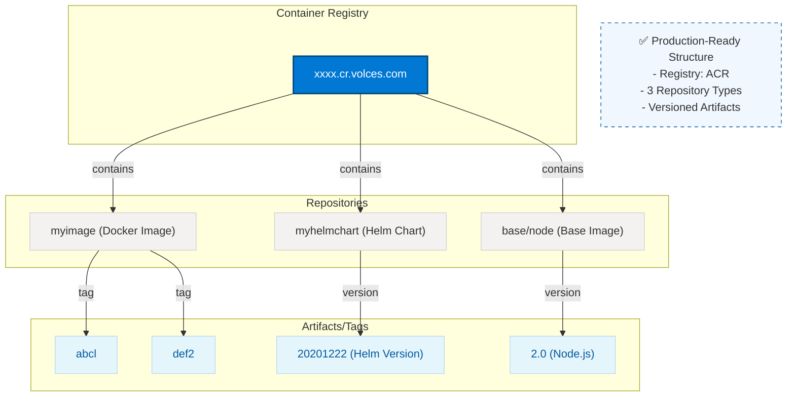
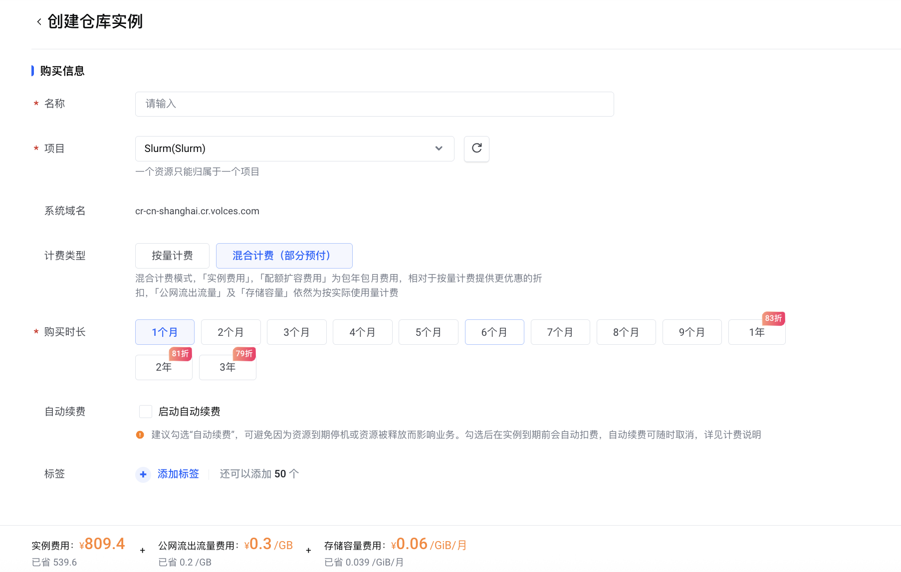
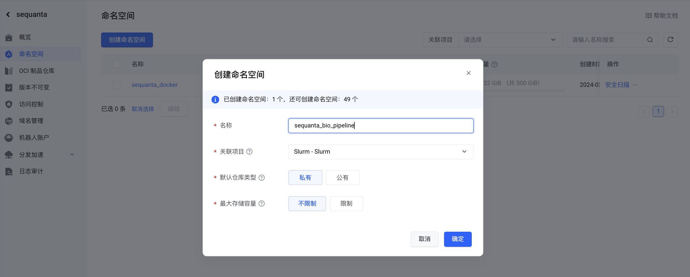
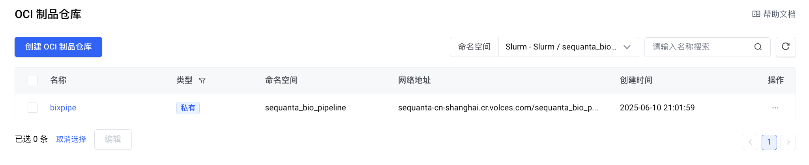
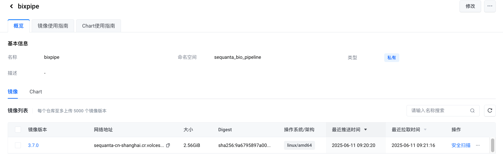
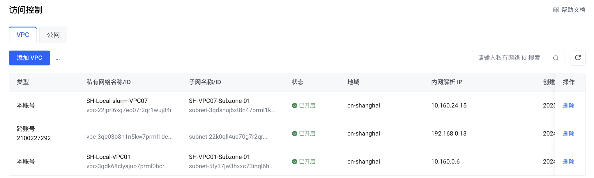
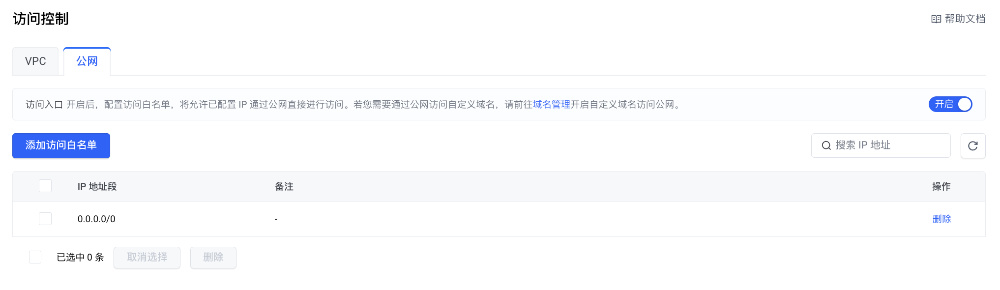
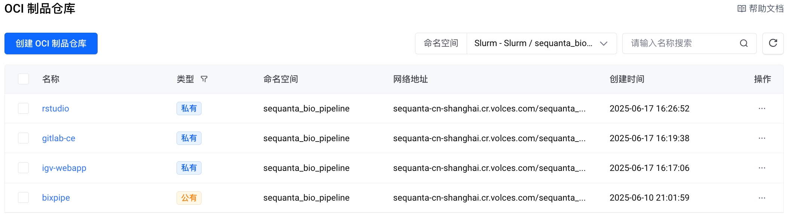

# CR : Container Registry

## 目录

- [1 introduce](#1-introduce)
  - [1.1 Container Registry](#11-Container-Registry)
  - [Container Image Repository](#Container-Image-Repository)
  - [1.3 Namespace](#13-Namespace)
  - [1.4 OCI Artifact Registry](#14-OCI-Artifact-Registry)
    - [1.4.1 Version Control](#141-Version-Control)
- [2 Tutorial](#2-Tutorial)
  - [2.1 火山云创建镜像仓库](#21-火山云创建镜像仓库)
- [3 Reference](#3-Reference)

***

***Author***\*\* ：zhang jian\*\*​

***Date***\*\* : 2025-6-17\*\*​

***Version***\*\* : \*\***`1.2v`**

***

## 1 introduce

### `1.1 Container Registry`

**`Container Registry`** ：容器注册表是一项用来存储和分发容器映像和相关项目的服务。` `**`Docker Hub`** 是公共容器注册表的一个示例，它充当 `Docker`容器映像的一般目录。&#x20;




> **Tips : 容器镜像仓库 (****`Container Image Repository`****):**是一个**更具体**的概念，通常指**注册表中的一个特定位置**，用于存储**一组相关的容器镜像**。可以将其理解为注册表下的一个**文件夹或项目**，里面包含了某个应用程序或服务的不同版本镜像（通过标签区分）。

### **`Container Image Repository`**

容器镜像仓库是一种存储库（或存储库集合），可用来存储和访问容器镜像。容器镜像仓库可以为基于容器型应用开发提供支持，通常作为`DevOps`流程的一部分。容器镜像仓库可以直接连接到`Docker`和`Kubernetes`这样的容器编排平台。容器镜像仓库可以充当在系统之间共享容器镜像的中介，方便开发人员创建和交付云原生应用，为他们节省宝贵的时间[^1]。

**云镜像仓库（Cloud Container Registry）** 是一个在云平台上存储和管理操作系统镜像、应用镜像、容器镜像等软件镜像的服务或平台。它允许用户将镜像文件上传、存储，并通过网络提供给需要的用户或系统。通常，云镜像仓库用于简化操作系统、软件环境、虚拟机或容器等镜像的管理与分发[^2]。

> 云镜像仓库的主要特点包括：
>
> 1. **镜像存储和管理**：云镜像仓库为用户提供存储镜像文件的空间，同时支持镜像的版本控制、元数据管理、更新和删除等功能。
> 2. **高效的镜像分发**：通过分布式架构或内容分发网络（**CDN**）加速镜像的下载过程，确保用户可以快速获取镜像，特别是在多地区的分发场景下。
> 3. **镜像共享与使用**：用户可以选择公开或私密地共享自己的镜像，其他用户可以通过仓库来拉取这些镜像进行使用。
> 4. **跨平台支持**：支持多个平台和环境（如不同操作系统、容器平台等），例如镜像仓库可能支持Linux、Windows、Kubernetes等环境中的镜像管理。
> 5. **自动化和集成**：云镜像仓库通常与CI/CD（持续集成/持续交付）流程结合，允许开发者自动化部署、更新和发布应用镜像，提升软件交付的效率。

> 🧥**云服务商提供的镜像仓库服务：**
>
> - 阿里云容器镜像服务（Alibaba Cloud Container Registry，ACR）[^3]
> - 腾讯容器镜像服务（Tencent Container Registry，TCR）[^4]
> - 火山引擎镜像仓库（Container Registry，CR）[^5]
> - Amazon Elastic Container Registry[^6]
> - Azure 容器注册表[^7]

### 1.3 Namespace

> **Tips** : 容器镜像仓库中的`Namespace`概念，其核心功能是实现对镜像的逻辑分组和权限隔离，这在功能上与`group`或`organization`的概念高度相似。

在容器镜像仓库（如 `Docker Hub`、`Harbor`、`AWS ECR` 等）中，命名空间（`Namespace`） 是用于组织和管理镜像的逻辑分组机制，类似于文件系统的目录结构。以下是详细解析：

> 🥍**命名空间的核心作用**
>
> - **隔离性**：区分不同用户/团队的镜像（如`alpine`vs`myteam/alpine`）
> - **权限控制**：基于命名空间设置访问权限（如只允许某团队推送镜像到`dev/`空间）
> - **分类管理**：按项目/环境划分镜像（如`prod/nginx`、`test/nginx`）

> 🥅**常见仓库的命名规则**
>
> - **`Docker Hub`**
>   - **官方镜像**：无命名空间（如`ubuntu`、`nginx`）
>   - **用户镜像**：`<用户名>/<镜像名>`（如`library/ubuntu`是官方Ubuntu镜像的完整名称）
>   ```docker title="Docker Hub"
>   docker pull ubuntu          # 等效于 library/ubuntu
>   docker pull alice/myapp     # 用户 alice 的 myapp 镜像
>   ```
>
> - **私有仓库（Harbor/自建仓库）**
>
>   \*\* 格式：\*\* \*\*​`<仓库地址>/<命名空间>/<镜像名>:<标签>`\*\*
>   ```docker title="私有仓库"
>   docker pull harbor.example.com/dev/backend:v1.2
>   ```
>
>   - `harbor.example.com`：仓库地址
>   - `dev`：命名空间（通常对应项目/团队）
>   - `backend`：镜像名称
>   - `v1.2`：标签

### 1.4 OCI Artifact Registry

> NOTE : **OCI 制品仓库**其实就是符合OCI格式的镜像仓库存储系统。

**OCI 制品仓库**（**OCI Artifact Registry**）是一种**符合开放容器标准（OCI）的云原生存储系统**，专门用于存放、管理和分发各类云原生应用所需的“制品”（Artifacts）。它不仅是容器镜像的存储中心，还能管理更多类型的数字化资产（如 Helm Chart、WASM 模块、AI 模型等）

#### 1.4.1 Version Control

> 🥅云镜像仓库的镜像版本控制主要围绕以下三个核心概念展开，旨在帮助用户高效、安全地管理其 OCI（Open Container Initiative）制品（包括容器镜像等）：
>
> - **版本保留规则（****`Tag Retention Rules`****）：**
>
>   这是对 `OCI` 制品版本进行自动化管理的能力。通过制定详细的规则，用户可以定期对指定的命名空间或 `OCI` 制品仓库进行扫描，并根据预设条件（例如保留最新的 `N` 个版本、保留在特定日期之后创建的版本、根据标签前缀保留等）自动清理不再需要的旧版本。这有效地解决了镜像仓库占用空间过大以及版本混乱的问题，提高了管理效率。
> - **镜像版本不可变（****`Immutable Image Tags`****）：**
>
>   这是一种至关重要的存储策略，强调一旦某个镜像版本（通过其 `Tag`，例如 `v1.0.0`）被推送到仓库并关联到特定的镜像内容后，该 Tag 所指向的镜像内容就不能被修改或覆盖。这意味着` v1.0.0` 永远代表第一次推送时的那个特定镜像，不会因为后续有新的内容推送到相同的 `v1.0.0 Tag` 而改变。这种不可变性保障了镜像的唯一性、可靠性和可追溯性，是云原生开发和 `DevOps` 实践中的一项重要安全措施，能有效防止意外或恶意的镜像篡改，确保部署环境的一致性。
> - **版本管理（自动清理）：**
>
>   这实际上是“版本保留规则”的具体实现，强调了镜像仓库具备自动清理旧版本的能力。通过配置相应的保留策略，仓库会定期执行清理任务，移除那些不符合保留规则的镜像版本。这使得镜像管理变得更加自动化和便捷，减少了手动维护的工作量，并优化了存储资源的使用。

***

## 2 Tutorial

### 2.1 火山云创建镜像仓库

- **创建镜像仓库实例**

  
- **创建命名空间**

  
- **创建OCI镜像仓库**

  
- **登录 & 下载 & 推送镜像**
  > **Tips** : 为保证数据安全，可以使用临时秘匙进行镜像登录 & **下载 & 推送镜像**
  ```markdown title="登录 & 下载 & 推送镜像"
  # 登录 Registry
  docker login --username=wang_jiawei sequanta-cn-shanghai.cr.volces.com
  # 下载镜像
  docker pull sequanta-cn-shanghai.cr.volces.com/sequanta_bio_pipeline/bixpipe:[镜像版本号]
  # 上传镜像
  docker login --username=wang_jiawei sequanta-cn-shanghai.cr.volces.com
  docker tag [ImageId] sequanta-cn-shanghai.cr.volces.com/sequanta_bio_pipeline/bixpipe:[镜像版本号]
  docker push sequanta-cn-shanghai.cr.volces.com/sequanta_bio_pipeline/bixpipe:[镜像版本号]
  ```

  ```markdown title="镜像推送"
  # 镜像推送测试
  docker  push sequanta-cn-shanghai.cr.volces.com/sequanta_bio_pipeline/bixpipe:3.7.0     ─╯
  The push refers to repository [sequanta-cn-shanghai.cr.volces.com/sequanta_bio_pipeline/bixpipe]
  856cd8708669: Pushed 
  284d32d53177: Pushed 
  4d6e4601aa29: Pushed 
  fcdfd4cd4095: Pushed 
  ......
  24eb69ef59c7: Pushed 
  ce13c870202d: Pushed 
  08d8a2ef4e99: Pushed 
  5f70bf18a086: Pushed 
  174f56854903: Pushed 
  3.7.0: digest: sha256:9a6795897a00b75a84634fc62245413cf22b851f8cfb78b7d7d4b2dfc5be1baf size: 11518
  ```

  
- \*\*`OCI`\*\***镜像版本不可变规则设置**

  
- **设置镜像仓库访问规则**

  

  
  > **NOTE** : 当将本地`IDC`网络添加到`VPC`后，就需要在本地创建对应`dns`解析实现镜像拉取
  >
  > ```markdown title="hosts"
  > # /etc/hosts
  > 10.160.24.15 sequanta-cn-shanghai.cr.volces.com
  > ```
  >
  >
  > ```docker title="docker pull"
  > docker pull sequanta-cn-shanghai.cr.volces.com/sequanta_bio_pipeline/bixpipe:3.7.0
  > 3.7.0: Pulling from sequanta_bio_pipeline/bixpipe
  > 2d473b07cdd5: Already exists 
  > 4f4fb700ef54: Already exists 
  > 5b6cb93ce470: Already exists 
  > e9855fdf84a9: Already exists 
  > .....
  > 0b91d998b026: Pull complete 
  > 434499e55fdc: Pull complete 
  > 23f5b74fa847: Pull complete 
  > 2ab41eae6c5e: Pull complete 
  > Digest: sha256:9a6795897a00b75a84634fc62245413cf22b851f8cfb78b7d7d4b2dfc5be1baf
  > Status: Downloaded newer image for sequanta-cn-shanghai.cr.volces.com/sequanta_bio_pipeline/bixpipe:3.7.0
  > sequanta-cn-shanghai.cr.volces.com/sequanta_bio_pipeline/bixpipe:3.7.0
  > ```
  >

> **Tips** ：当使用`docker push`向私有仓库推送镜像时，如果镜像仓库未创建对应OCI仓库，会根据设置的本地镜像tag自动在镜像仓库创建。
>
> ```docker title="docker push"
> docker push sequanta-cn-shanghai.cr.volces.com/sequanta_bio_pipeline/gitlab-ce:nightly
> The push refers to repository [sequanta-cn-shanghai.cr.volces.com/sequanta_bio_pipeline/gitlab-ce]
> cb02987c2d1d: Pushed 
> 9bf9b9e393fa: Pushed 
> 03e0f12b7951: Pushed 
> 91b440158f08: Pushed 
> 4c79c9fe26e9: Pushed 
> 54dece9e270f: Pushed 
> a4aae6be439d: Pushed 
> 2dcf3af5bd87: Pushed 
> 8901a649dd5a: Pushed 
> nightly: digest: sha256:5c4fff8ae4dae570a4851053e272d423c36cfe68fef19f3ebab035396608ae1d size: 2201
> ```
>
>
> ```docker title="docker push"
> docker push sequanta-cn-shanghai.cr.volces.com/sequanta_bio_pipeline/rstudio:4.4
> The push refers to repository [sequanta-cn-shanghai.cr.volces.com/sequanta_bio_pipeline/rstudio]
> dbb1873151c8: Pushed 
> f01e62aebd12: Pushed 
> c30935ca0f4f: Pushed 
> 8940ae5c8fb8: Pushed 
> 338f5692dfc4: Pushed 
> 2c3e1065671f: Pushed 
> 35e3ec3e6de3: Pushed 
> 6fe63813e5af: Pushed 
> beb60f7d1dc7: Pushed 
> 9d41f73a3529: Pushed 
> 5a1d4eb5ae91: Pushed 
> 3e747aa91fa2: Pushed 
> 0403941e3b34: Pushed 
> b416178233a3: Pushed 
> 449e4debc7d6: Pushed 
> da24b1a7e724: Pushed 
> 3280669d4f8e: Pushed 
> 8901a649dd5a: Mounted from sequanta_bio_pipeline/gitlab-ce 
> 4.4: digest: sha256:48091c5392c33c2a926339d4063f1a77d7628f523496ef98b1de5ab7abdd5974 size: 4084
> ```
>
>
> 

***

## 3 Reference

[^1]: [https://www.redhat.com/zh/topics/cloud-native-apps/what-is-a-container-registry](https://www.redhat.com/zh/topics/cloud-native-apps/what-is-a-container-registry "https://www.redhat.com/zh/topics/cloud-native-apps/what-is-a-container-registry")

[^2]: [https://www.volcengine.com/docs/6420/68643?lang=zh](https://www.volcengine.com/docs/6420/68643?lang=zh "https://www.volcengine.com/docs/6420/68643?lang=zh")

[^3]: [https://www.alibabacloud.com/help/zh/acr/product-overview/what-is-container-registry?spm=a2c63.p38356.0.i3](https://www.alibabacloud.com/help/zh/acr/product-overview/what-is-container-registry?spm=a2c63.p38356.0.i3 "https://www.alibabacloud.com/help/zh/acr/product-overview/what-is-container-registry?spm=a2c63.p38356.0.i3")

[^4]: [https://cloud.tencent.com/product/tcr](https://cloud.tencent.com/product/tcr "https://cloud.tencent.com/product/tcr")

[^5]: [https://www.volcengine.com/docs/6420/68643](https://www.volcengine.com/docs/6420/68643 "https://www.volcengine.com/docs/6420/68643")

[^6]: [https://docs.aws.amazon.com/ecr/](https://docs.aws.amazon.com/ecr/ "https://docs.aws.amazon.com/ecr/")

[^7]: [https://learn.microsoft.com/zh-cn/azure/container-registry/](https://learn.microsoft.com/zh-cn/azure/container-registry/ "https://learn.microsoft.com/zh-cn/azure/container-registry/")
