# Cloud

## 目录

- [1 Introduce](#1-Introduce)
  - [1.1 Cloud](#11-Cloud)
  - [Cloud Provider](#Cloud-Provider)
  - [1.3 Data Center](#13-Data-Center)
  - [1.4 Cloud knowledge](#14-Cloud-knowledge)
    - [Tag & Project](#Tag--Project)
      - [1.4.1.1 tag](#1411-tag)
      - [1.4.1.2 Project](#1412-Project)
    - [1.4.2 Region & Availability Zones](#142-Region--Availability-Zones)
      - [1.4.2.1 Region](#1421-Region)
      - [Availability Zones](#Availability-Zones)
    - [1.4.3 VPC](#143-VPC)
    - [1.4.4 subnet ](#144-subnet-)
    - [1.4.5 Security Group](#145-Security-Group)
      - [1.4.5.1 Best Practices for Security Groups](#1451-Best-Practices-for-Security-Groups)
    - [1.4.6 Public NAT Gateway](#146-Public-NAT-Gateway)
    - [Elastic IP Address(EIP)](#Elastic-IP-AddressEIP)
    - [1.4.8 WAF](#148-WAF)
    - [1.4.9 Server Load Balancer](#149-Server-Load-Balancer)
  - [1.5 Elastic Compute Service](#15-Elastic-Compute-Service)
    - [1.5.1 vCPU](#151-vCPU)
    - [1.5.2 云盘/块存储（Block Storage）](#152-云盘块存储Block-Storage)
    - [1.5.3 Snapshot](#153-Snapshot)
    - [1.5.4 Image](#154-Image)
      - [Container Registry](#Container-Registry)
  - [1.6 Function as a Service](#16-Function-as-a-Service)
  - [1.7 AK & SK](#17-AK--SK)
  - [1.8 Storage](#18-Storage)
    - [1.8.1 Object Storage](#181-Object-Storage)
      - [1.8.1.1 Object Storage limits](#1811-Object-Storage-limits)
      - [Bucket](#Bucket)
      - [1.8.1.3 Object](#1813-Object)
      - [1.8.1.4 ObjectKey](#1814-ObjectKey)
      - [1.8.1.5 Region & Endpoint](#1815-Region--Endpoint)
      - [1.8.1.6 AccessKey](#1816-AccessKey)
      - [1.8.1.7 原子性和强一致性](#1817-原子性和强一致性)
    - [1.8.2 NAS](#182-NAS)
      - [1.8.2.1 NAS & NFS](#1821-NAS--NFS)
      - [1.8.2.2 NAS & 目录配额 & 权限组](#1822-NAS--目录配额--权限组)
    - [1.8.3 Elastic Block Storage](#183-Elastic-Block-Storage)
    - [1.8.4 Structured Data & Unstructured data](#184-Structured-Data--Unstructured-data)
  - [1.9 Data Lake](#19-Data-Lake)
    - [1.9.1 Data Lake Features](#191-Data-Lake-Features)
  - [1.10 DataBase](#110-DataBase)
  - [Message Queue, MQ](#Message-Queue-MQ)
- [2 Tutorial](#2-Tutorial)
  - [Cloud Provider Server](#Cloud-Provider-Server)
  - [2.2 Benchmark](#22-Benchmark)
    - [2.2.1 Block Storage  I/O Benchmark](#221-Block-Storage--IO-Benchmark)
  - [2.3 Minio](#23-Minio)
- [3 Tips](#3-Tips)
  - [3.1 VS  Code](#31-VS--Code)
  - [3.2  Tag & Project](#32--Tag--Project)
- [4 Source](#4-Source)
- [5 Reference](#5-Reference)

***

***Author***\*\* : zhang jian\*\*​

***Date***\*\* : 2025-4-1\*\*1

***Version***\*\* : \*\***`1.2.4.1v`**

***

> **Tips** : 在云计算平台上进行项目分析之前，建议通过新建独立项目并采用规范的计算资源命名方式，以便于后期回顾与维护，避免出现混乱无序的局面。**（默认一时爽，管理火葬场）**

> **NOTE** : 在云端新建示例后如果无法访问，请查看一下当前服务器绑定的安全组，是否设置正确,错误的安全组会导致相关服务无法正常运行。

> **WARRING** : 云服务商提供的`AK` & `SK`一定一定一定要进行妥善保管，在使用时也尽量做到使用环境与`AK` & `SK`分离。

> **NOTE** : 进行大规模数据计算时，可以使用并行技术加快分析速度。但是也需要注意计算对于`I/O`性能的需求,当`I/O`性能不满足时，会大大拖累分析速度。

> **NOTE** ：云计算提供商会提供很多不同规格的云服务器，其往往会存在配置限制，因此在进行云计算时，需要注意当前计算流程的瓶颈可能是由于示例的不同规格的限制造成滴[^1]。
>
> | **实例规格**​             | \*\*`vCPU`\*\*​ | **内存（** **`GiB`****）** ​ | **（出+入）网络带宽能力基础/突发（** **`Gbit/s`****）** ​ | **（出+入）网络收发包总能力（** **`万PPS`****）** ​ | **连接数（万）** ​ | **网卡队列数**​ | **弹性网卡（包括一张主网卡）** ​ | **单网卡私有IP**​ | **云盘** **`IOPS`****（万）** ​ | **云盘带宽（** **`Gbit/s`****）** ​ | **云盘数量（包含一块系统盘）** ​ |
> | --------------------- | --------------- | ------------------------ | ----------------------------------------- | ------------------------------------ | ------------ | ---------- | ------------------- | ------------ | -------------------------- | ----------------------------- | ------------------- |
> | \`ecs.r3il.large\`    | 2               | 16                       | 2/最高3                                     | 30                                   | 25           | 2          | 3                   | 6            | 1                          | 1.5                           | 9                   |
> | \`ecs.r3il.xlarge\`   | 4               | 32                       | 3/最高5                                     | 50                                   | 25           | 4          | 4                   | 15           | 2                          | 2                             | 9                   |
> | \`ecs.r3il.2xlarge\`  | 8               | 64                       | 4/最高6                                     | 60                                   | 25           | 8          | 4                   | 15           | 3                          | 3                             | 16                  |
> | \`ecs.r3il.4xlarge\`  | 16              | 128                      | 5/最高10                                    | 100                                  | 60           | 8          | 8                   | 30           | 4                          | 5                             | 16                  |
> | \`ecs.r3il.8xlarge\`  | 32              | 256                      | 10/--                                     | 180                                  | 120          | 16         | 8                   | 30           | 8                          | 6                             | 16                  |
> | \`ecs.r3il.12xlarge\` | 48              | 384                      | 13/--                                     | 250                                  | 180          | 16         | 8                   | 30           | 12                         | 8                             | 16                  |
> | \`ecs.r3il.16xlarge\` | 64              | 512                      | 18/--                                     | 350                                  | 240          | 32         | 8                   | 30           | 17                         | 10                            | 16                  |
> | \`ecs.r3il.29xlarge\` | 114             | 974                      | 27/--                                     | 500                                  | 300          | 32         | 8                   | 30           | 19                         | 13                            | 16                  |

***

[Terraform](Terraform/Terraform.md "Terraform")

***

## 1 Introduce

### 1.1 Cloud

**本地算力瓶颈** ： 生物信息学分析（如大规模基因组处理、多组学整合）常面临海量数据和复杂计算需求，本地服务器的固定硬件资源配置难以动态匹配爆发性任务负载。购置额外集群虽可短期缓解，但会导致闲置期的资源浪费和高昂运维成本。

**云计算的高效替代** ：基于弹性扩展的云平台（`AWS`、阿里云等）支持按需秒级扩容至上万核计算资源，结合竞价实例和预配置生信工具链（如`GATK`、`STAR`）显著降低成本。其全球分布式存储与合规化数据管理（如`HIPAA`认证）兼顾了分析效率与敏感信息安全，尤其适病原监测、临床队列研究等时效性场景。

**敏捷部署策略** : 采用混合云架构将稳态分析保留本地，突发任务无缝迁移至云端；容器化封装（`Docker`+`Kubernetes`）保障流程复现性，无服务器计算（`Lambda`）则进一步优化轻量作业响应。通过云原生架构，团队可聚焦核心研究，规避冗余基建投入。

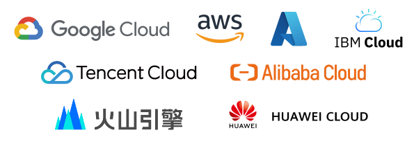

### **Cloud Provider**

> **云计算供应商：**
>
> - **火山云**[^2]
>
>   [ 云服务器-火山引擎 云服务器 ECS（Elastic Compute Service）是一种安全稳定、可弹性伸缩的云计算服务。您可以随时根据业务需要实时启用和增减计算资源，有效降低IT维护成本，助力核心业务增长 https://www.volcengine.com/product/ecs](https://www.volcengine.com/product/ecs " 云服务器-火山引擎 云服务器 ECS（Elastic Compute Service）是一种安全稳定、可弹性伸缩的云计算服务。您可以随时根据业务需要实时启用和增减计算资源，有效降低IT维护成本，助力核心业务增长 https://www.volcengine.com/product/ecs")
> - **腾讯云**[^3]
>
>   [ 批量计算 | 腾讯云 批量计算（BatchCompute，Batch）是为有大数据计算业务的企业、科研单位等提供高性价比且易用的计算服务。批量计算 Batch 可以根据用户提供的批处理规模，智能地管理作业和调动其所需的最佳资源。有了 Batch 的帮助，您可以将精力集中在如何分析和处理数据结果上。 https://www.tencentcloud.com/zh/products/batch?from\_qcintl=422020107](https://www.tencentcloud.com/zh/products/batch?from_qcintl=422020107 " 批量计算 | 腾讯云 批量计算（BatchCompute，Batch）是为有大数据计算业务的企业、科研单位等提供高性价比且易用的计算服务。批量计算 Batch 可以根据用户提供的批处理规模，智能地管理作业和调动其所需的最佳资源。有了 Batch 的帮助，您可以将精力集中在如何分析和处理数据结果上。 https://www.tencentcloud.com/zh/products/batch?from_qcintl=422020107")
> - **阿里云弹**[^4]
>
>   [ 弹性高性能计算E-HPC\_超算云\_高性能计算\_弹性计算-阿里云 弹性高性能计算（E-HPC）基于阿里云基础设施，拥有公有云、专有云等多种产品形态，为用户提供一站式HPC/HPDA平台服务，面向科研、生产、教育和行业大计算，提供快捷，弹性，安全的服务和拥有与阿里云产品互通的高性能计算服务平台。 https://www.aliyun.com/product/ehpc](https://www.aliyun.com/product/ehpc " 弹性高性能计算E-HPC_超算云_高性能计算_弹性计算-阿里云 弹性高性能计算（E-HPC）基于阿里云基础设施，拥有公有云、专有云等多种产品形态，为用户提供一站式HPC/HPDA平台服务，面向科研、生产、教育和行业大计算，提供快捷，弹性，安全的服务和拥有与阿里云产品互通的高性能计算服务平台。 https://www.aliyun.com/product/ehpc")
> - **Azure** [^5]
>
>   [ Azure Kubernetes 服务 (AKS) 文档 | Microsoft Learn加州消费者隐私法案 (CCPA) 禁用图标加州消费者隐私法案 (CCPA) 禁用图标 使用 AKS 可以在 Azure 中快速部署已准备好用于生产的 Kubernetes 群集。 通过这些快速入门、教程和示例了解 AKS 的用法。 https://learn.microsoft.com/zh-cn/azure/aks/](https://learn.microsoft.com/zh-cn/azure/aks/ " Azure Kubernetes 服务 (AKS) 文档 | Microsoft Learn加州消费者隐私法案 (CCPA) 禁用图标加州消费者隐私法案 (CCPA) 禁用图标 使用 AKS 可以在 Azure 中快速部署已准备好用于生产的 Kubernetes 群集。 通过这些快速入门、教程和示例了解 AKS 的用法。 https://learn.microsoft.com/zh-cn/azure/aks/")
> - **Google** [^6]
>
>   [   https://cloud.google.com/kubernetes-engine/docs/how-to/cluster-admin-overview?hl=zh-cn](https://cloud.google.com/kubernetes-engine/docs/how-to/cluster-admin-overview?hl=zh-cn "   https://cloud.google.com/kubernetes-engine/docs/how-to/cluster-admin-overview?hl=zh-cn")

### 1.3 Data Center

**数据中心（Data Center）** 指用于安置计算机系统及相关部件的设施，例如电信和储存系统。一般它包含冗余和备用电源供应，冗余数据通信连接，环境控制（例如空调、灭火器）和各种安全设备。大型数据中心消耗的电约与一个小城镇工业业务规模一样多。据估计，2022年全球数据中心的耗电量为 240-340 太瓦时（`TWH`），约占全球电力需求的 1-1.3%。这不包括加密货币挖矿所用的能源，据估计，2022 年加密货币挖矿所用能源约为 110 `TWH`，占全球电力需求的0.4%。数据中心在规模、电力要求、冗余度和整体结构方面差异很大。用于划分数据中心类型的四个常见类别是现场数据中心（`onsite data centers`）、主机托管设施（`colocation facilities`）、超大规模数据中心（`hyperscale data centers`）、和边缘数据中心（`edge data centers`）[^7]。

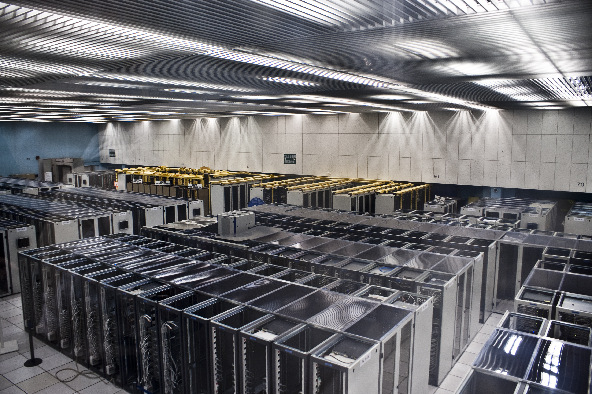

### 1.4 Cloud knowledge

#### **Tag** & Project

通过合理使用**Tag（标签）和Project**（项目），可以实现云资源的高效分类、精细化管理和成本优化，从而提升团队协作效率、增强资源的可追溯性和可控性，并降低运维复杂度和潜在风险。具体而言：

- **Tag（标签）**：帮助用户从多维度（如业务、环境、部门等）对资源进行标记和分类，便于快速查找、统计分析以及自动化运维操作。
- **Project（项目）**：提供逻辑分组能力，将资源按业务或团队划分到不同项目中，确保资源隔离与权限控制，避免误操作和冲突。

##### 1.4.1.1 tag

**标签(tag)** 是云资源的标识，可以帮助从不同维度对具有相同特征的云资源进行分类、搜索和聚合，让资源管理变得更加轻松[^8]。

> **云服务标签主要应用场景：**
>
> 1. **资源查找**：通过绑定标签，快速定位和筛选特定资源。
> 2. **成本分摊**：按业务或组织维度设置标签，结合成本分析功能实现精细化费用管理。
> 3. **自动化运维**：为不同环境或平台绑定标签，配合运维模板完成批量操作。
> 4. **权限控制**：结合RAM服务，通过标签限制用户对特定资源的访问和操作权限。

##### 1.4.1.2 Project

按照项目对资源进行管理的意义在于：**通过逻辑分组实现资源隔离、提升管理效率、降低运维风险，并支持精细化授权与账单分拆，从而优化资源利用和团队协作**[^9]**。**

#### `1.4.2 Region` & `Availability Zones`

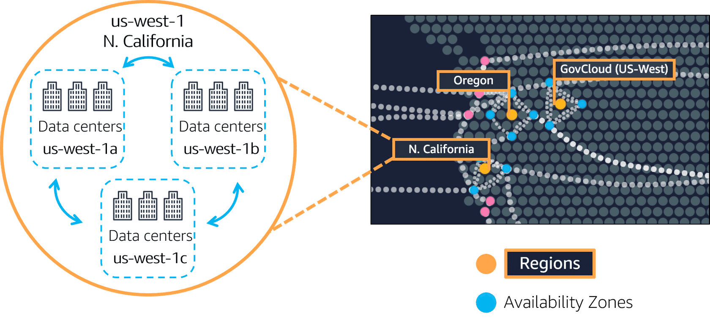

##### `1.4.2.1 Region`

`Region`(地域) 指数据中心所在的地理区域，通常按照数据中心所在的城市划分。例如，华北2（北京）地域表示数据中心所在的城市是北京。

> **NOTE** : 可用区选择最佳实践。
>
> - \*\*地理位置 \*\*: 用户和资源部署地域的距离越近，网络时延越低，访问速度越快；
> - **多产品使用时的内网互通要求** : 如果有较高的内网互通要求，需要将其布置到同一个地域中；
> - **经营性备案**。

##### **`Availability Zones`**

**`Availability zones`**\*\* (可用区)\*\* 是基于独立数据中心划分的云基础设施的独立部分（电力和网络互相独立的物理区域）。例如，华北2（北京）地域支持12个可用区，包括北京 可用区`A`和北京 可用区`B`等。同一可用区内实例之间的网络延时更小，其用户访问速度更快。

> **每个可用区都拥有自己的一套基础设施：**
>
> 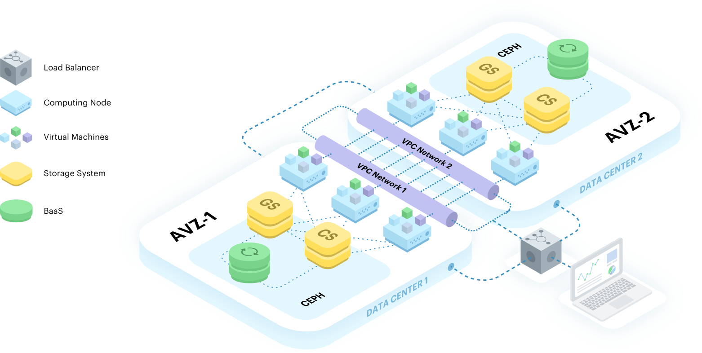
>
> 1. **`computing resources`**\*\* 计算资源\*\* : 是计算机系统中用于处理数据的各种硬件和软件资源，如 CPU、内存、操作系统等，用于执行各种计算任务。
> 2. **`data storage systems`**\*\* 数据存储系统\*\* : 用于存储和管理数据，常见的有硬盘、固态硬盘、磁带库等，可实现数据的持久化保存和高效读取。
> 3. **`security measures`**\*\* 安全措施\*\* : 是为保障计算机系统安全而采取的各种手段，包括防火墙、加密技术、入侵检测系统等，防止数据泄露、恶意攻击等安全威胁。
> 4. **`power supply systems`**\*\* 电源系统\*\* : 为计算机设备提供稳定的电力供应，如 `UPS`（不间断电源）、电源适配器等，确保设备正常运行，避免因停电等意外情况导致数据丢失或设备损坏。
> 5. **`network connections`**\*\* 网络连接\*\* : 使计算机能够与外界进行通信和数据传输，包括有线网络连接（如以太网）、无线网络连接（如 `Wi-Fi`）等，实现资源共享、远程访问等功能。
> 6. **`cooling systems`**\*\* 冷却系统\*\* : 用于降低计算机设备在运行过程中产生的热量，防止设备过热而影响性能或损坏硬件，常见的有风扇散热、水冷散热等。

> **NOTE**\*\* : 在同一地域内，可用区与可用区之间内网互通。将应用布置到不同可用区上可以实现故障隔离。\*\* ​

#### `1.4.3 VPC`

**虚拟私有云（** \*\*​`VPC,Virtual Private Cloud`\*\***也可以翻译成私有网络或者专有网络）\*\*是在公共云环境中按需配置的共享资源池，为使用这些资源的不同组织（以下简称为用户）提供一定程度的隔离。通过为每个用户分配一个`私有IP子网`以*及*一个虚拟通信结构（例如虚拟局域网（`VLAN`）或一组加密通信通道），通常可以实现一个`VPC`用户与其他所有用户（包括其他`VPC`用户和其他公共云用户）之间的隔离。在`VPC`中，上述提供云内隔离的机制通常还伴随着虚拟专用网络（`VPN`）功能（同样按`VPC`用户分配），通过身份验证和加密手段，确保组织能够安全地远程访问其`VPC`资源。通过引入这些隔离级别，使用此服务的组织实际上是在一个“虚拟私有”的云环境中工作（也就是说，就好像云基础设施没有与其他用户共享一样），因此得名为`VPC`。

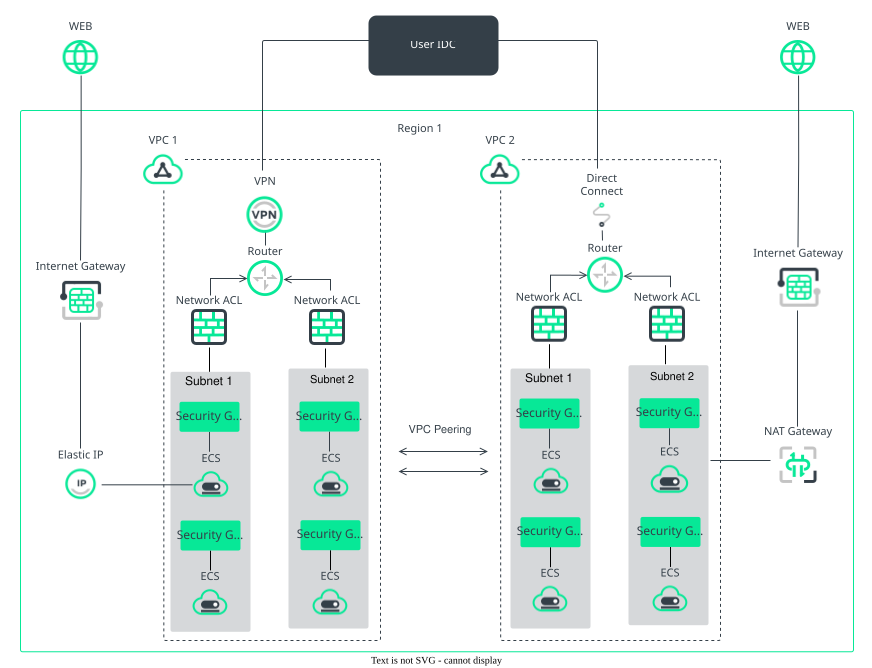

#### `1.4.4 subnet`&#x20;

\*\*子网(****`subnet`****)\*\*是的 `VPC`内的 `IP` 地址范围。通过特定子网可以创建 & 绑定不同的云计算资源。每个子网都必须完全位于一个可用区之内，不能跨越多个可用区。通过在独立的可用区内启动 云计算资源，可以保护应用程序不受单一可用区故障的影响。

#### `1.4.5 Security Group`

\*\*安全组(****`Security Group`****)\*\*是一种虚拟防火墙，能够控制`ECS`实例的出入站流量。您可以将具有相同安全需求并相互信任的`ECS`实例放入相同的安全组，以划分安全域，保障云上资源的安全。

> 🚟**在配置安全组前，需要了解以下信息：**
>
> - 在专有网络`VPC`下，安全组仅能在所属的`VPC`下使用，在创建专有网络`VPC`的`ECS`实例时，您指定的虚拟交换机和安全组，必须属于同一个`VPC`。
> - `ECS`实例或者弹性网卡可以关联一个或者多个安全组，但必须至少关联一个安全组。
> - 在创建`ECS`实例时，如果您未指定安全组，系统会将该`ECS`实例的主网卡关联到默认安全组。

> 🌋\*\*本人安全组设置示例 ： \*\*
>
> 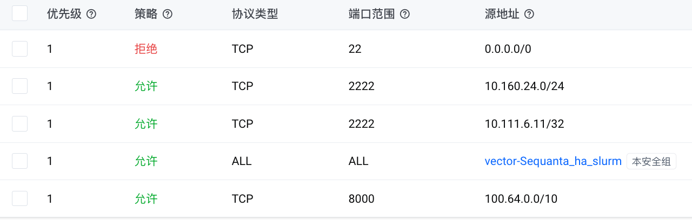
>
> - **拒绝 TCP 22 口（优先级 1）**：拒绝所有来源的 `SSH`连接请求；
> - **允许 TCP 2222 口（优先级 1）**：允许来自`10.160.24.0/24`子网的所有 IP 地址对 `2222` 口的访问服务器；
> - **允许 TCP 2222 端口（优先级 1）**：允许来自`10.111.6.11/32`单一 IP 址对 `2222` 端口的访问
> - **许所有端口（优先级 1）**：允许来自指定安全组（`vector-Sequanta_ha_slurm`）的所有流量。
> - **允许 ****`TCP 8000`**** 口** : 允许来自 `100.64.0.0/10` 子网的所有 `IP` 址对 `8000` 端口的访问

- **`Security Group`**\*\* 示例：\*\* ​

  专有网络VPC包含`ECS 1`和`ECS 2`，两个ECS的主网卡都关联`安全组1`。假设`安全组1`是普通安全组，组内连通策略默认为组内互通，那么`ECS 1`和`ECS 2`的内网是互通的，这种互通策略不受您配置的自定义规则的影响。`ECS 1`和`ECS 2`的其他出入方向流量受到`安全组1`的自定义规则控制。根据`安全组1`的入方向规则，使用任意IP都可以ping通`安全组1`内`ECS 1`和`ECS 2`，`安全组1`未配置出方向规则，默认允许所有出方向的流量。

  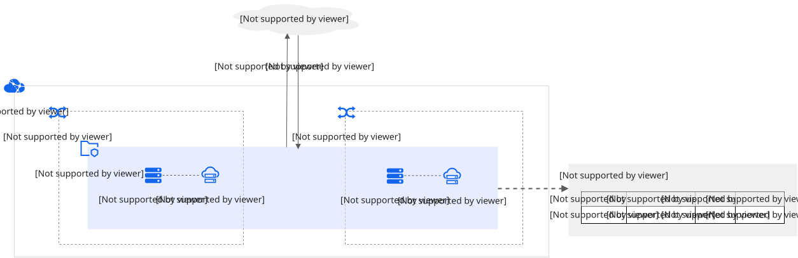

> **Knowledge** :  `CIDR` 是 `Classless Inter-Domain Routing` 的缩写，是一种用于分配 `IP` 地址和路由 `IP` 数据包的网络寻址方法。`CIDR` 通过在 `IP` 地址后面附加一个斜杠（`/`）和一个数字来表示一个 `IP` 地址块，这个数字表示网络前缀的长度（即网络部分的位数）。`CIDR` 的引入是为了更有效地使用`IPv4` 地址空间，并简化路由表。
>
> - **`/8`**   ：非常大的子网，适用于大型企业或 ISP，提供超过 1600 万个可用 IP 地址。
> - **`/16`** ：中等大小的子网，适用于较大的局域网或中小型企业，提供超过 65000 个可用 IP 地址。
> - **`/24`** ：最常见的子网掩码之一，适用于小型局域网，提供 254 个可用 IP 地址。
> - **`/32`** ：表示单个 IP 地址，通常用于静态路由或特定设备。
>
> ```python title="CIDR示例"
> # A 类子网，表示从 192.0.0.0 到 192.255.255.255 的 IP 地址范围
> 192.168.1.0/8
> # B 类子网，表示从 192.168.0.0 到 192.168.255.255 的 IP 地址范围
> 192.168.1.0/16
> # C 类子网，表示从 192.168.1.0 到 192.168.1.255 的 IP 地址范围
> 192.168.1.0/24
> # 单个 IP 地址 192.168.1.0
> 192.168.1.0/32
> ```
>

> \*\*Knowledge \*\***: 安全组协议类型**
>
> - **`TCP`**\*\* (Transmission Control Protocol)\*\*: `TCP` 是一种面向连接的协议，提供可靠的数据传输服务;
> - `UDP`\*\* (User Datagram Protocol) \*\*： `UDP` 是一种无连接的协议，不保证数据包的顺序或完整性;
> - **`ICMP`**\*\* (Internet Control Message Protocol)\*\* ： `ICMP` 用于网络设备之间的诊断消息和错误报告;
> - **`ICMPV6`** ： `ICMPv6` 是 `IPv6` 版本的 `ICMP` 协议，用于 `IPv6`网络中的诊断消息和错误报告;
> - **`ALL`** ： 允许所有类型的网络流量，包括但不限于 `TCP`、`UDP` 和`ICMP`。

##### 1.4.5.1 Best Practices for `Security Groups`

**为了保证云服务的安全性与稳定性推荐按照以下**\*\*`Security Groups`****最佳实践进行安全组管理与维护**[^10]**。\*\*

1. **规划** : 需要为安全组设置名称、描述，也可以设置安全组的标签、资源组，便于进行分类运维。建议您合理设置这些信息，方便快速识别安全组的用途，在管理较多安全组时更加清晰。
2. **以白名单的方式使用安全组** : 默认拒绝所有访问，添加允许规则来放通指定的端口范围和授权对象。
3. **添加安全组规则时遵循最小授权原则** : 开放Linux实例的22端口用于远程登录时，建议仅允许特定的IP访问，而非所有IP（`0.0.0.0/0`）。
   > **PS** : s'li最开始就需要将服务器登录端口从`22`修改为`2222`
4. **遵循最小权限原则** : 在不需要普通安全组内`ECS`实例互相内网互通时，将普通安全组的组内连通策略设置为组内隔离。
5. **尽量保持单个安全组内规则的简洁** : 按照用途将规则维护在多个安全组中，并将实例关联到这些安全组。单个安全组的规则数量过多，会增加管理复杂度。安全组规则的健康检查，提供了检测单个安全组冗余规则的能力。
6. **不同类型应用的实例加入不同的安全组，分别维护安全组规则** : 将允许公网访问的实例关联到同一个安全组，仅放通对外提供服务的端口，例如`80`、`443`等，默认拒绝其他所有访问。避免在允许公网访问的实例上提供其他服务，例如`MySQL`、`Redis`等，建议将内部服务部署在不允许公网访问的实例上，并关联其他的安全组。
7. **避免直接修改线上环境使用的安全组** : 可以先克隆一个安全组在测试环境调试，确保修改后实例流量正常，再对线上环境的安全组规则进行修改。

#### 1.4.6 Public NAT Gateway

> **NOTE** : \*\*`NAT`（网络地址转换）\*\*是一种网络技术，通常用于让整个专用网络在不为每个主机分配公共 IPv4 地址的情况下访问互联网。

公网NAT网关（`Public NAT Gateway`）是一种网络地址转换服务，主要用于为云环境中的资源提供安全的公网访问能力[^11]。通过**转换和隐藏云服务地址，防止地址直接暴露，实现安全访问互联网，提升网络安全性**。

> 🕸️\*\*`NAT`\*\***网关优势**
>
> - **安全**
>
>   `NAT`网关的`SNAT`功能具有安全防护的能力，避免地址对外暴露，通过`SNAT`规则限制入向连接，精细化出向规则管控。
> - **弹性高性能**
>
>   自动弹性伸缩，随业务弹性扩容，满足流量陡增；超高性能，满足超大业务上云需求。
> - **稳定高可用**
>
>   支持主备可用区容灾，可用区级别故障时仍能保障业务运行，实现业务高可用。
> - **灵活计费**
>
>   按量付费，降低使用成本，共享公网`IP`资源，节省公网带宽和IP持有成本。
> - **深度可观测**
>
>   丰富多维度的流量监控指标，支持会话日志、`VPC`流日志，满足用户合规、运维诉求。

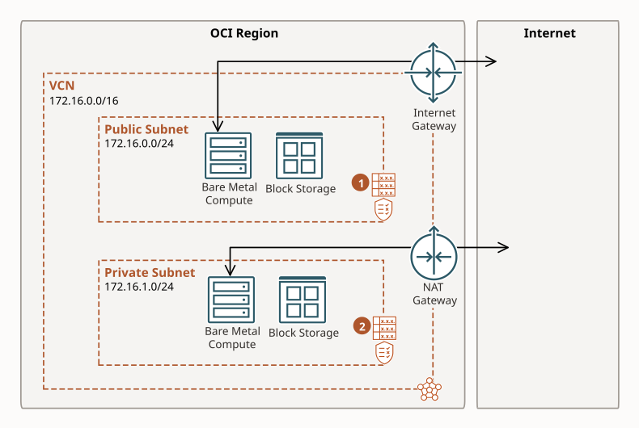

> 🥍\*\*`DNAT`& \*\*​**`SNAT`**
>
> 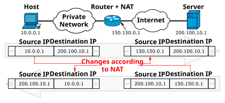
>
> - **标网络地址转换（Destination Network Address Translation，DNAT）**:  将外部请求的目标IP地址转换为内部网络中的特定IP地址
>
>   **外部访问内网服务**：通过DNAT将外部请求转发到内网资源。
> - \*\*网络地址转换(Source Network Address Translation,SNAT) \*\*: 将内部网络中的源IP地址转换为公共网络可路由的IP地址。
>
>   **内网访问公网**：通过SNAT隐藏内网设备的真实IP。

> 🙋**SNAT & DNAT**
>
> - **SNAT** : 用于允许内部的ECS实例发起对外部网络的连接。
>
>   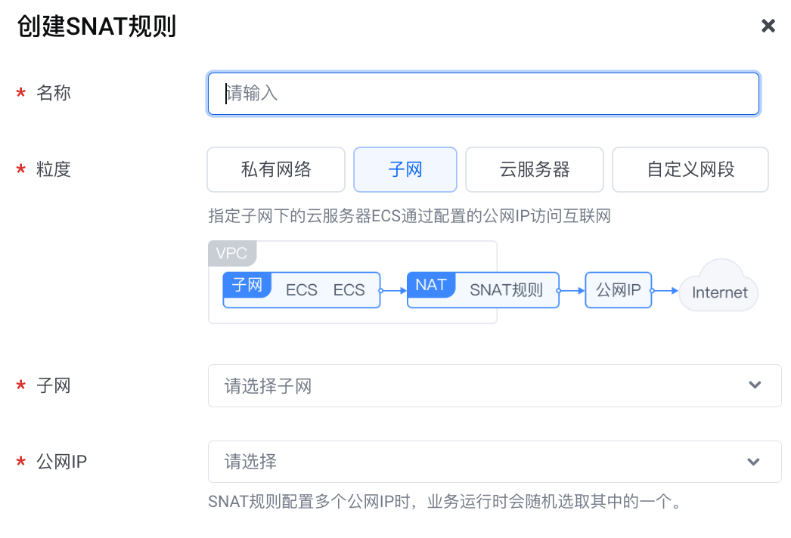
> - **DNAT :** 用于允许外部网络主动连接到内部的ECS实例。
>
>   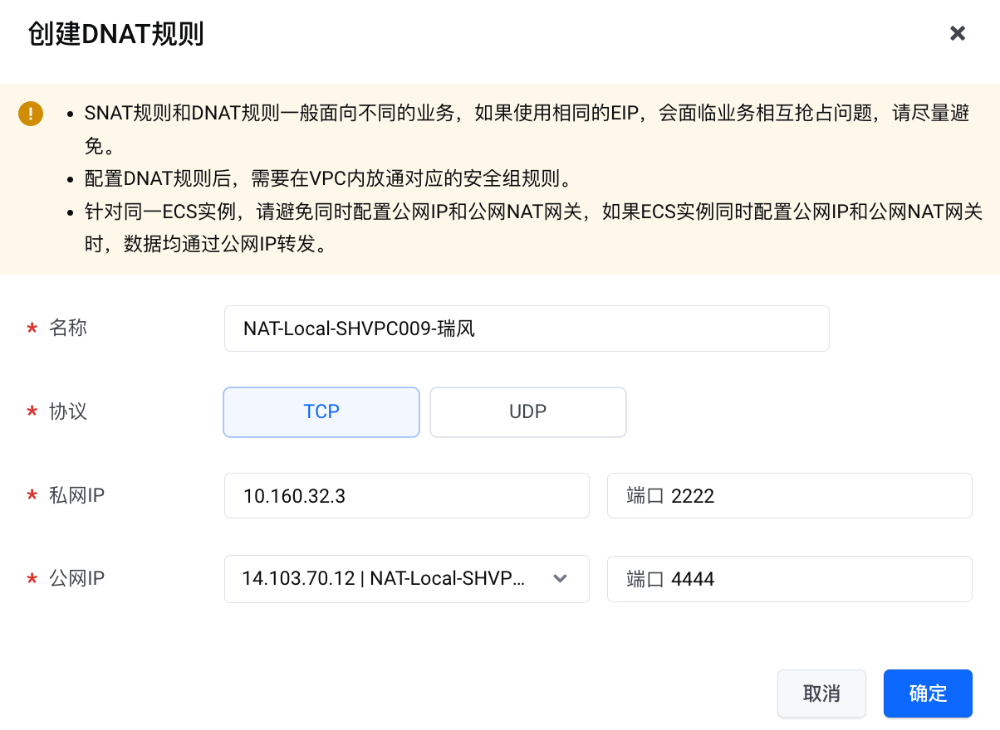

#### **Elastic IP Address**(EIP)

**EIP（Elastic IP Address，弹性公网IP）** 是一种可以独立购买和持有的公网IP地址资源，主要用于为云环境中的资源提供稳定的公网访问能力[^12]。

#### 1.4.8 WAF

**网页应用程序防火墙（Web Application Firewall，缩写：WAF）** 是一种特定形式的应用程序防火墙，用于过滤、监控和阻断通过网页服务的HTTP流量。透过监察HTTP流量，它可以防止利用网页应用程序已知漏洞的攻击，例如SQL 注入、跨网站脚本(XSS)、文件包含和不正确的系统配置。

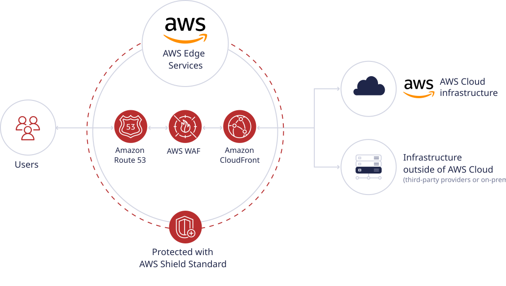

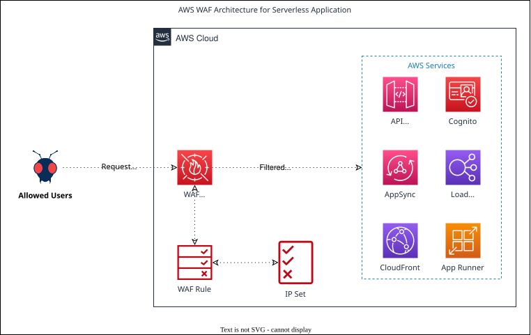

#### 1.4.9 Server Load Balancer

负载均衡SLB（Server Load Balancer）是一种对流量进行按需分发的服务，通过将流量分发到不同的后端服务来扩展应用系统的服务吞吐能力，并且可以消除系统中的单点故障，提升应用系统的可用性。

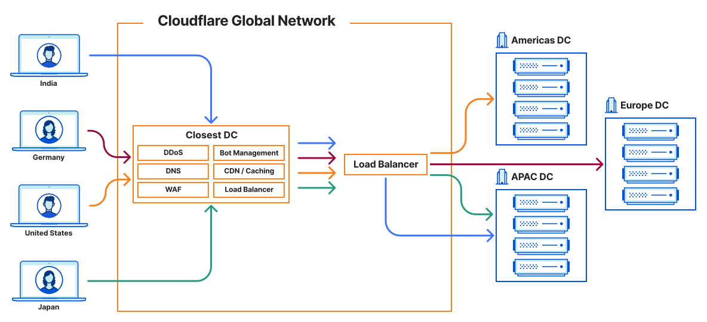

### `1.5 Elastic Compute Service`

**云服务器(****`Elastic Compute Service`****，简称 ****`ECS`****)** 是一种简单高效、处理能力可弹性伸缩的计算服务,其可以快速构建更稳定、安全的应用，提升运维效率，降低 `IT` 成本，使您更专注于核心业务创新。云服务器和`ECS`的含义有重复，它他们表达的是同一个意思，只不过一个是中文，一个是英文缩写而已。`ECS`意思是弹性计算服务器[^13]。

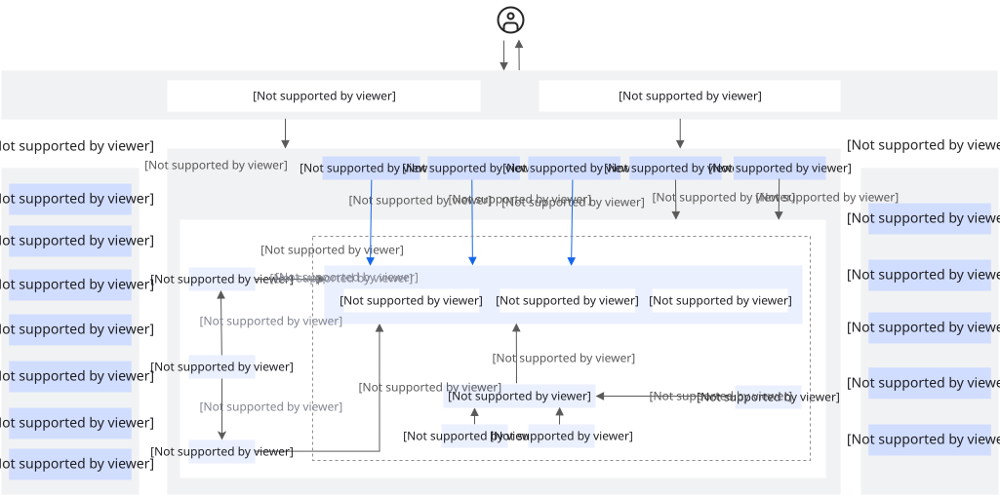

> **NOTE : ****`ECS`**** 具有以下优势：**
>
> 1. **灵活扩展性(弹性)**：支持分钟级创建/释放实例，可随时根据业务压力调整配置规格；
> 2. **完全管理权限** :  用户对云服务器的操作系统有完全控制权，用户可以通过连接管理终端自助解决系统问题，进行各项操作；
> 3. **自定义镜像** : 通过已有`ECS`实例或快照创建自定义镜像，还支持导入本地的自定义镜像。使用自定义镜像可以快速创建更多相同配置的实例，无需每次创建实例时重复配置。
> 4. **集成式服务**：提供自动快照(快照备份与恢复)、安全组策略、弹性网卡等原生工具，避免用户单独搭建网络或备份系统；
> 5. **成本优化机制**：通过抢占式实例（最高降价90%）、预留实例券等模式降低长期负载成本。

> **Tips** :  如果使用的是云服务器，可以考虑使用对应云服务商搭建的`pypi`镜像服务。(速度最快到`178M/s`)
>
> 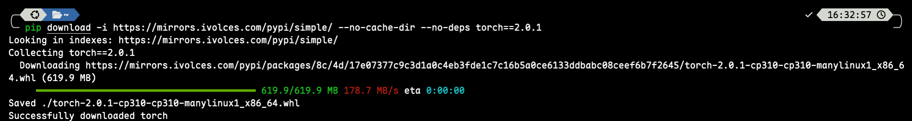

#### `1.5.1 vCPU`

`vCPU` 是**基于软件实现的虚拟`CPU `****资源，而不是真正的物理****`CPU`内核**。 它们不像真正的`CPU` 那样实际存在于计算机硬件中。 `vCPU` 的性能和效率通常低于真正的物理`CPU` 内核，因为它们需要通过虚拟化层来访问底层硬件资源。

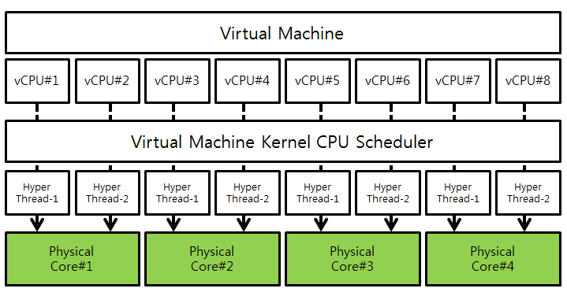

#### 1.5.2 云盘/块存储（`Block Storage`）

云盘/块存储（`Block Storage`）是云计算中**模拟物理硬盘**的存储服务。云服务商其抽象为**块设备**，通过云服务器`ECS`挂载使用，具备**格式化、分区、构建文件系统**能力（如`NTFS`/`ext4`/`XFS`），其数据以固定大小的块（`Block`）存储，与底层物理磁盘映射，**直接暴露原始存储空间**给用户。

> **NOTE** :在创建`ECS`后，会默认挂载两种不同容量的块存储：
>
> 
>
> - **系统盘** : 是`ECS`实例的启动盘，用于存储操作系统和程序文件等系统相关的数据。只能随ECS实例创建，生命周期与挂载的`ECS`实例相同。
> - 数据盘 : 用于存储用户数据、日志和其他应用程序等非系统相关的数据。可以随ECS实例创建，也可以单独创建。

#### `1.5.3 Snapshot`

**快照(****`Snapshot`****)** 是指云盘数据在某个时刻的完整拷贝，是一种重要的数据容灾手段。通过快照可以定期备份云盘的业务数据，以应对误操作、攻击或病毒导致的数据丢失风险。如果遇到云盘数据丢失或异常时，可以通过快照将云盘数据完整地恢复到某一个时间点，以实现业务的连续性。

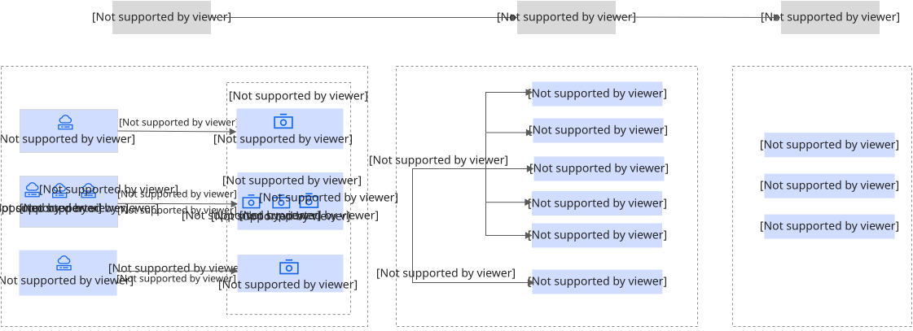

#### `1.5.4 Image`

> **NOTE** : 在创建不同版本的镜像时，推荐记录镜像修改情况

> **NOTE** : 除了可以将示例云盘打包为镜像，也可以将分析中会使用的`docker` 等容器镜像推送到镜像仓库，已实现快速分发与使用。

**自定义镜像**是云服务器中一种由用户**自主创建的系统模板**，它完整保存了某一时刻云服务器的操作系统、预装应用、配置文件、磁盘数据等环境状态（类似“服务器环境的完整快照”），可实现**一键复制相同的计算环境**[^14]。

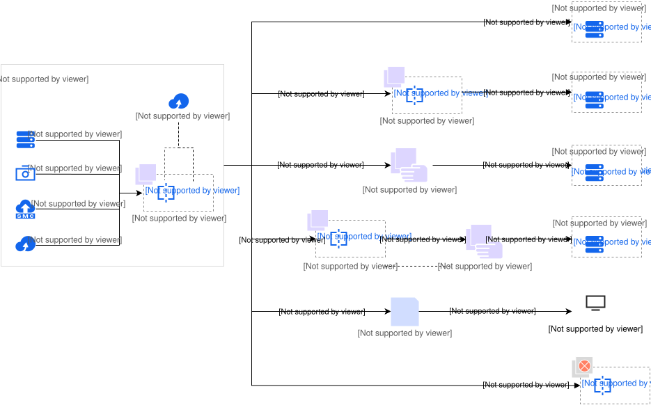

> **NOTE** : \*\*云服务商提供的自定义镜像可以支持以下操作 ： \*\*
>
> | **操作**​       | **名称**​     | **说明**​                                                  |
> | ------------- | ----------- | -------------------------------------------------------- |
> | **创建镜像**​     | 使用实例创建自定义镜像 | 基于运行中的\`ECS\`实例生成镜像，完整保留当前系统盘和数据盘状态。                     |
> |               | 使用快照创建自定义镜像 | 选择已有磁盘快照（系统盘或数据盘）生成镜像，适用于从备份恢复特定时间点环境。                   |
> | **镜像迁移**​     | 导入镜像        | 将本地或其他云平台的镜像文件（如\`RAW\`/\`QCOW2\`/\`VHD\`格式）导入，转换为可用镜像。  |
> | **镜像维护**​     | 更新自定义镜像     | 通过系统运维管理一键更新镜像中的软件和配置，支持批量操作，避免手动更新低效问题。                 |
> | **镜像分发**​     | 复制镜像        | 跨地域复制镜像（如北京→上海），或更改镜像加密状态（如非加密→\`KMS\`加密）。               |
> |               | 共享镜像        | 将镜像共享给其他账号使用，方便团队协作或多账号统一部署环境。                           |
> | **镜像导出**​     | 导出自定义镜像     | 将镜像导出对象存储空间，支持下载到本地或迁移到其他环境。                             |
> | **镜像信息管理**​   | 修改镜像的属性和标签  | 调整镜像名称、描述、启动模式（\`BIOS\`/\`UEFI\`）、\`NVMe\`属性等元数据，便于分类管理。 |
> | **镜像生命周期管理**​ | 删除自定义镜像     | 清理不再需要的镜像以释放存储空间，需确认无实例依赖该镜像后方可操作。                       |

##### **`Container Registry`**

**镜像仓库（****`Container Registry`****）是用于存储、管理和分发**容器镜像与**云原生制品**（如`Helm Chart`）的托管平台[^15]。

**云镜像仓库（Cloud Container Registry）** 是一个在云平台上存储和管理操作系统镜像、应用镜像、容器镜像等软件镜像的服务或平台。它允许用户将镜像文件上传、存储，并通过网络提供给需要的用户或系统。通常，云镜像仓库用于简化操作系统、软件环境、虚拟机或容器等镜像的管理与分发[^16]。

[CR : Container Registry](<CR - Container Registry/CR - Container Registry.md> "CR : Container Registry")

**云镜像仓库（Cloud Container Registry）** 是一个在云平台上存储和管理操作系统镜像、应用镜像、容器镜像等软件镜像的服务或平台。它允许用户将镜像文件上传、存储，并通过网络提供给需要的用户或系统。通常，云镜像仓库用于简化操作系统、软件环境、虚拟机或容器等镜像的管理与分发[^16]。

### 1.6 Function as a Service

**Function as a Service（功能即服务或称为 FaaS）** 是一种云计算服务，它允许开发人员以功能的形式来构建、计算、运行和管理这些应用包，无需维护自己的基础架构。FaaS 是一种在无状态容器中运行的事件驱动型执行模型，这些功能将利用 FaaS 提供商的服务来管理服务器端逻辑和状态。FaaS 解决方案可通过主流公共云提供，并可在本地置备，这样就为企业 IT 应用开发新增了一些重要的功能。获取云原生策略指南，为借助 FaaS 实施无服务器方案做好准备[^17][^18]。

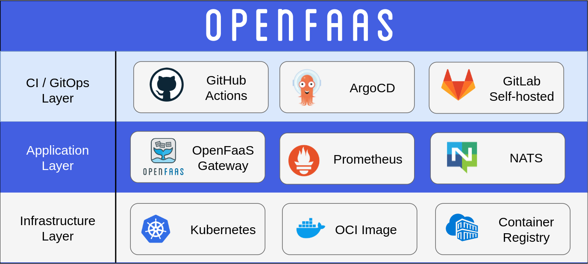

### `1.7 AK` & `SK`

在使用云服务过程中往往会经常使用`AK` & `SK`对权限进行验证。**`Access Key Id(AK`**)用于标示用户，\*\*`Secret Access Key(SK)`\*\*是用户用于加密认证字符串和云厂商用来验证认证字符串的密钥，其中`SK`必须保密。 `AK/SK`原理使用对称加解密。 收到用户的请求后，系统将使用`AK`对应的相同的`SK`和同样的认证机制生成认证字符串，并与用户请求中包含的认证字符串进行比对。

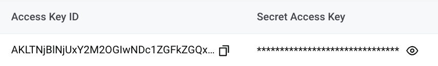

> **Tips** : \*\*`Access Key`\*\***管理实践推荐**：
>
> 1. **🌌 避免主账号密钥（保护“恒星级”风险）**
>    - **现象**：主账号密钥权限覆盖整个云环境（类似恒星引力范围）。
>    - **风险**：一旦泄露，攻击者可控制账号下所有资源（数据删除、服务停摆、费用爆炸）。
>    - **措施**：
>      - ❌ 禁止创建主账号密钥（即使已存在，立即停用并替换为`IAM`子用户密钥）。
>      - ✅ 使用`IAM`最小权限角色（参考哈勃望远镜的“精准观测”原则）
> 2. **🪐 划分工作负载用户与登录用户（构建“双星系统”平衡）**
>    - **场景对比**：
>      | **用户类型**​   | **定位**​        | **权限配置**​      |
>      | ----------- | -------------- | -------------- |
>      | **工作负载用户**​ | 程序/服务调用\`API\` | 仅开放必要\`API\`权限 |
>      | **运维登录用户**​ | 管理员登录控制台       | 禁用密钥生成功能       |
>    - **核心逻辑**：
>      - 🔒**防止权限交叉**：避免密钥创建权限与登录权限混杂（如“黑洞吞噬数据”）。
>      - 🛡️**离职/转岗隔离**：程序用户密钥独立于人员账号，避免连带失效风险。
> 3. **🔄 定期轮换密钥（遵循“行星轨道”周期性规律）**
>    - **操作流程**:
>      1. 新建密钥（保留旧密钥并行生效） → 替换应用配置 → 监控旧密钥静置（>7天） → 禁用旧密钥 → 检测无残留调用后删除。
>      2. **密钥轮换周期**≤ 90天（类似行星公转避免脱离轨道）。
>    - **工具支持**:
>      - 👉**访问时间回溯**：2024年1月1日后系统记录密钥访问时间，用于判断是否可安全禁用（旧密钥无访问记录即无引力残留）。
> 4. **⚠️ 密钥存储禁区（抵御“宇宙射线”式泄露）**
>    - **典型泄露场景**:
>      - ❗**代码硬编码**（如`access_key = "AKIA..."`） → 随代码提交到公开仓库。
>      - ❗**环境变量明文存储**（未加密的服务器配置文件）。
>    - **安全替代方案**:
>      - 🌟**密钥管理服务（****`KMS`****）**：将密钥加密存储，运行时动态解密（类似中子星密度的保护）。
>      - 🌟**临时凭证（****`STS`****）**：通过角色扮演获取临时`Token`（生命周期短，接近黑洞蒸发的安全性设计）。
> 5. **🌠 增强实践（高阶防护)**
>    1. **自动化密钥监控**:
>       - 使用云审计（`CloudTrail`）密钥使用行为，触发异常调用告警（如突然跨地域访问）。
>    2. **密钥分级管理**:
>       - 按业务场景划分密钥用途（例如：生产环境密钥、测试环境密钥），减少单点爆破风险。
> 6. **📡临时密钥优先（终极推荐）**
>    - **优势**：临时`STS`凭证（有效期15分钟\~36小时）即使泄露，短有效期自动过期。
>    - **适用场景**：`CI/CD`流水线、无服务器函数（`Lambda`）、容器任务等自动伸缩环境。

### 1.8 Storage

**`EBS`（Elastic Block Store）**、\*\*`OSS`****（Object Storage Service）\*\*和 \*\*`NAS`****（Network Attached Storage）\*\*是云存储服务中的三种不同类型，各自适用于不同的使用场景。

**文件存储(File Store)** 的数据存储单位为文件，数据存储方式是二叉树；**块存储(Block Store)** 的数据存储单位为数据块，数据存储格式是数组；**对象存储(Object Storage)** 的存储单位为对象，数据存储方式是哈希表[^19]。

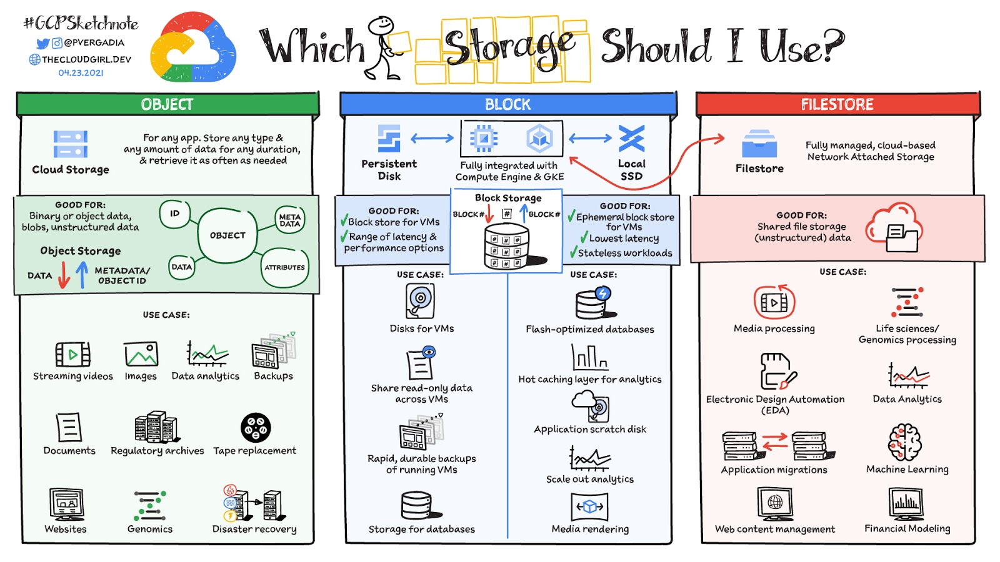

> `NOTE` : 当有超大容量的数据需要上传的云端，可以直接联系云服务商，直接将数据快递到数据中心，直接进行数据拷贝。
>
> **`火山云数据闪送`** ： 使用火山硬盘、用户自有硬盘或火山 `DataArk V300`直接快递数据[^20]。
>
> | !\[阿里云微型闪电立方  阿里云微型闪电立方  ]\(image/p412101\_LCo8XmfNyp.png "阿里云微型闪电立方  阿里云微型闪电立方  ") | !\[腾讯云云数据迁移（Cloud Data Migration，简称 CDM）  腾讯云云数据迁移（Cloud Data Migration，简称 CDM）  ]\(image/image\_mDVOzuleaI.png "腾讯云云数据迁移（Cloud Data Migration，简称 CDM）  腾讯云云数据迁移（Cloud Data Migration，简称 CDM）  ") |
> | ----------------------------------------------------------------------------------- | ------------------------------------------------------------------------------------------------------------------------------------------------------------------------------------------------- |

#### `1.8.1 Object Storage`

`Object Storage`在可扩展性、容错性和数据持久性方面显著优于现有的并行文件系统，且针对某些特定工作负载，它还能为计算节点提供惊人的输入输出带宽。\*\*对象存储通过彻底摒弃传统文件系统中“文件”和目录层级的概念来实现这些卓越性能。**它不支持文件系统所需的**`POSIX IO`\*\*调用（如`open`、`close`、`read`、`write`、`seek`），仅支持两个核心操作：`PUT`（写入存储）和`GET`（读取存储）[^21]。

> \*\*`Object Storage`\*\***与传统文件系统的本质差异**
>
> - **数据模型革新**：
>   - **对象取代文件**：每个数据实体（`Object`）包含数据本体（`Payload`）、全局唯一标识符（如`UUID`）及扩展元数据（自定义`Key-Value`键值对）。
>   - **消除目录层级**：数据通过唯一标识符直接寻址，避免传统文件系统的路径解析（`Path Resolution`）开销和锁竞争问题。
> - **接口简化**：
>   - **仅需**\*\*`PUT`****/****`GET`\*\***操作**：直接通过对象`ID`读写全部数据，无需`open()`阶段的预取状态维护。
>   - **不支持随机写（****`Random Write`****）**：对象存储通常设计为“一次写入不可修改”，而更新操作需通过覆写（`Overwrite`）整个对象实现。

> \*\*`Object Storage`\*\***这种极其简单性在高性能计算的背景下具有许多极其有价值**
>
> - **`Write-Once`**\*\* : 由于数据是一次性写入的,节点在读取对象内容前无需获取锁。在读取对象时，不存在其他节点同时写入该对象的风险。\*\* ​
>
>   \*\*`Write-Once`\*\*避免了在多个节点可能同时访问同一文件需通过锁机制协调机制而加快了读取速度。
> - \*\*对象的唯一引用是其唯一对象 \*\***`ID`** ：可以通过对象`ID`的简单哈希直接确定对象的物理位置（例如位于哪个存储节点的哪个磁盘）。计算节点无需联系元数据服务器即可确定存储对象内容的具体位置。

##### `1.8.1.1 Object Storage` limits

> \*\*`Object Storage`\*\***的简单性使其具有极高的可扩展性，但也极大地限制了它的实用性:**
>
> 1. **对象的不可变性限制**： &#x20;
>
>    对象的不可变性限制了它们只能执行“一次写入、多次读取（Write-Once, Read-Many）”的工作负载。这意味着对象存储不能用于临时存储（Scratch Space）或热存储（Hot Storage），其应用场景主要局限于数据归档（Data Archival）。
> 2. **元数据管理的局限性**： &#x20;
>
>    对象仅由数据和对象 ID 组成，没有其他内容。对象的元数据（如逻辑文件名、创建时间、所有者和访问权限）必须在对象存储之外进行管理。这在实际应用中可能非常不便。

> **Tips** : `Object Storage`的两种缺陷都足够严重，以至于几乎所有对象存储系统都会在对象存储层之上额外添加一个数据库层。这一数据库层（不同厂商称之为“网关”或“代理”服务）为用户提供了一个更加友好的前端接口，通常负责维护对象 `ID` 与用户友好型元数据（如对象名称、访问权限等）之间的映射关系。
>
> 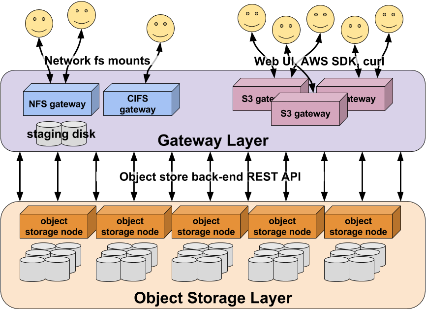

##### **`Bucket`**

**`Bucket`（存储空间）**: 存储桶是存储对象的容器，所有的对象都必须隶属于某个存储桶。存储桶具有各种配置属性，包括地域、访问权限等。使用前需要根据实际需求，创建不同类型的存储桶来存储不同的数据。

> **NOTE** : `Bucket`原意为桶，是用户用来管理所存储对象的存储空间。需要注意的是，存储空间的内部是扁平的，没有文件系统的目录等概念，所有的对象都直接隶属于其对应的存储空间。用户可拥有多个`Bucket`，但其名称在`OSS`中必须是全局唯一的，一旦创建便无法修改，其内部对象数量不限。

> 🌴**Tips : 存储空间的命名规范如下：**
>
> - 只能包括小写字母、数字和短划线（-）。
> - 必须以小写字母或者数字开头和结尾。
> - 长度必须在`3~63`字符之间。

##### 1.8.1.3 Object

`Object`是 `OS` 存储数据的基本单元，本帮助文档中对象、文件、`Object` 均具有相同含义。对象由键（`Key`），数据（`Data`）和元数据（`Metadata`）三部分组成。

对象（`Object`）是对象存储（`Object Storage`）的基本单元，可理解为任何格式类型的数据，例如图片、文档和音视频文件等。存储桶（`Bucket`）是对象的载体，每个存储桶可容纳任意数量的对象[^22]。


> `Object Storage` & `Metadata` : 每个对象都由对象键（`ObjectKey`）、对象值（`Value`）、和对象元数据（`Metadata`）组成。
>
> - **对象键（****`ObjectKey`****）**：对象键是对象在存储桶中的唯一标识，可以通俗的理解为文件路径。在 `API`、`SDK` 示例中，对象的命名格式为`<ObjectKey>`。
> - **对象值（****`Value`****）**：即上传的对象本身，可以通俗的理解为文件内容（`Object Content`）。
> - **对象元数据（`Metadata`**）：是一组键值对，可以通俗的理解为文件的属性，例如文件的修改时间、存储类型等，您可以在上传对象后对其进行查询。

> **Tips**\*\* : 对象存储的元数据可以方便的进行自定义，创建自定义元数据，需要同时指定键和值。创建自定义元数据​`key:value`\*\***对后，可以删除键或更改值。**

> **NOTE** : 对象的生命周期是从上传成功到被删除为止。在整个生命周期内，除使用追加方式上传的`Object`可以通过继续追加上传写入数据外，使用其他方式上传的`Object`内容无法编辑，您可以通过重复上传同名的对象来覆盖之前的对象。

> 🌔\*\*`Object`\*\***对象的命名规范如下：**
>
> - 使用`UTF-8`编码。
> - 长度必须在`1~1023`字符之间。
> - 不能以正斜线`/`或者反斜线`\`开头。

##### `1.8.1.4 ObjectKey`

对象存储中提到的`ObjectKey`、`Key`以及`ObjectName`是同一概念，均表示对`Object`执行相关操作时需要填写的`Object`名称。例如向某一存储空间上传`Object`时，`ObjectKey`表示上传的`Object`所在存储空间的完整名称，即包含文件后缀在内的完整路径，如填写为`abc/efg/123.jpg`。

##### 1.8.1.5 Region & Endpoint

`Region`表示`OS`的数据中心所在物理位置。用户可以根据费用、请求来源等选择合适的地域创建`Bucket`。一般来说，距离用户更近的`Region`访问速度更快。

`Endpoint`表示`OS`对外服务的访问域名。`OS`以`HTTP RESTful API`的形式对外提供服务，当访问不同的`Region`的时候，需要不同的域名。通过内网和外网访问同一个`Region`所需要的`Endpoint`也是不同的。

##### `1.8.1.6 AccessKey`

`AccessKey` 简称 `AK`是 `AccessKey Id` 和 `AccessKey Secret` 的统称，是访问 `OS` 的身份验证。

##### 1.8.1.7 原子性和强一致性

`Object`操作在`OSS`上具有原子性，操作要么成功要么失败，不存在中间状态的`Object`。当`Object`上传完成时，`OSS`即可保证读到的`Object`是完整的，`OSS`不会返回给用户一个部分上传成功的`Object`。

`OS` 具有强一致性，即对于同一个对象的读取和写入操作，在任何时间点都能够呈现出一致的状态。当成功地将一个对象写入对象存储系统后，任何后续的读取操作都能立即获取到最新写入的数据。即使存在多个副本或分布式存储节点，系统也会确保数据在所有副本中同步更新并可立即访问。

#### `1.8.2 NAS`

> **NOTE** : 如果要将火山云`NAS`挂载到本地服务器需要在 放行`111`,`2049`这个两个端口，才能访问`nfs`服务。（不同云服务商的`ip`地址可能不同）。
>
> ```python title="检查一下是能够链接2049/111  prot "
> # telnet 2049 prot
> telnet 10.160.24.3 2049
> # telnet 2049 111
> telnet 10.160.24.3 111
> ```
>

`NAS`（`Network Attached Storage`）是一种通过网络提供文件级共享存储的服务，允许多个客户端（如云服务器、容器、AI应用）并发访问同一存储空间。`NAS`基于`POSIX`文件接口，天然适配原生操作系统，提供共享访问，同时保证数据一致性和锁互斥。它提供了简单的可扩展文件存储以供与`ECS`配合使用，多个`ECS`实例可以同时访问`NAS`文件系统，并且存储容量会随着您添加和删除文件而自动弹性增长和收缩，为在多个实例或服务器上运行产生的工作负载和应用程序提供通用数据源。

> **云服务商提供的托管式**\*\*`NAS`\*\***具备以下特点：**
>
> 1. **完全托管**：无需自行部署硬件或维护文件系统;
> 2. **弹性伸缩**：存储容量按需自动扩展，无上限约束;
> 3. **多协议支持**：兼容`NFS`（`Linux`）、`SMB`（`Windows`）、`FTP`等协议;
> 4. **持续在线**：数据跨可用区（`AZ`）冗余，保障高可用性（99.95%\~99.99% `SLA`）。

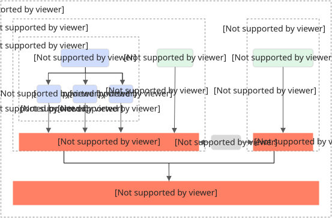

- **`NAS`**\*\* (Network Attached Storage)\*\* ​

  `NAS`**特点：**
  - **文件存储**：NAS 提供的是文件级别的存储，类似于网络文件系统（NFS）。
  - **共享访问**：允许多个计算节点同时访问同一个文件系统。
  - **弹性扩展**：可以根据需求动态调整存储容量。
  - **高性能**：适用于需要低延迟和高吞吐量的应用。
  - **兼容性**：支持多种文件系统协议，如 NFS 和 SMB/CIFS。
    `NAS`**应用场景：**
  - **共享文件系统**：多个应用程序或用户需要共享同一组文件。
  - **开发环境**：存储代码库、构建工具和其他开发资源。
  - **媒体处理**：存储和处理大文件，如视频编辑和渲染。
  - **容器存储**：为容器提供持久化存储。

> **Knowledge**\*\* : ****`NAS`**** 基本概念\*\*
>
> - `地域` ： 数据中心所在的物理位置，文件存储 `NAS` 满足跨地域访问或者与承载不同地域的业务系统时，需要根据地域按需进行配置。
> - `可用区` ： 可用区指在同一地域内，电力和网络互通的独立物理区域。
> - `VPC` ： 私有网络 `VPC` 是一种虚拟私有网络，`VPC` 之间相互隔离。
> - `挂载点` ： 挂载点是 `NAS` 文件系统在网络环境中的连接点。`NAS` 文件系统需要挂载在计算节点中才能完成数据的访问与存储。挂载是将计算节点与 `NAS` 文件系统相连接的操作。
> - `权限组` ： 权限组用于配置通过不同挂载点访问文件系统的权限信息，包括授权 `IP` 地址、读写操作权限等。
> - `NFS` : 网络文件系统 `NFS`（Network File System），挂载后访问网络中的文件系统如同访问本地文件系统一样，是 `Linux` 或 `Unix` 系统中最通用的网络文件系统类型。
> - `文件系统` : 文件系统通过标准的 `NFS` 协议为您提供文件存储服务，用于网络文件远程访问，通过管理控制台创建挂载地址后，即可按需在客户端中通过标准的 `POSIX` 接口对文件系统进行访问。
> - `POSIX`  : 可移植操作系统接口 `POSIX`（Portable Operating System Interface），是 `IEEE`为在各种 `Unix` 操作系统上运行软件而定义`API` 的一系列互相关联的标准的总称。为一个 `POSIX` 兼容的操作系统编写的程序，可以在任何其他的 `POSIX`操作系统上编译执行。

##### `1.8.2.1 NAS` & `NFS`

`NFS` 是一种分布式文件系统协议，由 `Sun Microsystems` 开发，允许不同计算机（如服务器、客户端）通过网络共享文件和目录[^23]。`NAS` 设备通过 `NFS` 协议将存储空间“挂载”到客户端（如 `Linux`/`Unix` 系统），使其像本地磁盘一样访问远程文件。

##### `1.8.2.2 NAS` & 目录配额 & 权限组

为了控制`NAS`存储中存储数据的量，云服务商一般会提供目录配额功能。目录配额功能会对指定目录下的文件数量、存储容量使用量，也可以限制指定目录下的文件数量、存储容量使用量。


云服务商提供的`NAS`存储可以通过创建权限组，限制访问文件系统的 `IP` 地址，实现不同地址的访问权限管理。

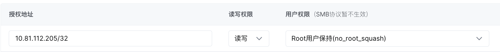

#### 1.8.3 Elastic Block Storage

弹性块存储`EBS`（`Elastic Block Storage`）是高可用、高可靠、高性能、弹性扩展的块存储设备，可以作为云服务器和弹性容器服务的可扩展硬盘使用[^24]。

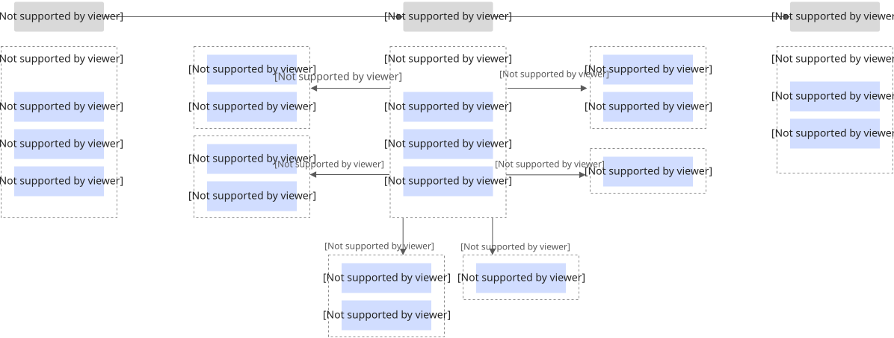

- **`EBS (Elastic Block Store)`**

  **`EBS`**\*\* 特点：\*\* ​
  - **块存储**：EBS 提供的是块级别的存储，类似于传统的硬盘或 SSD。
  - **持久性**：数据在 EBS 卷上是持久化的，即使实例停止或终止，数据仍然保留。
  - **性能**：支持多种卷类型，如通用型 SSD (gp2/gp3)、预置 IOPS SSD (io1/io2) 和磁性介质 (standard)，以满足不同的性能需求。
  - **可扩展性**：可以动态调整卷的大小，并且可以在运行时增加 IOPS。
  - **快照**：支持创建快照以备份数据，并可以从快照中恢复数据。
    **`EBS`**\*\* 应用场景：\*\* ​
  - **数据库**：如 MySQL、PostgreSQL 等需要高性能和持久化存储的数据库。
  - **文件系统**：用于需要块级访问的应用程序，如文件服务器。
  - **操作系统存储**：作为 EC2 实例的根设备或附加存储。

#### 1.8.4 Structured Data & Unstructured data

> 结构化数据(`Structured Data`) & 非结构化(`Unstructured data`)
>
> 1. **结构化数据**
>
>    在最早，结构化数据也称之为`行数据`。是可以由一个`二维表`来描述的数据。通俗的说，数据是有表结构的。不过，发展到如今，对于结构化的定义就不仅仅是指数据库中的数据了。我们可以认为，可以用`schema`定义的数据，就是结构化数据。那么什么是`schema`呢？ 可以简单的认为，`schema`就是表结构、或者说是一种对数据结构的描述。结构化数据是规范的，在`schema`的定义下，每一列，每一个位置，应该是什么类型的数据，表达的是什么意义都是确定的。对于这样的具有确定意义的数据的分析的处理，是极为方便的。
> 2. **非结构化数据** ： 无法用`schema`定义的数据
> 3. **半结构化数据**
>
>    可以用`schema`定义其一部分的数据，但无法定义全部。或者说：无法用二维表（比如：数据库表结构定义的数据）描述，但是其自身有相应的标记或描述语言，对自身进行数据描述的数据，其遵循自身所带有的描述或标记规定的结构
>    > **NOTE** : 常见的半结构化数据有：`XML` &  `JSON` & `YAML`

### 1.9 Data Lake

数据湖(`Data Lake`)是一个集中式存储库，允许您以任意规模存储所有结构化和非结构化数据。您可以按原样存储数据（无需先对数据进行结构化处理），并运行不同类型的分析 – 从控制面板和可视化到大数据处理、实时分析和机器学习，以指导做出更好的决策[^25]。

`Data Lake`是一种支持任意数据格式、并保留原始数据内容的大规模存储系统架构，并且其支持海量数据的分析处理。

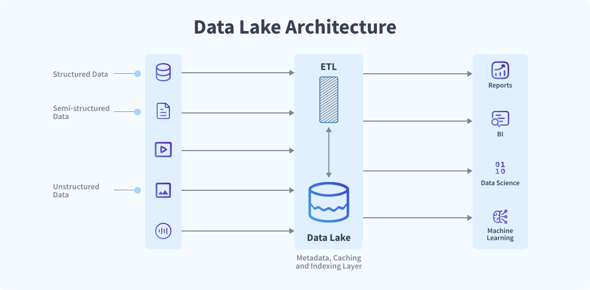

#### `1.9.1 Data Lake` Features

数据湖(`Data Lake`)是一种专注于在集中式存储库中存储大量数据的存储架构。它之所以适合满足现代大数据需求，是由于以下特性：

1. **灵活的数据存储格式**：能够以原始格式（如 `JSON`、`CSV` 或其他格式）存储结构化和非结构化数据，使组织能够快速捕获从源系统收集的数据，而无需花费太多时间和资源进行额外的转换和处理（即所谓的“提取-加载-转换”方法）。
2. **集中化的数据存储**：像 `Databricks` 和 `Amazon S3` 这样的数据湖提供了集中化的数据存储，用于创建单一的数据来源。
3. **可扩展性**：设计为可以轻松地随着数据存储量的增长而扩展（达到 `PB` 级甚至更多）。
4. **多功能性**：支持各种数据分析应用（如数据分析、机器学习、商业智能等）。

### 1.10 DataBase

| !\[]\(image/MySQL\_3scEOwrqnl.svg)                  |   |
| --------------------------------------------------- | - |
| !\[]\(image/MariaDB\_colour\_logo\_Sb3xk4DW3w\.svg) |   |
| !\[]\(image/Mongodb\_Fg2PnS8vTo.png)                |   |
| !\[]\(image/redis-logo-svgrepo-com\_lxg7eCQtu7.svg) |   |
| !\[]\(image/Pg\_logo\_HiMYedXmuB.png)               |   |
| !\[]\(image/SQLite370\_VHeXUmJm6O.svg)              |   |
| !\[]\(image/Cassandra\_logo\_-sATb0Qhi3.svg)        |   |

### **Message Queue, MQ**

**消息队列（Message Queue, MQ**）

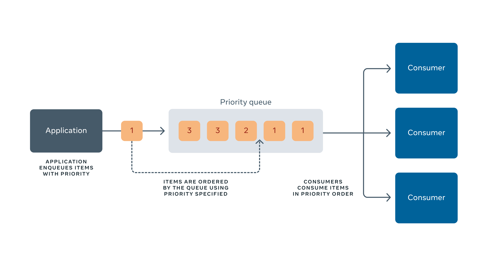


***

## 2 Tutorial

### **Cloud Provider Server**

> **阿里云**
>
> [OSS (对象存储)](<OSS (对象存储)/OSS (对象存储).md> "OSS (对象存储)")

> **腾讯云**
>
> [腾讯云ECS](腾讯云ECS/腾讯云ECS.md "腾讯云ECS")

> \*\* AWS\*\*​
>
> [AWS S3](<AWS S3/AWS S3.md> "AWS S3")

> **Google**
>
> [gsutil](gsutil/gsutil.md "gsutil")

> **Volcengine**&#x20;
>
> [TOS (火山云对象存储)](<TOS (火山云对象存储)/TOS (火山云对象存储).md> "TOS (火山云对象存储)")
>
> [NAS (文件存储)](<NAS (文件存储)/NAS (文件存储).md> "NAS (文件存储)")
>
> [ECS](ECS/ECS.md "ECS")
>
> [火山云 &  slurm集群](<火山云 &  slurm集群/火山云 &  slurm集群.md> "火山云 &  slurm集群")
>
> [火山引擎SDK for Python](<火山引擎SDK for Python/火山引擎SDK for Python.md> "火山引擎SDK for Python")

### 2.2 Benchmark

#### 2.2.1 Block Storage  I/O Benchmark

[Block Storage  I/O Benchmark](<Block Storage  I-O Benchmark/Block Storage  I-O Benchmark.md> "Block Storage  I/O Benchmark")

### 2.3 Minio

[ Github 29K Star的开源对象存储方案——Minio入门宝典-腾讯云开发者社区-腾讯云 对象存储不是什么新技术了，但是从来都没有被替代掉。为什么？在这个大数据发展迅速地时代，数据已经不单单是简单的文本数据了，每天有大量的图片，视频数据产生，在短视频火爆的今天，这个数量还在增加。有数据表明，当今世界产生的数据，有80%是非关系型的。那么，对于图片，视频等数据的分析可以说是大数据与人工智能的未来发展方向之一。 https://cloud.tencent.com/developer/article/1893329](https://cloud.tencent.com/developer/article/1893329 " Github 29K Star的开源对象存储方案——Minio入门宝典-腾讯云开发者社区-腾讯云 对象存储不是什么新技术了，但是从来都没有被替代掉。为什么？在这个大数据发展迅速地时代，数据已经不单单是简单的文本数据了，每天有大量的图片，视频数据产生，在短视频火爆的今天，这个数量还在增加。有数据表明，当今世界产生的数据，有80%是非关系型的。那么，对于图片，视频等数据的分析可以说是大数据与人工智能的未来发展方向之一。 https://cloud.tencent.com/developer/article/1893329")

***

## 3 Tips

### 3.1 VS  Code

> 除了使用云服务器进行高性能计算，还可以在上面搭建代码托管服务\*\*`Code-Server`\*\*服务。
>
> [VS Code (Web)](https://www.wolai.com/w6cbcDqhwJBVME5xEbhVb9 "VS Code (Web)")

### 3.2  Tag & Project

在云计算平台上进行项目分析之前，建议通过新建独立项目并采用规范的计算资源命名方式，以便于后期回顾与维护，避免出现混乱无序的局面 **（默认一时爽，管理火葬场）**。


[Jump Server & NAT traversal](<Jump Server & NAT traversal/Jump Server & NAT traversal.md> "Jump Server & NAT traversal")

***

## 4 Source

> **云计算教材（第三版）**
>
> [云计算（第三版）.pdf](file/云计算（第三版）_uZJiNKjK79.pdf "云计算（第三版）.pdf")

> **云计算学习网站**
>
> [   https://study.liuzehe.top/](https://study.liuzehe.top/ "   https://study.liuzehe.top/")

***

## 5 Reference

[^1]: [https://www.volcengine.com/docs/6396/68529](https://www.volcengine.com/docs/6396/68529 "https://www.volcengine.com/docs/6396/68529")

[^2]: [https://www.volcengine.com/](https://www.volcengine.com/ "https://www.volcengine.com/")

[^3]: [https://cloud.tencent.com/](https://cloud.tencent.com/ "https://cloud.tencent.com/")

[^4]: [https://cn.aliyun.com/](https://cn.aliyun.com/ "https://cn.aliyun.com/")

[^5]: [https://azure.microsoft.com/en-us](https://azure.microsoft.com/en-us "https://azure.microsoft.com/en-us")

[^6]: [https://cloud.google.com/?hl=zh\_cn](https://cloud.google.com/?hl=zh_cn "https://cloud.google.com/?hl=zh_cn")

[^7]: [https://zh.wikipedia.org/wiki/%E6%95%B0%E6%8D%AE%E4%B8%AD%E5%BF%83](https://zh.wikipedia.org/wiki/%E6%95%B0%E6%8D%AE%E4%B8%AD%E5%BF%83 "https://zh.wikipedia.org/wiki/%E6%95%B0%E6%8D%AE%E4%B8%AD%E5%BF%83")

[^8]: [https://help.aliyun.com/zh/resource-management/tag/product-overview/tag-overview](https://help.aliyun.com/zh/resource-management/tag/product-overview/tag-overview "https://help.aliyun.com/zh/resource-management/tag/product-overview/tag-overview")

[^9]: [https://www.volcengine.com/docs/6649/189152](https://www.volcengine.com/docs/6649/189152 "https://www.volcengine.com/docs/6649/189152")

[^10]: [<https://help.aliyun.com/zh/ecs/user-guide/overview-44?spm=5176.21213303.J_v8LsmxMG6alneH-O7TCPa.1.48832f3dZFqYhB&scm=20140722.S_help@@%E6%96%87%E6%A1%A3@@25387>. \_.ID\_help@@%E6%96%87%E6%A1%A3@@25387-RL \_%E5%AE%89%E5%85%A8%E7%BB%84-LOC\_2024SPHelpResult-OR\_ser-PAR1\_213e36b117405317573596939e5cac-V\_4-RE\_new6-P0\_0-P1\_0](https://help.aliyun.com/zh/ecs/user-guide/overview-44?spm=5176.21213303.J_v8LsmxMG6alneH-O7TCPa.1.48832f3dZFqYhB\&scm=20140722.S_help@@%E6%96%87%E6%A1%A3@@25387._.ID_help@@%E6%96%87%E6%A1%A3@@25387-RL_%E5%AE%89%E5%85%A8%E7%BB%84-LOC_2024SPHelpResult-OR_ser-PAR1_213e36b117405317573596939e5cac-V_4-RE_new6-P0_0-P1_0 "https://help.aliyun.com/zh/ecs/user-guide/overview-44?spm=5176.21213303.J_v8LsmxMG6alneH-O7TCPa.1.48832f3dZFqYhB\&scm=20140722.S_help@@%E6%96%87%E6%A1%A3@@25387._.ID_help@@%E6%96%87%E6%A1%A3@@25387-RL_%E5%AE%89%E5%85%A8%E7%BB%84-LOC_2024SPHelpResult-OR_ser-PAR1_213e36b117405317573596939e5cac-V_4-RE_new6-P0_0-P1_0")

[^11]: [https://help.aliyun.com/zh/nat-gateway/user-guide/public-network-nat-gateway/](https://help.aliyun.com/zh/nat-gateway/user-guide/public-network-nat-gateway/ "https://help.aliyun.com/zh/nat-gateway/user-guide/public-network-nat-gateway/")

[^12]: [https://help.aliyun.com/zh/eip/product-overview/what-is-eip/](https://help.aliyun.com/zh/eip/product-overview/what-is-eip/ "https://help.aliyun.com/zh/eip/product-overview/what-is-eip/")

[^13]: [https://developer.aliyun.com/article/196323](https://developer.aliyun.com/article/196323 "https://developer.aliyun.com/article/196323")

[^14]: [https://help.aliyun.com/zh/ecs/user-guide/overview-36](https://help.aliyun.com/zh/ecs/user-guide/overview-36 "https://help.aliyun.com/zh/ecs/user-guide/overview-36")

[^15]: [https://www.volcengine.com/docs/6420/79130](https://www.volcengine.com/docs/6420/79130 "https://www.volcengine.com/docs/6420/79130")

[^16]: [https://www.volcengine.com/docs/6420/68643?lang=zh](https://www.volcengine.com/docs/6420/68643?lang=zh "https://www.volcengine.com/docs/6420/68643?lang=zh")

[^17]: [https://panzhongxian.cn/cn/2021/03/faas-note-and-openfaas-deployment/](https://panzhongxian.cn/cn/2021/03/faas-note-and-openfaas-deployment/ "https://panzhongxian.cn/cn/2021/03/faas-note-and-openfaas-deployment/")

[^18]: [https://www.redhat.com/zh/topics/cloud-native-apps/what-is-faas](https://www.redhat.com/zh/topics/cloud-native-apps/what-is-faas "https://www.redhat.com/zh/topics/cloud-native-apps/what-is-faas")

[^19]: [https://www.cnblogs.com/fengxinglanmao/p/16327078.html](https://www.cnblogs.com/fengxinglanmao/p/16327078.html "https://www.cnblogs.com/fengxinglanmao/p/16327078.html")

[^20]: [https://www.volcengine.com/docs/6774/129262](https://www.volcengine.com/docs/6774/129262 "https://www.volcengine.com/docs/6774/129262")

[^21]: [https://www.glennklockwood.com/data-intensive/storage/object-storage.html](https://www.glennklockwood.com/data-intensive/storage/object-storage.html "https://www.glennklockwood.com/data-intensive/storage/object-storage.html")

[^22]: [https://cloud.tencent.com/document/product/436/13324](https://cloud.tencent.com/document/product/436/13324 "https://cloud.tencent.com/document/product/436/13324")

[^23]: [https://en.wikipedia.org/wiki/Network\_File\_System](https://en.wikipedia.org/wiki/Network_File_System "https://en.wikipedia.org/wiki/Network_File_System")

[^24]: [https://www.volcengine.com/docs/26444/434902](https://www.volcengine.com/docs/26444/434902 "https://www.volcengine.com/docs/26444/434902")

[^25]: [https://github.com/sfzsjx/document\_classfication/blob/master/%E5%A4%A7%E6%95%B0%E6%8D%AE%E6%8A%80%E6%9C%AF%E6%A0%88/%E6%95%B0%E6%8D%AE%E5%AD%98%E5%82%A8/%E6%95%B0%E6%8D%AE%E6%B9%96%E6%8A%80%E6%9C%AF/%E6%95%B0%E6%8D%AE%E6%B9%96%E7%AC%94%E8%AE%B0.md](https://github.com/sfzsjx/document_classfication/blob/master/%E5%A4%A7%E6%95%B0%E6%8D%AE%E6%8A%80%E6%9C%AF%E6%A0%88/%E6%95%B0%E6%8D%AE%E5%AD%98%E5%82%A8/%E6%95%B0%E6%8D%AE%E6%B9%96%E6%8A%80%E6%9C%AF/%E6%95%B0%E6%8D%AE%E6%B9%96%E7%AC%94%E8%AE%B0.md "https://github.com/sfzsjx/document_classfication/blob/master/%E5%A4%A7%E6%95%B0%E6%8D%AE%E6%8A%80%E6%9C%AF%E6%A0%88/%E6%95%B0%E6%8D%AE%E5%AD%98%E5%82%A8/%E6%95%B0%E6%8D%AE%E6%B9%96%E6%8A%80%E6%9C%AF/%E6%95%B0%E6%8D%AE%E6%B9%96%E7%AC%94%E8%AE%B0.md")
