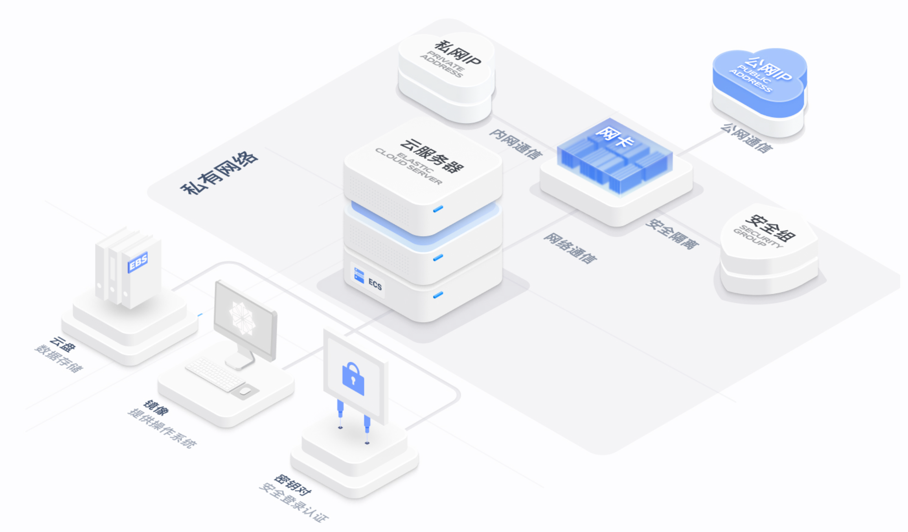
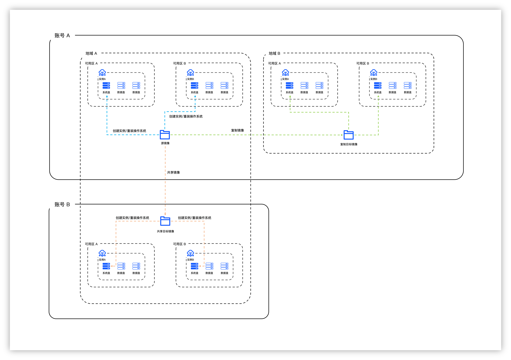
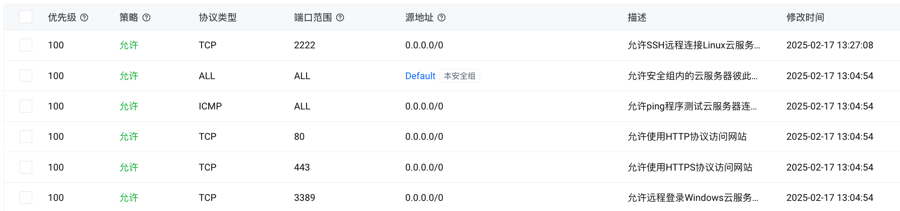
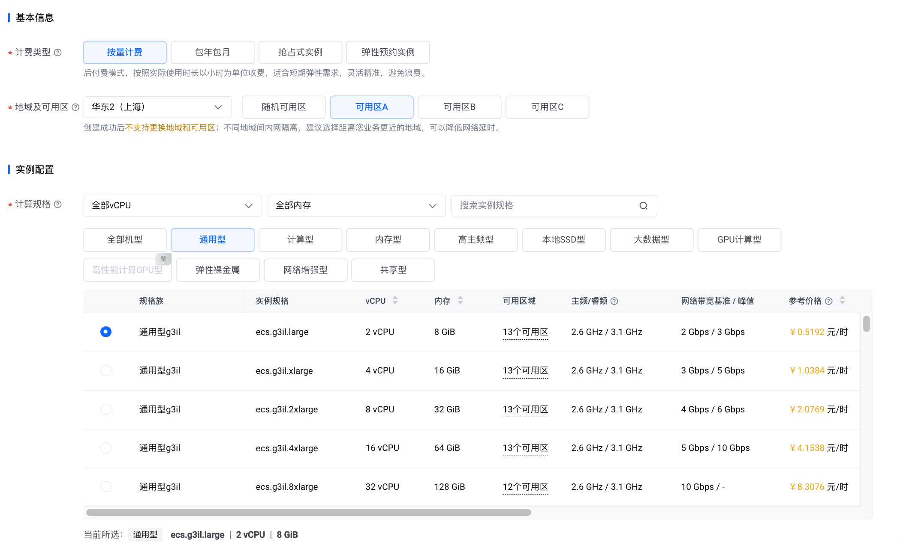
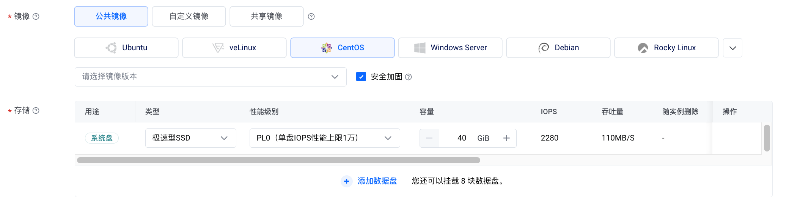
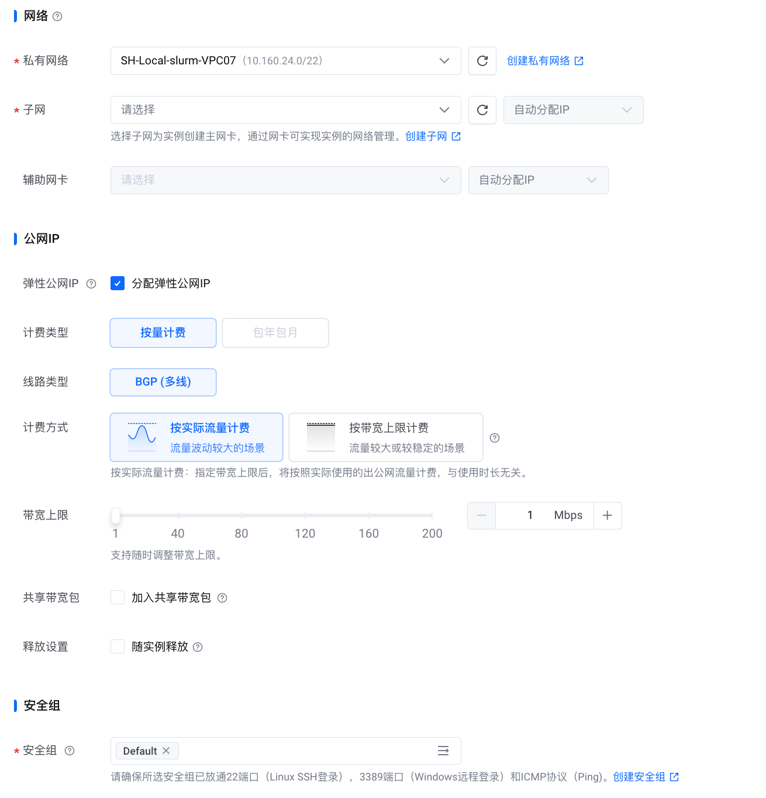
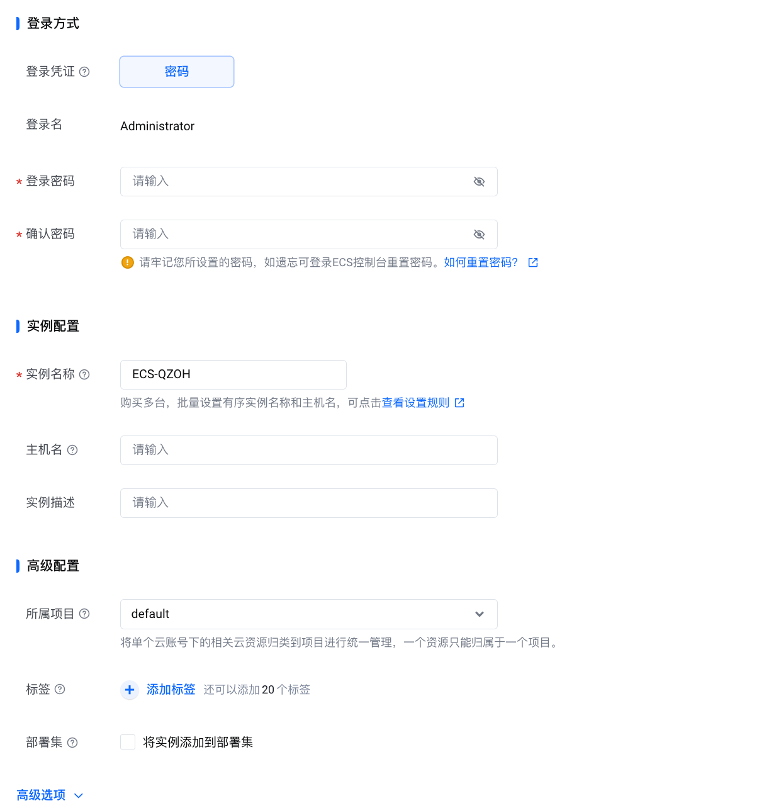

# ECS

## 目录

- [1 Introduce](#1-Introduce)
  - [1.1 ECS](#11-ECS)
    - [1.1.1 ECS Features](#111-ECS-Features)
    - [1.1.2 ECS Architecture](#112-ECS-Architecture)
  - [1.2 弹性裸金属云服务器](#12-弹性裸金属云服务器)
  - [1.3 Images](#13-Images)
    - [1.3.1 Images Features](#131-Images-Features)
- [2 Tutorial](#2-Tutorial)
  - [2.1 Create ECS](#21-Create-ECS)
  - [2.2 Create Images](#22-Create-Images)
- [3 Reference](#3-Reference)

## 1 Introduce

### `1.1 ECS`

云服务器（Elastic Compute Service， `ECS`）是火山云提供的一种安全稳定、可弹性伸缩的云上虚拟服务器，包含CPU、内存、云盘、网络等资源。在使用前可以结合自己的需求申请对应大小、规格的资源并按需调整，用于运行不同的业务负载，而无需关注硬件服务器的位置和状态[^1]。

#### `1.1.1 ECS` Features

**弹性**：即开即用，分钟级交付，支持随时调整云服务器的计算规格、存储容量、计费方式等，灵活应对业务变化。

**高性能** ：可选多种`CPU`平台及`GPU`加速卡，可配备高效云盘与高性能本地盘存储提供超高网络收发包能力，满足高性能业务需求

**安全** : `VPC`网络隔离，完备的权限管理系统，实时监控告警，秒级响应的`DDoS`防护，全方位保护您的云上资产

**稳定** : 单实例在单可用区的可用性能够达到`99.975%`，多可用区的多台实例可用性高达`99.995%`，提供部署集容灾与分钟级故障疏散能力，保障业务稳定运行

**低成本** : 无需搭建和维护基础物理设施，支持包含抢占式实例、预留实例券在内的多种计费方式，帮助您更大程度的节省支出

#### `1.1.2 ECS` Architecture

### 1.2 弹性裸金属云服务器

弹性裸金属云服务器基于火山引擎自研`DPU`软硬件一体架构，提供专属物理计算资源，配备高性能计算服务与高吞吐、低延迟的网络，无虚拟化耗损，计算性能与传统物理机无差异，兼顾性能、灵活性和安全物理隔离，实现资源分钟级安全、快速交付[^2]。

\*\*弹性裸金属云服务器优势 ： \*\*

- **第三方虚拟化** : 支持部署第三方虚拟化平台，适用于二次虚拟化及混合云和多云部署场景。
- **容器架构** : 容器架构下提供更高的部署密度、更低的资源开销，较虚拟化环境可优化容器架构效能。
- **业务安全合规部署** : 提供与传统物理机完全一致的隔离性与安全性，支持SGX加密计算环境，满足业务的安全合规要求，保障数据、代码安全可信。
- **软件许可绑定硬件** : 满足业务系统需要直接访问物理资源，或License绑定硬件等特定场景需求。

### 1.3 Images

`镜像`是包含云服务器实例运行所需的操作系统和应用数据的文件，多样可选的镜像为您创建、配置云服务器实例，提供功能丰富的系统环境和软件支持。

> 🏚️**火山云实例可以使用的镜像类型：**
>
> - **公共镜像** : 由火山引擎官方提供的具有正版版权的镜像，包括主流`Windows Server`系统镜像、 `Linux`系统镜像以及火山引擎自研的`veLinux`系统镜像。
> - **自定义镜像** : 自行创建或上传的镜像，是私有镜像。镜像中除操作系统外，还可以预装应用，具有更高的定制化性。
> - **共享镜像** : 其他火山引擎账户共享的镜像。也可以将自己创建或上传的自定义镜像共享给其他火山引擎账户使用。

#### 1.3.1 Images Features

**基于公共镜像 & 自定义镜像可以实现以下用途：**

- **创建云服务器实例** : 可以使用镜像快速、批量创建云服务器实例。
- **本地应用上云** : 可以将本地应用、数据打包入镜像文件，生成火山引擎自定义镜像，使用该镜像创建实例，即可实现本地应用快速上云。
- **备份云服务器数据** : 可以使用云服务器实例生成自定义镜像，将实例环境数据进行备份。生成的自定义镜像可以下载到本地保存或用于创建新实例。
- **更换操作系统** : 可以使用镜像，快捷更换已有实例的操作系统。

## 2 Tutorial

### 2.1 Create ECS

> **NOTE** :  火山云`ECS`创建过程中如果不对安全组进行设置，会使用默认安全组，默认安全组不会对访问`ECS`的任何流量进行管控，为了确保`ECS`安全，推荐在测试完生产环境中，和`IT`沟通对`ECS`出入端口进行修改。
>
> 

**在火山云可以非常简单的创建特定类型的**\*\*`ECS`****，创建****`ECS`\*\***步骤如下：**

- 选择计费类型 & 实例地域与可用区 & 实例规格
  > NOTE : 在创建实例前推荐与IT沟通，已确认实例的可用区 & 网络 & 安全组信息
  > 
- 选择要使用的镜像与云盘大下

  
- 选择合适的`VPC` & 是否开启公网 & 安全组信息

  
- 设置登录账号 & 密码 与示例名称信息
  > **NOTE** : 示例的命名不要使用默认，推荐按照特定规则进行命名，以防止众多示例无法进行分辨。
  > 

### 2.2 Create Images

> 制作`Linux`镜像
>
> [ 制作Linux镜像--云服务器-火山引擎 火山引擎官方文档中心，产品文档、快速入门、用户指南等内容，你关心的都在这里，包含火山引擎主要产品的使用手册、API或SDK手册、常见问题等必备资料，我们会不断优化，为用户带来更好的使用体验 https://www.volcengine.com/docs/6396/69144](https://www.volcengine.com/docs/6396/69144 " 制作Linux镜像--云服务器-火山引擎 火山引擎官方文档中心，产品文档、快速入门、用户指南等内容，你关心的都在这里，包含火山引擎主要产品的使用手册、API或SDK手册、常见问题等必备资料，我们会不断优化，为用户带来更好的使用体验 https://www.volcengine.com/docs/6396/69144")

> 制作`Windows`镜像
>
> [ 制作Windows镜像--云服务器-火山引擎 火山引擎官方文档中心，产品文档、快速入门、用户指南等内容，你关心的都在这里，包含火山引擎主要产品的使用手册、API或SDK手册、常见问题等必备资料，我们会不断优化，为用户带来更好的使用体验 https://www.volcengine.com/docs/6396/69868](https://www.volcengine.com/docs/6396/69868 " 制作Windows镜像--云服务器-火山引擎 火山引擎官方文档中心，产品文档、快速入门、用户指南等内容，你关心的都在这里，包含火山引擎主要产品的使用手册、API或SDK手册、常见问题等必备资料，我们会不断优化，为用户带来更好的使用体验 https://www.volcengine.com/docs/6396/69868")

## 3 Reference

[^1]: [https://www.volcengine.com/docs/6396](https://www.volcengine.com/docs/6396 "https://www.volcengine.com/docs/6396")

[^2]: [https://www.volcengine.com/docs/6396/624853](https://www.volcengine.com/docs/6396/624853 "https://www.volcengine.com/docs/6396/624853")
