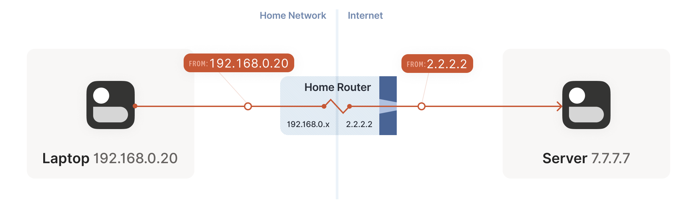

# Jump Server & NAT traversal

#### Jump Server

> SSH通过跳板机登录远程服务器其实使用方法很简单，直接一行命令就可以了，命令格式如下：
>
> ```python title="Jump Server"
> ssh -J username@jump_server_ip_or_name:port username@endpoint_server_ip_or_name -p port
> ssh -J  user1@1.2.3.4:22   user2@5.6.7.8 -p 22 
>              跳板机                服务器        
> # 只需要分别输入登录跳板服务器的用户的密码及登录目的服务器的用户的密码就可以了
> ```
>

#### NAT traversal

> 内网穿透软件 Cpolar
>
> 
