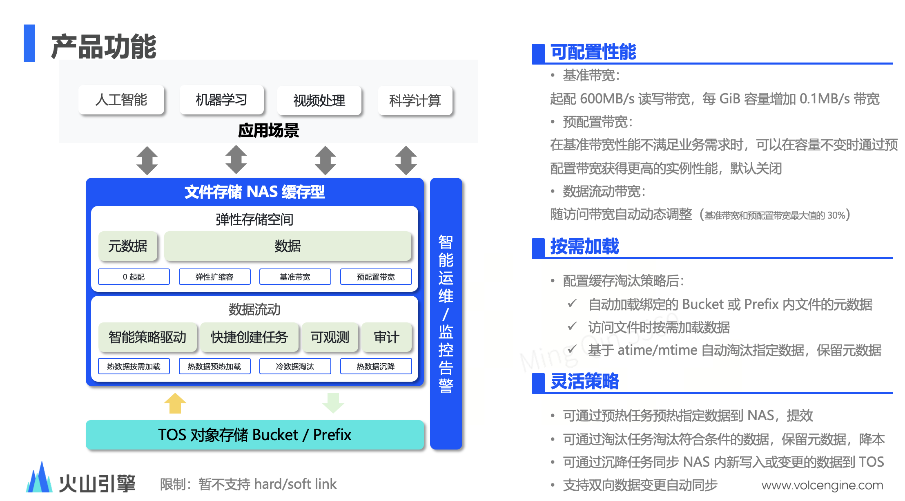
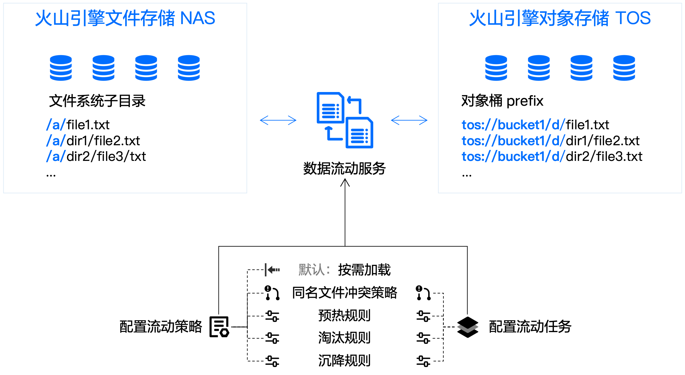
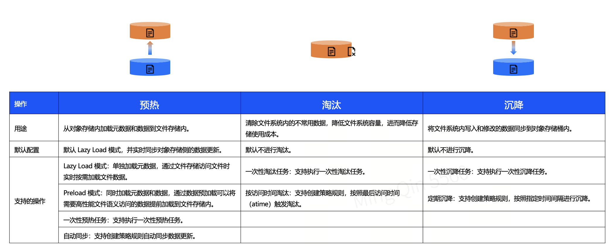

# NAS (文件存储)

## 目录

- [1 Introduce](#1-Introduce)
  - [1.1 NAS (文件存储)](#11-NAS-文件存储)
  - [1.2 NAS类型](#12-NAS类型)
  - [1.3 缓存型NAS & 数据流动](#13-缓存型NAS--数据流动)
- [2 Tutorial](#2-Tutorial)
  - [2.1 创建 & 挂载NAS](#21-创建--挂载NAS)
  - [2.2 缓存型NAS & 预配置带宽](#22-缓存型NAS--预配置带宽)
- [3 Source](#3-Source)
- [4 Reference](#4-Reference)

***

*Author* : zhang jian

*Date* : 2025-2-26

*Version* : 1.0v

***

> **NOTE** : `NAS` 存储不能通过网页端 & 客户端进行直接访问，一般需要挂载到`ECS` or 本地服务器后，才能进行读写。

> **NOTE** :本地数据拷贝到火山云NAS可以使用TOS进行数据中转。
>
> ```mermaid 
> flowchart LR
>       A([Local])--tosutil-->B([TOS Bucket])--tosutil-->C([NAS])
>       C--tosutil-->B--tosutil-->A
> ```
>

***

## 1 Introduce

### `1.1 NAS` (文件存储)

文件存储 `NAS`（`FileNAS`）是面向火山引擎弹性计算、容器服务、`AI` 智能应用的文件存储服务，可为业务应用提供一种高性能共享访问、持续在线、弹性扩展、跨地域访问的高性价比云存储服务。文件存储 `NAS` 提供简单、易操作的对外接口，并支持按实际使用量计费，免去部署、维护费用的同时，最大化提升您的业务效率[^1]。

### `1.2 NAS`类型

**火山云提供的**\*\*`NAS`类型有： \*\*​

- **NAS 容量型** ：适用于成本敏感且对时延响应要求不高的文件共享场景，对大文件顺序读的性能表现较好，例如大块数据顺序读场景、文件共享、数据备份、日志存储、原始训练数据备份等。
- **NAS缓存型** : `NAS`缓存型在容量弹性扩缩容能力的基础上提供了额外的性能配置能力，实现了文件系统容量和性能的解耦。您可以根据业务需求自定义文件系统的预配置性能。
- **NAS 极速型** ：适用于时延敏感的场景，例如高性能计算、中小场景 `AI`数据处理、容器存储、内容管理和 `Web` 服务、文件共享、`Devops` 代码存储等。

> 🛰️**火山云三种不同的文件存储性能 & 价格对比：**
>
> |                                | **NAS容量型**​                   | **NAS极速型**​                     | **NAS缓存型**​                                |
> | ------------------------------ | ----------------------------- | ------------------------------- | ------------------------------------------ |
> | **产品定位**​                      | 高性价比，容量和性能弹性扩展，适合大容量文件共享访问场景。 | 预配置容量，低延时，高 \`IOPS\`，适合时延敏感型业务。 | 高性能，可预配置性能，支持与 \`TOS\` 数据流动，适合高性能文件共享访问场景。 |
> | **最大带宽**​                      | 读 \`3GB/s\`，写 \`1.5GB/s\`     | 读 \`600MB/s\`，写 \`600MB/s\`     | 读 \`30GB/s\`，写 \`10GB/s\`                  |
> | \*\*最大 `IOPS`\*\*​             | 读 \`5000\`，写 \`2500\`         | 读 \`5\` 万，写 \`5\` 万             | 读 90 万，写 30 万                              |
> | **读 `4KiB`** \*\* 数据块平均时延\*\*​ | \`10ms\`                      | 亚毫秒                             | 亚毫秒                                        |
> | **容量规格**​                      | \`0 \~10PiB\`                 | \`100GiB\` \\\~ \`64TiB\`       | \`0 ～ 10PiB\`                              |
> | **协议**​                        | \`NFSv3\`, \`NFSv4.1\`        | \`NFSv3\`                       | \`NFS v4.1\`                               |
> | **价格**​                        | 存储容量：0.15 元/GiB/月             | 存储容量：1.8 元/GiB/月                | 存储容量：0.82 元/GiB/月 预配置带宽：4.1 元/MB/s/月       |

### 1.3 缓存型NAS & 数据流动



> **NOTE** : 火山云的缓存型NAS可以很方便的使用定义的预热 & 沉降 & 淘汰规则实现TOS ←→ NAS的数据流转。

AI 训练和推理等场景下，您可以通过文件存储 NAS 加速对象存储 TOS 中的数据访问，也可以通过将文件存储 NAS 中的冷数据导出到对象存储 TOS 来降低成本。[^2]





***

## 2 Tutorial

### 2.1 创建 & 挂载`NAS`

1. **创建新**\*\*`NAS`\*\***存储 \*\* : **为了获得最高访问速度****`ECS`****可用区需要与****`NAS`\*\***可用区一致。**

   

   

   
2. **在新的**\*\*`NAS`\*\***创建新的挂载点**

   **NOTE** : 在创建新的挂载点时，需要保证需要挂载的实例与该挂载位于同一个`VPC`下，其参数没有特定要求。

   
3. **根据给出的挂载命令在实例中挂载**\*\*`NAS`\*\*
   ```bash title="NAS挂载命令"
   # 创建挂载目录
   mkdir  -p  <挂载位置>
   # 安装nfs-common
   sudo apt-get install nfs-common -y
   # 挂载NAS
   mount -t nfs -o vers=4,minorversion=1,rsize=1048576,wsize=1048576,hard,timeo=600,retrans=2,noresvport \
         <NAS地址>  <挂载位置>
   ```

   > **NOTE** : 三种不同`NAS`的`NFS`协议支持情况
   >
   > - `NAS 容量型`：支持 `NFSv3` 和 `NFSv4.1` 版本，不支持 `NFSv4.0` 和 `NFSv4.2` 版本;
   > - `缓存型NAS`  :   在 `Linux` 操作系统挂载文件系统时，仅支持 `NFSv4.1`，不支持 `NFSv3`;
   > - `NAS 极速型`：支持 `NFSv3` 版本。
   >   **NOTE** : 如果要将火山云`NAS`挂载到本地服务器需要在安全组中放行`111`,`2049`这个两个端口，才能访问`nfs`服务。（不同云服务商的`ip`地址可能不同）。
   >
   > ```python title="检查一下是能够链接2049/111  prot "
   > # telnet 2049 prot
   > telnet 10.160.24.3 2049
   > # telnet 2049 111
   > telnet 10.160.24.3 111
   > ```
   >
4. **权限组 : 通过创建不同的权限组可以限制访问文件系统的 ****`IP`**** 地址，实现不同地址的访问权限管理。**

   

### 2.2 缓存型`NAS` & 预配置带宽

缓存型`NAS` 当前带宽无法满足需求时，可以通过购买额外带宽对NAS `I/O`进行加速。


## 3 Source

> **火山云缓存型NAS介绍材料：**
>
> [文件存储 NAS 缓存型产品介绍\_202409.pptx](<file/文件存储 NAS 缓存型产品介绍_202409_p3Yc3_AObZ.pptx> "文件存储 NAS 缓存型产品介绍_202409.pptx")

## 4 Reference

[^1]: [https://www.volcengine.com/docs/6453/73647](https://www.volcengine.com/docs/6453/73647 "https://www.volcengine.com/docs/6453/73647")

[^2]: [https://www.volcengine.com/docs/6453/1361179](https://www.volcengine.com/docs/6453/1361179 "https://www.volcengine.com/docs/6453/1361179")
