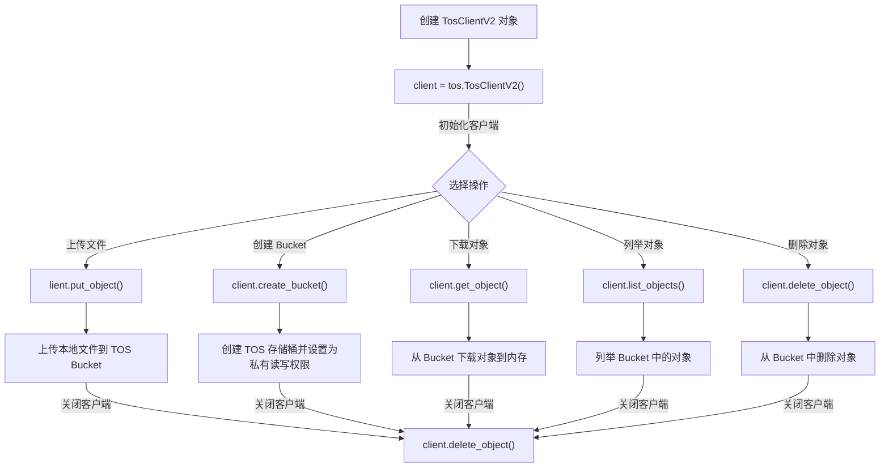

# Python TOS SDK

## 目录

- [1 Introduce](#1-Introduce)
  - [1.1 Python TOS SDK](#11-Python-TOS-SDK)
- [2 Install ](#2-Install-)
- [3 Tutorial](#3-Tutorial)
  - [TOS Python SDK pipeline](#TOS-Python-SDK-pipeline)
  - [3.2 init TosClient](#32-init-TosClient)
    - [3.2.1 配置超时 & 重试 & 数据校验](#321-配置超时--重试--数据校验)
  - [3.3 Bucket Operate](#33-Bucket-Operate)
    - [3.3.1 Create Bucket](#331-Create-Bucket)
    - [3.3.2 ListBuckets](#332-ListBuckets)
    - [3.3.3 Get bucket meta.data](#333-Get-bucket-metadata)
    - [3.3.4 Delete bucket](#334-Delete-bucket)
    - [3.3.5 get\_bucket\_location](#335-get_bucket_location)
  - [3.4 Object Operate](#34-Object-Operate)
    - [3.4.1 Upload object](#341-Upload-object)
    - [3.4.2 Download object](#342-Download-object)
    - [3.4.3 object cpoy](#343-object-cpoy)
    - [3.4.4 ListObjects](#344-ListObjects)
    - [3.4.5 object meta.data](#345-object-metadata)
    - [3.4.6 Determine whether the object exists](#346-Determine-whether-the-object-exists)
    - [3.4.7 Delete object](#347-Delete-object)
- [4 Code](#4-Code)
  - [4.1 Tos command](#41-Tos-command)
  - [4.2 FixMetadata](#42-FixMetadata)
  - [4.3 upload & MD5](#43-upload--MD5)
  - [4.4 upload & Crc64](#44-upload--Crc64)
- [5 Reference](#5-Reference)

***

*Author* : zhang jian

*Date* : 2025-3-1

*Version* : 1.0v

***

> **NOTE** :  如果想将本地数据`<local_path>/docker.tar.gz`上传到 `sequanta-ceph/2024_Slurm_bioos/Docker/docker.tar.gz`,`client.put_object`函数中的`bucket_name`, `object_key`,`file_name`需要按照下面的样式进行设置。
>
> ```python title="参数解释"
> # 上传bucket地址 : sequanta-ceph/2024_Slurm_bioos/Docker/docker.tar.gz
> # 待上传文件路径  : <local_path>/docker.tar.gz
> bucket_name  = 'sequanta-ceph'
> object_key = '2024_Slurm_bioos/Docker/docker.tar.gz'
> file_name = '<local_path>/docker.tar.gz'
>
> ```
>

> **NOTE** :` delete_bucke`操作最好还是在网页端进行操作。

## 1 Introduce

### 1.1 Python TOS SDK

`TOS Python SDK`（Tinder Object Storage Python SDK）是由火山引擎（`Volcengine`）提供的一个`Python`软件开发工具包，用于帮助Python开发者轻松地与火山引擎的对象存储服务`TOS`进行交互[^1]。

> **NOTE**\*\* : \*\*`TOS Python SDK` 适用于`Python` `3.5`、`3.6`、`3.7`、`3.8`及以上版本。

> **NOTE** : 在使用`TOS`工具前，需要拥有对应目录的访问权限与`AK`&#x20;

## 2 Install&#x20;

`TOS Python SDK`可以方便的使用`pip`安装，也可以从源码进行安装。

```bash title="install sdk by pip"
pip install tos
```


```bash title="install sdk by source"
git clone https://github.com/volcengine/ve-tos-python-sdk.git
python3 setup.py install
```


## 3 Tutorial

### **`TOS Python SDK`** pipeline

\*\*`TOS Python SDK`主要使用流程如下所示 ： \*\*​




### `3.2 init` `TosClient`

在使用`tos`管理对象存储前，需要使用自己的`AKS`初始化`tos`客户端。

> **推荐配置长期访问凭证 :  将**\*\*`ak`&****`aks`**** 加入环境变量或者配置文件，可以降低使用风险\*\*
>
> > **NOTE ****: 如果当前系统下有多个用户不推荐将****`ak`**\*\* & ****`aks`****添加到****`/etc/profile`****,可以将配置文件添加到`~/.zshrc`****文件,或者直接从****`tosutil`配置文件​`.tosutilconfig`中提取​`ak`&****`aks`****。\*\*
>
> ```bash title="配置长期访问凭证"
> vi /etc/profile
> # 添加 ak & aks
> export TOS_ACCESS_KEY=AKTPYmI1Z****
> export TOS_SECRET_KEY=T1dJM01UU****
> # 重新加载 /etc/profile
> source /etc/profile
> ```
>

- 使用长期使用的`ak` & `aks` 初始化`TOS`客户端
  ```python title="初始化tos客户端"
  #!/usr/bin/python3
  import os
  import tos
  # 从环境变量获取 AKSK 信息
  ak = os.getenv('TOS_ACCESS_KEY')
  sk = os.getenv('TOS_SECRET_KEY')
  # your endpoint 和 your region 填写Bucket 所在区域对应的Endpoint。# 以华北2(北京)为例，your endpoint 填写 tos-cn-beijing.volces.com，your region 填写 cn-beijing。
  endpoint = "tos-cn-shanghai.ivolces.com"
  region = "cn-shanghai"
  # Init tosclients
  client = tos.TosClientV2(ak, sk, endpoint, region)
  ```

- 使用临时访问凭证中的认证信息初始化`TosClient`
  > **NOTE** : 创建`STS token`后，就可以临时访问特定对象存储目录啦。
  ```python title="初始化tos客户端"
  import tos
  import os
  # ak和sk为临时访问凭证中的安全密钥（AccessKeyId、SecretAccessKey）
  ak = os.getenv('TOS_ACCESS_KEY')
  sk = os.getenv('TOS_SECRET_KEY')
  sts_token = "your security token"
  # your endpoint 和 your region 填写Bucket 所在区域对应的Endpoint。# 以华北2(北京)为例，your endpoint 填写 tos-cn-beijing.volces.com，your region 填写 cn-beijing。
  endpoint = "your endpoint"
  region = "your region"
  # 使用临时访问凭证中的认证信息初始化TosClient
  client = tos.TosClientV2(ak, sk, endpoint, region,
                           # 通过security_token可选参数设置STS
                           security_token=sts_token,
                           # 通过connection_time可选参数设置连接超时，单位：秒
                           connection_time=10,
                           # 通过socket_timeout可选参数设置Socket读写超时，单位：秒
                           socket_timeout=30)
  ```


#### 3.2.1 配置超时 & 重试 & 数据校验

在初始化 `TosClient` 时，通过添加可选参数配置网络请求的超时时间，目前 `TOS Python SDK`支持配置连接超时`connection_time`和请求超时`socket_timeout`。

```python title="超时策略"
# 创建 TosClientV2 对象，并设置连接超时为30秒, Socket 读写超时时间为60秒
# connection_time为连接超时，socket_timeout为请求超时时间。
client = tos.TosClientV2(ak, sk, endpoint, region,
                         connection_time=30, socket_timeout=60)
```


网络波动或短期 `TOS` 服务异常（返回 500 状态码）等场景会导致调用 `TOS` 服务失败，针对此问题 `Python SDK` 内部提供了重试机制，幂等操作的接口在失败后会使用指数避让策略进行重试，非幂接口则直接抛出对应异常

```python title="重试策略"
# 创建 TosClientV2 对象，并设置超时重试次数为3次。重试策略为指数避让策略，
# 基准时间为100ms，及第一次重试间隔100ms，第二次重试间隔200ms，第三次重试400ms
client = tos.TosClientV2(ak, sk, endpoint, region, max_retry_count=3)
```


对象上传和下载时 `TOS` 返回对象的 `CRC` 值，`SDK` 验证本地计算的`CRC` 和 `TOS` 返回的 `CRC` 是否相等，校验上传和下载数据的完整性。

```python title="数据校验配置"
# 创建 TosClientV2 对象，并设置 enable_crc=False 来关闭 CRC 数据校验
client = tos.TosClientV2(ak, sk, endpoint, region, enable_crc=True)
```


### 3.3 Bucket Operate

> **NOTE** ：使用`tos python sdk`进行桶管理，不是很靠谱，推荐还在在网页端进行操作。

桶（`Bucket`）是 `TOS` 的全局唯一的命名空间，相当于数据的容器，用来储存对象（`Object`）数据。提供给用户按指定桶名创建新桶，新创建的桶名在 `TOS` 中必须是唯一的[^2]。

> **Tips** : 在创建bucket需要拥有相关权限并按照相关命名规则对bucket进行命名。
>
> 1. **存储桶命名规范**
>    - 只能包括小写字母 `a~z`、数字和短横线（`-`）。
>    - 开头和结尾只能是数字或字母。
>    - 长度必须在 `3～63` 个字符之间。
> 2. 通过与 `TOS` 同地域的其他火山引擎产品访问 `TOS` 时，推荐您使用内网 `Endpoint`。
> 3. 创建存储桶前，需要确保账号拥有`tos:CreateBucket`权限。

#### 3.3.1 Create Bucket

```python title="create_bucket"
client.create_bucket(bucket_name,                        # 桶存储名称
                     acl=tos.ACLType.ACL_Private,        # 桶访问权限
                     storage_class=tos.StorageClassType.Storage_Class_Standard, # 存储类型
                     az_redundancy=tos.AzRedundancyType.Az_Redundancy_Multi_Az  # 指定AZ属性
                     ) 
```


#### 3.3.2 ListBuckets

`ListBuckets` 列举当前账号下所有区域的桶(Bucket)

```python title="ListBuckets"
client = tos.TosClientV2(ak, sk, endpoint, region)
# 例举所有桶
resp = client.list_buckets()
for bucket in resp.buckets:
    print("name:{}".format(bucket.name))
    print("location:{}".format(bucket.location))
    print("extranet_endpoint:{}".format(bucket.extranet_endpoint))
    print("intranet_endpoint:{}".format(bucket.intranet_endpoint))
    print("creation_date:{}".format(bucket.creation_date))
```


#### 3.3.3 Get bucket `meta.data`

`client.head_bucket` : 获取桶元数据，和判断桶是否存在

```python title="client.head_bucket"
client = tos.TosClientV2(ak, sk, endpoint, region)
head_bucket_out = client.head_bucket(bucket_name)
print('region: ', head_bucket_out.region)
print('storageClass: ', head_bucket_out.storage_class)
print('azRedundancy: ', head_bucket_out.az_redundancy)
```


#### 3.3.4 Delete bucket

> NOTE : 桶删除后不可恢复，请谨慎操作。删除桶必须具备`tos:DeleteBucket`权限。

```python title="delete_bucket"
client = tos.TosClientV2(ak, sk, endpoint, region)
client.delete_bucket(bucket_name)
```


#### `3.3.5 get_bucket_location`

`get_bucket_location` ： 获取`bucket`所在地域

```python title="get_bucket_location"
# 创建客户端
client = tos.TosClientV2(ak, sk, endpoint, region)
# 获取桶地域位置
out = client.get_bucket_location(bucket_name)
```


### 3.4 Object Operate

对象(`Object`)是 `OS` 存储数据的基本单元，本帮助文档中对象、文件、`Object` 均具有相同含义。对象由键（`Key`），数据（`Data`）和元数据（`Metadata`）三部分组成。`Python TOS SDK`可以很方便的对`bucket`中的存储对象进行操作。

#### 3.4.1 Upload object

在 `TOS` 中，数据存储的基本单元为文件,`Python TOS SDK`可以提供丰富的文件上传方法。

> `Python TOS SDK` 支持的文件上传方法：
>
> - **普通上传** ：上传对象大小不超过 `5GiB`，支持进度条、客户端限速。&#x20;
> - **追加上传**：追加后的对象大小不能大于 `5GiB`，支持进度条、客户端限速。&#x20;
> - **分片上传**：除了最后一个分片，其他分片大小需要大于等于 `5MiB`，上传的分片的编号范围是 `[1，10000]`，支持进度条、客户端限速。 每个分片必须 `≥4MiB`，单个分片`≤5GiB`，且总分片数`≤10000`
> - **断点续传上传**： 支持并发、断点续传、自定义分片大小、事件回调、进度条、取消机制，大文件上传推荐使用此接口。

> \*\*Tips : \*\*d

```python title="分片上传"
import os
import tos
from tos.utils import SizeAdapter

# 从环境变量获取 AK 和 SK 信息。
ak = os.getenv('TOS_ACCESS_KEY')
sk = os.getenv('TOS_SECRET_KEY')
# your endpoint 和 your region 填写Bucket 所在区域对应的Endpoint。# 以华北2(北京)为例，your endpoint 填写 tos-cn-beijing.volces.com，your region 填写 cn-beijing。
endpoint = "your endpoint"
region = "your region"
bucket_name = "bucket-test"
# 对象名称，例如 example_dir 下的 example_object.txt 文件，则填写为 example_dir/example_object.txt
object_key = "object-test"

# 本地文件完整路径，例如usr/local/testfile.txt
file_name = '/usr/local/testfile.txt'
total_size = os.path.getsize(file_name)
 part_size = 5 * 1024 * 1024 # 5MB 
try:
    # 创建 TosClientV2 对象，对桶和对象的操作都通过 TosClientV2 实现
    client = tos.TosClientV2(ak, sk, endpoint, region)

    # 初始化上传任务
    # 若需在初始化分片时设置对象的存储类型，可通过storage_class字段设置
    # 若需在初始化分片时设置对象ACL，可通过acl、grant_full_control等字段设置
    multi_result = client.create_multipart_upload(bucket_name, object_key, acl=tos.ACLType.ACL_Public_Read,
                                                  storage_class=tos.StorageClassType.Storage_Class_Standard)

    upload_id = multi_result.upload_id
    parts = []

    # 上传分片数据
    with open(file_name, 'rb') as f:
        part_number = 1
        offset = 0
        while offset < total_size:
            num_to_upload = min(part_size, total_size - offset)
            out = client.upload_part(bucket_name, object_key, upload_id, part_number,
                                     content=SizeAdapter(f, num_to_upload, init_offset=offset))
            parts.append(out)
            offset += num_to_upload
            part_number += 1

    # 完成分片上传任务
    client.complete_multipart_upload(bucket_name, object_key, upload_id, parts)
except tos.exceptions.TosClientError as e:
    # 操作失败，捕获客户端异常，一般情况为非法请求参数或网络异常
    print('fail with client error, message:{}, cause: {}'.format(e.message, e.cause))
except tos.exceptions.TosServerError as e:
    # 操作失败，捕获服务端异常，可从返回信息中获取详细错误信息
    print('fail with server error, code: {}'.format(e.code))
    # request id 可定位具体问题，强烈建议日志中保存
    print('error with request id: {}'.format(e.request_id))
    print('error with message: {}'.format(e.message))
    print('error with http code: {}'.format(e.status_code))
    print('error with ec: {}'.format(e.ec))
    print('error with request url: {}'.format(e.request_url))
except Exception as e:
    print('fail with unknown error: {}'.format(e))
```


#### 3.4.2 Download object

在 `TOS` 中，数据存储的基本单元为文件,`Python TOS SDK`也可以提供丰富的文件下载方法。

> `Python TOS SDK` 支持的文件下载方法：
>
> - **普通下载**：一般用于下载小对象。
> - **限定条件下载**：满足限定条件则下载，不满足则抛出异常且不会触发下载行为。
> - **范围下载**：当您只需要下载对象的一部分数据时，可以使用范围下载。
> - **断点续传下载**：下载大文件时，可以使用断点续传下载。

#### 3.4.3 object cpoy

`Python TOS SDK` 可以在同一地域的存储桶之间拷贝对象，也可以在同一个存储桶内拷贝对象。拷贝不支持跨地域的拷贝，并且要求对原对象拥有读权限。

> `Python TOS SDK` 提供了多种对象拷贝方式：
>
> - 普通拷贝：拷贝对象大小不超过 `5GiB`。&#x20;
> - 分片拷贝：除了最后一个分片，其他分片大小需要大于等于 `5MiB`，上传的分片的编号范围是 `[1，10000]`。&#x20;
> - 断点续传拷贝：适用于通过 `SDK` 在单个桶内或同区域的两个桶之间复制大对象的场景。

#### 3.4.4 ListObjects

`Python TOS SDK`的`ListObjectsType2` 可以对特定桶下的所有对象、指定前缀文件、指定目录下的文件和子目录进行列举[^3]。

```python title="ListObjectsType2"
# ListObjectsType2 可以使用的参数
prefix ： 本次查询结果的前缀。
delimiter ： 对对象名称进行分组的字符。
start_after ： 此次列举对象的起点。
continuation_token ： 指定列举操作需要从此 token 开始。可从上次列举结果中的 next_continuation_token 中获取。
max_keys ： 返回列举对象的最大数，默认值 1000。

```


#### 3.4.5 object `meta.data`

对象元信息是对象的属性描述，包括 `HTTP` 标准属性（`HTTP Header`）和用户自定义元数据（`User Meta`）两种。

```python title="上传元数据"
# 创建 TosClientV2 对象，对桶和对象的操作都通过 TosClientV2 实现
client = tos.TosClientV2(ak, sk, endpoint, region)
# 普通上传时设置对象元数据
client.put_object(bucket_name, object_key,
                    # 通过meta选填字段设置用户自定义元数据
                    meta={'author': 'test1', '姓名': '张三'},
                    # 通过content_disposition设置HTTP标准属性
                    content_disposition='attachment; filename=123.txt',
                    # 通过content_type设置对象类型
                    content_type="text/plain")
# 分片上传时设置对象元数据
client.create_multipart_upload(bucket_name, object_key,
                                # 通过meta选填字段设置用户自定义元数据
                                meta={'author': 'test2', '姓名': '张三'},
                                # 通过content_disposition设置HTTP标准属性
                                content_disposition='attachment; filename=123.txt',
                                # 通过content_type设置对象类型
                                content_type="text/plain")
# 通过set_object_meta接口设置对象元数据
client.set_object_meta(bucket_name, object_key, meta={'author': 'test3', '姓名': '张三'},
                        # 通过content_disposition设置HTTP标准属性
                        content_disposition='attachment; filename=123.txt',
                        # 通过content_type设置对象类型
                        content_type="text/plain")
```


#### 3.4.6 Determine whether the object exists

通过 `Python SDK` 的`head_object`接口判断对象是否存在。

```python title="head_object"
# 创建 TosClientV2 对象，对桶和对象的操作都通过 TosClientV2 实现
client = tos.TosClientV2(ak, sk, endpoint, region)
# 获取对象元数据
result = client.head_object(bucket_name, object_key)
```


#### 3.4.7 Delete object

当对象不再使用时，可以删除对象，降低成本开销。`TOS Python SDK` 支持删除桶中的单个对象、删除指定的多个对象，对于开启多版本的桶，可指定删除对象的任意版本数据。

- **删除指定桶**\*\*`bucket-test`****中的****`obejct-test`\*\***对象：**
  ```python title="delete_object"
  # 创建 TosClientV2 对象，对桶和对象的操作都通过 TosClientV2 实现
  client = tos.TosClientV2(ak, sk, endpoint, region)
  # 删除指定桶下的指定对象
  resp = client.delete_object(bucket_name, object_key)
  ```

- **删除指定开启多版本桶**\*\*`bucket-test`****中的****`obejct-test`\*\***对象的指定版本数据:**
  ```python title="delete_object"
  # 创建 TosClientV2 对象，对桶和对象的操作都通过 TosClientV2 实现
  client = tos.TosClientV2(ak, sk, endpoint, region)
  # 删除指定桶下的指定对象
  client.delete_object(bucket_name, object_key, version_id=version_id)
  ```

- **删除桶**\*\*`bucket-test`\*\***指定对象名的多个对象**
  ```python title="delete_multi_objects"
  # 创建 TosClientV2 对象，对桶和对象的操作都通过 TosClientV2 实现
  client = tos.TosClientV2(ak, sk, endpoint, region)
  # 批量删除指定桶下的指定对象
  objects = []
  objects.append(ObjectTobeDeleted(object_key_1))
  objects.append(ObjectTobeDeleted(object_key_2))
  # 未开启多版本的桶则直接删除
  delete_out = client.delete_multi_objects(bucket=bucket_name, objects=objects)
  ```

- **删除指定版本和对象名的对象**
  ```python title="delete_multi_objects"
  # 创建 TosClientV2 对象，对桶和对象的操作都通过 TosClientV2 实现
  client = tos.TosClientV2(ak, sk, endpoint, region)
  # 批量删除指定桶下的指定对象
  objects = []
  objects.append(ObjectTobeDeleted(object_key_1, version_id_1))
  objects.append(ObjectTobeDeleted(object_key_2, version_id_2))
  # 桶开启多版本并指定删除对象的版本号，则为直接标删除
  delete_out = client.delete_multi_objects(bucket=bucket_name, objects=objects)
  ```

- **删除桶中指定前缀的所有对象**

  删除桶`bucket-test`中前缀为`log/`的所有对象。
  ```python title="delete_object"
  # 创建 TosClientV2 对象，对桶和对象的操作都通过 TosClientV2 实现
  client = tos.TosClientV2(ak, sk, endpoint, region)
  is_truncated = True
  marker = ''
  while is_truncated:
      out = client.list_objects(bucket_name, prefix='log/', marker=marker)
      for obj in out.contents:
          client.delete_object(bucket_name, obj.key)    
      is_truncated = out.is_truncated
      marker = out.next_marker
  ```


## 4 Code

### 4.1 Tos command

```python title="Tos 常规命令"
# 创建 TosClientV2 对象，对桶和对象的操作都通过 TosClientV2 实现
client = tos.TosClientV2(ak, sk, endpoint, region)
# 上传本地文件到 tos bucket
resp = client.put_object(bucket, key, content=data)
# 创建 tos 存储桶 & 设置为私有读写权限
client.create_bucket(bucket_name, acl=tos.ACLType.ACL_Private)
# 下载对象到内存中
object_stream = client.get_object(bucket_name, object_key)
# 列举bucket中的对象
list_out_1 = client.list_objects(bucket_name)
# 从bucket删除对象
client.delete_object(bucket_name, object_key)
# 关闭客户端
client.close()
```


### `4.2 FixMetadata`

```python title="FixMetadata"
def FixMetadata(ak, sk, endpoint, region,bucket_name, object_key,meta):
    try:
        # 创建 TosClientV2 对象，对桶和对象的操作都通过 TosClientV2 实现
        client = tos.TosClientV2(ak, sk, endpoint, region)
        client.put_object(bucket_name, object_key,
                          # 通过meta选填字段设置用户自定义元数据
                          meta=meta,
                          # 通过content_type设置对象类型
                          content_type="text/plain")
    except tos.exceptions.TosClientError as e:
        # 操作失败，捕获客户端异常，一般情况为非法请求参数或网络异常
        print('fail with client error, message:{}, cause: {}'.format(e.message, e.cause))
    except tos.exceptions.TosServerError as e:
        # 操作失败，捕获服务端异常，可从返回信息中获取详细错误信息
        print('fail with server error, code: {}'.format(e.code))
        # request id 可定位具体问题，强烈建议日志中保存
        print('error with request id: {}'.format(e.request_id))
        print('error with message: {}'.format(e.message))
        print('error with http code: {}'.format(e.status_code))
        print('error with ec: {}'.format(e.ec))
        print('error with request url: {}'.format(e.request_url))
    except Exception as e:
        print('fail with unknown error: {}'.format(e))
```


### 4.3 upload & MD5

```python title="upload & MD5"
def uploadSingleFile_MD5(ak, sk, endpoint, region,bucket_name, object_key, file_name):
    import base64
    import hashlib
    hash = hashlib.md5()
    hash.update(file_name.encode())
    content_md5 = base64.b64encode(hash.digest()).decode()
    client = tos.TosClientV2(ak, sk, endpoint, region)
    try:
        resp = client.put_object(bucket_name,object_key, content=file_name, content_md5=content_md5)
        print(resp.status_code)
    except Exception as e:
        print(e)
    return content_md5
```


### 4.4 upload & Crc64

```python title="upload & Crc64"
class Crc64IO(object):
    def __init__(self, data):
        self.data = data
        self.crc64 = tos.utils.Crc64()

    def __iter__(self):
        return self

    def __next__(self):
        return self.next()

    def next(self):
        content = self.data.read(8 * 1024)
        if content:
            self.crc64.update(content)
            return content
        raise StopIteration
class SizeAdapter:
    def __init__(self, file_obj, size, init_offset=0):
        self.file_obj = file_obj
        self.size = size
        self.init_offset = init_offset
        self.current_offset = 0

    def read(self, size=-1):
        if self.current_offset >= self.size:
            return b''
        remaining = self.size - self.current_offset
        if size == -1 or size > remaining:
            size = remaining
        self.file_obj.seek(self.init_offset + self.current_offset)
        data = self.file_obj.read(size)
        self.current_offset += len(data)
        return data

def uploadSingleFile(ak, sk, endpoint, region,bucket_name, object_key, file_name):
    try:
        # 创建 TosClientV2 对象，对桶和对象的操作都通过 TosClientV2 实现
        client = tos.TosClientV2(ak, sk, endpoint, region)
        # 将本地文件上传到目标桶中
        total_size = os.path.getsize(file_name)
        part_size = 1024 * 1024 * 5
        resp = client.create_multipart_upload(bucket_name, key)
        upload_id = resp.upload_id
        parts = []
        crc64 = tos.utils.Crc64()
        crc64_final = 0
        # file_name为本地文件的完整路径。
        # 上传分片数据
        with open(file_name, 'rb') as f:
            part_number = 1
            offset = 0
            while offset < total_size:
                num_to_upload = min(part_size, total_size - offset)
                crc64_io = Crc64IO(SizeAdapter(f, num_to_upload, init_offset=offset))
                part = client.upload_part(bucket_name, key, upload_id, part_number,
                                          content=crc64_io)
                if crc64_io.crc64.crc != part.hash_crc64_ecma:
                    raise Exception('crc64 not match')
                crc64_final = crc64.combine(crc64_final, crc64_io.crc64.crc, num_to_upload)
                parts.append(part)
                offset += num_to_upload
                part_number += 1
        resp = client.complete_multipart_upload(bucket_name, key, upload_id, parts)
        if crc64_final != resp.hash_crc64_ecma:
            raise Exception('crc64 not match')
    except tos.exceptions.TosClientError as e:
        # 操作失败，捕获客户端异常，一般情况为非法请求参数或网络异常
        print('fail with client error, message:{}, cause: {}'.format(e.message, e.cause))
    except tos.exceptions.TosServerError as e:
        # 操作失败，捕获服务端异常，可从返回信息中获取详细错误信息
        print('fail with server error, code: {}'.format(e.code))
        # request id 可定位具体问题，强烈建议日志中保存
        print('error with request id: {}'.format(e.request_id))
        print('error with message: {}'.format(e.message))
        print('error with http code: {}'.format(e.status_code))
        print('error with ec: {}'.format(e.ec))
        print('error with request url: {}'.format(e.request_url))
    except Exception as e:
        print('fail with unknown error: {}'.format(e))
    return(resp)
```


## 5 Reference

[^1]: [https://github.com/volcengine/ve-tos-python-sdk](https://github.com/volcengine/ve-tos-python-sdk "https://github.com/volcengine/ve-tos-python-sdk")

[^2]: [https://www.volcengine.com/docs/6349/92793](https://www.volcengine.com/docs/6349/92793 "https://www.volcengine.com/docs/6349/92793")

[^3]: [https://www.volcengine.com/docs/6349/173819](https://www.volcengine.com/docs/6349/173819 "https://www.volcengine.com/docs/6349/173819")
