# SequantaTosutil

## 目录

- [1 Introduce](#1-Introduce)
  - [1.1 注意事项](#11-注意事项)
  - [1.2 Software dependencies](#12-Software-dependencies)
- [2 tutorial](#2-tutorial)
  - [2.1 配置SequantaTosutil.yaml运行文件](#21-配置SequantaTosutilyaml运行文件)
  - [2.2 标准分析数据交付代码](#22-标准分析数据交付代码)
  - [2.3 数据备份数据传输代码](#23-数据备份数据传输代码)
  - [2.4 通用数据传输代码](#24-通用数据传输代码)
  - [2.5 tos备份or交付数据删除示例代码](#25-tos备份or交付数据删除示例代码)
- [3 Source](#3-Source)
- [4 Reference](#4-Reference)

***

*Author*  :  zhang jian

*Date*      :  2025-3-7

*Version* :  1.0v

***

## 1 Introduce

为了简化和标准化标准分析与长期保存数据的上传流程，基于火山引擎的 `python tos sdk` 开发了 `SequantaTosutil` 脚本。`SequantaTosutil`脚本提供了五个子命令，每个子命令都有特定的功能，以满足不同的需求。

> 🎁\*\*`SequantaTosutil`\*\***子命令：**
>
> - `DataDeliver`：&#x20;
>   - 功能：用于标准分析结果的交付。
>   - 操作：自动上传待交付的数据，并将上传日志一并上传至指定目录。
>   - 元数据：根据标准分析`projetc.yaml`文件，在交付的数据和日志中添加不同的元数据信息，以便更好地管理和跟踪。
> - `Archive`：
>   - 功能：用于数据备份。
>   - 操作：自动上传待备份的数据，并将上传日志一并上传至指定目录。
>   - 元数据：根据标准分析`projetc.yaml`文件，在备份的数据和日志中添加不同的元数据信息，确保数据的完整性和可追溯性。
> - `General`：
>   - 功能：提供更灵活的数据上传和备份功能。
>   - 操作：自动上传待处理的数据，并将上传日志一并上传至指定目录。
>   - 元数据：在上传的数据和日志中添加不同的元数据信息，同时允许用户添加额外的元数据信息，以满足更多自定义需求。
> - `Delete`：
>   - 功能：用于删除已上传或备份的数据。
>   - 操作：根据上传和备份的日志文件删除相应的数据对象，但保留上传日志，并将删除日志上传到删除`tos`目录中
>   - 元数据 : 在删除日志中添加项目信息与删除操作者信息
> - *`Copy`*
>   - *功能：同地域间****tos**\*\*数据拷贝。*
>   - *操作：指定****tos**\*\*路径间数据转移，并在将数据复制****log**\*\*日志同步上传到拷贝路径中。*
>   - *元数据：****log****日志中添加****tos**\*\*源路径与目标路径信息。*
> - *`Delete`\*\*：*
>   - *功能：用于删除已上传或备份的数据，在删除前获取删除对象的元数据信息，无误后，才进行数据删除。*
>   - *操作：根据上传和备份的****日志文件**\*\*删除相应的数据对象，但保留上传日志，并将删除日志上传到删除*\*`tos`\**目录中*
>   - *元数据 : 在删除日志中添加项目信息与删除操作者信息*
> - `Config`：
>   - 功能：配置 `SequantaTosutil` 的参数。
>     操作：根据提供的 `ak`（访问密钥）、`sk`（秘密密钥）、`endpoint` 和 `region` 信息，自动生成 `SequantaTosutil` 的配置文件。
>   - 优势：在运行其他子命令时无需再次指定这些参数，简化了操作流程。

### 1.1 注意事项

**`SequantaTosutil`**\*\* 脚本使用注意事项\*\*​

> **WARRING** : **为了方便**\*\*`bug`****排查在代码中添加****`--debug`****参数，使用该参数会导致****`ak`& ​`sk`****等信息暴露到****`log`****日志中,禁止以****`--debug`\*\***模式进行正常项目数据交付与数据备份。**

> **NOTE** : 上传 & 删除操作需要操作者对该`bucket`路径拥有读写权限！

> **NOTE** : 不同子命令上传的数据会通过在数据元数据中添加 `uplodtype:xxxx` 来进行区分
>
> - `uplodtype:DataDeliver` : 表明该数据为交付数据
> - `uplodtype:Archive` : 表明该数据为备份数据
> - `uplodtype:General` : 表明该数据为常规数据

> **NOTE** : `SequantaTosutil`脚本会自动生成两种`log`日志：数据上传日志与数据删除日志，并且两种日志都会存储在特定`tos`路径中。
>
> - `uplodtype:Upload_log` : 表明该日志为数据上传日志
> - `uplodtype:Delete``_log` : 表明该日志为数据删除日志

> **NOTE** : 由于数据删除是根据数据上传时的`log`日志进行，如果本地`log`日志遗失，请使用`tosutils`从`tos bucket`下载对应上传日志。

### 1.2 Software dependencies

为了确保`SequantaTosutil`脚本能够正常运行，需要安装以下 `Python` 包。`SequantaTosutil`脚本已在`python=3.10`经过测试。

```bash title="软件依赖"
# 安装`SequantaTosutil`脚本必须python库
# 火山引擎的对象存储 SDK
pip install tos
# 用于解析和生成 YAML 文件
pip install PyYAML
# 用于计算 CRC 校验码
pip install crcmod
# 用于处理日期和时间
pip install python-dateutil
```


***

## 2 tutorial

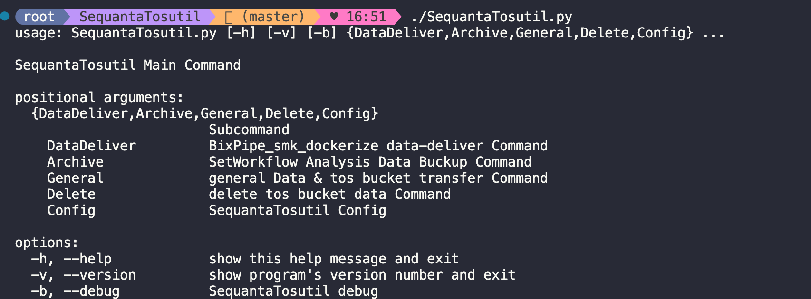

### 2.1 配置`SequantaTosutil.yaml`运行文件

`SequantaTosutil.py` `Config`子命令会根据提供的 `ak` & `sk` & `endpoint` & `region` 信息生成`SequantaTosutil.yaml`配置文件,简化其他子命令使用。

```bash title="配置 SequantaTosutil.yaml"
# 配置 SequantaTosutil.yaml
./SequantaTosutil.py Config --ak xxxxxxxxxxx \
                            --sk xxxxxxxxxxx \
                            --endpoint tos-cn-shanghai.ivolces.com \
                            --region cn-shanghai
2025-03-04 10:07:15,261 - tos-upload-logger - INFO - Upload Data Meta.data ak = xxxxxxxxxxx
2025-03-04 10:07:15,262 - tos-upload-logger - INFO - Upload Data Meta.data sk = xxxxxxx
2025-03-04 10:07:15,262 - tos-upload-logger - INFO - Upload Data Meta.data endpoint = tos-cn-shanghai.ivolces.com
2025-03-04 10:07:15,262 - tos-upload-logger - INFO - Upload Data Meta.data region = cn-shanghai
2025-03-04 10:07:15,265 - tos-upload-logger - INFO - SequantaTosutil配置文件已经保存到 : /shared/home/zhang_jian/.SequantaTosutil.yaml
```


> **WARRING** : `.SequantaTosutil.yaml`配置信息文件保存在用户家目录，为保证安全，请勿随意分享
>
> ```bash title=".SequantaTosutil.yaml"
> -rw-rw-r-- 1 zhang_jian zhang_jian 175 Mar  4 14:08 .SequantaTosutil.yaml
> ```
>

### 2.2 标准分析数据交付代码

`SequantaTosutil.py` `DataDeliver`子命令可以根据标准分析`project.yaml`文件与通过的特定待交付数据路径，将数据上传至对应`tos bucket`中，同时根据`project.yaml`文件添加元数据信息，在数据上传完成后，自动将本地上传`log`日志上传至对应`tos bucket`目录中。

```bash title="标准分析结果"
# datadeliver 标准分析结果交付
SequantaTosutil.py DataDeliver -o /titan4/home/zhang_jian/s2810r22t001_tos_bucket_auto_upload/data_deliver \
                   -t  sequanta-bioinfo-workspace/users/zhang_jian/s2810r22t001_DataDeliver/ \
                   -j 20 \
                   -p /titan4/home/zhang_jian/s2810r22t001_tos_bucket_auto_upload/project.yaml \
                   --link \
                   -T ShortTerm
```


**`SequantaTosutil.py`**\*\* ****`DataDeliver`**** 标准分析上传结果如下：\*\*

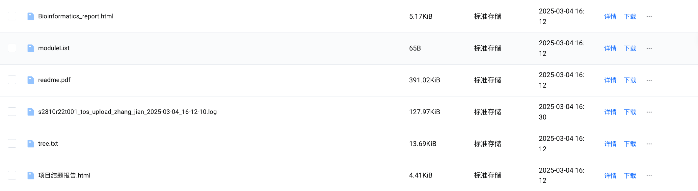

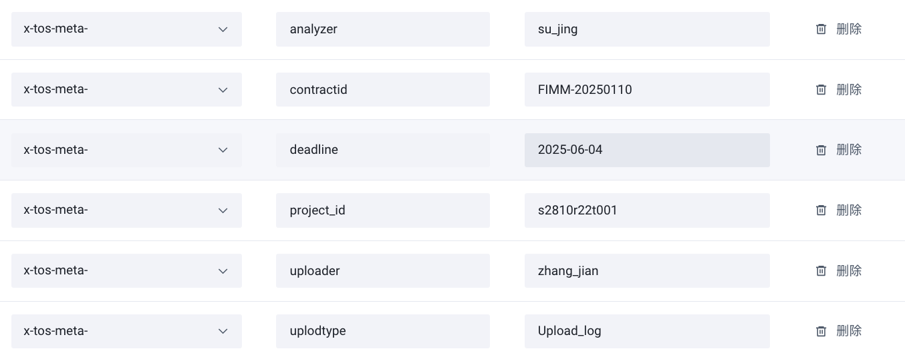

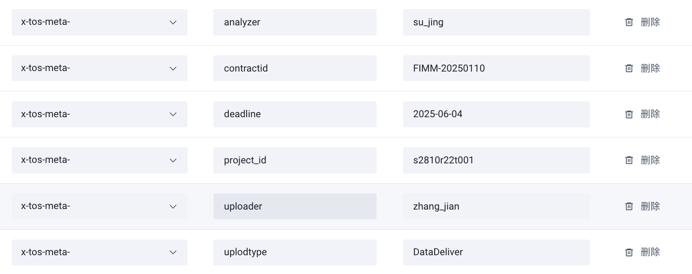

### 2.3 数据备份数据传输代码

`SequantaTosutil.py` `Archive`子命令可以根据标准分析`project.yaml`文件与通过的特定待交付数据路径，将数据备份至对应`tos bucket`中，同时根据`project.yaml`文件添加元数据信息，在数据备份完成后，自动将本地备份`log`日志上传至对应`tos bucket`目录中。

```bash title="数据备份"
# 数据长期备份（5年）
SequantaTosutil.py Archive -o /titan4/home/zhang_jian/s2810r22t001_tos_bucket_auto_upload/data_deliver \
                   -t  sequanta-bioinfo-workspace/users/zhang_jian/s2810r22t001_DataDeliver/ \
                   -j 20 \
                   -p /titan4/home/zhang_jian/s2810r22t001_tos_bucket_auto_upload/project.yaml \
                   --link \
                   -T LongTerm
```


> **NOTE** : 备份数据流程需要通过备份数据`project.yaml`文件，如果该文件丢失，请按照以下格式创建`project.yaml`文件。
>
> ```bash title="project.yaml示例"
> ## input
> contractID: FIMM-20250110
> project_id: s2810r22t001
> ## infor about project analysis
> customer: FimmCyte AG
> analyzer: su_jing    # default by $USER in envs
> reviewer: li_miaomiao
> company:  sequanta    # mingmatechs
> project_manager: zhao_wenjing   # wang_chunshi
> technicalSupport: yu_dan
> ```
>

**`SequantaTosutil.py`**\*\*`Archive`\*\***数据备份结果如下：**

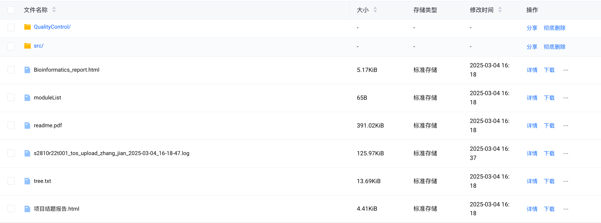

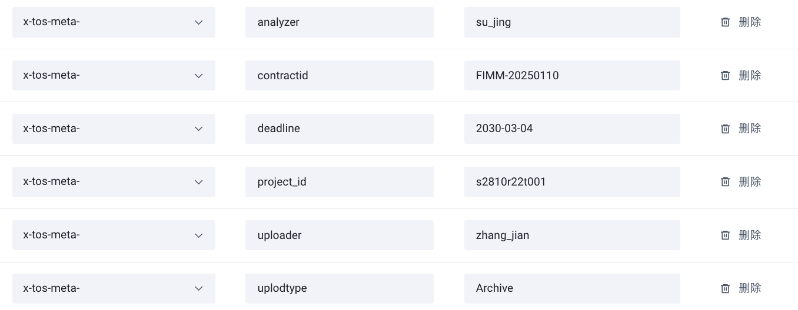

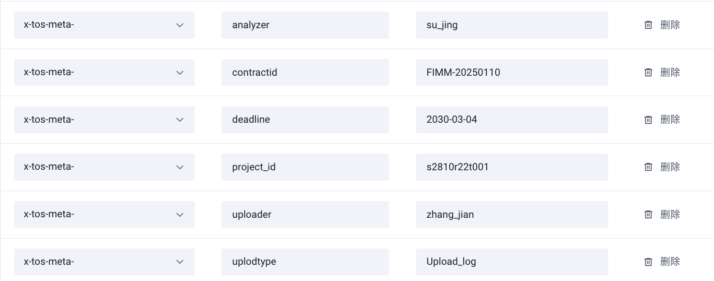

### 2.4 通用数据传输代码

`SequantaTosutil.py` `General`子命令可以通过自定义元数据信息与项目`id`，将数据上传至对应`tos bucket`中，同时添加元数据信息，在数据备份完成后，自动将本地备份`log`日志上传至对应`tos bucket`目录中。为了方便上传特定数据，额外添加了`--include` & `--exclude`参数，从待传输数据中排除特定文件。

```bash title="通用数据"
# 通用数据上传&备份 (仅包含bam文件)
SequantaTosutil.py General  -o /titan4/home/zhang_jian/s2810r22t001_tos_bucket_auto_upload/data_deliver \
                   -t  sequanta-bioinfo-workspace/users/zhang_jian/s2810r22t001_DataDeliver/ \
                   -j 20 \
                   --id s2810r22t001 --other key1:value1,key2:value2 \
                   --include *bam \
                   --link \
                   -T ShortTerm
# 常规数据上传/备份 (不包含bam文件)
SequantaTosutil.py General  -o /titan4/home/zhang_jian/s2810r22t001_tos_bucket_auto_upload/data_deliver \
                   -t  sequanta-bioinfo-workspace/users/zhang_jian/s2810r22t001_DataDeliver/ \
                   -j 20 \
                   --id s2810r22t001 --other key1:test1,key2:test2 \
                   --exclude *bam \
                   --link \
                   -T ShortTerm
```


**`SequantaTosutil.py`**\*\*`General`\*\***数据备份结果如下：**

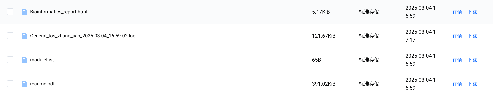

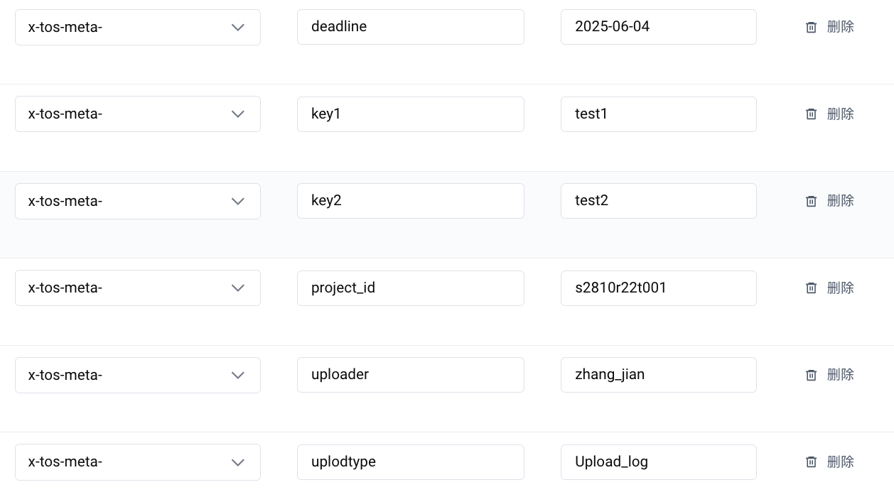

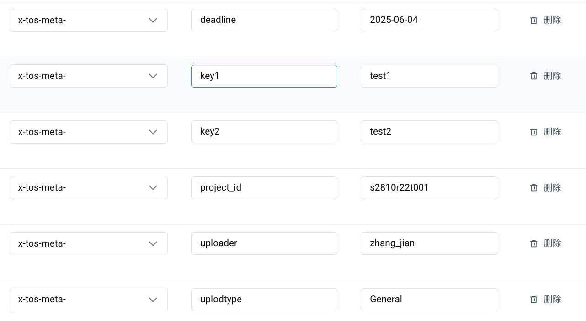

### 2.5 tos备份or交付数据删除示例代码

`SequantaTosutil.py` `Delete`子命令会通过对上传or备份日志进行解析，删除到期项目`tos`数据,并将删除过程中生成的生成日志上传中对应`tos bucket`路径中。

> **NOTE** : 为了保证数据安全,在正式删除数据前需要进行三次确认后，才会对特定数据进行删除。
>
> 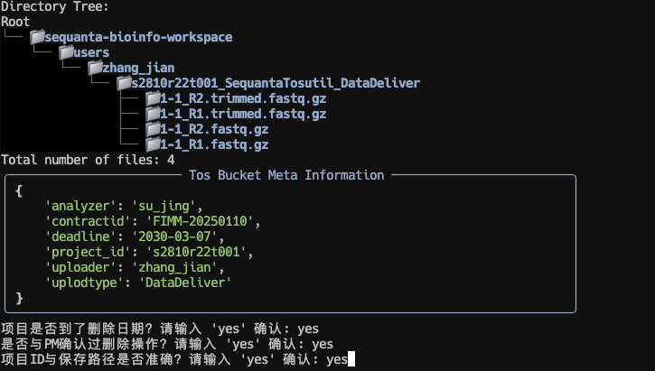
>
> ```bash title="三次确认"
> # 以下提示当全部输入yes后才会执行删除操作
> 项目是否到了删除日期？请输入 'yes' 确认: yes
> 是否与PM确认过删除操作？请输入 'yes' 确认: yes
> 项目ID与保存路径是否准确？请输入 'yes' 确认: yes
> ```
>

```bash title="数据删除"
# tos上传&备份数据删除
SequantaTosutil.py Delete --uploadlog xxxxxx.log --project s2810r22t001
```


```bash title="log"
# 数据删除完成后会在本地生成数据删除日志
s2810r22t001_tos_upload_zhang_jian_2025-03-04_16-18-47.log
Delete_s2810r22t001_tos_object_zhang_jian_2025-03-04_16-42-56.log

```


数据删除后会在`tos bucket`中保留上传与删除`log`日志

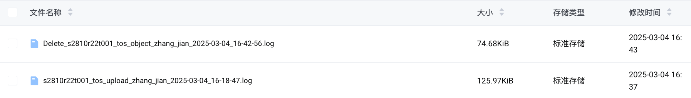

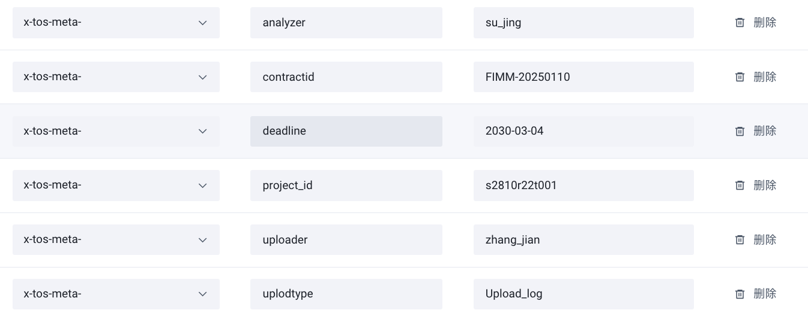

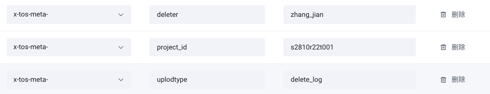

***

## 3 Source

> `SequantaTosutil`脚本：
>
> [project.yaml](file/project_VpA_pZ2thE.yaml "project.yaml")
>
> [SequantaTosutil.py](file/SequantaTosutil_VdtzK7kw1d.py "SequantaTosutil.py")

***

## 4 Reference
