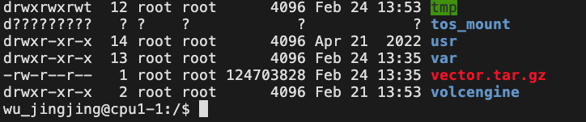

# TOS (火山云对象存储)

## 目录

- [1 Introduce](#1-Introduce)
  - [1.1 TOS](#11-TOS)
  - [1.2 tosutil](#12-tosutil)
  - [1.3 tosutil command](#13-tosutil-command)
- [2 Install](#2-Install)
  - [2.1 tosutil](#21-tosutil)
  - [2.2 SDK](#22-SDK)
    - [2.2.1 Install crcmod](#221-Install-crcmod)
- [3 Tutorial](#3-Tutorial)
  - [3.1 初始化配置](#31-初始化配置)
  - [3.2 Create & remove & copy ](#32-Create--remove--copy-)
    - [3.2.1 mb](#321-mb)
    - [3.2.2 mkdir](#322-mkdir)
  - [3.3 ls](#33-ls)
  - [3.4 du](#34-du)
  - [3.5 cp](#35-cp)
  - [3.6 mount](#36-mount)
    - [3.6.1 挂载tos所有人都可以访问](#361-挂载tos所有人都可以访问)
    - [3.6.2 mount limit](#362-mount-limit)
    - [3.6.3 tosutil mount parameter](#363-tosutil-mount-parameter)
    - [3.6.4 probe](#364-probe)
  - [3.7 TOS SDK](#37-TOS-SDK)
    - [3.7.1 Python TOS SDK](#371-Python-TOS-SDK)
- [4 Tips](#4-Tips)
  - [4.1 error log](#41-error-log)
- [5 Code](#5-Code)
  - [5.1 SequantaTosutil脚本](#51-SequantaTosutil脚本)
- [6 Source](#6-Source)
- [7 Reference](#7-Reference)

***

***Author***\*\* : zhang jian\*\*​

***Date***\*\* : 2025-3-4\*\*​

***Version***\*\* : \*\***`1.1.1v`**

***

> **NOTE** :  使用`tosutil`将`tos`挂载到本地使用了\*\*`POSIX`\*\*协议,其稳定性 & 速度堪忧啊。

***

## 1 Introduce

### 1.1 TOS

对象存储**TOS（Tinder Object Storage）** 是火山引擎提供的海量、安全、低成本、易用、高可靠、高可用的分布式云存储服务。通过网络，您可以在任何应用、任何时间、任何地点管理和访问火山引擎TOS上的数据[^1]。

### `1.2 tosutil`

`tosutil` 是用于访问和管理火山引擎对象存储（TOS）的命令行工具。通过该命令行工具，您可进行本地与 TOS 之间的批量数据处理，以应对本地中小数据上云、云上中小数据下载、自动化脚本任务集成等常见业务场景[^2]。

### `1.3 tosutil` command

> **`tosutil`**\*\* 工具常见的命令:\*\* ​
>
> | **类型**   | **命令**                                                                     | **描述**                      |
> | -------- | -------------------------------------------------------------------------- | --------------------------- |
> | **常用命令** | [ls](https://www.volcengine.com/docs/6349/152748#3558fadd "ls")            | 列举桶、列举桶内对象或列举桶内分片上传任务       |
> |          | [mkdir](https://www.volcengine.com/docs/6349/1254752#c35ac863 "mkdir")     | 创建文件夹                       |
> |          | [du](https://www.volcengine.com/docs/6349/1172132#8ba54f37 "du")           | 计算桶内对象和分片的大小和数量             |
> |          | [mb](https://www.volcengine.com/docs/6349/152749 "mb")                     | 根据指定的桶名和参数创建一个新桶            |
> |          | [cp](https://www.volcengine.com/docs/6349/152767 "cp")                     | 上传对象、下载对象或者复制对象             |
> |          | [setmeta](https://www.volcengine.com/docs/6349/152756 "setmeta")           | 设置对象元数据                     |
> |          | [stat](https://www.volcengine.com/docs/6349/152750 "stat")                 | 查询桶属性或查询对象属性                |
> |          | [rm](https://www.volcengine.com/docs/6349/152768 "rm")                     | 删除桶、删除对象或删除分片上传任务           |
> |          | [share](https://www.volcengine.com/docs/6349/170602 "share")               | 为需要分享的对象创建授权码，并通过授权码列举或下载对象 |
> |          | [set-acl](https://www.volcengine.com/docs/6349/1220835#9b092155 "set-acl") | 设置桶或对象的预定义访问策略              |
> |          | [mount](https://www.volcengine.com/docs/6349/1283241#cd767bb5 "mount")     | 将存储桶挂载为本地文件系统目录             |
>
> | **类型**   | **命令**                                                                           | **描述**                                    |
> | -------- | -------------------------------------------------------------------------------- | ----------------------------------------- |
> | **辅助命令** | [config](https://www.volcengine.com/docs/6349/152746 "config")                   | 查看配置文件路径，并更新配置文件中的关键配置信息                  |
> |          | [help](https://www.volcengine.com/docs/6349/152758 "help")                       | 查看命令帮助                                    |
> |          | [netdig](https://www.volcengine.com/docs/6349/1282828#c7603de5 "netdig")         | 测试上传及下载速率                                 |
> |          | [netdig](https://www.volcengine.com/docs/6349/1282828#c7603de5 "netdig")         | 支持一键式网络诊断 **NOTE** : 该命令仅支持 Linux 和 macOS |
> |          | [hash](https://www.volcengine.com/docs/6349/1141607 "hash")                      | 计算文件哈希值                                   |
> |          | [fcp](https://www.volcengine.com/docs/6349/1184015#1394b87b "fcp")               | 复制本地文件或文件夹                                |
> |          | [clear](https://www.volcengine.com/docs/6349/152760 "clear")                     | 删除指定文件夹下的断点记录文件，并尽力执行云端清理工作               |
> |          | [version](https://www.volcengine.com/docs/6349/152761 "version")                 | 查看版本号                                     |
> |          | [ping](https://www.volcengine.com/docs/6349/1220837#5f7eca0d "ping")             | 测量网络延迟                                    |
> |          | [connect](https://www.volcengine.com/docs/6349/1220838#b110e678 "connect")       | 计算网络连接耗时                                  |
> |          | [traceroute](https://www.volcengine.com/docs/6349/1220836#3ad9a74c "traceroute") | 抓取网络路径                                    |
> |          | [curl](https://www.volcengine.com/docs/6349/1220834#b048c772 "curl")             | 发送 HTTP 请求                                |

## 2 Install

### `2.1 tosutil`

> **NOTE** : 火山云提供了预先编译好的`tosutil`下载后可以直接使用[^3]。

```r title="tosutil"
# Linux
wget https://tos-tools.tos-cn-beijing.volces.com/linux/tosutil && chmod a+x tosutil
# macOS AM
wget https://tos-tools.tos-cn-beijing.volces.com/darwin/amd64/tosutil && chmod a+x tosutil
# macOS ARM64
wget https://tos-tools.tos-cn-beijing.volces.com/darwin/arm64/tosutil && chmod a+x tosutil
# Windows
wget https://tos-tools.tos-cn-beijing.volces.com/windows/tosutil -O tosutil.exe
```


### 2.2 SDK

🌋云提供了TOS的SDK，可以结合相关编程语言使用[^4]。

```bash title="install tos python sdk"
pip install tos
```


#### 2.2.1 Install crcmod

`TOS Python SDK` 依赖 `crcmod` 计算 `CRC` 校验码，而 `crcmod` 的`C` 扩展模式依赖 `python-devel` 包中的 `Python.h `文件。如果缺少 `Python.h`，`crcmod` 的 `C` 扩展模式安装失败，`crcmod` 会运行在纯 `Python` 模式，纯 `Python` 模式计算 `CRC`性能远差于 `C` 扩展模式 ，会导致上传、下载等操作效率低下[^5]。

```markdown title="install crcmod"
# install crcmod
pip install crcmod
```


## 3 Tutorial

### 3.1 初始化配置

1. **修改**\*\*`tosutil`\*\***文件权限**
   ```r title="修改tosutil运行权限"
   chmod +x tosutil
   ```

2. `tosutil config`
   ```r title="使用 config 命令进行初始化配置"
   ./tosutil config -i <access key> -k <secret key> -e <endpoint> -re <region>
   # -i 参数指定账号/子账号的 access key
   # -k 参数指定账号/子账号的 secret key
   # -e 参数指定访问的 endpoint
   # -re 参数指定访问的 region

   ```

3. `ls`
   ```r title="tosutil ls"
   # 该命令会返回当前账号的桶列表
   ./tosutil ls
   ```


### 3.2 Create & remove & copy&#x20;

```r title="Create & remove & copy "
# 创建桶
./tosutil mb tos://bucketname
# 上传单个对象，
./tosutil cp /temp/file.txt tos://bucketname/file.txt
# 下载单个对象
./tosutil cp tos://bucketname/file.txt /temp/file.txt
# 删除单个对象
./tosutil rm tos://bucketname/file.txt
# 上传文件夹
./tosutil cp /temp/test_folder tos://bucketname -r
# 下载文件夹
./tosutil cp tos://bucketname/test_folder /temp -r
# 删除文件夹
./tosutil rm tos://bucketname/test_folder -r


```


#### `3.2.1 mb`

`tosutil` 通过 `mb` 命令创建存储桶(ps:存在一个前提，你要有相关权限才能够创建bucket)

```r title="mb"
# 创建名称为 bucketname，桶 ACL 为私有（private），存储类型为标准存储（STANDARD）的存储桶
./tosutil mb tos://bucketname -acl=private -sc=STANDARD
# -acl : 创桶时可指定的预定义访问策略
         private：私有的，默认值。
         public-read：公共读。
         public-read-write：公共读写。
         authenticated-read：认证用户读。
         bucket-owner-read：桶所有者读。
         bucket-owner-full-control：桶所有者完全权限
# -sc  : 桶的默认存储类型，取值说明如下
         STANDARD：标准存储，默认值。
         IA：低频访问存储。
         ARCHIVE_FR：归档闪回存储。
         ARCHIVE：归档存储。
         COLD_ARCHIVE：冷归档存储。
         DEEP_COLD_ARCHIVE：深度冷归档存储。

```


#### `3.2.2 mkdir`

`tosutil`通过 `mkdir` 命令在本地或云端创建文件夹。

```r title="通过 mkdir 命令在本地或云端创建文件夹"
./tosutil mkdir tos://bucketname/a/b/c
```


### `3.3 ls`

`tosutil`使用 `ls` 命令列举账号下的资源信息，包括桶、桶内对象及桶内分片上传任务。

```r title="ls"
# 列举当前账号下的所有可用资源
./tosutil ls
# 显示特定bucket中的文件并只显示文件夹 & 精简显示
root@scheduler:~# tosutil ls tos://<PATH>/ -d -s
Start at 2024-09-06 04:39:53.594176656 +0000 UTC
Listing objects .
Folder list:
tos://<PATH>/Docker/
# -d : 仅列举当前目录下的对象和子目录，而非递归列举所有对象和子目录
# -s : 以精简格式显示查询结果。


```


```r title="通过使用key访问列举特定bucket"
tosutil ls -i xxxxxxxxxxxxxxxxxxx -k xxxxxxxxxxxxxxxxxxx \
           tos://<PATH>/
```


### `3.4 du`

`tosutil`使用 `du` 命令计算整个桶或桶前缀下所有对象和分片上传任务（包括未合并的分片）的总大小和总数量。

```r title="du"
root@scheduler:~# tosutil du tos://PATH/ 
Start at 2024-09-06 04:50:02.262509785 +0000 UTC
Calculating objects [18000]..
Storage class                   Object number                   Object size                     
---------------------------------------------------------------------------------------------
STANDARD                        27260                           460.03GB                        
---------------------------------------------------------------------------------------------
Total object number:            27260               Total object size:              460.03GB            

End at 2024-09-06 04:50:04.263984938 +0000 UTC, 2001 ms elapsed
```


### `3.5 cp`

`tosutil`使用 `cp` 命令上传、下载、拷贝对象及恢复之前执行失败任务的命令[^6]。

> 通过 `cp` 命令将本地对象上传至 TOS
>
> ```r title="上传数据到bucket"
> tosutil cp -r -link -u \
>            -flat -j 12 -p 12 
>            -i xxxxxxxxxxxxxxxxxxx \
>            -k xxxxxxxxxxxxxxxxxxx \
>            -e tos-cn-shanghai.ivolces.com \
>            -re cn-shanghai \
>            <PATH> tos://<PATH>/
> # -r  : 执行批量上传、下载或复制操作
> # -dryRun : 测试模式运行，不执行实际的上传、下载或复制操作。
> # -link : 上传软链接文件或文件夹指向的真实路径
> # -u  : 增量上传、下载或复制对象，设置该参数后，会比较源端和目标端
> # -vchecksum : 上传或下载对象时通过 CRC64 算法验证数据一致性
> # -flat : 上传、下载或复制对象时不包含相对父目录
> # -j  : 批量任务的最大并发数
> # -p  : 每个分片任务的最大并发数
> # -e  : 代表执行本次命令所使用的 TOS 服务端的 Endpoint.
> # -re : 代表执行本次命令所使用的 TOS 服务端的 Region.
> # -i  : 代表执行本次命令所使用的 Access Key ID.
> # -k  : 代表执行本次命令所使用的 Secret Access Key .
> ```
>

> 使用 `cp` 命令下载存储桶中的对象
>
> `tosutil`使用 `cp` 命令下载存储桶中的对象
>
> > PS:就是将上面命令的tos与本地位置调换就可以实现tos数据下载到本地
>
> ```r title="下载数据到本地"
> tosutil cp -r -u -flat -j 12 -p 12  tos:://<PATH> ./
> # 下载 tos://sequanta-ceph/2024_Slurm_bioos/Reference/ 文件夹到本地
> tosutil cp -r -u -flat -j 12 -p 12 tos://sequanta-ceph/2024_Slurm_bioos/Reference/ ./
> Start at 2024-09-06 05:08:06.362713529 +0000 UTC
> Parallel:      12                  Jobs:          12                  
> Threshold:     100.00MB            PartSize:      auto                
> VerifyChecksum: true                          
> CheckpointDir: /root/.tosutil_checkpoint     
> OutputDir: /root/.tosutil_output         
> TempFileDir: auto                          
> [>__________________] 1.10% tps:0.16 299.48MB/s 6/26.64K 7.43GB/677.27GB 38m10s
> ```
>

### `3.6 mount`

火山云`tos`可以使用标准的 `POSIX` 协议,将对象存储`bucket`挂载到本地。

> **NOTE** :由于挂载`tos`操作会涉及多个协议转换，速度可能会较慢。

> **NOTE** :  在`Linux`挂载`tos`需要使用`fusermount`，请确保当前系统已经安装的`fusermount`。
>
> ```markdown title="fusermount"
> # 查看fusermount是否安装 & 版本
> fusermount -V
> fusermount3 version: 3.10.5
> ```
>

```r title="tosutil  挂载tos示例"
./tosutil mount tos://bucket[/prefix] mount_point
```


```markdown title="挂载tos"
# 创建待挂载目录 & 修改目录权限
mkdir /mount_point && sudo chmod 777 /mount_point
# 将tos挂载到本地 & 仅只读
tosutil mount tos://bucket[/prefix] /mount_point -ro
# 将tos挂载 & 支持覆盖、删除、移动
tosutil mount tos://bucket[/prefix] /mount_point -aow -ad -ar
```


```python title="查看 & 卸载挂载"
# 查看目录tos挂载情况
df -h /tos_mount        
Filesystem      Size  Used Avail Use% Mounted on
tosutil/v3.1.6     0     0     0    - /tos_mount
# 卸载挂载目录
umount /tos_mount
```


#### 3.6.1 挂载tos所有人都可以访问

```markdown title="挂载tos所有人都可以访问"
# 修改 /etc/fuse.conf 文件 
user_allow_other
# 挂载特定tos
tosutil mount tos://sequanta-bioinfo-fastq/ /tos_mount \
        -ro -ao -i xxxxxxxxxxxxx \
        -k xxxxxxxxxxxxx \
        -e tos-cn-shanghai.ivolces.com -re cn-shanghai

```


> **NOTE** : 在使用`tosutil` 挂载tos到本地时，如果想让所有用户都可以访问，需要添加`-ao`参数，否则挂载的目录权限就会变得奇奇怪怪。
>
> 

#### `3.6.2 mount` limit

**将**\*\*`TOS`****挂载到本地后，可以通过兼容的 ****`POSIX`**** 文件接口管理桶内对象。由于只兼容部分 ****`POSIX`**** 语义，因此在本地系统对存储桶执行的操作受限**[^7]**。\*\*

1. **写操作限制**
   - **仅支持追加写**：文件写入时，只能在文件**末尾追加**新内容，**不能修改已有内容**（例如覆盖中间某段数据）。
   - **不支持随机位置修改**：如使用`lseek`跳转到文件中间写入或修改会失败。
   - **数据提交依赖**\*\*`flush`\*\***或关闭文件**：调用`flush`、`fsync`或关闭文件（`close`）后，数据才会真正写入存储桶。写入过程中可能存在本地缓存，导致未提交的数据在服务端不可见。
2. **兼容的操作** &#x20;

   支持基本的文件系统操作，例如：
   - **文件/目录管理**：创建 (`mkdir`,`create`)、删除 (`unlink`,`rmdir`)、重命名 (`rename`)、查看属性 (`getattr`)
   - **数据读写**：打开文件 (`open`)、读取文件 (`read`)、追加写入 (`write`)、强制刷盘 (`flush`,`fsync`)
   - **目录浏览**：列出目录内容 (`readdir`)、查看文件状态 (`statfs`)
3. **不支持的操作** &#x20;

   以下高级功能因对象存储语义不兼容而被禁用：
   - **扩展属性（xattr）**：`getxattr`,`setxattr`等（常用于存储文件元数据，对象存储一般通过对象属性替代）。
   - **文件锁（lock）**：`getlk`,`setlk`（对象存储通常不支持文件级锁，需通过业务层实现并发控制）。
   - **链接（Link）**：不支持硬链接 (`link`) 和符号链接 (`symlink`)（对象存储以唯一键标识对象，无文件系统层链接）。
   - **空间预分配**：`allocate`（对象存储无需预分配空间）。
   - **随机访问偏移**：`lseek`（仅允许顺序读写，不能跳转位置）。
   - **高效数据段拷贝**：`copyfilerange`（依赖文件系统内部优化，对象存储通常需完整上传）。

#### `3.6.3 tosutil` `mount` parameter

- **必填参数**
  - **`bucket`**(String)：要挂载的存储桶名称。
  - **`mount_point`**(String)：本地挂载目录路径（需为空目录且存在）。
- **可选参数**
  - **`prefix`**(String)：仅挂载存储桶内匹配该前缀的对象（如指定目录路径）。
  - **`-sc`**(Enum)：写入数据的存储类型，默认`STANDARD`（支持多种归档存储类型）。
- **进程模式**
  - **`-fg`**(Bool)：启用前台运行模式（默认后台）。
- **读写模式**
  - **`-ro`**(Bool)：以只读模式挂载（默认可写）。
  - **`-aow`**(Bool)：允许覆盖已有文件（需完全重写）
- **删除权限**
  - **`-ad`**(Bool)：允许删除文件。
  - **`-adr`**(Bool)：允许递归删除目录（*仅限FNS桶*）。
- **追加与修改**
  - **`-ac`**(Bool)：允许向已存在文件追加内容（*仅限FNS桶*）。
- **文件系统属性**
  - **`-dm`**(Integer)：目录权限（默认`0755`）。
  - **`-fm`**(Integer)：文件权限（默认`0644`）。
  - **`-uid/-gid`**(Integer)：设置挂载目录的用户/组归属。
- **并发控制**
  - **`-rconcurrency/-wconcurrency/-oconcurrency`**(Integer)：读写和非读写操作的并发数（默认均`1000`）。
- **分片与带宽**
  - **`-rl`**(String)：带宽限制（默认`1GB`）。
  - **`-ups`**(String)：写数据分片大小（默认`8MB`）。
- **缓存与内存**
  - **`-rps`**(String)：读分片大小（默认`8MB`）。
  - **`-mwbs`**(String)：单文件写入内存上限（默认`50MB`）。
  - **`-mlh`**(String)：总内存占用阈值（默认系统内存的70%）。
- **预取与缓存目录**
  - **`-cfd`**(String)：本地缓存目录路径（需手动设置）。
  - **`-tfd`**(String)：临时文件目录（建议用于大文件上传）。
- **数据一致性**
  - **`-vchecksum`**(Bool)：顺序读写时校验数据一致性（默认关闭）。
  - **`-nftr`**(Bool)：延迟数据提交（需配合`release`触发写入）。
- **调试与日志**
  - **`-debug`**(Bool)：开启 FUSE Debug 日志。
  - **`-pprof`**(Bool)：性能分析服务（默认端口`18888`）。
- **FNS桶专属功能**
  - `-ac`（追加写）和`-adr`（递归删）仅在 FNS 桶中生效。
- **写入安全**
  - 默认关闭文件覆盖（`-aow=false`），开启后需注意潜在数据丢失风险。
- **分片与临时文件**
  - 上传分片若超过`20MB`，需通过`-tfd`指定临时文件目录。
- **缓存时效**
  - 本地缓存有效期默认为`3600秒`（1小时），可通过`-ce`调整。

#### `3.6.4 probe`

火山云`tosutils`提供了`probe`命令，测试上传或下载时的单流速率[^8]。

```bash title="测速示例"
# 测试连接自有 bucket 上传速度
tosutil probe  tos://sequanta-bioinfo-workspace/users/zhang_jian/ -pt upload
Start to test the uploading speed for region cn-shanghai

Average upload rate: 50.36MB/s                                                 

Time consuming details
Resolve dns cost:      3 ms
Build connection cost: 1 ms
Tls handshake cost:    5 ms
Send request cost:     20459 ms
Wait response cost:    66 ms
Total cost:            20534 ms
# 测试连接自有 bucket 下载速度
tosutil probe  tos://sequanta-bioinfo-workspace/users/zhang_jian/ -pt download
tosutil probe  tos://sequanta-bioinfo-workspace/users/zhang_jian/ -pt download
Try to upload a cloud object for testing
Start to test the uploading speed for region cn-shanghai

Average upload rate: 84.75MB/s                                                 

Time consuming details
Resolve dns cost:      3 ms
Build connection cost: 1 ms
Tls handshake cost:    4 ms
Send request cost:     279 ms
Wait response cost:    150 ms
Total cost:            437 ms

--------------------------------
Start to test the downloading speed for region cn-shanghai

Average download rate: 51.89MB/s                                               

Time consuming details
Resolve dns cost:      -1 ms
Build connection cost: -1 ms
Tls handshake cost:    -1 ms
Send request cost:     0 ms
Wait response cost:    9 ms
Total cost:            20321 ms

```


### 3.7 TOS SDK

火山引擎对象存储服务 TOS（Torch Object Storage）为了方便对象存储的使用也提供了丰富的SDK工具。`Java` & `Python` & `Go` & `C++` & `Node.js` & `Browser.js` & `.NET` & `PHP` & `Android` & `iOS` & `Harmony` & `C`。

> **🌋云的TOS SDK主要有以下三种使用流程：**
>
> - **长期访问** ： 使用`AccessKeyId`、`SecretAccessKey`访问；
> - \*\*临时访问 \*\*： 通过 `STS` 服务向其他用户颁发临时访问凭证，在凭证有效期内，用户可访问您的 `TOS` 资源，而无需透露您的长期密钥，保障您 `TOS` 资源的安全性；
> - **ECS 免密登录** ： `OS Python SDK` 支持设置 `ECS` 免密登录，该操作需要先绑定` IAM` 角色到 ECS。
>
> ```mermaid 
> flowchart LR
>       TOSSDK_1(长期访问)--AccessKey/SecretKey-->B([初始化TosClients])
>       TOSSDK_2(临时访问)--STS Security Token Service-->B([初始化TosClients])
>       TOSSDK_3(ECS免密登录)--ECS Band IAM-->B
>       B--上传/下载/删除-->1(BUCKET)
>       1-->C([Close osClients])
>
>
> ```
>

#### 3.7.1 Python TOS SDK

`TOS Python SDK`（Tinder Object Storage Python SDK）是由火山引擎（`Volcengine`）提供的一个`Python`软件开发工具包，用于帮助Python开发者轻松地与火山引擎的对象存储服务`TOS`进行交互[^9]。

[Python TOS SDK](<Python TOS SDK/Python TOS SDK.md> "Python TOS SDK")

`TOS Python SDK`（Tinder Object Storage Python SDK）是由火山引擎（`Volcengine`）提供的一个`Python`软件开发工具包，用于帮助Python开发者轻松地与火山引擎的对象存储服务`TOS`进行交互[^9]。

## 4 Tips

> **使用特定key进行数据下载**
>
> > 当使用config配置好tosutil参数后，如果要访问当前账号下没有权限的bucket，可以原始 `-i` `-k` `-e` `-re`指定特定key。
> >
> > ```bash title="tosutil "
> > tosutil cp -r -link -u \
> >            -flat -j 12 -p 12 
> >            -i xxxxxxxxxxxxxxxxxxx \
> >            -k xxxxxxxxxxxxxxxxxxx \
> >            -e tos-cn-shanghai.ivolces.com \
> >            -re cn-shanghai \
> >            <PATH> tos://<PATH>/
> > # -e  : 代表执行本次命令所使用的 TOS 服务端的 Endpoint.
> > # -re : 代表执行本次命令所使用的 TOS 服务端的 Region.
> > # -i  : 代表执行本次命令所使用的 Access Key ID.
> > # -k  : 代表执行本次命令所使用的 Secret Access Key .
> >
> > ```
> >

### 4.1 error log

如果使用`tsoutil`下载数据失败可以到 `tosutil log`文件夹查看对应`log`日志。

```bash title="tsoutil log"
# tsoutil log日志位置
<user path>/.tosutil_output
# 可以使用 TASK_ID 搜索特定传输任务日志
p_failed_【TASK_ID】

```


## 5 Code

### `5.1 SequantaTosutil`脚本

[SequantaTosutil](SequantaTosutil/SequantaTosutil.md "SequantaTosutil")

## 6 Source

> 火山引擎对象存储TOS与文件存储迁移操作指导
>
> [火山引擎对象存储TOS与文件存储迁移操作指导.pdf](file/火山引擎对象存储TOS与文件存储迁移操作指导_75WJkdMR9I.pdf "火山引擎对象存储TOS与文件存储迁移操作指导.pdf")

## 7 Reference

[^1]: [https://www.volcengine.com/docs/6349](https://www.volcengine.com/docs/6349 "https://www.volcengine.com/docs/6349")

[^2]: [https://www.volcengine.com/docs/6349/148775](https://www.volcengine.com/docs/6349/148775 "https://www.volcengine.com/docs/6349/148775")

[^3]: [https://www.volcengine.com/docs/6349/152742](https://www.volcengine.com/docs/6349/152742 "https://www.volcengine.com/docs/6349/152742")

[^4]: [https://www.volcengine.com/docs/6349/93480](https://www.volcengine.com/docs/6349/93480 "https://www.volcengine.com/docs/6349/93480")

[^5]: [https://www.volcengine.com/docs/6349/92786](https://www.volcengine.com/docs/6349/92786 "https://www.volcengine.com/docs/6349/92786")

[^6]: [https://www.volcengine.com/docs/6349/152767](https://www.volcengine.com/docs/6349/152767 "https://www.volcengine.com/docs/6349/152767")

[^7]: [https://www.volcengine.com/docs/6349/1283241](https://www.volcengine.com/docs/6349/1283241 "https://www.volcengine.com/docs/6349/1283241")

[^8]: [https://www.volcengine.com/docs/6349/708213](https://www.volcengine.com/docs/6349/708213 "https://www.volcengine.com/docs/6349/708213")

[^9]: [https://github.com/volcengine/ve-tos-python-sdk](https://github.com/volcengine/ve-tos-python-sdk "https://github.com/volcengine/ve-tos-python-sdk")
