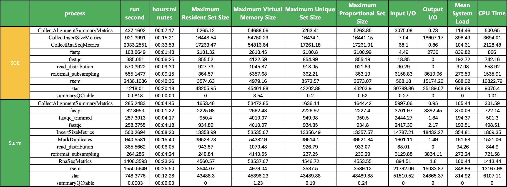
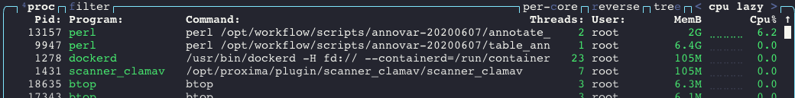
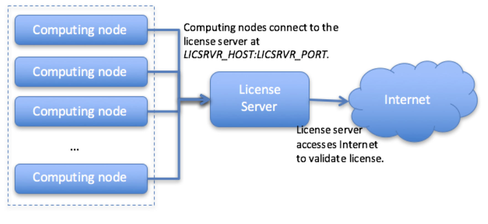
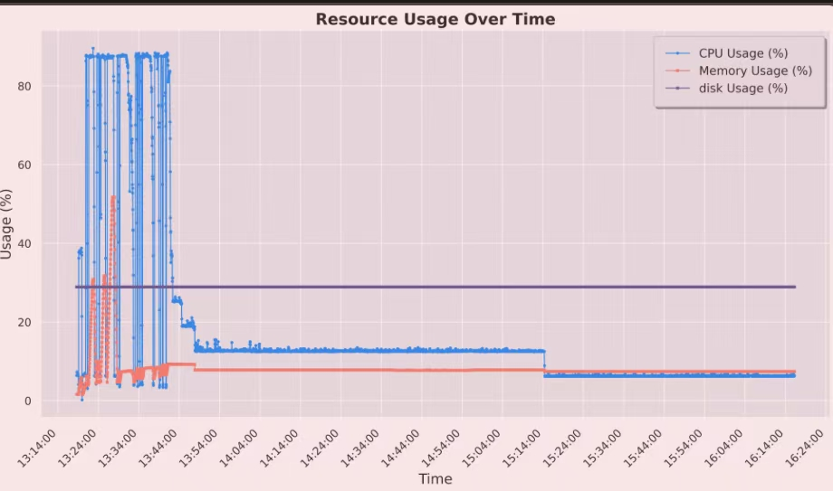

# Snakemake SGE 集群标准分析升级到Slurm集群标准分析 (AMD  服务器测试)

## 目录

- [1 Building Slurm Cluster](#1-Building-Slurm-Cluster)
- [2 Benchmark](#2-Benchmark)
- [3 question ](#3-question-)

### 1 Building Slurm Cluster

SGE标准分析流程 : 使用Snakemake 生成分析脚本 → 使用`monitor.py`脚本根据脚本之间依赖关系调用SGE进行分析

**(计划升级）** Slurm标准分析流程 : 使用Snakemake 生成分析脚本 → 使用`monitor_Slurm.py`脚本根据脚本之间依赖关系调用Slurm进行分析

> Snakemake SGE 集群标准分析升级到Slurm集群标准分析 (**AMD  服务器测试**)
>
> Slurm 集群建立成功 → 本地docker 镜像推送到镜像服务器 → Snakemake 管理节点环境搭建 （生成分析脚本与调用docker的python 环境搭建）→ RNA-seq 测试数据输上传→  云端分析测试（开启snakemake的benchmark模式）
>
> - [x] 火山云集群搭建（2024年09月04日完成）
> - [x] 本地Snakemke分析环境封装为Docker镜像（脚本生成模块 + python脚本分析需要的环境）
> - [x] 将本地docker 推送NAS（由于镜像存在多个版本，需要都进行推送还只是推送`10.111.6.122:5000/bixpipe` `3.5.6`  `29cc9b1fdf2c`版本）；
>   - 只推送`10.111.6.122:5000/bixpipe:3.5.6`版本
>     ```r title="bixpipe"
>     10.111.6.122:5000/bixpipe                                                  3.5.6                                         29cc9b1fdf2c        2 months ago        6.81GB
>     10.111.6.122:5000/bixpipe                                                  3.5.5                                         e006dcb6a08a        2 months ago        6.81GB
>     10.111.6.122:5000/bixpipe                                                  3.4.7                                         27ea5166773d        2 months ago        6.77GB
>     10.111.6.122:5000/bixpipe                                                  3.5.4                                         6907fc10f6ac        2 months ago        6.81GB
>     10.111.6.122:5000/bixpipe                                                  3.5.3                                         7c35daad57b9        3 months ago        6.81GB
>     10.111.6.122:5000/bixpipe                                                  3.5.2                                         75e886b9382a        3 months ago        6.82GB
>     10.111.6.122:5000/bixpipe                                                  3.5.1                                         e738a35f8b83        3 months ago        6.82GB
>     10.111.6.122:5000/bixpipe                                                  3.5.0                                         eab8f767bf49        3 months ago        6.82GB
>     10.111.6.122:5000/bixpipe                                                  3.4.6                                         9ec61f7f9cfa        4 months ago        6.78GB
>     10.111.6.122:5000/bixpipe                                                  3.4.5                                         87d7774bf2ce        5 months ago        6.78GB
>     10.111.6.122:5000/bixpipe                                                  3.4.1                                         db6b48002be4        6 months ago        6.76GB
>     10.111.6.122:5000/bixpipe                                                  3.4.0                                         36e7ca53d383        6 months ago        6.76GB
>     10.111.6.122:5000/bixpipe                                                  3.3.3                                         6435fb142093        6 months ago        6.76GB
>     10.111.6.122:5000/bixpipe                                                  3.3.2                                         f56e2af6448e        7 months ago        6.76GB
>     10.111.6.122:5000/bixpipe                                                  3.2.2                                         b49001dfb878        8 months ago        6.8GB
>     10.111.6.122:5000/bixpipe                                                  3.2.1                                         ea1436e6b54b        8 months ago        6.8GB
>     10.111.6.122:5000/bixpipe                                                  3.2.0                                         945c1f58276c        8 months ago        6.8GB
>     10.111.6.122:5000/bixpipe                                                  3.1.1                                         5eb86fb57391        9 months ago        6.73GB
>     10.111.6.122:5000/bixpipe                                                  3.1.0                                         cbf34b606a1e        10 months ago       6.71GB
>     10.111.6.122:5000/bixpipe                                                  3.0.2                                         76a9dd16ecbd        10 months ago       6.71GB
>     10.111.6.122:5000/bixpipe_env                                              3.0.0                                         3e4875fcc5f7        11 months ago       6.64GB
>     10.111.6.122:5000/bixpipe                                                  2.5.2                                         cb587e4ff0b3        13 months ago       6.32GB
>     10.111.6.122:5000/bixpipe                                                  2.3.6                                         9cb2dc05a915        17 months ago       6.36GB
>     10.111.6.122:5000/bixpipe                                                  2.3.5                                         6c327a437688        22 months ago       6.35GB
>     10.111.6.122:5000/bixpipe                                                  2.2.5  
>     ```
>
>   > NOTE : 目前只将 docker镜像推送到了NAS中
> - [x] 本地Reference 推送到SlurmNAS
>   > **NOTE** : 现阶段仅将Reference/index推送到共用NAS ([cnsh1589f576d7fc.22jprl6xg7eo07r2qr1wuj84i.nas.ivolces.com](http://cnsh1589f576d7fc.22jprl6xg7eo07r2qr1wuj84i.nas.ivolces.com "cnsh1589f576d7fc.22jprl6xg7eo07r2qr1wuj84i.nas.ivolces.com")),后续是否将其与分析文件夹分离？
> - [x] master 节点软件安装 & 加载docker 镜像
>   - [x] docker 安装
>     ```bash title="docker 安装"
>     apt install docker.io
>
>
>     ```
>
>   - [x] 分析脚本依赖包安装（python）
>   - [x] 加载docker镜像 & add tag
>   ```bash title="标准分析需要的分析环境与软件"
>   # install docker
>   apt update
>   apt install docker.io
>   # install btop
>   apt update
>   apt install btop
>   # install singularity
>   apt update
>   sudo apt-get update && sudo apt-get install -y \
>       build-essential \
>       libssl-dev \
>       uuid-dev \
>       libgpgme11-dev \
>       squashfs-tools \
>       libseccomp-dev \
>       pkg-config
>    apt install singularity 
>   # Install R 
>   sudo apt update
>   sudo apt install r-base r-base-dev 
>   sudo apt install r-cran-tidyverse
>   sudo apt install libcurl4-openssl-dev libssl-dev libxml2-dev 
>   # Install Python
>   pip install argparse
>   pip install pandas
>   pip install numpy
>   pip install snakemake
>   pip install biopython
>   pip install jupyterlab
>   pip install matplotlib
>
>   ```
>
>   **NOTE** : **Master 节点常开**
> - [x] 在集群外ECS中安装安装软件（docker ）→ image → 推送到所有计算节点 (2024/09/10完成)
>   - [x] 在集群外ECS安装软件（docker & BTOP）
>   - [x] 将其打包为镜像
>   - [x] 测试镜像可以在其他节点使用
>
> > **NOTE** : 火山云Slurm集群**Master** & 计算节点镜像需要在集群外找一台服务器进行配置（保持使用的CPU & 系统版本 & 系统盘大小一致）
>
> - [x] `set_workflow.py` → `set_workflow_slurm.py`(2024/09/10完成)
>   - [x] `set_workflow.py`脚本升级到`set_workflow_slurm.py`
>   - [x] 测试`set_workflow_slurm.py`脚本 & debug
> - [x] SGE → slurm脚本测试 `monitor.py`脚本修改；
>   - [x] 脚本升级`monitor.py` → `monitor_slurm.py`
>   - [x] `monitor_slurm.py`测试 & debug
> - [x] RNA-seq 数据标准分析测试；
> - [x] 火山云集群资源消耗测试
>   - [x] 缓存NAS测试 &  NAS 容量性测试 IO性能测试；
>   - [x] 分析时间与资源消耗统计；
> - [ ] sentieon ECS分析环境搭建；
> - [ ] DNA or Other-seq&#x20;

> **WARRING** : 使用自定义的master镜像后会导致计算节点无法启用 （master节点的镜像是否要进行特殊处理）

### 2 Benchmark

Slurm集群速度快了接近50%




> **NOTE** : [vcf2anno.py](http://vcf2anno.py "vcf2anno.py") 脚本运行超级耗时，同时对与多核心的使用也很不咋地
>
> 

### 3 question&#x20;

1. 单个master 如何挂载多个NAS & 计算节点如何挂载；
2. 不同集群间是否能够实现互联；

   Sentien license 是在Slurm master节点上面搭建

   
3. 集群如何能够实现不同配置的计算节点搭配

   Annotation 步骤对内存需求曲线（该节点为128G的计算节点）（能否搭配不同配置的计算节点）

   
