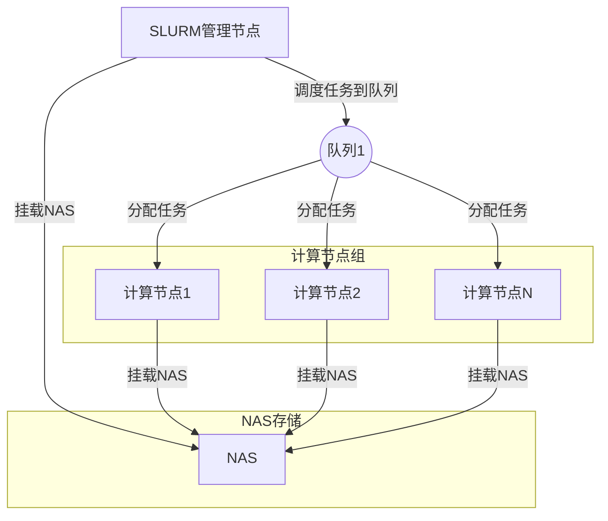
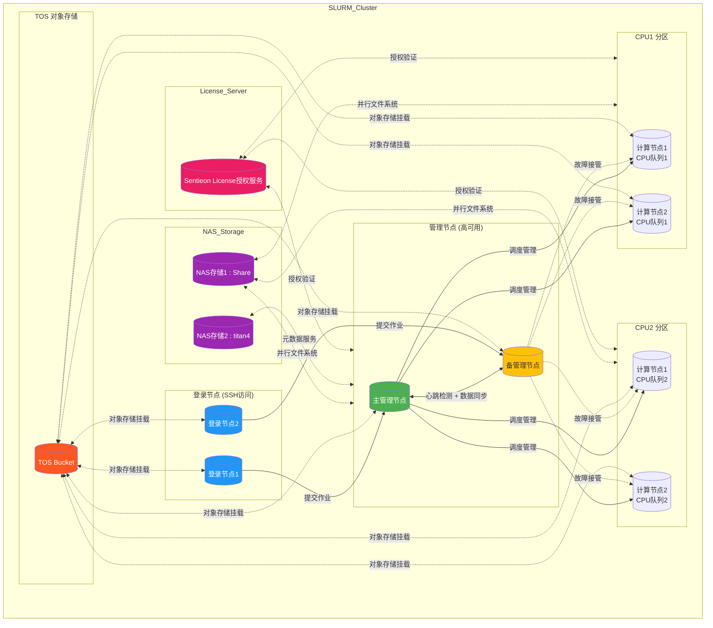
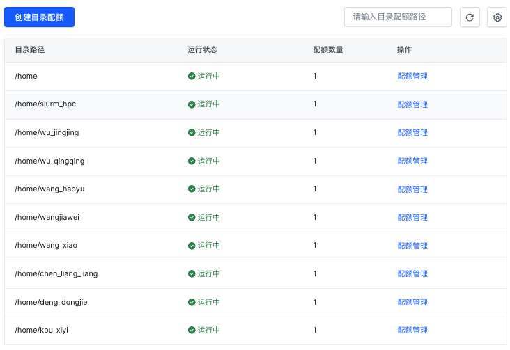
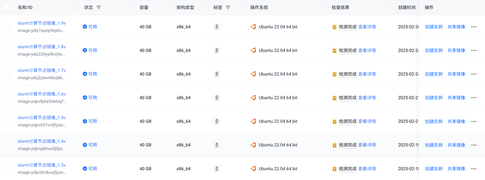
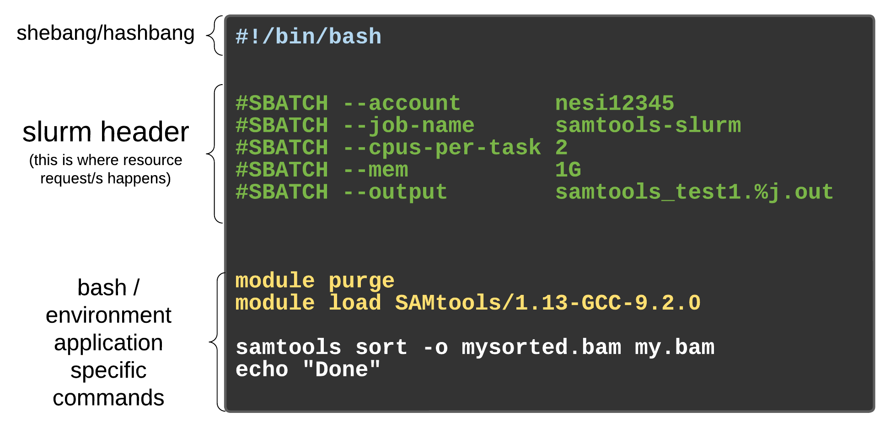
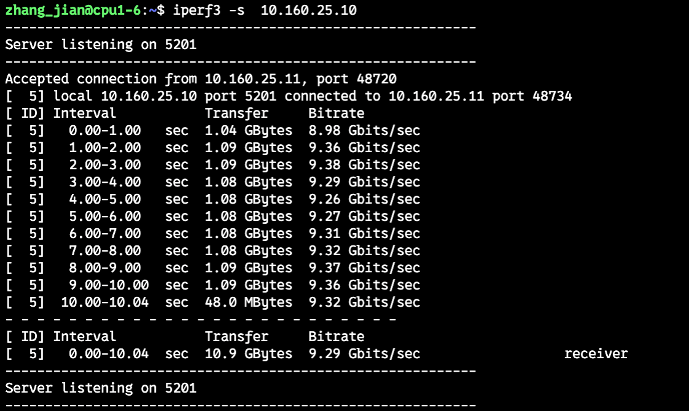
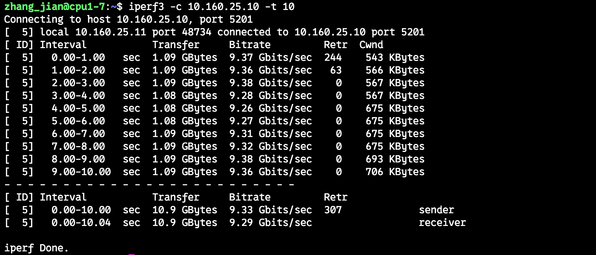
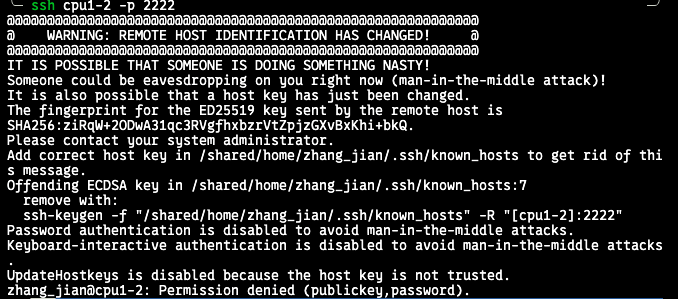

# 火山云Slurm Introduce

## 目录

- [1 Introduce](#1-Introduce)
  - [Slurm](#Slurm)
    - [Slurm Core Function](#Slurm-Core-Function)
  - [1.2 火山云Slurm集群架构](#12-火山云Slurm集群架构)
  - [1.3 CPU node  images](#13-CPU-node--images)
  - [1.4 火山云Slurm job 调度流程图](#14-火山云Slurm-job-调度流程图)
  - [1.5 Slurm 常用命令](#15-Slurm-常用命令)
    - [1.5.1 submit jobs](#151-submit-jobs)
  - [1.6 Set\_workflow.py](#16-Set_workflowpy)
  - [1.7 Data-deliver 结果交付结构](#17-Data-deliver-结果交付结构)
- [2 Tips](#2-Tips)
  - [2.1  不同计算节点打流测试](#21--不同计算节点打流测试)
- [3 Reference](#3-Reference)

***

*Author* : zhang jian

*Date* : 2025-2-28

*Version* : 1.0v

***

> \*\*NOTE \*\*: 当前的`slurm`集群获取的实例，都是基于虚拟化计算获得的虚拟机，无法满足需要对硬件进行绑定的相关操作。

***

## 1 Introduce

### **`Slurm`**

**`Slurm`**(***Simple Linux Utility for Resource Management***)[^1]是开源的、具有容错性和高度可扩展的`Linux`集群超级计算系统资源管理和作业调度系统。超级计算系统可利用`Slurm`对资源和作业进行管理，以避免相互干扰，提高运行效率。所有需运行的作业，无论是用于程序调试还是业务计算，都可以通过交互式并行 `srun` 、批处理式 `sbatch` 或分配式 `salloc` 等命令提交，提交后可以利用相关命令查询作业状态等。[^2]

#### **`Slurm`** Core Function

> \*\*`Slurm`\*\***主要有以下四大核心功能：**
>
> - \*\*`Slurm`\*\***可以分配独占或非独占的资源（计算节点）访问权限给用户一段时间，以便他们能够开展工作**;
>   > 在拥有多个计算节点的集群中，当用户`A`提交了一个需要占用一定计算资源的任务时，`Slurm`会根据任务需求和当前资源情况，分配给用户`A`一定数量的计算节点，这些节点可以是完全由用户`A`独占使用，也可以是与其他用户共享使用，用户`A`在分配到的这些节点上运行自己的任务程序。
> - \*\*`Slurm`\*\***提供了一个框架，用于在分配的节点集合上启动、执行和监控工作（通常是并行作业**);
>   > `Slurm`不仅分配资源，还会对在这些资源上运行的任务进行一系列的管理操作。例如，当用户`B`的任务被分配到几个计算节点后，`Slurm`会负责启动用户`B`的任务程序，确保任务在各个节点上正常运行，并且实时监控任务的执行状态，比如查看任务是否顺利进行、是否出现异常等情况。
> - \*\*`Slurm`\*\***通过管理待处理工作的队列来仲裁资源的竞争**;
>   > 当集群中有多个用户提交任务，而资源有限时，就会出现资源竞争的情况。`Slurm`会将所有待执行的任务放入一个队列中，然后根据一定的规则和策略，决定哪个任务先执行、哪个任务后执行，从而合理地分配有限的资源，避免资源争夺导致的混乱。
> - **`Slurm`**\*\* 还支持使用额外扩展以实现更加复杂的功能\*\*;
>   > **NOTE** : `Slurm`可以支持的插件详细见[here](https://www.wolai.com/ojYys3FUH7GnYBvdRqLF72#gyfXNLRbg1KByQXGXh9TJa "here")
>   > \*\*`Slurm`\*\***还可以使用插件来实现多种功能**
>   >
>   > - **会计核算** : 用于记录和统计资源使用情况等信息
>   > - **高级预约** : 用户可以提前预约资源
>   > - **成组调度（并行作业的时间共享）**:允许多个并行作业共享同一时间段内的资源
>   > - **回填调度**: 在保证主要任务执行的前提下，合理安排其他任务填充空闲时间
>   > - **拓扑优化的资源选择**:根据集群的网络拓扑结构等信息优化资源分配
>   > - **按用户或银行账户设置资源限制**:限制不同用户或账户可使用的资源量
>   > - **复杂的多因素作业优先级算法**:综合考虑多种因素来确定作业的优先级，从而更合理地安排作业执行顺序）。

### 1.2 火山云`Slurm`集群架构




**在火山云搭建的**\*\*`Slurm`\*\***集群，集群架构如下：**




`Sentieon license IP` : `10.160.24.5:8990`

```bash title="NAS 挂载位置"
# NAS 挂载位置
NAS1 :/   10P  1.3T   10P   1% /shared
NAS2 :/   10P  344G   10P   1% /titan4
```


```bash title="shared 目录说明"
# shared 目录说明
drwxrwxrwx  3 root  root  4.0K Dec 31 14:41 bixPipe    # 标准分析流程
drwxrwxrwx  3 root  root  4.0K Dec 31 14:26 Docker     # 标准分析DOCKER镜像
drwxrwxrwx  4 root  root  4.0K Jan 13 09:55 reference  # 参考基因组
drwxrwxrwx 20 root  root  4.0K Feb 11 16:25 software   # 分析环境
```


```bash title="/shared/home/software"
# /shared/home/software 文件夹
drwxrwxrwx  3 1000 1000 4096 Jan 20 11:23 bcftools-1.21
drwxrwxrwx  2 1000 1000 4096 Jan 22 15:38 celescope
drwxrwxrwx  3 root root 4096 Dec 26 17:21 cellranger
drwxrwxrwx  5 1000 1000 4096 Jan 22 10:44 cluster-utils-25.01.2
drwxrwxrwx  2 1000 1000 4096 Feb  8 17:19 conda_env
drwxrwxrwx  2 1000 1000 4096 Dec 31 15:04 ctop
drwxrwxrwx  3 1000 1000 4096 Jan 22 13:53 DNBC4
drwxrwxrwx  2 root root 4096 Sep  9 10:12 docker
drwxrwxrwx  5 1000 1000 4096 Jan  6 13:48 fastp-0.24.0
drwxr-xr-x  2 root root 4096 Feb 17 12:51 hosts_fix
drwxrwxrwx  2 1000 1000 4096 Jan  6 09:44 lazydocker
drwxrwxrwx 19 1000 1000 4096 Jan  7 15:12 miniconda3
drwxrwxr-x 13 1000 1000 4096 Feb 11 16:29 neovim
drwxrwxr-x  9 1000 1000 4096 Jan 16 13:52 ohmyzsh-master
drwxrwxr-x  3 1000 1000 4096 Jan 22 10:13 perl
-rwxrwxrwx  1 1000 1000 4696 Jan 22 09:28 README.md
drwxrwxr-x  8 1000 1000 4096 Jun 30  2024 sentieon-genomics-202308.03
drwxrwxr-x  5 1000 1000 4096 Jan 22 14:34 slurmvision-main
drwxrwxr-x 11 1000 1000 4096 Dec 27 11:18 spack
drwxrwxr-x  2 root root 4096 Feb 17 12:26 tosutil
```


> **NOTE** : 后续会对每一个人的目录进行限额配置

```bash title="titan4 目录说明"
# titan4 目录说明
drwxrwxr-x 2 chen_liang_liang chen_liang_liang 4096 Feb 17 15:04 chen_liang_liang
drwxrwxr-x 2 deng_dongjie     deng_dongjie     4096 Feb 17 15:04 deng_dongjie
drwxrwxr-x 2 kou_xiyi         kou_xiyi         4096 Feb 17 15:05 kou_xiyi
drwxrwxr-x 2 li_miaomiao      li_miaomiao      4096 Feb 17 15:05 li_miaomiao
drwxrwxr-x 4 su_jing          su_jing          4096 Feb 18 11:03 su_jing
drwxrwxr-x 2 wang_haoyu       wang_haoyu       4096 Feb 17 15:02 wang_haoyu
drwxrwxr-x 2 wangjiawei       wangjiawei       4096 Feb 17 15:02 wangjiawei
drwxrwxr-x 2 wang_xiao        wang_xiao        4096 Feb 17 15:03 wang_xiao
drwxrwxr-x 2 wu_jingjing      wu_jingjing      4096 Feb 17 15:00 wu_jingjing
drwxrwxr-x 2 wu_qingqing      wu_qingqing      4096 Feb 17 15:01 wu_qingqing
drwxrwxr-x 3 zhang_jian       zhang_jian       4096 Feb 17 15:10 zhang_jian
drwxrwxr-x 2 zhu_yun_ye       zhu_yun_ye       4096 Feb 17 15:06 zhu_yun_ye
```




`tos://sequanta-bioinfo-fastq/`挂载到了`/tos_mount`目录

### 1.3 CPU node  images

`slurm`集群的计算节点是通过将分析环境打包为镜像，在申请实例时，基于创建的定制化镜像创建的定制化实例实现的批量数据计算。



***

### 1.4 火山云Slurm job 调度流程图

***

### `1.5 Slurm` 常用命令

\*\*`Slurm`\*\***常用的命令有:**

1. **`sinfo`**\*\* : 查看当前集群下的节点详信息；\*\* ​
2. **`sbatch`**\*\*  : 提交分析作业脚本到集群；\*\* ​
3. **`salloc`**\*\*  :  申请特定规格的节点，登录到该节点运行作业；\*\* ​
4. **`squene`**\*\* : 查看节点作业信息；\*\* ​
5. **`sacct`**\*\* : 查看运行中或结束了的作业及作业步信息等命令\*\*​
6. **`scancel`**\*\*  : 取消作业；\*\* ​

[Basis Tutorial](https://www.wolai.com/Ro8H8DpPWNw3yaXRtXfhJ "Basis Tutorial")

#### 1.5.1 submit jobs

```bash title="submit jobs"
# subset joint call
sbatch -J joint_call \
       -o 2025_1_7_joint_call.out \
       -e 2025_1_7_oint_call.err \
       -p cpu-1 \
       -N1 \
       -n 114 \
       join_call_filter.sh
```




```bash title="例子："
#!/bin/bash
#SBATCH --job-name=myjob
#SBATCH --output=/share/home/pengchen/work/%x_%A_%a.out
#SBATCH --error=/share/home/pengchen/work/%x_%A_%a.err
#SBATCH --partition=cpu
#SBATCH --nodes=1
#SBATCH --tasks-per-node=1
#SBATCH --cpus-per-task=1
#SBATCH --mem-per-cpu=2g
#SBATCH --time=14-00:00:00
echo start: `date +'%Y-%m-%d %T'`
start=`date +%s`
####################
do something
####################
echo end: `date +'%Y-%m-%d %T'`
end=`date +%s`
echo TIME:`expr $end - $start`s
```


> **`sbatch`**\*\* 脚本作业参数\*\*​[^3]
>
> 1. **`#SBATCH --job-name`**\*\* ：作业名称;\*\* ​
> 2. **`#SBATCH –account=allocation`**\*\* : 指定Slurm作业使用的账户;\*\* ​
> 3. **`#SBATCH --dependency=<type:jobid>`: 设置作业依赖关系;**
> 4. **`#SBATCH --output`**\*\*  ：脚本标准输出结果;\*\* ​
> 5. **`#SBATCH --error`**\*\* ：脚本error输出结果;\*\* ​
> 6. **`#SBATCH --partition`**\*\* ：作业运行分区；\*\* ​
> 7. **`#SBATCH --nodelist`**\*\* ：指定作业节点\*\*；
> 8. **`#SBATCH --exclude`**\*\* ：破除特定作业节点；\*\* ​
> 9. **`#SBATCH --nodes`**\*\* ：作业使用的节点数量；\*\* ​
> 10. **`#SBATCH --ntasks`**\*\* ：作业的任务数；\*\* ​
> 11. **`#SBATCH  -–ntasks-per-node=processes`** ： **每个节点分配多少个进程**
> 12. **`#SBATCH --ntasks-per-node`**\*\* ：每个节点运行的tasks数；\*\* ​
> 13. **`#SBATCH --cpus-per-task`**\*\* ： 每个task使用的core的数；\*\* ​
> 14. **`#SBATCH --mem`**\*\* ：作业需要的内存 (Specified in MB，GB)；\*\* ​
>
>     **`--mem`**\*\* 的单位可以用后缀 K, M, G, T 指定（默认为 M）\*\*;
> 15. **`#SBATCH --mem-per-cpu`**\*\* :每个core需要的内存 (Specified in MB，GB)\*\*;
> 16. **`#SBATCH --mail-type=type`**\*\* :在作业开始或结束时接收电子邮件\*\*;
> 17. **`#SBATCH --mail-user=user`**\*\* : 用来接收邮件的地址\*\*;
> 18. **`#SBATCH --time=wall time`**\*\* : 作业将运行的最大时间长度\*\*;
> 19. **`#SBATCH --qos=qos`**\*\* : 指定作业服务质量\*\*。

***

### `1.6 Set_workflow.py`

`Set_workflow.py`标准分析流程:

```python title="Set_workflow.py"
usage: setup [-h] [-v] -w {r,rna,a,advRna,g,germline,j,joint,s,somatic,n,neo,m,wgbs} 
             -lab {wgs,v1,v5,v6,v8,TruSeq,riboZero,exome,wgbs}
             [-c CONFIGFILE]
             [-r RESOURCEFOLDER]
             -g {hg19,hg38,mm10,outbuild} [-s SAMPLEFILE] 
             -f FASTQFILE 
              [-bk BUCKET]  
              [-DE {ShortTerm,LongTerm}]  
             [-d GROUPFILE] 
             [-p PAIRFILE] 
             [-o WORKSPACE] 
             [--license SENTIEON_LICENSE]
             [--threads THREADS] 
             [-oc OUTBUILD_CONFIG] 
             [--qc] 
             [--sk SKIPPING_MODULES [SKIPPING_MODULES ...]] 
             [-ds DOWNSAMPLE] 
             [--platform {ILLUMINA,DNBSEQ,ELEMENT}]
              [-C {SGE,Slurm}]  
             [--gatk] 
             [--rna-somatic] 
             [--drop-black-region] 
             [-pon PANELOFNORMAL] 
             [-trim TRIM_FRONT | -ul UMI_LEN] 
             [-uc] [-pdx] [-globin] [-cgt] [-amp]
             [-sp {TruSeq,Nextera}] 
             [--targetBed TARGETBED] 
             [--coveredBed COVEREDBED] 
             [-img DOCKER_IMAGE] [-sha IMAGE_SHAID] 
             [-no-val] [-dev]
```


```python title="HPC Cluster"
[HPC Cluster platform] :
  -C {SGE,Slurm}, --Cluster {SGE,Slurm}
                        Set Workflow Analysis platform (Slurm | SGE), default: SGE
```


```python title="tos upload"
[tos upload] :
  -bk BUCKET, --bucket BUCKET
                        Set_workflow Analysis tos data deliver bucket (only for Slurm Cluster)
  -DE {ShortTerm,LongTerm}, --delete {ShortTerm,LongTerm}
                        Tos data-deliver Storage Type
```


```python 
# 小鼠 mm10 RNA-seq 标准分析 
# 分析完成后自动上传到 tos://sequanta-ceph/2024_Slurm_bioos/tmp/s2810r22t001 
# 并设置ShortTerm保存时间（3个月）
set_workflow.py -w rna --genome mm10 \
                 -lab  TruSeq -s sample.conf \
                -f fastq.conf -c project.yaml \
                -p pair.conf -C Slurm -d condition.conf \
                -DE ShortTerm \
                -bk 'tos://sequanta-ceph/2024_Slurm_bioos/tmp/s2810r22t001'
```


### 1.7 Data-deliver 结果交付结构

```python 
# 登录计算节点
ssh -p 2222 cpu1-1
```


## 2 Tips

### 2.1  不同计算节点打流测试







## 3 Reference

[^1]: [http://slurm.schedmd.com/](http://slurm.schedmd.com/ "http://slurm.schedmd.com/")

[^2]: [https://hmli.ustc.edu.cn/doc/linux/slurm-install/slurm-install.html](https://hmli.ustc.edu.cn/doc/linux/slurm-install/slurm-install.html "https://hmli.ustc.edu.cn/doc/linux/slurm-install/slurm-install.html")

[^3]: [https://curc.readthedocs.io/en/latest/running-jobs/job-resources.html](https://curc.readthedocs.io/en/latest/running-jobs/job-resources.html "https://curc.readthedocs.io/en/latest/running-jobs/job-resources.html")
