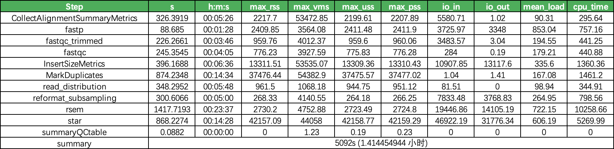
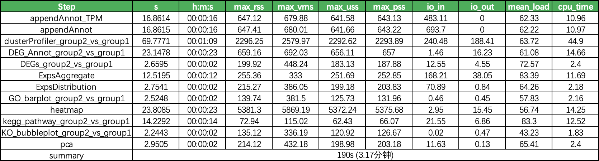

# 火山云Slurm 集群分析流程汇总

> **50个RNA-seq 样本分析时间 & 成本耗费预估；**
>
> 1. 根据项目新建容量型NAS存储；
> 2. TOS(50个RNA-seq 样本分析原始数据约225G) → 传输 →容量型NAS（TOS传输到容量型NAS速度约为200M/s，预估耗时19分钟）
> 3. master 节点：Set\_workfolw 打印分析命令；
> 4. master 节点 : montior\_Slurm根据打印的分析命令申请计算节点（一个样本会调用一台计算节点（16C 128G））；
> 5. 计算节点从镜像仓库拉取计算节点镜像（计算节点镜像image-ydj09z3z18dbktztvi4v）
>
>    
> 6. 计算节点启动后从缓存型NAS中加载Docker镜像 ，并开始进行分析；
>
>    **单个样本约消耗1.5小时**
>
>    
> 7. master 节点 : 完成样本分析后montior\_Slurm将申请新计算节点进行差异分析 & 富集分析 & 报告生成
>
>    **差异分析 & 富集分析 & 报告生成约消耗3.17分钟**
>
>    
> 8. 分析结果(分析结果约626G)从NAS → 传输到TOS（容量型NAS传输到TOS速度约为200M/s，预估耗时62分钟）
> 9. TOS中分析结果（626G）保存3个月，3个月后删除
>
> > **NOTE** : 50个RNA-seq样本分析时会在容量型NAS中存储933G数据（分析结果传输到TOS后该容量型NAS将销毁）
