# 火山云集群搭建

> **NOTE** : 当前集群下如果存在多个队列，就需要使用多个子网，以防止机器的数量超过可以使用的`IP`数量。

> **QA** : 当在管理 & 登录节点提交任务后，需要登录到对应计算节点时，可以使用`ssh cpu-xx`命令，但是需要保证对应计算节点的信息正确配置到`/etc/hosts`文件中。

> **NOTE** : 不要对管理节点进行任何设置！！！！！不要修改其安全组 & 秘匙对！！！

> **WARRING**\*\* : 新建集群需要依据一下规则  ！！！\*\* ​
>
> 1. \*\*`SH-Local-slurm-VPC07`\*\***私网为slurm集群专属VPC**
>
>    现阶段`SH-Local-slurm-VPC07` VPC共有两个子网
>    - `SH-VPC07-Subzone-01` |  `10.160.24.0/24` : 管控严格一些，为管理节点 & 登录节点 & MySql数据库专属子网
>    - `SH-VPC07-Subzone-02` | `10.160.25.0/24` : 管控宽松一些，为计算节点 & 计算节点镜像实例专属子网
> 2. **`NAS`**\*\*  目录配额\*\*​
>
>    火山云`slurm`集群是提供在所有节点挂载`NAS`实现共享存储，为了防止目录过于臃肿，需要设置所有目录配额。
>
>    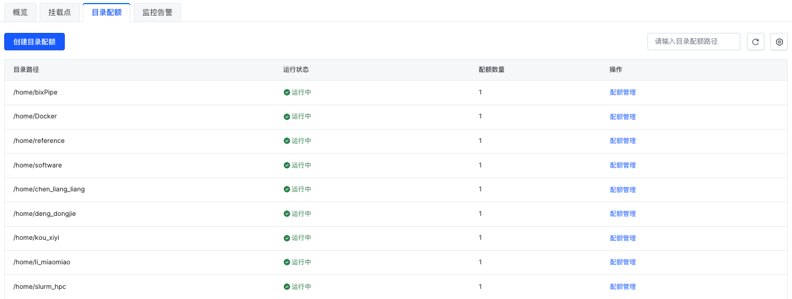
> 3. \*\*安全组 & \*\***`Key`**
>    > **NOTE** : `ssh` 登录端口需要修改为`2222`
>    - 火山云`slurm`集群开启后，为了保证节点的安全性，需要对登录节点 & 管理节点的安全组进行设置，以保证集群的安全性。
>      > `slurm` 集群端口要求： 整个集群都在一个安全组内，需要安全组内全通，然后数据库和nas也需要能通
>      > 所有节点需要可以访问 : `sentieon server` ： `10.160.24.5:8990`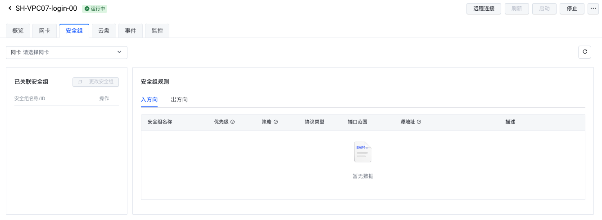
>    - 节点正式使用后，删除key,改用密码登录！！！
> 4. **节点与**\*\*`NAS`****等****`slurm`\*\***集群命名规则**
>    - 节点 ： `SH-VPC07-xxx-01`
>
>      `<地域>-<VPC网段>-<节点名称>-<编号>`
>    - `NAS` :&#x20;
>      - 如果是slurm集群正常使用的 ：`Slurm-缓存型-分析环境目录`
>
>        `<Slurm>-<NAS类型>-<NAS说明>`
>      - 如果是需要删除的`NAS` : `Slurm-容量型-deadline_2025_3_1`
>
>        `<Slurm>-<NAS类型>-<deadline>-<删除时间>`
>    - 计算节点镜像实例命名方式： `SH-VPC07-cpu-images`
>
>      `<地域>-<VPC网段>-<``cpu-images``>`
>    - mysql数据库命名方式 : `SH-VPC07-slurm-mysql`
>
>      `<地域>-<VPC网段>-<slurm-mysql>`

***

## 1 Introduce

### 1.1 Slurm

**`Slurm`**(***Simple Linux Utility for Resource Management***)[^1]是开源的、具有容错性和高度可扩展的`Linux`集群超级计算系统资源管理和作业调度系统。超级计算系统可利用`Slurm`对资源和作业进行管理，以避免相互干扰，提高运行效率。所有需运行的作业，无论是用于程序调试还是业务计算，都可以通过交互式并行 `srun` 、批处理式 `sbatch` 或分配式 `salloc` 等命令提交，提交后可以利用相关命令查询作业状态等。[^2]

> \*\*`Slurm`\*\***主要有以下四大核心功能：**
>
> - \*\*`Slurm`\*\***可以分配独占或非独占的资源（计算节点）访问权限给用户一段时间，以便他们能够开展工作**;
>   > 在拥有多个计算节点的集群中，当用户`A`提交了一个需要占用一定计算资源的任务时，`Slurm`会根据任务需求和当前资源情况，分配给用户`A`一定数量的计算节点，这些节点可以是完全由用户`A`独占使用，也可以是与其他用户共享使用，用户`A`在分配到的这些节点上运行自己的任务程序。
> - \*\*`Slurm`\*\***提供了一个框架，用于在分配的节点集合上启动、执行和监控工作（通常是并行作业**);
>   > `Slurm`不仅分配资源，还会对在这些资源上运行的任务进行一系列的管理操作。例如，当用户`B`的任务被分配到几个计算节点后，`Slurm`会负责启动用户`B`的任务程序，确保任务在各个节点上正常运行，并且实时监控任务的执行状态，比如查看任务是否顺利进行、是否出现异常等情况。
> - \*\*`Slurm`\*\***通过管理待处理工作的队列来仲裁资源的竞争**;
>   > 当集群中有多个用户提交任务，而资源有限时，就会出现资源竞争的情况。`Slurm`会将所有待执行的任务放入一个队列中，然后根据一定的规则和策略，决定哪个任务先执行、哪个任务后执行，从而合理地分配有限的资源，避免资源争夺导致的混乱。
> - **`Slurm`**\*\* 还支持使用额外扩展以实现更加复杂的功能\*\*;
>   > **NOTE** : `Slurm`可以支持的插件详细见[here](https://www.wolai.com/ojYys3FUH7GnYBvdRqLF72#gyfXNLRbg1KByQXGXh9TJa "here")
>   > \*\*`Slurm`\*\***还可以使用插件来实现多种功能**
>   >
>   > - **会计核算** : 用于记录和统计资源使用情况等信息
>   > - **高级预约** : 用户可以提前预约资源
>   > - **成组调度（并行作业的时间共享）**:允许多个并行作业共享同一时间段内的资源
>   > - **回填调度**: 在保证主要任务执行的前提下，合理安排其他任务填充空闲时间
>   > - **拓扑优化的资源选择**:根据集群的网络拓扑结构等信息优化资源分配
>   > - **按用户或银行账户设置资源限制**:限制不同用户或账户可使用的资源量
>   > - **复杂的多因素作业优先级算法**:综合考虑多种因素来确定作业的优先级，从而更合理地安排作业执行顺序）。

***

## 2 Tutorial

### 2.1 火山云`Slurm`**前置步骤**

#### 2.1.1 创建vpc & 子网，密钥对

> NOTE : 密钥对仅在配置集群时使用，集群配置完成后，登录节点 & 计算节点的密钥对将会解绑。

联系`IT`帮忙创建`slurm`集群专属创建`vpc` & 子网 & 密钥对

#### 2.1.2 创建 NAS存储

> **NOTE** : 火山云`Slurm`集群需要在特定目录挂载NAS,已实现文件共享存储。创建NAS时需要保证NAS位于同一个可用区。

> **NOTE** : 如果创建的`slurm`集群为高可用集群则需要在已有NAS存储的基础上，单独创建极速型NAS,已保存集群配置信息(极速型`NAS`容量100GB就可以)。

火山云提供的`NAS`存储有以下类型：[^3]

- `NAS`缓存型&#x20;
- `NAS`容量型
- `NAS`极速型
- `VePFS`

##### 2.1.2.1 创建挂载点

挂载点需要与slurm集群位于同一个子网下。可以联系`IT`帮忙创建。

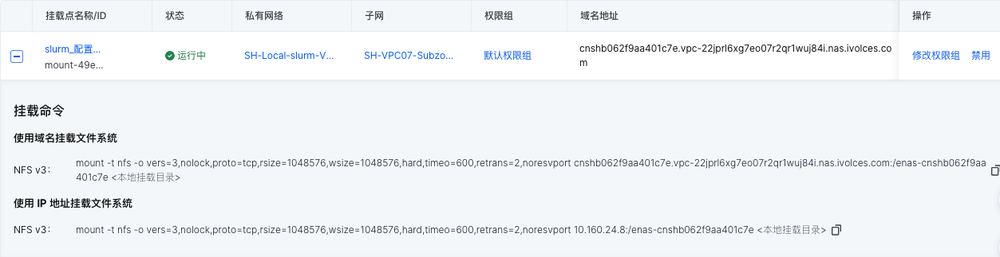

#### **创建MySQL服务（可选）**

> **NOTE **: **MySQL**服务需要与slurm集群位于相同的**可用区、VPC**和子网。

> **Tips** ：`slurm`集群推荐**MySQL服务**配置：2C4G 100G存储 & 最小配置：1C2G 50G存储

> NOTE : **MySQL**数据库创建过程中的密钥请进行长期妥善保管。

1. **创建**\*\*`MySQL`\*\***数据库(可以联系IT协助)**

   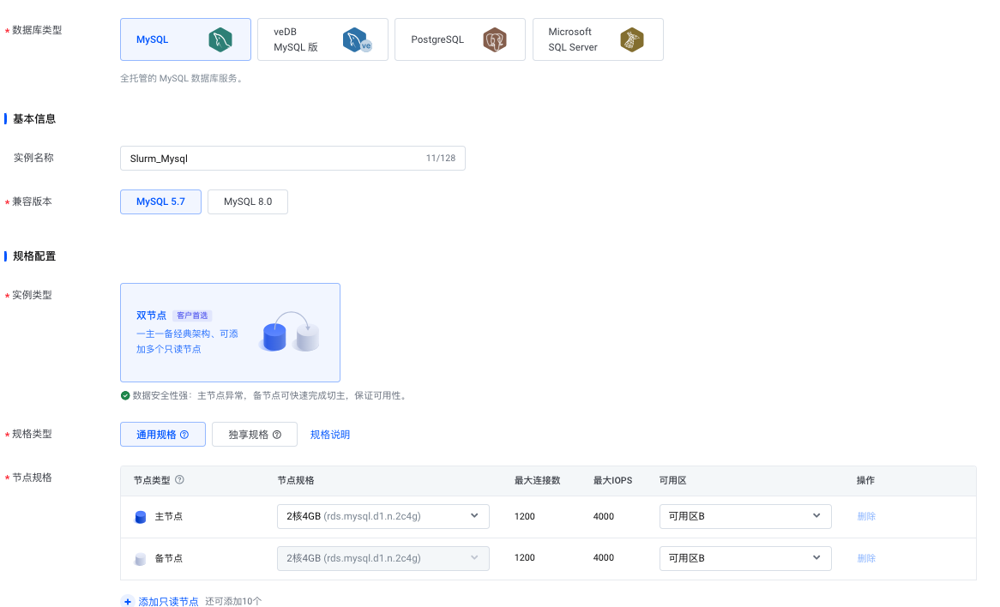

   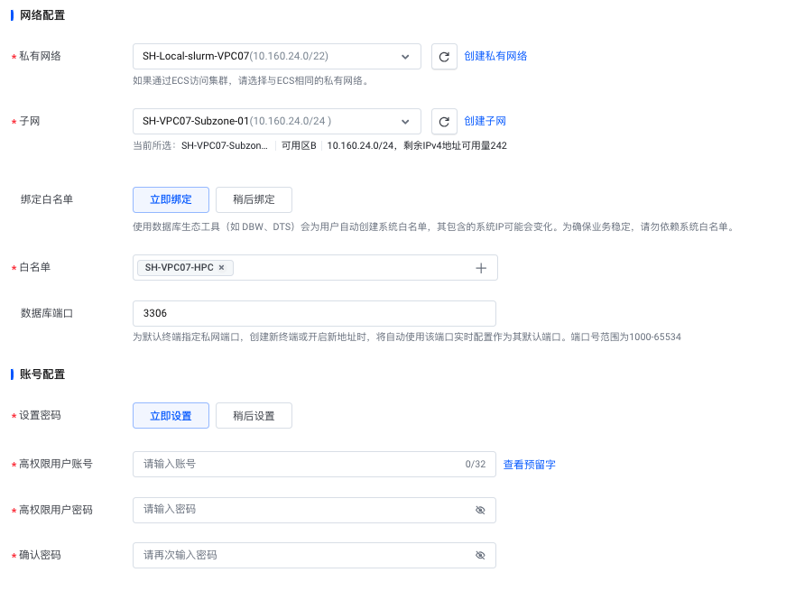

   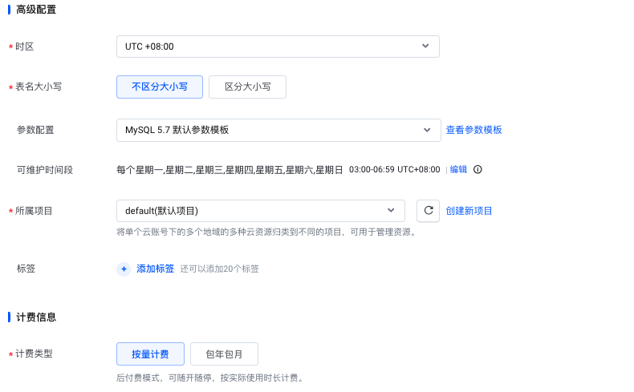
2. **创建数据库**

   
3. **绑定白名单：将**\*\*`slurm`****集群所在****`vpc`\*\***网段加入白名单**

   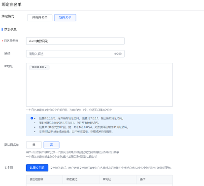

### 2.2 创建火山云`Slurm`集群流程

#### 2.2.1 火山云`Slurm`集群

1. **创建集群**
   > **NOTE** :   火山云`Slurm`集群默认可以创建的集群为单`master` & 单队列集群，如果需要创建更多计算节点（>100）与其他特殊类型集群,可以从火山云支持哪里获得对应模版。
   > 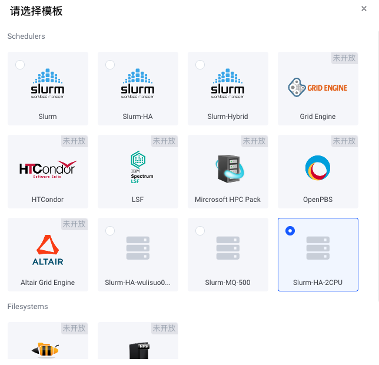
2. **基础配置**

   基础信息主要为集群的名称 & 网络配置信息 & 示例的配置规格 & 自动伸缩配置

   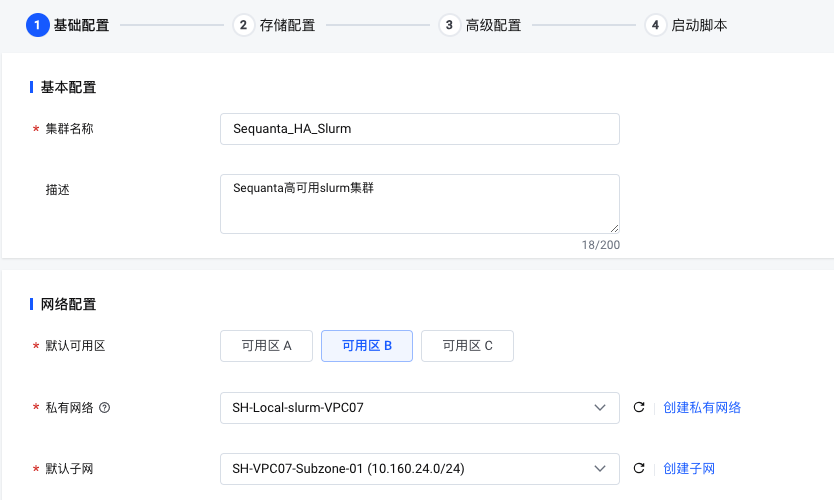
   > **NOTE** : 计算节点（`cpu1` & `cpu2`）需要指定其要使用的子网（ps:登录 & 管理节点的所在的子网需要较为严格的安全组控制）
   > 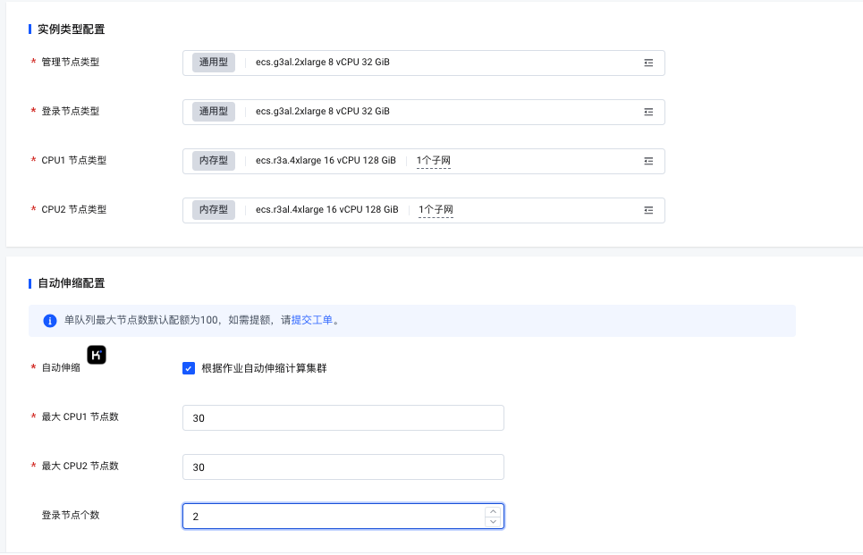
   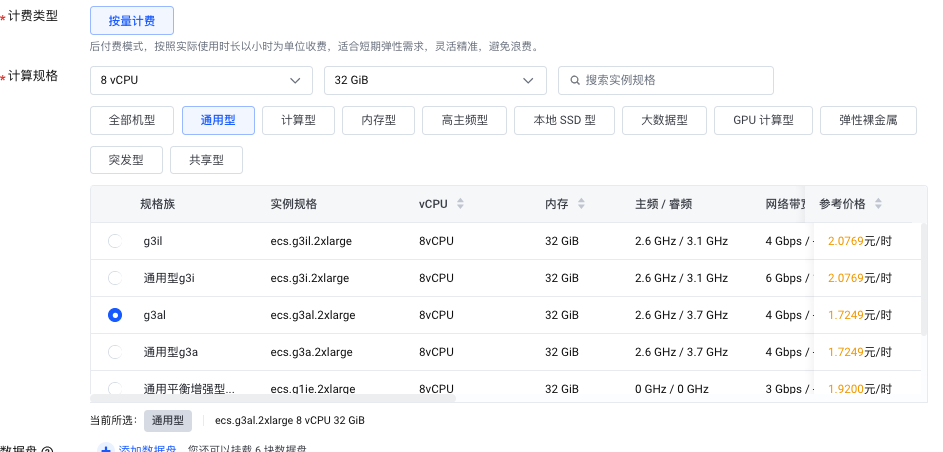

   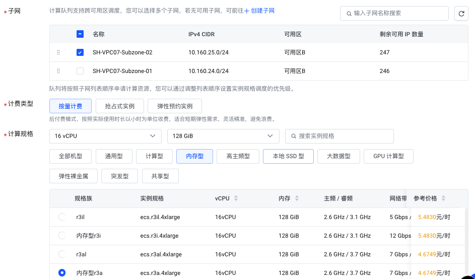
3. **存储配置**

   火山云`Slurm`集群是通过在所有节点挂载`NAS`实现共享存储，已实现任务可以在所有节点进行。
   > **NOTE** : NAS创建可以联系IT协助
   > **NOTE** : 当创建`slurm`高可用集群时，需要同时挂载两个nas：nas1挂载`/sched`(集群运行配置信息)；nas2挂载`/shared`(可以存放分析环境与分析数据)。**并且nas1的类型需要为极速型NAS**。
   ```bash title="调度配置NAS 挂载参数"
   # NFS 地址
   xxxxxxxxxxxxxxx.nas.ivolces.com
   # NFS Export 路径
   /enas-cnshb062f9aa401c7e
   # NFS 挂载选项
   vers=3,nolock,proto=tcp,rsize=1048576,wsize=1048576,hard,timeo=600,retrans=2,noresvport
   ```

   ```bash title="数据挂载NAS配置"
   # NFS 地址
   xxxxxxxxxxxxxxxx.nas.ivolces.com
   # NFS Export 路径
   /
   # NFS 挂载选项
   vers=4,minorversion=1,rsize=1048576,wsize=1048576,hard,timeo=600,retrans=2,noresvport

   ```

4. **高级配置**

   **高级配置**主要为集群使用的`slurm`版本 & `Slurm Job Accounting` & 节点操作系统信息
   1. `Slurm Job Accounting` 配置

      `Slurm Job Accounting` 配置信息需要按照**MySQL**数据库创建步骤的设置进行填写
      ```bash title="Slurm Job Accounting 配置信息"
      # Slurm Job Accounting 配置信息
      StorageType=accounting_storage/mysql
      StorageHost=mysql140fa6f80a59.rds.ivolces.com
      StoragePort=3306
      StoragePass=xxxxxxxxxxxxxx
      StorageUser=slurm-root
      StorageLoc=slurm-db
      ```

      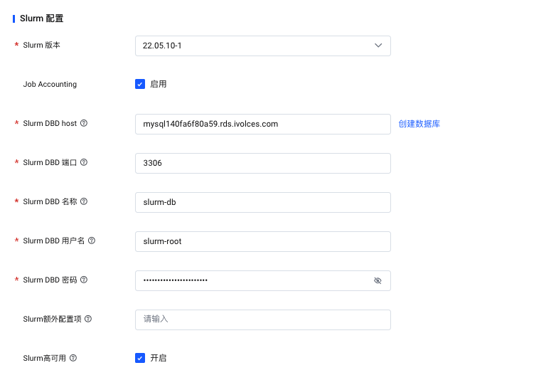
   2. 密匙对 & 操作系统信息

      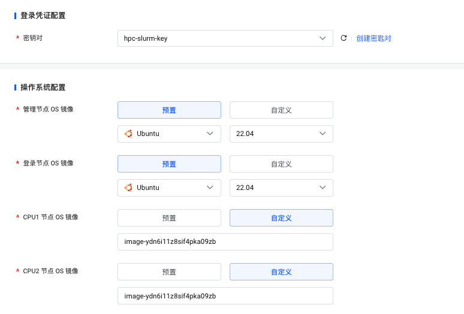
   3. 网络设置 & 用户管理
      > **NOTE** : 开启用户管理后，可以直接在网页中进行用户管理
      > 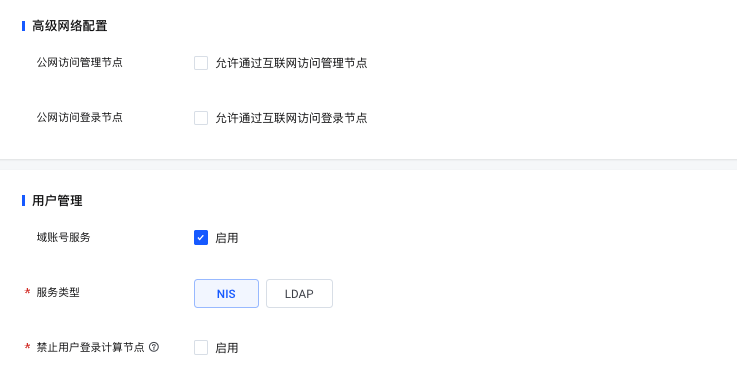
5. **启动脚本**
   > NOTE : 启动脚本需要在第一行指定`shebang`，如果不进行指定，会报错,
   > NOTE : 如果当前slurm集群启动失败，请将管理节点与登录节点启动脚本删除，重新启动slurm集群。
   > 启动脚步为当前集群启动对应节点后，会进行的操作，可以通过启动脚本在节点启动时挂载特定`NAS`或者进行特殊设置。
   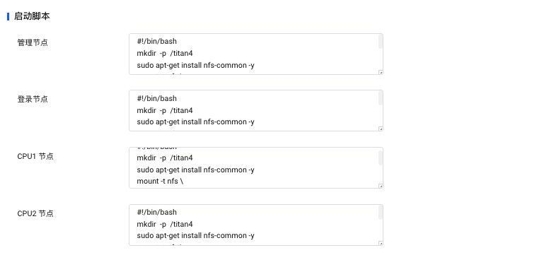
   ```bash title="示例启动脚本"
   #!/bin/bash
   # 创建 /titan4 挂载目录
   sudo mkdir  -p  /titan4
   # sudo apt-get install nfs-common -y
   # 在节点挂载 /titan4 分析目录
   sudo  mount -t nfs -o vers=4,minorversion=1,rsize=1048576,wsize=1048576,hard,timeo=600,retrans=2,noresvport \
         cnsha18b25dc44f1.22jprl6xg7eo07r2qr1wuj84i.nas.ivolces.com:/ /titan4
   # 修改 docker.sock 权限
   sudo chmod 666 /var/run/docker.sock
   ```


#### 2.2.2 修改登录节点 & 管理节点计费模式

集群启动后，需要联系IT将火山云相关节点修改为包年计费模式(PS:如果拥有相关权限可以自己进行设置，不推荐)

#### 2.2.3 创建火山云Slurm用户

火山云`slurm`创建账号,会在`/shared/home`目录创建每一个用户的文件夹。

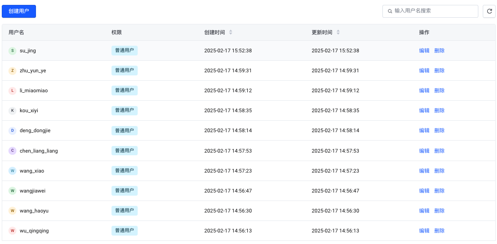

```bash title="账号list"
# 账号list
# 公共账号
slurm_hpc  slurmhpc1? # 该账号用于登录集群
# 个人账号
su_jing sujing1!
wu_jingjing wujingjing1!
wu_qingqing wuqingqing1!
wang_haoyu wanghaoyu1!
wangjiawei wangjiawei1!
wang_xiao wangxiao1!
zhang_jian zhangjian1!
chen_liang_liang chenliangliang1!
deng_dongjie dengdongjie1!
kou_xiyi kouxiyi1!
li_miaomiao limiaomiao1!
zhu_yun_ye zhuyunye1!
huang_longfei huanglongfei1!

```


```bash title="# 创建slurm_hpc组 & 添加用户"
sudo groupadd slurm_hpc
sudo usermod -aG slurm_hpc zhang_jian
```


```bash title="# 创建docker组 & 添加用户"
sudo groupadd docker
sudo usermod -aG docker zhang_jian
```


### 2.3 登录节点安装软件

由于登录节点使用的火山云官方镜像，为了实现标准分析流程的正常使用，需要按照一下流程安装相关软件。

```bash title="登录节点安装软件"
# 为了保证登录节点可以正常使用，需要使用一下命令安装分析环境
sudo apt update
sudo apt install zsh
sudo apt install btop
sudo apt install docker.io
sudo apt install bat
sudo apt install fzf
# python packages
# install volcengine python sdk
pip install volcengine-python-sdk
# python require
pip install pandas
pip install numpy
pip install calendra
pip install PyYAML
pip install loguru
pip install rich
pip install tos

```


### 2.4 修复`hosts`

由于火山云slurm集群当前不能自动更新/etc/hosts文件，导致提交分析任务后无法正常登录计算节点，因此使用火山云`SDK` + `service`解决该问题。(可以联系IT协助)

[host.fix](host.fix/host.fix.md "host.fix")

### 2.5 cpu 节点镜像

> **NOTE : 创建计算节点需要按照以下规则进行**
>
> - 计算节点镜像实例的可用区需要与集群保持一致；
> - 计算节点镜像实例的CPU提供商需要与计算节点一致；
> - 对于计算节点任何操作请进行记录；
> - 计算节点镜像实例账号密码如下：
>   ```bash title="root账号密码"
>   # root账号密码
>   root
>   xxxxxxxx
>   ```
>

火山云`slurm`集群是通过将`cpu`节点整体打包为镜像，已实现计算节点的正常使用。项目是对不同进行版本软件安装与分析环境配置的记录。

**创建**\*\*`CPU`\*\***节点镜像流程：**

创建实例 →  选择已有镜像 or 默认操作系统 → 登录镜像实例 → 安装计算节点依赖环境 → 打包为镜像&#x20;

- `slurm`集群计算节点版本更新记录：
  ```bash title="slurm计算节点镜像_1.0v"
  # slurm计算节点镜像_1.0v
  # CPU Images node 配置
  # install docker
  apt update
  apt install docker.io
  # install btop
  apt update
  apt install btop
  # python packages
  # install volcengine python sdk
  pip install volcengine-python-sdk
  # python require
  pip install pandas
  pip install numpy
  pip install calendra
  pip install PyYAML
  pip install loguru
  pip install rich

  ```

  ```bash title="slurm计算节点镜像_1.1v"
  # slurm计算节点镜像_1.1v
  # CPU Images node 配置
  # install docker
  apt update
  apt install docker.io
  # install btop
  apt update
  apt install btop
  # python packages
  # install volcengine python sdk
  pip install volcengine-python-sdk
  # python require
  pip install pandas
  pip install numpy
  pip install calendra
  pip install PyYAML
  pip install loguru
  pip install rich
  # 创建用户并将其添加到docker用户组
  ```

  ```bash title="slurm计算节点镜像_1.2v"
  # slurm计算节点镜像_1.2v
  # CPU Images node 配置
  # install docker
  apt update
  apt install docker.io
  # install btop
  apt update
  apt install btop
  # python packages
  # install volcengine python sdk
  pip install volcengine-python-sdk
  # python require
  pip install pandas
  pip install numpy
  pip install calendra
  pip install PyYAML
  pip install loguru
  pip install rich
  # 创建用户并将其添加到docker用户组
  sudo groupadd docker
  sudo usermod -aG docker zhang_jian
  # 修改docker.sock文件权限，使得普通用户可以使用docker
  chmod 666 /var/run/docker.sock
  ```

  ```bash title="slurm计算节点镜像_1.3v"
  # slurm计算节点镜像_1.3v
  # CPU Images node 配置
  # install docker
  apt update
  apt install docker.io
  apt install ctop
  apt install btop
  # python packages
  # install volcengine python sdk
  pip install volcengine-python-sdk
  # python require
  pip install pandas
  pip install numpy
  pip install calendra
  pip install PyYAML
  pip install loguru
  pip install rich
  pip install psutil
  # 创建用户并将其添加到docker用户组
  sudo groupadd docker
  sudo usermod -aG docker zhang_jian
  # 修改docker.sock文件权限，使得普通用户可以使用docker
  chmod 666 /var/run/docker.sock
  ```

  ```bash title="slurm计算节点镜像_1.4v"
  # slurm计算节点镜像_1.4v
  # CPU Images node 配置
  # install docker
  apt update
  apt install docker.io
  apt install ctop
  apt install btop
  # python packages
  # install volcengine python sdk
  pip install volcengine-python-sdk
  # python require
  pip install pandas
  pip install numpy
  pip install calendra
  pip install PyYAML
  pip install loguru
  pip install rich
  pip install psutil
  # 创建用户并将其添加到docker用户组
  sudo groupadd docker
  sudo usermod -aG docker zhang_jian
  # 修改docker.sock文件权限，使得普通用户可以使用docker
  chmod 666 /var/run/docker.sock
  # link ctop to /usr/bin/ctop 
  # link tosutil to /usr/bin/tosutil
  ```

  ```bash title="slurm计算节点镜像_1.5v"
  # slurm计算节点镜像_1.5v
  # CPU Images node 配置
  # install docker
  apt update
  apt install docker.io
  apt install ctop
  apt install btop
  # python packages
  # install volcengine python sdk
  pip install volcengine-python-sdk
  # python require
  pip install pandas
  pip install numpy
  pip install calendra
  pip install PyYAML
  pip install loguru
  pip install rich
  pip install psutil
  # 创建用户并将其添加到docker用户组
  sudo groupadd docker
  sudo usermod -aG docker zhang_jian
  # 修改docker.sock文件权限，使得普通用户可以使用docker
  chmod 666 /var/run/docker.sock
  # link ctop to /usr/bin/ctop 
  # link tosutil to /usr/bin/tosutil
  # 配置root账号配置集群TOS挂载配置
  tosutil config -i AKLTZmJhOTFkYjNlMjg2NGFlYTgzZTRlNTNjN2FmOGE3OTI \
                 -k TURJd01USmlZbUUzTXpVNE5HRTBPRGczTTJNM1lXVTRZMk0xWWpVeE5URQ== \
                 -e tos-cn-shanghai.ivolces.com -re cn-shanghai

  ```

  ```bash title="slurm计算节点镜像_1.6v"
  # slurm计算节点镜像_1.6v
  # CPU Images node 配置
  # install docker
  apt update
  apt install docker.io
  apt install ctop
  apt install btop
  # python packages
  # install volcengine python sdk
  pip install volcengine-python-sdk
  # python require
  pip install pandas
  pip install numpy
  pip install calendra
  pip install PyYAML
  pip install loguru
  pip install rich
  pip install psutil
  # 创建用户并将其添加到docker用户组
  sudo groupadd docker
  sudo usermod -aG docker zhang_jian
  # 修改docker.sock文件权限，使得普通用户可以使用docker
  chmod 666 /var/run/docker.sock
  # link ctop to /usr/bin/ctop 
  # link tosutil to /usr/bin/tosutil
  # 创建tos挂载目录
  mkdir /volcengine

  ```

  ```bash title="slurm计算节点镜像_1.7v"
  # slurm计算节点镜像_1.7v
  # CPU Images node 配置
  # install docker
  apt update
  apt install docker.io
  apt install ctop
  apt install btop
  # python packages
  # install volcengine python sdk
  pip install volcengine-python-sdk
  # python require
  pip install pandas
  pip install numpy
  pip install calendra
  pip install PyYAML
  pip install loguru
  pip install rich
  pip install psutil
  # 创建用户并将其添加到docker用户组
  sudo groupadd docker
  sudo usermod -aG docker zhang_jian
  # 修改docker.sock文件权限，使得普通用户可以使用docker
  chmod 666 /var/run/docker.sock
  # link ctop to /usr/bin/ctop 
  # link tosutil to /usr/bin/tosutil
  # 创建tos挂载目录
  mkdir /volcengine
  mkdir /tos_mount && chmod 777 /tos_mount

  ```

  ```bash title="slurm计算节点镜像_1.8v"
  # slurm计算节点镜像_1.8v
  # CPU Images node 配置
  # install docker
  apt update
  apt install docker.io
  apt install ctop
  apt install btop
  # python packages
  # install volcengine python sdk
  pip install volcengine-python-sdk
  # python require
  pip install pandas
  pip install numpy
  pip install calendra
  pip install PyYAML
  pip install loguru
  pip install rich
  pip install psutil
  # 创建用户并将其添加到docker用户组
  sudo groupadd docker
  sudo usermod -aG docker zhang_jian
  # 修改docker.sock文件权限，使得普通用户可以使用docker
  chmod 666 /var/run/docker.sock
  # link ctop to /usr/bin/ctop 
  # link tosutil to /usr/bin/tosutil
  # 创建tos挂载目录
  mkdir /volcengine
  mkdir /tos_mount && chmod 777 /tos_mount
  # fix /etc/fuse.conf
  /etc/fuse.conf
  ```

  ```bash title="slurm计算节点镜像_1.9v"
  # slurm计算节点镜像_1.9v
  # CPU Images node 配置
  # install docker
  apt update
  apt install docker.io
  apt install ctop
  apt install btop
  # python packages
  # install volcengine python sdk
  pip install volcengine-python-sdk
  # python require
  pip install pandas
  pip install numpy
  pip install calendra
  pip install PyYAML
  pip install loguru
  pip install rich
  pip install psutil
  # 创建用户并将其添加到docker用户组
  sudo groupadd docker
  sudo usermod -aG docker zhang_jian
  # 修改docker.sock文件权限，使得普通用户可以使用docker
  chmod 666 /var/run/docker.sock
  # link ctop to /usr/bin/ctop 
  # link tosutil to /usr/bin/tosutil
  # 创建tos挂载目录
  mkdir /volcengine
  mkdir /tos_mount && chmod 777 /tos_mount
  # fix /etc/fuse.conf
  /etc/fuse.conf
  # 修改ssh登录端口为 2222
  ```

  ```bash title="slurm计算节点镜像_2.0v"
  # slurm计算节点镜像_2.0v
  # CPU Images node 配置
  # install docker
  apt update
  apt install docker.io
  apt install ctop
  apt install btop
  # python packages
  # install volcengine python sdk
  pip install volcengine-python-sdk
  # python require
  pip install pandas
  pip install numpy
  pip install calendra
  pip install PyYAML
  pip install loguru
  pip install rich
  pip install psutil
  pip install tos
  pip install python-dateutil
  # 创建用户并将其添加到docker用户组
  sudo groupadd docker
  sudo usermod -aG docker zhang_jian
  # 修改docker.sock文件权限，使得普通用户可以使用docker
  chmod 666 /var/run/docker.sock
  # link ctop to /usr/bin/ctop 
  # link tosutil to /usr/bin/tosutil
  # 创建tos挂载目录
  mkdir /volcengine
  mkdir /tos_mount && chmod 777 /tos_mount
  # fix /etc/fuse.conf
  /etc/fuse.conf
  # 修改ssh登录端口为 2222
  ```


```bash title="镜像列表"
# slurm计算节点镜像_1.0v
image-ydpl1kre9xjfpzc1dk90
# slurm计算节点镜像_1.1v
image-ydpl45b9f6gv6rx88zo5
# slurm计算节点镜像_1.2v
image-ydpl4ixhmmkvj62briwb
# slurm计算节点镜像_1.3v
image-ydpn0ctkovjfpze2g246
# slurm计算节点镜像_1.4v
image-ydpnpbhso0jfpxtfelx4
# slurm计算节点镜像_1.5v
image-ydpv697vvfjfpzevncio
# slurm计算节点镜像_1.6v
image-ydpv8j4a5deloyf6rfxf
# slurm计算节点镜像_1.7v
image-ydq2yievrkkvj6koo545
# slurm计算节点镜像_1.8v
image-ydq33liyy0kvj6sml5fk
# slurm计算节点镜像_1.9v
image-ydq7qunp9qeloy9yh8b9

```


### 2.6 登录节点秘匙解绑

登录节点秘匙解绑并重置密码（可以联系IT协助）

```bash title="root 密码"
# login-0 & login-1 root 密码
xxxxxxxxx
```


### 2.7 Slurm 登录节点绑定到堡垒机

当集群配置完成，就可以将登录节点加入堡垒机(联系IT进行协助)。绑定堡垒机账号为`slurm_hpc`通过使用`slurm_hpc`账号跳转到特定用户。

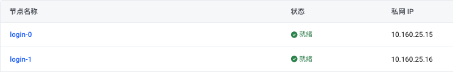

### 2.8 将tos挂载到所有节点

```bash title="tos 挂载"
# tos 挂载目录
sudo mkdir /volcengine && sudo chmod 777 /volcengine
# tos 挂载代码
tosutil mount tos://sequanta-ceph/2024_Slurm_bioos/slurm_test_bucket /volcengine -ro
prefix [2024_Slurm_bioos/slurm_test_bucket/] of bucket [sequanta-ceph] is mounted at [/volcengine] with generation [1ef810d3-f012-11ef-8a81-00163e75a865]

```


```bash title="检查挂载信息"
# 检查挂载信息
df -h /volcengine 
Filesystem      Size  Used Avail Use% Mounted on
tosutil/v3.1.6     0     0     0    - /volcengine
```


***

## 3 Source

> **火山云slurm 集群模版 ：单队列可以超过100个节点的模版**
>
> [slurm-mq-500.txt](file/slurm-mq-500_8Uv3jtSQ3m.txt "slurm-mq-500.txt")

> **火山云高可用集群模版**
>
> [slurm-ha-2cpu.txt](file/slurm-ha-2cpu_HkY-A3wuJs.txt "slurm-ha-2cpu.txt")

### 3.1 启动脚本

```bash title="启动脚本  1.0v"
#!/bin/bash
# author  : zhang jian
# version : 1.0v
# date    : 2025-2-21
# 创建 /titan4 挂载目录
sudo mkdir  -p  /titan4
# sudo apt-get install nfs-common -y
# mount /titan4 
sudo  mount -t nfs -o vers=4,minorversion=1,rsize=1048576,wsize=1048576,hard,timeo=600,retrans=2,noresvport \
      cnsha18b25dc44f1.22jprl6xg7eo07r2qr1wuj84i.nas.ivolces.com:/ /titan4
# revise docker.sock mod
sudo chmod 666 /var/run/docker.sock

```


```markdown title="启动脚本 1.1v"
#!/bin/bash
# author  : zhang jian
# version : 1.1v
# date    : 2025-2-24
# 创建 /titan4 挂载目录
sudo mkdir  -p  /titan4
# sudo apt-get install nfs-common -y
# mount /titan4 
sudo  mount -t nfs -o vers=4,minorversion=1,rsize=1048576,wsize=1048576,hard,timeo=600,retrans=2,noresvport \
      cnsha18b25dc44f1.22jprl6xg7eo07r2qr1wuj84i.nas.ivolces.com:/ /titan4
# revise docker.sock mod
sudo chmod 666 /var/run/docker.sock
# mount fastq
/software/tosutil mount tos://sequanta-bioinfo-fastq/ /tos_mount \
        -ro -ao -i AKLTZmJhOTFkYjNlMjg2NGFlYTgzZTRlNTNjN2FmOGE3OTI \
        -k TURJd01USmlZbUUzTXpVNE5HRTBPRGczTTJNM1lXVTRZMk0xWWpVeE5URQ== \
        -e tos-cn-shanghai.ivolces.com -re cn-shanghai
```


## 4 Reference

[^1]: [http://slurm.schedmd.com/](http://slurm.schedmd.com/ "http://slurm.schedmd.com/")

[^2]: [https://hmli.ustc.edu.cn/doc/linux/slurm-install/slurm-install.html](https://hmli.ustc.edu.cn/doc/linux/slurm-install/slurm-install.html "https://hmli.ustc.edu.cn/doc/linux/slurm-install/slurm-install.html")

[^3]: [https://www.volcengine.com/docs/6453/1274998](https://www.volcengine.com/docs/6453/1274998 "https://www.volcengine.com/docs/6453/1274998")
