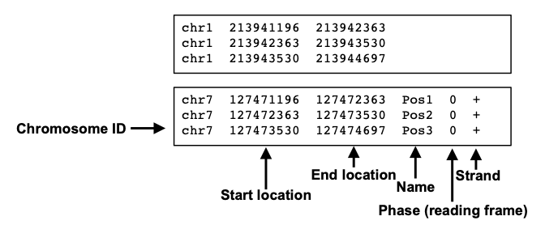
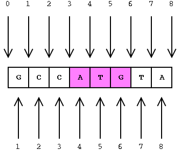

# BED

> `BED`（Browser Extensible Data，字面意思是“（基因组）浏览器可延展数据”）是一种基因组学中用于表示、标记基因组区域位置信息中的文件格式，于人类基因组计划中首次出现[^1]。`BED`文件是目前基因组学事实上的标准格式之一。



### format

> BED文件的扩展名一般为“.bed”。有时候，也根据列数的不同标注为“.bed3”（有3列的BED文件）、“.bed6”（有6列的BED文件）等等[^2]。



> **BED 文件中的坐标是从 0 开始的**。这意味着什么？在标准文件格式中，基因组坐标可以用两种不同的方式表示，如下图所示。
> 根据上面的示例，**您将使用什么坐标来定义序列**\*\*`ATG`？\*\*​
>
> - 如果您使用基于 1（底部）的方法，您将指示**4 到 6** 。
> - 使用基于 0 的方法，您可以将范围定义为**3 到 6** 。

> **拥有从零开始的系统的好处是可以轻松计算序列的距离或长度**。我们可以使用从零开始的坐标，通过从末尾减去开始来轻松确定`ATG`序列的长度，而对于从一开始的坐标，我们需要在减法之后加一。因此，计算中使用的许多文件格式（包括**BED 文件格式**）都使用从零开始的坐标。

### bed format

> BED文件最少需要有3个分别表示区域**染色体序号**、**起始位置**，以及**终止位置**的列，根据不同需求可增加至12列记录更多信息。一般来说，不同的列之间应以制表符分隔值`\t`隔开，且每一行的列数必须相同[^3]。

> 下表介绍BED文件每一列应该存储的信息。三个必须出现的列标记为红色
>
> > 一部分BED文件会具有一些与BED文件本身无关的头行文件，一般包含以下信息
> >
> > - **`browser`**：与UCSC基因组浏览器设置相关的参数
> > - `track`: 与基因组浏览器中可视化参数设置相关
> > - `#`：注释内容，内容任意
>
> | **序号** | **名称**            | **定义**                                                                                                         |
> | ------ | ----------------- | -------------------------------------------------------------------------------------------------------------- |
> | **1**  | **`chrom`**       | 染色体序号。有时也可以是[测序脚手架](https://zh.wikipedia.org/w/index.php?title=脚手架_\(测序\)\&action=edit\&redlink=1 "测序脚手架")的序号。 |
> | **2**  | **`chromStart`**  | 区域起始位置的编号（染色体起始点设为0）                                                                                           |
> | **3**  | **`chromEnd`**    | 区域终止位置的编号                                                                                                      |
> | **4**  | **`name`**        | 该行表示区域的名称                                                                                                      |
> | **5**  | **`score`**       | 该区域的分数，如[Peak calling](https://zh.wikipedia.org/wiki/Peak_calling "Peak calling")（寻峰）的分数，应该在0-100之间            |
> | **6**  | **`strand`**      | 该区域所在的DNA链，一般应取“+”（正[义](https://zh.wikipedia.org/wiki/义_\(分子生物学\) "义")链）、“-”（反义链），或“.”（不适用正反义链时）               |
> | **7**  | **`thickStart`**  | 在基因组浏览器中应加粗表示区域的起始点（例如基因的[起始密码子](https://zh.wikipedia.org/wiki/起始密码子 "起始密码子")）                                 |
> | **8**  | **`thickEnd`**    | 在基因组浏览器中应加粗表示区域的终止点（例如基因的[终止密码子](https://zh.wikipedia.org/wiki/终止密码子 "终止密码子")）                                 |
> | **9**  | **`itemRgb`**     | 该区域在基因组浏览器中用什么颜色表示，应使用三原色光模式（RGB）系统的颜色代码                                                                       |
> | **10** | **`blockCount`**  | 该行表示的区域含多少个区块（例如[外显子](https://zh.wikipedia.org/wiki/外显子 "外显子")）                                                |
> | **11** | **`blockSizes`**  | 该行表示的区域各个区块的长度。不同区块应使用半角[逗号](https://zh.wikipedia.org/wiki/逗号 "逗号")隔开。元素的数量应与第10列的值相同                          |
> | **12** | **`blockStarts`** | 该行表示的区域各个区块的开始点。不同区块应使用半角[逗号](https://zh.wikipedia.org/wiki/逗号 "逗号")隔开。元素的数量应与第10列的值相同                         |

### Example

```latex title="3列BED"
chr7    127471196    127472363
chr7    127472363    127473530
chr7    127473530    127474697
```


```latex title="UCSC基因组浏览器bed"
browser position chr7:127471196-127495720
browser hide all
track name="ItemRGBDemo" description="Item RGB demonstration" visibility=2 itemRgb="On"
chr7    127471196    127472363    Pos1    0    +    127471196    127472363    255,0,0
chr7    127472363    127473530    Pos2    0    +    127472363    127473530    255,0,0
chr7    127473530    127474697    Pos3    0    +    127473530    127474697    255,0,0
chr7    127474697    127475864    Pos4    0    +    127474697    127475864    255,0,0
chr7    127475864    127477031    Neg1    0    -    127475864    127477031    0,0,255
chr7    127477031    127478198    Neg2    0    -    127477031    127478198    0,0,255
chr7    127478198    127479365    Neg3    0    -    127478198    127479365    0,0,255
chr7    127479365    127480532    Pos5    0    +    127479365    127480532    255,0,0
chr7    127480532    127481699    Neg4    0    -    127480532    127481699    0,0,255
```


### tutorial

> bed 文件可以在很多软件中对特定区域进行快速处理（bcftools对特定区域Variant进行提取 & seqkit 对fasta文件进行快速处理等等）

[^1]: The human genome browser at UCSC.

[^2]: [https://web.archive.org/web/20211209192147/https://galaxyproject.org/learn/datatypes/#bed](https://web.archive.org/web/20211209192147/https://galaxyproject.org/learn/datatypes/#bed "https://web.archive.org/web/20211209192147/https://galaxyproject.org/learn/datatypes/#bed")

[^3]: The BEDTools manual
