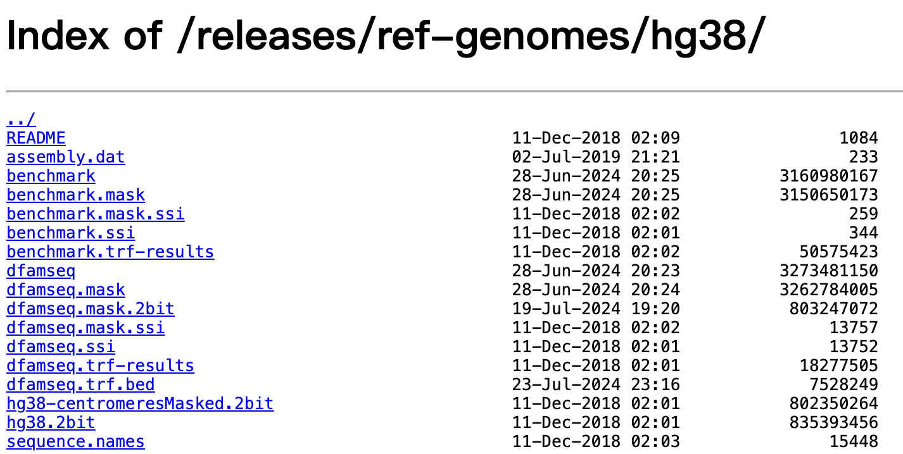
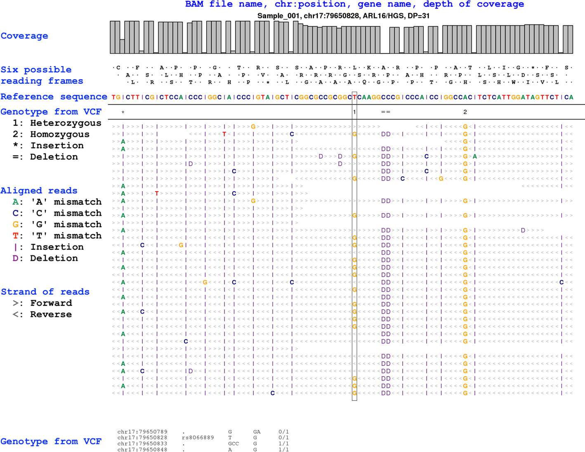
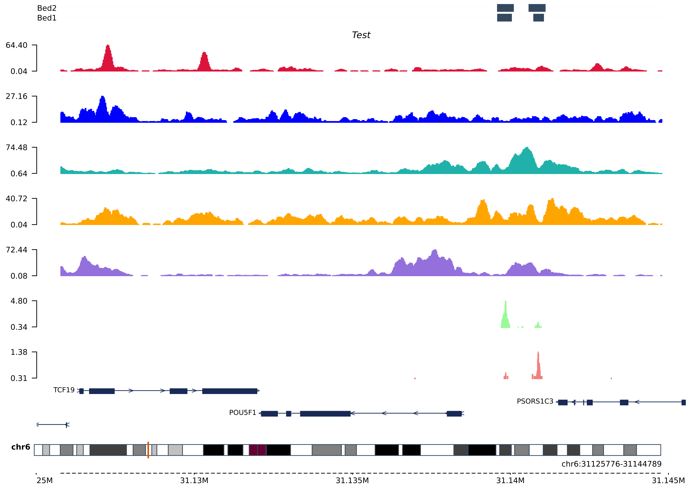

# Bioinformatics Data & Parameter Format

## 目录

- [1 introduce](#1-introduce)
  - [1.1 Bioinformatics Data & Parameter Format](#11-Bioinformatics-Data--Parameter-Format)
- [2 Bioinformatics Data format](#2-Bioinformatics-Data-format)
  - [2.1 2bit](#21-2bit)
  - [fastq](#fastq)
  - [fasta](#fasta)
  - [2.4 fast5](#24-fast5)
  - [2.5 bed](#25-bed)
  - [2.6 gff/gtf](#26-gffgtf)
  - [2.7 SAM/BAM](#27-SAMBAM)
  - [2.8 VCF](#28-VCF)
  - [2.9 Bedgraph/bigwig/bw](#29-Bedgraphbigwigbw)
  - [2.10 h5](#210-h5)
- [3 Parameter format](#3-Parameter-format)
  - [3.1 yaml & json & xml](#31-yaml--json--xml)
  - [3.2 RMarkdown](#32-RMarkdown)
  - [3.3 mermaid](#33-mermaid)
  - [3.4 LaTeX](#34-LaTeX)
- [4 Reference](#4-Reference)

***

gtf → bed12

```bash 
gtfToGenePred ITAG4.1_gene_models.gtf /dev/stdout | genePredToBed /dev/stdin ITAG4.1_gene_models.bed12
```


gff3 → bed12

```bash 
gff3ToGenePred input.gff3 /dev/stdout | genePredToBed /dev/stdin output.bed12
```


## 1 introduce

### 1.1 Bioinformatics Data & Parameter Format

生物信息领域会有很多不同格式的文件如：**`fastq`****、 ****`fasta`****、****`bam`****、****`bed`****、****`vcf`****与****`gtf`**` `等。这些不同格式文件会作为不同分析流程的输入或者输出来进行使用，在了解相关生物信息分析软件 & pipeline前对相关格式进行初步了解将会大有裨益。

> \*\*NOTE \*\*： 由于生物信息学是与计算机高度相关的领域，因此也会使用到计算机领域相关文件格式。
>
> 1. `YAML` & `JSON` & `XML` ：分析软件与分析环境配置文件；
> 2. `Rmarkdown` & `LaTeX` ： 文档格式。

## 2 Bioinformatics Data format

### 2.1 2bit

**2bit : 基因组序列的压缩二进制版本。**



- **2bit格式**：大多数基因组在2bit格式中可以找到，尤其是在UCSC。
- **转换工具**：可以使用UCSC程序faToTwoBit将FASTA文件转换为2bit格式，该程序适用于不同的平台，并且可以在UCSC找到。

> **NOTE** : `.2bit`文件存储多个DNA序列（总共高达4吉字节）在一个紧凑的随机可访问格式中。该文件包含掩码信息以及DNA本身[^1]。

### **fastq**

**FASTQ format** is a \*\*text-based \*\*[**format**](https://en.wikipedia.org/wiki/File_format "format") for storing both a biological sequence (usually [nucleotide sequence](https://en.wikipedia.org/wiki/Nucleotide_sequence "nucleotide sequence")) and its corresponding quality scores. Both the sequence letter and quality score are each encoded with a single [ASCII](https://en.wikipedia.org/wiki/ASCII "ASCII") character for brevity[^2].


[fastq](fastq/fastq.md "fastq")

**FASTQ format** is a \*\*text-based \*\*[**format**](https://en.wikipedia.org/wiki/File_format "format") for storing both a biological sequence (usually [nucleotide sequence](https://en.wikipedia.org/wiki/Nucleotide_sequence "nucleotide sequence")) and its corresponding quality scores. Both the sequence letter and quality score are each encoded with a single [ASCII](https://en.wikipedia.org/wiki/ASCII "ASCII") character for brevity[^2].


[fastq+](fastq+/fastq+.md "fastq+")

### **fasta**


> \*\*`FASTA`\*\*格式是一种用于记录核酸序列或肽序列的文本格式，其中的核酸或氨基酸均以单个字母编码呈现。该格式同时还允许在序列之前定义名称和编写注释。这一格式最初由FASTA软件包定义，但现今已是生物信息学领域的一项标准[^3]。

[FASTA](FASTA/FASTA.md "FASTA")


> \*\*`FASTA`\*\*格式是一种用于记录核酸序列或肽序列的文本格式，其中的核酸或氨基酸均以单个字母编码呈现。该格式同时还允许在序列之前定义名称和编写注释。这一格式最初由FASTA软件包定义，但现今已是生物信息学领域的一项标准[^3]。

### 2.4 fast5

[FAST5](FAST5/FAST5.md "FAST5")

### 2.5 bed


> `BED`（Browser Extensible Data，字面意思是“（基因组）浏览器可延展数据”）是一种基因组学中用于表示、标记基因组区域位置信息中的文件格式，于人类基因组计划中首次出现[^4]。`BED`文件是目前基因组学事实上的标准格式之一。

[BED](BED/BED.md "BED")

> `BED`（Browser Extensible Data，字面意思是“（基因组）浏览器可延展数据”）是一种基因组学中用于表示、标记基因组区域位置信息中的文件格式，于人类基因组计划中首次出现[^4]。`BED`文件是目前基因组学事实上的标准格式之一。


> **NOTE** : `interval list` & `refFlat`文件格式并不是生物信息中常用的文件格式，而是在特定分析中才会使用到的（在我映象中主要是用来对分析结果进行统计的软件）

[interval list](<interval list/interval list.md> "interval list")

[refFlat](refFlat/refFlat.md "refFlat")

### 2.6 gff/gtf

[gff/gtf](gff-gtf/gff-gtf.md "gff/gtf")

### 2.7 SAM/BAM



> 使用NGS技术测序获得read,使用相关软件将其对比到对于基因组默认会获得`sam`文件,为了节省存储空间可以使用`samtools`软件将其转换为二进制压缩文件`bam`以节约存储空间。

[SAM/BAM](SAM-BAM/SAM-BAM.md "SAM/BAM")


> 使用NGS技术测序获得read,使用相关软件将其对比到对于基因组默认会获得`sam`文件,为了节省存储空间可以使用`samtools`软件将其转换为二进制压缩文件`bam`以节约存储空间。

### 2.8 VCF

`VCF`文件是存储变异结果的标准格式，一般多用于单核苷酸变异`SNP`或小片段的插入缺失`indels`的结果记录,除此之外，`vcf`文件也可以存储其他变异形式，比如`CNV`（拷贝数变异）、`SV`（结构变异）[^5]。`VCF`格式是在`2010`年为`1000 Genomes Project`开发并推广滴，并且自那以后已被其他大规模基因分型和DNA测序项目所使用[^6][^5]。由于其相对**简单性**和**可扩展性**，`VCF` 是变体调用程序的常见输出格式。

[VCF/BCF](VCF-BCF/VCF-BCF.md "VCF/BCF")

`VCF`文件是存储变异结果的标准格式，一般多用于单核苷酸变异`SNP`或小片段的插入缺失`indels`的结果记录,除此之外，`vcf`文件也可以存储其他变异形式，比如`CNV`（拷贝数变异）、`SV`（结构变异）[^5]。`VCF`格式是在`2010`年为`1000 Genomes Project`开发并推广滴，并且自那以后已被其他大规模基因分型和DNA测序项目所使用[^6][^5]。由于其相对**简单性**和**可扩展性**，`VCF` 是变体调用程序的常见输出格式。

### 2.9 Bedgraph/bigwig/bw



[bw/bigwig/Bedgraph](bw-bigwig-Bedgraph/bw-bigwig-Bedgraph.md "bw/bigwig/Bedgraph")

### 2.10 h5

[hdf5](hdf5/hdf5.md "hdf5")

***

## 3 Parameter format

> **NOTE** :  在python 环境中`YAML` & `JOSN` & `XML`  与字典很搭（YYDS）


### 3.1 yaml & json & xml

> YAML（`/ˈjæməl/`）是一个可读性高，用来表达**数据序列化**的格式。YAML参考了其他多种语言，包括：C语言、Python、Perl，并从XML、电子邮件的数据格式（RFC 2822）中获得灵感。**Clark Evans**在2001年首次发表了这种语言，另外**Ingy döt Net**与**Oren Ben-Kiki**也是这语言的共同设计者。目前已经有数种编程语言或脚本语言支持（或者说解析）这种语言[^7]。

[yaml](yaml/yaml.md "yaml")

> YAML（`/ˈjæməl/`）是一个可读性高，用来表达**数据序列化**的格式。YAML参考了其他多种语言，包括：C语言、Python、Perl，并从XML、电子邮件的数据格式（RFC 2822）中获得灵感。**Clark Evans**在2001年首次发表了这种语言，另外**Ingy döt Net**与**Oren Ben-Kiki**也是这语言的共同设计者。目前已经有数种编程语言或脚本语言支持（或者说解析）这种语言[^7]。

`JSON`类似 `XML`,但`JSON` 比 `XML` 更小、更快，更易解析，易于人阅读和编写。`C`、`Python`、`C++`、`Java`、`PHP`、`Go` 等编程语言都支持 `JSON`。

[JSON](JSON/JSON.md "JSON")

`JSON`类似 `XML`,但`JSON` 比 `XML` 更小、更快，更易解析，易于人阅读和编写。`C`、`Python`、`C++`、`Java`、`PHP`、`Go` 等编程语言都支持 `JSON`。

[xml](xml/xml.md "xml")

[TOML](TOML/TOML.md "TOML")

### 3.2 RMarkdown

[Markdown](Markdown/Markdown.md "Markdown")

### 3.3 mermaid

[mermaid](mermaid/mermaid.md "mermaid")

### 3.4 LaTeX


> **LaTeX**（/ˈlɑːtɛx/或/ˈleɪtɛx/，常被读作/ˈlɑːtɛk/或/ˈleɪtɛk/，风格化后写作“**LaTeX**”），是一种基于TeX的排版系统，由美国计算机科学家**莱斯利·兰伯特**在20世纪80年代初期开发，利用这种格式系统的处理，即使用户没有排版和程序设计的知识也可以充分发挥由TeX所提供的强大功能，不必一一亲自去设计或校对，能在几天，甚至几小时内生成很多具有书籍质量的印刷品生成复杂表格和数学公式，这一点表现得尤为突出。因此它非常适用于生成高印刷质量的科技和数学、物理文档。这个系统同样适用于生成从简单的信件到完整书籍的所有其他种类的文档[^8]。

> `pylatex`是一个Python库，用于生成LaTeX文档。`pylatex`库的核心是`Document`类，它代表一个完整的LaTeX文档。文档可以包含多个部分，如章节、段落、列表、表格和数学公式等。这些部分通常由`pylatex`的其他类表示，如`Section`、`Paragraph`、`List`等[^9]。

[LaTeX](LaTeX/LaTeX.md "LaTeX")


> `pylatex`是一个Python库，用于生成LaTeX文档。`pylatex`库的核心是`Document`类，它代表一个完整的LaTeX文档。文档可以包含多个部分，如章节、段落、列表、表格和数学公式等。这些部分通常由`pylatex`的其他类表示，如`Section`、`Paragraph`、`List`等[^9]。

***

## 4 Reference

[^1]: [https://genome.ucsc.edu/FAQ/FAQformat.html#format7](https://genome.ucsc.edu/FAQ/FAQformat.html#format7 "https://genome.ucsc.edu/FAQ/FAQformat.html#format7")

[^2]: The Sanger FASTQ file format for sequences with quality scores, and the Solexa/Illumina FASTQ variants

[^3]: [https://zh.wikipedia.org/wiki/FASTA格式](https://zh.wikipedia.org/wiki/FASTA格式 "https://zh.wikipedia.org/wiki/FASTA格式")

[^4]: The human genome browser at UCSC.

[^5]: "The variant call format and VCFtools"

[^6]: "The Race to Build a Search Engine for Your DNA"

[^7]: [https://en.wikipedia.org/wiki/YAML](https://en.wikipedia.org/wiki/YAML "https://en.wikipedia.org/wiki/YAML")

[^8]: [https://www.latex-project.org/about/](https://www.latex-project.org/about/ "https://www.latex-project.org/about/")

[^9]: [https://jeltef.github.io/PyLaTeX/current/](https://jeltef.github.io/PyLaTeX/current/ "https://jeltef.github.io/PyLaTeX/current/")
