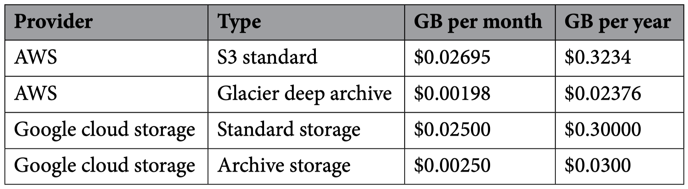
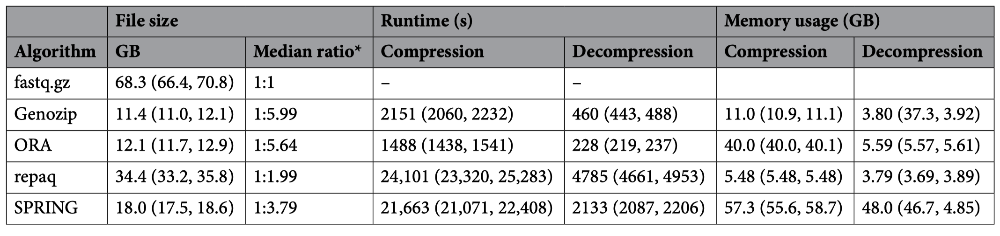
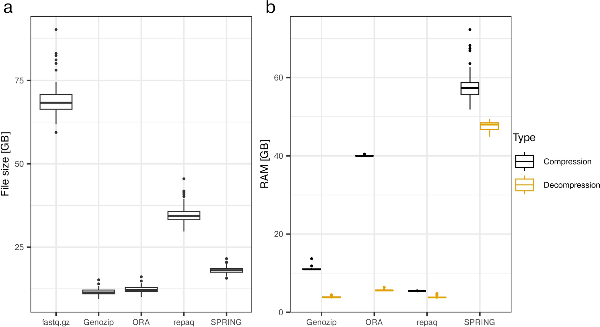
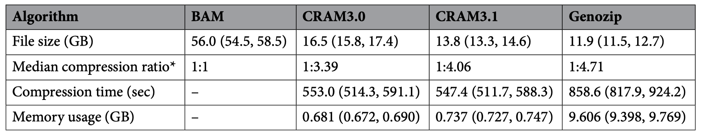
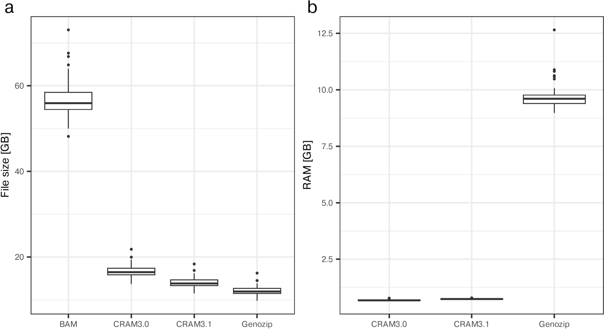

# Compress

## 目录

- [1 Introduce](#1-Introduce)
  - [1.1 Compress](#11-Compress)
  - [1.2 fastq compress](#12-fastq-compress)
  - [1.3 BAM Compress](#13-BAM-Compress)
- [2 Tutorial](#2-Tutorial)
  - [2.1 repaq](#21-repaq)
  - [2.2 spring](#22-spring)
  - [2.3 DRAGEN ORA (Illumina)](#23-DRAGEN-ORA-Illumina)
  - [2.4 bam → cram](#24-bam--cram)
  - [2.5 genozip](#25-genozip)
- [3 Source](#3-Source)
- [4 Reference](#4-Reference)

***

***Author***\*\* : JZHANG\*\*​

***Date***\*\* : 2025-11-22\*\*​

***Version***\*\* : \*\***`1.0v`**

***

## 1 Introduce

### 1.1 Compress

现阶段数据压缩其实就是使用计算资源(`CPU` + `Memory`)换取存储空间

随着新一代测序（`NGS`）技术的飞速发展，测序数据的产量呈现指数级增长，对高效数据压缩的需求日益迫切。虽然目前的下机数据通常已经采用 `.gz` 格式（如 `fastq.gz`）进行了一次压缩，但其文件体积仍然相当庞大。



通过使用专业的压缩软件，可以在已压缩的 `.gz` 文件的基础上，对数据体积进行二次高效压缩。例如，商业软件 `Genozip` 和 `DRAGEN ORA` 能将 `fastq.gz` 文件的压缩率提高到惊人的 `1:6`左右，相比之下，免费软件 `SPRING` 和 `repaq`的压缩率较低。这极大地减少了原始序列数据（`fastq.gz`）的长期存储和传输成本。对于比对和定位后产生的 \*\*`BAM`\*\*文件（在 `35×` 覆盖率下，每个样本约占 `55 GB`），同样可以通过相关软件进行高效压缩: 1. 转换为 `CRAM` 文件（使用 `SAMtools`; 2. 使用 `Genozip` 直接压缩 `BAM` 文件[^1]。

### 1.2 fastq compress

`Genozip` 提供了最高的压缩率( `1:5.99`),而 `ORA` 的压缩和解压速度最快,不过它对计算资源要求高，压缩需在专用 `DRAGEN` 服务器上进行，且内存占用高达 `40.0 GB`。相比之下，免费开源工具 `SPRING` 和 `repaq`虽然不需要许可证，但性能相对较弱：`SPRING` 的内存占用最高（压缩中位数 `57.3 GB`），而`repaq` 的压缩率最低（`1:1.99`）。





> **NOTE** : `Genozip` 、`ORA` (`DRAGEN ORA`)压缩是需要商用许可证滴。`repaq`、`SPRING`开源软件，并不需要许可证。

### 1.3 BAM Compress

`SAMtools` : `bam`→ `cram` : `CRAM` 格式依赖于**参考基因组**（例如人类的 `hg38`）来存储 `reads` 与参考序列之间的**差异**，从而实现高效压缩。`CRAM` 文件被许多标准软件包兼容,可以直接用来进行下游分析[^2]。

`Genozip` : `bam` → `Genozip` :商用软件





***

## 2 Tutorial

### `2.1 repaq`

```bash title="repaq compressing "
repaq -c --thread 8 \
      --compression 4 \
      -i SRR33161185_1.fastq.gz \
      -I SRR33161185_2.fastq.gz \
      -o SRR33161185.rfq.xz
```


```text title="repaq的压缩结果"
-rw-r--r-- 1 jzhang xinwang 5.6G Nov 13 09:15 SRR33161185_1.fastq.gz
-rw-r--r-- 1 jzhang xinwang 5.0G Nov 13 09:16 SRR33161185_2.fastq.gz
-rw-r--r-- 1 jzhang xinwang 4.5G Nov 13 10:34 SRR33161185.rfq.xz
```


```bash title="repaq Decompressing "
repaq -d \
      -i SRR33161185.rfq.xz \
      -o <Sample_name>.R1.fq.gz \
      -O <Sample_name>.R2.fq.gz
```


### `2.2 spring`

```bash title="spring"
spring -c \
       -i <PATGH_R1.Fastq.gz> <PATGH_R2.Fastq.gz> \
       -o <NAME>.spring -g \
       -t 16
```


```bash title="spring 的压缩结果"
-rw-r--r-- 1 jzhang xinwang 5.6G Nov 13 09:15 SRR33161185_1.fastq.gz
-rw-r--r-- 1 jzhang xinwang 5.0G Nov 13 09:16 SRR33161185_2.fastq.gz
-rw-r--r-- 1 jzhang xinwang 3.7G Nov 13 12:07 SRR33161185.spring
```


```markdown title="Decompressing "
# 解压 spring 压缩文件
spring -d \
       -i SRR33161185.spring \
       -o <Sample_name>.R1.fq.gz <Sample_name>.R2.fq.gz \
       -g
```


### 2.3 DRAGEN ORA (Illumina)

不用也罢，一般人也接触不到\~

### 2.4 bam → cram

```bash title="bam → cram"
samtools view -@ 20 \
         -C -T <PATH genome.fa> \
         B10.sort.Dup.bam \
         -o B10.sort.Dup.cram
```


```text title="bam → cram"
12G     B10.sort.Dup.bam
6.6G    B10.sort.Dup.cram
```


### 2.5 genozip

> **Tips** : `genozip` 教育邮箱可以申请使用免费版本滴
>
> [   https://www.genozip.com/student](https://www.genozip.com/student "   https://www.genozip.com/student")

***

## 3 Source

[A benchmark study of compression software for human short-read sequence data.pdf](<file/A benchmark study of compression software for huma.pdf> " A benchmark study of compression software for human short-read sequence data.pdf")

***

## 4 Reference

[^1]: Betschart, Raphael O., et al. "A benchmark study of compression software for human short-read sequence data." Scientific Reports 15.1 (2025): 15358.

[^2]: Bonfield, James K. "CRAM 3.1: advances in the CRAM file format." Bioinformatics 38.6 (2022): 1497-1503.
