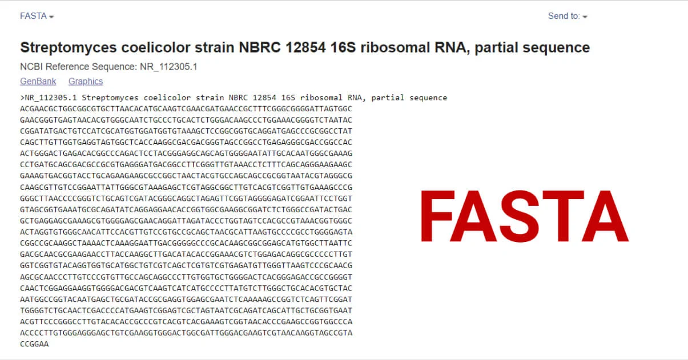

# FASTA

## 目录

- [1 introduce](#1-introduce)
  - [1.1 fasta](#11-fasta)
  - [1.2 Filename extension](#12-Filename-extension)
  - [1.3 Amino acid](#13-Amino-acid)
  - [1.4 Nucleic acid](#14-Nucleic-acid)
- [2 Tutorial](#2-Tutorial)
  - [2.1 fasta index](#21-fasta-index)
  - [2.2 Toolkit for fasta processing](#22-Toolkit-for-fasta-processing)
- [3 Reference](#3-Reference)

## 1 introduce



### 1.1 fasta

> \*\*`FASTA`\*\*格式是一种用于记录核酸序列或肽序列的文本格式，其中的核酸或氨基酸均以单个字母编码呈现。该格式同时还允许在序列之前定义名称和编写注释。这一格式最初由FASTA软件包定义，但现今已是生物信息学领域的一项标准[^1]。

> FASTA文件的首行以一个`>`（大于号）或`;`（分号，较不常见）起始，后者是一条注释。然而，后续以分号起始的各行却会被软件忽略。由于软件只会识别第一条注释，早期会在首行注释中编写序列摘要（以唯一的图书馆登录号起始）；但随时间推移，现在的常见做法是只使用`>`（包括首行），不再使用任何`;`注释（因软件会忽略后者）。

> 在首行（用于唯一描述序列）之后，是以单字母标准编码表达的实际序列数据。有效编码以外的任何字符（包括空格、制表符、星号等）都会被忽略。在结尾以`*`（星号）以示序列结束亦是早期的一种常见做法（与PIR格式序列类似）；同样因为如上原因，描述和序列之间往往还会留有空行。

### 1.2 Filename extension

> `fasta` 文件主要使用以下文件格式：

| **Extension**        | **Meaning**                                                                           | **Notes**                                                     |
| -------------------- | ------------------------------------------------------------------------------------- | ------------------------------------------------------------- |
| `fasta`, `fas`, `fa` | generic FASTA                                                                         | Any generic FASTA file                                        |
| `fna`                | FASTA nucleic acid                                                                    | Used generically to specify nucleic acids                     |
| `ffn`                | FASTA nucleotide of gene regions                                                      | Contains coding regions for a genome                          |
| `faa`                | FASTA amino acid                                                                      | Contains amino acid sequences                                 |
| `mpfa`               | FASTA amino acids                                                                     | Contains multiple protein sequences                           |
| `frn`                | FASTA [non-coding RNA](https://en.wikipedia.org/wiki/Non-coding_RNA "non-coding RNA") | Contains non-coding RNA regions for a genome, e.g. tRNA, rRNA |

> `fasta`支持的核酸编码如下:
>
> | **核酸编码** | **含义**       | **辅助记忆**                                                       |
> | -------- | ------------ | -------------------------------------------------------------- |
> | A        | A            | [腺嘌呤](https://zh.wikipedia.org/wiki/腺嘌呤 "腺嘌呤")（**A**denine）    |
> | C        | C            | [胞嘧啶](https://zh.wikipedia.org/wiki/胞嘧啶 "胞嘧啶")（**C**ytosine）   |
> | G        | G            | [鸟嘌呤](https://zh.wikipedia.org/wiki/鸟嘌呤 "鸟嘌呤")（**G**uanine）    |
> | T        | T            | [胸腺嘧啶](https://zh.wikipedia.org/wiki/胸腺嘧啶 "胸腺嘧啶")（**T**hymine） |
> | U        | U            | [尿嘧啶](https://zh.wikipedia.org/wiki/尿嘧啶 "尿嘧啶")（**U**racil）     |
> | R        | A、G          | [嘌呤](https://zh.wikipedia.org/wiki/嘌呤 "嘌呤")（pu**R**ine）        |
> | Y        | C、T、U        | [嘧啶](https://zh.wikipedia.org/wiki/嘧啶 "嘧啶")（p**Y**rimidines）   |
> | K        | G、T、U        | [酮](https://zh.wikipedia.org/wiki/酮 "酮")基（**K**etones）         |
> | M        | A、C          | [氨基](https://zh.wikipedia.org/wiki/氨基 "氨基")（a**M**ino）         |
> | S        | C、G          | 强（**S**trong）结合力                                               |
> | W        | A、T、U        | 弱（**W**eak）结合力                                                 |
> | B        | 非A（如C、G、T、U） | A后为**B**                                                       |
> | D        | 非C（如A、G、T、U） | C后为**D**                                                       |
> | H        | 非G（如A、C、T、U） | G后为**H**                                                       |
> | V        | 非T非U（如A、C、G） | U后为**V**                                                       |
> | N        | A C G T U    | 任意核酸（**N**ucleic acid）                                         |
> | -        | 不定长度空白占位符    |                                                                |

> `fasta`支持的蛋白质序列编码（25条氨基酸和3条特殊编码):
>
> | 氨基酸编码 | 含义                                                                                                                                 |
> | ----- | ---------------------------------------------------------------------------------------------------------------------------------- |
> | A     | [丙氨酸](https://zh.wikipedia.org/wiki/丙氨酸 "丙氨酸")（Alanine）                                                                            |
> | B     | [天冬氨酸](https://zh.wikipedia.org/wiki/天冬氨酸 "天冬氨酸")（Aspartic acid，D）或[天冬酰胺](https://zh.wikipedia.org/wiki/天冬酰胺 "天冬酰胺")（Asparagine，N） |
> | C     | [半胱氨酸](https://zh.wikipedia.org/wiki/半胱氨酸 "半胱氨酸")（Cysteine）                                                                        |
> | D     | [天冬氨酸](https://zh.wikipedia.org/wiki/天冬氨酸 "天冬氨酸")（Aspartic acid）                                                                   |
> | E     | [谷氨酸](https://zh.wikipedia.org/wiki/穀氨酸 "谷氨酸")（Glutamic acid）                                                                      |
> | F     | [苯丙氨酸](https://zh.wikipedia.org/wiki/苯丙氨酸 "苯丙氨酸")（Phenylalanine）                                                                   |
> | G     | [甘氨酸](https://zh.wikipedia.org/wiki/甘氨酸 "甘氨酸")（Glycine）                                                                            |
> | H     | [组氨酸](https://zh.wikipedia.org/wiki/組氨酸 "组氨酸")（Histidine）                                                                          |
> | I     | [异亮氨酸](https://zh.wikipedia.org/wiki/異亮氨酸 "异亮氨酸")（Isoleucine）                                                                      |
> | J     | [亮氨酸](https://zh.wikipedia.org/wiki/亮氨酸 "亮氨酸")（Leucine，L）或[异亮氨酸](https://zh.wikipedia.org/wiki/異亮氨酸 "异亮氨酸")（Isoleucine，I）          |
> | K     | [赖氨酸](https://zh.wikipedia.org/wiki/離胺酸 "赖氨酸")（Lysine）                                                                             |
> | L     | [亮氨酸](https://zh.wikipedia.org/wiki/亮氨酸 "亮氨酸")（Leucine）                                                                            |
> | M     | [甲硫氨酸](https://zh.wikipedia.org/wiki/甲硫氨酸 "甲硫氨酸")（Methionine）                                                                      |
> | N     | [天冬酰胺](https://zh.wikipedia.org/wiki/天冬酰胺 "天冬酰胺")（Asparagine）                                                                      |
> | O     | [吡咯赖氨酸](https://zh.wikipedia.org/wiki/吡咯赖氨酸 "吡咯赖氨酸")（Pyrrolysine）                                                                  |
> | P     | [脯氨酸](https://zh.wikipedia.org/wiki/脯氨酸 "脯氨酸")（Proline）                                                                            |
> | Q     | [谷氨酰胺](https://zh.wikipedia.org/wiki/穀氨酰胺 "谷氨酰胺")（Glutamine）                                                                       |
> | R     | [精氨酸](https://zh.wikipedia.org/wiki/精氨酸 "精氨酸")（Arginine）                                                                           |
> | S     | [丝氨酸](https://zh.wikipedia.org/wiki/絲氨酸 "丝氨酸")（Serine）                                                                             |
> | T     | [苏氨酸](https://zh.wikipedia.org/wiki/蘇氨酸 "苏氨酸")（Threonine）                                                                          |
> | U     | [硒半胱氨酸](https://zh.wikipedia.org/wiki/硒半胱氨酸 "硒半胱氨酸")（Selenocysteine）                                                               |
> | V     | [缬氨酸](https://zh.wikipedia.org/wiki/缬氨酸 "缬氨酸")（Valine）                                                                             |
> | W     | [色氨酸](https://zh.wikipedia.org/wiki/色氨酸 "色氨酸")（Tryptophan）                                                                         |
> | Y     | [酪氨酸](https://zh.wikipedia.org/wiki/酪氨酸 "酪氨酸")（Tyrosine）                                                                           |
> | Z     | [谷氨酸](https://zh.wikipedia.org/wiki/穀氨酸 "谷氨酸")（Glutamic acid，E）或[谷氨酰胺](https://zh.wikipedia.org/wiki/穀氨酰胺 "谷氨酰胺")（Glutamine，Q）     |
> | X     | 任意                                                                                                                                 |
> | \*    | 翻译终止                                                                                                                               |
> | -     | 不定长度空白占位符                                                                                                                          |

### 1.3 Amino acid

> 下面的是在`uniport`数据库中蛋白氨基酸序列fasta文件格式：

```bash title="P69905"
sp|P69905|HBA_HUMAN Hemoglobin subunit alpha OS=Homo sapiens OX=9606 GN=HBA1 PE=1 SV=2
MVLSPADKTNVKAAWGKVGAHAGEYGAEALERMFLSFPTTKTYFPHFDLSHGSAQVKGHG
KKVADALTNAVAHVDDMPNALSALSDLHAHKLRVDPVNFKLLSHCLLVTLAAHLPAEFTP
AVHASLDKFLASVSTVLTSKYR
```


```bash title="P69905 Annotation"
db | UniqueIdentifier|EntryName ProteinName OS=OrganismName OX=OrganismIdentifier [GN=GeneName ]PE=ProteinExistence SV=SequenceVersion
sp #这个为swiss-port中的数据，同时已经过了验证；
P69905 #uniport中给出的id号；
HBA_HUMAN #uniport中给出的登记名称；
Hemoglobin subunit alpha #蛋白的全称；
OS=Homo sapiens #该蛋白的物种来源
OX=OrganismIdentifier #这个应该是一个识别代号，这个就和Tax ID这个很像很像；
GN #为编码蛋白的基因名称；
PE #为蛋白的可靠性，这个数字越小越好（范围从1-5）
SV #序列的版本
```


### 1.4 Nucleic acid

```bash title="NM_000558.5"
>NM_000558.5 HBA1 [organism=Homo sapiens] [GeneID=3039]
ACTCTTCTGGTCCCCACAGACTCAGAGAGAACCCACCATGGTGCTGTCTCCTGCCGACAAGACCAACGTC
AAGGCCGCCTGGGGTAAGGTCGGCGCGCACGCTGGCGAGTATGGTGCGGAGGCCCTGGAGAGGATGTTCC
TGTCCTTCCCCACCACCAAGACCTACTTCCCGCACTTCGACCTGAGCCACGGCTCTGCCCAGGTTAAGGG
CCACGGCAAGAAGGTGGCCGACGCGCTGACCAACGCCGTGGCGCACGTGGACGACATGCCCAACGCGCTG
TCCGCCCTGAGCGACCTGCACGCGCACAAGCTTCGGGTGGACCCGGTCAACTTCAAGCTCCTAAGCCACT
GCCTGCTGGTGACCCTGGCCGCCCACCTCCCCGCCGAGTTCACCCCTGCGGTGCACGCCTCCCTGGACAA
GTTCCTGGCTTCTGTGAGCACCGTGCTGACCTCCAAATACCGTTAAGCTGGAGCCTCGGTGGCCATGCTT
CTTGCCCCTTGGGCCTCCCCCCAGCCCCTCCTCCCCTTCCTGCACCCGTACCCCCGTGGTCTTTGAATAA
AGTCTGAGTGGGCGGCA
```


```bash title="NM_000558.5 Annotation"
>               #这个是标志着序列的开头，同时这一行里面是注明了核酸的相关信息；
NC_000016.10    #是参考的基因序列
176680-177522   #这个是这段核酸的位置
HBA1            #这个为基因的名称
[organism=Homo sapiens] #这个为这段序列所位于的生物
[GeneID=3039]   #这个是在NCBI中的id
[chromosome=16] #这个是这一段基因所位于的染色体
```


> **Tips** : NCBI 数据库中对于不同的类型的序列拥有不同的ID编号方法，下面是具体的描述[^2]：
>
> 1. `AC_`：genomic mixed，一些可供选择的注释的基因组序列，主要用来标记病毒和原核生物；
> 2. `AP_`：protein mixed，AC\_标记序列对应的蛋白产物；
> 3. `NC_`：genomic mixed，完整的基因组分子序列，标记的类别包括基因组、染色体、细胞器、质粒；
> 4. `NG_`：genomic mixed，不完整的基因组区域，提供NCBI基因组注释途径。比较有代表性有不转录的假基因或者哪些很难自行化注释的基因组簇；
> 5. `NM_`：mRNA mixed，转录组产物序列；成熟mRNA转录本序列；
> 6. `NP_`：protein mixed，蛋白产物；主要是全长转录氨基酸序列，但也有一些只有部分蛋白质的部分氨基酸序列；
> 7. `NR_`：RNA mixed，非编码的转录子序列，包括结构RNAs，假基因转子等；
> 8. `NT_`：genomic automated，BAC或者鸟枪测序法的还未完全注释的测序序列；
> 9. `NW_`：genomic automated，BAC或者鸟枪法测序的还未完全注释的测序序列；
> 10. `NZ_ABCD1234`：genomic automated，收集的各种利用鸟枪法测序的测序计划，ABCD代表的是计划名称；
> 11. `XM_`：mRNA automated，转录产物；mRNA来自基因组注释，序列相当于基因组重叠群；
> 12. `XP_`：protein automated，蛋白产物；序列相当于基因组重叠群；
> 13. `XR`：RNA automated，转录产物；非编码区来自基因组注释，序列相当于基因组重叠群；
> 14. `YP_`：protein mixed，蛋白产物；不涉及到转录组，主要用来标记细菌、病毒和线粒体；
> 15. `ZP_`：protein automated，蛋白产物；主要是用电脑自动注释；
> 16. `NS_***`：genomic automated，未知生物分子基因组序列。

***

## 2 Tutorial

### 2.1 fasta index

> 当对想基因组较大的`fasta`文件进行处理时，如果对特定位置进行处理，如果没有建立index 相关软件对其处理可能会耗费较多的时间，因此可以使用`samtools`等相关软件建立`fasta`文件的index。

```bash title="building samtools index"
samtools faidx hg38.genome.fa
```


### 2.2 Toolkit for fasta processing

[SeqKit](https://www.wolai.com/hudaohzNiWL8UMdBnfKEQW "SeqKit")

[Seqtk](https://www.wolai.com/7V5n473UWfUksPmqeDpT1E "Seqtk")

***

## 3 Reference

[^1]: [https://zh.wikipedia.org/wiki/FASTA格式](https://zh.wikipedia.org/wiki/FASTA格式 "https://zh.wikipedia.org/wiki/FASTA格式")

[^2]: [https://browse.welch.jhmi.edu/finding-sequence-using-nucleotide/nucleotide-overview](https://browse.welch.jhmi.edu/finding-sequence-using-nucleotide/nucleotide-overview "https://browse.welch.jhmi.edu/finding-sequence-using-nucleotide/nucleotide-overview")
