# FastQC

## 目录

- [1 Introduce](#1-Introduce)
  - [1.1 FastQC](#11-FastQC)
- [2 Install](#2-Install)
- [3 Toturial](#3-Toturial)
  - [3.1 How to run](#31-How-to-run)
  - [3.2 Fastqc Result](#32-Fastqc-Result)
    - [3.2.1 How to understand fastqc report ](#321-How-to-understand-fastqc-report-)
  - [3.3 Adapter](#33-Adapter)
    - [3.3.1 Small RNA with read-through adapter](#331-Small-RNA-with-read-through-adapter)
  - [3.4 Overrepresented sequences](#34-Overrepresented-sequences)
  - [3.5 Abnormal GC-Content](#35-Abnormal-GC-Content)
  - [3.6 Contaminants](#36-Contaminants)
  - [3.7 Library Example](#37-Library-Example)
    - [3.7.1 PacBio](#371-PacBio)
    - [3.7.2 Roche 454](#372-Roche-454)
- [4 code](#4-code)
  - [4.1 Extert fastqc result ](#41-Extert-fastqc-result-)
- [5 Source](#5-Source)
- [6 Reference](#6-Reference)

***

***Author***\*\* : zhang jian\*\*​

***Date***\*\* : 2025-9-21\*\*​

***Version***\*\* : \*\***`1.0v`**

***

## 1 Introduce

### `1.1 FastQC`

`fastqc`是一个旨在发现高通量测序数据集中潜在问题的程序。它对一个或多个原始序列文件（`fastq` 或 `bam` 格式）运行一系列分析，并生成一个报告，总结分析结果[^1]。其足够经典现阶段已经成为生物信息领域分析绕不过去的工具之一 ！！(由于其是`Babraham Bioinformatics`研究所发布的软件，可惜没有发布相关文章，要不引用量将极端恐怖)

***

## 2 Install

```bash title="micromamba"
# create qc env
micromamba create -n qc
# activate qc env
micromamba activate qc
# install fastqc by mamba
micromamba install bioconda::fastqc=0.12.1 -y
```


```bash title="check fastqc version"
fastqc --version
FastQC v0.12.1
```


> **Tips : 也可以直接从**\*\*`Babraham Bioinformatics`\*\***官方下载编译好的安装包**
>
> [ Babraham Bioinformatics - Public Projects Download  https://www.bioinformatics.babraham.ac.uk/projects/download.html#fastqc](https://www.bioinformatics.babraham.ac.uk/projects/download.html#fastqc " Babraham Bioinformatics - Public Projects Download  https://www.bioinformatics.babraham.ac.uk/projects/download.html#fastqc")

***

## 3 Toturial

### 3.1 How to run

使用`fastqc`对原始下机数据进行质控非常方便，仅需要按照下面的格式运行`fastqc`命令即可完成对数据的质控。如果有其他特殊的要求可以参考`fastqc`相关参数说明。

```markdown title="Run fastqc"
# Run fastqc example
mkdir CK_L_10_R1.R1_fastqc && \
      fastqc CK_L_10_R1.R1.fq.gz -o CK_L_10_R1.R1_fastqc
```


> **Fastqc Parameter**
>
> - `-o, --outdir <目录>` : **指定输出目录**。所有生成的结果文件（`HTML`报告和`ZIP`压缩包）都会放在这个目录里。
> - `-f, --format <格式>` : 强制指定输入文件的格式，如`fastq`,`bam`,`sam`。通常 `FastQC` 能自动识别，但如果识别失败，可以用这个参数手动指定。
> - `--extract` : `FastQC` 默认生成一个`.zip`压缩包。使用此参数，它会在运行结束后**自动解压**这个压缩包，生成一个包含报告和图表的文件夹。
> - `--noextract` : 与`--extract`相反，**强制不解压**输出的`.zip` 文件。在自动化脚本中比较常用。
> - `-t, --threads <数量>` : **设置线程数**，也就是同时处理多少个文件。这能大大加快处理多个样本的速度。(**NOTE** : 每个线程会分配约 `250MB` 内存，所以线程数要根据你的电脑内存和`CPU`核心数来合理设置。)
> - `--memory <兆字节>` : 设置处理单个文件时分配的**基础内存**大小（单位 `MB`），默认为 `512MB`。如果你的测序文件包含特别长的 `Reads`，可能需要调高这个值以防内存溢出。
> - `-q, --quiet` : **安静模式**。运行时不在屏幕上打印详细的进度信息，只在出错时才显示消息。
> - `-a, --adapters <文件路径>` : 提供一个自定义的**接头序列文件**。`FastQC`会用你提供的序列来检查接头污染情况，而不是用它内置的通用接头序列。
> - `-c, --contaminants <文件路径>` : 提供一个自定义的**污染源序列文件**。在分析“过度重复序列”(`Overrepresented sequences`) 时，`FastQC` 会用这个文件里的序列来注释，帮你快速判断这些高频序列是不是常见的污染物（如`rRNA`、`phiX`等）。
> - `-k, --kmers <长度>` : 设置 `K-mer` 分析模块所使用的\*\*`K-mer`长度 \*\*。长度范围是 2-`10`，默认为 `7`。
> - `--nogroup` : 对于长 `Reads (>50bp)`，`FastQC` 默认会将碱基位置分组展示来节省空间。此参数会**禁用分组**，强制报告展示**每一个**碱基位置的质量信息。
> - `--casava` : 适用于处理旧版 `Illumina Casava` 平台产生的原始数据。它会自动合并属于同一个样本的文件，并过滤掉被标记为低质量的 `Reads`。
> - `--nano` : 专门用于处理\*\*`Nanopore`(牛津纳米孔)\*\*测序的`fast5` 格式文件。

### 3.2 Fastqc\*\* Result\*\*

`Fastqc`运行完成后汇总当前目录或者指定的输出目录输出`.html` & `.zip`结果文件。当样本数量较少时可以直接查看`html`报告，以了解样本质量情况。如要要处理的样本数量较多，推荐使用`MultiQC`[^2]对结果进行汇总。

```bash title="Fastqc Result"
.rw-r--r-- jzhang xinwang 595 KB Sun Sep 21 14:09:43 2025 CK_L_10_R1.R1_fastqc.html
.rw-r--r-- jzhang xinwang 390 KB Sun Sep 21 14:09:43 2025 CK_L_10_R1.R1_fastqc.zip
```


> Tips : 除了可以使用`MultiQC`对多个样本的结果进行汇总外，也可以写一些脚本直接对`.zip`压缩文件结果进行处理滴(现阶段AI这么好用，完全可以让AI给你写脚本呀)。

#### 3.2.1 How to understand fastqc report&#x20;

下面是一个`Bidens alba`的`RNA-seq`下机数据的质控结果,当第一眼看到这个结果时，如果一点知识都没有的话，将会一脸懵逼。

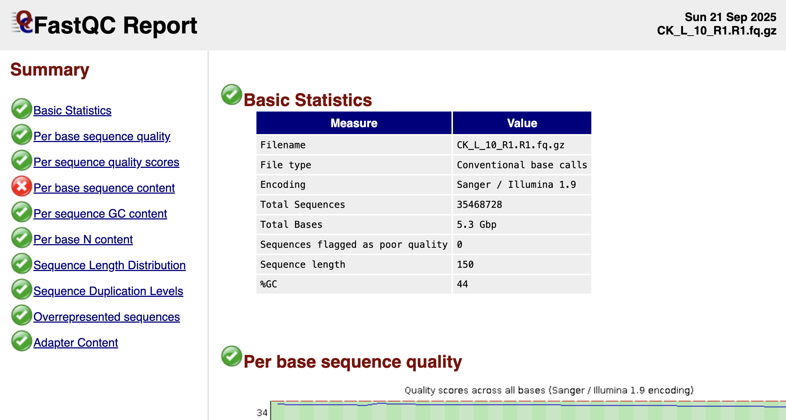

> **下面是根据**\*\*`multiqc`****的教程汇总的****`fastqc`****结果如何解读指标如下**[^3]**：\*\*
>
> **Adapter content** : 由于二代测序文库在构建时会连接`adapter`，因此检测最终测序数据中的`adapter`残留比例，是衡量文库质量的关键环节。该比例若显著偏高，则强烈预示着文库中`DNA`插入片段（`insert fragment`）的平均长度过短。
>
> 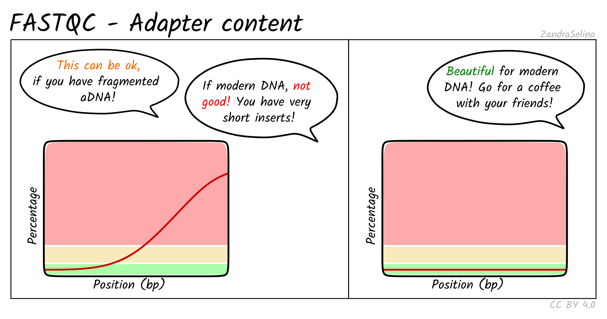
>
> **Per base N content** : 测序过程中如果测序仪无法确认特定`Cycle`的碱基类型，会将该处碱基定义为`N`,因此需要对最终下机数据`Read`中的`N`碱基数量进行统计。
>
> 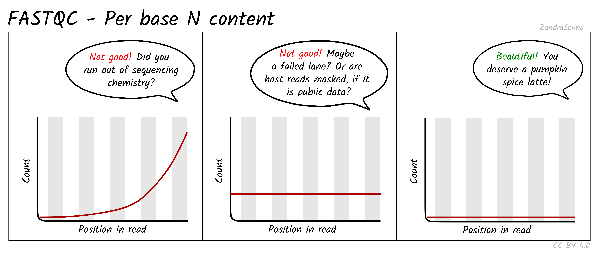
>
> **Per base sequence content** : 在正常测序过程中，四种 `DNA` 碱基的百分比含量应保持基本一致（碱基间差异极小或没有差异）。若不同碱基间出现含量失衡，通常表明存在过度表达的序列，即文库受到污染。
>
> 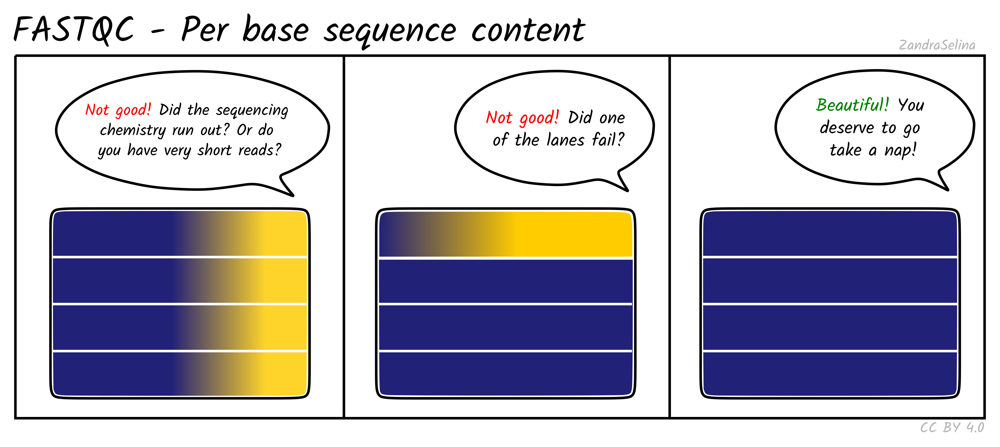
>
> **Per sequence GC content** : 在随机测序文库中，不同测序位置的碱基组成差异应极小或不存在，因此绘制的曲线应大致保持水平，并且整体 `GC`含量应反映基因组本身的 `GC` 特征。若观察到不同测序位置存在 `GC` 含量偏移，可能提示存在过度表达的序列污染。
>
> 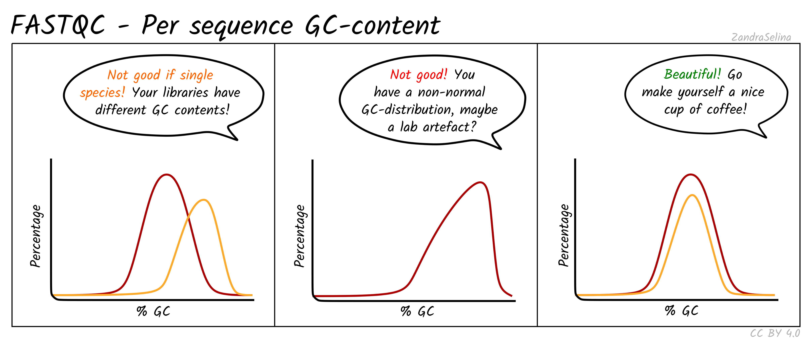
>
> **Per sequence quality scores** : 该指标主要用来评估序列的平均质量水平，`NGS`测序中大部分的`Read`碱基质量应该超高`30`。
>
> 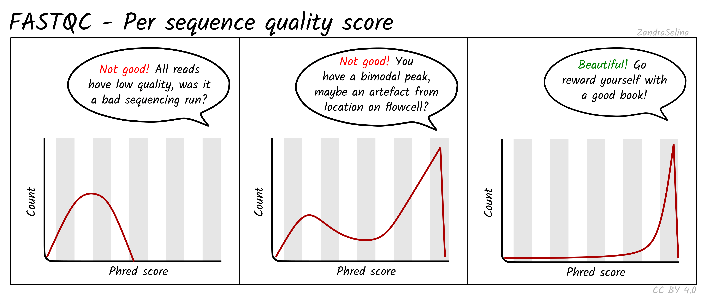
>
> **Sequence counts** : 评估文库的序列重复率是判断其质量的重要步骤。以`RNA-seq`文库为例，如果数据中出现过高的序列重复率，通常表明文库在构建过程中可能存在`PCR`扩增偏倚或起始样本量不足等问题。
>
> 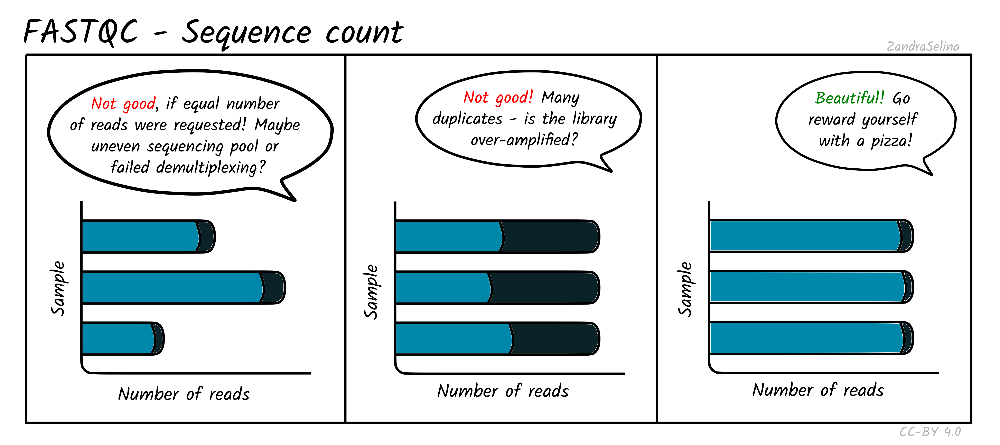
>
> **Sequence Duplication Levels** : 评估测序数据的重复率时需要区分应用场景。对于`WGS`（全基因组测序），高重复率通常是不良信号；而对于`RNA-seq`，存在一定比例的重复序列则是正常现象，因为它反映了基因的表达丰度。
>
> 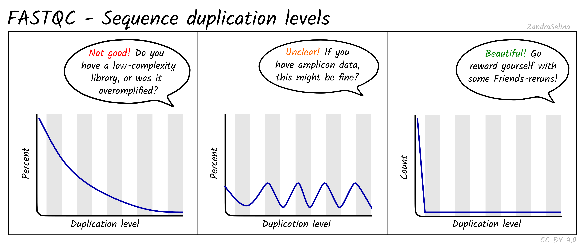
>
> **Sequence Quality Histograms** : 碱基质量（`Phred Quality Score`）是评估`NGS`数据质量的核心指标。目前，主流测序平台产出的数据通常能保证绝大部分碱基的质量值高于`Q25`（甚至`Q30`）。分析时需注意，一条读长（`Read`）的首尾两端碱基质量普遍偏低，这通常与测序初期的信号校准过程，以及测序末期化学反应体系的逐渐衰减有关。
>
> 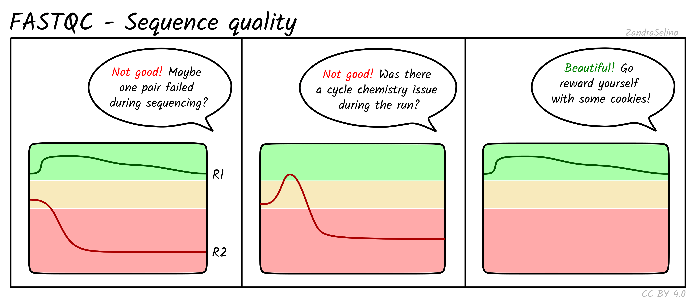

### 3.3 Adapter

在`NGS`（特别是`Illumina`平台）测序流程中，文库`DNA`片段两端连接的`Adapter`序列，使其能够与测序芯片（`Flow Cell`）表面的寡核苷酸探针结合。随后，通过桥式`PCR`技术在芯片上进行原位扩增，将单个`DNA`分子扩增成一个克隆簇（`Cluster`）以放大信号。最后，测序仪对这些克隆簇进行测序（如`SBS`技术），从而读取`DNA`片段的序列信息[^4]。

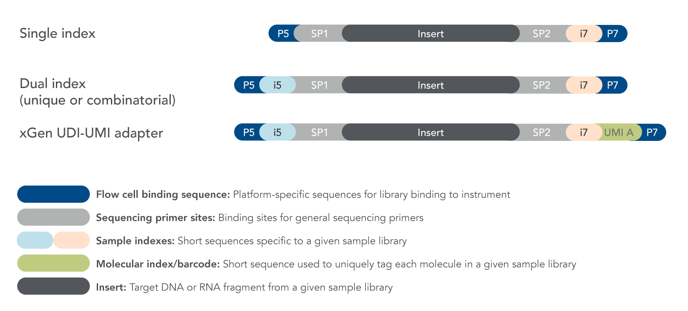

在构建`Illumina`测序文库时，会将目标`DNA/cDNA`片段的两端连接上特定的`Adapter`。这些`Adapter`结构复杂，其末端的`P5`和`P7`序列能让文库分子锚定在`Flow Cell`上，而其内部的引物结合位点则是测序开始的地方。

在进行`PE150`这类双端测序时，测序仪会分别从文库分子的两端进行`5'→3'`方向的读取，生成长度为`150 bp`的`Read 1`和`Read 2`。

关键在于，如果**文库中插入片段（****`Insert`****）的实际长度小于测序设定的读长（****`Read Length`****）**——例如，一个只有`100 bp`的片段在`PE150`模式下测序——测序仪在读完这`100 bp`的有效序列后不会停止，而是会继续“读穿”，将片段另一端的`Adapter`序列也读进来(**这个也是为什么**\*\*`Illumina`\*\***测序会存在接头的原因呀**)。

这就导致了在最终生成的`150 bp` `FASTQ`数据中，其**3'末端**会包含一部分（此例中为`50 bp`）我们不需要的`Adapter`序列。因此，数据分析的第一步通常就是使用`Trimmomatic`或`fastp`等工具对`3'`端的接头污染进行切除。


```markdown title="R1_Read & R2_Read"
@E250070638L1C001R00300003444  1 :N:0:None
NNNNNNNNNNNN AGATCGGAAGAGCACACGTCTGAACTCCAGTCAC 
+
FFFFFFFFFFFFFFFFFFFFFFFFFFFFFFFFFFFFFFFFFFFFFF
@E250070638L1C001R00300003444  2 :N:0:None
NNNNNNNNNNNN AGATCGGAAGAGCGTCGTGTAGGGAAAGAGTGT 
+
FFFFFFFFFFFFFFFFFFFFFFFFFFFFFFFFFFFFFFFFFFFFF
```


> **Tips** : 由于PE数据是配对数据，在后续分析中是使用fastq文件中read的ID进行配对

> **NOTE** : 下面为现阶段`NGS`大多数平台使用的`adapter`序列
>
> ```text title="Illumina & Nextera & SOLID & DNB"
> Illumina–TruSeq Adapter
>   Read 1 :  AGATCGGAAGAG CACACGTCTGAACTCCAGTCA
>   Read 2 :  AGATCGGAAGAG CGTCGTGTAGGGAAAGAGTGT
> ---------------
> Illumina Universal Adapter          AGATCGGAAGAG
> Illumina Small RNA Adapter          ATGGAATTCTCG
> Nextera Transposase Sequence        CTGTCTCTTATA
> SOLID Small RNA Adapter             CGCCTTGGCCGT
> DNB Dual Barcode Adapter Trimming Sequences Forward filter: AAGTCGGAGGCCAAGCGGTCTTAGGAAGACAA
> DNB Dual Barcode Adapter Trimming Sequences Reverse filter: AAGTCGGATCGTAGCCATGTCGTTCTGTGAGCCAAGGAGTTG
> ```
>

因此当需要对`Illumina–TruSeq`测序数据进行质控时，就可以通过指定`AGATCGGAAGAG`序列，就可以实现对于`Illumina–TruSeq`下机数据的质控。

```bash title="cutadapt"
# 使用 cutadapt 对PE下机数据进行质控
cutadapt -a AGATCGGAAGAG -A AGATCGGAAGAG \
         -o CK_L_10_R1.R1.trim.fq.gz \
         -p CK_L_10_R1.R2.trim.fq.gz \
         CK_L_10_R1.R1.fq.gz CK_L_10_R1.R2.fq.gz \
         -j 30
```


#### 3.3.1 Small RNA with read-through adapter

`smallRNA`长度都在`15–30 nt`之间[^5],二代测序`NGS`文库往往可以捕获`100-150bp`的序列。最终文库中会存在较多的adapter序列，同时也会存在较多的重复序列[^6]。

| !\[]\(image/image\_Yo8eQI2NW\_.png) | !\[  ]\(image/image\_3OiZJ-JE55.png "  ") |
| ----------------------------------- | ----------------------------------------- |

### 3.4 Overrepresented sequences

> 🍎`RNA-seq` 测序中会存在过表达序列的，但是如果**过表达序列的占比较高** & 存在**超级多过表达序列**其可能来源于以下几种：
>
> 1. 建库过程中的引物序列；
> 2. 在建库过程中**rRNA序列**；
>
> 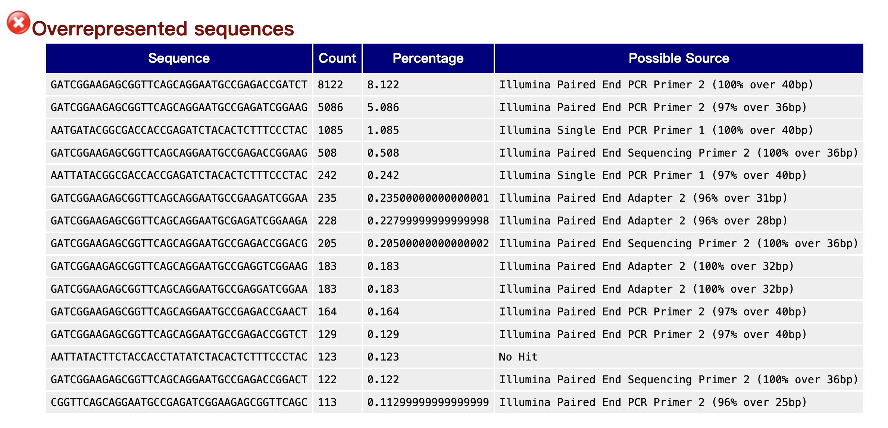

### 3.5 Abnormal GC-Content

在随机测序文库中，不同测序位置的碱基组成差异应极小或不存在，因此绘制的曲线应大致保持水平，并且整体 `GC`含量应反映基因组本身的 `GC` 特征。若观察到不同测序位置存在 `GC` 含量偏移，可能提示存在过度表达的序列污染。

> 🐶**Bimodal GC content graph**
>
> 当`Per sequence GC content` 的分布图呈现出明显的双峰时，通常强烈暗示样本受到了外源物种的污染。之所以会这样，是因为不同物种的DNA其GC含量通常有各自的特征范围。如果你的目标物种A被另一个GC含量差异很大的物种B污染了，那么在最终的数据中就会同时存在属于A和B的两种GC分布，图形上就表现为两个独立的峰[^7]。
>
> 这种污染的引入通常发生在两个环节：一是在采样或建库的实验操作中，不慎混入了环境中的其他生物DNA；二是在测序服务商进行多样本混合测序（拼板测序）时，发生了样本之间的微量交叉污染。
>
> 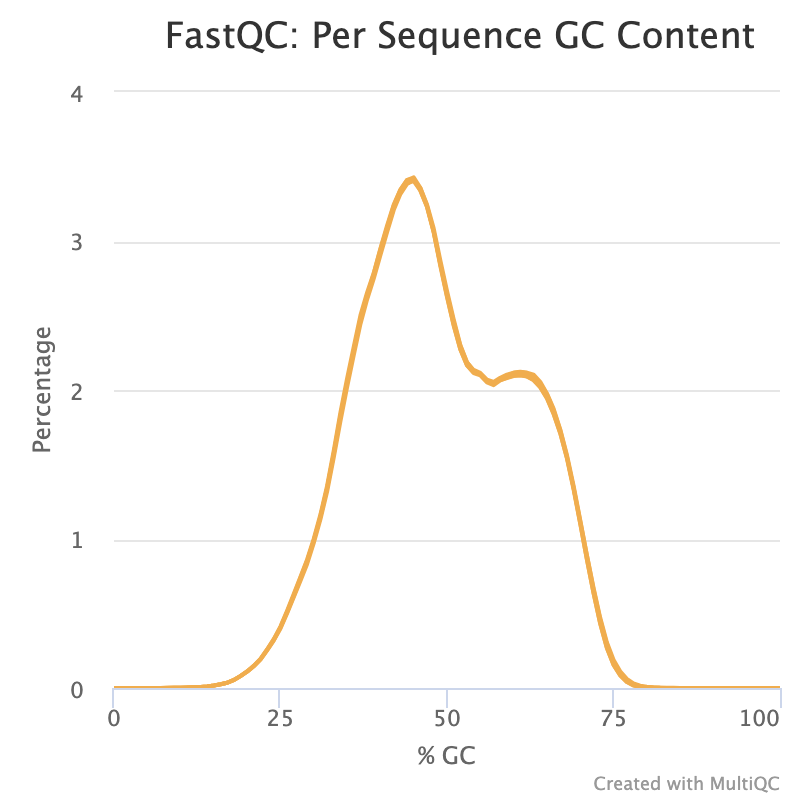

> 🕳️当`Per sequence GC content`存在双峰并且在`70-80%`左右还存在额外的峰，这提示文库中存在其他物种污染，并且建库过程中未去除完全`ribosomeRNA`。
>
> 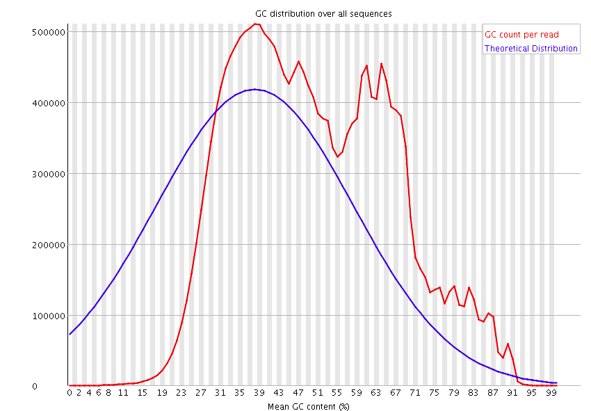

> Tips : 由于rRNA占所有RNA的90%，因此RNA-seq测序中往往需要将rRNA去除。
>
> - [RNA depletion](https://www.neb.com/en/products/next-generation-sequencing-library-preparation/rna-depletion-and-mrna-enrichment/rna-depletion-and-mrna-enrichment#deplete "RNA depletion") – Selectively depleting abundant/off-target transcripts (干掉rRNA)
> - [mRNA enrichment](https://www.neb.com/en/products/next-generation-sequencing-library-preparation/rna-depletion-and-mrna-enrichment/rna-depletion-and-mrna-enrichment#enrich "mRNA enrichment") – Selectively enriching for poly(A)-tailed transcripts(ploy-A-tial富集)

> 🌨️**昆虫** & **细菌**
>
> 昆虫经常与特定的细菌存在共生关系，并且这些细菌细胞的数量通常非常庞大。您所使用的 RiboZero 方法会去除核糖体RNA (rRNA)，但会保留所有其余的RNA——这其中既包含了来自昆虫本身的RNA，也包含了来自其共生细菌的RNA。
>
> 沃尔巴克氏体 (Wolbachia) 就是一个典型的例子：它是一种胞内菌，通常在其宿主的卵巢中数量极高，但也普遍存在于所有组织中。

### 3.6 Contaminants

在测序文库构建的时候可能会由于操作者污染 (Operator Contamination) & 交叉污染 (Cross-Contamination) & 共生或寄生生物 (Symbiotic or Parasitic Organisms) & 试剂污染 (Reagent Contamination)导致文件中混入污染物。

> 🌨️`fastqc` 汇总的在测序中较为常见的污染物
>
> ```markdown title="Contaminants"
> Illumina Single End Adapter 1          GATCGGAAGAGCTCGTATGCCGTCTTCTGCTTG
> Illumina Single End Adapter 2          CAAGCAGAAGACGGCATACGAGCTCTTCCGATCT
> Illumina Single End PCR Primer 1        AATGATACGGCGACCACCGAGATCTACACTCTTTCCCTACACGACGCTCTTCCGATCT
> Illumina Single End PCR Primer 2        CAAGCAGAAGACGGCATACGAGCTCTTCCGATCT
> Illumina Single End Sequencing Primer      ACACTCTTTCCCTACACGACGCTCTTCCGATCT
>
> Illumina Paired End Adapter 1          ACACTCTTTCCCTACACGACGCTCTTCCGATCT
> Illumina Paired End Adapter 2          GATCGGAAGAGCGGTTCAGCAGGAATGCCGAG
> Illumina Paried End PCR Primer 1        AATGATACGGCGACCACCGAGATCTACACTCTTTCCCTACACGACGCTCTTCCGATCT
> Illumina Paired End PCR Primer 2        CAAGCAGAAGACGGCATACGAGATCGGTCTCGGCATTCCTGCTGAACCGCTCTTCCGATCT
> Illumina Paried End Sequencing Primer 1      ACACTCTTTCCCTACACGACGCTCTTCCGATCT
> Illumina Paired End Sequencing Primer 2      CGGTCTCGGCATTCCTGCTGAACCGCTCTTCCGATCT
>
> Illumina DpnII expression Adapter 1        ACAGGTTCAGAGTTCTACAGTCCGAC
> Illumina DpnII expression Adapter 2        CAAGCAGAAGACGGCATACGA
> Illumina DpnII expression PCR Primer 1      CAAGCAGAAGACGGCATACGA
> Illumina DpnII expression PCR Primer 2      AATGATACGGCGACCACCGACAGGTTCAGAGTTCTACAGTCCGA
> Illumina DpnII expression Sequencing Primer    CGACAGGTTCAGAGTTCTACAGTCCGACGATC
>
> Illumina NlaIII expression Adapter 1      ACAGGTTCAGAGTTCTACAGTCCGACATG
> Illumina NlaIII expression Adapter 2      CAAGCAGAAGACGGCATACGA
> Illumina NlaIII expression PCR Primer 1      CAAGCAGAAGACGGCATACGA
> Illumina NlaIII expression PCR Primer 2      AATGATACGGCGACCACCGACAGGTTCAGAGTTCTACAGTCCGA
> Illumina NlaIII expression Sequencing Primer  CCGACAGGTTCAGAGTTCTACAGTCCGACATG
>
> Illumina Small RNA Adapter 1          GTTCAGAGTTCTACAGTCCGACGATC
> Illumina Small RNA Adapter 2          TGGAATTCTCGGGTGCCAAGG
> Illumina Small RNA RT Primer          CAAGCAGAAGACGGCATACGA
> Illumina Small RNA PCR Primer 1          CAAGCAGAAGACGGCATACGA
> Illumina Small RNA PCR Primer 2          AATGATACGGCGACCACCGACAGGTTCAGAGTTCTACAGTCCGA
> Illumina Small RNA Sequencing Primer      CGACAGGTTCAGAGTTCTACAGTCCGACGATC
>
> Illumina Multiplexing Adapter 1          GATCGGAAGAGCACACGTCT
> Illumina Multiplexing Adapter 2          ACACTCTTTCCCTACACGACGCTCTTCCGATCT
> Illumina Multiplexing PCR Primer 1.01      AATGATACGGCGACCACCGAGATCTACACTCTTTCCCTACACGACGCTCTTCCGATCT
> Illumina Multiplexing PCR Primer 2.01      GTGACTGGAGTTCAGACGTGTGCTCTTCCGATCT
> Illumina Multiplexing Read1 Sequencing Primer  ACACTCTTTCCCTACACGACGCTCTTCCGATCT
> Illumina Multiplexing Index Sequencing Primer  GATCGGAAGAGCACACGTCTGAACTCCAGTCAC
> Illumina Multiplexing Read2 Sequencing Primer  GTGACTGGAGTTCAGACGTGTGCTCTTCCGATCT
>
> Illumina PCR Primer Index 1            CAAGCAGAAGACGGCATACGAGATCGTGATGTGACTGGAGTTC
> Illumina PCR Primer Index 2            CAAGCAGAAGACGGCATACGAGATACATCGGTGACTGGAGTTC
> Illumina PCR Primer Index 3            CAAGCAGAAGACGGCATACGAGATGCCTAAGTGACTGGAGTTC
> Illumina PCR Primer Index 4            CAAGCAGAAGACGGCATACGAGATTGGTCAGTGACTGGAGTTC
> Illumina PCR Primer Index 5            CAAGCAGAAGACGGCATACGAGATCACTGTGTGACTGGAGTTC
> Illumina PCR Primer Index 6            CAAGCAGAAGACGGCATACGAGATATTGGCGTGACTGGAGTTC
> Illumina PCR Primer Index 7            CAAGCAGAAGACGGCATACGAGATGATCTGGTGACTGGAGTTC
> Illumina PCR Primer Index 8            CAAGCAGAAGACGGCATACGAGATTCAAGTGTGACTGGAGTTC
> Illumina PCR Primer Index 9            CAAGCAGAAGACGGCATACGAGATCTGATCGTGACTGGAGTTC
> Illumina PCR Primer Index 10          CAAGCAGAAGACGGCATACGAGATAAGCTAGTGACTGGAGTTC
> Illumina PCR Primer Index 11          CAAGCAGAAGACGGCATACGAGATGTAGCCGTGACTGGAGTTC
> Illumina PCR Primer Index 12          CAAGCAGAAGACGGCATACGAGATTACAAGGTGACTGGAGTTC
>
> Illumina DpnII Gex Adapter 1          GATCGTCGGACTGTAGAACTCTGAAC
> Illumina DpnII Gex Adapter 1.01          ACAGGTTCAGAGTTCTACAGTCCGAC
> Illumina DpnII Gex Adapter 2          CAAGCAGAAGACGGCATACGA
> Illumina DpnII Gex Adapter 2.01          TCGTATGCCGTCTTCTGCTTG
> Illumina DpnII Gex PCR Primer 1          CAAGCAGAAGACGGCATACGA
> Illumina DpnII Gex PCR Primer 2          AATGATACGGCGACCACCGACAGGTTCAGAGTTCTACAGTCCGA
> Illumina DpnII Gex Sequencing Primer      CGACAGGTTCAGAGTTCTACAGTCCGACGATC
>
> Illumina NlaIII Gex Adapter 1.01        TCGGACTGTAGAACTCTGAAC
> Illumina NlaIII Gex Adapter 1.02        ACAGGTTCAGAGTTCTACAGTCCGACATG
> Illumina NlaIII Gex Adapter 2.01        CAAGCAGAAGACGGCATACGA
> Illumina NlaIII Gex Adapter 2.02        TCGTATGCCGTCTTCTGCTTG
> Illumina NlaIII Gex PCR Primer 1        CAAGCAGAAGACGGCATACGA
> Illumina NlaIII Gex PCR Primer 2        AATGATACGGCGACCACCGACAGGTTCAGAGTTCTACAGTCCGA
> Illumina NlaIII Gex Sequencing Primer      CCGACAGGTTCAGAGTTCTACAGTCCGACATG
>
> Illumina Small RNA RT Primer          CAAGCAGAAGACGGCATACGA
> Illumina 5p RNA Adapter              GTTCAGAGTTCTACAGTCCGACGATC
> Illumina RNA Adapter1              TGGAATTCTCGGGTGCCAAGG
>
> Illumina Small RNA 3p Adapter 1          ATCTCGTATGCCGTCTTCTGCTTG
> Illumina Small RNA PCR Primer 1          CAAGCAGAAGACGGCATACGA
> Illumina Small RNA PCR Primer 2          AATGATACGGCGACCACCGACAGGTTCAGAGTTCTACAGTCCGA
> Illumina Small RNA Sequencing Primer      CGACAGGTTCAGAGTTCTACAGTCCGACGATC
>
> TruSeq Universal Adapter            AATGATACGGCGACCACCGAGATCTACACTCTTTCCCTACACGACGCTCTTCCGATCT
> TruSeq Adapter, Index 1              GATCGGAAGAGCACACGTCTGAACTCCAGTCACATCACGATCTCGTATGCCGTCTTCTGCTTG
> TruSeq Adapter, Index 2              GATCGGAAGAGCACACGTCTGAACTCCAGTCACCGATGTATCTCGTATGCCGTCTTCTGCTTG
> TruSeq Adapter, Index 3              GATCGGAAGAGCACACGTCTGAACTCCAGTCACTTAGGCATCTCGTATGCCGTCTTCTGCTTG
> TruSeq Adapter, Index 4              GATCGGAAGAGCACACGTCTGAACTCCAGTCACTGACCAATCTCGTATGCCGTCTTCTGCTTG
> TruSeq Adapter, Index 5              GATCGGAAGAGCACACGTCTGAACTCCAGTCACACAGTGATCTCGTATGCCGTCTTCTGCTTG
> TruSeq Adapter, Index 6              GATCGGAAGAGCACACGTCTGAACTCCAGTCACGCCAATATCTCGTATGCCGTCTTCTGCTTG
> TruSeq Adapter, Index 7              GATCGGAAGAGCACACGTCTGAACTCCAGTCACCAGATCATCTCGTATGCCGTCTTCTGCTTG
> TruSeq Adapter, Index 8              GATCGGAAGAGCACACGTCTGAACTCCAGTCACACTTGAATCTCGTATGCCGTCTTCTGCTTG
> TruSeq Adapter, Index 9              GATCGGAAGAGCACACGTCTGAACTCCAGTCACGATCAGATCTCGTATGCCGTCTTCTGCTTG
> TruSeq Adapter, Index 10            GATCGGAAGAGCACACGTCTGAACTCCAGTCACTAGCTTATCTCGTATGCCGTCTTCTGCTTG
> TruSeq Adapter, Index 11            GATCGGAAGAGCACACGTCTGAACTCCAGTCACGGCTACATCTCGTATGCCGTCTTCTGCTTG
> TruSeq Adapter, Index 12            GATCGGAAGAGCACACGTCTGAACTCCAGTCACCTTGTAATCTCGTATGCCGTCTTCTGCTTG
> TruSeq Adapter, Index 13            GATCGGAAGAGCACACGTCTGAACTCCAGTCACAGTCAACTCTCGTATGCCGTCTTCTGCTTG
> TruSeq Adapter, Index 14            GATCGGAAGAGCACACGTCTGAACTCCAGTCACAGTTCCGTCTCGTATGCCGTCTTCTGCTTG
> TruSeq Adapter, Index 15            GATCGGAAGAGCACACGTCTGAACTCCAGTCACATGTCAGTCTCGTATGCCGTCTTCTGCTTG
> TruSeq Adapter, Index 16            GATCGGAAGAGCACACGTCTGAACTCCAGTCACCCGTCCCTCTCGTATGCCGTCTTCTGCTTG
> TruSeq Adapter, Index 18            GATCGGAAGAGCACACGTCTGAACTCCAGTCACGTCCGCATCTCGTATGCCGTCTTCTGCTTG
> TruSeq Adapter, Index 19            GATCGGAAGAGCACACGTCTGAACTCCAGTCACGTGAAACTCTCGTATGCCGTCTTCTGCTTG
> TruSeq Adapter, Index 20            GATCGGAAGAGCACACGTCTGAACTCCAGTCACGTGGCCTTCTCGTATGCCGTCTTCTGCTTG
> TruSeq Adapter, Index 21            GATCGGAAGAGCACACGTCTGAACTCCAGTCACGTTTCGGTCTCGTATGCCGTCTTCTGCTTG
> TruSeq Adapter, Index 22            GATCGGAAGAGCACACGTCTGAACTCCAGTCACCGTACGTTCTCGTATGCCGTCTTCTGCTTG
> TruSeq Adapter, Index 23            GATCGGAAGAGCACACGTCTGAACTCCAGTCACCGTACGTTCTCGTATGCCGTCTTCTGCTTG
> TruSeq Adapter, Index 25            GATCGGAAGAGCACACGTCTGAACTCCAGTCACACTGATATCTCGTATGCCGTCTTCTGCTTG
> TruSeq Adapter, Index 27            GATCGGAAGAGCACACGTCTGAACTCCAGTCACATTCCTTTCTCGTATGCCGTCTTCTGCTTG
>
> Illumina RNA RT Primer              GCCTTGGCACCCGAGAATTCCA
> Illumina RNA PCR Primer              AATGATACGGCGACCACCGAGATCTACACGTTCAGAGTTCTACAGTCCGA
>
> RNA PCR Primer, Index 1              CAAGCAGAAGACGGCATACGAGATCGTGATGTGACTGGAGTTCCTTGGCACCCGAGAATTCCA
> RNA PCR Primer, Index 2              CAAGCAGAAGACGGCATACGAGATACATCGGTGACTGGAGTTCCTTGGCACCCGAGAATTCCA
> RNA PCR Primer, Index 3              CAAGCAGAAGACGGCATACGAGATGCCTAAGTGACTGGAGTTCCTTGGCACCCGAGAATTCCA
> RNA PCR Primer, Index 4              CAAGCAGAAGACGGCATACGAGATTGGTCAGTGACTGGAGTTCCTTGGCACCCGAGAATTCCA
> RNA PCR Primer, Index 5              CAAGCAGAAGACGGCATACGAGATCACTGTGTGACTGGAGTTCCTTGGCACCCGAGAATTCCA
> RNA PCR Primer, Index 6              CAAGCAGAAGACGGCATACGAGATATTGGCGTGACTGGAGTTCCTTGGCACCCGAGAATTCCA
> RNA PCR Primer, Index 7              CAAGCAGAAGACGGCATACGAGATGATCTGGTGACTGGAGTTCCTTGGCACCCGAGAATTCCA
> RNA PCR Primer, Index 8              CAAGCAGAAGACGGCATACGAGATTCAAGTGTGACTGGAGTTCCTTGGCACCCGAGAATTCCA
> RNA PCR Primer, Index 9              CAAGCAGAAGACGGCATACGAGATCTGATCGTGACTGGAGTTCCTTGGCACCCGAGAATTCCA
> RNA PCR Primer, Index 10            CAAGCAGAAGACGGCATACGAGATAAGCTAGTGACTGGAGTTCCTTGGCACCCGAGAATTCCA
> RNA PCR Primer, Index 11            CAAGCAGAAGACGGCATACGAGATGTAGCCGTGACTGGAGTTCCTTGGCACCCGAGAATTCCA
> RNA PCR Primer, Index 12            CAAGCAGAAGACGGCATACGAGATTACAAGGTGACTGGAGTTCCTTGGCACCCGAGAATTCCA
> RNA PCR Primer, Index 13            CAAGCAGAAGACGGCATACGAGATTTGACTGTGACTGGAGTTCCTTGGCACCCGAGAATTCCA
> RNA PCR Primer, Index 14            CAAGCAGAAGACGGCATACGAGATGGAACTGTGACTGGAGTTCCTTGGCACCCGAGAATTCCA
> RNA PCR Primer, Index 15            CAAGCAGAAGACGGCATACGAGATTGACATGTGACTGGAGTTCCTTGGCACCCGAGAATTCCA
> RNA PCR Primer, Index 16            CAAGCAGAAGACGGCATACGAGATGGACGGGTGACTGGAGTTCCTTGGCACCCGAGAATTCCA
> RNA PCR Primer, Index 17            CAAGCAGAAGACGGCATACGAGATCTCTACGTGACTGGAGTTCCTTGGCACCCGAGAATTCCA
> RNA PCR Primer, Index 18            CAAGCAGAAGACGGCATACGAGATGCGGACGTGACTGGAGTTCCTTGGCACCCGAGAATTCCA
> RNA PCR Primer, Index 19            CAAGCAGAAGACGGCATACGAGATTTTCACGTGACTGGAGTTCCTTGGCACCCGAGAATTCCA
> RNA PCR Primer, Index 20            CAAGCAGAAGACGGCATACGAGATGGCCACGTGACTGGAGTTCCTTGGCACCCGAGAATTCCA
> RNA PCR Primer, Index 21            CAAGCAGAAGACGGCATACGAGATCGAAACGTGACTGGAGTTCCTTGGCACCCGAGAATTCCA
> RNA PCR Primer, Index 22            CAAGCAGAAGACGGCATACGAGATCGTACGGTGACTGGAGTTCCTTGGCACCCGAGAATTCCA
> RNA PCR Primer, Index 23            CAAGCAGAAGACGGCATACGAGATCCACTCGTGACTGGAGTTCCTTGGCACCCGAGAATTCCA
> RNA PCR Primer, Index 24            CAAGCAGAAGACGGCATACGAGATGCTACCGTGACTGGAGTTCCTTGGCACCCGAGAATTCCA
> RNA PCR Primer, Index 25            CAAGCAGAAGACGGCATACGAGATATCAGTGTGACTGGAGTTCCTTGGCACCCGAGAATTCCA
> RNA PCR Primer, Index 26            CAAGCAGAAGACGGCATACGAGATGCTCATGTGACTGGAGTTCCTTGGCACCCGAGAATTCCA
> RNA PCR Primer, Index 27            CAAGCAGAAGACGGCATACGAGATAGGAATGTGACTGGAGTTCCTTGGCACCCGAGAATTCCA
> RNA PCR Primer, Index 28            CAAGCAGAAGACGGCATACGAGATCTTTTGGTGACTGGAGTTCCTTGGCACCCGAGAATTCCA
> RNA PCR Primer, Index 29            CAAGCAGAAGACGGCATACGAGATTAGTTGGTGACTGGAGTTCCTTGGCACCCGAGAATTCCA
> RNA PCR Primer, Index 30            CAAGCAGAAGACGGCATACGAGATCCGGTGGTGACTGGAGTTCCTTGGCACCCGAGAATTCCA
> RNA PCR Primer, Index 31            CAAGCAGAAGACGGCATACGAGATATCGTGGTGACTGGAGTTCCTTGGCACCCGAGAATTCCA
> RNA PCR Primer, Index 32            CAAGCAGAAGACGGCATACGAGATTGAGTGGTGACTGGAGTTCCTTGGCACCCGAGAATTCCA
> RNA PCR Primer, Index 33            CAAGCAGAAGACGGCATACGAGATCGCCTGGTGACTGGAGTTCCTTGGCACCCGAGAATTCCA
> RNA PCR Primer, Index 34            CAAGCAGAAGACGGCATACGAGATGCCATGGTGACTGGAGTTCCTTGGCACCCGAGAATTCCA
> RNA PCR Primer, Index 35            CAAGCAGAAGACGGCATACGAGATAAAATGGTGACTGGAGTTCCTTGGCACCCGAGAATTCCA
> RNA PCR Primer, Index 36            CAAGCAGAAGACGGCATACGAGATTGTTGGGTGACTGGAGTTCCTTGGCACCCGAGAATTCCA
> RNA PCR Primer, Index 37            CAAGCAGAAGACGGCATACGAGATATTCCGGTGACTGGAGTTCCTTGGCACCCGAGAATTCCA
> RNA PCR Primer, Index 38            CAAGCAGAAGACGGCATACGAGATAGCTAGGTGACTGGAGTTCCTTGGCACCCGAGAATTCCA
> RNA PCR Primer, Index 39            CAAGCAGAAGACGGCATACGAGATGTATAGGTGACTGGAGTTCCTTGGCACCCGAGAATTCCA
> RNA PCR Primer, Index 40            CAAGCAGAAGACGGCATACGAGATTCTGAGGTGACTGGAGTTCCTTGGCACCCGAGAATTCCA
> RNA PCR Primer, Index 41            CAAGCAGAAGACGGCATACGAGATGTCGTCGTGACTGGAGTTCCTTGGCACCCGAGAATTCCA
> RNA PCR Primer, Index 42            CAAGCAGAAGACGGCATACGAGATCGATTAGTGACTGGAGTTCCTTGGCACCCGAGAATTCCA
> RNA PCR Primer, Index 43            CAAGCAGAAGACGGCATACGAGATGCTGTAGTGACTGGAGTTCCTTGGCACCCGAGAATTCCA
> RNA PCR Primer, Index 44            CAAGCAGAAGACGGCATACGAGATATTATAGTGACTGGAGTTCCTTGGCACCCGAGAATTCCA
> RNA PCR Primer, Index 45            CAAGCAGAAGACGGCATACGAGATGAATGAGTGACTGGAGTTCCTTGGCACCCGAGAATTCCA
> RNA PCR Primer, Index 46            CAAGCAGAAGACGGCATACGAGATTCGGGAGTGACTGGAGTTCCTTGGCACCCGAGAATTCCA
> RNA PCR Primer, Index 47            CAAGCAGAAGACGGCATACGAGATCTTCGAGTGACTGGAGTTCCTTGGCACCCGAGAATTCCA
> RNA PCR Primer, Index 48            CAAGCAGAAGACGGCATACGAGATTGCCGAGTGACTGGAGTTCCTTGGCACCCGAGAATTCCA
>
> ABI Dynabead EcoP Oligo              CTGATCTAGAGGTACCGGATCCCAGCAGT
> ABI Solid3 Adapter A              CTGCCCCGGGTTCCTCATTCTCTCAGCAGCATG
> ABI Solid3 Adapter B              CCACTACGCCTCCGCTTTCCTCTCTATGGGCAGTCGGTGAT
> ABI Solid3 5' AMP Primer            CCACTACGCCTCCGCTTTCCTCTCTATG
> ABI Solid3 3' AMP Primer            CTGCCCCGGGTTCCTCATTCT
> ABI Solid3 EF1 alpha Sense Primer        CATGTGTGTTGAGAGCTTC
> ABI Solid3 EF1 alpha Antisense Primer      GAAAACCAAAGTGGTCCAC
> ABI Solid3 GAPDH Forward Primer          TTAGCACCCCTGGCCAAGG
> ABI Solid3 GAPDH Reverse Primer          CTTACTCCTTGGAGGCCATG
>
> ```
>

### 3.7 Library Example

#### 3.7.1 PacBio

长读长测序也被称作三代测序，其测序原理会导致最终下机`read`的碱基质量普遍偏低,下面是`pacbio`测序的示例报告，可能明显发现其`Per base sequence quality`偏低[^8]。

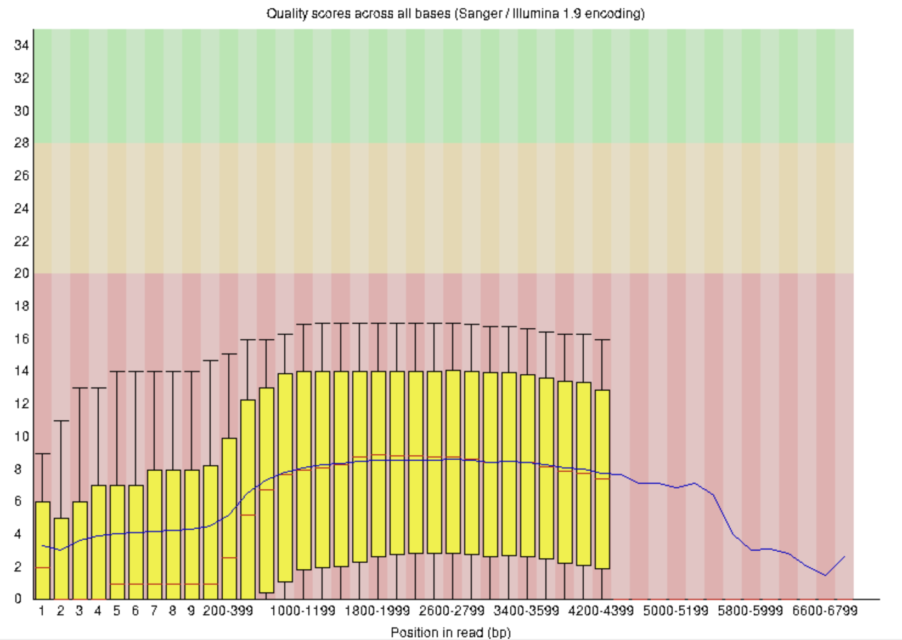

#### 3.7.2 Roche 454

Roche 454测序具有以下特征：1.读长分布不均 (Sequence Length Distribution) ；2.碱基质量沿读长下降 (Per base sequence quality) ；3.碱基组成偏好性 (Per base sequence content)。因此Roche 454 2013年就退市啦[^9] 。

| !\[  ]\(image/image\_zIXjmET0Je.png "  ") | !\[  ]\(image/image\_ebdpY-uL0b.png "  ") |
| ----------------------------------------- | ----------------------------------------- |

***

## 4 code

### 4.1 Extert fastqc result&#x20;

- 提取 Per base sequence quality 信息的 shell 脚本
  ```r title="Extert fastqc result by shell"
  # 提取 Per base sequence quality 信息的 shell 脚本
  sed -n '/>>Per base sequence quality/,/>>END_MODULE/p'  fastqc_data.txt | grep -v ">>END_MODULE" | grep -v ">>Per base sequence quality" > Per_base_sequence_quality.txt
  ```

- 使用ggplot2对fastq文件的Per base sequence quality进行重新绘制
  ```r title="Per base sequence quality ggplot2"
  library(tidyverse)
  library(data.table)
  # input data
  root_dir <- "/titan3/local_zhang_jian/fastqc/R24010606LR01-1DIO-Liver_R2_fastqc"
  data <- fread(file.path(root_dir,"Per_base_sequence_quality.txt"))
  p <- data |> mutate(id = as.integer(rownames(data)))|> mutate(`#Base` = as.factor(`#Base`)) |> mutate(`#Base` = fct_reorder(`#Base`,id)) |> 
    ggplot(aes(x=`#Base`,y=Mean,group="group"))+
    geom_rect(aes(xmin = 0, ymin = 10, ymax = 20, xmax = Inf),fill = "red", alpha = 0.1)+
    geom_rect(aes(xmin = 0, ymin = 20, ymax = 28, xmax = Inf),fill = "#FFD700", alpha = 0.2)+
    geom_rect(aes(xmin = 0, ymin = 28, ymax = Inf, xmax = Inf),fill = "#1E90FF", alpha = 0.2) +
    geom_line(lwd = 1,colour="#9400D3")+
    labs(title = paste("Per base sequence quality"), x = "Position in read (bp)",y = "Mean quality scores",subtitle = "Red: low quality zone") +
    scale_y_continuous(limits = c(10,40),expand = c(0,0))+
    theme_classic()+
    theme(axis.text.x = element_text(angle = 45,vjust = 0.9,hjust = 0.9))
  ggsave(file.path(root_dir,"R24010606LR01-1DIO.qc.png"),width = 6,height = 3.5,dpi = 1000,plot = p)
  ggsave(file.path(root_dir,"R24010606LR01-1DIO.qc.pdf"),width = 6,height = 3.5,plot = p)
  ```

  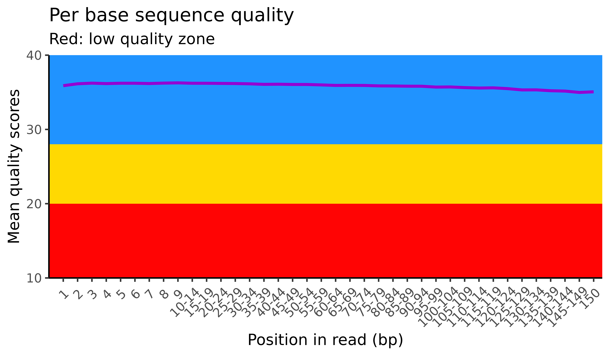
- 提取 Fastqc结果的Extert\_fastqc\_infor脚本
  > fastqc 除了生成网页报告，也会生成原始数据的压缩文件，如果要对fastqc 结果进行重新绘制，可以使用相关代码对结果进行提取，python 提取 fastqc代码如下：
  >
  > 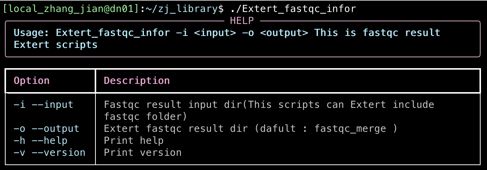
  >
  > ```r title="Extert_fastqc_infor Code"
  > #!/titan3/local_zhang_jian/miniconda3/miniconda3/envs/python3/bin/python
  > import os
  > import sys
  > import glob
  > import getopt
  > import zipfile
  > import shutil
  > import pandas as pd
  > from io import StringIO
  > from loguru import logger
  > from datetime import datetime
  > from rich.console import Console
  > from rich.panel import Panel
  > from rich.table import Table
  > from rich.text import Text
  > #-----------------------#
  > version  =  "1.1v"
  > scripts_name = 'Extert_fastqc_infor'
  > # Define custom log format
  > log_format = "<green>{time:YYYY-MM-DD HH:mm:ss.SSS}</green> | <level>{level}</level> | <cyan>{message}</cyan>"
  > # Configure the logger
  > logger.remove()  # Remove the default logger
  > logger.add(sys.stdout, format=log_format)
  > #-----------------------#
  > def getparameter(argv):
  >     input = ''
  >     output = 'fastqc_merge'
  >     if not argv:
  >         print_help()
  >         sys.exit()
  >     try:
  >         opts, args = getopt.getopt(argv, 'hi:o:v',
  >                                    ['help', 'input=','output=', 'version'])
  >     except getopt.GetoptError:
  >         print_help()
  >         sys.exit(2)
  >     for opt, arg in opts:
  >         if opt in ('-h', '--help'):
  >             print_help()
  >             sys.exit()
  >         elif opt in ('-i', '--input'):
  >             input = arg
  >         elif opt in ('-o', '--output'):
  >             output = arg
  >         elif opt in ('-v', '--version'):
  >             print_version(version)
  >             sys.exit()
  >     return input, output
  > def print_help():
  >     console = Console()
  >     table = Table(show_header=True, header_style="bold magenta",width=110)
  >     table.add_column("Option", style="cyan")
  >     table.add_column("Description", style="white")
  >     options = [
  >         ("-i --input",  "fastqc result input dir(This scripts can Extert include fastqc folder)"),
  >         ("-o --output", "Extert fastqc result dir (dafult : fastqc_merge )"),
  >         ("-h --help", "print help"),
  >         ("-v --version", "print version")
  >     ]
  >     for opt, desc in options:
  >         if "[Optional]" in desc:
  >             desc = desc.replace("[Optional]", "[bold yellow]Optional[/bold yellow]")
  >         table.add_row(opt, Text.from_markup(desc))
  >     usage_text = Text(f"Usage: {scripts_name} -i <input> -o <output> \n This is fastqc result Extert scripts", style="bold cyan")
  >     help_panel = Panel(usage_text,title="HELP",title_align="center",border_style="deep_pink4",width=110)
  >     console.print(help_panel)
  >     console.print(table)
  > def print_version(version):
  >     print("{} Version : \033[7;36m {} \033[0m".format(scripts_name, version))
  > def unzip_file(zip_path, extract_to):
  >     with zipfile.ZipFile(zip_path, 'r') as zip_ref:
  >         zip_ref.extractall(extract_to)
  >         extracted_files = zip_ref.namelist()
  >     return extracted_files
  > def find_fastqc_folder(directory):
  >     search_pattern = os.path.join(directory, '*_fastqc')
  >     fastqc_files = glob.glob(search_pattern)
  >     return fastqc_files
  > def find_fastqc_files(directory):
  >     search_pattern = os.path.join(directory, '*_fastqc.zip')
  >     fastqc_files = glob.glob(search_pattern)
  >     return fastqc_files
  > def unzip_fastqc(fastqc_list, extract_to):
  >     res = {}
  >     for i in fastqc_list:
  >         name = os.path.basename(i).replace('.zip', '')
  >         extracted_files = unzip_file(i, extract_to)
  >         res[name] = extracted_files
  >     return res
  > def find_file(file_list, filename):
  >     return [file for file in file_list if os.path.basename(file) == filename]
  > def extract_per_base_sequence_quality(file_path):
  >     with open(file_path, 'r') as file:
  >         lines = file.readlines()
  >
  >     start_idx = -1
  >     end_idx = -1
  >
  >     for idx, line in enumerate(lines):
  >         if '>>Per base sequence quality' in line:
  >             start_idx = idx
  >         if '>>END_MODULE' in line and start_idx != -1:
  >             end_idx = idx
  >             break
  >
  >     if start_idx != -1 and end_idx != -1:
  >         return lines[start_idx:end_idx+1]
  >     else:
  >         return []
  > def extract_per_base_sequence_content(file_path):
  >     with open(file_path, 'r') as file:
  >         lines = file.readlines()
  >
  >     start_idx = -1
  >     end_idx = -1
  >
  >     for idx, line in enumerate(lines):
  >         if '>>Per base sequence content' in line:
  >             start_idx = idx
  >         if '>>END_MODULE' in line and start_idx != -1:
  >             end_idx = idx
  >             break
  >     if start_idx != -1 and end_idx != -1:
  >         return lines[start_idx:end_idx+1]
  >     else:
  >         return []
  > def extract_per_GC_content(file_path):
  >     with open(file_path, 'r') as file:
  >         lines = file.readlines()
  >
  >     start_idx = -1
  >     end_idx = -1
  >
  >     for idx, line in enumerate(lines):
  >         if '>>Per sequence GC content' in line:
  >             start_idx = idx
  >         if '>>END_MODULE' in line and start_idx != -1:
  >             end_idx = idx
  >             break
  >     if start_idx != -1 and end_idx != -1:
  >         return lines[start_idx:end_idx+1]
  >     else:
  >         return []
  > def convert_df(content):
  >     content = content[1:-1]
  >     content_str = ''.join(content)
  >     content_io = StringIO(content_str)
  >     df = pd.read_csv(content_io, sep='\t')
  >     return df
  > def main_extert(directory):
  >     filename = 'fastqc_data.txt'
  >     fastqc_list = find_fastqc_files(directory)
  >     res = unzip_fastqc(fastqc_list, directory)
  >     for i in res:
  >         temp = res[i]
  >         file = find_file(temp, filename)
  >         name = i
  >         file_dir = os.path.join(directory, file[0])
  >         content = extract_per_base_sequence_quality(file_dir)
  >         if content:
  >             df = convert_df(content)
  >             df.to_csv(os.path.join(directory, f'{name}_fastqc_Per_base_sequence_quality.csv'), sep=',', index=False)
  >         logger.info(" \033[0;36m Extert  {}  Per_base_sequence_quality \033[0m ".format(name))
  >         content = extract_per_base_sequence_content(file_dir)
  >         if content:
  >             df = convert_df(content)
  >             df.to_csv(os.path.join(directory, f'{name}_fastqc_Per_base_sequence_content.csv'), sep=',', index=False)
  >         logger.info(" \033[0;36m Extert  {}  fastqc_Per_base_sequence_content \033[0m ".format(name))
  >         content = extract_per_GC_content(file_dir)
  >         if content:
  >             df = convert_df(content)
  >             df.to_csv(os.path.join(directory, f'{name}_fastqc_Per_GC_content.csv'), sep=',', index=False)
  >         logger.info(" \033[0;36m Extert  {}  fastqc_Per_GC_content \033[0m ".format(name))
  > def copy_files(search_pattern, destination_folder):
  >     files = glob.glob(search_pattern)
  >     for file_path in files:
  >         try:
  >             shutil.copy(file_path, destination_folder)
  >         except Exception as e:
  >             print(f"Error copying {file_path}: {e}")
  > def fastqc(main_directory,output):
  >     folder = find_fastqc_folder(main_directory)
  >     for i in folder:
  >         main_extert(i)
  >         destination_folder = os.path.join(main_directory, output)
  >         if not os.path.exists(destination_folder):
  >             os.makedirs(destination_folder, mode=511)
  >         search_pattern = os.path.join(i, '*_fastqc_Per_base_sequence_quality.csv')
  >         copy_files(search_pattern, destination_folder)
  >         search_pattern = os.path.join(i, '*_fastqc_Per_base_sequence_content.csv')
  >         copy_files(search_pattern, destination_folder)
  >         search_pattern = os.path.join(i, '*_fastqc_Per_GC_content.csv')
  >         copy_files(search_pattern, destination_folder)
  > def log():
  >     current_date_and_time = datetime.now()
  >     timestamp_str = current_date_and_time.strftime("%Y-%m-%d_%H-%M-%S")
  >     log_file_name = f"Extert_fastqc_{timestamp_str}.log"
  >     logger.add(log_file_name)
  > def main():
  >     input,output = getparameter(sys.argv[1:])
  >     log()
  >     logger.info(" \033[0;36m Extert  {}  fastqc result \033[0m ".format(input))
  >     fastqc(input,output)
  > #-----------------------#
  > # run main()
  > if __name__ == "__main__":
  >     main()
  > #-----------------------#
  > ```
  >
  >
  > ```python title="Extert fastqc result Python scripts"
  > Extert_fastqc_infor -i ./human_t7
  > # -i human_t7 文件夹中需要 ***fastqc fastqc结果文件夹
  > ```
  >
- Fastqc ggplot2 结果重新绘制脚本 & fastqc文件预处理脚本
  ```r title="ggplot2_fastqc"
  ggplot2_fastqc <- function(data,name=name,color=color3list){
    p <- data |> ggplot()+
      annotate("rect", xmin = 0, ymin = 10, xmax = Inf, ymax = 20, fill = "#e1c4c4")+
      annotate("rect", xmin = 0, ymin = 20, xmax = Inf, ymax = 28, fill = "#e5dcc6")+
      annotate("rect", xmin = 0, ymin = 28, xmax = Inf, ymax = Inf, fill = "#cae5c6")+
      geom_line(aes(x=`#Base`,y=as.numeric(as.character(Mean)),group=group,colour=group))+
      scale_color_manual(values = color)+
      scale_y_continuous(breaks = c(0,5,10,15,20,25,30,35,40),expand = c(0,0),limits = c(10,41))+
      labs(title = paste("Per base sequence quality for ",name), x = "Position in read (bp)",
           y = "Mean quality scores",
           subtitle = "Red: low quality zone",
           color = 'Sample')+
      theme(axis.text.x = element_text(angle = 45,hjust = 0.9,vjust = 0.9),
            legend.title = element_text(size = 10),
            legend.text = element_text(size = 6),
            legend.key = element_blank(),
            panel.grid.major = element_blank(),
            panel.grid.minor = element_blank(),
            panel.background = element_rect(color=NULL))+
      guides(color = guide_legend(keywidth = 1, keyheight = 1.15,ncol=1,
                                  override.aes = list(size = 5)))
    return(p)
  }
  ```

  ```r title="input_fastqc scripts"
  input_fastqc <- function(fastqc_list){
    blank_data_frame <- data.frame()
    if (length(fastqc_list) > 5){
      fastqc_list <- fastqc_list[c(1:5)]
      print('Fastqc replot scripts only draw top 10 fastqc result')
    }
    # fastqc_list <- R1 
    for (i in fastqc_list){
      temp <- fread(i)
      name <- gsub('_fastqc_fastqc_Per_base_sequence_quality.csv','',basename(i))
      temp$rank <-  c(1:dim(temp)[1])
      temp <-  temp |> dplyr::select(c(`#Base`,Mean,rank)) |> dplyr::mutate(group = `name`)
      blank_data_frame <- bind_rows(blank_data_frame, temp)
    }
    blank_data_frame
    blank_data_frame$`#Base` <- fct_reorder(blank_data_frame$`#Base`,blank_data_frame$rank)
    return(blank_data_frame)
  }
  ```

  ```r title="如何使用"
  color_list <- c(rep('#1a8c42',2),rep('#de452f',2))
  R1_p <- input_fastqc(R1) |> mutate(group = str_replace(group, "GEX_81_S1_L001_R1_001", "t7-10xscRNA-seq-sample-3"))|>
    mutate(group = str_replace(group, "GEX_82_S1_L001_R1_001", "t7-10xscRNA-seq-sample-4"))|>
    mutate(group = str_replace(group, "R23033581re-lib_S1_L001_R1_001", "genemind-10xscRNA-seq-sample-3"))|>
    mutate(group = str_replace(group, "R23033582-lib_S1_L001_R1_001", "genemind-10xscRNA-seq-sample-4"))|>
    ggplot2_fastqc(name='R1',color = color_list)
  ```

- R1& R2结果重新绘制
  ```r title="Redraw fastqc plot R scripts"
  #!/titan3/local_zhang_jian/miniconda3/miniconda3/envs/R/bin/Rscript
  #-----------------------#
  # author : zhang jian
  # date : 2024.7.2
  # version : 1.0v
  #-----------------------#
  suppressMessages(library("getopt"))
  suppressMessages(library("stringr"))
  suppressMessages(library("crayon"))
  suppressMessages(library("praise"))
  suppressMessages(library("ggplot2"))
  suppressMessages(library("dplyr"))
  suppressMessages(library("tidyverse"))
  suppressMessages(library("data.table"))
  #-----------------------#
  # define color & function
  color3list <- c("#1a8c42","#de452f","#3f5ba1","#c48e07","#2e6a9f",
                  "#b34078","#5e9c14","#9449b6","#227272","#e87032",
                  "#4b367b","#a6a535","#6c176e","#89b456","#d436a3",
                  "#3b7f34","#b14624","#6c6995","#e3845e","#376080",
                  "#cc8b19","#4d539e","#8d7520","#2b8d84","#c44b56")
  width_print <- 80
  print_color_note <- function(logo){
    # input print with print
    if (is.na(width_print)){
      width_print <- 100
    }else{
      width_print <- width_print
    }
    # print subfactor of print dafult:(●´∀｀●)ﾉ
    logo_style_1 <- "(●´∀｀●)ﾉ"
    logo_style_2 <- "(￣▽￣)~*"
    padded_text_style1 <- str_pad(logo_style_1, width=width_print, pad = "#", side = "both")
    padded_text_style2 <- str_pad(logo_style_2, width=width_print, pad = "#", side = "both")
    # pint
    cat(bold(cyan(padded_text_style1)),"\n")
    cat("\n")
    cat(bold(str_pad(logo, width=width_print, pad = " ", side = "both"),"\n"))
    cat("\n")
    cat(bold(cyan(padded_text_style2)))
    cat("\n")
  }
  # CheckPackage function
  print_color_note_UP_blue <- function(logo){
    # input print with print
    if (is.na(width_print)){
      width_print <- 100
    }else{
      width_print <- width_print
    }
    # print subfactor of print dafult:(●´∀｀●)ﾉ
    logo_style_1 <- "(●´∀｀●)ﾉ"
    logo_style_2 <- "(￣▽￣)~*"
    padded_text_style1 <- str_pad(logo_style_1, width=width_print, pad = "#", side = "both")
    padded_text_style2 <- str_pad(logo_style_2, width=width_print, pad = "#", side = "both")
    # pint
    cat(bold(cyan(padded_text_style1)),"\n")
    cat("\n")
    cat(bold(blue(str_pad(logo, width=width_print, pad = " ", side = "both"),"\n")))
  }

  # function4:print run condition DOWN blank
  print_color_note_DOWN_blank <- function(logo){
    # input print with print
    if (is.na(width_print)){
      width_print <- 100
    }else{
      width_print <- width_print
    }
    # print subfactor of print dafult:(●´∀｀●)ﾉ
    logo_style_1 <- "(●´∀｀●)ﾉ"
    logo_style_2 <- "(￣▽￣)~*"
    padded_text_style1 <- str_pad(logo_style_1, width=width_print, pad = "#", side = "both")
    padded_text_style2 <- str_pad(logo_style_2, width=width_print, pad = "#", side = "both")
    # pint
    cat(bold(str_pad(logo, width=width_print, pad = " ", side = "both"),"\n"))
    cat(bold(cyan(padded_text_style2)))
    cat("\n")
  }
  # function5:print run condition WARRING
  redraw_fastqcCOMMAND <- function(){
    # setting run parameter
    spec <- matrix(
      c("input",  "i", 2, "character","fastqc result dir",
        "project_name",  "p", 2, "character","redraw fastqc plot name",
        "output", "o", 1, "character","redraw fastqc plot input dir",
        "help", "h", 0, "loical","Print help",
        "version", "v", 0, "loical","Redraw fastqc scripts version"
      ),byrow=TRUE, ncol=5)
    # input run parameter
    opt <- getopt(spec=spec)
    ###############
    if( !is.null(opt$help)){
      print_color_note_UP_blue("This is Redraw fastqc scripts !!!")
      print_color_note_DOWN_blank(paste0(getopt(spec,usage = T,command="redraw_fastqc")))
      quit()
    }
    # get version
    if(!is.null(opt$version)){
      print_color_note_UP_blue("Redraw fastqc scripts version : 1.1av !!!")
      print_color_note_DOWN_blank("")
      quit()
    }
    if(is.null(opt$input) || is.null(opt$project_name) ){
      print_color_note("Redraw fastqc must seetting input dir & project_name !!!")
      quit()
    }
    if(is.null(opt$output)){
      print_color_note("Redraw fastqc output -> input dir !!!")
      opt$output <- opt$input
    }
    # get input data
    return(opt)
  }
  input_fastqc <- function(fastqc_list){
    blank_data_frame <- data.frame()
    if (length(fastqc_list) > 5){
      fastqc_list <- fastqc_list[c(1:5)]
      print('Fastqc replot scripts only draw top 10 fastqc result')
    }
    # fastqc_list <- R1 
    for (i in fastqc_list){
      temp <- fread(i)
      name <- gsub('_fastqc_fastqc_Per_base_sequence_quality.csv','',basename(i))
      temp$rank <-  c(1:dim(temp)[1])
      temp <-  temp |> dplyr::select(c(`#Base`,Mean,rank)) |> dplyr::mutate(group = `name`)
      blank_data_frame <- bind_rows(blank_data_frame, temp)
    }
    blank_data_frame
    blank_data_frame$`#Base` <- fct_reorder(blank_data_frame$`#Base`,blank_data_frame$rank)
    return(blank_data_frame)
  }
  ggplot2_fastqc <- function(data,name=name){
    p <- data |> ggplot()+
      annotate("rect", xmin = 0, ymin = 10, xmax = Inf, ymax = 20, fill = "#e1c4c4")+
      annotate("rect", xmin = 0, ymin = 20, xmax = Inf, ymax = 28, fill = "#e5dcc6")+
      annotate("rect", xmin = 0, ymin = 28, xmax = Inf, ymax = Inf, fill = "#cae5c6")+
      geom_line(aes(x=`#Base`,y=as.numeric(as.character(Mean)),group=group,colour=group))+
      scale_color_manual(values = color3list)+
      scale_y_continuous(breaks = c(0,5,10,15,20,25,30,35,40),expand = c(0,0),limits = c(10,41))+
      labs(title = paste("Per base sequence quality for ",name), x = "Position in read (bp)",
           y = "Mean quality scores",
           subtitle = "Red: low quality zone",
           color = 'Sample')+
      theme(axis.text.x = element_text(angle = 45,hjust = 0.9,vjust = 0.9),
            legend.title = element_text(size = 10),
            legend.text = element_text(size = 6),
            legend.key = element_blank(),
            panel.grid.major = element_blank(),
            panel.grid.minor = element_blank(),
            panel.background = element_rect(color=NULL))+
      guides(color = guide_legend(keywidth = 1, keyheight = 1.15,ncol=1,
                                  override.aes = list(size = 5)))
    return(p)
  }
  ggplot2_fastqc_r1_r2 <- function(R1,R2){
    name <- 'R1 & R2'
    temp <- rbind((input_fastqc(R1) |> mutate(Group = 1)),(input_fastqc(R2) |> mutate(Group = 2)))
    temp$group <- fct_reorder(temp$group, temp$Group)
    color_list <- c(rep("#1a8c42",length(levels(temp$group))/2),rep("#de452f",length(levels(temp$group))/2))
    p <- temp |> ggplot()+
      annotate("rect", xmin = 0, ymin = 10, xmax = Inf, ymax = 20, fill = "#e1c4c4")+
      annotate("rect", xmin = 0, ymin = 20, xmax = Inf, ymax = 28, fill = "#e5dcc6")+
      annotate("rect", xmin = 0, ymin = 28, xmax = Inf, ymax = Inf, fill = "#cae5c6")+
      geom_line(aes(x=`#Base`,y=as.numeric(as.character(Mean)),group=group,colour=group))+
      scale_color_manual(values = color_list)+
      scale_y_continuous(breaks = c(0,5,10,15,20,25,30,35,40),expand = c(0,0),limits = c(10,41))+
      labs(title = paste("Per base sequence quality for ",name), x = "Position in read (bp)",
           y = "Mean quality scores",
           subtitle = "Red: low quality zone",
           color = 'Sample')+
      theme(axis.text.x = element_text(angle = 45,hjust = 0.9,vjust = 0.9),
            legend.title = element_text(size = 10),
            legend.text = element_text(size = 6),
            legend.key = element_blank(),
            panel.grid.major = element_blank(),
            panel.grid.minor = element_blank(),
            panel.background = element_rect(color=NULL))+
      guides(color = guide_legend(keywidth = 1, keyheight = 1.15,ncol=1,
                                  override.aes = list(size = 5)))
    return(p)
  }
  #-----------------------#
  opt <- redraw_fastqcCOMMAND()
  input_dir <- opt$input
  save_dir <- opt$output
  project_name <- opt$project_name
  #-----------------------#
  # get r1 & r2 fastqc list
  R1 <- dir(input_dir, pattern = '.*_R1_.*Per_base_sequence_quality.csv', full.names = TRUE)
  R2 <- dir(input_dir, pattern = '.*_R2_.*Per_base_sequence_quality.csv', full.names = TRUE)
  #-----------------------#
  # draw R1 plot
  R1_p <- input_fastqc(R1) |> ggplot2_fastqc(name='R1')
  ggsave(file.path(save_dir,paste0(project_name,'-R1.png')),width = 10,height = 4,dpi = 1000,plot = R1_p)
  ggsave(file.path(save_dir,paste0(project_name,'-R1.pdf')),width = 10,height = 4,plot = R1_p)
  # draw R2 plot
  R2_p <- input_fastqc(R2) |> ggplot2_fastqc(name='R2')
  ggsave(file.path(save_dir,paste0(project_name,'-R2.png')),width = 10,height = 4,dpi = 1000,plot = R2_p)
  ggsave(file.path(save_dir,paste0(project_name,'-R2.pdf')),width = 10,height = 4,plot = R2_p)
  # draw R1 & R2 plot
  R1_R2_p <- ggplot2_fastqc_r1_r2(R1,R2)
  ggsave(file.path(save_dir,paste0(project_name,'-R1_R2.png')),width = 10,height = 4,dpi = 1000,plot = R1_R2_p)
  ggsave(file.path(save_dir,paste0(project_name,'-R1_R2.pdf')),width = 10,height = 4,plot = R1_R2_p)
  #-----------------------#
  ```

  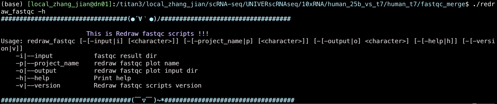
  > **NOTE** : 重新绘制的图还挺好看的！！！
  >
  > R1 & R2 FASTQCPLOT
  >
  > 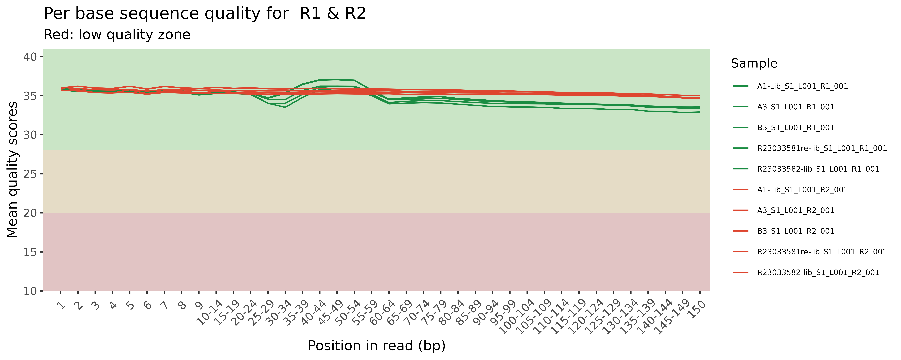
  >
  > R2 FASTQCPLOT
  >
  > 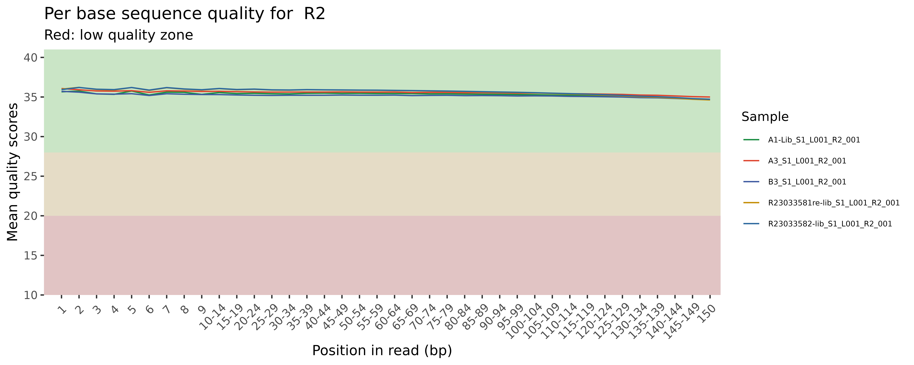
  >
  > R1 FASTQCPLOT
  >
  > 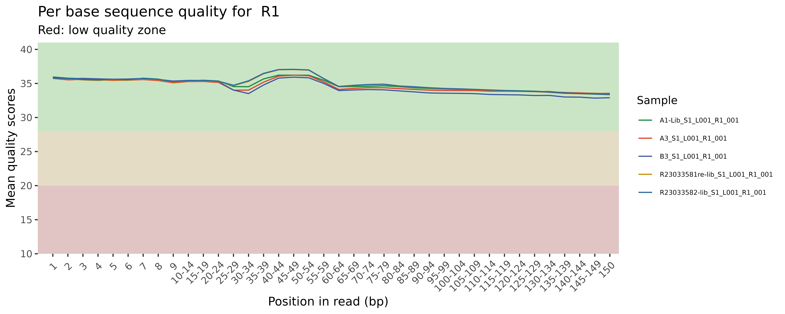

***

## 5 Source

> Fastqc在官网通过了不同NGS测序fastqc质控结果可以进行参考
>
> \*\*Good Report : \*\*
>
> [ good\_sequence\_short.txt FastQC Report  https://www.bioinformatics.babraham.ac.uk/projects/fastqc/good\_sequence\_short\_fastqc.html](https://www.bioinformatics.babraham.ac.uk/projects/fastqc/good_sequence_short_fastqc.html " good_sequence_short.txt FastQC Report  https://www.bioinformatics.babraham.ac.uk/projects/fastqc/good_sequence_short_fastqc.html")
>
> \*\*Bad Report : \*\*
>
> [ bad\_sequence.txt FastQC Report  https://www.bioinformatics.babraham.ac.uk/projects/fastqc/bad\_sequence\_fastqc.html](https://www.bioinformatics.babraham.ac.uk/projects/fastqc/bad_sequence_fastqc.html " bad_sequence.txt FastQC Report  https://www.bioinformatics.babraham.ac.uk/projects/fastqc/bad_sequence_fastqc.html")

> **甲基化测序 fastqc示例**
>
> [ RRBS.fastq.gz FastQC Report  https://www.bioinformatics.babraham.ac.uk/projects/fastqc/RRBS\_fastqc.html](https://www.bioinformatics.babraham.ac.uk/projects/fastqc/RRBS_fastqc.html " RRBS.fastq.gz FastQC Report  https://www.bioinformatics.babraham.ac.uk/projects/fastqc/RRBS_fastqc.html")

> \*\*Fastqc material : \*\*
>
> [FastQC\_TutorialAndFAQ\_080717.pdf](file/FastQC_TutorialAndFAQ_080717_VGx8rFKpAv.pdf "FastQC_TutorialAndFAQ_080717.pdf")

***

## 6 Reference

[^1]: [https://github.com/s-andrews/FastQC](https://github.com/s-andrews/FastQC "https://github.com/s-andrews/FastQC")

[^2]: [https://github.com/MultiQC/MultiQC](https://github.com/MultiQC/MultiQC "https://github.com/MultiQC/MultiQC")

[^3]: [https://forge.inrae.fr/bios4biol/Help4MultiQC/-/blob/main/English/FastQC/fastQC.md](https://forge.inrae.fr/bios4biol/Help4MultiQC/-/blob/main/English/FastQC/fastQC.md "https://forge.inrae.fr/bios4biol/Help4MultiQC/-/blob/main/English/FastQC/fastQC.md")

[^4]: [https://sapac.support.illumina.com/downloads/illumina-adapter-sequences-document-1000000002694.html](https://sapac.support.illumina.com/downloads/illumina-adapter-sequences-document-1000000002694.html "https://sapac.support.illumina.com/downloads/illumina-adapter-sequences-document-1000000002694.html")

[^5]: Lai, Hejin, Ning Feng, and Qiwei Zhai. "Discovery of the major 15–30 nt mammalian small RNAs, their biogenesis and function." Nature communications 14.1 (2023): 5796.

[^6]: [https://www.bioinformatics.babraham.ac.uk/projects/fastqc/small\_rna\_fastqc.html](https://www.bioinformatics.babraham.ac.uk/projects/fastqc/small_rna_fastqc.html "https://www.bioinformatics.babraham.ac.uk/projects/fastqc/small_rna_fastqc.html")

[^7]: [https://www.biostars.org/p/346252/#346272](https://www.biostars.org/p/346252/#346272 "https://www.biostars.org/p/346252/#346272")

[^8]: [https://www.bioinformatics.babraham.ac.uk/projects/fastqc/pacbio\_srr075104\_fastqc.html](https://www.bioinformatics.babraham.ac.uk/projects/fastqc/pacbio_srr075104_fastqc.html "https://www.bioinformatics.babraham.ac.uk/projects/fastqc/pacbio_srr075104_fastqc.html")

[^9]: [https://www.bioinformatics.babraham.ac.uk/projects/fastqc/454\_SRR073599\_fastqc.html](https://www.bioinformatics.babraham.ac.uk/projects/fastqc/454_SRR073599_fastqc.html "https://www.bioinformatics.babraham.ac.uk/projects/fastqc/454_SRR073599_fastqc.html")
