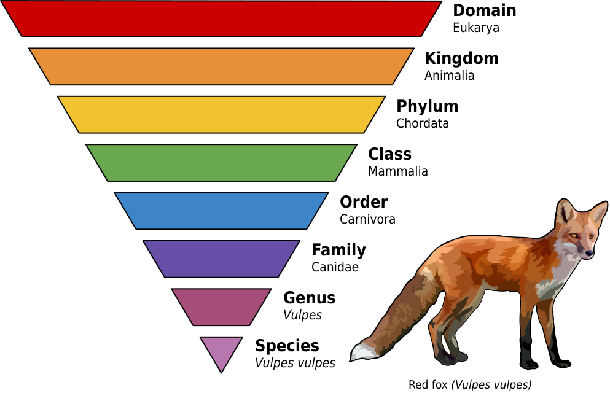
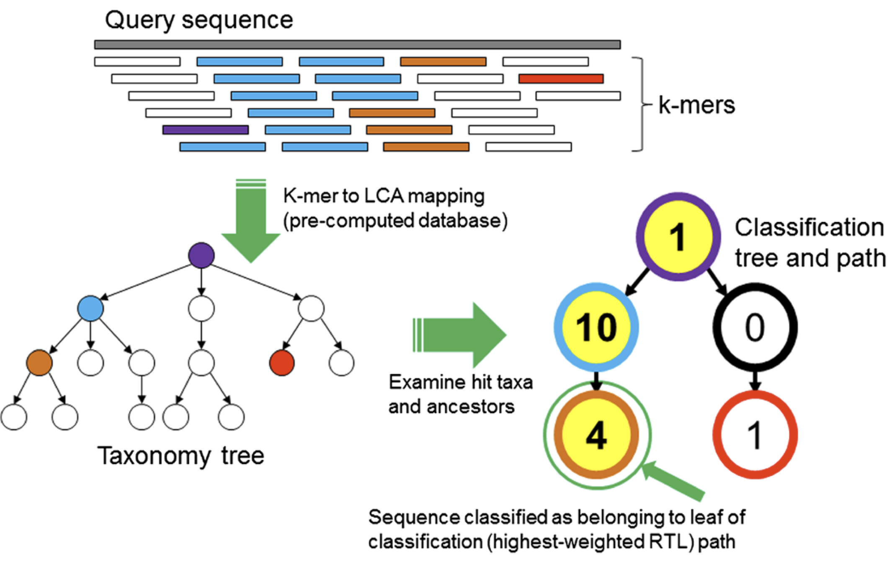
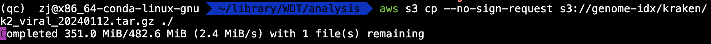

# Kraken2 & Bracken

## 目录

- [1 Introduce](#1-Introduce)
  - [Kraken2](#Kraken2)
  - [1.2 Principle](#12-Principle)
  - [1.3 characteristic](#13-characteristic)
- [2 Install](#2-Install)
  - [2.1 Index download](#21-Index-download)
    - [2.1.1 genome & nt library](#211-genome--nt-library)
    - [2.1.2 Kraken 2 / Bracken 16s RNA](#212-Kraken-2--Bracken-16s-RNA)
    - [2.1.3 minikraken\_8GB dataset](#213-minikraken_8GB-dataset)
- [3 Tutorial](#3-Tutorial)
  - [3.1 building index](#31-building-index)
    - [3.1.1 building standard index](#311-building-standard-index)
  - [3.2 kraken2 & bracken](#32-kraken2--bracken)
- [4 Result](#4-Result)
- [5 REFERENCE](#5-REFERENCE)

***

***Author***\*\* : zhang jian\*\*​

***Date***\*\* : 2025-9-25\*\*​

***Version***\*\* : 1.0v\*\*​

***

[   https://cloud-span.github.io/nerc-metagenomics06-taxonomic-anno/01-taxonomic/index.html](https://cloud-span.github.io/nerc-metagenomics06-taxonomic-anno/01-taxonomic/index.html "   https://cloud-span.github.io/nerc-metagenomics06-taxonomic-anno/01-taxonomic/index.html")

## 1 Introduce

### **Kraken2**

`Kraken2`是一种基于`k-mer`的序列**分类**工具。**在其独立的建库（****`build`****）阶段**，它会先将数据库中每一个物种的基因组分割为`k-mer`子串（并使用`minimizer`技术进行压缩），构建成一个巨大的、从`k-mer`到物种分类`ID`的索引数据库。当要对特定序列进行**分类（****`classify`****）时，程序会首先将这个数据库加载到内存中，然后使用相同的`k`值将待查询序列分割为子串。最后，通过**在内存数据库中对每个`k-mer`进行快速、精确的查找（`Lookup`），并结合**最低共同祖先（****`LCA`****）算法**进行决策，从而为查询序列赋予一个最可靠的物种或分类单元信息。。同时在这个分析过程中\*\*`Kraken2`**会将数据库的使用`kmer`读取到内存中使用`hash table`的方法进行快速搜索，因此当使用**`Kraken2`\*\*进行`NT` 库对比时将会消耗大量内存(进行`NT`库序列对比将消耗约`500GB`内存)。

**Kraken2**是一种宏基因组分析工具，可通过对DNA序列进行分类和注释来识别微生物序列。它使用的是参考数据库，包括细菌、病毒、真菌和原核生物等，并根据每个序列中存在的K-mer进行分类和注释。Kraken2物种注释是为每个序列特定分类到相应的物种级别（域界门纲目科属种-Domain,Kingdom,Phylum,Class,Order,Family,Genus,Species）。[^1]



[Kraken- ultrafast metagenomic sequence classification using exact alignments.pdf](<file/Kraken- ultrafast metagenomic sequence classificat.pdf> "Kraken- ultrafast metagenomic sequence classification using exact alignments.pdf")

> \*\*NOTE \*\*: Kraken 2, KrakenUniq and Bracken indexes[^2] ： AWS cloud 数据库中已经提供了很多已经建好的index，可以使用AWS S3进行直接下载！

Although Kraken’s *k*-mer-based approach provides a fast taxonomic classification of metagenomic sequence data, its large memory requirements can be limiting for some applications. Kraken 2 improves upon Kraken 1 by reducing memory usage by 85%, allowing greater amounts of reference genomic data to be used, while maintaining high accuracy and increasing speed fivefold.[^3]

> 与Kraken1相比Kraken2的内存需求减少了80% ，并且速度提高了五倍！

But Kraken’s high memory requirements force many researchers to either use a reduced-sensitivity MiniKraken database.

> Kraken的高内存需求使得研究人员往往趋向于使用较小的MiniKraken数据库！

***

### 1.2 Principle

To classify a sequence, each *k*-mer in the sequence is mapped to the lowest common ancestor (LCA) of the genomes that contain that *k*-mer in a database.The taxa associated with the sequence’s *k*-mers, as well as the taxa’s ancestors, form a pruned subtree of the general taxonomy tree, which is used for classification. In the classification tree, each node has a weight equal to the number of *k*-mers in the sequence associated with the node’s taxon. Each root-to-leaf (RTL) path in the classification tree is scored by adding all weights in the path, and the maximal RTL path in the classification tree is the classification path (nodes highlighted in yellow).[^4]

> 为了对序列进行分类，序列中的每个 k-mer 都映射到数据库中包含该 k-mer 的基因组的最低共同祖先 （LCA [LCA (Lowest common ancestor)](https://www.wolai.com/9a9r6CZv11a47QwPHydyvK "LCA (Lowest common ancestor)")）。如何在根据分类树上每一个节点的权重，将K-mer分配到合适的节点分类树上。



Kraken2物种注释的原理是基于一种称为k-mer的特征。k-mer是指DNA序列中长度为k的连续子串。Kraken2会将输入的宏基因组测序数据集中的每个序列进行k-mer切割，然后将这些k-mer序列与预定义的参考数据库中的k-mer序列进行比对。通过比对这些k-mer序列，Kraken2可以快速地确定序列来源于哪个物种或者哪个分类单元。

举个例子，假设我们有一个长度为100bp的宏基因组序列，Kraken2可以将其切割成长度为k（例如k=31）的多个k-mer序列。然后，Kraken2会将这些k-mer序列与参考数据库中的k-mer序列进行比对，以确定这些k-mer序列来源于哪个物种或者哪个分类单元。最终，Kraken2会根据比对结果确定该序列的物种或分类单元。

Kraken2的特点是快速和准确。它使用了一种高效的k-mer比对算法，可以在较短的时间内完成大规模的物种注释。此外，Kraken2还支持多线程处理，可以充分利用计算机的多核处理能力，加快物种注释速度。

***

### 1.3 characteristic

1. **高效快速**：Kraken2使用了一种高效的k-mer比对算法，可以在较短的时间内完成大规模的物种注释。此外，Kraken2还支持多线程处理，可以充分利用计算机的多核处理能力，加快物种注释速度。
2. **准确性高**：Kraken2的比对算法能够高度准确地将输入序列比对到参考数据库中的物种或分类单元。与传统的BLAST等比对算法相比，Kraken2的准确性更高。
3. **数据库广泛**：Kraken2的参考数据库包括了各种生物的完整基因组序列和代表性序列。这些序列被归类到不同的分类级别（例如：物种、属、科、目等）。这使得Kraken2可以用于各种类型的生物样品的物种注释。
4. **灵活性高**：Kraken2可以根据用户的需要自定义参考数据库。用户可以添加或删除参考序列，以便适应特定研究领域的需求。
5. **输出结果清晰**：Kraken2的输出结果包括了样品中所有DNA序列的物种组成信息。输出结果以表格或图表形式展示，方便用户进行数据分析和可视化。

> \*\*NOTE \*\*: 但是存在一个问题，像对比到nt库这样大的index,大约就需要使用约500g的内存！

***

## 2 Install

```yaml title="kraken2 yaml"
name: kraken2
channels:
  - bioconda
  - https://mirrors.ustc.edu.cn/anaconda/pkgs/main
dependencies:
  - _libgcc_mutex=0.1=main
  - _openmp_mutex=5.1=1_gnu
  - blast=2.12.0=pl5262h3289130_0
  - bzip2=1.0.8=h5eee18b_6
  - c-ares=1.34.5=hef5626c_0
  - ca-certificates=2025.9.9=h06a4308_0
  - curl=7.88.1=hdbd6064_2
  - entrez-direct=24.0=he881be0_0
  - gettext=0.21.0=hedfda30_2
  - icu=73.1=h6a678d5_0
  - kraken2=2.0.8_beta=pl526h6bb024c_0
  - krb5=1.20.1=h143b758_1
  - libcurl=7.88.1=h251f7ec_2
  - libedit=3.1.20230828=h5eee18b_0
  - libev=4.33=h7f8727e_1
  - libgcc-ng=11.2.0=h1234567_1
  - libgomp=11.2.0=h1234567_1
  - libiconv=1.16=h5eee18b_3
  - libidn2=2.3.4=hb25bd0a_1
  - libnghttp2=1.57.0=h2d74bed_0
  - libssh2=1.11.1=h251f7ec_0
  - libstdcxx-ng=11.2.0=h1234567_1
  - libunistring=1.3=hb25bd0a_0
  - libxml2=2.13.8=hfdd30dd_0
  - lz4-c=1.9.4=h6a678d5_1
  - ncurses=6.5=h7934f7d_0
  - openssl=3.0.17=h5eee18b_0
  - pcre=8.45=h295c915_0
  - pcre2=10.42=hebb0a14_1
  - perl=5.26.2=h14c3975_0
  - perl-archive-tar=2.32=pl526_0
  - perl-carp=1.38=pl526_3
  - perl-common-sense=3.74=pl526_2
  - perl-compress-raw-bzip2=2.087=pl526he1b5a44_0
  - perl-compress-raw-zlib=2.087=pl526hc9558a2_0
  - perl-exporter=5.72=pl526_1
  - perl-exporter-tiny=1.002001=pl526_0
  - perl-extutils-makemaker=7.36=pl526_1
  - perl-io-compress=2.087=pl526he1b5a44_0
  - perl-io-zlib=1.10=pl526_2
  - perl-json=4.02=pl526_0
  - perl-json-xs=2.34=pl526h6bb024c_3
  - perl-list-moreutils=0.428=pl526_1
  - perl-list-moreutils-xs=0.428=pl526_0
  - perl-pathtools=3.75=pl526h14c3975_1
  - perl-scalar-list-utils=1.52=pl526h516909a_0
  - perl-types-serialiser=1.0=pl526_2
  - perl-xsloader=0.24=pl526_0
  - popt=1.19=h5eee18b_0
  - rsync=3.4.1=hc9e6f67_0
  - wget=1.25.0=h4b2c318_1
  - xxhash=0.8.0=h7f8727e_3
  - xz=5.6.4=h5eee18b_1
  - zlib=1.2.13=hd233ad5_2
  - zstd=1.5.6=hc292b87_0

```


```bash title="create env"
# create kraken2 env by kraken2.yaml
micromamba create -n kraken2 -f kraken2.yaml -y 
```


### 2.1 Index download

***

#### 2.1.1 genome & nt library

| **Type**    | **Contains**                                                                                 | **HTTPS**                                                                                                                                                                                                                                   | \*\*Inspect \*\*                                                                                                                                                                                                                                                                            | **Library**                                                                                                                                                                                                                                                            |
| ----------- | -------------------------------------------------------------------------------------------- | ------------------------------------------------------------------------------------------------------------------------------------------------------------------------------------------------------------------------------------------- | ------------------------------------------------------------------------------------------------------------------------------------------------------------------------------------------------------------------------------------------------------------------------------------------- | ---------------------------------------------------------------------------------------------------------------------------------------------------------------------------------------------------------------------------------------------------------------------- |
| Viral       | Refeq viral Refeq (病毒基因组序列)                                                                  | [https://genome-idx.s3.amazonaws.com/kraken/k2\_viral\_20240112.tar.gz](https://genome-idx.s3.amazonaws.com/kraken/k2_viral_20240112.tar.gz "https://genome-idx.s3.amazonaws.com/kraken/k2_viral_20240112.tar.gz")                          | [https://genome-idx.s3.amazonaws.com/kraken/viral\_20240112/inspect.txt](https://genome-idx.s3.amazonaws.com/kraken/viral_20240112/inspect.txt "https://genome-idx.s3.amazonaws.com/kraken/viral_20240112/inspect.txt")                                                                     | [https://genome-idx.s3.amazonaws.com/kraken/viral\_20240112/library\_report.tsv](https://genome-idx.s3.amazonaws.com/kraken/viral_20240112/library_report.tsv "https://genome-idx.s3.amazonaws.com/kraken/viral_20240112/library_report.tsv")                          |
| MinusB      | Refeq archaea, viral, plasmid, human1, UniVec\_Core (古菌 & 病毒  &质粒 & UniVec\_Core 参考基因组序列)    | [https://genome-idx.s3.amazonaws.com/kraken/k2\_minusb\_20240112.tar.gz](https://genome-idx.s3.amazonaws.com/kraken/k2_minusb_20240112.tar.gz "https://genome-idx.s3.amazonaws.com/kraken/k2_minusb_20240112.tar.gz")                       | [https://genome-idx.s3.amazonaws.com/kraken/minusb\_20240112/inspect.txt](https://genome-idx.s3.amazonaws.com/kraken/minusb_20240112/inspect.txt "https://genome-idx.s3.amazonaws.com/kraken/minusb_20240112/inspect.txt")                                                                  | [https://genome-idx.s3.amazonaws.com/kraken/minusb\_20240112/library\_report.tsv](https://genome-idx.s3.amazonaws.com/kraken/minusb_20240112/library_report.tsv "https://genome-idx.s3.amazonaws.com/kraken/minusb_20240112/library_report.tsv")                       |
| Standard    | Refeq archaea, bacteria, viral, plasmid, human1, UniVec\_Core (古菌&细菌&病毒&质粒&人类\&UniVec\_Core) | [https://genome-idx.s3.amazonaws.com/kraken/k2\_standard\_20240112.tar.gz](https://genome-idx.s3.amazonaws.com/kraken/k2_standard_20240112.tar.gz "https://genome-idx.s3.amazonaws.com/kraken/k2_standard_20240112.tar.gz")                 | [https://genome-idx.s3.amazonaws.com/kraken/standard\_20240112/inspect.txt](https://genome-idx.s3.amazonaws.com/kraken/standard_20240112/inspect.txt "https://genome-idx.s3.amazonaws.com/kraken/standard_20240112/inspect.txt")                                                            | [https://genome-idx.s3.amazonaws.com/kraken/standard\_20240112/library\_report.tsv](https://genome-idx.s3.amazonaws.com/kraken/standard_20240112/library_report.tsv "https://genome-idx.s3.amazonaws.com/kraken/standard_20240112/library_report.tsv")                 |
| Standard-8  | Standard with DB capped at 8 GB                                                              | [https://genome-idx.s3.amazonaws.com/kraken/k2\_standard\_08gb\_20240112.tar.gz](https://genome-idx.s3.amazonaws.com/kraken/k2_standard_08gb_20240112.tar.gz "https://genome-idx.s3.amazonaws.com/kraken/k2_standard_08gb_20240112.tar.gz") | [https://genome-idx.s3.amazonaws.com/kraken/standard\_08gb\_20240112/inspect.txt](https://genome-idx.s3.amazonaws.com/kraken/standard_08gb_20240112/inspect.txt "https://genome-idx.s3.amazonaws.com/kraken/standard_08gb_20240112/inspect.txt")                                            | [https://genome-idx.s3.amazonaws.com/kraken/standard\_08gb\_20240112/library\_report.tsv](https://genome-idx.s3.amazonaws.com/kraken/standard_08gb_20240112/library_report.tsv "https://genome-idx.s3.amazonaws.com/kraken/standard_08gb_20240112/library_report.tsv") |
| Standard-16 | Standard with DB capped at 16 GB                                                             | [https://genome-idx.s3.amazonaws.com/kraken/k2\_standard\_16gb\_20240112.tar.gz](https://genome-idx.s3.amazonaws.com/kraken/k2_standard_16gb_20240112.tar.gz "https://genome-idx.s3.amazonaws.com/kraken/k2_standard_16gb_20240112.tar.gz") | [https://genome-idx.s3.amazonaws.com/kraken/standard\_16gb\_20240112/inspect.txt](https://genome-idx.s3.amazonaws.com/kraken/standard_16gb_20240112/inspect.txt "https://genome-idx.s3.amazonaws.com/kraken/standard_16gb_20240112/inspect.txt")                                            | [https://genome-idx.s3.amazonaws.com/kraken/standard\_16gb\_20240112/library\_report.tsv](https://genome-idx.s3.amazonaws.com/kraken/standard_16gb_20240112/library_report.tsv "https://genome-idx.s3.amazonaws.com/kraken/standard_16gb_20240112/library_report.tsv") |
| PlusPF      | Standard plus Refeq protozoa & fungi(原生动物和真菌参考基因组)                                           | [https://genome-idx.s3.amazonaws.com/kraken/k2\_pluspf\_20240112.tar.gz](https://genome-idx.s3.amazonaws.com/kraken/k2_pluspf_20240112.tar.gz "https://genome-idx.s3.amazonaws.com/kraken/k2_pluspf_20240112.tar.gz")                       | [https://genome-idx.s3.amazonaws.com/kraken/pluspf\_20240112/inspect.txt](https://genome-idx.s3.amazonaws.com/kraken/pluspf_20240112/inspect.txt "https://genome-idx.s3.amazonaws.com/kraken/pluspf_20240112/inspect.txt")                                                                  | [https://genome-idx.s3.amazonaws.com/kraken/pluspf\_20240112/library\_report.tsv](https://genome-idx.s3.amazonaws.com/kraken/pluspf_20240112/library_report.tsv "https://genome-idx.s3.amazonaws.com/kraken/pluspf_20240112/library_report.tsv")                       |
| PlusPFP     | Standard plus Refeq protozoa, fungi & plant(原生动物、真菌和植物参考基因组)                                 | [https://genome-idx.s3.amazonaws.com/kraken/k2\_pluspfp\_20240112.tar.gz](https://genome-idx.s3.amazonaws.com/kraken/k2_pluspfp_20240112.tar.gz "https://genome-idx.s3.amazonaws.com/kraken/k2_pluspfp_20240112.tar.gz")                    | [https://genome-idx.s3.amazonaws.com/kraken/pluspfp\_20240112/inspect.txt](https://genome-idx.s3.amazonaws.com/kraken/pluspfp_20240112/inspect.txt "https://genome-idx.s3.amazonaws.com/kraken/pluspfp_20240112/inspect.txt")                                                               | [https://genome-idx.s3.amazonaws.com/kraken/pluspfp\_20240112/library\_report.tsv](https://genome-idx.s3.amazonaws.com/kraken/pluspfp_20240112/library_report.tsv "https://genome-idx.s3.amazonaws.com/kraken/pluspfp_20240112/library_report.tsv")                    |
| nt Database | Very large collection, inclusive of GenBank, RefSeq, TPA and PDB(nt库)                        | [https://genome-idx.s3.amazonaws.com/kraken/k2\_nt\_20231129.tar.gz](https://genome-idx.s3.amazonaws.com/kraken/k2_nt_20231129.tar.gz "https://genome-idx.s3.amazonaws.com/kraken/k2_nt_20231129.tar.gz")                                   | [https://genome-idx.s3.amazonaws.com/kraken/nt\_20231129/inspect.txt](https://genome-idx.s3.amazonaws.com/kraken/nt_20231129/inspect.txt "https://genome-idx.s3.amazonaws.com/kraken/nt_20231129/inspect.txt")                                                                              | [https://genome-idx.s3.amazonaws.com/kraken/nt\_20231129/library\_report.tsv](https://genome-idx.s3.amazonaws.com/kraken/nt_20231129/library_report.tsv "https://genome-idx.s3.amazonaws.com/kraken/nt_20231129/library_report.tsv")                                   |
| EuPathDB46  | Eukaryotic pathogen genomes with contaminants removed(去除污染物的真核病原体基因组)                        | [https://genome-idx.s3.amazonaws.com/kraken/k2\_eupathdb48\_20230407.tar.gz](https://genome-idx.s3.amazonaws.com/kraken/k2_eupathdb48_20230407.tar.gz "https://genome-idx.s3.amazonaws.com/kraken/k2_eupathdb48_20230407.tar.gz")           | [https://genome-idx.s3.amazonaws.com/kraken/k2\_eupathdb48\_20230407/kraken2inspect\_output.txt](https://genome-idx.s3.amazonaws.com/kraken/k2_eupathdb48_20230407/kraken2inspect_output.txt "https://genome-idx.s3.amazonaws.com/kraken/k2_eupathdb48_20230407/kraken2inspect_output.txt") |                                                                                                                                                                                                                                                                        |

```r 
aws s3 cp --no-sign-request \
          s3://genome-idx/kraken/k2_viral_20240112.tar.gz \
          ./
```




下面页面的使用index到可以使用AWS下载！！！！ YYDS!!!

[   https://benlangmead.github.io/aws-indexes/k2](https://benlangmead.github.io/aws-indexes/k2 "   https://benlangmead.github.io/aws-indexes/k2")

***

#### 2.1.2 Kraken 2 / Bracken 16s RNA

| **Type**                    | URL                                                                                                                                                                                                                                     |
| --------------------------- | --------------------------------------------------------------------------------------------------------------------------------------------------------------------------------------------------------------------------------------- |
| Archaea and Bacteria 16sRNA | [https://genome-idx.s3.amazonaws.com/kraken/16S\_Greengenes13.5\_20200326.tgz](https://genome-idx.s3.amazonaws.com/kraken/16S_Greengenes13.5_20200326.tgz "https://genome-idx.s3.amazonaws.com/kraken/16S_Greengenes13.5_20200326.tgz") |
| RDP 11.5                    | [https://genome-idx.s3.amazonaws.com/kraken/16S\_RDP11.5\_20200326.tgz](https://genome-idx.s3.amazonaws.com/kraken/16S_RDP11.5_20200326.tgz "https://genome-idx.s3.amazonaws.com/kraken/16S_RDP11.5_20200326.tgz")                      |
| Silva 132                   | [https://genome-idx.s3.amazonaws.com/kraken/16S\_Silva132\_20200326.tgz](https://genome-idx.s3.amazonaws.com/kraken/16S_Silva132_20200326.tgz "https://genome-idx.s3.amazonaws.com/kraken/16S_Silva132_20200326.tgz")                   |
| Silva 138                   | [https://genome-idx.s3.amazonaws.com/kraken/16S\_Silva138\_20200326.tgz](https://genome-idx.s3.amazonaws.com/kraken/16S_Silva138_20200326.tgz "https://genome-idx.s3.amazonaws.com/kraken/16S_Silva138_20200326.tgz")                   |

#### 2.1.3 minikraken\_8GB dataset

"minikraken\_8GB\_20200312"是一种广泛使用的宏基因组分析参考数据库，由Kraken2开发者提供。该数据库包含了各种生物的完整基因组序列和代表性序列，并将这些序列归类到不同的分类级别（例如：物种、属、科、目等）。这个数据库是一个预处理的Kraken2数据库，占用8GB空间，是用于快速物种注释的小型数据库。

```r 
# Refseq: bacteria, archaea, viral
https://genome-idx.s3.amazonaws.com/kraken/minikraken2_v1_8GB_201904.tgz
# Refseq: bacteria, archaea, viral, human*
https://genome-idx.s3.amazonaws.com/kraken/minikraken2_v1_8GB_201904.tgz

```


***

## 3 Tutorial

***

### 3.1 building index

***

#### 3.1.1 building standard index

```r 
# buildiing standard index
kraken-build --standard --db $DBNAME
kraken-build --standard --threads 24 --db $DBNAME
```


```r 
# builidng bacteria standard index
kraken-build --download-library bacteria --db $DBNAME
# builidng plasmids standard index
kraken-build --download-library plasmids --db $DBNAME
# builidng bacteria viruses index
kraken-build --download-library viruses --db $DBNAME
# builidng bacteria human index
kraken-build --download-library human --db $DBNAME
```


```r 
# added genome for index
kraken-build --add-to-library chr1.fa --db $DBNAME
```


### 3.2 kraken2 & bracken

> **NOTE** : 为了加速Kraken2的运行速度，其会将index加载到内存中，这对内存的压力很大！

```r 
# download test data
fasterq-dump -p ERR2513180
```


```r 
kraken2 --db ~/database/minikraken2/minikraken_8GB_20200312 \
        --threads 20 \
        --report ./SRR13188906.report \
        --output ./SRR13188906.output \
        --paired ../SRR13188906_1.fastq ../SRR13188906_2.fastq
        
# kraken2 parameter
--db NAME        # Name for Kraken 2 DB
--threads NUM    # Number of threads (default: 1)
--quick          # quick run models
--unclassified-out FILENAME # Print unclassified sequences to filename
--classified-out FILENAME   # Print classified sequences to filename
--output  FILENAME          # Print output to filename
--confidence FLOAT          # Confidence score threshold (default: 0.0)
--minimum-base-quality NUM  # Minimum base quality used in classification
--report FILENAME           # Print a report with aggregrate counts/clade to file
--paired                    # The filenames provided have paired-end reads

```


```r 
bracken -d ~/database/minikraken2/minikraken_8GB_20200312 \
        -i ./SRR13188906.report \
        -o ./SRR13188906.S.bracken \
        -w ./SRR13188906.S.bracken.report \
        -r 150 \
        -l S
        
# bracken parameter
-d MY_DB          # location of Kraken database
-i INPUT          # Kraken REPORT file to use for abundance estimation
-o OUTPUT         # file name for Bracken default output
-w OUTREPORT      # New Kraken REPORT output file with Bracken read estimates
-r READ_LEN       # read length to get all classifications for (default: 150) PE150
-l LEVEL          # level to estimate abundance at [options: D,P,C,O,F,G,S,S1,etc] (default: S)
-t THRESHOLD      # number of reads required PRIOR to abundance estimation to perform reestimation 

```


***

## 4 Result

Kraken2 → bracken 会生成以下一个read 分类信息表格，如下表所示：

| name                   | taxonomy\_id | taxonomy\_lvl | kraken\_assigned\_reads | added\_reads | new\_est\_reads | fraction\_total\_reads |
| ---------------------- | ------------ | ------------- | ----------------------- | ------------ | --------------- | ---------------------- |
| Aegiceras corniculatum | 59970        | S             | 7259166                 | 18894232     | 26153398        | 0.95171                |
| Ardisia solanacea      | 1073919      | S             | 54                      | 654          | 708             | 0.00003                |
| Boechera divaricarpa   | 115915       | S             | 306                     | 1051         | 1357            | 0.00005                |
| Arabidopsis thaliana   | 3702         | S             | 152                     | 74           | 226             | 0.00001                |
| Talaromyces pinophilus | 128442       | S             | 20853                   | 3319         | 24172           | 0.00088                |

其中每一列的含义如下

```r 
Name
taxonomy_id : Taxonomy ID
taxonomy_lvl : Level ID (S=Species, G=Genus, O=Order, F=Family, P=Phylum, K=Kingdom)
taxonomy_lvl : Kraken Assigned Reads
added_reads : Added Reads with Abundance Reestimation
new_est_reads :new_est_reads : Total Reads after Abundance Reestimation
fraction_total_reads : Fraction of Total Reads
```


***

## 5 REFERENCE

[ Manual The second version of the Kraken taxonomic sequence classification system  - DerrickWood/kraken2 https://github.com/DerrickWood/kraken2/wiki/Manual](https://github.com/DerrickWood/kraken2/wiki/Manual " Manual The second version of the Kraken taxonomic sequence classification system  - DerrickWood/kraken2 https://github.com/DerrickWood/kraken2/wiki/Manual")

[^1]: [https://www.cnblogs.com/wzbzk/p/17392303.html](https://www.cnblogs.com/wzbzk/p/17392303.html "https://www.cnblogs.com/wzbzk/p/17392303.html")

[^2]: [https://benlangmead.github.io/aws-indexes/k2](https://benlangmead.github.io/aws-indexes/k2 "https://benlangmead.github.io/aws-indexes/k2")

[^3]: Improved metagenomic analysis with Kraken 2

[^4]: Kraken: ultrafast metagenomic sequence classification using exact alignments
