# LaTeX

## 目录

- [1 Introduce](#1-Introduce)
  - [ LaTeX](#-LaTeX)
  - [1.2 Advantage & Disadvantage](#12-Advantage--Disadvantage)
  - [1.3 pylatex](#13-pylatex)
- [2 install](#2-install)
  - [2.1 TeXLive (MAC)](#21-TeXLive-MAC)
  - [2.2 Ubuntu texlive-full](#22-Ubuntu-texlive-full)
  - [LATEX 编辑器](#LATEX-编辑器)
  - [2.4 Python LaTeX](#24-Python-LaTeX)
- [3 tutorial](#3-tutorial)
  - [3.1 LaTeX宏包](#31-LaTeX宏包)
    - [3.1.1 booktabs](#311-booktabs)
    - [3.1.2 中文支持](#312-中文支持)
    - [3.1.3 GB/T 7714—2015 BibTeX Style](#313-GBT-77142015-BibTeX-Style)
  - [3.2 LaTeX特殊字符](#32-LaTeX特殊字符)
    - [3.2.1 LaTex Structure](#321-LaTex-Structure)
      - [3.2.1.1 Main](#3211-Main)
      - [3.2.1.2 title](#3212-title)
      - [3.2.1.3 Chatpers & Sections](#3213-Chatpers--Sections)
      - [3.2.1.4 label](#3214-label)
      - [3.2.1.5 TOC & newpage](#3215-TOC--newpage)
      - [3.2.1.6 Front](#3216-Front)
        - [3.2.1.6.1 Front Type](#32161-Front-Type)
        - [3.2.1.6.2 Front color](#32162-Front-color)
        - [3.2.1.6.3 Front Size](#32163-Front-Size)
      - [3.2.1.7 段落缩进](#3217-段落缩进)
      - [3.2.1.8 list](#3218-list)
    - [3.2.2 tabular](#322-tabular)
    - [3.2.3 Figure](#323-Figure)
    - [3.2.4 Formula](#324-Formula)
    - [3.2.5 Cite （Reference）](#325-Cite-Reference)
      - [3.2.5.1 使用BibTeX进行文献管理](#3251-使用BibTeX进行文献管理)
  - [3.3 pylatex](#33-pylatex)
- [4 Source ](#4-Source-)
- [5 Reference](#5-Reference)

## 1 Introduce

***

> **NOTE** :\*\* Latex\*\*做分析的生物信息分析报告模块还是很有搞头滴🙆🏼‍♀️

### **LaTeX**


> **LaTeX**（/ˈlɑːtɛx/或/ˈleɪtɛx/，常被读作/ˈlɑːtɛk/或/ˈleɪtɛk/，风格化后写作“**LaTeX**”），是一种基于TeX的排版系统，由美国计算机科学家**莱斯利·兰伯特**在20世纪80年代初期开发，利用这种格式系统的处理，即使用户没有排版和程序设计的知识也可以充分发挥由TeX所提供的强大功能，不必一一亲自去设计或校对，能在几天，甚至几小时内生成很多具有书籍质量的印刷品生成复杂表格和数学公式，这一点表现得尤为突出。因此它非常适用于生成高印刷质量的科技和数学、物理文档。这个系统同样适用于生成从简单的信件到完整书籍的所有其他种类的文档[^1]。

> **LaTeX**遵循呈现与内容分离的设计理念，以便作者可以专注于他们正在编写的内容，而不必同时注视其外观。在准备LaTeX文档时，作者使用章`（chapter）`、节`（section）`、表`（table）`、图`（figure）`等简单的概念指定文档的逻辑结构，并让LaTeX系统负责这些结构的格式和布局。因此，它鼓励从内容中分离布局，同时仍然允许在需要时进行手动排版调整。这个概念类似于许多文字处理器允许全局定义整个文档的样式的机制，或使用层叠样式表来规定HTML的样式。`LaTeX`系统是一种可以处理排版和渲染的标记语言[^2]。

> `LaTeX`使用`TeX`作为它的格式化引擎，当前的版本是`LaTeX2e`（写作`LaTeX2ε`）

### 1.2 Advantage & Disadvantage

> `LaTeX` 总会拿来和一些*所见即所得*（***What You See Is What You Get***）的文字处理和排版工具比较优缺点。我认为这种比较并不值得提倡，毕竟所有工具都有自己值得使用的原因[^3]。

> `LaTeX`\*\* 的优点：\*\* ​
>
> 1. **专业的排版输出**: 产生的文档看上去就像***印刷品***一样;
> 2. 方便而强大的**数学公式**排版能力;
> 3. 绝大多数时候，**用户只需专注于一些组织文档结构的基础命令**，无需（或很少）操心文档的版面设计;
> 4. **很容易生成复杂的专业排版元素**，如脚注、交叉引用、参考文献、目录等;
> 5. **强大的扩展性**:世界各地的人开发了数以千计的`LaTeX` 宏包用于补充和扩展 `LaTeX` 的功能;
> 6. `LaTeX`\*\* 依赖的 TEX 排版引擎和其它软件是跨平台、免费、开源的\*\*。无论用户使用的是 `Windows` & `macOS（OS X）`& `GNU/Linux` &  `FreeBSD` 等操作系统，都能轻松获得和使用这一强大的排版工具。

> `LaTeX`**的缺点：**
>
> 1. **入门门槛高**(确实比较麻烦🤏🏻);
> 2. **排查错误困难** : `LaTeX` 作为一个依靠编写代码工作的排版工具，其使用的宏语言比 `C++` 或 `Python` 等程序设计语言在错误排查方面困难得多。它虽然能够提示错误，但不提供调试的机制，有时错误提示还很难理解;
> 3. **样式定制困难** : `LaTeX`提供了一个基本上良好的样式，为了让用户不去关注样式而专注于文档结构。但如果想要改进 `LaTeX`生成的文档样式则是十分困难。

```latex title="LaTeX"
\documentclass[12pt]{article}
\usepackage{xunicode}
\usepackage{amsmath}
\title{\LaTeX}
\author{}
\date{}
\begin{document}
  \maketitle
  \LaTeX{} is a document preparation system
  for the \TeX{}   typesetting program. It offers
  programmable desktop publishing features and
  extensive facilities for automating most aspects
  of typesetting and desktop publishing, including
  numbering and cross-referencing, tables and figures,
  page layout, bibliographies,   and much more.
  \LaTeX{} was originally written in 1984 by Leslie
  Lamport and has become the dominant method for
  using \TeX; few people write in plain \TeX{} anymore.
  The current version is  \LaTeXe.
  \setmainfont[BoldFont=Adobe Heiti Std]{SimSun}
  \textbf：XeTeX TeXLive2008      \\
  \begin{align}
    E &= mc^2                              \\
    m &= \frac{m_0}{\sqrt{1-\frac{v^2}{c^2}}}
  \end{align}
\end{document}
```


### `1.3 pylatex`

> `pylatex`是一个Python库，用于生成LaTeX文档。`pylatex`库的核心是`Document`类，它代表一个完整的LaTeX文档。文档可以包含多个部分，如章节、段落、列表、表格和数学公式等。这些部分通常由`pylatex`的其他类表示，如`Section`、`Paragraph`、`List`等[^4]。

***

## 2 install

### 2.1 TeXLive (MAC)

> `TeXLive`官网下载系统对应安装包（安装包体积比较大5.7G）：`https://www.tug.org/texlive/`

```bash title="TeXLive Install"
# 查看 tex 的版本信息
➜ tex -v
TeX 3.141592653 (TeX Live 2024)
kpathsea version 6.4.0
# 查看 laTeX 的版本信息
➜ latex -v
pdfTeX 3.141592653-2.6-1.40.26 (TeX Live 2024)
kpathsea version 6.4.0
# 查看 XeTeX 的版本信息
➜ xelatex -v
XeTeX 3.141592653-2.6-0.999996 (TeX Live 2024)
kpathsea version 6.4.0
# 查看 pdfTeX 的版本信息
➜ pdflatex -v
pdfTeX 3.141592653-2.6-1.40.26 (TeX Live 2024)
kpathsea version 6.4.0
```


### 2.2 Ubuntu texlive-full

```bash title="texlive-full Install"
sudo apt-get install texlive-full
```


### **LATEX** 编辑器

> `Texifier` · **Smoothest way to write LaTeX**


> `TeXstudio` - A LaTeX editor


### 2.4 Python `LaTeX`

```bash title="pylatex"
pip install pylatex
```


***

## 3 tutorial

### `3.1 LaTeX`宏包

> `LaTeX`的宏包是一组命令和定义，可以扩展`LaTeX`的功能，宏包可以添加各种功能，例如参考文献、交叉引用、图形和表格等。

> 包引用的命令放置在文档的前导命令的位置（即放在 `\begin{document}` 命令之前）。使用 `\usepackage[options]{package}` 来引用包。

```latex title="LaTeX宏包"
\documentclass[11pt]{article}
\usepackage{booktabs}   % booktabs表格宏包
\usepackage{CJKutf8}    % CJKutf8中文支持宏包
\begin{document}
.........
\end{document}

```


[ GitHub - vmp65l3/awesome-latex: 整理一些 LaTeX 宏包。 整理一些 LaTeX 宏包。. Contribute to vmp65l3/awesome-latex development by creating an account on GitHub. https://github.com/vmp65l3/awesome-latex](https://github.com/vmp65l3/awesome-latex " GitHub - vmp65l3/awesome-latex: 整理一些 LaTeX 宏包。 整理一些 LaTeX 宏包。. Contribute to vmp65l3/awesome-latex development by creating an account on GitHub. https://github.com/vmp65l3/awesome-latex")

#### 3.1.1 booktabs

> `LaTeX` 宏包 `booktabs` 由 David Carlisle 开发，旨在提供一种专业、美观的方式来排版表格，特别适用于学术和出版物中的高质量表格设计。在 LaTeX 中，标准的表格环境通常使用细线将每个单元格分隔开来，而 booktabs 强调减少视觉混乱并增强表格的可读性，它通过引入不同粗细和间距的水平线来构建简洁、优雅且易于阅读的“三线表”[^5]。

> 以下是一些 booktabs 宏包提供的核心命令：
>
> 1. `\toprule`: 用于绘制表格顶部的粗线，该线下面有适当的垂直间距；
> 2. `\midrule`: 绘制一条中等粗细的横线，用于分隔表格的主要部分；
> 3. `\bottomrule`: 绘制表格底部的粗线，上面也有合适的垂直间距；
> 4. `\cmidrule`: 可以用来画一条自定义长度的中等粗细横线，可以只覆盖部分列，并且可以灵活调整两端的悬空（trimming）效果；
> 5. `\addlinespace`: 提供在表格行之间增加额外垂直间距的功能，有助于改善内容层次和阅读体验；
> 6. `\specialrule`: 用于定制特殊粗细和间距的横线，当需要更精细控制时使用；
>
> ```latex title="booktabs"
> \documentclass[11pt]{article}
> \usepackage{booktabs}
>
> \begin{document}
>
> \begin{tabular}{ccc}
> \toprule
> 姓名 & 语文成绩 & 数学成绩 \\
> \midrule
> 阿汪 & 93 & 97 \\
> 阿喵 & 98 & 92 \\
> \bottomrule
> \end{tabular}
>
> \end{document}
> ```
>

#### 3.1.2 中文支持

> `LaTeX` 可以使用 CJK 和 CTEX 宏包支持中文编辑
>
> ```latex title="CJKutf8"
> \documentclass[11pt]{article}
> \usepackage{booktabs}
>  \usepackage{CJKutf8}      %导入CJKutf8包
>
> \begin{document}
> \begin{CJK}{UTF8}{gbsn}  %以下内容都为CJKutf8
> \begin{tabular}{ccc}
> \toprule
> 姓名 & 语文成绩 & 数学成绩 \\
> \midrule
> 阿汪 & 93 & 97 \\
> 阿喵 & 98 & 92 \\
> \bottomrule
> \end{tabular}
> \end{CJK}
> \end{document}
> ```
>

#### 3.1.3 GB/T 7714—2015 BibTeX Style

> GB/T 7714—2015《信息与文献 参考文献著录规则》是中国的参考文献推荐标准。国内的绝大部分学术期刊、学位论文都使用了基于该标准的格式。本宏包是国标的 BibTeX 实现，主要有以下特性：
>
> - 兼容 `natbib` 宏包。
> - 支持 “顺序编码制” 和 “著者-出版年制” 两种风格。
> - 自动识别语言并进行相应处理。
> - 提供了简单的接口供用户修改样式。
> - 同时提供了 2005 版的 `.bst` 文件。

```latex title="gbt7714"
\documentclass[a4paper, 12pt]{article} 

\usepackage{color}
\usepackage{graphicx}
 \usepackage{gbt7714} 

\begin{document}           % document begin
   \bibliographystyle{gbt7714-numerical}    %设置参考文献格式
  
  \begin{center}   
    \textcolor{blue}{\textbf{LaTeX  Reference}}
  \end{center}
  
  \begin{figure}[h]
    \centering
    \includegraphics[scale=0.3]{photo_2024-07-23_08-50-12.jpg}
    \caption{Here is my image\cite{ref1}}    %文献插入位置
    \label{image-myimage}
  \end{figure}
  
  \bibliography{references}        % 文章默认插入参考文献
  
\end{document}   % document end
```


### `3.2 LaTeX`特殊字符

> `LaTeX` 文档中可以使用特殊字符进行**注释** & **换行** &\*\* 添加空格\*\*：
>
> 1. `%` 创建一个单行注释，在这个字符之后的该行上的内容都会被忽略;
> 2. 多个连续空格在 LaTeX 中被视为一个空格。多个连续空行被视为一个空行。空行的主要功能是开始一个新的段落;
> 3. 两个反斜杠（`\`）可以被用来换行;
> 4. `\vaspace{...}`在文档中添加空格;
> 5. 为了使用这些字符，我们需要在他们前面添加反斜杠进行转义.
>    ```latex title="特殊字符"
>    \# \$ \% \^{} \& \_ \{ \} \~{}
>    ```
>

#### 3.2.1 LaTex Structure

##### 3.2.1.1 Main

> `\documentclass` 命令必须出现在每个 LaTeX 文档的开头。花括号内的文本指定了文档的类型。方括号内的文本指定了一些选项——示例中它设置纸张大小为 A4，主要文字大小为 12pt。

> `\begin{document}` 和 `\end{document}` 命令将你的文本内容包裹起来。任何在 `\begin{documnet}` 之前的文本都被视为前导命令，会影响整个文档。任何在 `\end{document}` 之后的文本都会被忽视。

```latex title="Test LaTeX"
\documentclass[a4paper, 12pt]{article} % documentclass 设置文档的类型 & 页面大小 & 字体
\begin{document}  % 文档开始
This is LaTeX Test article
\end{document} % 文档结束
```


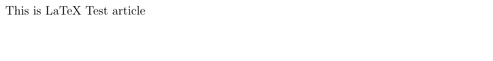

> **NOTE** : 在`LaTex`文档中是使用`%`进行注释滴

- **LATEX 中的文档，通常分为三类，book，report 和article**[^6]**：**
  1. **Article** : 由part，section，sebsection 组成，但没有chapter，可以有摘要，摘要紧接标题头位于第一页上，**article** 文档的正文会紧跟着标题之后在同一页上排版；
  2. **Report** : 包含多个章节的长篇报告、小册子、论文等，**report** 会将标题置为单独的一页；
  3. **Book** : （实体书籍）由part，chapter，section，subsection 组成，但没有摘要；

##### `3.2.1.2 title`

> `\maketitle` 命令可以给文档创建标题。你需要指定文档的标题。如果没有指定日期，就会使用现在的时间，作者是可选的。

```latex title="LaTeX"
\documentclass[a4paper, 12pt]{article} % documentclass 设置文档的类型 & 页面大小 & 字体
\begin{document}  % 文档开始
  \title{My First Document}
  \author{zhang jian}
  \date{\today}
  \maketitle
  A sentence of text.
\end{document} % 文档结束
```


##### 3.2.1.3 Chatpers & Sections

> `LaTex`可以对正文中的内容安装章 & 节 & 小节 & 段落进行分割
>
> - `\chapter{...}` ：章;
> - `\section{...}` ： 节;
> - `\subsection{...}` ：小节;
> - `\subsubsection{...}` ：小小节🌝;
> - `\paragraph{...}` ：段;
> - `\subparagraph{...}` ：分段;

> **NOTE** : 花括号内的文本表示章节的标题。对于 **report** 和 **book** 类型的文档我们还支持 `\chapter{...}` 的命令
>
> ```latex title="Test LaTeX"
> % documentclass 设置文档的类型 & 页面大小 & 字体
> \documentclass[a4paper, 12pt]{article} 
> % 导入 xcolor 包以支持颜色
> \usepackage{xcolor} 
> % document begin
> \begin{document} 
>   \title{RNA-seq Report}
>   \author{zhang jian}
>   \date{\today}
>   \maketitle                               % 设置文档标题
>
> % 设置文本居中并蓝色加粗
> \begin{center}   
> \textcolor{blue}{\textbf{RNA-seq Report Power by zhang jian}}
> \end{center}
>
> \section{Introduction}
> RNA-Seq (named as an abbreviation of RNA sequencing) is a technique that uses next-generation sequencing to reveal the presence and quantity of RNA molecules in a biological sample, providing a snapshot of gene expression in the sample, also known as transcriptome.
>
> %  Methods section
> \section{Methods} 
> \subsection{Library preparation}
> The general steps to prepare a complementary DNA (cDNA) library for sequencing are described below, but often vary between platforms
>
> %  Analysis section
> \section{Analysis}
> \subsection{Transcriptome assembly} 
> Two methods are used to assign raw sequence reads to genomic features (i.e., assemble the transcriptome)
>
> % Result section
> \section{Result}
> xxxxxxx
>
> % document end
> \end{document}
>
> ```
>

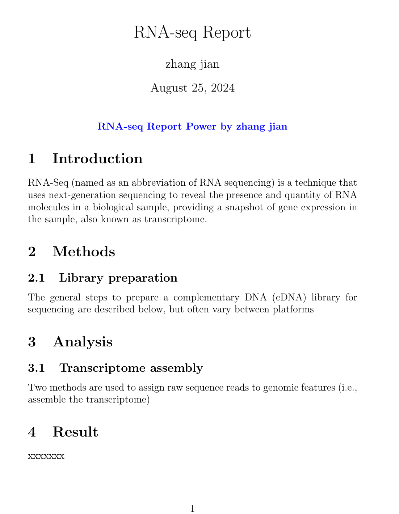

##### 3.2.1.4 label

> 使用 `\label{labelname}` 对章节创建标签。然后输入 `\ref{labelname}` 或者 `\pageref{labelname}` 来引用对应的章节。

```latex title="Test LaTeX"
% documentclass 设置文档的类型 & 页面大小 & 字体
\documentclass[a4paper, 12pt]{article} 
% 导入 xcolor 包以支持颜色
\usepackage{xcolor} 
% document begin
\begin{document} 
  \title{RNA-seq Report}
  \author{zhang jian}
  \date{\today}
  \maketitle                               % 设置文档标题

% 设置文本居中并蓝色加粗
\begin{center}   
\textcolor{blue}{\textbf{RNA-seq Report Power by zhang jian}}
\end{center}

\section{Introduction}
RNA-Seq (named as an abbreviation of RNA sequencing) is a technique that uses next-generation sequencing to reveal the presence and quantity of RNA molecules in a biological sample, providing a snapshot of gene expression in the sample, also known as transcriptome.

%  Methods section
\section{Methods} 
\subsection{Library preparation}
 \label{sec1} The general steps to prepare a complementary DNA (cDNA) library for sequencing are described below, but often vary between platforms


%  Analysis section
\section{Analysis}
\subsection{Transcriptome assembly} 
Two methods are used to assign raw sequence reads to genomic features (i.e., assemble the transcriptome)
 Referring to section \ref{sec1} on page \pageref{sec1} 

% Result section
\section{Result}
xxxxxxx

% document end
\end{document}
```


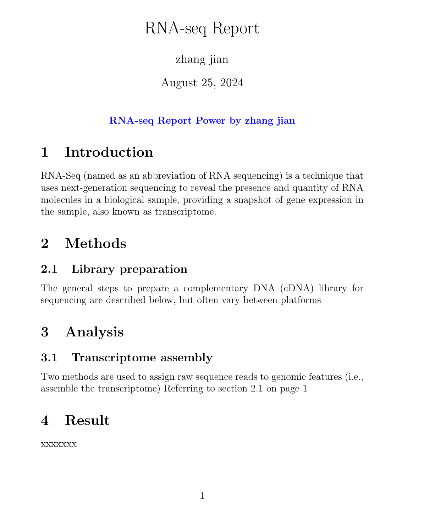

##### 3.2.1.5 TOC & newpage

> `\tableofcontents` 在文档中创建目录。通常我们会在标题的后面建立目录 & `\newpage` 命令会另起一个页面。

```latex title="Test LaTeX"
% documentclass 设置文档的类型 & 页面大小 & 字体
\documentclass[a4paper, 12pt]{article} 
% 导入 xcolor 包以支持颜色
\usepackage{xcolor} 
% document begin
\begin{document} 
  \title{RNA-seq Report}
  \author{zhang jian}
  \date{\today}
  \maketitle         % 设置文档标题
   \tableofcontents    % 生成目录
  \newpage           % 新启一页
.......
```


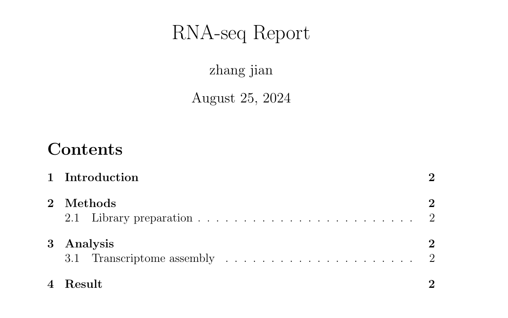

> Tips :在真正的文档的首页 & 目录页与正文页中页码需要设置不同的样式，而LaTeX可以通过以下函数对样式进行设置：
>
> 1. `\thispagestyle{empty}` ：设置页码为空；
> 2. `\pagenumbering{roman}` ：设置页码为罗马数字；
> 3. `\pagenumbering{arabic}`：设置页码为正常数字；

> NOTE :  重新进行变化的页码可以不是从1开始，可以使用`\setcounter{page}{1}`设置当前页码为1。

```latex title="LaTeX Code"
% documentclass 设置文档的类型 & 页面大小 & 字体
\documentclass[a4paper, 12pt]{article} 
% 导入 xcolor 包以支持颜色
\usepackage{xcolor}
\usepackage[UTF8]{ctex}
% document begin
\begin{document} 
  \title{RNA-seq Report}
  \author{zhang jian}
  \date{\today}
  \maketitle                               % 设置文档标题
  \thispagestyle{empty}
  \begin{center}   
    \textcolor{blue}{\textbf{RNA-seq Report Power by zhang jian}}
  \end{center}
  \tableofcontents
  \newpage
  
\setcounter{page}{1}
% 设置文本居中并蓝色加粗
\section{Introduction}
RNA-Seq (named as an abbreviation of RNA sequencing) is a technique that uses next-generation sequencing to reveal the presence and quantity of RNA molecules in a biological sample, providing a snapshot of gene expression in the sample, also known as transcriptome.

%  Methods section
\section{Methods} 
\subsection{Library preparation}
\label{sec1}The general steps to prepare a complementary DNA (cDNA) library for sequencing are described below, but often vary between platforms


%  Analysis section
\section{Analysis}
\subsection{Transcriptome assembly} 
Two methods are used to assign raw sequence reads to genomic features (i.e., assemble the transcriptome)
Referring to section \ref{sec1} on page \pageref{sec1}

% Result section
\section{Result}
xxxxxxx

% document end
\end{document}

```


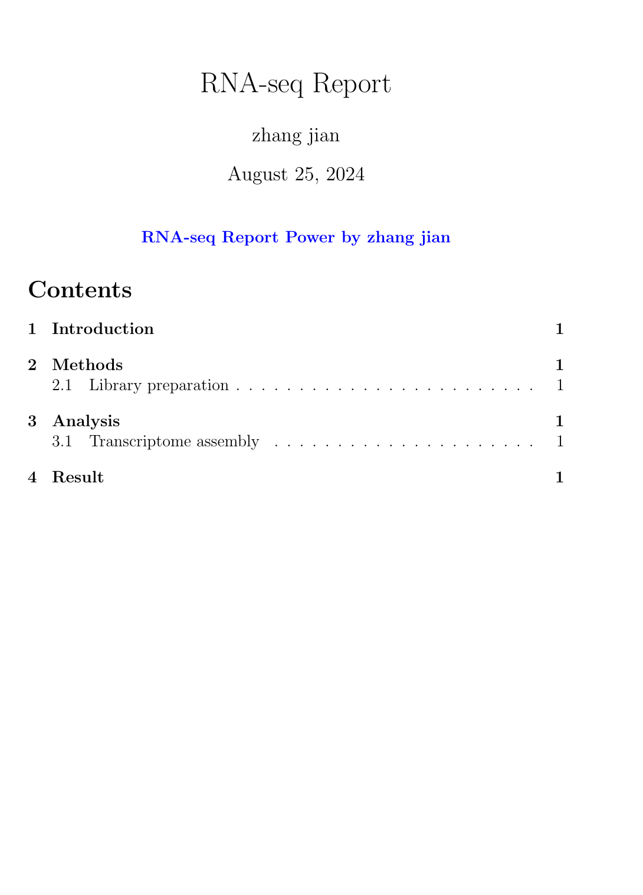

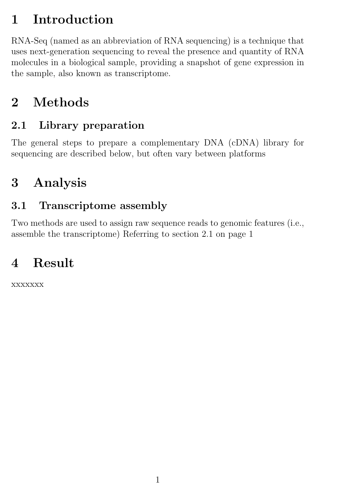

##### 3.2.1.6 Front

> 在文档的前导命令部分添加CTeX 宏包可以让\*\*LaTEX \*\*支持中文显示。

```latex title="LaTeX Code"
% documentclass 设置文档的类型 & 页面大小 & 字体
\documentclass[a4paper, 12pt]{article} 

\usepackage[UTF8]{ctex}   % 导入 CTeX 包以支持中文
\usepackage{xcolor}            % 导入 xcolor 包以支持颜色
% document begin
\begin{document} 
..........
```


> NOTE : 在编译文档的时侯使用 `xelatex` 命令，因为它是支持中文字体的。

###### 3.2.1.6.1 Front Type

> LaTeX 有多种不同的字体效果

```latex title="Front Type"
\documentclass[a4paper, 12pt]{article} 

\begin{document}   % document begin

\textit{words in italics}\\        % 斜体
\textsl{words slanted}\\           % 标准字体
\textsc{words in smallcaps}\\      %  大写
\textbf{wordsin bold}\\            %  加粗
\texttt{words in teletype}\\
\textsf{sans serif words}\\
\textrm{roman words} \\
\underline{underlined words}\\    %下划线

\end{document}   % document end
```


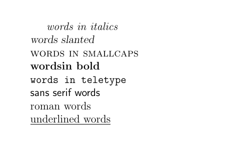

> Tips: LaTeX可以使用`\\`进行换行

###### 3.2.1.6.2 Front color

> 使用 `\usepackage{color}` 后，我们可以调用常见的颜色。

```latex title="Front Color"
\documentclass[a4paper, 12pt]{article} 

\usepackage{color}

\begin{document}   % document begin

\begin{center}   
  \textcolor{blue}{\textbf{LaTeX Front Color}}
\end{center}

\noindent{\color{blue}text}\\
{\color{black}text}\\
{\color{red}text}\\

\end{document}   % document end
```


> Tips:可以通过使用`\noindent`防止改行存在缩进！！！

###### 3.2.1.6.3 Front Size

LaTeX 的字体大小设定命令

```latex title="Front Size"
\documentclass[a4paper, 12pt]{article} 

\usepackage{color}

\begin{document}   % document begin

\begin{center}   
  \textcolor{blue}{\textbf{LaTeX Front Size}}
\end{center}

\noindent normal size words\\
{\tiny tiny words}\\
{\scriptsize scriptsize words}\\
{\footnotesize footnotesize words}\\
{\small small words}\\
{\large large words}\\
{\Large Large words}\\
{\LARGE LARGE words}\\
{\huge huge words}\\

\end{document}   % document end
```


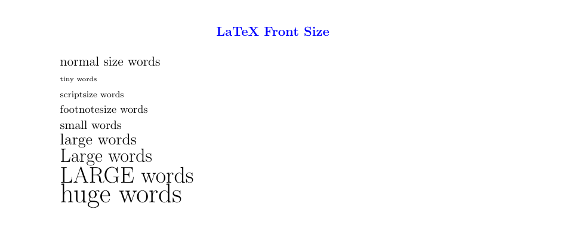

##### 3.2.1.7 段落缩进

> LaTeX 默认每个章节第一段首行顶格，之后的段落首行缩进。如果想要段落顶格，在要顶格的段落前加 `\noindent` 命令即可。如果希望全局所有段落都顶格，在文档的某一位置使用 `\setlength{\parindent}{0pt}` 命令，之后的所有段落都会顶格。

##### 3.2.1.8 list

> LaTeX 支持两种类型的列表：有序列表（enumerate）和无序列表（itemize）。列表中的元素定义为 `\item`。列表可以有子列表。

```latex title="list"
\documentclass[a4paper, 12pt]{article} 

\usepackage{color}

\begin{document}   % document begin

\begin{center}   
  \textcolor{blue}{\textbf{LaTeX  List}}
\end{center}

\begin{enumerate}
\item First thing
\item Second thing
\begin{itemize}
\item A sub-thing
\item Another sub-thing
\end{itemize}
\item Third thing
\end{enumerate}
  
\end{document}   % document end
```


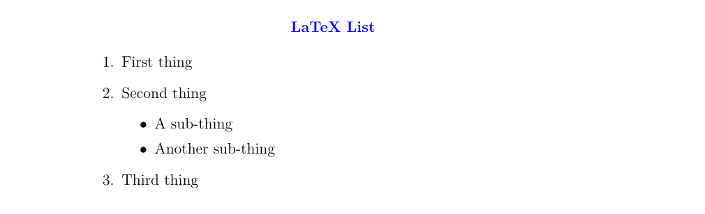

#### 3.2.2 tabular

> 表格（tabular）命令用于排版表格。LaTeX 默认表格是没有横向和竖向的分割线的——如果你需要，你得手动设定。LaTeX 会根据内容自动设置表格的宽度。下面的代码可以创一个表格：

```latex title="（tabular"
\documentclass[a4paper, 12pt]{article} 

\usepackage{color}

\begin{document}   % document begin

\begin{center}   
  \textcolor{blue}{\textbf{LaTeX  tabular}}
\end{center}

\begin{tabular}{|r|l|}
  \hline
  8              & here's \\
  \cline{2-2} 86 & stuff  \\
  \hline
  \hline
  2008           & now    \\
  \hline
\end{tabular}
  
\end{document}   % document end
```


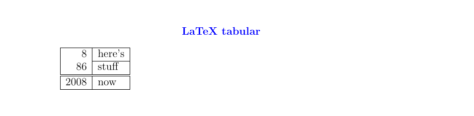

#### 3.2.3 Figure

> 需要引入 **graphicx** 包。图片应当是 PDF，PNG，JPEG 或者 GIF 文件

> NOTE : 待插入的图片需要为tex主文件位于同一个文件夹

```latex title="Figure"
\documentclass[a4paper, 12pt]{article} 

\usepackage{color}
\usepackage{graphicx}

\begin{document}   % document begin

\begin{center}   
  \textcolor{blue}{\textbf{LaTeX  Figure}}
\end{center}

\begin{figure}[h]
  \centering
  \includegraphics[scale=0.3]{photo_2024-07-23_08-50-12.jpg}
  \caption{Here is my image}
  \label{image-myimage}
\end{figure}
  
\end{document}   % document end
```


- `[h]` 是位置参数，**h** 表示把图表近似地放置在这里（如果能放得下）。有其他的选项：**t** 表示放在在页面顶端；**b** 表示放在在页面的底端；**p** 表示另起一页放置图表。你也可以添加一个 **!** 参数来强制放在参数指定的位置（尽管这样排版的效果可能不太好）。
- `\centering` 将图片放置在页面的中央。如果没有该命令会默认左对齐。使用它的效果是很好的，因为图表的标题也是居中对齐的。
- `\includegraphics{...}` 命令可以自动将图放置到你的文档中，图片文件应当与 TeX 文件放在同一目录下。
- `[width=1\textwidth]` 是一个可选的参数，它指定图片的宽度——与文本的宽度相同。宽度也可以以厘米为单位。你也可以使用 `[scale=0.5]` 将图片按比例缩小（示例相当于缩小一半）。（ps : `width`与`scale`只能二选一）
- `\caption{...}` 定义了图表的标题。如果使用了它，LaTeX 会给你的图表添加「Figure」开头的序号。你可以使用 `\listoffigures` 来生成一个图表的目录。
- `\label{...}` 创建了一个可以供你引用的标签。


#### 3.2.4 Formula

> 对公式的支持是LaTeX最广泛的应用（ps: 因为暂时用不到暂定不折腾了）

#### 3.2.5 Cite （Reference）

> LaTeX 可对参考文献以及目录进行处理&#x20;

> LaTeX可以使用`\begin{thebibliography}{99}` & `\end{thebibliography}`在文档末尾插入要插入的参考文献，然后使用`\cite{ref1}`在特定位置插入文献。

```latex title="插入参考文献"
\documentclass[a4paper, 12pt]{article} 

\usepackage{color}
\usepackage{graphicx}

\begin{document}   % document begin

\begin{center}   
  \textcolor{blue}{\textbf{LaTeX  Figure}}
\end{center}

\begin{figure}[h]
  \centering
  \includegraphics[scale=0.3]{photo_2024-07-23_08-50-12.jpg}
   \caption{Here is my image\cite{ref1}} %插入的位置 
  \label{image-myimage}
\end{figure}

\begin{ thebibliography }{ 99 } %插入的文献
   \bibitem{ref1}Zheng L, Wang S, Tian L, et al., Query-adaptive late fusion for image search and person re-identification, Proceedings of the IEEE Conference on Computer Vision and Pattern Recognition, 2015: 1741-1750.   
  \bibitem{ref2}Arandjelović R, Zisserman A, Three things everyone should know to improve object retrieval, Computer Vision and Pattern Recognition (CVPR), 2012 IEEE Conference on, IEEE, 2012: 2911-2918.  
  \bibitem{ref3}Lowe D G. Distinctive image features from scale-invariant keypoints, International journal of computer vision, 2004, 60(2): 91-110.  
  \bibitem{ref4}Philbin J, Chum O, Isard M, et al. Lost in quantization: Improving particular object retrieval in large scale image databases, Computer Vision and Pattern Recognition, 2008. CVPR 2008, IEEE Conference on, IEEE, 2008: 1-8.  
\end{thebibliography}
  
\end{document}   % document end
```


##### 3.2.5.1 使用BibTeX进行文献管理

> BibTeX是一种格式和一个程序，用于协调LaTeX的参考文献处理.

> **BibTeX** 使用数据库的的方式来管理参考文献. `BibTeX` 文件的后缀名为 `.bib `. 先来看一个例子。

- BibTeX 文件包含了所有你想要在你文档中引用的文献

  它的文件后缀名为 `.bib`。它的名字应设置为你的 TeX 文档的名字。`.bib` 文件是文本文件。你需要将你的参考文献按照下列格式输入：
  ```latex 
  @article{
      Birdetal2001,
      Author = {Bird, R. B. and Smith, E. A. and Bird, D. W.},
      Title = {The hunting handicap: costly signaling in human foraging strategies},
      Journal = {Behavioral Ecology and Sociobiology},
      Volume = {50},
      Pages = {9-19},
      Year = {2001} 
  }
  ```


```latex title="LaTeX BibTeX文献引用需要设置BibTeX文件，文件格式如下"
@article{name1,  
author = {作者, 多个作者用 and 连接},  
title = {标题},  
journal = {期刊名},  
volume = {卷20},  
number = {页码},  
year = {年份},  
abstract = {摘要, 这个主要是引用的时候自己参考的, 这一行不是必须的}  
}
```


```latex title="references.bib"
@article{ref1,  
  author = {Zheng L, Wang S, Tian L},  
  title = {Query-adaptive late fusion for image search and person re-identification, Proceedings of the IEEE Conference on Computer Vision and Pattern Recognition},  
  journal = {IEEE Conference},  
  volume = {20},  
  number = {1741-1750},  
  year = {2015}
}
```


```latex title="Reference"
\documentclass[a4paper, 12pt]{article} 

\usepackage{color}
\usepackage{graphicx}

\begin{document}           % document begin
\bibliographystyle{plain}   %设置参考文献格式

\begin{center}   
  \textcolor{blue}{\textbf{LaTeX  Reference}}
\end{center}

\begin{figure}[h]
  \centering
  \includegraphics[scale=0.3]{photo_2024-07-23_08-50-12.jpg}
  \caption{Here is my image\cite{ref1}}    %文献插入位置
  \label{image-myimage}
\end{figure}

\bibliography{references}        % 文章默认插入参考文献

\end{document}   % document end
```


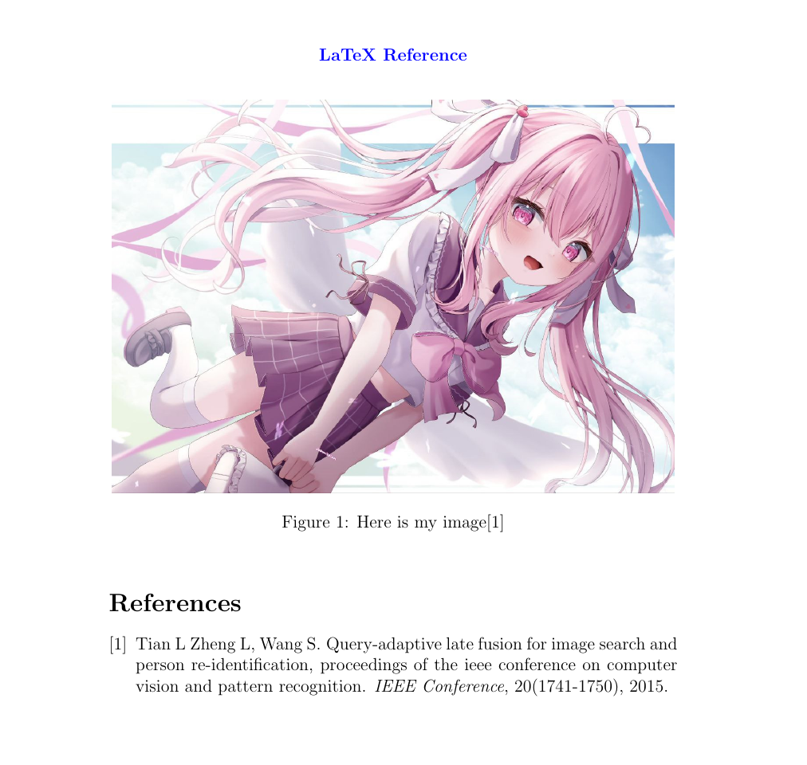

### `3.3 pylatex`

***

## 4 Source&#x20;

> \*\*大家來學LaTEX : \*\*
>
> [大家來學lATEX.pdf](file/大家來學lATEX_qMNep6YLCE.pdf "大家來學lATEX.pdf")

***

## 5 Reference

[^1]: [https://www.latex-project.org/about/](https://www.latex-project.org/about/ "https://www.latex-project.org/about/")

[^2]: [https://github.com/latex3/latex2e](https://github.com/latex3/latex2e "https://github.com/latex3/latex2e")

[^3]: [https://github.com/qinnian/LaTeX/blob/master/01 LaTeX 的基本介绍.md](<https://github.com/qinnian/LaTeX/blob/master/01 LaTeX 的基本介绍.md> "https://github.com/qinnian/LaTeX/blob/master/01 LaTeX 的基本介绍.md")

[^4]: [https://jeltef.github.io/PyLaTeX/current/](https://jeltef.github.io/PyLaTeX/current/ "https://jeltef.github.io/PyLaTeX/current/")

[^5]: [https://blog.marquis.eu.org/posts/34f95ec7/](https://blog.marquis.eu.org/posts/34f95ec7/ "https://blog.marquis.eu.org/posts/34f95ec7/")

[^6]: [https://zh.wikibooks.org/wiki/LaTeX/基础](https://zh.wikibooks.org/wiki/LaTeX/基础 "https://zh.wikibooks.org/wiki/LaTeX/基础")
