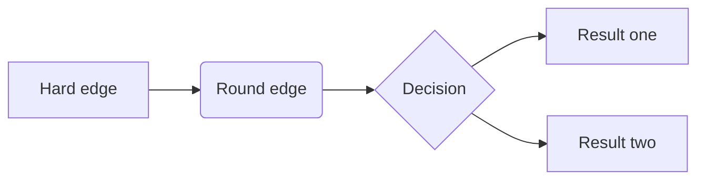

# Markdown

## 目录

- [1 Introduce](#1-Introduce)
  - [Markdown](#Markdown)
- [2 Tutorial](#2-Tutorial)
  - [2.1 Text Format](#21-Text-Format)
  - [2.2 Headings](#22-Headings)
  - [2.3 Links & Images](#23-Links--Images)
  - [2.4 List](#24-List)
  - [2.5 Footnotes](#25-Footnotes)
  - [2.6 Tables](#26-Tables)
  - [2.7 Source Code](#27-Source-Code)
  - [2.8 Equations](#28-Equations)
  - [2.9 Diagrams](#29-Diagrams)
  - [2.10 Videos](#210-Videos)
  - [2.11 Frontmatter](#211-Frontmatter)
- [Markdown Edit](#Markdown-Edit)
- [4 Reference](#4-Reference)

*A Markdown-formatted document should be publishable as-is, as plain text, without looking like it’s been marked up with tags or formatting instructions*&#x20;

&#x20;                                                                                                                                        **— John Gruber**


## 1 Introduce

### **M****a****r****k****d****o****wn**

**M****a****r****k****d****o****wn**是一种轻量级标记语言，创始人为**约翰·格鲁伯**[^注释1]。它允许人们使用易读易写的纯文本格式编写文档，然后转换成有效的`XHTML`（或者\*\*`HTML`\*\*）文档。这种语言吸收了很多在电子邮件中已有的纯文本标记的特性[^1]。&#x20;

由于**M****a****r****k****d****o****wn**的轻量化、易读易写特性，并且对于图片，图表、数学式都有支持，目前许多网站都广泛使用**M****a****r****k****d****o****wn**来撰写帮助文档或是用于论坛上发表消息。如`GitHub`、`Reddit`、`Discord`、`Diaspora`、`Stack Exchange`、`OpenStreetMap` 、`SourceForge`、简书等，甚至还能被用来撰写电子书[^2]。

> **NOTE** : **M****a****r****k****d****o****wn**文档的文件后缀为`.md`, `.markdown`

***

## 2 Tutorial

### 2.1 Text Format

**M****a****r****k****d****o****wn**中可以使用下面的样式设定*斜体* &\*\* 粗体\*\* & ***粗斜体***

```markdown title="Markdown"
*italics*
**Blod**
***blod italics ***

```


`*italics*` : *italics*

`**Blod**` : **Blod**

`***blod italics ***`  : ***Blod italics***

**M****a****r****k****d****o****wn**中可以使用下面的样式设定上下标

```markdown title="上下标"
superscript^2^  # 上标
subscript~2~    # 下标
```


`superscript^2^` ：$X^2
 $

`subscript~2~`  ： $X_2
 $

**M****a****r****k****d****o****wn**中可以使用下面的样式设定删除线

```markdown title="删除线"
~~strikethrough~~
```


`~~strikethrough~~` ：~~strikethrough~~

**M****a****r****k****d****o****wn**中可以使用下面的样式设定行内代码

```markdown title="行内代码"
`verbatim code`
```


`` `verbatim code` `` ： `verbatim code`

### 2.2 Headings

**M****a****r****k****d****o****wn**中主要使用`#`设置不同级别的header

```markdown title="章节标头使用以下格式进行设置"
# Header 1
## Header 2
### Header 3
#### Header 4
##### Header 5
###### Header 6

```


### 2.3 Links & Images

**M****a****r****k****d****o****wn**使用以下格式标注链接🔗与图片

```markdown title="Links & Images"
<https://quarto.org>
[Quarto](https://quarto.org)

[](https://quarto.org)
[](https://quarto.org)
[{fig-alt="Alt text"}](https://quarto.org)
```


### 2.4 List

**M****a****r****k****d****o****wn**主要使用以下样式设定不同`list`样式

```markdown title="List"
* unordered list
    + sub-item 1
    + sub-item 2
        - sub-sub-item 1
```


- unordered list
  - sub-item 1
  - sub-item 2
    - sub-sub-item 1

```markdown title="List"
*   item 2

    Continued (indent 4 spaces)
```


- item 2

  Continued (indent 4 spaces)

```markdown title="List"
1. ordered list
2. item 2
    i) sub-item 1
         A.  sub-sub-item 1
```


1. ordered list
2. item 2

   i) sub-item 1

   A.  sub-sub-item 1

```markdown title="List"
- [ ] Task 1
- [x] Task 2
```


- [ ] Task 1
- [x] Task 2

### 2.5 Footnotes

**M****a****r****k****d****o****wn**中还可以在特定位置插入脚注

```markdown title="Footnotes"
Here is a footnote reference,[^1] and another.[^longnote]

[^1]: Here is the footnote.

[^longnote]: Here's one with multiple blocks.

    Subsequent paragraphs are indented to show that they
belong to the previous footnote.

        { some.code }

    The whole paragraph can be indented, or just the first
    line.  In this way, multi-paragraph footnotes work like
    multi-paragraph list items.

This paragraph won't be part of the note, because it
isn't indented.
```


```markdown title="Footnotes"
Here is an inline note.^[Inlines notes are easier to write,
since you don't have to pick an identifier and move down to
type the note.]
```


### 2.6 Tables

**M****a****r****k****d****o****wn**使用下面的样式向MarkDown插入表格

```markdown title="Tables"
| Right | Left | Default | Center |
|------:|:-----|---------|:------:|
|   12  |  12  |    12   |    12  |
|  123  |  123 |   123   |   123  |
|    1  |    1 |     1   |     1  |
```


| Right | Left | Default | Center |
| ----- | ---- | ------- | ------ |
| 12    | 12   | 12      | 12     |
| 123   | 123  | 123     | 123    |
| 1     | 1    | 1       | 1      |

### 2.7 Source Code

**M****a****r****k****d****o****wn**使用` ``` `  ` ``` ` 插入代码

```markdown title="code"
```python
1 + 1
```


```text 


```python title="Code"
1 + 1
```


### 2.8 Equations

**M****a****r****k****d****o****wn**使用`$`  `$` 插入公式

```markdown title="Equations"
inline math: $E = mc^{2}$
```


inline math : $E = mc^{2}$

### 2.9 Diagrams

**M****a****r****k****d****o****wn**可以使用`Mermaid`和`Graphviz`语法向文档中插入流程图、序列图、状态图、甘特图。




### 2.10 Videos

```markdown title="Videos"

```


[   https://www.youtube.com/embed/wo9vZccmqwc](https://www.youtube.com/embed/wo9vZccmqwc "   https://www.youtube.com/embed/wo9vZccmqwc")

### 2.11 Frontmatter

`markdown`作为一种通用文本语言，其被广泛应用与众多领域。在`markdown`通用语法的基础上`R Markdown` & 静态网页 & `Slidev` 通过添加了`frontmatter`模块定义了后续文档渲染方式（如：通过`theme: seriph`全局设置后续网页渲染使用的主题）。

`frontmatter` 必须位于`markdown` 文件中的第一部分，并且必须采用在三点划线之间书写的有效的 `YAML`。下面是一个`frontmatter` 示例：

```yaml title="slidev的frontmatter示例"
---
layout: cover
theme: seriph
background: https://sli.dev/demo-cover.png
---
```


> **Tips** : 个人感觉`frontmatter`就是通过结合`YAML`实现了对于文档的全局设置的统一呀！

***

## **M****a****r****k****d****o****wn** Edit

在`Mac` & `Win`上可以使用的**M****a****r****k****d****o****wn**编辑器 😙 🤭 🤩 😳

> **妙言** : 轻灵的 Markdown 笔记本伴你写出妙言\~
>
> [ 妙言 轻灵的 Markdown 笔记本伴你写出妙言\~ https://miaoyan.app/](https://miaoyan.app/ " 妙言 轻灵的 Markdown 笔记本伴你写出妙言~ https://miaoyan.app/")

> **Sharpen your thinking** : Obsidian is the private and flexible writing app that adapts to the way you think.
>
> [   https://obsidian.md/](https://obsidian.md/ "   https://obsidian.md/")

> Markdown app for writing in plain text efficiently. Available for Mac, iPhone and iPad.
>
> [   https://www.bywordapp.com/](https://www.bywordapp.com/ "   https://www.bywordapp.com/")

> **iA Writer** is the pro tool for focused writing. It removes all distractions and keeps you in the flow.
>
> [   https://ia.net/writer](https://ia.net/writer "   https://ia.net/writer")

> **TEXTS** : Rich Editor *for* Plain Text
>
> [ Texts — Markdown Word Processor for Mac OS X and Windows Markdown editor for Mac and Windows. Tables, images, footnotes, math and more. Export to PDF, HTML, Word, ePub. http://www.texts.io/](http://www.texts.io/ " Texts — Markdown Word Processor for Mac OS X and Windows Markdown editor for Mac and Windows. Tables, images, footnotes, math and more. Export to PDF, HTML, Word, ePub. http://www.texts.io/")

> **Markdown Basics：**
>
> [ Markdown Basics – Quarto  https://quarto.org/docs/authoring/markdown-basics.html#diagrams](https://quarto.org/docs/authoring/markdown-basics.html#diagrams " Markdown Basics – Quarto  https://quarto.org/docs/authoring/markdown-basics.html#diagrams")

***

## 4 Reference

[^注释1]: 约翰·格鲁伯（英语：John Gruber，1973年—）是一名来自美国宾夕凡尼亚州的作家、博客编者、用户界面设计师及Markdown发布格式的发明者

[^1]: [https://daringfireball.net/projects/markdown/](https://daringfireball.net/projects/markdown/ "https://daringfireball.net/projects/markdown/")

[^2]: [https://markdown.com.cn/](https://markdown.com.cn/ "https://markdown.com.cn/")
