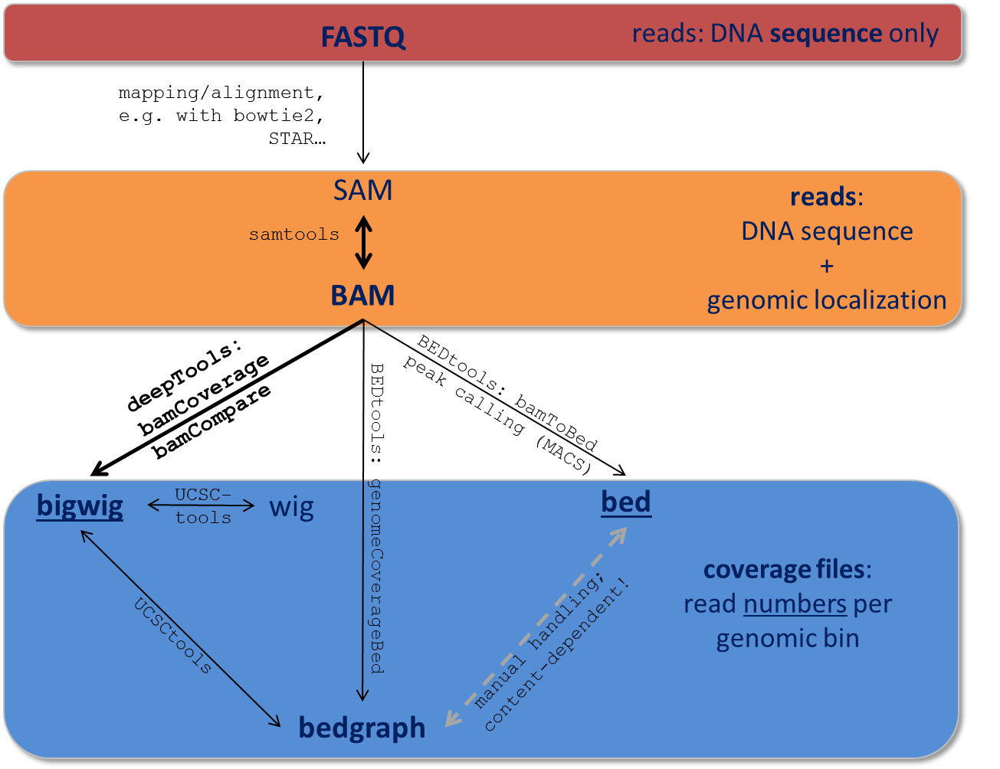

# NGS Format Convert (Tools)

## 目录

- [1 samtools](#1-samtools)
- [2 sambamba ](#2-sambamba-)
- [3 bedtools](#3-bedtools)
- [4 bcftools](#4-bcftools)
- [5 gffread](#5-gffread)
- [6 deeptools](#6-deeptools)
- [7 bwtool](#7-bwtool)
- [8 bcftools](#8-bcftools)
- [9 pysam](#9-pysam)

从下一代测序（NGS）数据获得的数据必须经过多次处理。大多数处理步骤旨在提取特定下游分析所需的信息，通常会丢弃冗余条目。因此，特定的数据格式通常与数据处理流水线的不同步骤相关联[^1]。

> **Fastq**\*\*  & ****GTF**** & ****GFF****& sam &****bam**** & ****bw/bedGraph**** & ****BED****& VCF \*\***& ****BCF**** 格式转换关系**：
>
> ```mermaid 
> flowchart LR
>       A(fastq)--mapping-->B1[sam]
>       B1[sam] --sam2bam--> B2
>       A(fastq)--mapping-->B2[bam]
>       B2--Call Variant-->D1[VCF]
>       B2--Call Variant-->D2[BCF]
>       B2 --Coverage-->E[bw/bedGraph]
>       B2 --bam2bed-->F[BED]
>       D1 --vcf2bcf--> D2
>       G1[GFF] <--> G2[GTF]
>       G2 --Annotation--> D1
>       G2 --Annotation--> D2
>       G2 --Annotation--> F
>       
>       
>  
> ```
>



### 1 samtools

> ***Samtools***是最常用的sam & bam & cram对比文件格式处理软件，可以进行读取 & 写入 & 编辑 & 索引 & 查看！[^2]（**samtools 很稳**）

[Samtools](Samtools/Samtools.md "Samtools")

> ***Samtools***是最常用的sam & bam & cram对比文件格式处理软件，可以进行读取 & 写入 & 编辑 & 索引 & 查看！[^2]（**samtools 很稳**）

### 2 sambamba&#x20;

[sambamba ](sambamba-/sambamba-.md "sambamba ")

### 3 bedtools

> `bedtools` 它支持对BAM、BED、GFF/GTF、VCF等和基因组区域有关文件的intersect, merge, count, complement, and shuffle等操作[^3]。

[bedtools](bedtools/bedtools.md "bedtools")

### 4 bcftools

[gtftools](gtftools/gtftools.md "gtftools")

### 5 gffread

[gffread](gffread/gffread.md "gffread")

### 6 deeptools

BigWig and BAM/CRAM related utilities

[deepTools](deepTools/deepTools.md "deepTools")

[MEGADEPTH](MEGADEPTH/MEGADEPTH.md "MEGADEPTH")

### 7 bwtool

[bwtool](bwtool/bwtool.md "bwtool")

### 8 bcftools

**`BCFtools`** 是一个用于变体（`Variant`）调用和操作变体调用格式（Variant Call Format，简称 VCF）文件及其二进制格式（BCF）的程序。这个程序支持对 VCF 和 BCF 文件进行操作，无论是未压缩的还是使用了 BGZF 压缩算法压缩的文件。**`BCFtools`** 的所有命令都能够无缝地与这些文件格式一起工作，无论是它们是压缩的还是未压缩的状态[^4]。

[bcftools](bcftools/bcftools.md "bcftools")

**`BCFtools`** 是一个用于变体（`Variant`）调用和操作变体调用格式（Variant Call Format，简称 VCF）文件及其二进制格式（BCF）的程序。这个程序支持对 VCF 和 BCF 文件进行操作，无论是未压缩的还是使用了 BGZF 压缩算法压缩的文件。**`BCFtools`** 的所有命令都能够无缝地与这些文件格式一起工作，无论是它们是压缩的还是未压缩的状态[^4]。

### 9 pysam

[pysam](pysam/pysam.md "pysam")

[^1]: [https://deeptools.readthedocs.io/en/latest/content/help\_glossary.html](https://deeptools.readthedocs.io/en/latest/content/help_glossary.html "https://deeptools.readthedocs.io/en/latest/content/help_glossary.html")

[^2]: [https://github.com/samtools/samtools](https://github.com/samtools/samtools "https://github.com/samtools/samtools")

[^3]: [https://bedtools.readthedocs.io/en/latest/](https://bedtools.readthedocs.io/en/latest/ "https://bedtools.readthedocs.io/en/latest/")

[^4]: [https://samtools.github.io/bcftools/howtos/index.html](https://samtools.github.io/bcftools/howtos/index.html "https://samtools.github.io/bcftools/howtos/index.html")
