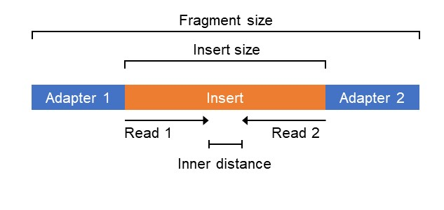
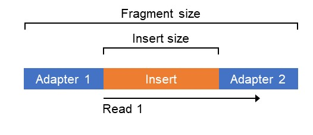

# Quality control & preprocessing

## 目录

- [1 intrudoce](#1-intrudoce)
  - [1.1 preprocessing](#11-preprocessing)
    - [1.1.1 NGS sequence](#111-NGS-sequence)
  - [1.2 Low data quality (sequence)](#12-Low-data-quality-sequence)
  - [1.3 Quality control and preprocessing](#13-Quality-control-and-preprocessing)
  - [1.4 Quality control and preprocessing software](#14-Quality-control-and-preprocessing-software)
  - [1.5 Quality control and preprocessing pipeline](#15-Quality-control-and-preprocessing-pipeline)
    - [1.5.1 General Quality control & preprocessing pipeline](#151-General-Quality-control--preprocessing-pipeline)
    - [1.5.2 WGS Quality control  &  preprocessing : ](#152-WGS-Quality-control----preprocessing--)
  - [1.6 Remove PhiX contamination and adapters](#16-Remove-PhiX-contamination-and-adapters)
    - [1.6.1 PhiX contamination (optional)](#161-PhiX-contamination-optional)
    - [1.6.2 Adapters Trimming](#162-Adapters-Trimming)
  - [1.7 Mark duplicates ](#17-Mark-duplicates-)
    - [1.7.1 UMI](#171-UMI)
    - [1.7.2 software duplicates](#172-software-duplicates)
  - [1.8 Analyze coverage depth](#18-Analyze-coverage-depth)
  - [1.9 Detect sample swaps and contamination](#19-Detect-sample-swaps-and-contamination)
  - [1.10 Sequence adapter](#110-Sequence-adapter)
- [2 Env Create & Install](#2-Env-Create--Install)
- [3 tutorial](#3-tutorial)
  - [3.1 Remove PhiX contamination](#31-Remove-PhiX-contamination)
  - [3.2 qc & Remove adapter & low base](#32-qc--Remove-adapter--low-base)
    - [3.2.1 fastp](#321-fastp)
    - [3.2.2 cutadapt](#322-cutadapt)
    - [3.2.3 Trimmomatic](#323-Trimmomatic)
    - [3.2.4 Trim Galore](#324-Trim-Galore)
    - [3.2.5 Skewer (adapter trimming)](#325-Skewer-adapter-trimming)
    - [3.2.6 ktrim](#326-ktrim)
  - [3.3 Mark duplicates](#33-Mark-duplicates)
    - [3.3.1 fastp](#331-fastp)
    - [3.3.2 picard](#332-picard)
- [4 Source](#4-Source)
- [5 Referecne](#5-Referecne)

***

## 1 intrudoce

### 1.1 preprocessing

#### 1.1.1 NGS sequence

The main principle of HTS technology is sequencing by synthesis, which is the same for most platforms[^1].&#x20;

> 现在主要的NGS测序平台都是基于边合成边测序技术！

1. The first step is to prepare samples for sequencing by creating libraries. This is done by fragmenting the cDNA into small single strand fragments, called ssDNA templates, and ligating adapters to the 5’ and 3’ ends.&#x20;
   > 第一步是通过创建文库来准备用于测序的样品。这是通过将 cDNA 片段化成小的单链片段（称为 ssDNA 模板）并将接头连接到 5' 和 3' 末端来完成的。\*\*cDNA → \*\***ssDNA**
2. Second, libraries are arranged into clusters on a solid surface.&#x20;
   > 文库与lane primer 结合 → sequence cluster
3. Third, complementary bases are built up. The complementary bases sequentially emit fluorescence signals, and the process of this synthesis step is captured in a series of images. The actual nucleotide information is inferred from the fluorescence intensity data for each cluster by using base-calling algorithms. This yields so-called reads, which can be processed by downstream algorithms. Finally, a measure of uncertainty or quality is assigned to each called base.
   > 碱基互补 → cycle → 荧光 → 算法识别碱基 →同时根据检测到的信号质量赋予每一个碱基对应质量值！

The major drawback of current HTS technology is that any information about the region or position on the genome of the generated reads is lost. Therefore, for each read, the most likely position on a reference genome must be found. This process is called alignment, which is the central element of HTS data preprocessing[^1].

> 现阶段NGS(HTS)技术在建库过程中会丢失序列在基因组上的位置信息，因此需要将read mapping 到基因组，才能够获得基因组表达 & 突变信息，而获得靠谱的read 位置信息的前提为read序列具有较高的质量！

### 1.2 Low data quality (sequence)

Low data quality may be generated from ***adapter contamination***, ***base content biase**\*\*s*, ***overrepresented sequences***, and ***errors in library preparation or sequencing steps***.

> NGS中低质量数据主要包含以下几种 ： 1.***adapter contamination*** (测序过程中使用的接头)；2.***base content biase**\*\*s* (碱基内容偏倚)；3.**overrepresented sequences** (过表达序列)；4.***errors in library preparation or sequencing steps*** (建库 & 测序过程中的错误)

These preprocessing steps include the removal of adapters, duplicates and contaminations, alignment to a reference genome and the post-processing of the alignment[^1].

### 1.3 Quality control and preprocessing

Quality control and preprocessing of sequences are essential before analyzing high-throughput sequence data. After raw read data is generated from high-through sequencing platforms, quality control and preprocessing of sequencing reads should be implemented, for clean data to be produced for subsequent bioinformatic analysis. Different tools have been developed for this, such as FastQC, iTools, fastp, cutadapt, and FASTX.

> Quality control and preprocessing 是NGS测序中重要步骤，现阶段已经有很多处理NGS序列的工具！

### 1.4 Quality control and preprocessing software

**FastQC** :  provides per-base and per-read quality profiling features[^2].&#x20;

**Cutadapt**  : is used as an adapter trimmer[^3] ;&#x20;

**Trimmomatic** : is another trimming adapter tool[^4];

\*\*FASTX-Toolkit \*\*: is a collection of Linux command line tools for processing FASTQ files[^5];&#x20;

**iTools** : calculates the quality score of fastq and includes multiple functions by analyzing other data formats[^6] ;&#x20;

\*\*Fastp \*\*:  is an ultra-fast preprocessor, which can perform quality control, adapter trimming, quality filtering, and other functions[^7].

### 1.5 Quality control and preprocessing pipeline

#### 1.5.1 General Quality control & preprocessing pipeline


QC &  preprocessing : Fastq → QC (fastqc & multiqc & itools ) → preprocessing (**Cutadapt** & fastp & **FASTX**)

> 常规质控与预处理流程！(RNA-seq)

#### 1.5.2 WGS Quality control  &  preprocessing :&#x20;

Preprocessing and quality control for whole genome sequences from the Illumina HiSeq X platform.

> Illumina HiSeq X 平台wgs数据质控 & 预处理流程：


### 1.6 Remove PhiX contamination and adapters

#### 1.6.1 PhiX contamination (optional)

Illumina offers PhiX libraries from the PhiX bacteriophage genome to provide a quality control for cluster generation and sequencing as well as a calibration control during sequencing runs.

> 在进行下游分析前可以先使用fastq-screen 检查一下样本中是否存在PhiX污染！

#### 1.6.2 Adapters Trimming

Trimming is the process of removing unwanted sequence prior to sequence alignment. In general, trimming is an optional step. The 3’ ends of the sequence may contain part of the Illumina sequencing adapter. This adapter contamination may prevent the reads from aligning to the reference genome correctly, thus adversely impacting the downstream analysis. You could evaluate potential adapter contamination either from the FastQC report (in “Overrepresented sequences” or “Adapter Contamination” sections), or from the size distribution of your sequencing libraries. If you suspect that your reads are contaminated with adapters, you should run an adapter removal tool. We list some additional considerations below whether trimming is needed[^8]:

> 修剪是在序列比对之前去除不需要的序列的过程。一般来说，修剪是一个可选步骤。序列的 3' 末端可能包含 Illumina 测序接头的一部分。这种适配器污染可能会阻止读数与参考基因组正确对齐，从而对下游分析产生不利影响。可以从 FastQC 报告（在“过量序列”或“适配器污染”部分）或从测序文库的大小分布来评估潜在的适配器污染。如果您怀疑您的读数被适配器污染，您应该运行适配器删除工具。我们在下面列出了是否需要修剪的一些额外注意事项：

- **If the read length is 25bp, there is no need to trim - adapter sequences will not be included in reads of inserts >25 bp.**
  > 如果read的长度为25bp，则其中含有接头的概率会很低，可以不进行接头修剪
  > 建库完成的文库中如果序列的Insert size < 测序长度，其就会在下机的fastq文件中包含接头信息！ （figure -2）
  > 
  
- **If you perform trimming, then there is no need to use soft-clipping during the alignment.**
  > 如果进行了adapter 就不用在下游mapping 中开启soft-clipping 对比！
- **After trimming, a minimum read length of 25bp should be imposed, as reads smaller than this are hard to align accurately.**
  > 使用相关软件处理后的read最好设置一个长度cutoff,因为太短的序列不易对比到基因组！

### 1.7 Mark duplicates&#x20;

ATAC-seq & WGS & Chip-seq需要对建库过程中由于PCR扩增导致的duplicates进行移除！

Plenty can go wrong when genomic material is amplified. The resulting fragment can be less than 100% identical to its DNA or RNA template.The polymerase chain reaction (PCR) can also selectively amplify one fragment over another “despite our best efforts,” says Marie Adams, who directs the genomics core at the Van Andel Research Institute[^9].

> 在建库过程中使用到PCR聚合酶扩增cDNA获得的DNA的比例是存在区别的，PCR聚合酶对不同的cDNA扩增具有不同的效率，因此在建库的PCR扩增中，会引入PCR 偏倚！,er而而

#### 1.7.1 UMI

He hopes that in the near future, all resequencing experiments will use unique molecular identifiers (UMIs) to enable accurate counting and tracking of molecules.

> 可以通过是建库过程中引入UMI序列，来避免由于PCR扩增导致的偏好性！


**Genomic material is fragmented or cDNA is generated (基因组提取& 片段化)** → **The fragments are uniquely labeled with molecular barcodes（在片段化序列前链接UMI序列）** →  \*\* After amplification and sequencing, there are many labeled reads. But errors can occur in both reads and barcodes. (PCR扩增 & 测序)\*\* → **由于聚合酶的偏好性导致扩增获得的序列扩增比例不一致** →\*\* 根据UMI对PCR  duplicates进行移除\*\*！

[deduplicate PCR.pdf](<file/deduplicate PCR_vDakmETiMd.pdf> "deduplicate PCR.pdf")

#### 1.7.2 software duplicates

Marking of PCR duplicates is usually done with software tools such as Picard's MarkDuplicates, developed at the Broad Institute of Harvard and MIT, or samtools rmdup, developed at the Sanger Institute

> Picard's MarkDuplicates  &  samtools rmdup 可以对建库过程中由于PCR扩增导致的duplicates进行处理！

Both tools identify aligned fragments that have the same genome coordinates, which suggests that the duplicates came from the same original fragment and are therefore technical artifacts. The two tools use different but related criteria to decide which duplicates to keep in the analysis.

> Picard's MarkDuplicates  &  samtools rmdup都能识别具有相同基因组坐标的对齐片段，这表明重复片段来自相同的原始片段。（是将能够对比到相同基因组位置的read 认为是由于PCR扩增导致的duplicates）

### 1.8 Analyze coverage depth

WGS & WES 测序为了获得准确的基因突变结果，需要对测序的coverage 进行检测！过低发coverage可能会导致使用下游分析软件获得的结果不正确！

### 1.9 Detect sample swaps and contamination

Detecting sample swaps and human DNA contamination is a critical quality control step in any HTS study. Ideally, additional genotype information from other sources, such as microarrays, is available. In this case, the tool `verifyBamID`  can be used to test whether the sequencing data for a sample matches the additional genotype information.

> 在像WES & WGS这样需要对样本中的数据进行call mutation时，需要注意在建库过程中不同样本之间可能存在的交叉污染，以及其他人类DNA污染！

### 1.10 Sequence adapter

- Nextera, Illumina Prep, and Illumina PCR Kits
  ```bash 
  # adapter R1
  Read 1: CTGTCTCTTATACACATCT
  # adapter R2
  Read 2: CTGTCTCTTATACACATCT

  ```

- Nextera Transposase Adapters (ATAC-seq)
  ```python 
  # Read 1
  5’ TCGTCGGCAGCGTCAGATGTGTATAAGAGACAG
  # Read 2
  5’ GTCTCGTGGGCTCGGAGATGTGTATAAGAGACAG
  # Nextera Transposase Sequence Adapter
  CTGTCTCTTAT

  ```

- Illumina–TruSeq Adapter Trimming
  ```bash 
  # adapter R1
  AGATCGGAAGAGCACACGTCTGAACTCCAGTCA
  # adapter R2
  AGATCGGAAGAGCGTCGTGTAGGGAAAGAGTGT
  ```

- BGI adapters[^10]:
  ```bash 
  # adapter R1
  Read 1: AAGTCGGAGGCCAAGCGGTC
  # adapter R2
  Read 2: AAGTCGGATCGTAGCCATGT
  ```


***

## 2 Env Create & Install

```python 
# create qc env by mamba
mamba create -n qc
# activate qc
mamba install bioconda::bwa -y 
mamba install bioconda::samtools -y     
mamba install bioconda::fastp -y
mamba install bioconda::cutadapt=4.8 -y
mamba install bioconda::trimmomatic -y
mamba install bioconda::trim-galore -y
mamba install bioconda::skewer -y
mamba install bioconda::picard -y
mamba install bioconda::verifybamid2 -y   
```


***

## 3 tutorial

### 3.1 Remove PhiX contamination

> Phix 基因组 ： PhiX & BWA : [BWA](https://www.wolai.com/xecZeqMh1d7vhA2nEGScPK "BWA")

```r 
# mapping to PhiX genome
bwa mem -t $threads \
        -M \
        -R $read_group \
        $reference_file_phix \
        <S>_R1.fastq.gz <S>_R2.fastq.gz > \
        <S>.phix_aligned.sam
# Extert not mapping PhiX genome bam    
samtools view -b \
              -f 4 \
              <S>.phix_aligned.sam > \
              <S>.phix_removed.bam
```


### 3.2 qc & Remove adapter & low base

#### 3.2.1 fastp

`fastp`是基于C++编写的可以对**FASTQ**数据进行**超快**预处理和质量控制的软件。其可以在一次运行中执行Adapter去除、全局或质量修剪、read过滤、UMI处理、基因型修正等多个操作[^11]

[fastp](https://www.wolai.com/6brAAPGTibG1xkRZez9S92 "fastp")

`fastp`是基于C++编写的可以对**FASTQ**数据进行**超快**预处理和质量控制的软件。其可以在一次运行中执行Adapter去除、全局或质量修剪、read过滤、UMI处理、基因型修正等多个操作[^11]

#### 3.2.2 cutadapt


[cutadapt](https://www.wolai.com/ucjzc9SFq1QD4wZJ69msxT "cutadapt")

- Nextera, Illumina Prep, and Illumina PCR Kits
  ```bash 
  # adapter R1
  Read 1: CTGTCTCTTATACACATCT
  # adapter R2
  Read 2: CTGTCTCTTATACACATCT

  ```

- Illumina–TruSeq Adapter Trimming
  ```bash 
  # adapter R1
  AGATCGGAAGAGCACACGTCTGAACTCCAGTCA
  # adapter R2
  AGATCGGAAGAGCGTCGTGTAGGGAAAGAGTGT
  ```

- BGI adapters[^10]:
  ```bash 
  # adapter R1
  Read 1: AAGTCGGAGGCCAAGCGGTC
  # adapter R2
  Read 2: AAGTCGGATCGTAGCCATGT
  ```


> 本人之前比较常用的接头移除软件，感觉比Trimmomatic好用一点点 (最新版本的cutadapt 已经支持最新的python ）

> cutadapt 的可以对**Regular X’ adapter**  & **Non-internal X’ adapter** & **Anchored X’ adapter** 接头进行移除！

#### 3.2.3 Trimmomatic

[Trimmomatic](https://www.wolai.com/8sKpLNRh7QG2tQv3xUWWH3 "Trimmomatic")

> A flexible read trimming tool for Illumina NGS data, 其质控中有一个**滑窗剪切**还是很有意思的！

#### 3.2.4 Trim Galore

[Trim Galore](https://www.wolai.com/mpZTa55y7UC2it95twDcZ5 "Trim Galore")

> 我影响中他主要用在**small RNA**的质控分析流程中（ribo-seq）

#### 3.2.5 Skewer (adapter trimming)

Skewer : a fast and accurate adapter trimmer for next-generation sequencing paired-end reads

[Skewer](https://www.wolai.com/xaN9A4ccdRp3xDGGygKbMM "Skewer")

#### 3.2.6 ktrim

Ktrim: an extra-fast and accurate adapter- andquality-trimmer for sequencing data

[ktrim](https://www.wolai.com/oLRXzQE7idHbeRrNYFV86g "ktrim")

### 3.3 Mark duplicates

#### 3.3.1 fastp

fastp : duplication rate and deduplication

> fastp 可以对fastq文件中的read 中的PCR read 进行移除
>
> Duplication rate and Deduplication&#x20;

#### 3.3.2 picard

Duplicates are marked using the Picard program `MarkDuplicates`

> 可以使用[picard](https://www.wolai.com/fE9L5uEFQLy3eYhe6kjDPL "picard") 的`MarkDuplicates`移除bam文件中的Duplicates！

***

## 4 Source

> Quality control of raw sequencing data, data cleaning, FASTQ file handling

[   http://genomeast.igbmc.fr/wiki/doku.php?id=training:dudijon:qualitycontrol](http://genomeast.igbmc.fr/wiki/doku.php?id=training:dudijon:qualitycontrol "   http://genomeast.igbmc.fr/wiki/doku.php?id=training:dudijon:qualitycontrol")

> Quality Control and Preprocessing of Sequencing Reads

[Quality Control and Preprocessing of Sequencing Reads.pdf](<file/Quality Control and Preprocessing of Sequencing Re.pdf> "Quality Control and Preprocessing of Sequencing Reads.pdf")

> Preprocessing and quality control for whole genome sequences from the Illumina HiSeq X platform

> WGS 数据QC & 预处理！

[   https://imbs-hl.github.io/illumina\_seq.html](https://imbs-hl.github.io/illumina_seq.html "   https://imbs-hl.github.io/illumina_seq.html")

***

## 5 Referecne

[^1]: Preprocessing and quality control for whole genome sequences from the Illumina HiSeq X platform

[^2]: FastQC A Quality Control tool for High Throughput Sequence Data

[^3]: Cutadapt Removes Adapter Sequences From High-Throughput Sequencing Reads

[^4]: Trimmomatic: a flexible trimmer for Illumina sequence data

[^5]: FASTX-Toolkit: FASTQ/a short-reads pre-processing tools

[^6]: iTools: A Framework for Classification, Categorization and Integration of Computational Biology Resources

[^7]: fastp: an ultra-fast all-in-one FASTQ preprocessor&#x20;

[^8]: [https://hbctraining.github.io/Intro-to-ChIPseq-flipped/lessons/04\_alignment\_using\_bowtie2.html](https://hbctraining.github.io/Intro-to-ChIPseq-flipped/lessons/04_alignment_using_bowtie2.html "https://hbctraining.github.io/Intro-to-ChIPseq-flipped/lessons/04_alignment_using_bowtie2.html")

[^9]: How to deduplicate PCR

[^10]: [https://github.com/hellosunking/Ktrim/](https://github.com/hellosunking/Ktrim/ "https://github.com/hellosunking/Ktrim/")

[^11]: Ultrafast one‐pass FASTQ data preprocessing, qualitycontrol, and deduplication using fastp
