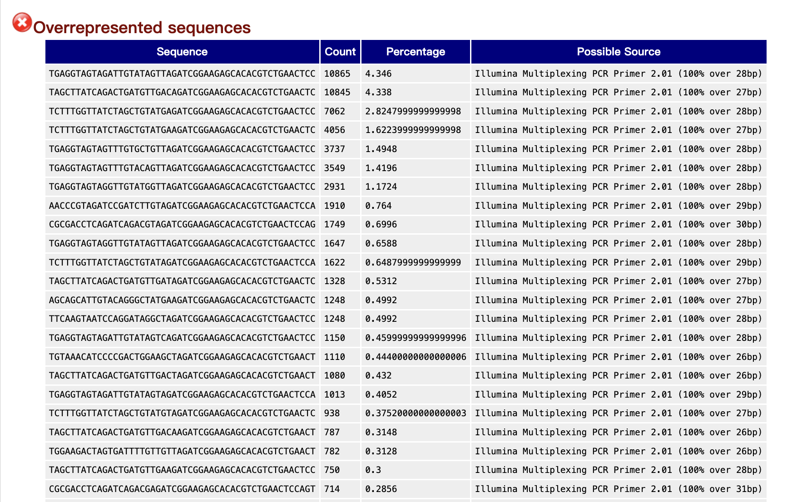
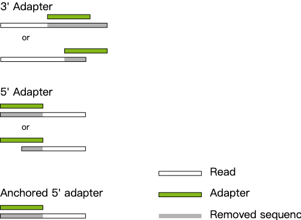
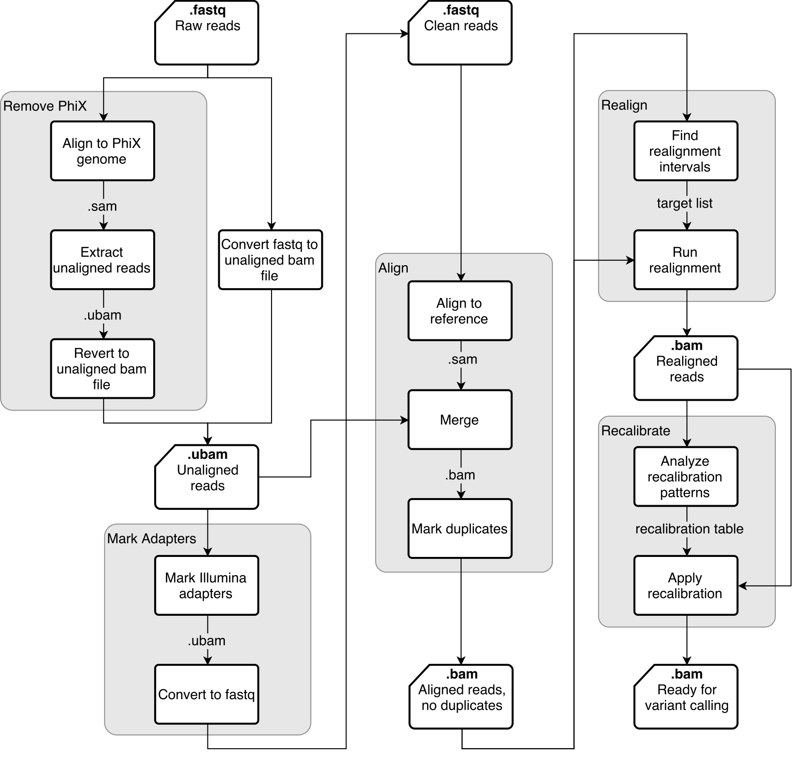
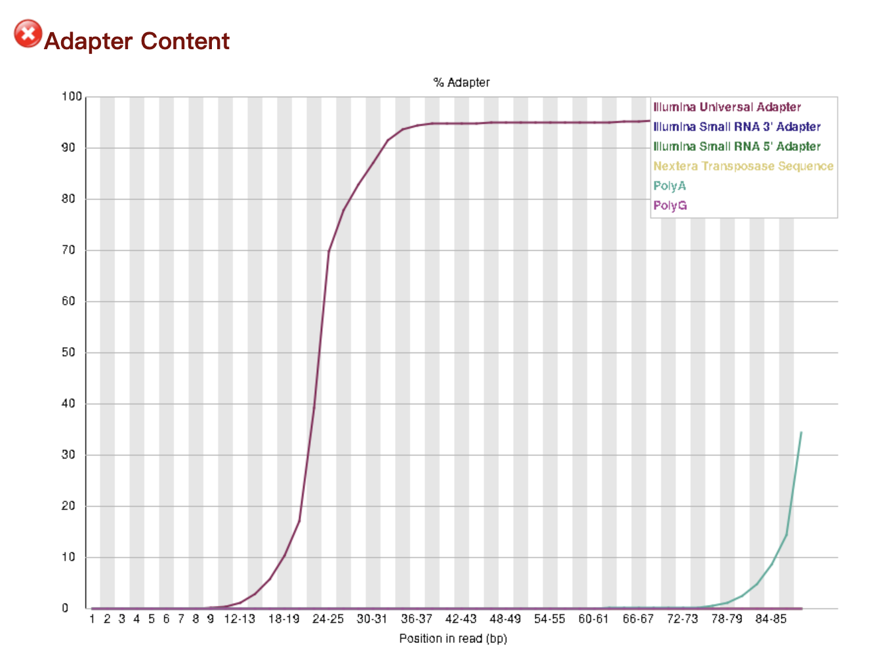
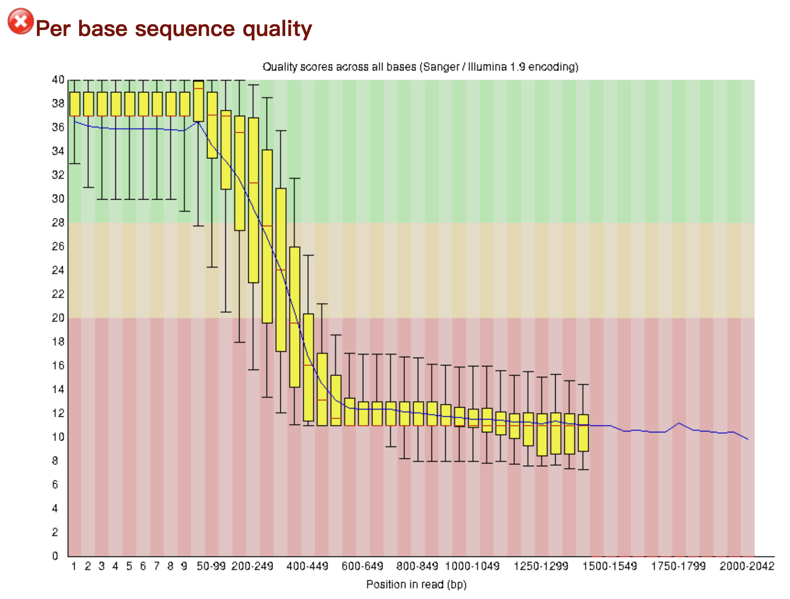
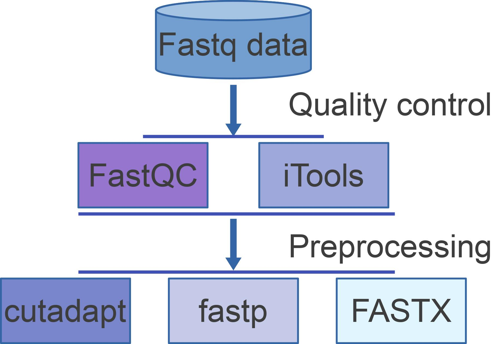
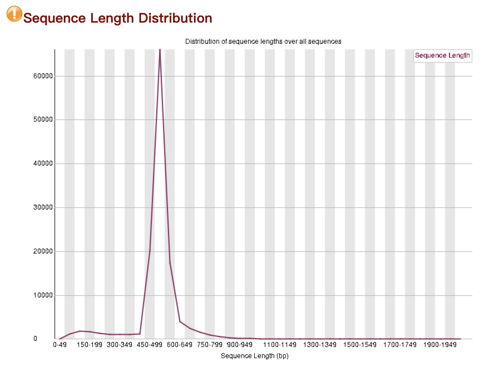

# QC 知识库目录

本目录汇集测序质量控制、预处理、生物信息文件格式和常用 QC 工具笔记。数据库导入入口为
`scripts/import_qc_knowledge.py`；脚本会递归导入本目录全部 Markdown，并将 Markdown 引用的 PDF
文本和图片说明/OCR 文本加入检索分块。

## 核心主题

- [原始数据 QC](Raw%20data%20QC.md)
- [质量控制与预处理](Quality%20control%20%26%20preprocessing.md)
- [FastQC](FastQC.md)
- [fastp](fastp.md)
- [MultiQC](multiqc.md)
- [测序技术与平台](Sequence%20%26%20platforms%20%28Sanger%20%E2%86%92%20NGS%20%E2%86%92%20long-read%29.md)
- [接头与引物序列](sequences%20of%20adapters%20-%20primer/sequences%20of%20adapters%20-%20primer.md)
- [Kraken2 与 Bracken 污染/物种分类](Kraken2%20%26%20Bracken.md)
- [SAM/BAM 格式](SAM-BAM/SAM-BAM.md)
- [Samtools](Samtools/Samtools.md)
- [VCF/BCF 格式](VCF-BCF/VCF-BCF.md)
- [deepTools](deepTools/deepTools.md)
- [常用生物信息数据与参数格式](Bioinformatics%20Data%20%26%20Parameter%20Format.md)

## 补充附件索引

以下附件此前未被其他 Markdown 显式引用，在此登记以确保 PDF 文本和图片说明/OCR 可进入索引：

- [PCR duplicate 说明](<file/deduplicate PCR_12kovLpG4p.pdf>)
- 
- 
- 
- 
- 
- 
- 
- 
- 
- 

图片 OCR 结果仅作为召回辅助，精确参数、数值和结论应回到原图、正文或正式工具文档复核。
