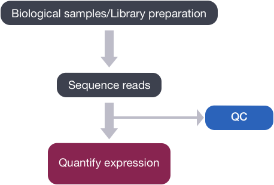
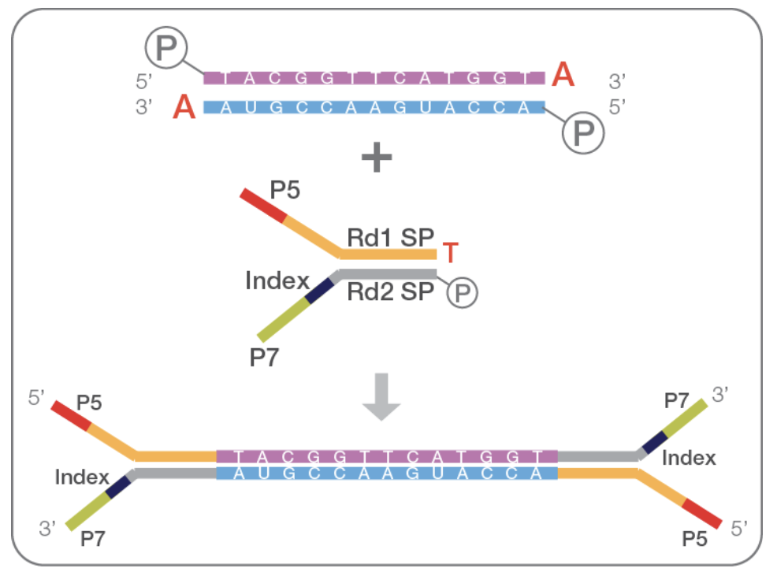
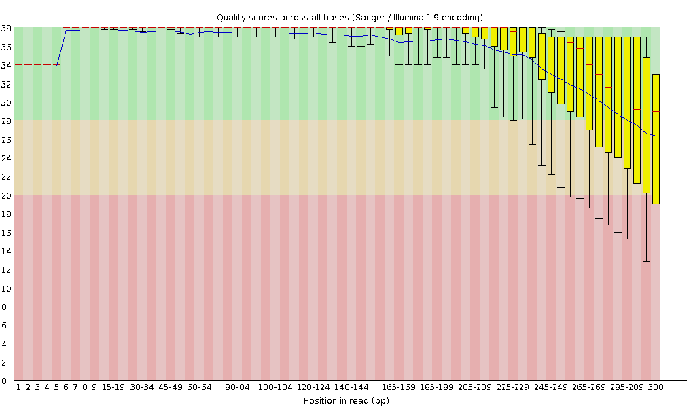

# Raw data QC

## 目录

- [1 Introduce](#1-Introduce)
  - [1.1 NGS  & QC](#11-NGS---QC)
  - [1.2 What causes poor-quality NGS data](#12-What-causes-poor-quality-NGS-data)
  - [1.3 Quality control metrics](#13-Quality-control-metrics)
  - [1.4 Sequence Quality](#14-Sequence-Quality)
  - [1.5 Fastq](#15-Fastq)
    - [1.5.1 Illumina sequence identifiers](#151-Illumina-sequence-identifiers)
- [2 create conda  qc env ](#2-create-conda--qc-env-)
- [3 Tutorial](#3-Tutorial)
  - [3.1 Fastqc](#31-Fastqc)
  - [3.2 Falco](#32-Falco)
  - [3.3 multiqc](#33-multiqc)
- [4 Reference](#4-Reference)

***

## 1 Introduce

***

### 1.1 NGS  & QC

Quality control is an essential step in any NGS workflow, allowing the integrity and quality of the data to be checked before downstream analysis and interpretation. Depending on the sequencing technology selected, additional data processing steps may also be required to remove low-quality reads from the dataset. [^1]

> 使用不同的**NGS**建库 & 测序方法获得相关序列的碱基后，就需要按照特定条件对碱基质量进行检查，以移除质量较差的碱基，以防止对下游分析造成影响。

The first step in the RNA-Seq workflow is to take the FASTQ files received from the sequencing facility and assess the quality of the sequence reads.

> 以RNA-seq为例进行分析时在从测序设备中获得read后就需要对碱基质量进行控制，以进行下游分析。



> 📌**NOTE** : 下机的read序列，由于测序设备的错误 & 文库问题可能会存在碱基质量较差的read & 含义N碱基的read & 含有adapter的read,因此就需要对其质量进行检查，在下游使用相关软件将质量较差 & 长度较短 & read中的adapter进行移除！



> 使用Illumina 试剂盒建库完成后，文库结构如图所示：在我们真正要获得序列的两段是包含有建库 & 测序要使用adapter & Index,因此在下游分析中需要将其移除。
>
> - [ ] 在下机过程中5‘端的接头会自动移除，但是当要测序的read小于建库的长度时，read中才包含adapter

***

### 1.2 What causes poor-quality NGS data

Several biological and technical factors may influence the quality- and read-depth of sequencing data. These may include: &#x20;

> 在对样本进行测序时，生物学&技术原因会导致碱基质量较差，包括一下因素：

1. ***Poor quality of starting material***

   测序原始样本质量较差，但是在进行测序之前都会使用相关仪器对样本进行质量控制，因此出现太大问题的样本可能会被移除。
2. ***Improper library preparation***

   建库失败，文库在制备过程中出现问题，这里一般会出现非特异性文库，如果出现非特异性文库，表明建库获得的文库可能存在问题。
3. **Technical sequencing errors**

   测序错误，在测序过程中由于设备的问题与测序过程中试剂的问题会导致测序出现问题。(PS:比如在测序开始与测序结束时的碱基质量会较差)

   测序开始 ： 测序设备刚刚开始由于设备刚刚启动不稳定，会导致碱基质量较差；

   测序结束 ：在测序结束事由于测序使用的试剂的消耗与循环开始不同步，会导致碱基质量较差；

   

***

### 1.3 Quality control metrics

There are numerous metrics that can be used to assess the quality of raw sequencing reads before secondary analysis:&#x20;

> 可以使用以下条件对测序获得的read质量进行评价：

1. **Yield:** The total number of reads per run.

   数据产量；
2. **Read analysis:** Read length, GC content, adapter content and duplication can be measured to give an indication of data quality.

   read 质量 ： *read 长度* & *GC含量* &\* 接头含量\* &  *read重复*；
3. **Q score:** A score that determines the probability that an incorrect base was called during the run. This is determined by Q = –10 log10 P. A Q score of above 30 is generally considered to be good quality for most sequencing experiments.

   \*\*Q \*\*分数 ：测序过程中设备测序获得的碱基错误概率，一般要求Q > 30 的比例大于95% (Q30 就是每一个碱基)；&#x20;
4. **Error rate (%):** The percentage of bases incorrectly called during one cycle. As read length increases, error rate also increases.

   测序错误率%
5. **Clusters Passing Filter (%):** Illumina sequencers provide an indication of signal purity. This cluster passing filter percentage refers to the number of clusters that passed the “chastity filter” of the instrument3. Generally, a lower PF percentage is associated with lower yield.

   簇通过滤比例 %
6. **Phas/Prephas (%):** Another commonly used Illumina metric, referring to the percentage of base signal lost in each sequencing cycle. This is calculated by analysing the number of clusters that fall behind (phasing) or move ahead (prephasing) during sequencing.

***

### 1.4 Sequence Quality

A quality value *Q* is an integer mapping of *p* (i.e., the probability that the corresponding base call is incorrect). Two different equations have been in use. The first is the standard Sanger variant to assess reliability of a base call, otherwise known as [Phred quality score](https://en.wikipedia.org/wiki/Phred_quality_score "Phred quality score"):

> 在测序获得的序列中通常使用Q对测序的每一个碱基的质量进行评价，Q就是碱基测序出现错误概率的log。(PS : Q30就是表明测序测序概率为1/1000)

${\displaystyle Q_{\text{sanger}}=-10\,\log _{10}p}$

***

### 1.5 Fastq

> Fastq是用来存储碱基序列的文本文件，其中每一个read由以下4部分组成：
>
> 1. **Field 1 **begins with a '**@**' character and is followed by a sequence identifier and an *optional* description；
>
>    第一部分，以@为开头后面跟着仪器ID & 序列ID & UMI信息等
>    - FASTQ Format @ infor  :&#x20;
>      - @后面接的的相关的描述信息；
>      - SRR2176360.1这个是fastq文件的名称；
>      - HWI-ST1085这个是测序设备的唯一🆔
>      - 243这个是run 🆔
>      - C42G3ACXX这个是flowcell 🆔
>      - 2这个是flowcell的lane（一个flowcell差不多是有8个lane的）
>      - 1101这个是lane中的tile🆔
>      - 1164这个是tile的x轴坐标
>      - 2101这个是tile的y轴坐标
>      - 1是read1（在这里如果有一个文件后面是2，就说明这是一个PE数据）
> 2. \*\*Field 2 \*\*is the raw sequence letters.
>
>    碱基序列（ATCG）
> 3. \*\*Field 3 \*\*begins with a '+' character and is *optionally* followed by the same sequence identifier (and any description) again.
>
>    固定字符 +
> 4. \*\*Field 4 \*\*encodes the quality values for the sequence in Field 2, and must contain the same number of symbols as letters in the sequence.
>
>    每一个碱基的质量编码
>    > **NOTE** : 测序碱基质量编码主要有两种 ： 1.Phred+33；2.Phred+64 ；但是现在主要用碱基质量编码为Phred+33
>
> ```bash title="FASTA Sample"
> @SRR2176360.1 HWI-ST1085:243:C42G3ACXX:2:1101:1164:2101/1
> GNGANNNNNNNNNTGNNCATGCGGTAAGACAACCACCANNNNNNNNNNATTNGACTANNNNNAANNNNNNNCANCCNNATCTTCATTTGGGGGCTGGAGGA
> +
> <#08#########22##23<???@@9=>???<>;????###############################################################
> ```
>

#### 1.5.1 Illumina sequence identifiers

Illumina 作为目前最常用的测序平台，其会使用以下样式的ID对read进行编号

```bash 
@HWUSI-EAS100R:6:73:941:1973#0/1

HWUSI-EAS100R  # 设备唯一ID
6              # flowcell lane
73             # tile number within the flowcell lane
941            # 'x'-coordinate of the cluster within the tile
1973           # y'-coordinate of the cluster within the tile
#0             # index number for a multiplexed sample (0 for no indexing)
/1             # paired-end or mate-pair reads only
```


***

## 2 create conda  qc env&#x20;

Conda qc env : Kraken & Bracken  & KrakenTools &  \*\*FastQ Screen \*\*  & **BBduk**  & AWS  & fastp  & fastqc  & multiqc & Pavian & krona&#x20;

```r 
mamba env create -f qc.ymal
```


[qc.ymal](file/qc_sXkv0ZJKZH.ymal "qc.ymal")

***

## 3 Tutorial

### 3.1 Fastqc

\*\*\*FastQC \*\*\* is a program designed to spot potential problems in high througput sequencing datasets. It runs a set of analyses on one or more raw sequence files in fastq or bam format and produces a report which summarises the results[^2].

> 当使用不同的方法获得各种各式各样的测序文库后，就可以通过相关测序平台对捕获到的序列进行测序已获得不同种类的read序列。

[FastQC](https://www.wolai.com/5KXW8jvs7jmtTLvsLwTxAR "FastQC")

> **fastqc **是由Babraham Bioinformatics开发的一款**最常用**的fastq文件质控软件！(这个软件也可以被称为二代测序中最最常用的软件之一！)

***

### 3.2 Falco

[falco](https://www.wolai.com/hneXkziE8Ncs7B9KA7LwJk "falco")

> 相关推文上说的其可以平替fastqc,同时速度更快一点点🤏🏻

***

### 3.3 multiqc


[multiqc](https://www.wolai.com/7AEVvqVLYNdmWxF6wTTFNP "multiqc")

multiqc 可以对***fastqc*** & \*\*\*Cutadapt \*\*\*& ***STAR*** & ***featureCounts*** 的分析结果进行整合并生成网页报告！

> multiqc是可以对NGS相关软件生成的报告进行合并的软件(可以在已有的分析流程中将其添加到相关流程中)强推！

***

## 4 Reference

[^1]: [https://frontlinegenomics.com/how-to-ngs-quality-control/](https://frontlinegenomics.com/how-to-ngs-quality-control/ "https://frontlinegenomics.com/how-to-ngs-quality-control/")

[^2]: [https://github.com/s-andrews/FastQC](https://github.com/s-andrews/FastQC "https://github.com/s-andrews/FastQC")
