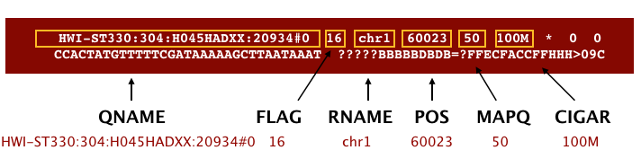
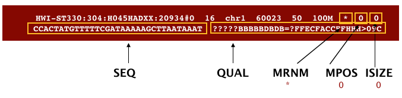

# SAM/BAM

## 目录

- [1 introduce](#1-introduce)
  - [1.1 SAM/BAM](#11-SAMBAM)
  - [1.2 Format](#12-Format)
  - [1.3 FLAG](#13-FLAG)
- [2 SAM/BAM](#2-SAMBAM)
  - [2.1 SAM/BAM manipulating](#21-SAMBAM-manipulating)
  - [2.2 Visualization](#22-Visualization)
- [3 Source](#3-Source)
- [4 Reference](#4-Reference)

***

## 1 introduce

### 1.1 SAM/BAM


SAM/BAM

> 使用NGS技术测序获得read,使用相关软件将其对比到对于基因组默认会获得`sam`文件,为了节省存储空间可以使用`samtools`软件将其转换为二进制压缩文件`bam`以节约存储空间。

- **SAM**（**Sequence Alignment Map**，“序列比对地图”）是生物信息学中一种用于储存已比对到基因组上的序列信息的文件格式[^1]\(*ps:这个文件可以使用less & vi等工具进行查看哟*)
- **BAM(Binary Alignment Map，二元比对**地图 **)** : 由序列比对地图文件的无损压缩二进制获得（ps :`bam`文件如果要进行查看需要使用`samtools`等软件进行处理）

### 1.2 Format

```bash title="SAM/BAM Example"
HWI-1KL110:152:C6D3RACXX:8:2115:21300:91326     16      chr10   1007    0       11M     *       0       0       AACGTCAGGAAHFHFFFFD?B@     XT:A:N  NM:i:0  XN:i:11 X0:i:1312       XM:i:0  XO:i:0  XG:i:0  MD:Z:11
HWI-1KL110:152:C6D3RACXX:8:1116:18885:83989     0       chr10   54979   0       12M     *       0       0       TCAATCATGACA       CCCFFFFFHHHH    XT:A:N  NM:i:0  XN:i:12 X0:i:837        XM:i:0  XO:i:0  XG:i:0  MD:Z:12
HWI-1KL110:152:C6D3RACXX:8:1210:5531:59052      0       chr10   60321   0       51M     *       0       0       GTGCAGTTGAGCGCATGTTCTGTTGTTCAGCATTTATGGTGGTTGGTAGTG        BBBFFFDEHHHHHJJJJHJJJJIJJIIJJJJIJJJJJJJDGH@GIJFHHGI     XT:A:R  NM:i:0  X0:i:2     X1:i:0  XM:i:0  XO:i:0  XG:i:0  MD:Z:51 XA:Z:chr18,+14735,51M,0;
HWI-1KL110:152:C6D3RACXX:8:2104:2290:53263      0       chr10   60321   0       51M     *       0       0       GTGCAGTTGAGCGCATGTTCTGTTGTTCAGCATTTATGGTGGTTGGTAGTG        BCBFFFFFHHHHHJJJJIJJJJIJJJJJJJJJJJJIJJJBGIGHIJGHJII     XT:A:R  NM:i:0  X0:i:2     X1:i:0  XM:i:0  XO:i:0  XG:i:0  MD:Z:51 XA:Z:chr18,+14735,51M,0

```


> SAM格式由头部（header）和比对（alignment section）两部分组成，可以使用`SAMtools`软件进行分析和编辑。如果存在头部部分，它必须位于比对部分之前。头部部分以`'@'`符号开头，以区别于比对部分。

1. **header**（可选）：标头用于描述数据源、参考序列、比对方法等，这将根据所使用的`aliger`而变化。每个部分都以字符`@`开头，后跟两个字母的记录类型代码。接下来是两个字母的标签和值;
   ```bash title="header"
   @HD  The header line
   VN: format version
   SO: Sorting order of alignments
   @SQ  Reference sequence dictionary
   SN: reference sequence name
   LN: reference sequence length
   SP: species
   @PG  Program
   PN: program name
   VN: program version
   ```

2. **alignment section**: 每一行对应于单次读取的对齐信息,比对部分有11个必需字段以及可变数量的可选字段;

   

   

   `CIGAR`是一种由字母和数字组成的序列，它代表了将测序读取与参考序列进行匹配所需的编辑或操作。字母表示用于指示哪些碱基与参考序列对齐的操作（即匹配、不匹配、删除、插入），而数字则指示每个“操作”相关的碱基长度。一些下游工具使用CIGAR来快速评估对齐情况；

   `MRNM` = `RNEXT`

   `MPOS` = `PNEXT`

   `ISIZE` = `TLEN`
   | 列  | 名称      | 数据类型 | 说明                                                     |
   | -- | ------- | ---- | ------------------------------------------------------ |
   | 1  | `QNAME` | 字符   | 查询模板名称                                                 |
   | 2  | `FLAG`  | 整数   | 比对FLAG数字之和                                             |
   | 3  | `RNAME` | 字符   | 序列比对上的参考序列的名称，在真核生物中一般指染色体编号                           |
   | 4  | `POS`   | 整数   | 序列上第一个碱基比对到参考序列上的位置，如没有比对上会记为0                         |
   | 5  | `MAPQ`  | 整数   | 比对品质的评分，数值越大代表比对品质越高                                   |
   | 6  | `CIGAR` | 字符   | CIGAR值                                                 |
   | 7  | `RNEXT` | 字符   | 双端测序另一端序列比对上的参考序列的名称，在真核生物中一般指染色体编号。单端测序数据中此处会被记为“ \*” |
   | 8  | `PNEXT` | 整数   | 双端测序另一端序列比对到参考序列上的位置，如没有比对上会记为0                        |
   | 9  | `TLEN`  | 整数   | 读长比对到参考序列上的长度，如果和参考序列完全比对，数值上等于读长本身的长度                 |
   | 10 | `SEQ`   | 字符   | 读长序列信息 （FASTQ文件中的信息）                                   |
   | 11 | `QUAL`  | 字符   | 读长的测序品质，以Phred-33分数表示（FASTQ文件中的信息）                     |

> \*\*NOTE \*\*: 不同的软件会在可选字段中添加不同的信息来对read进行标记，因此在下游分析中可以结合标记信息对相关read进行提取。

### `1.3 FLAG`

> SAM/BAM文件通过`FLAG`值代表read的对比结果[^2]：
>
> > NOTE : read的不同对比想结果会通过将对应值进行相加获得！因此就可以使用samtools对不同的read对比结果进行提取。
>
> > **NOTE** : `FLAG`的美妙之处在于，`FLAG`的任何组合只能得出一个总和！
>
> - 1 ：代表这个序列采用的是PE双端测序
> - 2 ：代表这个序列和参考序列完全匹配，没有插入缺失
> - 4 ：代表这个序列没有mapping到参考序列上
> - 8 ：代表这个序列的另一端序列没有比对到参考序列上，比如这条序列是R1,它对应的R2端序列没有比对到参考序列上
> - 16 ：代表这个序列比对到参考序列的负链上
> - 32 ：代表这个序列对应的另一端序列比对到参考序列的负链上
> - 64  ：代表这个序列是R1端序列， read1;
> - 128 ：代表这个序列是R2端序列，read2；
> - 256 ： 代表这个序列不是主要的比对，一条序列可能比对到参考序列的多个位置，只有一个是首要的比对位置，其他都是次要的
> - 512 ：代表这个序列在QC时失败了，被过滤不掉了（这个标签不常用）
> - 1024 ：代表这个序列是PCR重复序列（这个标签不常用）
> - 2048 ：代表这个序列是补充的比对（这个标签具体什么意思，没搞清楚，但是不常用）

***

## 2 SAM/BAM

### 2.1 SAM/BAM manipulating

> SAM/BAM 文件可以使用`samtools` & `sambamba`进行处理！
>
> [Samtools](https://www.wolai.com/hJknzbJCgzMDXHzSs9ZbNx "Samtools")
>
> [sambamba ](https://www.wolai.com/5DkzjzsTcpSEMsrEx7832V "sambamba ")

1. `Viewing`
   ```bash title="Viewing"
   samtools view -h Mov10_oe_1_Aligned.sortedByCoord.out.bam | less
   ```

2. `filted by quality`
   ```bash title="filted by quality"
   samtools view -q 30 -c Mov10_oe_1_Aligned.sortedByCoord.out.bam

   ```

3. `filted`
   ```bash title="filted"
   ## This will tell us how many reads are unmapped
   samtools view -f 4 -c Mov10_oe_1_Aligned.sortedByCoord.out.bam
   ## This should give us the remaining reads that do not have this flag set (i.e reads that are mapped)
   samtools view -F 4 -c Mov10_oe_1_Aligned.sortedByCoord.out.bam
   ```

4. `sam → bam → sort → index`
   ```bash title="sam → bam → sort → index"
   samtools view -@ 20 -b -S XXXX.sam > XXXX.bam
   samtools sort -@ 20  XXXX.bam > XXXX.sort.bam
   samtools index -@ 20 XXXX.sort.bam
   ```


### 2.2 Visualization

> `bam`文件可以使用`IGV / JBrowse`进行查看 & 可视化


> sam/bam文件也可以使用相关软件（Trackplot）进行批量可视化！

[Trackplot (python) ](https://www.wolai.com/kR2MhfKFUrNWjrE7hVPZ6K "Trackplot (python) ")

***

## 3 Source

> **Sequence Alignment/Map Format Specification** :&#x20;
>
> [Sequence Alignment:Map Format Specification.pdf](<file/Sequence Alignment-Map Format Specification_j6sus8.pdf> "Sequence Alignment:Map Format Specification.pdf")

***

## 4 Reference

[^1]: [https://zh.wikipedia.org/wiki/SAM格式](https://zh.wikipedia.org/wiki/SAM格式 "https://zh.wikipedia.org/wiki/SAM格式")

[^2]: [https://www.cnblogs.com/xudongliang/p/5437850.html](https://www.cnblogs.com/xudongliang/p/5437850.html "https://www.cnblogs.com/xudongliang/p/5437850.html")
