# Samtools

## 目录

- [1 Introduce](#1-Introduce)
- [2 Install](#2-Install)
  - [2.1 Install by Source file](#21-Install-by-Source-file)
  - [2.2 Install by Conda](#22-Install-by-Conda)
- [3 tutorial](#3-tutorial)
  - [3.1 view](#31-view)
  - [3.2 sort](#32-sort)
  - [merge](#merge)
  - [3.4 index](#34-index)
  - [3.5 tview](#35-tview)
  - [3.6 faidx](#36-faidx)
  - [3.7 flagstat](#37-flagstat)
  - [3.8 stats](#38-stats)
    - [3.8.1 plot\_bamstats ](#381-plot_bamstats-)
  - [3.9 depth](#39-depth)
  - [3.10 rmdup](#310-rmdup)
  - [3.11 Other](#311-Other)
  - [3.12 bam2fastq](#312-bam2fastq)
- [4 Source](#4-Source)
- [5 Reference](#5-Reference)

***

## 1 Introduce

***Samtools*** is a suite of programs for interacting with high-throughput sequencing data ；Reading/writing/editing/indexing/viewing SAM/BAM/CRAM format.

> ***Samtools***是最常用的sam & bam & cram对比文件格式处理软件，可以进行读取 & 写入 & 编辑 & 索引 & 查看！[^1]（**samtools 很稳**）

***

## 2 Install

### 2.1 Install by Source file

```bash title="Install by Source file"
# download samtools source
wget https://github.com/samtools/samtools/releases/download/1.19/samtools-1.19.tar.bz2
# decompress
tar -zxvf samtools-1.19.tar.bz2
# Install Samtools by 
cd samtools-1.19    # and similarly for bcftools and htslib
./configure --prefix=/where/to/install
make
make install
```


### 2.2 Install by Conda

```bash title="Install by Conda"
# install by condaaaaa
conda install -c bioconda samtools
```


***

## 3 tutorial

> SAMtools是一个用于操作sam和bam文件的工具合集。能够实现二进制查看、格式转换、排序及合并等功能，结合sam格式中的flag、tag等信息，还可以完成比对结果的统计汇总。同时利用linux中的grep、awk等操作命令，还可以大大扩展samtools的使用范围与功能

### 3.1 view

> **samtools view**命令的主要功能是：将sam文件转换成bam文件以及提取对比到基因组特定位置的read。

```bash title="samtools view"
samtools view [options] <in.bam>|<in.sam> [region1 [...]]
```


```bash title="samtools view parameter"
-@/--threads INT    : Number of additional threads to use [0]
-b/--bam            : Output BAM
-C/--cram           : Output CRAM (requires -T)
-T/--reference FILE : Reference sequence FASTA FILE [null]
-h/--with-header    : Include header in SAM output
-H/--header-only    : Print SAM header only (no alignments)
-o/--output FILE    : Write output to FILE [standard output]
```


```bash title="samtools view command"
# print  sam header  only (no alignments)
samtools view -H abc.sam
#  sam2bam  use multi threads
samtools view -@ 20 -bS abc.sam > abc.bam
samtools view -@ 20 -b -S abc.sam -o abc.bam
# extert  mappings to reference read 
samtools view -@ 20 -bF 4 abc.bam > abc.F.bam
# extert  mappings to reference pe read 
samtools view -bF 12 abc.bam > abc.F12.bam
# extert  not mappings to reference read 
samtools view -bf 4 abc.bam > abc.f.bam
# extert mappings to chrx read; chrx : is chromosomene ID (染色体的具体ID取决于使用的基因组)
samtools view abc.bam chrx > chrx.sam
# extert mappings to chrx:30000-100000 range read;chrx : is chromosomene ID
samtools view abc.bam chrx:30000-100000 > chrx_30k-100k.sam
# Add header infor by genome fasta file (如果sam/bam文件没有header信息可以使用该命令添加)
samtools view -T genome.fasta -h scaffold1.sam > scaffold1.h.sam
```


### 3.2 sort

> **samtools sort**对bam文件进行排序,默认是按照是按序列在fasta文件中的顺序（即header）和序列从左往右的位点排序。

```bash title="samtools sort"
samtools sort [options...] [in.bam]
```


```bash title="samtools sort parameter"
-n               : Sort by read name (not compatible with samtools index command)
-u               : Output uncompressed data (equivalent to -l 0)
-l               : Set compression level, from 0 (uncompressed) to 9 (best)
-m               : Set maximum memory per thread; suffix K/M/G recognized [768M]
-@/--threads INT : Number of additional threads to use [0]
```


```bash title="samtools sort command"
samtools sort -@ 20 abc.bam abc.sort
```


> **NOTE** : 除了按照`fa`文件中染色体顺序进行排序，在某些特定用途中会使用`-n`按照read的名称进行排序。

### **merge**

> \*\*samtools merge \*\*主要用来对多个bam文件进行合并，同时该合并后的文件是经过排序的！

```bash title="samtools merge"
samtools merge [options] -o <out.bam> [options] <in1.bam> ... <inN.bam>
```


```bash title="samtools merge parameter"
-o               : Specify output file via option instead of <out.bam> argument
-@/--threads INT : Number of additional threads to use [0]
```


### 3.4 index

> **samtools index** : 主要用来对bam文件进行快速操作，建立索引后将产生后缀为.bai的文件，用于快速的随机处理。很多情况下需要有bai文件的存在，特别是显示序列比对情况下。

```bash title="samtools index"
samtools index [-bc] [-m INT] <in.bam> [out.index]
```


```bash title="samtools index parameter"
-o FILE  : Write index to FILE [alternative to <out.index> as an argument]
-@ INT   : Sets the number of threads [none]
```


### 3.5 tview

> **samtools tview** 主要用来在终端中对bam文件对比情况进行查看 (ps:也就是应急一下下)

```bash title="samtools tview"
samtools tview  R20042878LR01-S094-Aligned.sortedByCoord.out.mapping.bam
```


```bash title="samtools tview parameter"
-d display      : output as (H)tml or (C)urses or (T)ext
-w INT          : display width (with -d T only)
-reference FILE : Reference sequence FASTA FILE
```


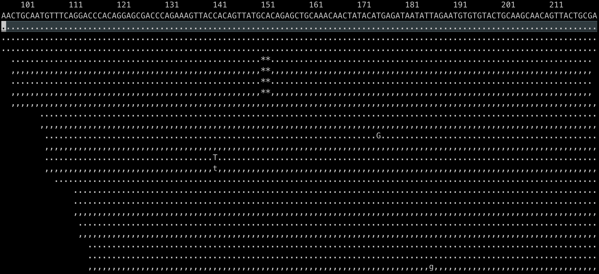

***

### 3.6 faidx

> \*\*samtools faidx \*\*主要用来建立fa文件索引，用于相关软件对fasta文件进行快速操纵。生成的文件以`.fai`结尾。

```bash title="samtools faidx"
samtools faidx <file.fa|file.fa.gz> [<reg> [...]]
```


```bash title="samtools faidx parameter"
-f/--fastq : File and index in FASTQ format.
--fai-idx  : FILE  name of the index file (default file.fa.fai).
--gzi-idx  : FILE  name of compressed file index (default file.fa.gz.gzi).
-n, --length INT : Length of FASTA sequence line. [60]
```


```bash title="samtools faidx command"

# 生成基因组文件的index
samtools faidx -f GRCh38.d1.vd1.fa --gzi-idx GRCh38.d1.vd1.fa.gzi
# 提特定基因组区域
samtools faidx -f GRCh38.d1.vd1.fa chr1 > seq_chrom/chr1.fa
```


***

### 3.7 flagstat

> \*\*samtools flagstat \*\*主要用来对对比结果进行统计。在bam文件中主要通过使用FLAG数值对read的对比情况进行记录。通过对bam文件第2列的Flag数值进行解读就可以获得read的对比情况。

```bash title="samtools flagstat"
samtools flagstat [options] <in.bam>
samtools flagstat R20042878LR01-S094-Aligned.sortedByCoord.out.mapping.bam -O, --output-fmt tsv
```


```bash title="samtools flagstat  parameter"
-@/--threads INT : Number of additional threads to use [0]
-O/--output-fmt  : Specify output format (json, tsv)
```


```bash title="samtools flagstat  result "
372  0  total (QC-passed reads + QC-failed reads)  # reads总数；
370  0  primary                                    # 主要比对到参考序列的 reads数
2    0  secondary                                  # 出现比对到参考基因组多个位置的reads数；
0    0  supplementary                              # 可能存在嵌合的reads；
0    0  duplicates                                 # 重复的reads数；
0    0  primary duplicates                         # 主要比对到参考序列的reads的重复数；
372  0  mapped                                     # 比对到参考基因组上的reads数；
100.00%  N/A  mapped %                             # 比对到参考基因组上的reads比例；
370  0  primary mapped                             # 主要比对到参考序列的reads数量；
100.00%  N/A  primary mapped %                     # 主要比对到参考序列的reads的比例；
370  0  paired in sequencing                       # 属于PE read的reads总数；
185  0  read1                                      # 属于R1的reads总数；
185  0  read2                                      # 属于R1的reads总数；
370  0  properly paired                            # 完美比对的reads总数；PE两端reads比对到同一条序列，且根据比对结果推断的插入片段大小符合设置的阈值
100.00%  N/A  properly paired %                    # 完美比对的reads比例；
370  0  with itself and mate mapped                # PE两端reads都比对上参考序列的reads总数；
0    0  singletons                                 # PE两端reads，其中一端比上，另一端没比上的reads总数；
0.00%  N/A  singletons %                           # PE两端reads，其中一端比上，另一端没比上的reads比例；
0    0  with mate mapped to a different chr        # PE read中，两端分别比对到两条不同的序列的reads总数。
0    0  with mate mapped to a different chr (mapQ>=5) #PE read中，两端分别比对到两条不同的序列，且mapQ>=5的reads总数。
```


***

### 3.8 stats

> \*\*samtools stats \*\*与samtools flagstat一样也可以用来对bam文件中的对比结果进行统计。与samtools flagstat相比其统计的更加详细。

```bash title="samtools stats"
Usage: samtools stats [OPTIONS] file.bam
       samtools stats [OPTIONS] file.bam chr:from-to
```


```bash title="samtools stats parameter"
-d/--remove-dups     : Exclude from statistics reads marked as duplicates
-F/--filtering-flag  : Filtering flag, 0 for unset. See also `samtools flags` [0]
-t, --target-regions : Do stats in these regions only. Tab-delimited file chr,from,to, 1-based, inclusive.
-@, --threads INT    : Number of additional threads to use [0]
```


```bash title="samtools stats result"
# Samtools stats summary result
      8 SN      raw total sequences:    370     # excluding supplementary and secondary reads
      9 SN      filtered sequences:     0
     10 SN      sequences:      370
     11 SN      is sorted:      1
     12 SN      1st fragments:  185
     13 SN      last fragments: 185
     14 SN      reads mapped:   370
     15 SN      reads mapped and paired:        370     # paired-end technology bit set + both mates mapped
     16 SN      reads unmapped: 0
     17 SN      reads properly paired:  370     # proper-pair bit set
     18 SN      reads paired:   370     # paired-end technology bit set
     19 SN      reads duplicated:       0       # PCR or optical duplicate bit set
     20 SN      reads MQ0:      0       # mapped and MQ=0
     21 SN      reads QC failed:        0
     22 SN      non-primary alignments: 2
     23 SN      supplementary alignments:       0
     24 SN      total length:   49420   # ignores clipping
     25 SN      total first fragment length:    24694   # ignores clipping
     26 SN      total last fragment length:     24726   # ignores clipping
     27 SN      bases mapped:   49420   # ignores clipping
     28 SN      bases mapped (cigar):   48877   # more accurate
     29 SN      bases trimmed:  0
     30 SN      bases duplicated:       0
     31 SN      mismatches:     0       # from NM fields
     32 SN      error rate:     0.000000e+00    # mismatches / bases mapped (cigar)
     33 SN      average length: 133
     34 SN      average first fragment length:  133
     35 SN      average last fragment length:   134
     36 SN      maximum length: 150
     37 SN      maximum first fragment length:  150
     38 SN      maximum last fragment length:   150
     39 SN      average quality:        36.1
     40 SN      insert size average:    181.6
     41 SN      insert size standard deviation: 90.9
     42 SN      inward oriented pairs:  82
     43 SN      outward oriented pairs: 103
     44 SN      pairs with other orientation:   0
     45 SN      pairs on different chromosomes: 0
     46 SN      percentage of properly paired reads (%):        100.0
```


- samtools stats除了生成一个对bam文件的汇总内容，还包括对每一个碱基对比结果的详细数据[^2]。
  1. FFQ 和 LFQ 部分报告每个第一个/最后一个片段和每个循环数的质量分布;

     FFQ : First Fragment Qualities
     LFQ : Last Fragment Qualities
  2. GCF 和 GCL 报告每个片段的总 GC 含量，分为第一个片段和最后一个片段;

     GCF : GC Content of first fragments
     GCL : GC Content of last fragments
  3. GCC、FBC 和 LBC 报告每个周期的核苷酸含量，可以合并 （GCC） 或拆分为第一个 （FBC） 和最后一个 （LBC） 片段;

     GCC : ACGT content per cycle
     FBC : ACGT content per cycle for first fragments
     LBC : ACGT content per cycle for last fragments
  4. IS 报告插入尺寸分布，每个尺寸一行，在第一列中报告，后续列用于总对、向内对、向外对和其他方向对的频率;

     IS  : Insert sizes
  5. RL 报告所有读取长度的分布，每个观察到的长度一行（最多为 -l 选项指定的最大值）;

     RL : Read lengths
  6. MAPQ 报告映射读取的映射质量，忽略重复、补充、辅助和失败质量读取;

     MAPQ  : Mapping qualities for reads
  7. IC 报告每个周期出现的插入缺失频率，按插入/删除和首次/最后一次读取细分;

     IC : Indels per cycle
  8. COV 报告了每个覆盖参考站点的对齐深度分布;

     COV : Coverage distribution

#### 3.8.1 plot\_bamstats&#x20;

> 在使用相关对比软件完成read mapping to genome 后,可以在`samtools stats`分析基础上使用`plot-bamstats`[^3]对对比结果进行看可视化。

> **NOTE**:使用`plot_bamstats`需要安装`gunplot package`
>
> ```python 
> # use conda install package
> conda install -c conda-forge gnuplot
> # 使用conda安装的gunplot会提示相关库缺失，就需要将高版本库创建软连接到需要的版本
> ln -s libicudata.so.68 libicudata.so.56
> ln -s libicuuc.so.68   libicuuc.so.56
> ln -s libicui18n.so.68 libicui18n.so.56
> ln -s libjpeg.so.9.5.0 libjpeg.so.8
> ```
>

```bash title="samtools stats & plot_bamstats"
samtools stats  xxxx.sort.bam  > xxxx.stats
# draw plot 
plot_bamstats -p ./mapping.qc xxxx.stats
```


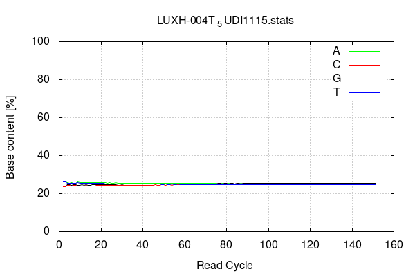

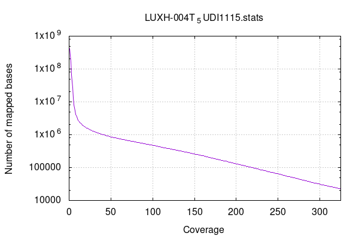

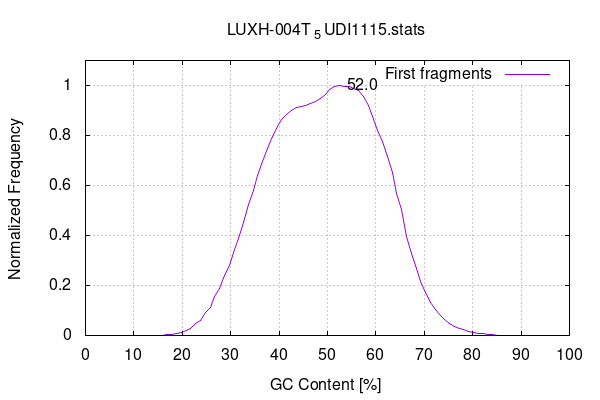

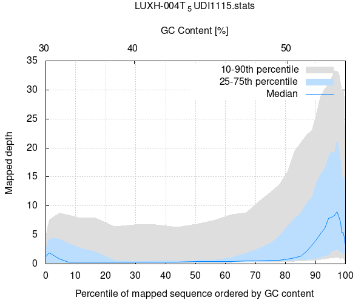

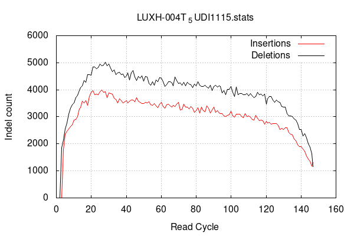

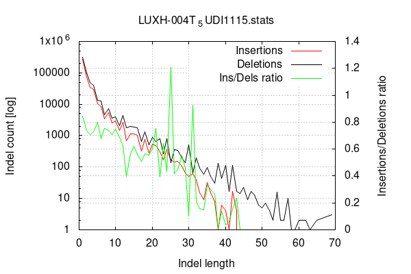

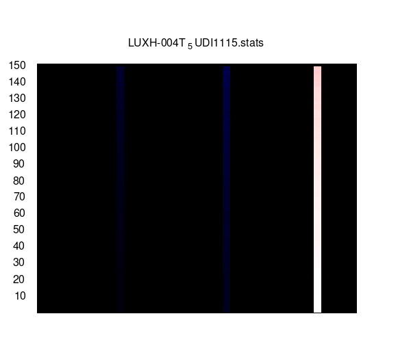

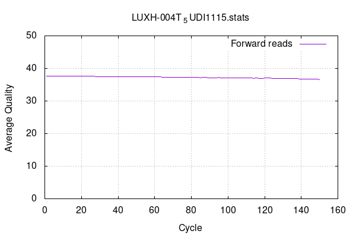

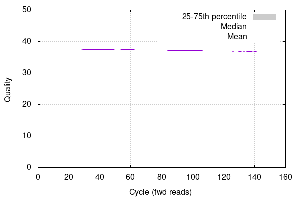

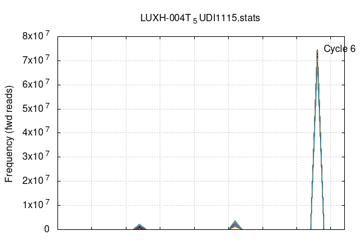

### 3.9 depth

> **samtools depth** 可以得到每个碱基位点的测序深度,并输出到标准输出[^4]。

```bash title="samtools depth parameter"
-a              : Output all positions (including zero depth)
-r REG          : Specify a region in chr or chr:from-to syntax
-b FILE         : Use bed FILE for list of regions
-q/--min-BQ INT : Filter bases with base quality smaller than INT [0]
-Q/--min-MQ INT : Filter alignments with mapping quality smaller than INT [0]
-@, --threads INT    : Number of additional threads to use [0]
```


```bash title="samtools depth result"
# col1 : chromesome name
# col2 : site
# col3 : sequence depth
AF534061.1  7899  3
AF534061.1  7900  3
AF534061.1  7901  3

```


***

### 3.10 rmdup

> \*\*samtools rmdup \*\*将由PCR duplicates获得的reads去掉，并只保留最高比对质量的read  (除了samtools 可以对对比结果中的PCR duplicates进行去除，也有很多更加合适的软件(`picard`)也可以进行该操作)

```bash title="samtools rmdup"
samtools rmdup [-sS] <input.srt.bam> <output.bam>
```


```bash title="samtools rmdup parameter"
-s    rmdup for SE reads (dafult PE data)
-S    treat PE reads as SE in rmdup (force -s)
```


### 3.11 Other

> samtools 除了以上的命令外，还存在很多使用频率较低，但是还是很好的工具！

1. `addreplacerg`命令可以执行以下操作：
   - 替换BAM文件中现有的读组标签。
   - 向BAM文件中添加新的读组标签。
2. `ampliconclip` 是其中的一个命令，其功能是使用一个BED文件来剪切（clip）读取（reads）（特定用于扩展子测序）[^5]；
3. `ampliconstats`: 专注于扩增子测序数据的统计分析[^6]；
4. `bedcov` 命令会计算每个基因组区域的总读取基基数（即每个基位点的读取深度之和）。输出的格式与输入的 BED 文件相同，区域是0-based的，意味着起始位置是从0开始计数[^7]；
5. `calmd` ：命令的主要功能是计算并添加MD（Mismatch Distribution）和NM（Number of Mismatch）标签到SAM（Sequence Alignment/Map）文件中。MD标签记录了读段与参考序列对齐时出现的不匹配（mismatches）的分布情况，而NM标签则记录了读段与参考序列对齐时不匹配的总数[^8]；
6. `cat`：用于将多个BAM或CRAM文件合并（concatenate）成一个文件[^9]；
7. `collate` ：主要功能是将测序读取（reads）按照它们的名字（QNAME）进行随机打乱和分组。具体来说，它确保具有相同名字的读取会被组合在一起形成连续的组，但是它并不保证不同组之间的读取名字的顺序[^10]；
8. `consensus` ： 是从一个SAM、BAM或CRAM文件中生成共识序列（consensus sequence）。共识序列是基于对齐记录的内容产生的，可以以FASTA、FASTQ或堆叠（pileup）格式输出[^11]；
9. `depad`： padded通常指的是在参考序列中添加了额外的字符（如星号 " \*"），以对齐序列数据。depad命令的作用是去除这些额外的字符，将BAM文件中的序列对齐信息转换回原始、未填充的参考序列状态[^12]。
10. `dict`：从一个fasta文件创建一个序列字典文件[^13]；
11. `samtools-fasta` & `samtools-fastq`：主要作用是将SAM、BAM或CRAM格式的文件转换成FASTA或FASTQ格式[^14]；
12. `fixmate `：命令可以应用于已经按照名称排序（name-sorted）或名称合并（name-collated）的比对文件，以确保数据的完整性和准确性[^15]；
13. `flags` ：命令允许用户输入一个或多个标记（FLAGS），这些标记可以是整数（以十进制、十六进制或八进制表示），代表一系列列出的数字标记值的组合；或者是一个由逗号分隔的字符串，代表一系列列出的标记名称的组合。这些标记用于描述测序数据中的特定属性，如是否成对、是否正确对齐、是否映射等。

    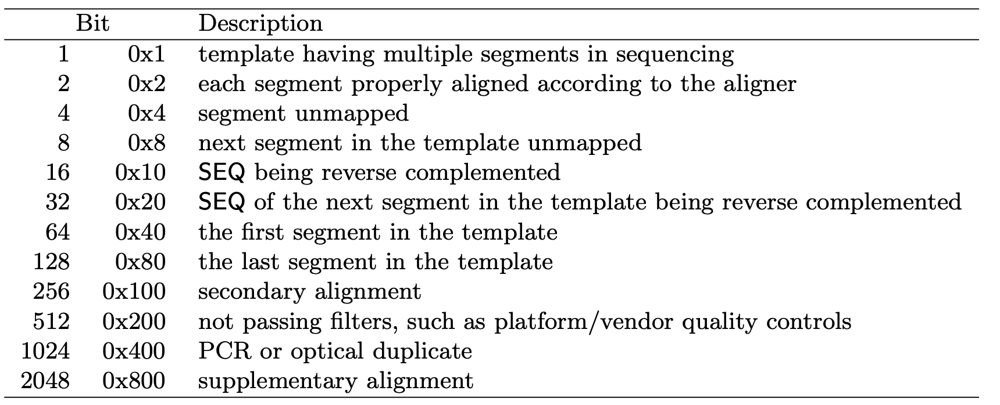
14. `fqidx` 有两个主要功能[^16]：
    - **`索引FASTQ文件`**：它能够为FASTQ格式的参考序列创建索引。FASTQ文件包含了测序读段的序列信息和质量评分。索引文件通常用于加速对特定区域的查询。
    - **`查询区域`**：如果指定了区域，samtools fqidx 可以从索引的参考序列中提取子序列，并将这些子序列以FASTQ格式打印到标准输出（stdout）。
15. **`head`** 是samtools中的一个命令，用于查看SAM、BAM或CRAM文件的头部信息；
16. `idxstats`：可以检索并打印与输入文件相对应的索引文件中的统计数据。这些统计数据通常包括对齐的读段数量、未对齐的读段数量、参考序列的名称和长度等信息。这些数据对于分析测序数据的覆盖度和质量非常有用；
17. `mpileup `：从比对（alignment）文件中生成“pileup”文本格式的输出。所谓的“pileup”格式，是指在基因组的特定位置上，将所有相关的序列读段（reads）的信息按照一定的格式排列起来，以便于后续的变异检测（variant calling）和分析；
18. `quickcheck` 用于快速检查输入文件是否完整无损；
19. `reference` 允许用户从CRAM文件中恢复出参考序列；
20. `reheader `允许用户用一个新的头文件 in.header.sam 来替换 in.bam 文件中的原始头文件；
21. `reset `执行以下操作：
    - 移除CIGAR字符串和参考序列数据。
    - 更新标志位，将序列标记为未比对（unmapped）和不是正确配对（not a proper pair）。
    - 如果比对是在反向方向上进行的，将数据和其质量值反转、互补，并重置反向标志。
    - 丢弃补充（supplementary）和次要（secondary）比对数据
22. `split `是一个命令行工具，它属于 samtools 软件包的一部分。这个工具的主要功能是将一个合并后的序列比对文件（可以是 SAM、BAM 或 CRAM 格式）按照读取组（read group）进行拆分。读取组是一组具有相同来源或处理方式的序列读段的集合，通常在测序数据的元数据中用 @RG 标签来标识。
23. `targetcut` 是专门用来从 fosmid 池测序数据中识别和提取特定区域的工具

### 3.12 bam2fastq

> 由于对比bam文件中是有read序列与测序质量信息，因此可以结合对比的结果对特定fastq文件进行提取（`bam2fastq` is a program to extract sequences and qualities from a BAM file.）

```bash title="bam2fastq"
git clone --recursive https://github.com/jts/bam2fastq
cd bam2fastq
make
```


***

## 4 Source

> \*\*samtools flagstat vs samtools stats \*\*:
>
> \[&#x20;
> &#x20;      &#x20;
> &#x20;   Flagstat vs stats Samtools
>
> &#x20;     <https://www.biostars.org/p/412621/>]\(<https://www.biostars.org/p/412621/> "&#x20;
> &#x20;      &#x20;
> &#x20;   Flagstat vs stats Samtools
>
> &#x20;     <https://www.biostars.org/p/412621/>")

***

## 5 Reference

[^1]: [https://github.com/samtools/samtools](https://github.com/samtools/samtools "https://github.com/samtools/samtools")

[^2]: [https://www.htslib.org/doc/samtools-stats.html](https://www.htslib.org/doc/samtools-stats.html "https://www.htslib.org/doc/samtools-stats.html")

[^3]: [https://stackoverflow.com/questions/54908223/plot-bamtools-where-are-the-commands](https://stackoverflow.com/questions/54908223/plot-bamtools-where-are-the-commands "https://stackoverflow.com/questions/54908223/plot-bamtools-where-are-the-commands")

[^4]: [https://blog.csdn.net/u013553061/article/details/53512250](https://blog.csdn.net/u013553061/article/details/53512250 "https://blog.csdn.net/u013553061/article/details/53512250")

[^5]: [https://www.htslib.org/doc/samtools-ampliconclip.html](https://www.htslib.org/doc/samtools-ampliconclip.html "https://www.htslib.org/doc/samtools-ampliconclip.html")

[^6]: [https://www.htslib.org/doc/samtools-ampliconstats.html](https://www.htslib.org/doc/samtools-ampliconstats.html "https://www.htslib.org/doc/samtools-ampliconstats.html")

[^7]: [https://www.htslib.org/doc/samtools-bedcov.html](https://www.htslib.org/doc/samtools-bedcov.html "https://www.htslib.org/doc/samtools-bedcov.html")

[^8]: [https://www.htslib.org/doc/samtools-calmd.html](https://www.htslib.org/doc/samtools-calmd.html "https://www.htslib.org/doc/samtools-calmd.html")

[^9]: [https://www.htslib.org/doc/samtools-cat.html](https://www.htslib.org/doc/samtools-cat.html "https://www.htslib.org/doc/samtools-cat.html")

[^10]: [https://www.htslib.org/doc/samtools-collate.html](https://www.htslib.org/doc/samtools-collate.html "https://www.htslib.org/doc/samtools-collate.html")

[^11]: [https://www.htslib.org/doc/samtools-consensus.html](https://www.htslib.org/doc/samtools-consensus.html "https://www.htslib.org/doc/samtools-consensus.html")

[^12]: [https://www.htslib.org/doc/samtools-depad.html](https://www.htslib.org/doc/samtools-depad.html "https://www.htslib.org/doc/samtools-depad.html")

[^13]: [https://www.htslib.org/doc/samtools-dict.html](https://www.htslib.org/doc/samtools-dict.html "https://www.htslib.org/doc/samtools-dict.html")

[^14]: [https://www.htslib.org/doc/samtools-fasta.html](https://www.htslib.org/doc/samtools-fasta.html "https://www.htslib.org/doc/samtools-fasta.html")

[^15]: [https://www.htslib.org/doc/samtools-fixmate.html](https://www.htslib.org/doc/samtools-fixmate.html "https://www.htslib.org/doc/samtools-fixmate.html")

[^16]: [https://www.htslib.org/doc/samtools-fqidx.html](https://www.htslib.org/doc/samtools-fqidx.html "https://www.htslib.org/doc/samtools-fqidx.html")
