# Sequence & platforms (Sanger → NGS → long-read)

## 目录

- [1 Introduce](#1-Introduce)
  - [1.1 Sanger](#11-Sanger)
    - [1.1.1  Mamual Sanger](#111--Mamual-Sanger)
    - [1.1.2  Automated Sanger](#112--Automated-Sanger)
    - [1.1.3 manual vs automated Sanger](#113-manual-vs-automated-Sanger)
    - [1.1.4 Sanger seq advantage & disadvantage](#114-Sanger-seq-advantage--disadvantage)
  - [1.2 NGS](#12-NGS)
    - [1.2.1 NGS sequence](#121-NGS-sequence)
      - [DNA fragmentation](#DNA-fragmentation)
      - [1.2.1.2 building library](#1212-building-library)
    - [1.2.2 sequencing by synthesis (SBS)](#122-sequencing-by-synthesis-SBS)
    - [1.2.3 DNA nanoball technology](#123-DNA-nanoball-technology)
  - [1.3 Long-read](#13-Long-read)
  - [1.4 Main sequencing platforms](#14-Main-sequencing-platforms)
    - [1.4.1 sequences of adapters / primers](#141-sequences-of-adapters--primers)
- [2 Question](#2-Question)
  - [2.1 Question-1: what cause poly-G from NextSeq?](#21-Question-1-what-cause-poly-G-from-NextSeq)
- [3 Source](#3-Source)
- [4 Reference](#4-Reference)

随着二代测序技术的发展，测序成本变得越来越低，并且不断有新的测序技术的存在，使得NGS获得了更广泛的应用。

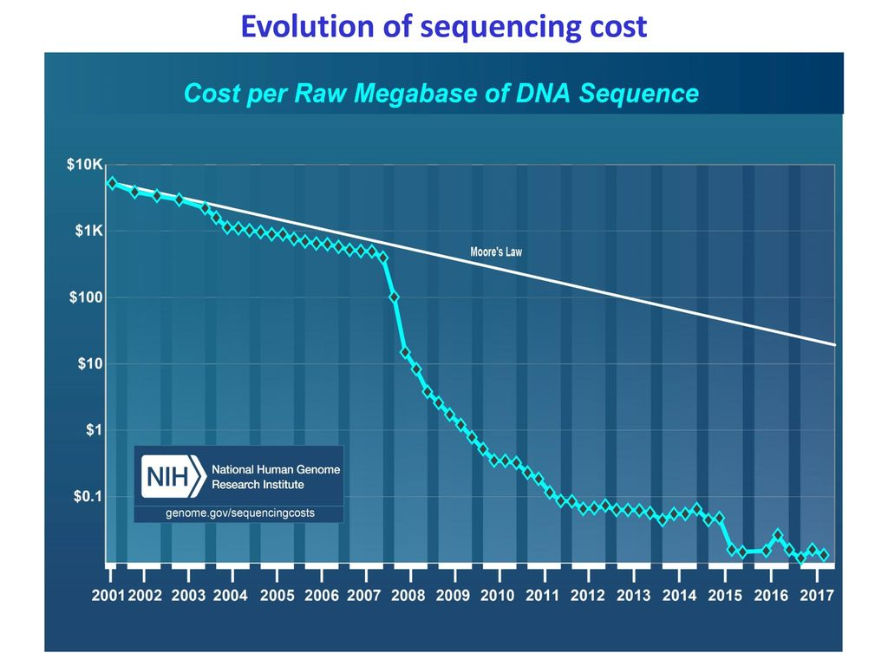

## 1 Introduce

[Twenty years of bacterial genome sequencing.pdf](<file/Twenty years of bacterial genome sequencing__ODC_y.pdf> "Twenty years of bacterial genome sequencing.pdf")

[DNA-seq.pdf](file/DNA-seq_qwZbYRbj0m.pdf "DNA-seq.pdf")

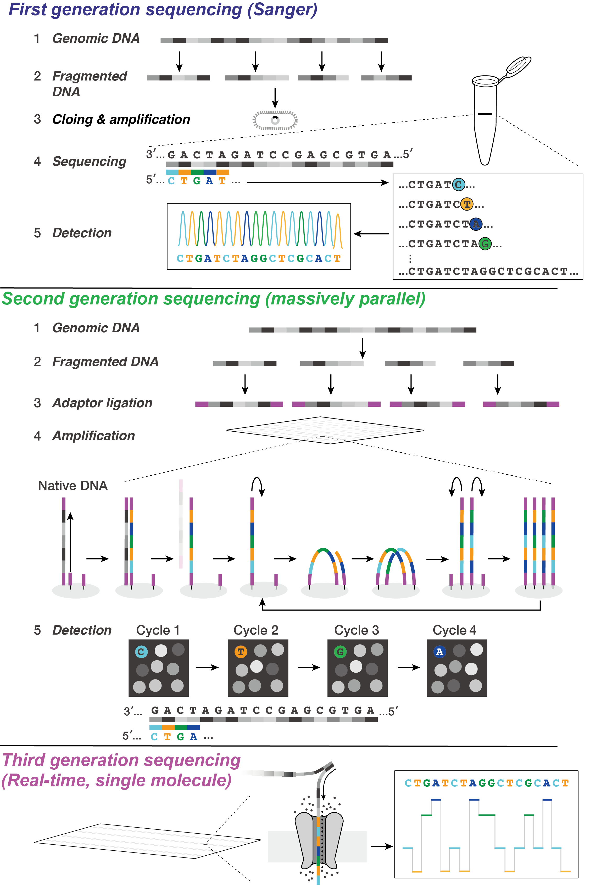

\*\*sanger \*\*→ **NGS** → **long-read sequence**

NGS : **Massive parallel sequencing** or **massively parallel sequencing**&#x20;

> NGS测序也被称为大规模平行测序！

### 1.1 Sanger

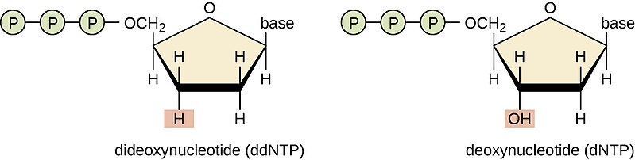

> 由于ddNTP的3'-OH缺失，因此无法在DNA聚合酶的作用下进行DNA聚合！

**Sanger sequencing** is a method of [DNA sequencing](https://en.wikipedia.org/wiki/DNA_sequencing "DNA sequencing") that involves electrophoresis and is based on the random incorporation of chain-terminating [dideoxynucleotides](https://en.wikipedia.org/wiki/Dideoxynucleotide "dideoxynucleotides") by [DNA polymerase](https://en.wikipedia.org/wiki/DNA_polymerase "DNA polymerase") during [in vitro](https://en.wikipedia.org/wiki/In_vitro "in vitro") [DNA replication](https://en.wikipedia.org/wiki/DNA_replication "DNA replication")[^1].

> **Sanger sequencing**是一种基于电泳的 DNA 测序方法，在DNA 聚合酶体外 DNA 复制过程中随机掺入链终止双脱氧核苷酸。

反应体系中掺入ddNTP → DNA聚合 → 获得由掺入ddNTP而随机终止的不同长度DNA片段→ 凝胶电泳 → 判断随机终止最后为核苷酸 → 根据片段长度推算出测序片段核苷酸组成

> **一代测序 （** Sanger ：**双脱氧链终止法**）： 在测序反应体系中掺入一定量ddNTP（A T C G ），这样链扩增将会随机在一定长度停止，获得不同长度的链后使用凝胶电泳 & 毛细管凝胶电泳对链进行电泳，已获得不同位置的核酸。

#### 1.1.1  Mamual Sanger

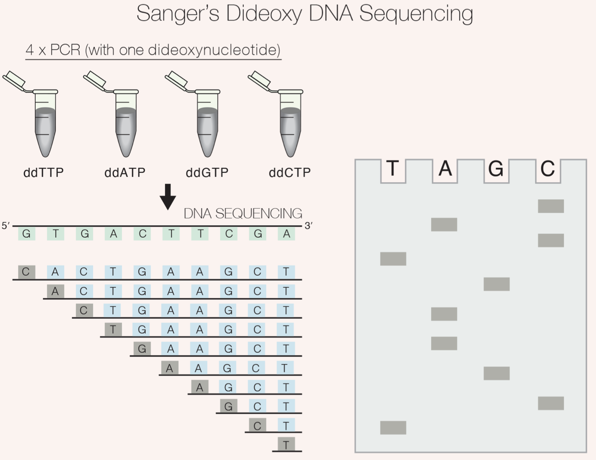

Sanger Sequencing is based on the synthesis of truncated DNA fragments in solution from **multiple DNA templates**, prematurely terminating elongating strands via the stochastic incorporation of labeled dNTPs **lacking a 3′-OH (ddNTP)**. This is the earliest form of the so-called ‘terminator chemistry’, where truncated synthetic DNA strands are size-separated by gel electrophoresis from which the original sequence is reconstructed[^2].

**multiple DNA templates** → 4 type ddNTP  → DNA synthetic → gel electrophoresis → seq

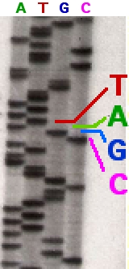

In the image on the right, X-ray film was exposed to the gel, and the dark bands correspond to DNA fragments of different lengths. A dark band in a lane indicates a DNA fragment that is the result of chain termination after incorporation of a dideoxynucleotide (ddATP, ddGTP, ddCTP, or ddTTP). The relative positions of the different bands among the four lanes, from bottom to top, are then used to read the DNA sequence.

> X射线胶片暴露在凝胶上，暗带对应于不同长度的DNA片段。泳道中的暗带表示 DNA 片段，该片段是掺入双脱氧核苷酸（ddATP、ddGTP、ddCTP 或 ddTTP）后链终止的结果。然后使用四个泳道中不同条带从下到上的相对位置来读取 DNA 序列。

#### 1.1.2  A**utomated** Sanger

Sanger sequence main 3 Steps[^3] :&#x20;

> 基于荧光基团Sanger测序主要由以下3步组成：

1. DNA SEQUENCE FOR CHAIN TERMINATION PCR
   > 在添加了带有荧光基团的ddNTP 、待测序序列（作为模版序列）、DNA聚合酶、测序引物的反应体系中进行链终止PCR反应；
2. SIZE SEPARATION BY GEL ELECTROPHORESIS
   > 对链终止PCR获得的产物进行毛细管凝胶电泳，以将不同长度的产物分离；
3. GEL ANALYSIS & DETERMINATION OF DNA SEQUENCE
   > 根据不同大小链终止PCR产物终止位置带有荧光基团的核苷酸检测，最终获得待测序序列全长。

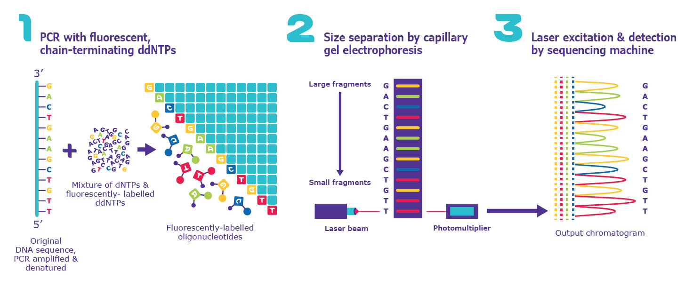

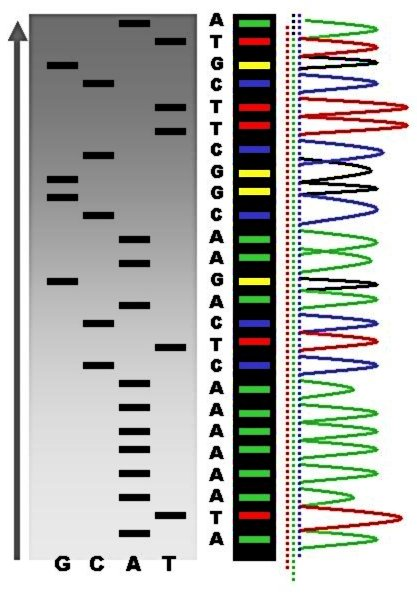

> 目标片段、[DNA聚合酶](https://zh.wikipedia.org/wiki/DNA聚合酶 "DNA聚合酶")、测序[引物](https://zh.wikipedia.org/wiki/引物 "引物")、四种[dNTP](https://zh.wikipedia.org/w/index.php?title=DNTP\&action=edit\&redlink=1 "dNTP")和一种特定类型荧光（或放射性同位素）标记的[ddNTP](https://zh.wikipedia.org/wiki/DdNTP "ddNTP")（即不同的反应中分别为[ddATP](https://zh.wikipedia.org/wiki/DdATP "ddATP")、[ddGTP](https://zh.wikipedia.org/wiki/DdGTP "ddGTP")、[ddCTP](https://zh.wikipedia.org/wiki/DdCTP "ddCTP")及[ddTTP](https://zh.wikipedia.org/wiki/DdTTP "ddTTP")）

> 在ddNTP的基础上添加荧光基团，在

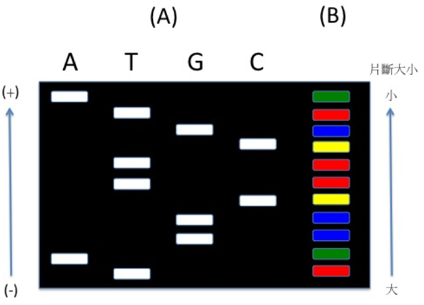

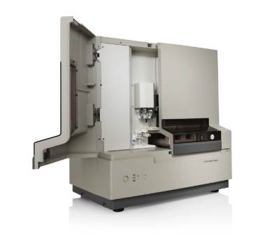

[Applied Biosystems® 3130:3130xl Genetic Analyzers.pdf](<file/Applied Biosystems® 3130-3130xl Genetic Analyzers_.pdf> "Applied Biosystems® 3130:3130xl Genetic Analyzers.pdf")

#### 1.1.3 manual vs **automated** Sanger

In **manual** Sanger sequencing, four PCR reactions are set up, each with only a single type of ddNTP ((**ddATP**, **ddTTP**, **ddGTP**, and **ddCTP**) mixed in.

In **automated** Sanger sequencing, all ddNTPs are mixed in a single reaction, and each of the four dNTPs has a unique fluorescent label.

> 手动sanger测序中会在分别含有ddNTP (**ddATP**, **ddTTP**, **ddGTP**, and **ddCTP**)的4个反应体系中分别进行链终止PCR反应，而在自动sanger测序则会在荧光体系中添加4中ddNTP 进行反应。

#### 1.1.4 Sanger seq advantage & disadvantage

it can produce DNA sequence reads of > 500 [nucleotides](https://en.wikipedia.org/wiki/Nucleotide "nucleotides") and maintains a very low error rate with accuracies around 99.99%[^4].

> 由NGS测序相比，其那个对500 nt 的核苷酸片段进行测序，并且其错误率超级低！

Common challenges of DNA sequencing with the Sanger method include poor quality in the first 15-40 bases of the sequence due to primer binding and deteriorating quality of sequencing traces after 700-900 bases.&#x20;

> 由于测序引物的结合Sanger测序前15-40个碱基质量较差，700-900位置碱基质量也较差！

### 1.2 NGS

sequencing by synthesis (SBS)

The objective for sequential sequencing by synthesis (SBS) is to determine the sequencing of a [DNA](https://en.wikipedia.org/wiki/DNA "DNA") sample by detecting the incorporation of a [nucleotide](https://en.wikipedia.org/wiki/Nucleotide "nucleotide") by a [DNA polymerase](https://en.wikipedia.org/wiki/DNA_polymerase "DNA polymerase").[^5]

> NGS 测序是基于SBS (边合成边测序)方法，其通过检测DNA聚合酶对于核苷酸的掺入情况对DNA序列进行测序！

**Next-generation sequencing (NGS)** is a new technology used for DNA and RNA sequencing and variant/mutation detection. NGS can sequence hundreds and thousands of genes or whole genome in a short period of time. The sequence variants/mutations detected by NGS have been widely used for disease diagnosis, prognosis, therapeutic decision, and follow up of patients[^6].

> NGS可以在短时间内对成白上千的基因 or 基因组进行测序。现阶段NGS一倍广泛应用于疾病诊断 & 预后。

#### 1.2.1 NGS sequence

**DNA fragmentation** → **library preparation** → **massive parallel sequencing**

> **NGS** 测序主要包括3步：***1.DNA片段化***；**2.建库**；3.测序！

##### **DNA fragmentation**

DNA fragmentation is used to break the targeted DNA into many short segments, usually 100–300 bp in length. Different methods can be used to achieve this. DNA can be fragmented using mechanical methods, enzymatic digestion, or other methods[^7].

> DNA片段化一般使用物理（超声波）或者酶学方法将提取得到的DNA/RNA序列片段化为100-300bp。

##### 1.2.1.2 building library

add adapter & index → PCR扩增 → library

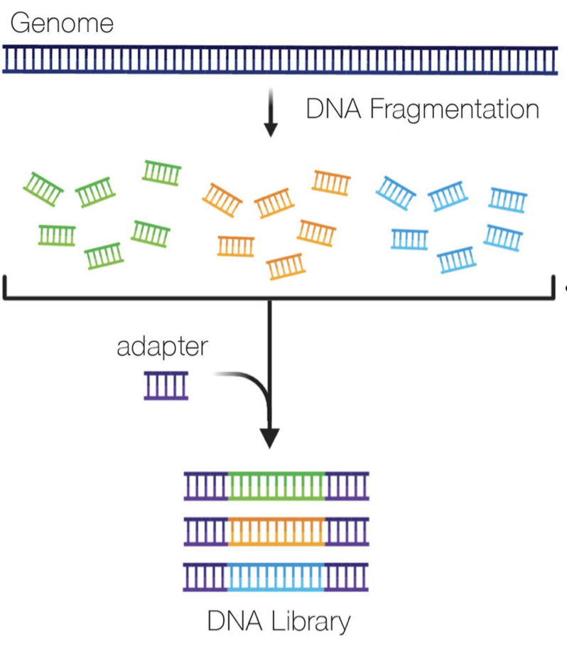

Library preparation is a process by which DNA segments are modified so that each DNA sample can have a sample-specific index like sample identification which helps to identify the patient from whom DNA sequencing was performed.&#x20;

> 完成DNA片段化后，就要需要在片段化序两大添加adapter & index → PCR扩增 → library
>
> - ATAC-seq building library methods :&#x20;
>
>    developed by Illumina. DNA library preparation using a transposase-based method (Nextera) developed by Illumina. ")

- **Illumina (Solexa) sequencing**

  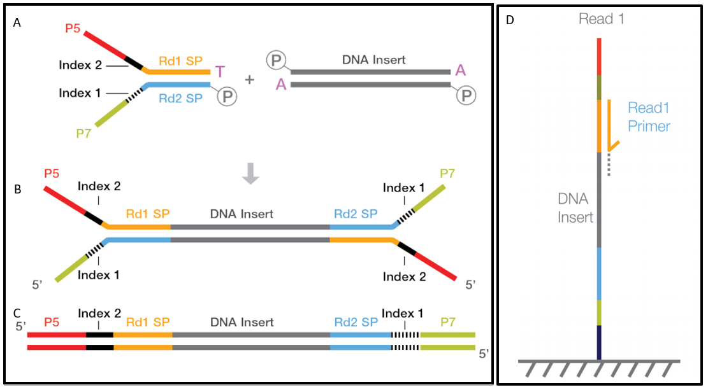

  **Illumina** 在获得DNA library (cDNA library)后，需要进行PCR扩增以进行最后的测序
  1. Template binding : DNA library中的人工添加的P5 / P7序列会与flow cells上的测序引物结合；
  2. Bridge amplification: DNA colony generation (Bridge amplification) : 桥式扩增！完成 Template binding后，在flow cells上存在的P5 / P7序列接头发基础上进行桥式PCR扩增！
  3. Cluster generation : Bridge amplification后会在flow cells的特定位置生成一个一个DNA序列的cluster !

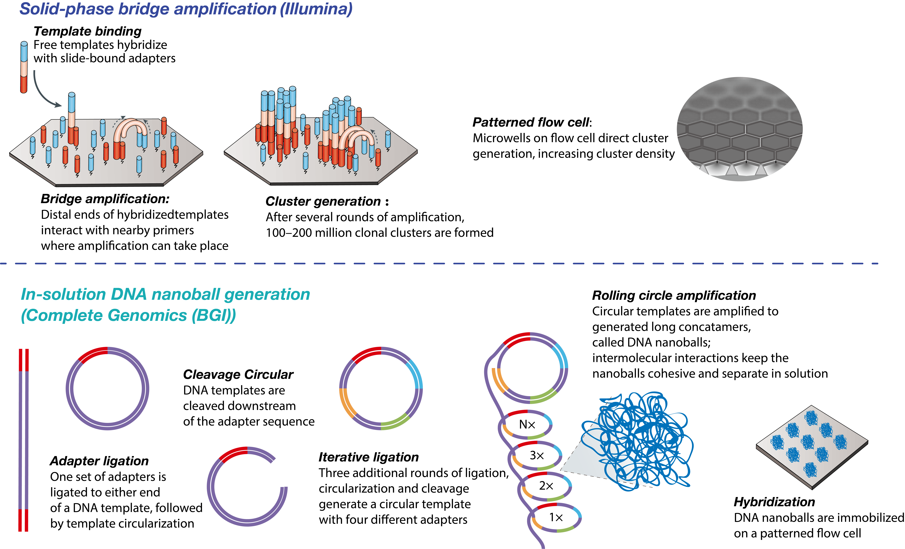

[NGS.pdf](file/NGS_IruaYXxWkI.pdf "NGS.pdf")

#### 1.2.2 sequencing by synthesis (SBS)

Solexa developed a sequencing technology based on dye terminators.

1. **Nucleotide addition**  ：Fluorophore-labelled, terminally blocked nucleotides hybridize to complementary base. Each cluster on a slide can incorporate a different base.&#x20;
   > 带有荧光标签的终止核苷酸与特定Cluster上匹配位置结合 ；
   > Each *nucleotide* is *blocked* by a 3′-O-allyl group and some of the bases are *labelled* with a base-specific, cleavable *fluorophore*.
   > 每个核苷酸都被 3'-O-烯丙基封闭，因只能在上一部基上添加一个带有荧光基团的碱基；
2. **Imaging** ：Slides are imaged with either two or four laser channels. Each cluster emits a colour corresponding to the base incorporated during this cycle.&#x20;

   dNTP identification is achieved through total internal reflection fluorescence (TIRF) microscopy using either two or four laser channels.
   > 完成核苷酸添加后测序仪使用激光通道对核苷酸中带有的荧光进行激发 → 根据荧光发给情况对核苷酸类型进行判断。
3. **Cleavage** ： Fluorophores are cleaved and washed from flow cells and the 3′-OH group is regenerated. A new cycle begins with the addition of new nucleotides.
   > 完成核苷酸检测后将3'-O-烯丙基清洗掉 →  3′-OH  重生 → 进行新一轮测序反应！

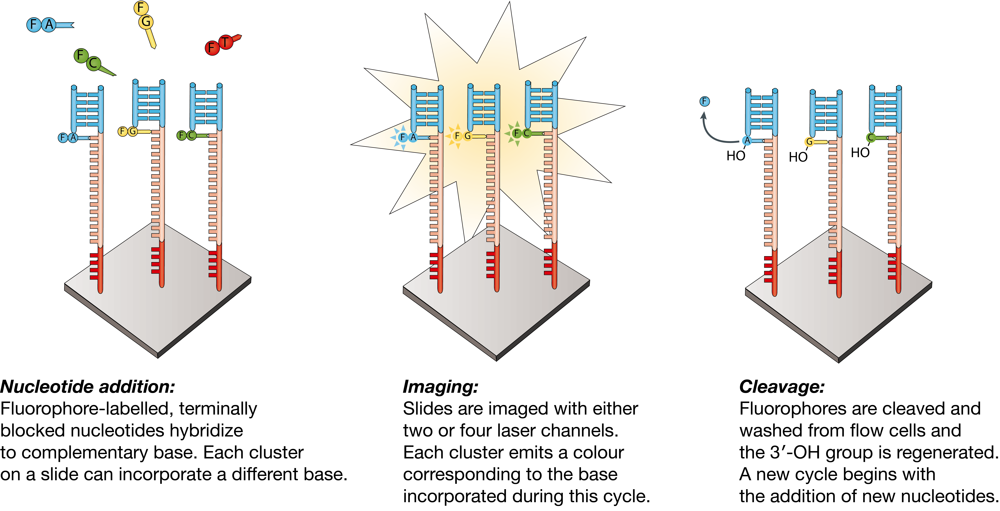

[Illumina.pdf](file/Illumina_VNKbIoUmVY.pdf "Illumina.pdf")

#### 1.2.3 DNA nanoball technology

> BGISEQ 平台将 DNB 加载到图案化阵列上，并利用组合探针锚定合成 (cPAS) 进行测序[^8]。独特的DNB技术采用**Phi29聚合酶**，具有很强的链置换活性，以及​​滚环复制（RCR）过程，实现线性扩增；通过使用原始的圆形（单链环）模板，每个扩增循环保持独立。
>
> 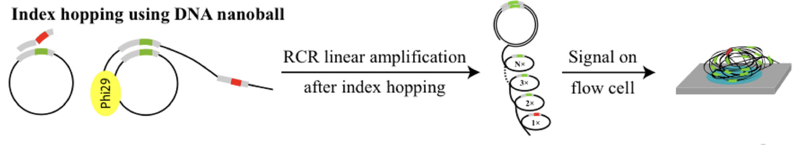

DNB = **DNA nanoball technology**

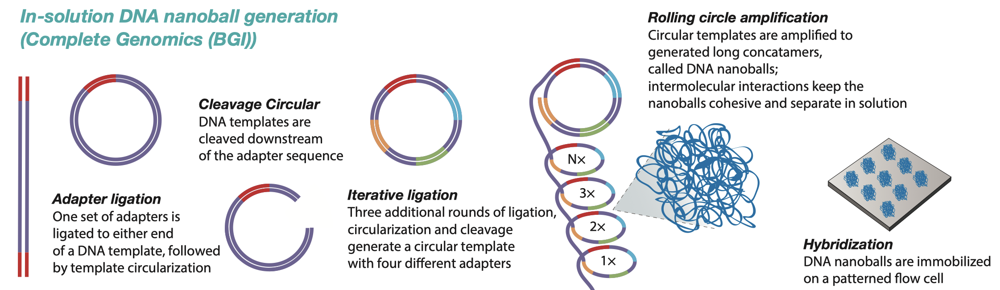

1\) DNA fragmentation, 2) end repair and A-tailing, 3) indexed adapter ligation, 4) PCR amplification, 5) single-stranded circle (ssCir) formation, and 6) DNB preparation[^9].

> DNB 建库的一般流程：&#x20;
>
> **DNA fragmentation** → **end repair and A-tailing(末端修复)** → **连接接头** → **PCR扩增** → \*\*ssCir 生成 \*\*→ DNB 制备

### 1.3 Long-read

当前的测序 技术除了NGS中的短读长测序，还发展出了以Oxford Nanopore Technologies 公司的Nanopore与PacBio的SMRT测序技术，其可以对mRNA的全长进行测序。

Long- read cDNA sequencing ： ambiguity in the mapping of sequence reads is reduced, and longer transcripts can be identified, which leads to a more complete capture of isoform diversity. Also reduced is the high rate of false-positive splice-junction detection by many short-read RNA-seq computational tools[^10].

> Long- read cDNA sequencing 可以对长转录本进行直接鉴定，其能够较好的解决在short-read cDNA sequencing检测可变剪切中存在假阳性的问题。

**Nanopore 测序技术原理**：纳米孔测序主要是利用电泳的方式将一个未知序列的样品输送穿过一个直径约1纳米孔。这个纳米孔系统会借由施以固定的外加电场在电解液上产生的可检测电流信号，其穿过纳米孔的电流信号强弱则会与纳米孔孔径大小及通过此纳米孔核酸的组成有关。

**SMRT 测序技术原理**：SMRT 技術得以實現有賴於 zero-mode waveguide (ZMW) 技術之成熟。ZMW 是一個僅有 20 zeptoliter (10-21 liter) 之大小的孔洞，此空間僅容納數個分子，故可以做到單一 DNA 長鏈定序。透過將 ZMW 表面進行化學修飾後，使得 DNA 聚合酶 (polymerase) 可以被放置於 ZMW 中，當 DNA 聚合酶進行聚合反應時利用光源以毫秒 (millisecond) 快速的進行照射，可以減少螢光訊號損失並可即時 (real-time) 偵測 DNA 聚合時產生的螢光。

### 1.4 Main sequencing platforms

#### 1.4.1 sequences of adapters / primers

[sequences of adapters / primer](<sequences of adapters - primer/sequences of adapters - primer.md> "sequences of adapters / primer")

***

## 2 Question

### 2.1 Question-1: what cause poly-G from NextSeq?

> This is because NextSeq uses a two-colour chemistry system, different from the HiSeq series that use a **four-colour system**[^11][^12][^13].
>
> In the two-colour system:
>
> 1. **Green** denotes T
> 2. **Red** denotes C
> 3. \*\*Yellow \*\*(Green + Red) denotes A
> 4. **Black** ( No Green, no Red) denotes `G`
>
> **As the sequencing by synthesis (SBS) goes on cycle by cycle, the signal strength will decrease. When the signal is too weak to be detected, it will be recognised as a G in the base calling stage, which causes a sequencing error**. This is why you may see a lot of polyG in the read tails.
>
> This is why so many polyG in NextSeq, and I have two news for this issue:
>
> 1. &#x20;NovaSeq also has the same issue, since it's also a\*\* two-colour system.\*\*
> 2. I have developed a tool to address this issue automatically, which is called [fastp](https://github.com/OpenGene/fastp "fastp"). fastp is designed to provide fast all-in-one preprocessing for FastQ files. This tool is developed in C++ with multithreading supported to afford high performance.

***

## 3 Source

[Sequencing technologies the next generation.pdf](<file/Sequencing technologies the next generation_11rDlH.pdf> "Sequencing technologies the next generation.pdf")

[Coming of age- ten years of nextgeneration sequencing technologies.pdf](<file/Coming of age- ten years of nextgeneration sequenc.pdf> "Coming of age- ten years of nextgeneration sequencing technologies.pdf")

[Library construction for next-generation sequencing- Overviews and challenges.pdf](<file/Library construction for next-generation sequencin.pdf> "Library construction for next-generation sequencing- Overviews and challenges.pdf")

***

## 4 Reference

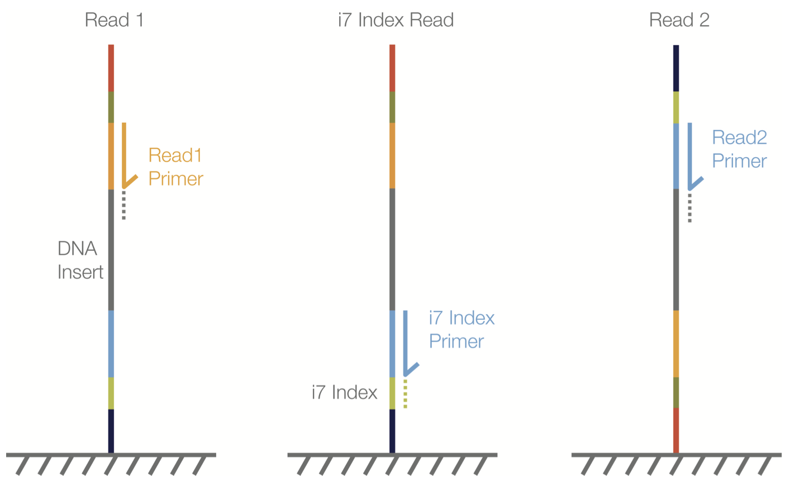

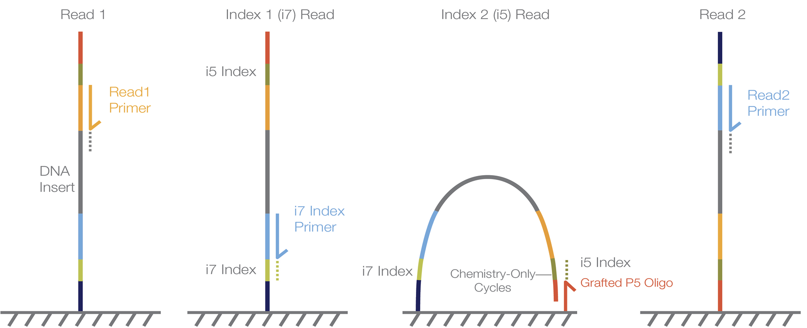

[Indexed Sequencing.pdf](<file/Indexed Sequencing_IBzifTkROt.pdf> "Indexed Sequencing.pdf")

[^1]: [https://en.wikipedia.org/wiki/Sanger\_sequencing](https://en.wikipedia.org/wiki/Sanger_sequencing "https://en.wikipedia.org/wiki/Sanger_sequencing")

[^2]: Developing an enabling reversible terminator chemistry

[^3]: [https://www.sigmaaldrich.com/HK/zh/technical-documents/protocol/genomics/sequencing/sanger-sequencing](https://www.sigmaaldrich.com/HK/zh/technical-documents/protocol/genomics/sequencing/sanger-sequencing "https://www.sigmaaldrich.com/HK/zh/technical-documents/protocol/genomics/sequencing/sanger-sequencing")

[^4]: Next-generation DNA sequencing

[^5]: [https://en.wikipedia.org/wiki/Massive\_parallel\_sequencing](https://en.wikipedia.org/wiki/Massive_parallel_sequencing "https://en.wikipedia.org/wiki/Massive_parallel_sequencing")

[^6]: Next-generation sequencing and its clinical application

[^7]: Systematic comparison of three methods for fragmentation of long-range PCR products for next generation sequencing

[^8]: A reference human genome dataset of the BGISEQ-500 sequencer.

[^9]: Reliable multiplex sequencing with rare index mis-assignment on DNB-based NGS platform

[^10]: RNA sequencing: the teenage years

[^11]: [https://www.illumina.com/science/technology/next-generation-sequencing/sequencing-technology/2-channel-sbs.html#:\~:text=×-,4-channel chemistry uses a mixture of nucleotides labeled with,software to determine nucleotide identity](<https://www.illumina.com/science/technology/next-generation-sequencing/sequencing-technology/2-channel-sbs.html#:~:text=×-,4-channel chemistry uses a mixture of nucleotides labeled with,software to determine nucleotide identity> "https://www.illumina.com/science/technology/next-generation-sequencing/sequencing-technology/2-channel-sbs.html#:~:text=×-,4-channel chemistry uses a mixture of nucleotides labeled with,software to determine nucleotide identity").

[^12]: [https://www.ecseq.com/support/ngs/do\_you\_have\_two\_colors\_or\_four\_colors\_in\_Illumina](https://www.ecseq.com/support/ngs/do_you_have_two_colors_or_four_colors_in_Illumina "https://www.ecseq.com/support/ngs/do_you_have_two_colors_or_four_colors_in_Illumina")

[^13]: [https://www.biostars.org/p/294612/#294753](https://www.biostars.org/p/294612/#294753 "https://www.biostars.org/p/294612/#294753")
