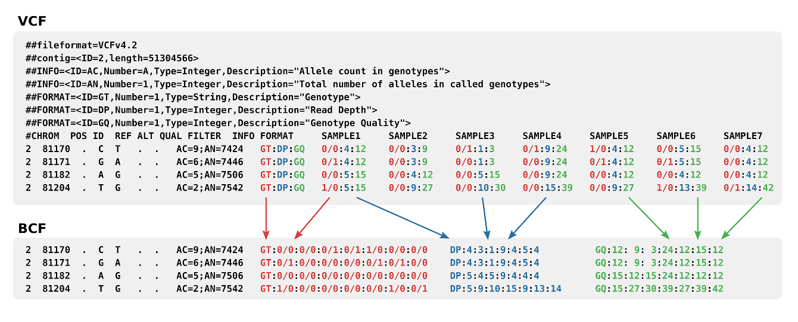

# VCF/BCF

## 目录

- [1 Introduce](#1-Introduce)
  - [1.1 VCF/BCF](#11-VCFBCF)
  - [1.2 VCF/BCF Structure](#12-VCFBCF-Structure)
    - [1.2.1 VCF/BCF & SV](#121-VCFBCF--SV)
  - [1.3 Variant Normalization](#13-Variant-Normalization)
  - [vcftools/bcftools](#vcftoolsbcftools)
- [2 Tutorial](#2-Tutorial)
  - [2.1 bcftools](#21-bcftools)
  - [2.2 Python Ecosystem](#22-Python-Ecosystem)
- [3 Source](#3-Source)
- [4 Reference](#4-Reference)

***

***Author***\*\* : zhang jian\*\*​

***Date***\*\* : 2025-8-26\*\*​

***Version***\*\* : \*\***`1.0v`**

***

## 1 Introduce

### `1.1 VCF`/`BCF`

`VCF`文件是存储变异结果的标准格式，一般多用于单核苷酸变异`SNP`或小片段的插入缺失`indels`的结果记录,除此之外，`vcf`文件也可以存储其他变异形式，比如`CNV`（拷贝数变异）、`SV`（结构变异）[^1]。`VCF`格式是在`2010`年为`1000 Genomes Project`开发并推广滴，并且自那以后已被其他大规模基因分型和DNA测序项目所使用[^2][^1]。由于其相对**简单性**和**可扩展性**，`VCF` 是变体调用程序的常见输出格式。

`BCF`是 `VCF` 的二进制版本。它保留了 `VCF` 中的全部信息，但在处理效率上要高得多，尤其是在处理大量样本时。`BCF` 和 `VCF` 之间的关系，类似于 `BAM`和 `SAM` 之间的关系[^3]。

`VCF`文件现阶段标准目前处于`4.5`版本（2024-08-12）[^4]，尽管`1000 Genomes Project`已经为诸如重复序列等结构变异开发了自己的规范，这些变异不容易被纳入现有的框架[^5]。

> **Tips** : `gvcf` 是 `VCF` 的一种，因此基本格式规范与常规 `VCF` 相同,并且包含额外的 `Genomic VCF `信息。

### `1.2 VCF`/`BCF` Structure

> 🫷`VCF`/`BCF`文件主要由三部分组成：
>
> 
>
> - `Metadata header` : 在VCF中使用`##`开头的行，就是该文件的`Metadata header`；
> - `Column Header Line` : 在VCF中使用`#`开头的行；
> - `Data Rows` : 样本的具体突变信息。

> 🛻`Data Rows`
>
> - **`CHROM`**\*\* (染色体)\*\* : 指明变异所在的染色体名称（例如`chr1`,`chrX`）。
> - **`POS`**\*\* (位置) :\*\* 变异在染色体上的起始坐标（`1-based`）,对于插入和缺失（`Indels`）`1-based`坐标的表示方式需要特别注意。
> - **`ID`**\*\* (标识符) :\*\* 变异的唯一`ID`。最常见的是 `dbSNP` 数据库中的 `rs `号（如`rs12345`）。如果没有可用的`ID`，则用点`.` 表示。
> - **`REF`**\*\* (参考等位基因) :\*\* 参考基因组在这个位置的碱基序列。
> - **`ALT`**\*\* (备选等位基因)\*\* : 检测到的变异碱基序列。如果存在多种变异类型，会用逗号`,` 分隔。
> - **`QUAL`**\*\* (质量值) **: 对这个变异存在的置信度打分，以 `Phred-scaled `分数表示。计算公式是$−10log10(P)$，其中 `P` 是变异判定错误的概率。分数越高，变异越可靠。不同软件的结果间没有可比性。同时当**`QUAL=20`\*\* 时,表明该位点的错误率为`1%`。
> - `FILTER` (过滤状态):表明该变异位点是否通过了所有的过滤标准。如果通过，则标记为`PASS`。如果未通过某个或某些过滤，则会在这里注明未通过的过滤器名称（例如`LowQual`,`q10`）。这只是一个“标签”，并不会从文件中删除这一行记录。
> - `INFO` (信息):这是一个信息量最大也最灵活的字段，包含了关于该变异的各种注释信息。它由一系列以分号`;`分隔的键值对 (`key=value`) 组成。

> 🚉`INFO`
>
> - **`Genotype`**\*\* (****`GT`****)\*\*
>
>   `GT`（`Genotype`，基因型）：表示每个样本在变异位点上的基因型，通常以数字编码表示，如`0/0`表示纯合参考基因型，`0/1`表示杂合基因型，`1/1`表示纯合变异基因型等。同时这里面的数字也是相当于`REF` & `ALT`列而言滴。
>
>   二倍体生物的两条染色体分别来源于父母亲本。理论上，完整的基因组分析旨在获得详细的染色体单倍型信息，但这需要**在标准的`call variant`****分析之后，再进行额外的定相(****`phasing`)分析**才能实现。但是在实际分析中由于亲本数据的缺失和测序质量的限制往往不能够获得测序样本的明确单倍型信息。为了区分这两种情况，`VCF`/`BCF`文件在`GT`列使用`|`与`/`，分别来表示已定相(`phased`)的基因型和未定相(`Unphased`)的**基因型**。同时在`phased`数据中竖线| 左边的数字永远属于第一个单倍型（我们称之为`Haplotype 1`），右边的数字永远属于第二个单倍型（`Haplotype 2`）
> - **`Genotype Quality`****(****`GQ`)**
>
>   **`GQ`****（****`Genotype Quality`，基因型质量得分）**: 表示每个样本基因型的质量得分，用于评估基因型的可靠性。`GQ`是数值越高表示`GT`计算的错误率越低，如果`GQ=20`表明`GT`有`1%`的几率存在错误。在后续分析中也会可以`GQ=20`作为`cutoff`对`variant`进行过滤[^6]。
> - **`Read Depth`**\*\* (****`DP`****)\*\*
>
>   `DP`（`Read Depth`，测序深度）：表示每个样本在变异位点上的测序深度，即覆盖该位点的测序读段数目。同时需要注意该DP是**去除或标记了PCR重复 (deduplication,简称dedup) 之后**的有效测序深度。
>
>   **根据**\*\*`biostars`****论坛中关于****`DP cutoff`****汇总的相关信息如下**[^7]**：\*\*
>   | **应用领域 (Application)** ​ | **DP Cutoff 推荐值**​ | **核心原因 (Key Rationale)** ​               |
>   | ------------------------ | ------------------ | ---------------------------------------- |
>   | 临床遗传学                    | 18× (最低), 30× (最佳) | 种系突变频率高 (50%/100%)，30× 已足够准确，过高深度可能引入噪音。 |
>   | 科研环境                     | 10× 或更低            | 容忍更高的错误率以换取成本效益和通量，主要用于探索性研究。            |
>   | 癌症/液体活检                  | 远高于 30× (如 500×+)  | 需要极高灵敏度来检测存在于少数细胞中的低频体细胞突变。              |
> - **`Allele Frequency`**\*\* (****`AF`****)\*\*
>
>   **`AF`****(****`Allele Fraction`,等位基因分数)**是衡量的是在**单个测序样本**中，支持变异的 `reads` 占总 `reads` 的比例(这个好像也不咋地准确)。&#x20;
>
>   $群体AF = (所有样本中变异等位基因的总数) / (所有样本中等位基因的总数)$
>   ```markdown title="群体AF"
>   NFO                       FORMAT       NA00001         NA00002          NA00003
>   NS=3;DP=14;AF=0.5;DB;H2   GT:GQ:DP:HQ  0|0:48:1:51,51  1|0:48:8:51,51   1/1:43:5:.,.
>   ```
>
>   $样本AF = (变异reads) / (所有reads的总数)$
>   ```markdown title="样本AF"
>             M19D7748W1L1              M19D7748W1B1
>   GT:AD:AF  0/1:435,4:0.00911162      0/0:114,0:0
>   ```
>
> - `Allelic Depths` (`AD`)
>
>   `AD`（`Allelic Depths`，等位基因深度）：表示每个样本中每个等位基因的深度，可以用于估计每个等位基因的相对丰度。
> - `Phred-scaled Likelihoods`(`PL`)
>
>   `PL`（`Phred-scaled Likelihoods`，似然比得分）：表示每个样本基因型的似然比得分，用于评估不同基因型的可能性。
> - `Allelic Depth for Each Allele` (`ADP`)
>
>   `ADP`（`Allelic Depth for Each Allele`，每个等位基因的深度）：表示每个样本中每个等位基因的深度，与AD字段类似，但提供了更详细的等位基因深度信息。
> - `Counts for Each Allele` (`DP4`)
>
>   `DP4`（`Counts for Each Allele`，每个等位基因的计数）：表示每个样本中每个等位基因的计数，包括正向链和负向链的计数。

> **Tips** : `bcf` 与`vcf`文件在样本`INFO` 部分存在区别，两者`INFO`差异见下图所示：
>
> 

#### `1.2.1 VCF`/`BCF` & `SV`

结构变异（`Structural variation`）又称为基因体结构变异，是生物染色体上结构的变异，由一个物种基因体中的多种变异所组成，通常包括微观和亚微观类型，如缺失、重复、拷贝数变异、插入、倒位和易位等[^8]。

`vcf`文件也支持结构变异，但是其人工阅读难度和可解析度其实都不太尽如人意。主流的注释工具更多的支持`bed`或其他格式的结构突变结果[^9]。下面为使用`manta` 分析的`tumor-normal`样本的`SV`结果。

```markdown title="SV & VCF"
.........
##INFO=<ID=IMPRECISE,Number=0,Type=Flag,Description="Imprecise structural variation">
##INFO=<ID=SVTYPE,Number=1,Type=String,Description="Type of structural variant">
##INFO=<ID=SVLEN,Number=.,Type=Integer,Description="Difference in length between REF and ALT alleles">
##INFO=<ID=END,Number=1,Type=Integer,Description="End position of the variant described in this record">
.........
#CHROM  POS  ID  REF  ALT  QUAL  FILTER  INFO
chr1  939570  MantaINS:48551:0:0:0:0:0  T  TCCCTGGAGGACC  .  .  END=939570;SVTYPE=INS;SVLEN=12;CIGAR=1M12I;CIPOS=0,4;HOMLEN=4;HOMSEQ=CCCT;UPSTREAM_PAIR_COUNT=0;DOWNSTREAM_PAIR_COUNT=0;PAIR_COUNT=0

```


> **NOTE : Manta SVTYPE :**
>
> - `SVTYPE=DEL`: 缺失(deletions);
> - `SVTYPE=DUP`: 重复 (duplications);
> - `SVTYPE=INS`: 插入(insertions);
> - `SVTYPE=BND`: 倒位 (inversions) 与 易位 (translocations)&#x20;

### 1.3 Variant Normalization

`vcf`/`bcf` 可以方便记录和表述样本的突变情况，但是实践中不同变异检测工具对变异判定的区别，会造成对于同一个变异信息存在不同纪录的可能性（尤其是`Indels`类型记录）。因此为赋予相同的`variant`唯一`ID`就提出了`Variant Normalization`方法。其通过使用`Parsimony` 与`Left Alignment`方式实现了`variant`标准化[^10]。

> 🐎\*\*`Variant Normalization`(变异标准化)的最终目标是：确保同一个基因变异，有且仅有一种规范的、无歧义的表示方式。\*\*​
>
> - \*\*简约性 (****`Parsimony`****) \*\*: 以最简洁的方式表示变异;
>
>   `POS: 100, REF: ATCG, ALT: AT`这里`REF`和`ALT`有共同的前缀`AT`。标准化后，去掉前缀`AT`，同时`POS` 位置需要相应后移2位：`POS: 102, REF: CG, ALT: ""`
> - **左对齐 (****`Left Alignment`****)** : 对于插入和缺失 (`Indels`)，其位置应尽可能地向基因组的左侧（坐标小的方向）移动。
>   ```markdown title="左对齐 (Left Alignment) "
>   ... A C T C T C T G ... # REF 序列
>       1 2 3 4 5 6 7 8
>   ... A C T C T G ...     # ALT 序列
>   # A (未对齐):POS: 5, REF: TCT, ALT: T
>   # B (未对齐):POS: 7, REF: TCT, ALT: T
>   # C (左对齐):POS: 3, REF: TCT, ALT: T
>
>   ```
>
>
> 如要需要对VCF数据进行标准化，可以使用`bcftools norm`命令进行
>
> ```bash title="vcf normalization"
> # 使用 bcftools 对 vcf 结果进行标准化
> bcftools norm -f ref.fa in.vcf -O z > out.vcf.gz
> ```
>

### **`vcftools`/**`bcftools`

为了高效处理`VCF`/`BCF`变异文件,开发了对应的处理软件`vcftools`/`bcftools`。\*\*`VCFtools`**是在2011年与`VCF`格式一同发布的。而**`BCFtools`\*\*最初是作为`SAMtools`的一部分，直到2014年才被拆分成一个独立的软件包[^11]。

> ⛄**`vcftools`****/****`bcftools`功能：**
>
> - **过滤特定变异 (Filter out specific variants)**
> - **比较文件 (Compare files)**
> - **汇总/统计变异信息 (Summarize variants)**
> - **文件格式转换 (Convert to different file types)**
> - **验证和合并文件 (Validate and merge files)**
> - **提取变异的交集与子集 (Create intersections and subsets of variants)**

***

## 2 Tutorial

### 2.1 bcftools

**`BCFtools`** 是一个用于变体（`Variant`）调用和操作变体调用格式（Variant Call Format，简称 VCF）文件及其二进制格式（BCF）的程序。这个程序支持对 VCF 和 BCF 文件进行操作，无论是未压缩的还是使用了 BGZF 压缩算法压缩的文件。**`BCFtools`** 的所有命令都能够无缝地与这些文件格式一起工作，无论是它们是压缩的还是未压缩的状态[^12]。

[bcftools](https://www.wolai.com/4VxQMAaGpFWbqh8rMRdfrV "bcftools")

### 2.2 Python Ecosystem

随着`python`生态的不断完善，现阶段已经拥有很多可以直接在`python`代码中处理`VCF`的包啦

> 💸`Pysam`
>
> > **NOTE** : 个人感觉`Pysam` 用起来比`bcftools`的灵活性强很多！
>
> > `Pysam`是一个基于**htslib**的C语言应用程序编程接口(C-API) ,提供了读写多种生物信息学文件格式的功能，包括序列对齐格式(SAM)、二进制序列对齐格式(BAM)、变异调用格式(VCF)、二进制变异调用格式(BCF)、浏览器可扩展数据(BED)、基因组特征格式(GFF)、基因组传输格式(GTF)、核酸序列(FASTA)和快速质量(FASTQ)文件,同时支持通过索引进行压缩和随机访问。
>
> [pysam](https://www.wolai.com/pgho5ELUb6ogGubbrFBUSv "pysam")

> 💸`vcfpy`
>
> > vcf文件读取 & 写入 Python 包`vcfpy`：
> >
> > [ Welcome to VCFPy’s documentation! — vcfpy 0.11.2+0.g697768d.dirty documentation  https://vcfpy.readthedocs.io/en/stable/index.html](https://vcfpy.readthedocs.io/en/stable/index.html " Welcome to VCFPy’s documentation! — vcfpy 0.11.2+0.g697768d.dirty documentation  https://vcfpy.readthedocs.io/en/stable/index.html")

***

## 3 Source

> **VCF Format :**
>
> [The Variant Call Format Specification v4.5.pdf](<file/The Variant Call Format Specification v4.5_exHXzf-.pdf> " The Variant Call Format Specification v4.5.pdf")

***

## 4 Reference

[^1]: "The variant call format and VCFtools"

[^2]: "The Race to Build a Search Engine for Your DNA"

[^3]: [https://evomics.org/vcf-and-bcf/](https://evomics.org/vcf-and-bcf/ "https://evomics.org/vcf-and-bcf/")

[^4]: "Specifications of SAM/BAM and related high-throughput sequencing file formats"

[^5]: "Encoding Structural Variants in VCF (Variant Call Format) version 4.0 | 1000 Genomes"

[^6]: Nielsen R, Paul J S, Albrechtsen A, et al. Genotype and SNP calling from next-generation sequencing data\[J]. Nature Reviews Genetics, 2011, 12(6): 443-451.

[^7]: [https://www.biostars.org/p/278020/#278031](https://www.biostars.org/p/278020/#278031 "https://www.biostars.org/p/278020/#278031")

[^8]: [https://en.wikipedia.org/wiki/Structural\_variation](https://en.wikipedia.org/wiki/Structural_variation "https://en.wikipedia.org/wiki/Structural_variation")

[^9]: [http://www.xtaohub.com/BI-solutions/vcf-file-format.html](http://www.xtaohub.com/BI-solutions/vcf-file-format.html "http://www.xtaohub.com/BI-solutions/vcf-file-format.html")

[^10]: [https://genome.sph.umich.edu/wiki/Variant\_Normalization](https://genome.sph.umich.edu/wiki/Variant_Normalization "https://genome.sph.umich.edu/wiki/Variant_Normalization")

[^11]: "Twelve years of SAMtools and BCFtools"

[^12]: [https://samtools.github.io/bcftools/howtos/index.html](https://samtools.github.io/bcftools/howtos/index.html "https://samtools.github.io/bcftools/howtos/index.html")
