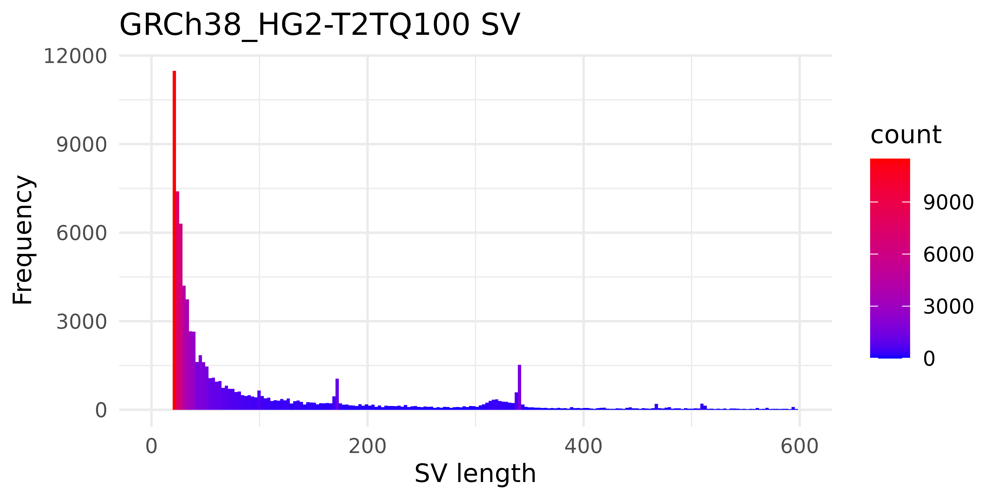
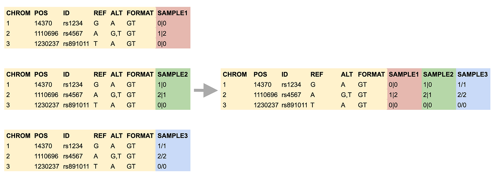
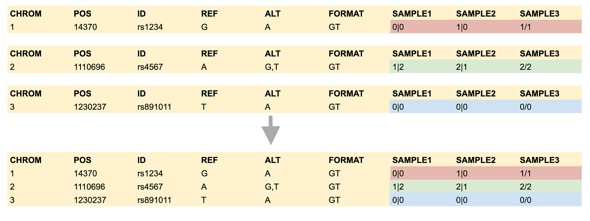

# bcftools

## 目录

- [1 Introduce](#1-Introduce)
  - [1.1 bcftools](#11-bcftools)
  - [1.2 bcftools function](#12-bcftools-function)
  - [1.3 bcftools command](#13-bcftools-command)
- [2 install](#2-install)
  - [2.1 github](#21-github)
  - [2.2 mamba](#22-mamba)
- [3 tutorial](#3-tutorial)
  - [3.1 Indexing](#31-Indexing)
  - [3.2 VCF/BCF manipulation](#32-VCFBCF-manipulation)
    - [3.2.1 sort](#321-sort)
    - [3.2.2 reheader](#322-reheader)
    - [3.2.3 annotate](#323-annotate)
    - [3.2.4 view](#324-view)
    - [3.2.5 filter](#325-filter)
  - [3.3 query](#33-query)
  - [3.4 merge](#34-merge)
    - [3.4.1 Bcftools Concat vs Bcftools Merge](#341-Bcftools-Concat-vs-Bcftools-Merge)
  - [3.5 mpileup & call](#35-mpileup--call)
  - [3.6 VCF/BCF analysis](#36-VCFBCF-analysis)
- [4 Reference](#4-Reference)

> **NOTE** : `bcftools`的功能复杂度**Max** ! (**ps:但是其可以实现的功能也超级多**)

***

## 1 Introduce

### 1.1 bcftools

**`BCFtools`** 是一个用于变体（`Variant`）调用和操作变体调用格式（Variant Call Format，简称 VCF）文件及其二进制格式（BCF）的程序。这个程序支持对 VCF 和 BCF 文件进行操作，无论是未压缩的还是使用了 BGZF 压缩算法压缩的文件。**`BCFtools`** 的所有命令都能够无缝地与这些文件格式一起工作，无论是它们是压缩的还是未压缩的状态[^1]。

> **NOTE** : `BCFtools` 最开始是内置在`samtools`,后面慢慢从`samtools`独立出来。

### `1.2 bcftools` function

**`Bcftools`** 提供了一系列用于操作和分析 VCF 和 BCF 文件的功能，其中包括：

- 1️⃣ **VCF 和 BCF 格式之间的转换；**
- 2️⃣ **查看和过滤存储在 VCF 和 BCF 文件中的变体数据；**
- 3️⃣ **执行数据操作操作，例如合并和交叉变体集；**
- 4️⃣ **使用附加信息注释变体数据，例如基因和功能影响；**
- 5️⃣ **进行群体水平的分析，例如计算等位基因频率和哈迪 - 温伯格平衡。**

### `1.3 bcftools` command

`bcftools` 是一套工具或实用程序。目前，共有 22 个 bcftools 命令 / 实用程序，它们被分为三个主要组：

> **索引命令:**
>
> **`bcftools index`** vcf/bcf 索引工具

> **VCF / BCF 操作命令:**
>
> **`bcftools annotate`** ：注释和编辑 VCF / BCF 文件;
>
> **`bcftools concat`**：连接来自相同样本集的 VCF / BCF 文件;
>
> **`bcftools convert`**：将 VCF / BCF 文件转换为不同格式并返回;
>
> **`bcftools isec`**：VCF / BCF 文件的交集;
>
> **`bcftools merge`**：合并来自非重叠样本集的 VCF / BCF 文件;
>
> **`bcftools norm`**：左对齐和规范化插入缺失;
>
> **`bcftools plugin`**：用户定义的插件;
>
> **`bcftools query`**：将 VCF / BCF 转换为用户定义的格式;
>
> **`bcftools reheader`**：修改 VCF / BCF 头部，更改样本名称;
>
> **`bcftools sort`**：对 VCF / BCF 文件进行排序;
>
> **`bcftools view`**：VCF / BCF 转换、查看、子集和过滤 VCF / BCF 文件。

> **VCF / BCF 分析命令：**
>
> **`bcftools call`**：SNP / 插入缺失调用；
>
> **`bcftools consensus`**：通过应用 VCF 变异创建共识序列；
>
> **`bcftools cnv`**：HMM CNV 调用；
>
> **`bcftools csq`**：调用变异后果；
>
> **`bcftools filter`**：使用固定阈值过滤 VCF / BCF 文件；
>
> **`bcftools gtcheck`**：检查样本一致性，检测样本交换和污染；
>
> **`bcftools mpileup`**：多路堆积产生基因型似然；
>
> **`bcftools polysomy`**：检测染色体拷贝数；
>
> **`bcftools roh`**：识别自交系（HMM）；
>
> **`bcftools stats`**：生成 VCF / BCF 统计信息。

***

## 2 install

### 2.1 github

```bash title="install form github"
git clone --recurse-submodules https://github.com/samtools/htslib.git
git clone https://github.com/samtools/bcftools.git
cd bcftools
 # The following is optional:
 #   autoheader && autoconf && ./configure --enable-libgsl --enable-perl-filters
make
```


### 2.2 mamba

```bash title="install by mamba "
mamba install bioconda::bcftools -y
```


> **NOTE** : 使用 conda安装的bcftools可能会遇到以下报错（由于`libopenblas.so.0`缺失导致）：
>
> `error`` while loading shared libraries: libopenblas.so.0: cannot open shared object file`
>
> 解决方法：`mamba install anaconda::libopenblas -y`

***

## 3 tutorial

> WARRING  : 在对`vcf` 文件进行处理时需要使用`bgzip`对文件进行压缩，如果使用其他软件进行压缩可能会报错。
>
> ```bash title="vcf压缩"
> # 使用多核心压缩xxxx.vcf文件
> bgzip -@ 12 xxxx.vcf
> ```
>
>
> \*\*HG002\_GRCh38\_TandemRepeats VCF **[^2]**: \*\*
>
> [HG002\_GRCh38\_TandemRepeats\_v1.0.1.vcf.gz](file/HG002_GRCh38_TandemRepeats_v1.0.1.vcf_VUhLZLOvkL.gz "HG002_GRCh38_TandemRepeats_v1.0.1.vcf.gz")

### 3.1 Indexing

`index`  : index VCF/BCF files

```bash title="index parameter"
-c, --csi      # 生成CSI-format的index (默认)
-f, --force    # 覆盖已有index文件
-t, --tbi      # 生成TBI-format是index
```


```bash title="Create VCF index"
(qc) ➜  bcftools   index  HG002_GRCh38_TandemRepeats_v1.0.1.vcf.gz
```


### 3.2 VCF/BCF manipulation

#### 3.2.1 sort

> `Sort` VCF/BCF file

```bash title="sort parameter"
-m, --max-mem <float>[kMG]   # 最大内存使用量 [768M]
-o, --output <file>          # 输出文件名称
-O, --output-type <b|u|z|v>  # b:压缩bcf文件;u:未压缩BCF文件;z压缩vcf文件;v未压缩vCF文件
-T, --temp-dir <dir>         # 临时文件夹
```


```bash title="command"
(qc) ➜  bcftools  sort HG002_GRCh38_TandemRepeats_v1.0.1.vcf.gz  \
                -o HG002_GRCh38_TandemRepeats_v1.0.1.sort.vcf.gz \
                -Oz
```


#### 3.2.2 reheader

> NOTE : 当仅需要对VCF的header进行修改时，可以使用`reheader`进行快速滴修改。

`reheader` : BCF/VCF文件header 修改

```bash title="parameter"
-f, --fai    <file>    # 从.fai文件中更新sequences和lengths信息
-h, --header <file>    # 新的header
-o, --output <file>    # 输出修改的结果
-s, --samples <file>   # 新VCF SAMPLE 名称
    --threads <int>    # 使用的线程数
```


```bash title="Reheader VCF"
#  Write out the header to be modified 
bcftools view -h old.bcf > header.txt
#  Edit the header using your favorite text editor 
vi header.txt
#  Reheader the file 
bcftools reheader -h header.txt -o new.bcf old.bcf
```


#### 3.2.3 annotate

> `annotate` : BCF/VCF文件注释 & 编辑

> **Change VCF ID:**
>
> 使用VCF文件中其他信息修改VCF ID[^3]
>
> `'%SVTYPE\_%CHROM\_%POS'` : 提取VCF文件中的  `SVTYPE` & `CHROM` & `POS`并将其拼接为`VCFID`
>
> ```bash title="change the IDs"
> bcftools annotate --set-id '%SVTYPE\_%CHROM\_%POS' \
>                   GRCh38_HG2-T2TQ100-V1.0.DEL_INS.allpass.vcf \
>                   -o GRCh38_HG2-T2TQ100-V1.0.DEL_INS.allpass.addID.vcf
> # -I, --set-id [+]<format>       set ID column, see man page for details
>
> ```
>
>
> 

#### `3.2.4 view`

> NOTE : 当使用其他软件生成了`vcf.gz`文件，但是在使用bcftools进行处理时报错，可以使用`bcftools` `view`对vcf文件进行格式转换。
>
> ```bash title="bcftools view"
> bcftools view -Oz --threads 20 -o output.vcf.gz \
>               input.vcf.gz
> ```
>

`bcftools`  `view` 可以对VCF文件中特定区域进行提取 & 子集化 & 过滤

```bash title="parameter"
-h, --header-only  # 仅输出VCF的header 
-H, --no-header    # 不输出VCF的header
-l, --compression-level [0-9] # 输出文件的压缩水平
-o, --output       # 输出文件的名称
-O, --output-type  # 输出文件的格式 b:BCF, u:未压缩BCF, z: 压缩VCF, v: 未压缩VCF
-r, --regions      # 提取特定区域的variant (提取的VCF需要进行index)
-R, --regions-file # 提取bed文件中特定区域的variant (提取的VCF需要进行index)
-t, --targets [^]<region>     # 提取不包含特定区域的variant (在提取范围前添加 ^ 字符串)
-T, --targets-file [^]<file>  # 提取不包含bed特定区域的variant (在提取bed文件前添加^字符串)
# SUBSET
-a, --trim-alt-alleles  # 对 VCF 文件中的 ALT（替代等位基因）进行修剪，以移除在 GT（基因型）字段中未观察到的 ALT 等位基因
-I, --no-update         # 对 VCF 文件进行样本子集选择时，避免重新计算或更新一些特定的 INFO 字段
-s, --samples [^]<list> # 从合并文件中提取特定样本（如果在样本名称list前添加 ^ 就是不包含该样本）
-S, --samples-file [^]<file>  # 从合并文件中提取文件中指定的特定样本（如果在样本名称文件前添加 ^ 就是不包含该样本）
# Filter
-i, --include      # 提取符合要求的位点
-e, --exclude      # 排除符合要求的位点
-f, --apply-filters # 对VCF FILTER 进行过滤（仅保留符合要求的位点）


```


```bash title="提取SVTYPE 为 DEL, DUP, INV, INS"
bcftools view -i 'INFO/SVTYPE="DEL" || INFO/SVTYPE="DUP" || INFO/SVTYPE="INV" || INFO/SVTYPE="INS"' input.vcf > output_sv.vcf
```


```bash title="提取FILTER 字段中为PASS的variant"
bcftools view -f PASS R21131699LD16.chr1-y.geno.vcf \
              -o R21131699LD16.chr1-y.geno.PASS.vcf \
              --threads 40
```


```bash title="提取chr2:300-40000范围内的variant"
# 提取字符串指定的特定范围variant
bcftools view -r chr2:300-40000 \
              HG002_GRCh38_TandemRepeats_v1.0.1.vcf.gz \
              -o HG002_GRCh38_TandemRepeats_v1.0.1.chr2:300-40000.vcf.gz \
              -O z
# 提取bed文件中指定的特定范围variant
bcftools view -R chr2:300-4000.bed \
              HG002_GRCh38_TandemRepeats_v1.0.1.vcf.gz \
              -o HG002_GRCh38_TandemRepeats_v1.0.1.chr2:300-40000.vcf.gz \
              -O z
# 提取chr1:0-100000之外区域的variant
bcftools view -t ^chr1:0-100000 \
              HG002_GRCh38_TandemRepeats_v1.0.1.vcf.gz \
              -o HG002_GRCh38_TandemRepeats_v1.0.1.remove_chr2:300-40000.vcf.gz \
              -O z
# 提取不在HG002_GRCh38_TandemRepeats_v1.0.bed.gz文件中特定区域的variant
bcftools view -T ^HG002_GRCh38_TandemRepeats_v1.0.bed.gz \
              HG002_GRCh38_TandemRepeats_v1.0.1.vcf.gz \
              -o HG002_GRCh38_TandemRepeats_v1.0.1.remove_chr2:300-40000.vcf.gz \
              -O z

```


```bash title="VCF header操作"
# 提取VCF文件的heder
bcftools view -h R21131699LD16.geno.vcf.gz | grep 'contig' > hg38_vcf_contig.txt
# 提取VCF文件的body
bcftools view -H HG002_GRCh38_TandemRepeats_v1.0.1.vcf

```


#### 3.2.5 filter

```bash title="删除vcf中的bed区域"
bcftools view -T ^hg38_repeat.bed \
              HG002_SVs_Tier1_v0.6_hg38modi_filter.sort.high.vcf.gz \
              -o HG002_SVs_Tier1_v0.6_hg38modi_filter.sort.high.removerepeat.vcf.gz \
              -O z
```


```bash title="FILTER全部替换为PASS"
bcftools filter -s "PASS" -O v -o GRCh38_HG2-T2TQ100-V1.0.DEL_INS.allpass.vcf GRCh38_HG2-T2TQ100-V1.0.DEL_INS.vcf
```


```bash 
bcftools  filter -r chr1,chr2,chr3,chr4,chr5,chr6,chr7,chr8,chr9,chr10,chr11,chr12,chr13,chr14,chr15,chr16,chr17,chr18,chr19,chr20,chr21,chr22,chrX,chrY \
                 -o R21131699LD16.chr1-y.geno.vcf \
                 -O v \
                 R21131699LD16.geno.vcf.gz
```


```r title="过滤SV长度短于50bp的variant"
bcftools filter -i 'INFO/SVLEN < 50' \
                GRCh38_HG2-T2TQ100-V1.0.SV.vcf.gz \
                -O z -o GRCh38_HG2-T2TQ100-V1.0.SV.less50bp.vcf.gz
```


### 3.3 query

> `bcftools query` 是 `bcftools` 工具集中的一个子命令，它允许用户从 VCF/BCF 文件中提取信息，并将其转换为用户定义的格式

> NOTE : 提取VCF文件中相关信息有一个前提，文件中需要含有该字段信息

```bash title="提取VCF文件的SVLEN信息"
bcftools query -f '%CHROM\t%POS\ t%INFO/SVLEN \n' input.vcf
                              提取INFO字段中的SVLEN
```


```bash title="SVLEN长度可视化脚本"
SVLEN <- read.table(file.path('/titan3/local_zhang_jian/database/SV_Benchmark/SVLEN.tsv'),sep = '\t')
save_dir <- '/titan3/local_zhang_jian/database/SV_Benchmark/'
SVLEN_filtered <- SVLEN %>% filter(V3 >= 0 & V3 <= 600)
p <- ggplot(SVLEN_filtered, aes(x=V3, fill=..count..)) + 
  geom_histogram(bins = 200) + 
  labs(x = 'SV length', title = 'GRCh38_HG2-T2TQ100 SV',y= 'Frequency') + 
  scale_x_continuous(limits = c(0,600)) + 
  scale_fill_gradient(low = "blue", high = "red") + 
  theme_minimal()
ggsave(file.path(save_dir,'SVLEN.png'),width = 6,height = 3,dpi = 1000,plot = p)
ggsave(file.path(save_dir,'SVLEN.pdf'),width = 6,height = 3,plot = p)
```




### 3.4 merge

`merge` : bcftools的merge可以对多个VCF文件进行合并，但是其合并速度较慢。如果要合并的vcf是包含相同的样本的不同染色体的结果则可以使用\*\*`concat`\*\*进行更加快速的合并。

> BCFtools `merge`能够识别出所有可能的结构变异，包括那些在其他工具中可能因为匹配标准不同而被排除的变异。这使得BCFtools 成为评估其他工具性能的一个基准，因为其他工具可能会因为更严格的匹配标准而识别出较少的SVs[^4]。

#### `3.4.1 Bcftools Concat` vs `Bcftools Merge`

> `Bcftools Concat` vs `Bcftools Merge`
>
> 1. **`bcftools merge`**：将来自非重叠样本集的多个 VCF/BCF 文件合并成一个多样本文件。例如，当合并包含样本 S1、S2 和 S3 的文件 A.vcf.gz 以及包含样本 S3 和 S4 的文件 B.vcf.gz 时，输出文件将包含五个样本，分别命名为 S1、S2、S3、2:S3 和 S4。
> 2. **`bcftools concat`**：合并或组合VCF/BCF文件。所有源文件必须具有相同顺序的样本列。例如，可用于将染色体VCF文件合并成一个VCF文件，或将一个SNP VCF文件和一个indel VCF文件合并成一个。输入文件必须按染色体和位置排序。除非指定了`-a`、`--allow-overlaps`选项，否则必须按正确顺序给出文件，以在输出中生成排序的VCF文件。使用`--naive`选项时，文件会直接合并而不重新压缩，速度非常快。

> `Bcftools Concat`  和 `Bcftools Merge`都将一组单独的 VCF/BCF 文件合并为一个文件，但是其合并的具体方式存在区别。
>
> 
>
> 

> ***Tips: 如果要对拆分染色体的VCF进行合并可以使用bcftools concat进行快速合并。***
>
> ```bash title="bcftools concat"
> chrY_10000001_20000000.vcf.hg38_multianno.vcf.gz.bcftools.vcf.gz
> chrY_1_10000000.vcf.hg38_multianno.vcf.gz.bcftools.vcf.gz
> chrY_20000001_30000000.vcf.hg38_multianno.vcf.gz.bcftools.vcf.gz
> chrY_30000001_40000000.vcf.hg38_multianno.vcf.gz.bcftools.vcf.gz
> chrY_40000001_50000000.vcf.hg38_multianno.vcf.gz.bcftools.vcf.gz
> chrY_50000001_57227415.vcf.hg38_multianno.vcf.gz.bcftools.vcf.gz
>
> ```
>

### 3.5 mpileup & call

在使用bcftools进行call variant 时，会受到其算法的限制导致其不能重复使用多线程，这时可以先对样本按照染色体分别进行call varinat 后合并。

```bash title="call variant by chr levels"
rule call_variant_by_chromosome:
    input:
        bam = '../02.mapping/bwa_mem2/MarkDup/{sample}.sort.Dup.bam',
        bai = '../02.mapping/bwa_mem2/MarkDup/{sample}.sort.Dup.bam.bai',
    output:
        vcf = temp('../03.call_variant/by_chr/{sample}.{chr}.raw.vcf.gz'),
    log:
        "../logs/03.call_variant/{sample}_{chr}_variant.log",
    benchmark:
        "../benchmarks/{sample}_{chr}_variant_benchmark.txt",
    threads:
        config["threads"]["bcftools_call"],
    params:
        reference = config["bcftools"]['reference'],
        path = config["bcftools"]['path'],
        ploidy = config["bcftools"]['ploidy'],
        verbosity = config["bcftools"]['verbosity'],
        chr = "{chr}",
    message:
        "Running bcftools mpileup & call on {wildcards.sample} chromosome {wildcards.chr}",
    shell:
        """
        {params.path} mpileup \
                 --threads {threads} \
                 --verbosity {params.verbosity} \
                 -r {params.chr} \
                 -f {params.reference} \
                 -Ou \
                 {input.bam} | {params.path} call \
                 --threads {threads} \
                 --ploidy {params.ploidy} \
                 --verbosity {params.verbosity} \
                 -mv -Oz -o {output.vcf} &>{log}
        """

rule concat_sample_chromosomes:
    input:
        vcf_list = lambda wildcards: expand(
            '../03.call_variant/by_chr/{sample}.{chr}.raw.vcf.gz',
            sample=wildcards.sample,
            chr=CHROMOSOMES
        ),
    output:
        vcf = '../03.call_variant/{sample}.raw.vcf.gz',
    log:
        "../logs/03.call_variant/{sample}_concat_chr.log",
    benchmark:
        "../benchmarks/{sample}_concat_chr_benchmark.txt",
    threads: 
        config["threads"]["bcftools"],
    params:
        path = config["bcftools"]['path'],
    message:
        "Concatenating chromosome VCFs for sample: {wildcards.sample}",
    shell:
        """
        {params.path} concat \
          --threads {threads} \
          -Oz -o {output.vcf} \
          {input.vcf_list} &>{log}
        """
```


### 3.6 VCF/BCF analysis

***

## 4 Reference

[^1]: [https://samtools.github.io/bcftools/howtos/index.html](https://samtools.github.io/bcftools/howtos/index.html "https://samtools.github.io/bcftools/howtos/index.html")

[^2]: [https://www.nist.gov/programs-projects/genome-bottle](https://www.nist.gov/programs-projects/genome-bottle "https://www.nist.gov/programs-projects/genome-bottle")

[^3]: [https://github.com/samtools/bcftools/issues/178](https://github.com/samtools/bcftools/issues/178 "https://github.com/samtools/bcftools/issues/178")

[^4]: Truvari: refined structural variant comparison preserves allelic diversity
