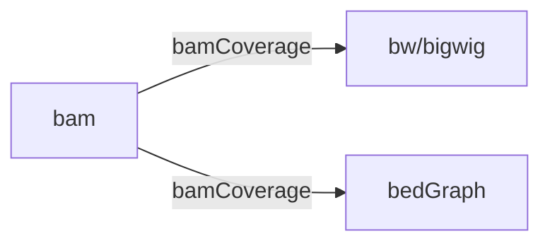

# bw/bigwig/Bedgraph

## 目录

- [1 Introduce](#1-Introduce)
  - [1.1 bigwig](#11-bigwig)
  - [1.2 bedGraph](#12-bedGraph)
- [2 tutorial](#2-tutorial)
  - [2.1 Format  Convert](#21-Format--Convert)
  - [2.2 BamCoverage](#22-BamCoverage)
  - [2.3 bedgraph → lowess](#23-bedgraph--lowess)
  - [2.4 Bedgraph/bigwig/bw manipulate](#24-Bedgraphbigwigbw-manipulate)
  - [2.5 Bedgraph/bigwig/bw  Visablity](#25-Bedgraphbigwigbw--Visablity)
- [3 reference](#3-reference)

## 1 Introduce

> `bw`/`bigwig`/`Bedgraph`文件主要用来在基因组浏览器中对不同基因组区域的基因表达水平 & DNA甲基化水平和相关评分(score)等进行可视化。（`bw`/`bigwig`/`Bedgraph`格式是UCSC提出的主要还是为了方便对数据进行可视化！）

### 1.1 bigwig

> `Wiggle`（通常缩写为WIG）是一种文件格式，它被用来在基因组浏览器中展示连续值数据。这种数据通常用于展示基因组上的某些特征，比如基因表达水平、DNA甲基化水平或其他生物学上的连续变量。`BigWig`是一种文件格式，它用于在基因组浏览器的轨迹中展示密集且连续的数据。这种格式是由Wiggle（简称WIG）格式转换而来的[^1]。

> `bigWig` 文件采用索引二进制格式 后缀名：`.bw`，`.bigwig`

> \*\*NOTE \*\*: 为什么会采用`bigWig`文件格式，在要对特定基因组区域进行查看时，可以对特定的bigWig文件进行处理，而不用处理完整的bam or wiggle 文件（小 & 速度快）

> **NOTE** : Wiggle 数据必须是连续的并且由相同大小的元素组成

### 1.2 bedGraph

> BedGraph主要存放区间的坐标轴信息和相关评分(score)的文件，主要用于存储稀疏，不连续的数据，其是BED文件的扩展4列BED格式[^2]。

> 后缀名`.bedGraph`

> 一般UCSC不建议采用该格式作为基因组浏览器输入文件，因为考虑到数据集大小与索引构建，都不如 bigwig 更高效，尤其在如果bedGraph数据集非常大（超过5000万行 ），推荐转为 bigwig 文件

```bash title=".bedGraph format"
chromA    chromStartA    chromEndA    dataValue 
#  染色体号 
#  起始位点 ：染色体坐标从 0 开始，这意味着第一个染色体位置为0，而长度为N的染色体的最后位置将为N-1。
#  终止位点 
#  数据值 ：数据值可以是整数或实数，正值或负值。输入数据中列出的位置必须按数字顺序，并且仅会绘制指定位置的图。
```


## 2 tutorial

### 2.1 Format  Convert

> UCSC 提供了很多有用的`bw`/`bigwig`/`Bedgraph`转换工具！

`https://hgdownload.soe.ucsc.edu/admin/exe`

> `bedGraphToBigWig` : create a bigWig track from a bedGraph
>
> [bedGraphToBigWig](file/bedGraphToBigWig_Ptk834zkSm "bedGraphToBigWig")
>
> ```bash title="bedGraph → BigWig"
> bedGraphToBigWig in.bedGraph chrom.sizes myBigWig.bw
> ```
>

> `wigToBigWig` : create your own bigWig file from an existing wiggle file
>
> [wigToBigWig](file/wigToBigWig_YK3UFICrDa "wigToBigWig")
>
> ```bash title="wig → BigWig"
> wigToBigWig wigVarStepExample.gz hg19.chrom.sizes myBigWig.bw
> ```
>

> `bigWigToWig` : converts a bigWig file to [wig](http://genome.ucsc.edu/FAQ/FAQformat.html#format6 "wig") format
>
> [bigWigToWig](file/bigWigToWig_EDyq2XGmgd "bigWigToWig")
>
> ```bash title=" BigWig → wig"
> bigWigToWig in.bigWig out.wig
> ```
>

> `bigWigToBedGraph` : converts a bigWig file to ASCII [bedGraph](http://genome.ucsc.edu/FAQ/FAQformat.html#format1.8 "bedGraph") forma
>
> [bigWigToBedGraph](file/bigWigToBedGraph_EnQjLu0EVe "bigWigToBedGraph")
>
> ```bash title="BigWig → bedGraph"
> bigWigToBedGraph in.bigWig out.bedGraph
> ```
>

> `bigWigSummary` : extracts summary information from a bigWig file
>
> [bigWigSummary](file/bigWigSummary_htBUpAKB8s "bigWigSummary")
>
> ```bash title="bigWigSummary"
> bigWigSummary K562.bigWig chr8 127955641 127965435 10
> ```
>

> `bigWigInfo` :  prints out information about a bigWig file
>
> [bigWigInfo](file/bigWigInfo_uoBOsIJx_j "bigWigInfo")
>
> ```bash title="bigWigInfo"
> ./bigWigInfo bigWigExample.bw
> ```
>

### 2.2 BamCoverage

> `deepTools`的`BamCoverage`可以将Bam文件转换为`.bw` &` .bedgraph`[^3]
>
> ```bash title="BamCoverage"
> bamCoverage -b reads.bam -o coverage.bw
> bamCoverage -b reads.bam --outFileFormat bedgraph -o coverage.bedgraph
>
> ```
>




### 2.3 bedgraph → lowess

[   https://biojuse.com/2024/06/29/%E5%AF%B9%20bedgraph%20%E6%96%87%E4%BB%B6%E8%BF%9B%E8%A1%8C%20lowess%20%E5%B9%B3%E6%BB%91%E6%93%8D%E4%BD%9C/](https://biojuse.com/2024/06/29/%E5%AF%B9%20bedgraph%20%E6%96%87%E4%BB%B6%E8%BF%9B%E8%A1%8C%20lowess%20%E5%B9%B3%E6%BB%91%E6%93%8D%E4%BD%9C/ "   https://biojuse.com/2024/06/29/%E5%AF%B9%20bedgraph%20%E6%96%87%E4%BB%B6%E8%BF%9B%E8%A1%8C%20lowess%20%E5%B9%B3%E6%BB%91%E6%93%8D%E4%BD%9C/")

### 2.4 Bedgraph/bigwig/bw manipulate

[deepTools](https://www.wolai.com/iFaidLGwLj2gtjYzgbzDLJ "deepTools")

[IRanges & GRanges (plyranges)](https://www.wolai.com/gUGF9NZSX31nwCmCNBtELi "IRanges & GRanges (plyranges)")

### 2.5 Bedgraph/bigwig/bw  Visablity

> 如果要对Bedgraph/bigwig/bw文件进行绘图可以使用`Trackplot (R)`

[Trackplot (python) ](https://www.wolai.com/kR2MhfKFUrNWjrE7hVPZ6K "Trackplot (python) ")

[Trackplot (R)](https://www.wolai.com/n7FCYKjHuk7n9TroRxBMku "Trackplot (R)")

## 3 reference

[^1]: [https://www.pombase.org/faq/what-bigwig-format](https://www.pombase.org/faq/what-bigwig-format "https://www.pombase.org/faq/what-bigwig-format")

[^2]: [https://genome.ucsc.edu/goldenPath/help/bedgraph.html](https://genome.ucsc.edu/goldenPath/help/bedgraph.html "https://genome.ucsc.edu/goldenPath/help/bedgraph.html")

[^3]: [https://deeptools.readthedocs.io/en/develop/content/tools/bamCoverage.html](https://deeptools.readthedocs.io/en/develop/content/tools/bamCoverage.html "https://deeptools.readthedocs.io/en/develop/content/tools/bamCoverage.html")
