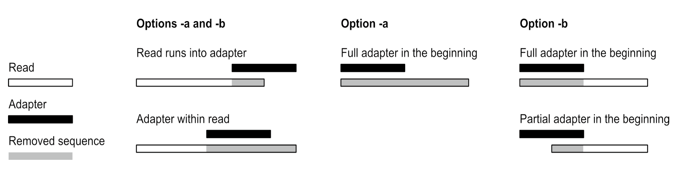

# cutadapt

## 目录

- [1 introduce](#1-introduce)
- [2 install & conda envs](#2-install--conda-envs)
- [3 tutorial](#3-tutorial)
  - [3.1 basic usage](#31-basic-usage)
  - [3.2 Standard input and output](#32-Standard-input-and-output)
  - [3.3 Read processing stages](#33-Read-processing-stages)
  - [3.4 adapter remove](#34-adapter-remove)
    - [3.4.1 3' adapter types](#341-3-adapter-types)
    - [3.4.2 5' adapter types](#342-5-adapter-types)
    - [3.4.3 Linked adapters (combined 5’ and 3’ adapter)](#343-Linked-adapters-combined-5-and-3-adapter)
    - [3.4.4 5’ or 3’ adapters](#344-5-or-3-adapters)
    - [3.4.5 Multiple adapter occurrences within a single read](#345-Multiple-adapter-occurrences-within-a-single-read)
    - [3.4.6 Adapter-search parameters](#346-Adapter-search-parameters)
    - [3.4.7 Searching reverse complements](#347-Searching-reverse-complements)
    - [3.4.8 Specifying adapter sequences](#348-Specifying-adapter-sequences)
    - [3.4.9 Repeated bases](#349-Repeated-bases)
  - [3.5 Modifying reads](#35-Modifying-reads)
    - [3.5.1 --action ： 接头移除参数](#351---action--接头移除参数)
    - [3.5.2 Removing a fixed number of bases](#352-Removing-a-fixed-number-of-bases)
    - [3.5.3 Quality trimming](#353-Quality-trimming)
    - [3.5.4 Quality trimming of reads using two-color chemistry (NextSeq)](#354-Quality-trimming-of-reads-using-two-color-chemistry-NextSeq)
    - [3.5.5 Poly-A/poly-T trimming](#355-Poly-Apoly-T-trimming)
    - [3.5.6 Shortening reads to a fixed length](#356-Shortening-reads-to-a-fixed-length)
  - [3.6 Modifying read names](#36-Modifying-read-names)
  - [3.7 Filtering reads](#37-Filtering-reads)
  - [3.8 Trimming paired-end reads](#38-Trimming-paired-end-reads)
  - [3.9 Multiple adapters](#39-Multiple-adapters)
  - [3.10 Adapter-Sequence](#310-Adapter-Sequence)
  - [3.11 general command](#311-general-command)
- [4 Source](#4-Source)
- [5 Reference](#5-Reference)

***

## 1 introduce

**Cutadapt** finds and removes adapter sequences, primers, poly-A tails and other types of unwanted sequence from your high-throughput sequencing reads[^1].

> **Cutadapt** : 主要用来移除接头 & 引物 & poly-A tails & 其他不想保留的序列。

**Cutadapt**  可以进行adapter 移除 & read中固定位置序列处理 & read 重命名& 长度过滤 & 质量过滤 &  poly-G序列处理。

***

## 2 install & conda envs

```r title="install & conda envs"
# install & create Trim Galore env
mamba create -n cutadapt
# add channels
conda config --add channels conda-forge
conda config --set channel_priority strict
conda config --add channels https://conda.software.inl.gov/public
# installl cutadapt
mamba install conda-forge::pigz -y 
mamba install bioconda::cutadapt=4.8 -y
```


***

## 3 tutorial

### 3.1 basic usage

```python title="cutadapt 默认用法"
# cutadapt 默认用法
cutadapt -a AACCGGTT -o output.fastq input.fastq -j 40
# -a : 3'adapter 序列
# -o : 输出fastq文件名称（也可以加上目录）
# cutadapt 也支持对压缩文件进行质控
# -j : Number of CPU cores to use. Use 0 to auto-detec
cutadapt -a AACCGGTT -o output.fastq.gz input.fastq.gz -Z 4 -j 40
# -Z : 输出文件的压缩率（数值越大速度越慢！）
```


> NOTE : Cutadapt 支持对FASTA, FASTQ和unaligned BAM 进行处理。

> NOTE : Cutadapt 会根据fastq文件压缩后缀自动对文件进行处理(PS : 支持的压缩格式有gzip (`.gz`), bzip2 (`.bz2`), xz (`.xz`) and zstandard (`.zst`))

> NOTE : `-j 0`开启自动检测使用的核心数 （**使用多核并写入 ****`.gz`**** 输出文件，还请确保安装了 ****`pigz`**** （并行 gzip）。否则，输出的压缩将在单个线程中完成，因此会成为瓶颈。**）
>
> 使用 `-j` 增加核心数量将以接近线性的速率增加每分钟的读取次数。

> Cutadapt  可以使用`-A` `-p` 参数对PE数据进行质控
>
> ```python 
> cutadapt -a AACCGGTT \
>          -A AACCGGTT \
>          -o SY24000121-1-1-1-1_combined_R1.trim.fastq.gz \
>          -p SY24000121-1-1-1-1_combined_R2.trim.fastq.gz \
>          SY24000121-1-1-1-1_combined_R1.fastq.gz SY24000121-1-1-1-1_combined_R2.fastq.gz \
>          -j 60 \
>          > SY24000121-1-1-1-1.cutadapt 2>&1
> # -A : R2的3‘接头详细
> # -p : R2输出文件名
> # > SY24000121-1-1-1-1.cutadapt 2>&1 输出logo到SY24000121-1-1-1-1.cutadapt
> ```
>

### 3.2 Standard input and output

```python 
# cutadapt 也支持使用 > 输出质控后fastq文件(其只支持SE文件)
cutadapt -a AACCGGTT XXXXX_R1.fastq.gz  > XXXXX_R1.trim.fastq.gz -j 40
# 也可以使用2>将运行结果导出到单独的文件中
cutadapt -a AACCGGTT XXXXX_R1.fastq.gz  > XXXXX_R1.trim.fastq.gz -j 40 2> SY24000121-1-1-1-1_combined_R1.cutadapt
# 也可以使用 | 管道符将fastq文件中的特定部分输入到cutadapt
tail -n 4 input.fastq | cutadapt -a AACCGGTT - > output.fastq
# cutadapt 也可以在 -o /dev/null 不输入任何fastq文件，可以只看质控报告
cutadapt -a AACCGGTT -o /dev/null input.fastq

```


> **NOTE** : cutadapt `2>`  输出的结果可使用multiqc进行合并 （很方便）！！！！
>
> 

### 3.3 Read processing stages

> cutadapt 按照以下顺序对fastq文件进行处理：

Read modification options →  Filtering options → written to the output file

Read modification options ： adapter 移除 & 质量修剪 & read 名称修改

Filtering options ：such as removal of too short or untrimmed reads

### 3.4 adapter remove



> Cutadapt 可以检测多种类型的接头。5' 接头位于感兴趣的序列之前，而 3' 接头位于感兴趣的序列之后。进一步区分的依据是接头序列在读取过程中允许出现的位置

| **Adapter type**                                                                                                              | **Command-line option**                           |
| ----------------------------------------------------------------------------------------------------------------------------- | ------------------------------------------------- |
| [Regular 3’ adapter](https://cutadapt.readthedocs.io/en/latest/guide.html#three-prime-adapters "Regular 3’ adapter")          | `-a ADAPTER`                                      |
| [Regular 5’ adapter](https://cutadapt.readthedocs.io/en/latest/guide.html#five-prime-adapters "Regular 5’ adapter")           | `-g ADAPTER`                                      |
| [Non-internal 3’ adapter](https://cutadapt.readthedocs.io/en/latest/guide.html#non-internal "Non-internal 3’ adapter")        | `-a ADAPTERX`                                     |
| [Non-internal 5’ adapter](https://cutadapt.readthedocs.io/en/latest/guide.html#non-internal "Non-internal 5’ adapter")        | `-g XADAPTER`                                     |
| [Anchored 3’ adapter](https://cutadapt.readthedocs.io/en/latest/guide.html#anchored-3adapters "Anchored 3’ adapter")          | `-a ADAPTER$`                                     |
| [Anchored 5’ adapter](https://cutadapt.readthedocs.io/en/latest/guide.html#anchored-5adapters "Anchored 5’ adapter")          | `-g ^ADAPTER`                                     |
| [5’ or 3’ (both possible)](https://cutadapt.readthedocs.io/en/latest/guide.html#anywhere-adapters "5’ or 3’ (both possible)") | `-b ADAPTER`                                      |
| [Linked adapter](https://cutadapt.readthedocs.io/en/latest/guide.html#linked-adapters "Linked adapter")                       | `-a ^ADAPTER1...ADAPTER2``-g ADAPTER1...ADAPTER2` |

1. **Regular X’ adapter** : 接头序列可以存在read序列任何位置；
2. \*\*Non-internal X’ adapter \*\*： 接头序列read 序列内部；
3. **Anchored X’ adapter** : 可以锚定read 开头 & 尾部；

> **NOTE** : 默认情况下，所有适配器的搜索都是容错的。接头序列还可以包含任何 IUPAC 通配符（简并碱基）（例如 `N` ）

#### 3.4.1 3' adapter types

| \*\*Adapter location in read \*\* | **Read layout**         | Found by regular 3`-a ADAPTER` | Found by non-internal 3’`-a ADAPTERX` | Found by anchored 3’`-a ADAPTER$` |
| --------------------------------- | ----------------------- | ------------------------------ | ------------------------------------- | --------------------------------- |
| read在如何位置包含接头                     | acgtacgt**ADAPTER**acgt | YES                            | NO                                    | NO                                |
| 3' 端的部分接头序列                       | acgtacgtacgt**ADAP**    | YES                            | YES                                   | NO                                |
| 5' 端的完整接头序列                       | acgtacgtacgt**ADAPTER** | YES                            | YES                                   | YES                               |

- `-a ADAPTER` ：3'常规接头

  Cutadapt 的 `-a` 选项查找并修剪这样的3'适配器，允许部分和完整出现
  ```bash 
  mysequen                        →         mysequen  
  mysequence ADAP                    →         mysequence
  mysequence ADAPTER                →         mysequence
  mysequence ADAPTER somethingelse  →         mysequence
  # 如果read1中的接头位于R1的开头，则会将read中 ADAPTER 后的所有序列移除
   ADAPTER something                →         <NULL>
  ```

  默认情况下，空读数将被保留并将出现在输出中。可以使用 `--minimum-length` / `-m` 过滤选项。
- `-a ADAPTER$` ：3'锚定

  `-a ADAPTER$` 当适配器在读取结束时完整出现时才会被找到
  ```bash 
  mysequence ADAP                    →     mysequenceADAP
  mysequence ADAPTER                 →     mysequence
  mysequence ADAPTER somethingelse   →     mysequenceADAPTERsomethingelse
  ```

- `-a ADAPTERX`  : 不移除3' 内部适配器

  `-a ADAPTERX` （将 `ADAPTER` 替换为实际的适配器序列，但使用文字 `X` ）禁止 3' 适配器的内部匹配
  ```bash 
  mysequenceADAP                     →   mysequence
  mysequenceADAPTER                  →   mysequence
  mysequenceADAPTERsomethingelse     →   mysequenceADAPTERsomethingelse
  ```


#### 3.4.2 5' adapter types

| \*\*Adapter location in read \*\* | **Read layout**         | Found by regular 5 `-g ADAPTER` | Found by non-internal 5’ `-g XADAPTER` | Found by anchored 5 `-g ^ADAPTER` |
| --------------------------------- | ----------------------- | ------------------------------- | -------------------------------------- | --------------------------------- |
| read在如何位置包含接头                     | acgt**ADAPTER**acgtacgt | YES                             | YES                                    | NO                                |
| 5' 端的部分接头序列                       | **PTER**acgtacgtacgt    | YES                             | NO                                     | NO                                |
| 5' 端的完整接头序列                       | **ADAPTER**acgtacgtacgt | YES                             | YES                                    | YES                               |

- `-g ADAPTER` : 5'常规接头

  Cutadapt 的 `-g` 选项查找并修剪这样的5'适配器，允许部分和完整出现
  ```bash 
  ADAPTER mysequence                   →         mysequence  
   DAPTER mysequence                    →         mysequence  
   TER mysequence                       →         mysequence  
  something ADAPTER mysequence          →         mysequence
  #########
  somethingADAPTER                    →         <NULL>

  ```

- `-g ^ADAPTER`

  Cutadapt 的 `-g` `^ADAPTER` 可以将5' 端接头移除

  锚定的 5' 适配器必须完整出现在读取开始处
  ```bash 
  ADAPTER something        →      something            
  ```

- `-g XADAPTERX` : 不移除5' 内部适配器

  （将 `ADAPTER` 替换为实际的适配器序列，但使用文字 `X` ）禁止 3' 适配器的内部匹配
  ```bash 
  APTERmysequence                     →   mysequence
  ADAPTERmysequence                   →   mysequence
  mysequenceADAPTERsomethingelse      →   mysequenceADAPTERsomethingelse
  ```


#### 3.4.3 Linked adapters (combined 5’ and 3’ adapter)

> 如果感兴趣的序列被 5' 和 3' 适配器包围，并且想要删除这两个适配器，那么可以使用链接的适配器。链接适配器结合了 5' 和 3' 适配器。默认情况下，适配器不会被锚定，但在许多情况下，应该通过在 5' 适配器前面添加前缀 `^` 来锚定它

```bash 
cutadapt -a ^FIRST...SECOND -o out.fastq.gz in.fastq.gz
```


```bash 
FIRST mysequence SECOND extrabases         →    mysequence
 FIRST mysequence SEC                       →    mysequence
 FIRST myseque                            →    myseque
anotherreadSECOND                       →    anotherreadSECOND
```


#### 3.4.4 5’ or 3’ adapters

> 最后一种类型的适配器是 5' 和 3' 适配器的组合。当适配器连接到某些读取的 5' 末端和其他读取的 3' 末端时，您可以使用它。这种情况可能不会经常发生，而且这种适配器类型实际上最初是因为实验中的文库制备没有按预期工作而实现的。

`-b ADAPTER`

#### 3.4.5 Multiple adapter occurrences within a single read

> 单个读取包含同一适配器的多个副本 `-a`   &  `-g`&#x20;

```bash 
# 3'adapter
ccccc ADAPTER gggggADAPTERttttt    →     ccccc
# 5'adapter
ccccc ADAPTER gggggADAPTERttttt    →     gggggADAPTERttttt
```


#### 3.4.6 Adapter-search parameters

> 接头搜索算法具有一些特定于每个接头的参数，用于控制如何找到接头序列。

1. `-e 0.2`

   最大错误率（默认值：0.1）

   所有接头序列搜索都是容错的。允许的错误包括**不匹配**、**插入**和**删除**。例如，如果您搜索适配器序列 `ADAPTER` 并且正确设置了容错性（如下所述），那么也会找到 `ADABTER` （有 1 个不匹配）作为 `ADAPTR` （有 1 个删除），以及 `ADAPPTER` （有 1 个插入）。如果使用 `--no-indels` 禁用插入和删除，则不匹配是唯一的错误类型

   `-a "ADAPTER;max_error_rate=0.15"` ：也可以在`-a`参数中设置最大错误率

   计算错误率时，将跳过适配器序列中的任何 `N` 通配符。也就是说，它们对adapter的长度没有影响。例如，接头序列 `ACGTACNNNNNNNNGTACGT` 的长度为 20，但只有 12 个非 `N` 字符。在最大错误率为 0.1 时，如果在一次读取中完整找到该序列，则只允许有一个错误，因为 12·0.1=1.2，向下舍入时为 1。
2. `-O 5`

   由于 Cutadapt 允许大多数适配器类型的读段和适配器序列之间进行部分匹配，因此可能会偶然发生短匹配，从而导致错误地修剪碱基。例如，我们偶然预计所有读取中大约 25% 的碱基与接头的第一个碱基相同。为了减少错误修剪的碱基数量，比对算法要求适配器的**至少三个碱基**与读数比对

   最小重叠（默认值：3）
3. `--no-indels`

   不允许插入或删除
4. `ADAPTER;indels`

   允许插入（这是默认值）
5. `ADAPTER;anywhere`

   允许在任何地方进行匹配

> **NOTE** : cutadapt 也可以使用`adapters.fa`文件指定接头移除参数
>
> `cutadapt -a "file:adapters.fa;min_overlap=5;noindels"`
>
> ```bash 
> # adapters.fa
> >adapter1
> ^ACGT;min_overlap=3
> >adapter2
> AACCGGT;noindels
> ```
>

#### 3.4.7 Searching reverse complements

默认情况下，Cutadapt 期望接头的方向与读数相同（5' 至 3'）。也就是说，Cutadapt 既不考虑读段的反向互补，也不考虑接头的反向互补。

`--revcomp` or  `--rc`

#### 3.4.8 Specifying adapter sequences

> cutadapt 支持所有 IUPAC 核苷酸代码（通配符、简并碱基）。例如，在接头序列中使用 `N` 来匹配读数中的任何核苷酸，或使用 `-a YACGT` 作为同时匹配 `CACGT` 和 `TACGT` 。通配符 `N` 对于修剪具有嵌入式可变条形码的适配器非常有用：
>
> ```bash 
> cutadapt -a ACGTAANNNNTTAGC -o output.fastq input.fastq
> ```
>

#### 3.4.9 Repeated bases

> 如果接头序列中有许多重复碱基，例如许多 `N` 或许多 `A` ，则不必将它们拼写出来。例如，不要连续写十个 `A` ( `AAAAAAAAAA` )，而是写 `A{10}` 。大括号内的数字指定其前面的字符重复的频率。这也适用于 IUPAC 通配符，如 `N{5}`
>
> ```bash 
> -a "N{5}ACGT"
> ```
>

### 3.5 Modifying reads

#### `3.5.1 --action` ： 接头移除参数

> 默认值为 `--action=trim` ，这将从读取中删除适配器及其之前或之后的序列。对于 5' 接头，接头及其前面的序列将被删除。对于 3' 适配器，适配器及其后面的序列将被删除。由于连接的适配器是 5' 和 3' 适配器的组合，因此实际上仅保留 5' 和 3' 适配器匹配之间的序列;

> 使用 `--action=retain` ，读取会被修剪，但适配器序列本身不会被删除。上游和下游序列的删除方式与 `trim` 操作相同。对于连接的接头，两个接头序列均被保留;

> 使用 `--action=mask` 将 `N` 字符写入原本会被删除的读取部分;

```bash 
cutadapt --action=mask -a AGATCGGAAGAG HI.4019.002.index_7.ANN0831_R2.fastq  > HI.4019.002.index_7.ANN0831_R2.Trim.fastq 
# 将接头使用N进行mask结果
@K00271:89:HHWWNBBXX:2:1101:26697:1367 2:N:0:CAGATC
ATGATCAGAAAGGTAAAACTTCTTTTT AGATCGGAAGAG 
@K00271:89:HHWWNBBXX:2:1101:26697:1367 2:N:0:CAGATC
ATGATCAGAAAGGTAAAACTTCTTTTT NNNNNNNNNNNN
```


> 即使存在匹配，使用 `--action=none` 也不更改read;

> 使用 `--action=lowercase` 将读取的那些原本会被删除的部分更改为小写。其余部分转换为大写。

#### 3.5.2 Removing a fixed number of bases

通过使用 `--cut` 选项或其缩写 `-u` ，可以无条件地从每次读取的开头或结尾删除碱基。如果给定长度为正，则从每次读取的开头删除碱基。如果为负，则从末端删除碱基

```bash 
# 删除每个读数的前五个碱基
cutadapt -u 5 -o trimmed.fastq reads.fastq
# 删除每个读数的最后七个碱基
cutadapt -u -7 -o trimmed.fastq reads.fastq
```


#### 3.5.3 Quality trimming

> `-q` （或 `--quality-cutoff` ）参数可用于修剪读数中的低质量末端。如果指定单个截止值，则每次读取的 3' 末端都会被修剪：

```bash 
cutadapt -q 10 -o output.fastq input.fastq
```


> 通过将两个逗号分隔的截断指定为 5' 截断、3' 截断来从 5' 端进行修剪

```bash 
cutadapt -q 15,10 -o output.fastq input.fastq
```


> 对于双端数据，默认情况下，使用相同的截止值将质量修整应用于两个读数。使用选项 `-Q` 为 R2 指定不同的截止值

```bash 
cutadapt -q 5 -Q 15,20 -o out.1.fastq -p out.2.fastq in.1.fastq in.2.fastq

```


#### 3.5.4 Quality trimming of reads using two-color chemistry (NextSeq)

> 一些 Illumina 仪器使用双色化学物质对四个碱基进行编码。这包括 NextSeq 和 NovaSeq。在这些仪器中，“暗循环”（未检测到颜色）编码 `G` 。然而，当测序从片段末端“脱落”时，也会发生暗循环。然后，该读取在其 3' 端包含一系列高质量但不正确的“G”调用

```bash 
cutadapt --nextseq-trim=20 -o out.fastq input.fastq
```


#### 3.5.5 Poly-A/poly-T trimming

使用 `–-poly-a` 修剪多聚 A 尾部。 Poly-A 修剪是在适配器修剪后进行的

#### 3.5.6 Shortening reads to a fixed length

要将每次读取缩短到一定长度，请使用 `--length` 选项或简短版本 `-l`

```bash 
# 会将 input.fastq.gz 的所有读取缩短至 10 个碱基。移除的碱基是 3' 端的碱基
cutadapt -l 10 -o output.fastq.gz input.fastq.gz
```


### 3.6 Modifying read names

> **Tips**:该功能可以将scRNA-seq的barcode序列添加到read中！🦊

```r title="Remove BC & Add Read name"
cutadapt -j 60 LC_S1_L001_R1_001.fastq.gz \
         -u 16 \
         -o LC_S1_L001_R1_001.remove_BC.fastq \
         --rename='{id} {cut_prefix}'
```


> cutadapt可以对已处read的名称进行修改

- `--rename` ：read 重命名

  `{id}` – 读取ID，即标题中第一个空格之前的部分;

  `{comment}` – ID后面的空格后面的标头部分;

  `{header}` – 完整的、未更改的标头;

  `{adapter_name}` – 在此读取中找到的适配器的名称，如果没有适配器匹配，则为 `no_adapter`;

  PE : `{rn}` 可用（“读取编号”），并且在 R1 中用 `1` 替换，在 R2 中用 `2` 替换。

  `{cut_prefix}` – 由`--cut` （或`-u` ）选项删除的前缀（即与正长度参数一起使用时）

  `{cut_suffix}` – 由`--cut` （或`-u` ）选项删除的后缀（即与负长度参数一起使用时）
  ```bash 
  # SE
  cutadapt -a AGATCGGAAGAG \
           HI.4019.002.index_7.ANN0831_R1.fastq \
           -o  HI.4019.002.index_7.ANN0831_R1.trim.fastq \
           --rename='{id} adapter={adapter_name} {comment}'
  # PE 修改前read名称    
  @K00271:89:HHWWNBBXX:2:1101:23277:1068 1:N:0:CAGATC
  # PE 修改后read名称  
  @K00271:89:HHWWNBBXX:2:1101:23277:1068 adapter=no_adapter 1:N:0:CAGATC
  # PE 
  cutadapt -a AGATCGGAAGAG \
           HI.4019.002.index_7.ANN0831_R1.fastq \
           HI.4019.002.index_7.ANN0831_R2.fastq \
           -o  HI.4019.002.index_7.ANN0831_R1.trim.fastq \
           -p  HI.4019.002.index_7.ANN0831_R2.trim.fastq \
           --rename='{id} adapter={adapter_name} {comment} R={rn}'\
           > HI.4019.002.index_7.ANN0831.cutadapt 2>&1
  # PE 修改前read名称    
  @K00271:89:HHWWNBBXX:2:1101:23277:1068 1:N:0:CAGATC
  # PE 修改后read名称
  @K00271:89:HHWWNBBXX:2:1101:23277:1068 adapter=no_adapter 1:N:0:CAGATC R=1

  ```

- `-y` ： 适配器后修改

  如果找到适配器 `ACGT` ，则将名为 `read1` 的读取更改为 `read1 we found adapter1`
  ```bash 
  cutadapt -a adapter1=ACGT -y ' we found {name}' input.fastq
  ```

- `-x` ： 适配器前修改

  将文本添加在read名称前面
- `--length-tag 'length='` ：长度统计

  一些旧的 454 读取文件在名称中包含读取的长度：
  ```bash 
  >read1 length=17
  ACGTACGTACAAAAAAA

  >read1 length=10
  ACGTACGTAC

  ```


### 3.7 Filtering reads

> 默认情况下，所有处理的读取，无论是否被修剪，都会写入 `-o` 选项指定的输出文件（如果未提供 `-o` 则写入标准输出） 。对于成对末端读取，成对的第二个读取始终写入 `-p` 选项指定的文件。

- `--minimum-length LENGTH` or `-m LENGTH` : 长度过滤

  丢弃短于 LENGTH 的已处理读取
  ```bash 
  cutadapt -a AGATCGGAAGAG \
           HI.4019.002.index_7.ANN0831_R1.fastq \
           HI.4019.002.index_7.ANN0831_R2.fastq \
           -o  HI.4019.002.index_7.ANN0831_R1.trim.fastq \
           -p  HI.4019.002.index_7.ANN0831_R2.trim.fastq \
           -m 75 \
           --rename='{id} adapter={adapter_name} {comment} R={rn}'\
           > HI.4019.002.index_7.ANN0831.cutadapt 2>&1
  ```

- `--minimum-length LENGTH1:LENGTH2` or `-m LENGTH1:LENGTH2`

  修剪双端读段时，可以通过用冒号 ( `:` ) 分隔它们来分别指定 R1 和 R2 的最小长度
- `--too-short-output` ：&#x20;

  输出短于m的 read到 FILE文件
  ```bash 
  cutadapt -a AGATCGGAAGAG \
           HI.4019.002.index_7.ANN0831_R1.fastq \
           HI.4019.002.index_7.ANN0831_R2.fastq \
           -o  HI.4019.002.index_7.ANN0831_R1.trim.fastq \
           -p  HI.4019.002.index_7.ANN0831_R2.trim.fastq \
           -m 100 \
           --too-short-output HI.4019.002.index_7.ANN0831.too_short.R1.fastq \
           --too-short-paired-output HI.4019.002.index_7.ANN0831.too_short.R2.fastq \
           --rename='{id} adapter={adapter_name} {comment} R={rn}'\
           > HI.4019.002.index_7.ANN0831.cutadapt 2>&1
  ```

- `--maximum-length LENGTH` or `-M LENGTH`

  丢弃长度超过 LENGTH 的已处理读取
  ```bash 
  cutadapt -a AGATCGGAAGAG \
           HI.4019.002.index_7.ANN0831_R1.fastq \
           HI.4019.002.index_7.ANN0831_R2.fastq \
           -o  HI.4019.002.index_7.ANN0831_R1.trim.fastq \
           -p  HI.4019.002.index_7.ANN0831_R2.trim.fastq \
           -m 75 \
           -M 145 \
           --rename='{id} adapter={adapter_name} {comment} R={rn}'\
           > HI.4019.002.index_7.ANN0831.cutadapt 2>&1
  ```

- `--maximum-length LENGTH1:LENGTH2` or `-M LENGTH1:LENGTH2`

  修剪双端读段时，可以通过用冒号 ( `:` ) 分隔它们来分别指定 R1 和 R2 的最大长度
- `--too-long-output FILE`

  输出长于m的 read到 FILE文件
  ```bash 
  cutadapt -a AGATCGGAAGAG \
           HI.4019.002.index_7.ANN0831_R1.fastq \
           HI.4019.002.index_7.ANN0831_R2.fastq \
           -o  HI.4019.002.index_7.ANN0831_R1.trim.fastq \
           -p  HI.4019.002.index_7.ANN0831_R2.trim.fastq \
           -m 75 \
           --too-short-output HI.4019.002.index_7.ANN0831.too_short.R1.fastq \
           --too-short-paired-output HI.4019.002.index_7.ANN0831.too_short.R2.fastq \
           -M 145 \
           --too-long-output HI.4019.002.index_7.ANN0831.too_long.R1.fastq \
           --too-long-paired-output HI.4019.002.index_7.ANN0831.too_long.R2.fastq \
           --rename='{id} adapter={adapter_name} {comment} R={rn}' \
           > HI.4019.002.index_7.ANN0831.cutadapt 2>&1     
  ```

- `--untrimmed-output FILE`

  将所有不带适配器的读取写入 FILE（以 FASTA/FASTQ 格式）
  ```bash 
  cutadapt -a AGATCGGAAGAG \
           HI.4019.002.index_7.ANN0831_R1.fastq \
           HI.4019.002.index_7.ANN0831_R2.fastq \
           -o  HI.4019.002.index_7.ANN0831_R1.trim.fastq \
           -p  HI.4019.002.index_7.ANN0831_R2.trim.fastq \
           -m 75 \
           --too-short-output HI.4019.002.index_7.ANN0831.too_short.R1.fastq \
           --too-short-paired-output HI.4019.002.index_7.ANN0831.too_short.R2.fastq \
           --untrimmed-output HI.4019.002.index_7.ANN0831.R1.untrimmed.fastq \
           --untrimmed-paired-output HI.4019.002.index_7.ANN0831.R2.untrimmed.fastq \
           --rename='{id} adapter={adapter_name} {comment} R={rn}' \
           > HI.4019.002.index_7.ANN0831.cutadapt 2>&1 
  ```

- `--discard-trimmed`

  丢弃在其中找到适配器的read
- `--discard-untrimmed`

  丢弃未找到适配器的read
- `--max-n COUNT_or_FRACTION`

  丢弃超过 COUNT 个 `N` 个碱基的读数。如果 `COUNT_or_FRACTION` 是 0 到 1 之间的数字，则将其解释为读取长度的一部分
- `--max-expected-errors ERRORS` or `--max-ee ERRORS`

  丢弃超过 ERRORS 个预期错误的read
- `--max-average-error-rate ERROR_RATE` or `--max-aer`

  丢弃平均预期错误超过 ERROR\_RATE 的read
- `--discard-casava`

  丢弃未通过 CASAVA 过滤的read

### 3.8 Trimming paired-end reads

| **R1**             | **R2**                  |
| ------------------ | ----------------------- |
| `--adapter`, `-a`  | `-A`                    |
| `--front`, `-g`    | `-G`                    |
| `--anywhere`, `-b` | `-B`                    |
| `--cut`, `-u`      | `-U`                    |
| `--output`, `-o`   | `--paired-output`, `-p` |

### 3.9 Multiple adapters

```bash 
# 使用多套 adapter
cutadapt -a TGAGACACGCA -a AGGCACACAGGG -o output.fastq input.fastq
# 使用多套 adapters.fasta
cutadapt -a file:adapters.fasta -o output.fastq input.fastq

```


### 3.10 Adapter-Sequence

- Nextera, Illumina Prep, and Illumina PCR Kits
  ```bash 
  # adapter R1
  Read 1: CTGTCTCTTATACACATCT
  # adapter R2
  Read 2: CTGTCTCTTATACACATCT

  ```

- Illumina–TruSeq Adapter Trimming
  ```bash 
  # adapter R1
  AGATCGGAAGAGCACACGTCTGAACTCCAGTCA
  # adapter R2
  AGATCGGAAGAGCGTCGTGTAGGGAAAGAGTGT
  ```

- BGI adapters[^2]:
  ```bash 
  # adapter R1
  Read 1: AAGTCGGAGGCCAAGCGGTC
  # adapter R2
  Read 2: AAGTCGGATCGTAGCCATGT
  ```


### 3.11 general command

```bash 
cutadapt -j $threads \
         -q 20 \
         -A CTGTCTCTTATA \
         -a CTGTCTCTTATA \
         -m 54 \
         -o ./3.rm_adapter/$file_name.R1.fastq.gz \
         -p ./3.rm_adapter/$file_name.R2.fastq.gz \
         -O 5 \
         -e 0.2 \
         ./1.raw_data/$file_name.R1.fastq.gz \
         ./1.raw_data/$file_name.R2.fastq.gz
```


***

## 4 Source

[Cutadapt Removes Adapter Sequences From High-Throughput Sequencing Reads.pdf](<file/Cutadapt Removes Adapter Sequences From High-Throu.pdf> "Cutadapt Removes Adapter Sequences From High-Throughput Sequencing Reads.pdf")

***

## 5 Reference

[^1]: [https://cutadapt.readthedocs.io/en/stable/installation.html](https://cutadapt.readthedocs.io/en/stable/installation.html "https://cutadapt.readthedocs.io/en/stable/installation.html")

[^2]: [https://github.com/hellosunking/Ktrim/](https://github.com/hellosunking/Ktrim/ "https://github.com/hellosunking/Ktrim/")
