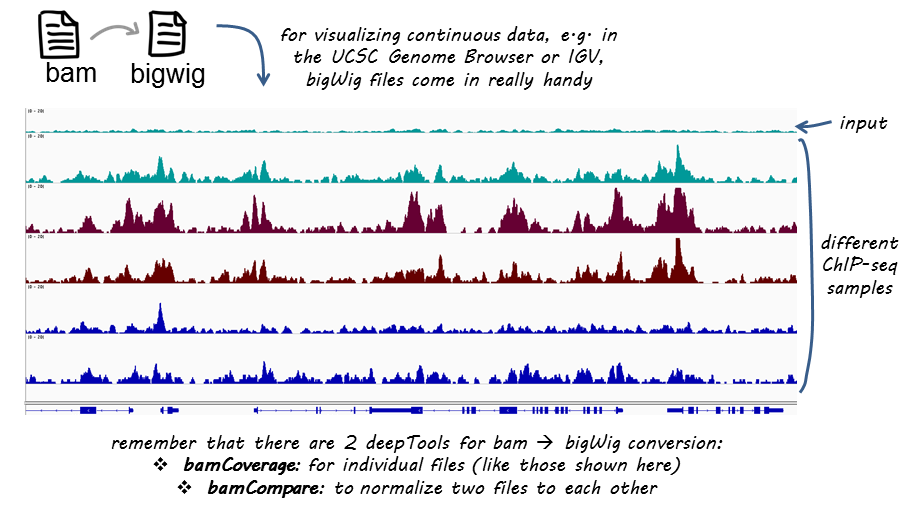

# bamCoverage

## 目录

- [1 bamCoverage](#1-bamCoverage)
  - [1.1 bamCoverage parameter](#11-bamCoverage-parameter)
  - [1.2 bamCoverage Example](#12-bamCoverage-Example)

***

***Author***\*\* : JZHANG\*\*​

***Date***\*\* : 2025-12-14\*\*​

***Version***\*\* : \*\***`1.0v`**

***

### 1 bamCoverage

\*\*bam → ****`bamCoverage`**** → ****`bigWig`**** | \*\***`bedGraph`**

`bamCoverage`接受对齐的读取或片段作为输入（`BAM`文件），并生成覆盖度轨迹（`bigWig`或`bedGraph`）作为输出。覆盖度是通过定义大小的短连续计数窗口中的读取数量来计算的。可以扩展读取的长度，以更好地反映实际的片段长度。`bamCoverage`提供通过缩放因子、每千碱基每百万映射读取数（RPKM）、每百万计数（CPM）、每百万映射读取的bins（BPM）和1×深度（每基因组覆盖度的读取数，RPGC）进行标准化。



##### `1.1 bamCoverage` parameter

> **NOTE** : `bamCoverage`默认输出的文件为`bigwig`（ps: `bigwig`为二进制文件，如果想导出可以直接阅读的结果可以选择`bedgraph`）

```bash title="bamCoverage parameter"
# Required arguments
--bam/-b            : 需要转换的 bam 文件 (sam2bam → sort → index)
--outFileName/-o    : 输出文件名
--outFileFormat/-of : 输出文件格式，bigwig 或 bedgraph，默认 bigwig
# Optional arguments
--scaleFactor           : 缩放因子，默认是 1
--MNase                 ：MNase-seq 数据确定核小体的位置，具体见参考文档
--Offset                ：整数，reads 的偏移，针对 RiboSeq 或 GROseq
--filterRNAstrand       ：过滤正负链，针对连特异性测序数据(forward : + reverse : -)
--binSize/-bs           ：划分区间大小，整数型，默认 50bp 一个区间，越小分辨率越高
--region/-r             ：对特定的区间计算，用于测试
--blackListFileName     ：bed 格式文件，用于排除不需要的区间
--numberOfProcessors/-p ：线程数，整数型
--verbose/-v            ：输出计算过程中的信息，默认不输出
# Read coverage normalization options
--effectiveGenomeSize             ：有效基因组大小
--normalizeUsing                  ：{RPKM,CPM,BPM,RPGC,None}五个选项可选，默认 none，具体见参考文档
--exactScaling                    ：精确计算缩放因子，所需时间更长
--ignoreForNormalization          ：排除不需要归一化的染色体
--skipNonCoveredRegions/--skipNAs ：跳过没有 reads 覆盖的区域
--smoothLength                    ：整数型，平滑化窗口，必须大于 binsize
# Read processing options
--extendReads/-e    ：延长 reads 的长度，对应 RNA-seq 数据不适合
--ignoreDuplicates  ：忽略重复的 reads
--minMappingQuality ：reads 最小比对质量值，整数型
--centerReads       ：中心化 reads，可获得更陡峭的峰
--samFlagInclude    ：根据 sam 格式的 flag 来保留对应的 reads 用于分析
--samFlagExclude    ：根据 sam 格式的 flag 来剔除对应的 reads 用于分析
--minFragmentLength ：reads 的 Fragment 最小长度，对应于 ATAC-seq 数据可用来筛选单核小体和多核小体
--maxFragmentLength ：reads 的 Fragment 最大长度
# Other
--version ：输出软件版本信息
--help/-h : 查看帮助信息
```


> **NOTE** : 如果将`bin`的大小设置得很小，那么生成的覆盖轨道（可能是某种数据可视化中的一个术语，比如基因组数据的覆盖度分析）的分辨率会更高，但同时这也会导致生成的文件体积更大；

> **NOTE** : 在对bam文件进行标准化中如果选择RPGC标准方法，则需要输入有效基因组大小。如何计算特定物种有效基因组大小见：
>
> - Genome **Effective size** Calculation:
>
>   Kents tools  的faCount 可以对有效基因组大小进行计算
>
>   [faCount](file/faCount_W8UDp6EnvF "faCount")
>   | **Genome**​        | **Effective size**​ |
>   | ------------------ | ------------------- |
>   | GRCh37             | 2864785220          |
>   | GRCh38             | 2913022398          |
>   | T2T/CHM13CAT\\\_v2 | 3117292070          |
>   | GRCm37             | 2620345972          |
>   | GRCm38             | 2652783500          |
>   | dm3                | 162367812           |
>   | dm6                | 142573017           |
>   | GRCz10             | 1369631918          |
>   | GRCz11             | 1368780147          |
>   | WBcel235           | 100286401           |
>   | TAIR10             | 119482012           |

> **NOTE** : 在进行某些研究时，可能需要排除特定的染色体，以防止研究结果出现偏差。例如，研究者可能会选择排除X染色体。这是因为在雄性小鼠中，每对常染色体都有两条，但通常只有一条X染色体。
>
> ```bash title="excluding chromosome X during the normalization step"
> --ignoreForNormalization chrX
> ```
>

> **NOTE** :为了在下游分析中获得比较平滑的结果可以设置`--smoothLength`参数

##### `1.2 bamCoverage` Example

> NOTE : 如果想对具有生物学重复的多个样本进行处理可以先使用samtools merge对多个样本的bam文件进行合并在转换呀。

`Chip-seq`数据：**更小的bin尺寸用于更高的分辨率** & 将覆盖度标准化到1倍小鼠基因组大小 & **在标准化步骤中排除X染色体** & **扩展读取**

```bash title="ChIP-seq data"
# ChIP-seq data
bamCoverage --bam a.bam -o a.SeqDepthNorm.bw \
            --binSize 10
            --normalizeUsing RPGC
            --effectiveGenomeSize 2150570000
            --ignoreForNormalization chrX
            --extendReads
```


`RNA-seq` 数据：

```bash title="RNA-seq data"
bamCoverage -p 40 --bam JZ24050910-SQ24015264-SQ24015264_sorted.bam \
            --binSize 10 \
            --centerReads \
            --smoothLength 14 \
            --normalizeUsing RPKM \
            -o SQ24015264.bw
```


提取正负链数据：

```bash title="Extert Forward or Reverse strand"
# Forward strand
bamCoverage -b a.bam -o a.fwd.bw --filterRNAstrand forward
# Reverse strand
bamCoverage -b a.bam -o a.rev.bw --filterRNAstrand reverse
```
