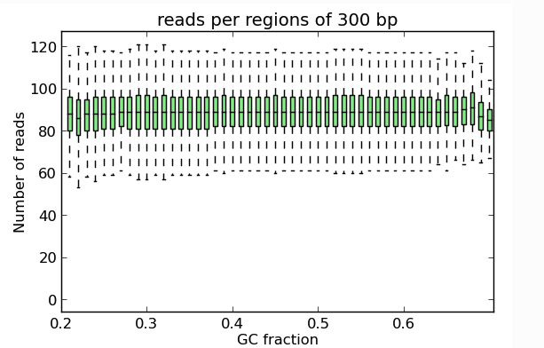

# computeGCBias

## 目录

- [1 Introduce](#1-Introduce)
  - [1.1 computeGCBias](#11-computeGCBias)
  - [1.2 computeGCBias methods](#12-computeGCBias-methods)
- [2 computeGCBias parameter](#2-computeGCBias-parameter)
  - [2.1 computeGCBias Example](#21-computeGCBias-Example)
  - [2.2 Excluding regions from the read distribution calculation](#22-Excluding-regions-from-the-read-distribution-calculation)
- [3 Source](#3-Source)
- [4 Reference](#4-Reference)

#### 1 Introduce

###### `1.1 computeGCBias`

`computeGCBias` 是基于 Benjamini 和 Speed 的一篇论文开发的一个工具[^1]。这个工具用于诊断 GC 偏倚（GC bias），其基本假设是：在一个理想的样本中，整个基因组的测序读数应该均匀分布，也就是说，不管基因组各区域的碱基对组成如何，它们都应该有相似数量的读数。然而，**在现实中，用于测序协议文库制备过程中的基于 PCR 的扩增步骤中的 DNA 聚合酶，更倾向于扩增富含 GC 的区域**。这种偏好会影响测序结果，因为仅仅是由于 DNA 聚合酶的这种偏好，富含 GC 的区域会产生更多的读数。

###### `1.2 computeGCBias` methods

`computeGCBias`首先通过计算每个GC分数的固定大小DNA片段数量来计算预期的GC分布图，其中GC分数被定义为在给定长度的基因组区域内G或C的数量。结果基本上是一个直方图，描绘了每种类型基因组区域的DNA片段频率，其GC分数在0\~100%之间。对于每个参考基因组来说，这将是不同的，但与实际的测序实验无关。如何将预期的概况与实际观察到的GC概况进行比较。实际观察到的GC概况是通过计算每个GC分数（即DNA片段中鸟嘌呤和胞嘧啶的比例）对应的测序读数数量来生成的。



#### `2 computeGCBias` parameter

```bash 
# Required arguments
--bamfile, -b         : 排序后的BAM文件。
--effectiveGenomeSize : 有效基因组大小是指可以映射的基因组部分。需要丢弃大量的NNNN序列。
                        此外，如果重复区域没有包含在读段的映射中，有效基因组大小需要相应调整。
--genome, -g          : 二进制格式的基因组。.2bit结尾的文件
--GCbiasFrequenciesFile, -freq, -o : 保存包含每个%GC含量的观测和预期读段频率的文件路径。
# Optional arguments
--fragmentLength, -l  : 测序的片段长度。如果使用成对末端读段，则基于BAM文件计算片段长度。
--sampleSize          : 采样点数量。（默认：50000000.0）
--extraSampling       : 由于基因组中某些区域表示不足，需要额外采样的BED文件。
--region, -r          : 限制操作的基因组区域，这在测试参数以减少计算时间时很有用。
                        格式为chr:start:end，例如 –region chr10 或 –region chr10:456700:891000。
--blackListFileName, -bl : 包含应该从所有分析中排除的区域的BED或GTF文件。
--numberOfProcessors, -p : 要使用的处理器数量。输入“max/2”使用一半的最大处理器数量，
                           或者输入“max”使用所有可用处理器。（默认：1）
--verbose, -v  : 设置为查看处理消息。
# Diagnostic plot options
--biasPlot       : 输出GC偏差的诊断图像。
--plotFileFormat : 输出图片格式png, pdf, svg, eps, plotly
--regionSize     : 要在区域内绘制每个%GC的读段，需要指定区域的大小。
                   默认情况下，设置的bin大小为300个碱基，这接近于Illumina机器的标准片段大小。
                   然而，如果测序深度较低，则需要更大的bin大小，否则许多bin将不会与任何读段重叠（默认：300）。
```


###### `2.1 computeGCBias` Example

```bash title="computeGCBias Example"
computeGCBias -b H3K27Me3.bam \
              --effectiveGenomeSize 2695000000
              --genome genome.2bit \
              -l 200 \
              -freq freq_test.txt
              --region X \
              --biasPlot test_gc.png
```


###### 2.2 Excluding regions from the read distribution calculation

> 在某些情况下，为了提高GC计算的准确性，从读取分布的计算中排除某些特定区域是合理的。存在几种类型的区域，这些区域要么预计不会显示出与背景相匹配的读取分布，要么参考基因组的不确定性可能太大。因此，需要考虑以下几点：
>
> 1. **排除与背景不匹配的区域**：在基因组分析中，某些区域的读取分布可能与整体背景不一致，这可能是由于这些区域的特殊性质，如重复序列、结构变异等。排除这些区域可以减少对整体分析结果的干扰。
>    - **repetitive regions**：如果从BAM文件中排除多重比对的读取（这些读取可以映射到基因组中的多个位置），这将有助于排除已知的重复区域。你可以从UCSC Table Browser获取已知重复区域的BED文件。
>    - **低可映射性区域**：这些区域的读取映射通常失败，我们建议从GC含量计算中排除已知存在映射问题的区域。你可以从UCSC下载不同读取长度的可映射性轨迹，例如对于小鼠和人类。在GitHub的deepTools文件夹“scripts”中，你可以找到一个名为`mappabilityBigWig_to_unmappableBed.sh`的shell脚本，该脚本可以将UCSC的bigWig可映射性文件转换为BED文件。
> 2. **排除参考基因组不确定性大的区域**：参考基因组是用于比对和分析测序数据的标准版本。如果参考基因组在某些区域存在较大的不确定性，比如序列不完整或存在多个可能的变体，那么这些区域的读取分布可能不准确，因此在计算时排除这些区域可以提高分析的准确性。
> 3. **考虑其他因素**：除了上述两点，还可能需要考虑其他因素，比如测序深度、覆盖度不均等问题，这些都可能影响读取分布的准确性
>    - ChIP-seq样本中，预计某些区域的读数应该比基于背景分布预期的要多，因此排除这些区域进行GC偏差计算是完全有意义的。我们建议首先对未校正的BAM文件进行一个简单、非保守的峰值召唤，以获得一个BED文件，其中包含应该随后用于计算GC偏差的峰值区域。

***

#### 3 Source

[Summarizing and correcting the GC content bias in high-throughput sequencing.pdf](<file/Summarizing and correcting the GC content bias in .pdf> "Summarizing and correcting the GC content bias in high-throughput sequencing.pdf")

***

#### 4 Reference

[^1]: Summarizing and correcting the GC content bias in high-throughput sequencing
