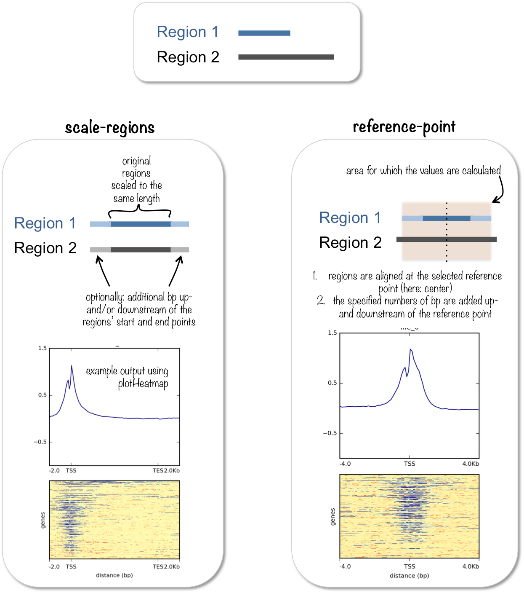
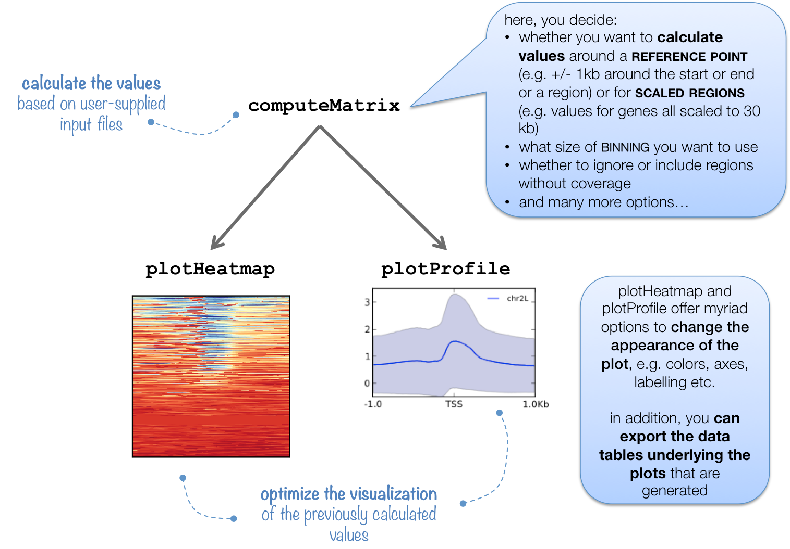

# computeMatrix

## 目录

- [1 computeMatrix](#1-computeMatrix)
- [2 computeMatrix subcommand](#2-computeMatrix-subcommand)
  - [2.1 computeMatrix  parameter](#21-computeMatrix--parameter)
    - [2.1.1 reference-point](#211-reference-point)
    - [2.1.2 scale-regions](#212-scale-regions)

bw→ `computeMatrix` → matrix.mat.gz → `plotProfile` | `plotHeatmap`

#### `1 computeMatrix`



`computeMatrix`工具计算每个基因组区域的得分，并生成一个中间文件，这个文件可以用于`plotHeatmap`和`plotProfiles`。通常，基因组区域是基因，但任何在BED文件中定义的其他区域也可以使用。`computeMatrix`接受多个得分文件（bigWig格式）和多个区域文件（BED格式）。这个工具还可以用来根据它们的得分来过滤和排序区域。

#### `2 computeMatrix` subcommand



> `computeMatrix` 生成的矩阵文件可以被进一步用来生成热图（heatmap）或剖面图（profile）。这个工具有两种主要的使用模式：
>
> 1. **scale-regions 模式**：这种模式用于计算一组区域（**如基因组中的基因**）上的信号，其中所有区域都被缩放到相同的大小。这允许比较不同区域的信号强度，即使这些区域在基因组中的长度不同。例如，如果你对比较不同基因的 ChIP-seq 信号感兴趣，这种模式会非常有用。**在缩放区域模式下，BED文件中的所有区域都会被拉伸或收缩到用户指定的长度（以碱基为单位）**
> 2. **reference-point 模式**：这种模式是用于计算相对于某个参考点（**如基因的转录起始位点 TSS 或者是某个特定区域的中心点**）的信号分布。这可以用来查看信号如何在参考点周围分布，例如，查看在转录因子结合位点周围的组蛋白修饰信号如何变化。**该模式将以 bed 文件的区域的中点为参考位置，然后根据使用者提供的上游和下游多少 bp 之间的区间，计算该区间内的信号富集密度**

> **NOTE** : 除了生成用于绘制热图和剖面图的中间压缩文件外，`computeMatrix` 还可以简单地输出热图背后的值，或者使用 `--skipZeros` 和 `--sortUsing` 参数来过滤和排序 BED 文件.

##### `2.1 computeMatrix`  parameter

```bash title="computeMatrix parameter"
# In the scale-regions mode, all regions in the BED file are stretched or shrunken to the length (in bases) indicated by the user.
computeMatrix scale-regions
# Reference-point refers to a position within a BED region (e.g., the starting point). In this mode, only those genomicpositions before (upstream) and/or after
# (downstream) of the reference point will be plotted.
computeMatrix reference-point           
```


###### 2.1.1 reference-point

```bash title="parameter"
# Required arguments:
--regionsFileName, -R : bed 或 gtf 格式，需要绘制的靶标区域
--scoreFileName, -S   : bigwig 文件
# Output options
--outFileName, -out, -o : 输出结果文件名
--outFileNameMatrix     : 输出热图的矩阵结果
--outFileSortedRegions  : 输出排序好的 bed 文件结果
# Optional arguments
--referencePoint        : 参考中心点，3 个  TSS ,  TES ,  center  选项，TSS 为 bed 文件第一个位置，TES 为 bed 文件最后一个位置，center 为 bed 文件中间位置，默认 TSS
--beforeRegionStartLength, -b, --upstream  : 参考位置上游长度，默认 500bp
--afterRegionStartLength, -a, --downstream : 参考位置下游长度，默认 500bp
--nanAfterEnd            : 如果设置该选项则丢弃 bed 最后位置后面的所有信号值
--binSize, -bs           : bin 的长度，用于计算平均得分，越小分辨率越高，计算量越大
--sortRegions            : 输出文件是否需要排序，默认不排序，descend, ascend, no, keep，4 个选项，如果需要自己绘图，可以设置
--sortUsing              : 排序方法，mean, median, max, min, sum, region_length，6 种，默认按 mean 排序
--sortUsingSamples       : 用样本编号排序
--averageTypeBins        : 对 bin 的统计类型，mean, median, min, max, std, sum，6 种，默认 mean
--missingDataAsZero      : 用 0 代替缺失数据
--skipZeros              : 去除信号为 0 的区域，默认不去除
--minThreshold           : 最小阈值设定，小于该阈值的被舍弃
--maxThreshold           : 最大阈值设定，大于该阈值的被舍弃
--blackListFileName, -bl : 黑名单区域，去除不想要的区域
--samplesLabel           : 样本名标签，用于可视化展示，默认为文件名
--quiet, -q              : 安静模式，不输出警告或处理过程信息
--numberOfProcessors, -p : 线程数
# D.GTF/BED12 
--metagene : 当提供 bed12 或 gtf 格式的区间文件时，会合并外显子后再进行计算，
             而不是基于含有内含子区域计算，如果提供 bed3 或 bed6 格式的，则
             第 2 列和第 3 列作为一个外显子
--transcriptID : 当区间为 gtf 格式时，使用 transcripts 作为特征来计算
--exonID       : 当区间为 gtf 格式时，使用 exons 作为特征来计算
--transcript_id_designator : 设置特征的选择，默认 transcript_id
# Other
--version

```


`computeMatrix  reference-point example : `

```bash title="computeMatrix  reference-point example "
computeMatrix reference-point -S SQ24015264.bw \
                              -R gene.bed \
                              -a 3000 -b 3000 \
                              -p 30 \
                              --outFileName SQ24015264.matrix.mat.gz
```


```bash title="computeMatrix  reference-point example"
computeMatrix reference-point -S 15-IgG.bw 15-f4-1.bw 15-f4-2.bw 15-sh-IgG.bw 15-sh-f4-1.bw 15-sh-f4-2.bw \
                              -R /glusterfs/home/local_liu_yang/01.database/deeptools_database/hg38_gencode_v39/hg38_V39_gencode.bed \
                              -a 5000 -b 5000 \
                              -p 30 \
                              --outFileName 15_ref_point.matrix.mat.gz
```


[ref\_point.matrix.mat.gz](file/ref_point.matrix.mat_dtc7Wv50o2.gz "ref_point.matrix.mat.gz")

###### 2.1.2 scale-regions

```bash title="parameter"
# Required arguments:
--regionsFileName, -R : bed 或 gtf 格式，需要绘制的靶标区域
--scoreFileName, -S   : bigwig 文件
# Output options
--outFileName, -out, -o : 输出结果文件名
--outFileNameMatrix     : 输出热图的矩阵结果
--outFileSortedRegions  : 输出排序好的 bed 文件结果
# Optional arguments
--regionBodyLength, -m区间长度缩放的长度，默认 1000bp
--startLabel在图上显示的区间起始位置的标签，自定义，默认 TSS
--endLabel在图上显示的区间结束位置的标签，自定义，默认 TES
--beforeRegionStartLength, -b, --upstream计算区间起始位置上游多少 bp 的区间信号，默认 0
--afterRegionStartLength, -a, --downstream计算区间终止位置下游多少 bp 的区间信号，默认 0
--unscaled5prime给定 5'端不需要缩放的长度，对比较缩放和不缩放边界的信号分布比较有用，默认 0
--unscaled3prime给定 3'端不需要缩放的长度，对比较缩放和不缩放边界的信号分布比较有用，默认 0
--nanAfterEnd            : 如果设置该选项则丢弃 bed 最后位置后面的所有信号值
--binSize, -bs           : bin 的长度，用于计算平均得分，越小分辨率越高，计算量越大
--sortRegions            : 输出文件是否需要排序，默认不排序，descend, ascend, no, keep，4 个选项，如果需要自己绘图，可以设置
--sortUsing              : 排序方法，mean, median, max, min, sum, region_length，6 种，默认按 mean 排序
--sortUsingSamples       : 用样本编号排序
--averageTypeBins        : 对 bin 的统计类型，mean, median, min, max, std, sum，6 种，默认 mean
--missingDataAsZero      : 用 0 代替缺失数据
--skipZeros              : 去除信号为 0 的区域，默认不去除
--minThreshold           : 最小阈值设定，小于该阈值的被舍弃
--maxThreshold           : 最大阈值设定，大于该阈值的被舍弃
--blackListFileName, -bl : 黑名单区域，去除不想要的区域
--samplesLabel           : 样本名标签，用于可视化展示，默认为文件名
--quiet, -q              : 安静模式，不输出警告或处理过程信息
--numberOfProcessors, -p : 线程数
# D.GTF/BED12 
--metagene : 当提供 bed12 或 gtf 格式的区间文件时，会合并外显子后再进行计算，
             而不是基于含有内含子区域计算，如果提供 bed3 或 bed6 格式的，则
             第 2 列和第 3 列作为一个外显子
--transcriptID : 当区间为 gtf 格式时，使用 transcripts 作为特征来计算
--exonID       : 当区间为 gtf 格式时，使用 exons 作为特征来计算
--transcript_id_designator : 设置特征的选择，默认 transcript_id
# Other
--version

```


`computeMatrix  scale-regions example :`&#x20;

```bash title="computeMatrix scale-regions example"
computeMatrix scale-regions -S 293-IgG.bw 293-f4-1.bw 293-f4-2.bw 293-sh-IgG.bw 293-sh-f4-1.bw 293-sh-f4-2.bw \
                            --samplesLabel 293Cell-IgG 293Cell-FOXP4-1 293Cell-FOXP4-2 293Cell-sh-IgG 293Cell-sh-FOXP4-1 293Cell-sh-FOXP4-2 \
                            -R gpx4.bed  \
                            -m 10000 \
                            --binSize 10 \
                            --startLabel TSS \
                            --endLabel TES \
                            --beforeRegionStartLength 5000 \
                            --afterRegionStartLength 5000 \
                            --outFileNameMatrix 293.gpx4.matrix.mat.r \
                            -o 293.gpx4.matrix.mat.gz
```


gtf → bed

```bash 
gtfToGenePred ITAG4.1_gene_models.gtf /dev/stdout | \
genePredToBed /dev/stdin stdout | \
# 新增：按基因名去重 (假设第4列是 Transcript ID，通常需要处理一下变成 Gene ID)
# 或者更简单的：按染色体(1)、TSS(2) 和 链(6) 去重，防止同一个 TSS 被算多次
sort -k1,1 -k2,2n -k6,6 -u > ITAG4.1_gene_models.unique_TSS.bed
```
