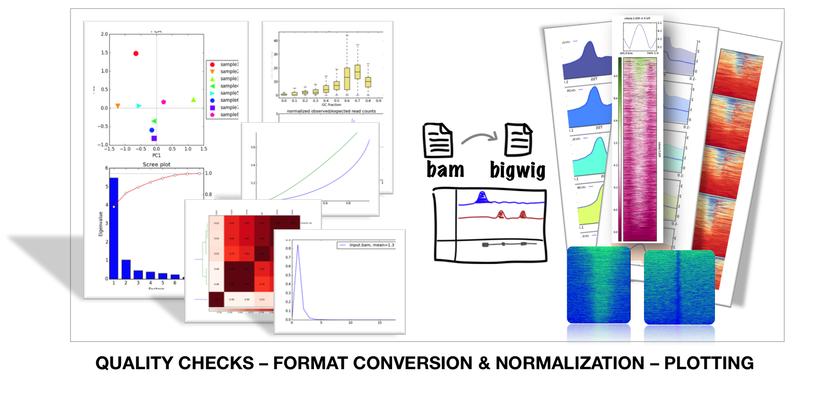
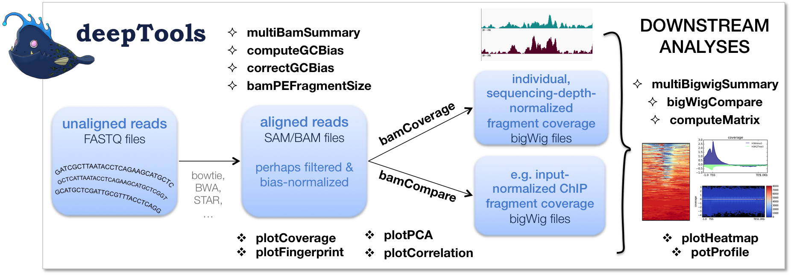
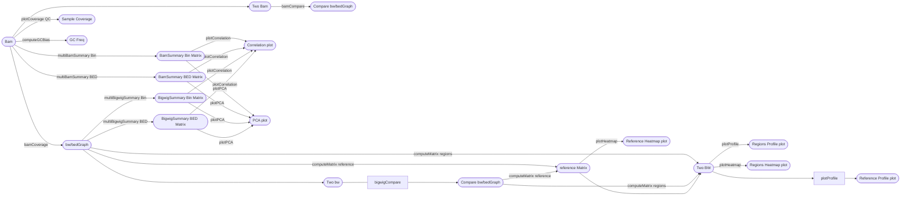

# deepTools

## 目录

- [1 Introduce](#1-Introduce)
  - [1.1 deepTools](#11-deepTools)
  - [1.2 deepTools Use](#12-deepTools-Use)
  - [1.3 deepTools modules](#13-deepTools-modules)
    - [1.3.1 deepTools modules List](#131-deepTools-modules-List)
  - [1.4 deepTools Normalization](#14-deepTools-Normalization)
- [2 Install](#2-Install)
- [3 Tutorial](#3-Tutorial)
  - [3.1 general parameter](#31-general-parameter)
    - [3.1.1 Parameters to decrease the run time](#311-Parameters-to-decrease-the-run-time)
    - [3.1.2 Filtering BAMs while processing](#312-Filtering-BAMs-while-processing)
  - [3.2 Tools](#32-Tools)
    - [3.2.1 Tools for BAM and bigWig file processing](#321-Tools-for-BAM-and-bigWig-file-processing)
      - [3.2.1.1 multiBamSummary](#3211-multiBamSummary)
      - [3.2.1.2 multiBigwigSummary](#3212-multiBigwigSummary)
      - [3.2.1.3 bamCoverage](#3213-bamCoverage)
      - [3.2.1.4 computeMatrix](#3214-computeMatrix)
      - [3.2.1.5 computeGCBias](#3215-computeGCBias)
      - [3.2.1.6 bamCompare](#3216-bamCompare)
      - [3.2.1.7 bigwigCompare](#3217-bigwigCompare)
    - [3.2.2 Tools for QC](#322-Tools-for-QC)
      - [3.2.2.1 plotCoverage](#3221-plotCoverage)
      - [3.2.2.2 plotCorrelation](#3222-plotCorrelation)
      - [3.2.2.3 plotPCA](#3223-plotPCA)
    - [Heatmaps and Summary Plots](#Heatmaps-and-Summary-Plots)
      - [3.2.3.1 plotProfile](#3231-plotProfile)
      - [3.2.3.2 plotHeatmap](#3232-plotHeatmap)
      - [3.2.3.3 plotEnrichment](#3233-plotEnrichment)
    - [3.2.4 Other](#324-Other)
- [4 Tips](#4-Tips)
  - [4.1 bedGraph/bw visablity scripts](#41-bedGraphbw-visablity-scripts)
- [5 Source](#5-Source)
- [6 Reference](#6-Reference)

***

## 1 Introduce

### `1.1 deepTools`

`deepTools` 是一套用 Python 编写的工具集，特别为高效分析高通量测序数据而开发。这些数据包括但不限于 ***ChIP-seq（染色质免疫沉淀测序***）、***RNA-seq（RNA测序***）或 ***MNase-seq（核酸酶敏感位点测序）*** 等[^1]。



`deepTools` 是一套用于处理和可视化深度测序数据的工具。它可以执行完整的生物信息学工作流程，从比对读取的质量控制和标准化到综合分析，包括聚类和可视化方法。

### `1.2 deepTools` Use

- `deepTools`一共有三种使用方法：
  - `Galaxy usage` （整合到Galaxy服务中）
  - `command line usage` （命令行）
  - `API `（python API）

### `1.3 deepTools` modules

`deepTools` 软件包中包含不同的 模块可以对NGS数据进行QC & 格式转换 & 标准化 & 绘图！

***BAM*** → ***Quality Checks*** & ***Format Conversion*** & ***Normalization*** & ***Plotting***

- `deepTools` 支持四种常见的任务（QC & **数据处理和标准化  &**数据整合 & 可视化）：
  1. **质量控制：**
     - deeptools 提供了多种质量控制工具，例如 GC 偏差检测（computeGCbias）和 ChIP 特异性富集评估（plotFingerprint）。
     - 它还包括新的程序，如 plotCoverage 用于检查多个样本的片段覆盖率的全基因组分布，以及 bamPEFragmentSize 用于检查双端数据的测序片段的大小分布是否符合预期。
  2. **数据处理和标准化：**
     - deeptools 可以执行数据过滤，标准化和格式转换等操作。
     - 它支持基于 SAM 标志灵活过滤比对文件（BAM），还可以选择排除重复项和比对分数低的读取。
     - deeptools 还可以识别和处理新的测序读取类型，例如 CIGAR 字符串和拼接读取比对。
  3. 数据整合：
     - deeptools 可以处理多个信号（bigWig）和区域文件（BED），以进行联合分析。例如，multiBamSummary 和 multiBigwigSummary 可以将来自多个样本的信息汇总到每个样本每个区域的单个分数中。
     - computeMatrix 计算所选基因组区域上的分数分布，并可以聚合来自许多不同样本的区域分数到单个矩阵中，以便随后进行可视化。
  4. 可视化：
     - deeptools 提供了多种可视化工具，例如 plotHeatmap 和 plotProfile，它们可以生成多个热图和汇总配置文件的组合图像



> **NOTE** : 在从fastq文件对比得到`bam`文件后，`deepTools`转获得`bw`文件过程中是会对数据进行标准化操作。

#### `1.3.1 deepTools` modules List

- `deepTools` 提供了众多的工具，可以对bam文件进行处理其中最常用的有

  [bamCoverage](https://deeptools.readthedocs.io/en/develop/content/tools/bamCoverage.html "bamCoverage") & [bamCompare](https://deeptools.readthedocs.io/en/develop/content/tools/bamCompare.html "bamCompare") & [plotHeatmap](https://deeptools.readthedocs.io/en/develop/content/tools/plotHeatmap.html "plotHeatmap") & [plotProfile](https://deeptools.readthedocs.io/en/develop/content/tools/plotProfile.html "plotProfile")
  | **Tool**                                                                                                                                    | **Type**           | **Input files**                     | **Main output file(s)**                    | **Application**                      |
  | ------------------------------------------------------------------------------------------------------------------------------------------- | ------------------ | ----------------------------------- | ------------------------------------------ | ------------------------------------ |
  | [multiBamSummary](https://deeptools.readthedocs.io/en/develop/content/tools/multiBamSummary.html "multiBamSummary")                         | 数据整合               | 2 or more BAM                       | interval-based table of values             | 执行跨样本的读数分析 → 绘制相关性图，绘制主成分分析图。        |
  | [multiBigwigSummary](https://deeptools.readthedocs.io/en/develop/content/tools/multiBigwigSummary.html "multiBigwigSummary")                | data integration   | 2 or more bigWig                    | interval-based table of values             | 对基因组范围内的评分进行跨样本分析 → 绘制相关性图，绘制主成分分析图  |
  | [plotCorrelation](https://deeptools.readthedocs.io/en/develop/content/tools/plotCorrelation.html "plotCorrelation")                         | QC & visualization | bam/multiBigwigSummary output       | clustered heatmap                          | Pearson/Spearman 相关性                 |
  | [plotPCA](https://deeptools.readthedocs.io/en/develop/content/tools/plotPCA.html "plotPCA")                                                 | QC & visualization | bam/multiBigwigSummary output       | 2 PCA plots                                | PCA                                  |
  | [plotFingerprint](https://deeptools.readthedocs.io/en/develop/content/tools/plotFingerprint.html "plotFingerprint")                         | QC                 | 2 BAM                               | 1 diagnostic plot                          | 评估染色质免疫沉淀样本的富集强度                     |
  | [computeGCBias](https://deeptools.readthedocs.io/en/develop/content/tools/computeGCBias.html "computeGCBias")                               | QC                 | 1 BAM                               | 2 diagnostic plots                         | 计算读取的预期和观察到的GC分布                     |
  | [correctGCBias](https://deeptools.readthedocs.io/en/develop/content/tools/correctGCBias.html "correctGCBias")                               | QC                 | BAM, output from computeGCbias      | GC-corrected BAM                           | 获取一个BAM文件，其中读取的分布与基因组的GC含量相对应        |
  | [bamCoverage](https://deeptools.readthedocs.io/en/develop/content/tools/bamCoverage.html "bamCoverage")                                     | normalization      | BAM                                 | bedGraph or bigWig                         | 获取单个BAM文件的标准化读取覆盖度                   |
  | [bamCompare](https://deeptools.readthedocs.io/en/develop/content/tools/bamCompare.html "bamCompare")                                        | normalization      | 2 BAM                               | bedGraph or bigWig                         | 将两个文件相互标准化（log2ratio，difference）     |
  | [computeMatrix](computeMatrix/computeMatrix.md "computeMatrix")                                                                               | data integration   | 1 or more bigWig, 1 or more BED     | zipped file for plotHeatmap or plotProfile | 计算生成heatmaps和summary plots所需的值       |
  | [estimateReadFiltering](https://deeptools.readthedocs.io/en/develop/content/tools/estimateReadFiltering.html "estimateReadFiltering")       | information        | 1 or more BAM files                 | table of values                            | 估计从一个BAM文件或文件中过滤掉的读取数量               |
  | [alignmentSieve](https://deeptools.readthedocs.io/en/develop/content/tools/alignmentSieve.html "alignmentSieve")                            | QC                 | 1 BAM file                          | 1 filtered BAM or BEDPE file               | 根据一个或多个标准过滤BAM文件                     |
  | [plotHeatmap](https://deeptools.readthedocs.io/en/develop/content/tools/plotHeatmap.html "plotHeatmap")                                     | visualization      | computeMatrix output                | heatmap of read coverages                  | 为基因组区域绘制读取覆盖度图                       |
  | [plotProfile](https://deeptools.readthedocs.io/en/develop/content/tools/plotProfile.html "plotProfile")                                     | visualization      | computeMatrix output                | summary plot (“meta-profile”)              | 将一组基因组区域的平均读覆盖度（read coverages）进行可视化 |
  | [plotCoverage](https://deeptools.readthedocs.io/en/develop/content/tools/plotCoverage.html "plotCoverage")                                  | visualization      | 1 or more BAM                       | 2 diagnostic plots                         | 在采样的基因组位置上，可视化平均读取覆盖率                |
  | [bamPEFragmentSize](https://deeptools.readthedocs.io/en/develop/content/tools/bamPEFragmentSize.html "bamPEFragmentSize")                   | information        | 1 BAM                               | text with paired-end fragment length       | 从PE数据（paired ends）中获取平均片段长度          |
  | [plotEnrichment](https://deeptools.readthedocs.io/en/develop/content/tools/plotEnrichment.html "plotEnrichment")                            | visualization      | 1 or more BAM and 1 or more BED/GTF | A diagnostic plot                          | 绘制与给定特征重叠的比对部分的比例                    |
  | [computeMatrixOperations](https://deeptools.readthedocs.io/en/develop/content/tools/computeMatrixOperations.html "computeMatrixOperations") | miscellaneous      | 1 or more BAM and 1 or more BED/GTF | A diagnostic plot                          | 绘制与给定特征重叠的对齐（alignments）的比例          |




### `1.4 deepTools` ***Normalization***

***deeptools*** ***Normalization*** (归一化)：在对多个样本进行处理时往往需要查看不同组的基因表达情况，但是由于测序深度的不同，则需要进行归一化操作。（**Example** : ctrl : 测序10G | treat 测序5G,在进行下游比较时可能出现对照始终比实验高，这是不可信的，因此需要进行归一化操作！ps ：而在使用**deeptools进行下游可视化时如果不进行标准化则无法对不同样本的结果基因对比**）[^2]

> ***deeptools***的归一化方法有RPKM & CPM & BPM & RPGC & scaling factor
>
> ```r title="deeptools Normalization "
> RPKM (per bin)  = number of reads per bin / (number of mapped reads (in millions) * bin length (kb))
> CPM (per bin)   = number of reads per bin / number of mapped reads (in millions)
> BPM (per bin)   = number of reads per bin / sum of all reads per bin (in millions)
> RPGC (per bin)  = number of reads per bin / scaling factor for 1x average coverage
> scaling factor  =  (total number of mapped reads * fragment length) / effective genome size
> ```
>

***

## 2 Install

```r title="Install by conda"
# Conda install
conda install -c bioconda deeptools -y
# pip install
pip install deeptools
```


***

## 3 Tutorial

### 3.1 general parameter

> `deepTools` models 的命令示例如下：
>
> ```bash title="deepTools models示例"
> bamCoverage --bam myAlignedReads.bam \
>             --outFileName myCoverageFile.bigWig \
>             --outFileFormat bigwig \
>             --fragmentLength 200 \
>             --ignoreDuplicates \
>             --scaleFactor 0.5
> ```
>

#### 3.1.1 Parameters to decrease the run time

> NOTE : 为了加快分析速度`deepTools`提供了多个函数对分析进行加速：
>
> 1. `numberOfProcessors` ： 要使用的处理器数量；
> 2. `region` ： 仅处理单个基因组区域。

#### 3.1.2 Filtering BAMs while processing

> **NOTE** : `deepTools`提供了多个函数（`bamCoverage` &  `bamCompare`）对bam文件进行高效处理，并且也提供了多个参数以动态过滤bam文件。
>
> 1. `ignoreDuplicates`: 具有相同方向和起始位置的读取将只被考虑一次。如果读取是成对的，那么其配对的读取也会被评估；
> 2. `minMappingQuality` ： 只有映射质量分数大于特定值的读取才会被保留；
> 3. `samFlagInclude` ： 根据 sam 格式的 flag 来保留对应的 reads 用于分析；
> 4. `samFlagExclude` ： 根据 sam 格式的 flag 来剔除对应的 reads 用于分析。

### 3.2 Tools

`deepTools`软件包中包含不同的 模块可以对NGS数据进行QC & 格式转换（BAM and bigWig file processing ） & 标准化 & 绘图（Heatmaps and Summary Plots）

#### 3.2.1 Tools for BAM and bigWig file processing

##### `3.2.1.1 multiBamSummary`

`multiBamSummary` 可以对两个或更多 BAM 文件的基因组区域的读覆盖度进行计算，并且`deeptools`也提供了`plotCorrelation` & `plotPCA`进行绘图可视。`multiBamSummary` 的标准输出是一个压缩的 numpy 数组（.npz）它可以直接用于使用工具`plotCorrelation`计算和可视化读覆盖度之间的成对相关性值。同样，`plotPCA` 可用于使用 .npz 文件进行读覆盖度的主成分分析。请注意，如果只想生成 `bedGraph` 文件（即，使用 `--outRawCounts` 选项；如果仅提供了单个文件，则默认输出文件不能被任何 `deepTools` 程序使用！），则只推荐使用单个 `bigWig` 文件。

[multiBamSummary](multiBamSummary/multiBamSummary.md "multiBamSummary")

`multiBamSummary` 可以对两个或更多 BAM 文件的基因组区域的读覆盖度进行计算，并且`deeptools`也提供了`plotCorrelation` & `plotPCA`进行绘图可视。`multiBamSummary` 的标准输出是一个压缩的 numpy 数组（.npz）它可以直接用于使用工具`plotCorrelation`计算和可视化读覆盖度之间的成对相关性值。同样，`plotPCA` 可用于使用 .npz 文件进行读覆盖度的主成分分析。请注意，如果只想生成 `bedGraph` 文件（即，使用 `--outRawCounts` 选项；如果仅提供了单个文件，则默认输出文件不能被任何 `deepTools` 程序使用！），则只推荐使用单个 `bigWig` 文件。

bam  →  `multiBamSummary` → .npz → `plotPCA` & `plotCorrelation`

##### `3.2.1.2 multiBigwigSummary`

`multiBigwigSummary` ：计算两个或更多的`bigWig`文件每个文件在每个基因组区域的平均分数。通过在`bin`模式下运行程序，可以对整个基因组进行这种分析，或者在`BED`文件模式下对用户选定的特定区域进行分析。最常见的是，`multiBigwigSummary`的默认输出（一个压缩的numpy数组，.npz）被其他工具如`plotCorrelation`或`plotPCA`用于可视化和诊断目的。**(ps:****`multiBigwigSummary`****和****`multiBamSummary`**** 命令具有相同的作用，只是起始文件存在一定区别）**

[multiBigwigSummary](multiBigwigSummary/multiBigwigSummary.md "multiBigwigSummary")

`multiBigwigSummary` ：计算两个或更多的`bigWig`文件每个文件在每个基因组区域的平均分数。通过在`bin`模式下运行程序，可以对整个基因组进行这种分析，或者在`BED`文件模式下对用户选定的特定区域进行分析。最常见的是，`multiBigwigSummary`的默认输出（一个压缩的numpy数组，.npz）被其他工具如`plotCorrelation`或`plotPCA`用于可视化和诊断目的。**(ps:****`multiBigwigSummary`****和****`multiBamSummary`**** 命令具有相同的作用，只是起始文件存在一定区别）**

bw → `multiBigwigSummary` → .npz → `plotCorrelation` | `plotPCA`

##### `3.2.1.3 bamCoverage`

\*\*bam → ****`bamCoverage`**** → ****`bigWig`**** | \*\***`bedGraph`**

`bamCoverage`接受对齐的读取或片段作为输入（`BAM`文件），并生成覆盖度轨迹（`bigWig`或`bedGraph`）作为输出。覆盖度是通过定义大小的短连续计数窗口中的读取数量来计算的。可以扩展读取的长度，以更好地反映实际的片段长度。`bamCoverage`提供通过缩放因子、每千碱基每百万映射读取数（RPKM）、每百万计数（CPM）、每百万映射读取的bins（BPM）和1×深度（每基因组覆盖度的读取数，RPGC）进行标准化。

[bamCoverage](bamCoverage/bamCoverage.md "bamCoverage")

\*\*bam → ****`bamCoverage`**** → ****`bigWig`**** | \*\***`bedGraph`**

`bamCoverage`接受对齐的读取或片段作为输入（`BAM`文件），并生成覆盖度轨迹（`bigWig`或`bedGraph`）作为输出。覆盖度是通过定义大小的短连续计数窗口中的读取数量来计算的。可以扩展读取的长度，以更好地反映实际的片段长度。`bamCoverage`提供通过缩放因子、每千碱基每百万映射读取数（RPKM）、每百万计数（CPM）、每百万映射读取的bins（BPM）和1×深度（每基因组覆盖度的读取数，RPGC）进行标准化。

##### `3.2.1.4 computeMatrix`

bw→ `computeMatrix` → matrix.mat.gz → `plotProfile` | `plotHeatmap`

`computeMatrix`工具计算每个基因组区域的得分，并生成一个中间文件，这个文件可以用于`plotHeatmap`和`plotProfiles`。通常，基因组区域是基因，但任何在BED文件中定义的其他区域也可以使用。`computeMatrix`接受多个得分文件（bigWig格式）和多个区域文件（BED格式）。这个工具还可以用来根据它们的得分来过滤和排序区域。

[computeMatrix](computeMatrix/computeMatrix.md "computeMatrix")

bw→ `computeMatrix` → matrix.mat.gz → `plotProfile` | `plotHeatmap`

##### `3.2.1.5 computeGCBias`

`computeGCBias` 是基于 Benjamini 和 Speed 的一篇论文开发的一个工具[^3]。这个工具用于诊断 GC 偏倚（GC bias），其基本假设是：在一个理想的样本中，整个基因组的测序读数应该均匀分布，也就是说，不管基因组各区域的碱基对组成如何，它们都应该有相似数量的读数。然而，**在现实中，用于测序协议文库制备过程中的基于 PCR 的扩增步骤中的 DNA 聚合酶，更倾向于扩增富含 GC 的区域**。这种偏好会影响测序结果，因为仅仅是由于 DNA 聚合酶的这种偏好，富含 GC 的区域会产生更多的读数。

[computeGCBias](computeGCBias/computeGCBias.md "computeGCBias")

`computeGCBias` 是基于 Benjamini 和 Speed 的一篇论文开发的一个工具[^3]。这个工具用于诊断 GC 偏倚（GC bias），其基本假设是：在一个理想的样本中，整个基因组的测序读数应该均匀分布，也就是说，不管基因组各区域的碱基对组成如何，它们都应该有相似数量的读数。然而，**在现实中，用于测序协议文库制备过程中的基于 PCR 的扩增步骤中的 DNA 聚合酶，更倾向于扩增富含 GC 的区域**。这种偏好会影响测序结果，因为仅仅是由于 DNA 聚合酶的这种偏好，富含 GC 的区域会产生更多的读数。

##### `3.2.1.6 bamCompare`

**`bamCompare`** 可以用来生成 基于两个相互比较的 BAM 文件生成的bigWig 或 bedGraph 文件，同时在生成过程中会对这些文件进行测序深度的标准化处理。

[bamCompare](bamCompare/bamCompare.md "bamCompare")

**`bamCompare`** 可以用来生成 基于两个相互比较的 BAM 文件生成的bigWig 或 bedGraph 文件，同时在生成过程中会对这些文件进行测序深度的标准化处理。

##### `3.2.1.7 bigwigCompare`

`bigwigCompare`可以对bam转换后获得的bigWig进行对比。基因组被划分成等大小的bin，然后计算每个BAM文件中每个bin发现的读取数量，最后报告一个汇总值。这个值可以是每个bin读取数量的比率、比率的log2、总和或差异。

[bigwigCompare](bigwigCompare/bigwigCompare.md "bigwigCompare")

`bigwigCompare`可以对bam转换后获得的bigWig进行对比。基因组被划分成等大小的bin，然后计算每个BAM文件中每个bin发现的读取数量，最后报告一个汇总值。这个值可以是每个bin读取数量的比率、比率的log2、总和或差异。

#### 3.2.2 Tools for QC

##### `3.2.2.1 plotCoverage`

`plotCoverage`可以对测序数据的样本的测序深度进行检测与可视化。其采样了100万个碱基对，计算重叠读段的数量，并可以报告一个直方图，告诉你有多少碱基被覆盖了多少次。

[plotCoverage](plotCoverage/plotCoverage.md "plotCoverage")

`plotCoverage`可以对测序数据的样本的测序深度进行检测与可视化。其采样了100万个碱基对，计算重叠读段的数量，并可以报告一个直方图，告诉你有多少碱基被覆盖了多少次。

##### `3.2.2.2 plotCorrelation`

`plotCorrelation`用于分析和可视化基于`multiBamSummary`或`multiBigwigSummary`输出的样本相关性的工具。可以使用**皮尔逊**或**斯皮尔曼**方法来计算相关系数。结果可以保存为多个散点图，描绘成对相关性，或者保存为聚类热图，其中颜色代表相关系数，聚类是使用完全链接构建的。也可以选择将值保存为表格。

bam  →  `multiBamSummary` → .npz → `plotPCA` & `plotCorrelation`

bw → `multiBigwigSummary` → .npz → `plotCorrelation` | `plotPCA`

[plotCorrelation](plotCorrelation/plotCorrelation.md "plotCorrelation")

`plotCorrelation`用于分析和可视化基于`multiBamSummary`或`multiBigwigSummary`输出的样本相关性的工具。可以使用**皮尔逊**或**斯皮尔曼**方法来计算相关系数。结果可以保存为多个散点图，描绘成对相关性，或者保存为聚类热图，其中颜色代表相关系数，聚类是使用完全链接构建的。也可以选择将值保存为表格。

##### `3.2.2.3 plotPCA`

bam  →  `multiBamSummary` → .npz → `plotPCA` & `plotCorrelation`

bw → `multiBigwigSummary` → .npz → `plotCorrelation` | `plotPCA`

[plotPCA](plotPCA/plotPCA.md "plotPCA")

#### **Heatmaps and Summary Plots**

##### `3.2.3.1 plotProfile`

`plotProfile`命令可以根据`computeMatrix`生成的矩阵的基础上，绘制基因组区域（这些区域指的是基因，但也可以是BED文件中定义的任何其他区域）上分数的轮廓图（**Profile plot**）。

bw→ `computeMatrix` → matrix.mat.gz → `plotProfile` | `plotHeatmap`

[plotProfile](plotProfile/plotProfile.md "plotProfile")

`plotProfile`命令可以根据`computeMatrix`生成的矩阵的基础上，绘制基因组区域（这些区域指的是基因，但也可以是BED文件中定义的任何其他区域）上分数的轮廓图（**Profile plot**）。

##### `3.2.3.2 plotHeatmap`

`plotHeatma`可以绘制基因组区域相关的分数的热图。但是`plotHeatma`需要`computeMatrix`生成的矩阵文件作为输入。

bw→ `computeMatrix` → matrix.mat.gz → `plotProfile` | `plotHeatmap`

[plotHeatmap](plotHeatmap/plotHeatmap.md "plotHeatmap")

`plotHeatma`可以绘制基因组区域相关的分数的热图。但是`plotHeatma`需要`computeMatrix`生成的矩阵文件作为输入。

##### `3.2.3.3 plotEnrichment`

[plotEnrichment](plotEnrichment/plotEnrichment.md "plotEnrichment")

#### 3.2.4 Other

***

## 4 Tips

### 4.1 bedGraph/bw visablity scripts

bedGraph/bw 文件可视化

[Coverage plot](https://www.wolai.com/m1Dnen5QBcEZ6hL6Jf4g9N "Coverage plot")

[ggcoverage](https://www.wolai.com/v8oiBxQB7jsFHFVe5YgUVf "ggcoverage")

***

## 5 Source

[ 神器之 computeMatrix + 绘图  https://maimengkong.com/m/?post=1310](https://maimengkong.com/m/?post=1310 " 神器之 computeMatrix + 绘图  https://maimengkong.com/m/?post=1310")

> \*\*deepTools2 paper : \*\*
>
> [deepTools2- a next generation web server for deep-sequencing data analysis.pdf](<file/deepTools2- a next generation web server for deep-.pdf> "deepTools2- a next generation web server for deep-sequencing data analysis.pdf")

***

## 6 Reference

[^1]: [https://deeptools.readthedocs.io/en/latest/](https://deeptools.readthedocs.io/en/latest/ "https://deeptools.readthedocs.io/en/latest/")

[^2]: [https://blog.csdn.net/weixin\_43569478/article/details/108079478](https://blog.csdn.net/weixin_43569478/article/details/108079478 "https://blog.csdn.net/weixin_43569478/article/details/108079478")

[^3]: Summarizing and correcting the GC content bias in high-throughput sequencing
