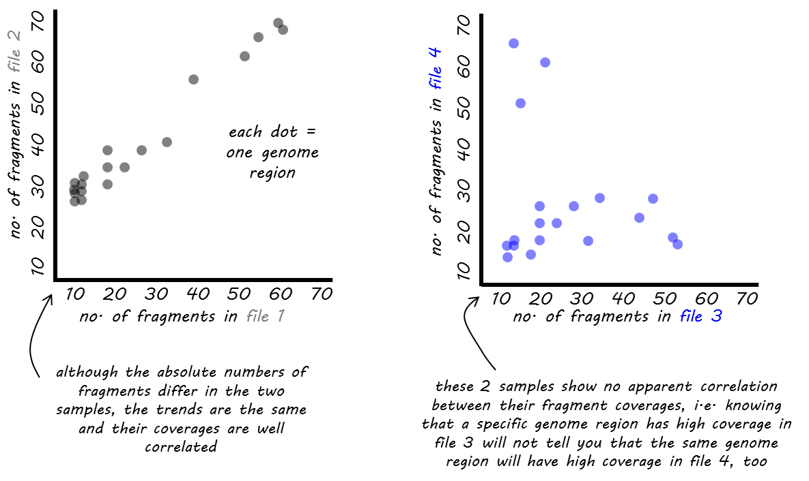
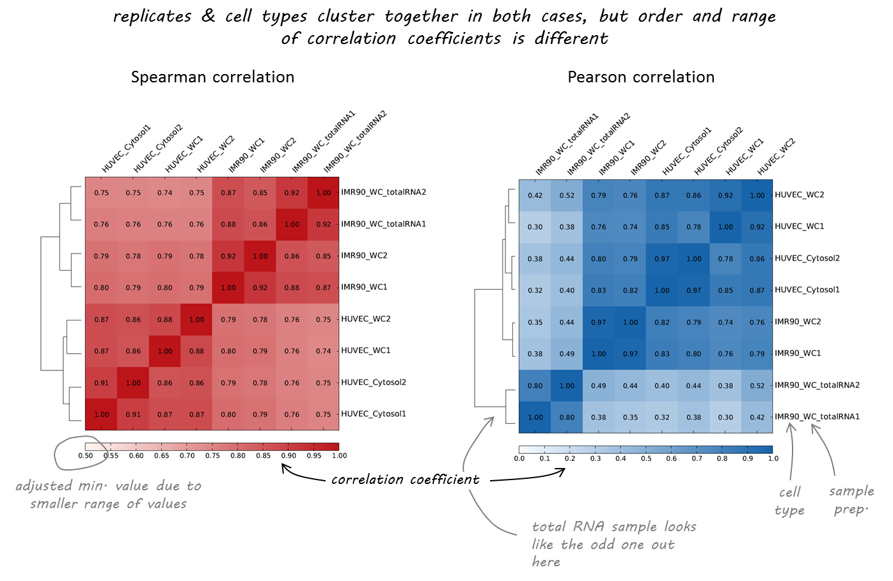
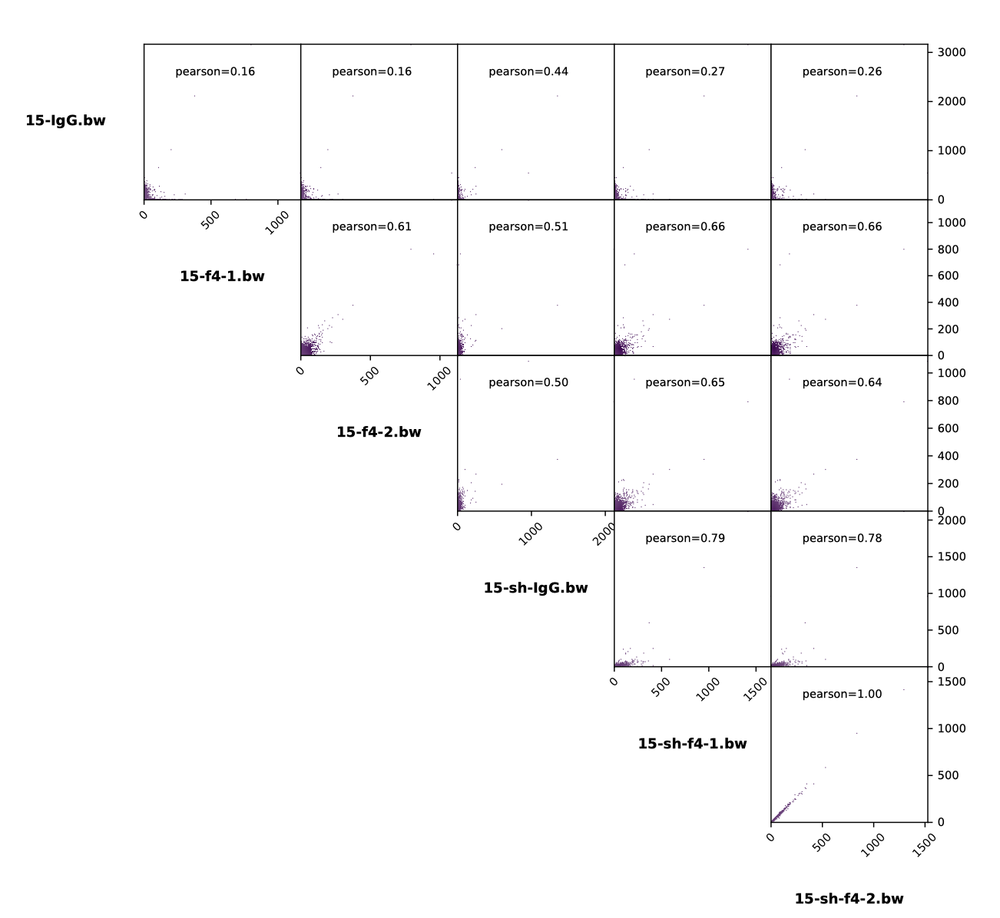
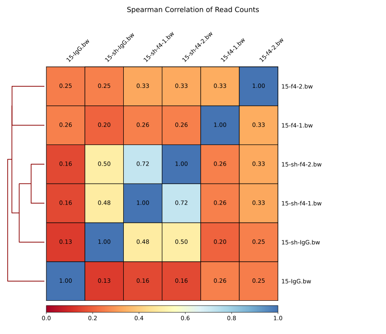

# plotCorrelation

## 目录

- [1 plotCorrelation](#1-plotCorrelation)
  - [1.1 Scatterplot](#11-Scatterplot)
  - [1.2 Heatmap](#12-Heatmap)
- [2 plotCorrelation parameter](#2-plotCorrelation-parameter)
  - [2.1 scatterplot](#21-scatterplot)
  - [2.2 heatmap](#22-heatmap)

### `1 plotCorrelation`

`plotCorrelation`用于分析和可视化基于`multiBamSummary`或`multiBigwigSummary`输出的样本相关性的工具。可以使用**皮尔逊**或**斯皮尔曼**方法来计算相关系数。结果可以保存为多个散点图，描绘成对相关性，或者保存为聚类热图，其中颜色代表相关系数，聚类是使用完全链接构建的。也可以选择将值保存为表格。

> Tips : **皮尔逊**或**斯皮尔曼**具体描述见：
>
> [Correlation](https://www.wolai.com/x2jwUy4Z7q4mNxFB6PHxt8 "Correlation")

`plotCorrelation` 是一个计算两个或多个文件之间整体相似度的工具。它基于基因组区域内的读取覆盖率（或其他分数）来计算相似度。而要得到这些读取覆盖率或分数，必须使用 `multiBamSummary` 或 `multiBigwigSummary` 这两个工具之一来进行计算.

#### 1.1 Scatterplot



#### 1.2 Heatmap

> NOTE : 如果你使用`plotCorrelation`函数生成的热图输出，它会自动根据相关系数对样本进行聚类。这样做可以帮助确定不同类型的样本是否可以被区分开来，也就是说，我们期望在不同条件下的样本之间的相似性要低于同一条件下重复样本之间的相似性。



### `2 plotCorrelation` parameter

```bash title="parameter"
# Required arguments
--corData, -in   : 由 multiBigwigSummary 或 multiBamSummary 生成的压缩值矩阵
--corMethod, -c  : 相关性计算方法 spearman, pearson
--whatToPlot, -p : 可能的选择：heatmap(生成热图), scatterplot(成对散点图)
# Optional arguments
--plotFile, -o : 输出图片的格式，可用的格式有：.png, .eps, .pdf 和 .svg。
--skipZeros    : 通过设置此选项，排除所有样本中具有零或缺失（nan）值的基因组区域。
--labels, -l   : 用户定义的标签，而不是从文件名中的默认标签。
                 多个标签必须用空格分隔，例如，--labels sample1 sample2 sample3
--plotTitle, -T  : 图像顶部标题。留空则不显示标题。（默认：无）
--plotFileFormat : 图像格式类型png, pdf, svg, eps, plotly
--removeOutliers : 如果设置，将移除具有非常大计数的bin。
                   具有异常高读取计数的bin会在人为地增加皮尔逊相关性；
                   因此，multiBamSummary尝试使用中位数绝对偏差（MAD）方法移除异常值，
                   应用200的阈值只考虑与中位数的极端大偏差。
# Output optional options
--outFileCorMatrix : 将成对相关性值矩阵保存到制表符分隔的文件中。
# heatmap plot options
--plotHeight  : 图像高度，以厘米为单位。（默认：9.5）
--plotWidth   : 图像宽度，以厘米为单位。最小值为1厘米。（默认：11）
--zMin, -min  : 热图强度的最小值。如果没有指定，将自动设置此值
--zMax, -max  : 热图强度的最大值。如果没有指定，将自动设置此值
--colorMap    : 用于热图的颜色图。
--plotNumbers : 如果设置，则在热图上方绘制相关性数字。此选项仅在绘制热图时有效。
# Scatter plot options
--xRange : X轴范围。默认情况下，这些设置使得所有点的范围都能显示。
--yRange : Y轴范围。默认情况下，这些设置使得所有点的范围都能显示。
--log1p  : 在添加1之后绘制散点图的自然对数。注意，这只是用于绘图，相关性不受影响。
# Other
--version : 显示程序的版本号并退出

```


#### 2.1 scatterplot

```bash title="plotCorrelation scatterplot"
plotCorrelation -in 15_bins.multiBigwigSummary.npz \
                --corMethod pearson --skipZeros \
                --plotTitle "Pearson Correlation of Average Scores Per Transcript" \
                --whatToPlot scatterplot \
                -o 15_bins_scatterplot_PearsonCorr_bigwigScores.pdf   \
                --outFileCorMatrix 15_bins_PearsonCorr_bigwigScores.tab
```




#### 2.2 heatmap

```bash title="plotCorrelation heatmap"
plotCorrelation -in 15_bins.multiBigwigSummary.npz \
                --corMethod spearman --skipZeros \
                --plotTitle "Spearman Correlation of Read Counts" \
                --whatToPlot heatmap --colorMap RdYlBu --plotNumbers \
                -o 15_bins_heatmap_SpearmanCorr_readCounts.svg   \
                --outFileCorMatrix 15_bins_SpearmanCorr_readCounts.tab
```



