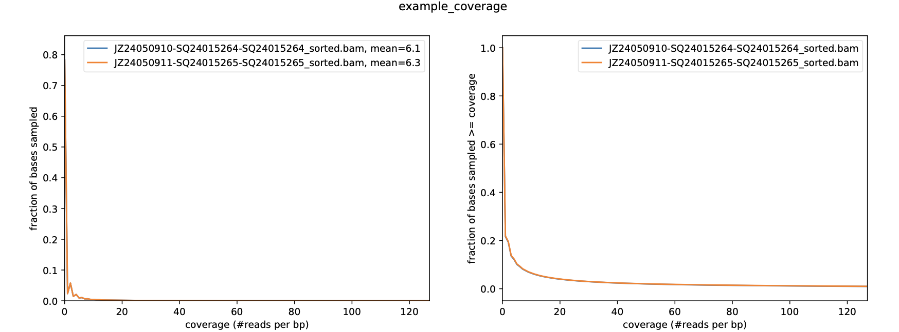
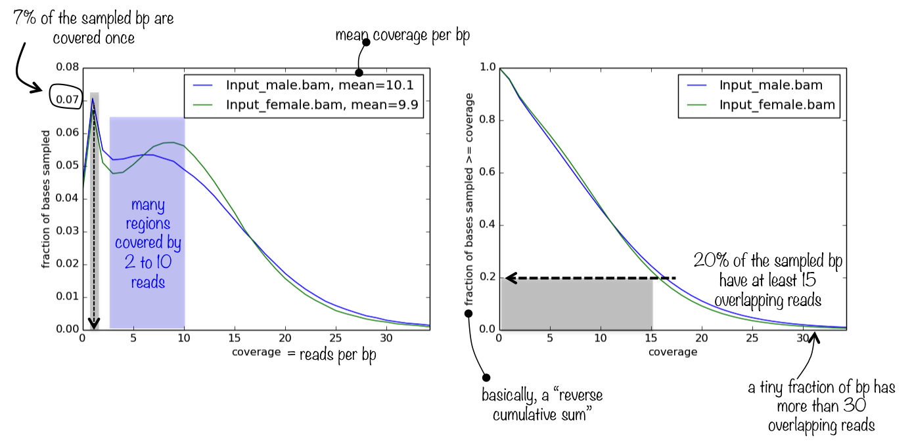

# plotCoverage

#### `1 plotCoverage`

`plotCoverage`可以对测序数据的样本的测序深度进行检测与可视化。其采样了100万个碱基对，计算重叠读段的数量，并可以报告一个直方图，告诉你有多少碱基被覆盖了多少次。

#### `2 plotCoverage` parameter

```bash 
# Named Arguments
--version       :  显示程序的版本号并退出。
# Required Arguments
--bamfiles, -b  : 用空格分隔的索引化BAM文件列表。
# Optional arguments
--plotFile, -o  : 保存图表的文件名。
--labels, -l    : 用户定义的标签，而不是从文件名中获取的默认标签。
--smartLabels   : 自动命名
--plotTitle, -T : 图表的标题，将打印在生成的图像顶部。留空则无标题。（默认：无）
--skipZeros     : 通过设置此选项，排除所有样本中具有零或非数值的基因组区域。
--numberOfSamples, -n  : 要采样的1 bp区域的数量。（默认：1000000）
--BED           : 将覆盖分析限制在这些文件中指定的区域。
--outRawCounts  : 将原始计数（覆盖度）保存到文件。
--outCoverageMetrics : 将超过指定阈值的bin/区域的百分比保存到指定文件。
--coverageThresholds, -ct : 报告的bin/区域中信号至少与给定阈值一样高的百分比。
--plotHeight     : 图表高度，以厘米为单位。（默认：5.0）
--plotWidth      : 图表宽度，以厘米为单位。最小值为1厘米。（默认：15.0）
--plotFileFormat : 可能的选择：png, pdf, svg, eps, plotly
--region, -r     : 限制操作的基因组区域 - 这在测试参数以减少计算时间时非常有用。
--blackListFileName, -bl : 包含应该从所有分析中排除的区域的BED或GTF文件。
--numberOfProcessors, -p : 要使用的处理器数量。
--verbose, -v    : 设置为查看处理消息。
# Read processing options
--extendReads/-e    ：延长 reads 的长度，对应 RNA-seq 数据不适合
--ignoreDuplicates  ：忽略重复的 reads
--minMappingQuality ：reads 最小比对质量值，整数型
--centerReads       ：中心化 reads，可获得更陡峭的峰
--samFlagInclude    ：根据 sam 格式的 flag 来保留对应的 reads 用于分析
--samFlagExclude    ：根据 sam 格式的 flag 来剔除对应的 reads 用于分析
--minFragmentLength ：reads 的 Fragment 最小长度，对应于 ATAC-seq 数据可用来筛选单核小体和多核小体
--maxFragmentLength ：reads 的 Fragment 最大长度
```


#### `3 plotCoverage` Example

```bash title="plotCoverage Example"
plotCoverage -b JZ24050910-SQ24015264-SQ24015264_sorted.bam JZ24050911-SQ24015265-SQ24015265_sorted.bam \
    --plotFile RNA_example_coverage.pdf \
    -n 1000000 \
    --plotTitle "example_coverage" \
    --outRawCounts coverage.tab \
    --ignoreDuplicates \
    -p 60 \
    --minMappingQuality 10 \
    --region 19
```




##### `3.1 plotCoverage` Result

> `plotCoverage` 会输出两张来对样本测序覆盖度进行评价的图：
>
> 
>
> - \*\*Fig1测序覆盖度的频率分布 \*\*: 会输出样本平均覆盖度值，如果测序覆盖度的分布大致是均质的（即方差大致相同），并且理想情况下是正态分布的（虽然很可能不是），那么平均值就是一个非常适合代表测序深度的指标
> - **Fig2  ：** 可以帮助你回答这个问题：基因组中有多少比例的区域测序深度为2。
