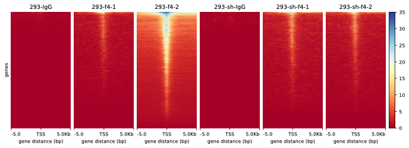

# plotHeatmap

#### `plotHeatmap`



`plotHeatma`可以绘制基因组区域相关的分数的热图。但是`plotHeatma`需要`computeMatrix`生成的矩阵文件作为输入。

#### `plotHeatmap` parameter

```bash title="parameter"
# Required arguments:
--matrixFile, -m : computeMatrix 输出的压缩结果文
--outFileName, -out, -o : 保存绘图结果名，“png”, “eps”, “pdf” and “svg”等格式可选，e.g., MyHeatmap.png
# Output arguments:
--outFileSortedRegions : 输出排序好的 bed 文件，Example: Heatmap1sortedRegions.bed
--outFileNameMatrix.   : 保存绘制热图数据，e.g. MyMatrix.gz
--interpolationMethod. : auto, nearest, bilinear, bicubic, gaussian 五个选项，如果 HeatMap 图像包含大量列通常更好地使用插值方法产生更好的结果，默认使用 nearest
--dpi.                 : 保存绘图图片的分辨率
# Clustering arguments
--kmeans  : 聚类数量，使用此参数会用 k-means 算法进行聚类，只能在单个样本工作
--hclust  : 聚类数量，使用此参数会用 hierarchical clustering 算法进行层次聚类，只能在单个样本工作
--silhouette  : 计算区域轮廓得分，得分是一个衡量一个区域与同一集群中的其他区域之间的相似程度的指标。它将报告在带有区域的 BED 文件的最后一列中。当你有超过 10 万个区域时，轮廓评估可能会非常缓慢
# Optional arguments
--plotType.   : lines, fill, se, std 三种类型
--sortRegions : 是否需要对区间排序，默认降序，descend, ascend, no, keep 四个选项
--sortUsing.  : 6 种排序方法，mean, median, max, min, sum, region_length
--linesAtTickMarks : 用虚线标记在热图上的刻度位置
--missingDataColor : 缺失数据的颜色，默认黑色
--colorMap         : 热图颜色， ‘Accent’, ‘Blues’, ‘BrBG’, ‘BuGn’, ‘BuPu’, ‘CMRmap’, ‘Dark2’, ‘GnBu’, ‘Greens’, ‘Greys’, ‘OrRd’, ‘Oranges’, ‘PRGn’, ‘Paired’, ‘Pastel1’, ‘Pastel2’, ‘PiYG’, ‘PuBu’, ‘PuBuGn’, ‘PuOr’, ‘PuRd’, ‘Purples’, 
                              ‘RdBu’, ‘RdGy’, ‘RdPu’, ‘RdYlBu’, ‘RdYlGn’, ‘Reds’, ‘Set1’, ‘Set2’, ‘Set3’, ‘Spectral’, ‘Wistia’, ‘YlGn’, ‘YlGnBu’, ‘YlOrBr’, ‘YlOrRd’, ‘afmhot’, ‘autumn’, ‘binary’, ‘bone’, ‘brg’, ‘bwr’, ‘cividis’, 
                              ‘cool’, ‘coolwarm’, ‘copper’, ‘cubehelix’, ‘flag’, ‘gist_earth’, ‘gist_gray’, ‘gist_heat’, ‘gist_ncar’, ‘gist_rainbow’, ‘gist_stern’, ‘gist_yarg’, ‘gnuplot’, ‘gnuplot2’, ‘gray’, ‘hot’, ‘hsv’, ‘icefire’, 
                              ‘inferno’, ‘jet’, ‘magma’, ‘mako’, ‘nipy_spectral’, ‘ocean’, ‘pink’, ‘plasma’, ‘prism’, ‘rainbow’, ‘rocket’, ‘seismic’, ‘spring’, ‘summer’, ‘tab10’, ‘tab20’, ‘tab20b’, ‘tab20c’, ‘terrain’, ‘twilight’, 
                              ‘twilight_shifted’, ‘viridis’, ‘vlag’, ‘winter’
--alpha         : 热图透明度，默认 1
--colorList     : 自定义颜色，–colorList black,yellow,blue
--colorNumber   : 控制颜色转变的数量
--zMin, -min    : 热图密度的最小值
--zMax, -max    : 热图密度的最大值
--heatmapHeight : 热图高度，cm，默认 28，最小 3，最大 100
--heatmapWidth. : 热图宽度，cm，默认 4，最小 1，最大 100
--whatToShow.   : 展示图像类型， plot, heatmap and colorbar, plot and heatmap, heatmap only, heatmap and colorbar，5 种选择，默认：密度图+热图+热图颜色柱
--boxAroundHeatmaps : 热图边框，–boxAroundHeatmaps no 则不绘制边框
--xAxisLabel, -x.   : X 轴文本标签

```


```bash title="Draw plotHeatmap Example"
plotHeatmap -m 293_ref_point.matrix.mat.gz \
            --heatmapHeight 10 \
            --heatmapWidth 4 \
            --dpi 1000 \
            --whatToShow 'heatmap and colorbar' \
            --boxAroundHeatmaps no \
            -out 293_ref.plotHeatmap.pdf
```
