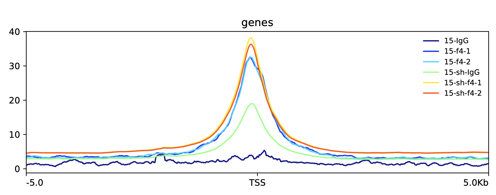
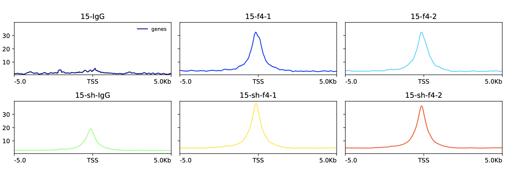
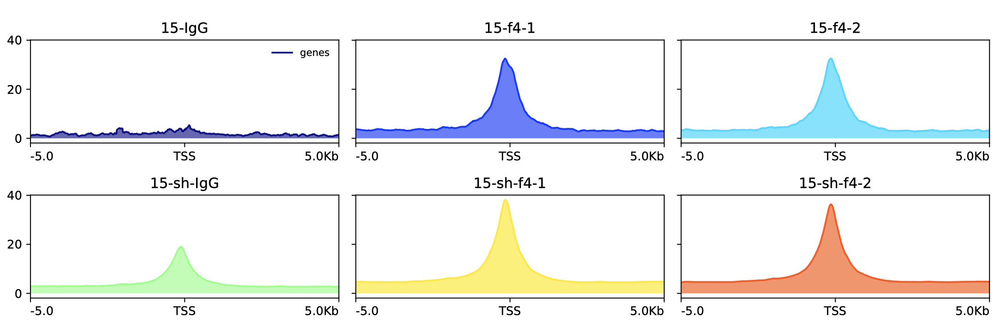
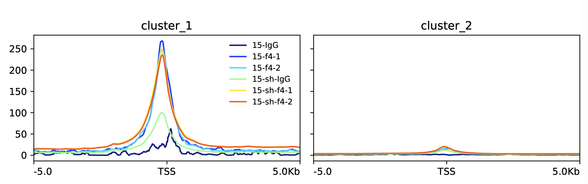
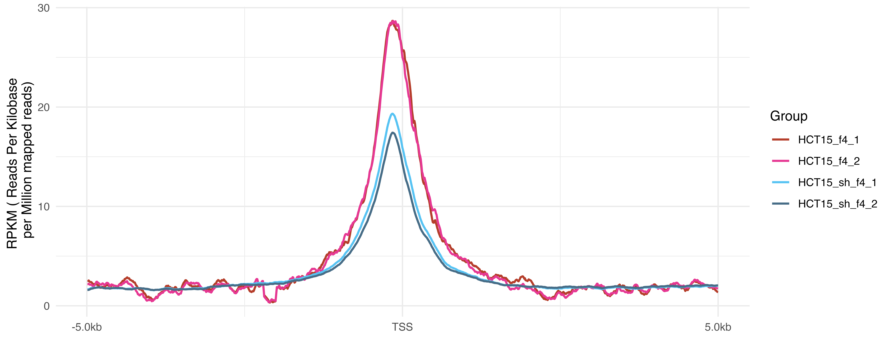

# plotProfile

## 目录

- [1 plotProfile](#1-plotProfile)
- [2 plotProfile parameter](#2-plotProfile-parameter)
- [3 plotProfile example](#3-plotProfile-example)
- [4 Code](#4-Code)

#### `1 plotProfile`

`plotProfile`命令可以根据`computeMatrix`生成的矩阵的基础上，绘制基因组区域（这些区域指的是基因，但也可以是BED文件中定义的任何其他区域）上分数的轮廓图（**Profile plot**）。

#### `2 plotProfile` parameter

```bash title="parameter"
# Required arguments:
--matrixFile, -m        : computeMatrix 输出的压缩结果文件
--outFileName, -out, -o : 保存绘图结果名，“png”, “eps”, “pdf” and “svg”等格式可选，e.g., MyHeatmap.png
# Output
--outFileSortedRegions : 输出排序好的 bed 文件，Example: Heatmap1sortedRegions.bed
--outFileNameData      : 保存绘图数据， e.g. myProfile.tab.
--dpi                  : 保存绘图图片的分辨率
# Clustering arguments
--kmeans  : 聚类数量，使用此参数会用 k-means 算法进行聚类，只能在单个样本工作
--hclust  : 聚类数量，使用此参数会用 hierarchical clustering 算法进行层次聚类，只能在单个样本工作
--silhouette  : 计算区域轮廓得分，得分是一个衡量一个区域与同一集群中的其他区域之间的相似程度的指标。它将报告在带有区域的 BED 文件的最后一列中。当你有超过 10 万个区域时，轮廓评估可能会非常缓慢
# Optional arguments
--averageType : mean, median, min, max, std, sum，6 种统计信号值的方法
--plotHeight  : 绘图的高度，cm
--plotWidth   : 绘图的宽度，cm
--plotType    : 绘图类型：lines, fill, se, std, overlapped_lines, heatmap，se 和 std 是给线图添加标准误和标准差
--colors      : 设置线条的颜色，对于 overlapped_lines 不可用，example, --colors red blue green
--numPlotsPerRow : 每行图的个数
--clusterUsingSamples : 对样本编号聚类
--startLabel  : 区间起始位置绘图的标签，只对 scale-regions 有用
--endLabel    : 区间终止位置绘图的标签，只对 scale-regions 有用
--refPointLabel : 参考位置的绘图标签，只对 reference-point 有用
--labelRotation : x 轴标签的旋转角度，默认 0
--regionsLabel, -z : 热图里 bed 区间的绘图标签，如果有多个，以空格分割，如果本身有空格，则需要引号，–regionsLabel label_1, “label 2”
--samplesLabel  : 样本标签，默认使用样本名，如果本身有空格，则需要引号和空格分开，–samplesLabel label-1 “label 2”
--plotTitle, -T : 绘图标题，默认无
--yAxisLabel, -y : Y 轴标签
--yMin        : 指定 Y 轴最小值
--yMax        : 指定 Y 轴最大值
--legendLocation : 图例位置，best, upper-right, upper-left, upper-center, lower-left, lower-right, lower-center, center, center-left, center-right, none
--perGroup    : 是否将所有样本绘制在一张图里，默认分别画图
--plotFileFormat : 输出图片格式，png, pdf, svg, eps, plotly

```


#### `3 plotProfile` example

> 绘制多样本合并**Profile plot**
>
> ```bash title="plotProfile example"
> plotProfile -m 15_ref_point.matrix.mat.gz  \
>             --perGroup \
>             --averageType mean \
>             --plotType lines \
>             --plotHeight 8 \
>             --plotWidth 20 \
>             --legendLocation 'best' \
>             --outFileName 15_ref_point.pdf \
>             --plotFileFormat  "pdf" 
> ```
>
>
> 

> 绘制每一个样本的**Profile plot**
>
> ```bash title="plotProfile example"
> plotProfile -m 15_ref_point.matrix.mat.gz  \
>             --numPlotsPerRow 6 \
>             --averageType mean \
>             --plotType lines \
>             --plotHeight 4 \
>             --plotWidth 10 \
>             --legendLocation 'best' \
>             --outFileName 15_ref_point.Perplot.pdf \
>             --plotFileFormat  "pdf" 
> ```
>
>
> 

> 绘制`fill`样式的**Profile plot**
>
> ```bash title="绘制fill样式的Profile plot"
> nohup plotProfile -m 15_ref_point.matrix.mat.gz   \
>             --numPlotsPerRow 3 \
>             --averageType mean \
>             --plotType fill \
>             --plotHeight 5 \
>             --plotWidth 10 \
>             --legendLocation 'best' \
>             --outFileName 15_ref_pointPerplot_fill.pdf \
>             --plotFileFormat  "pdf"  &
> ```
>
>
> 

> 绘制`kmeans`聚类\*\* Profile plot\*\*
>
> ```bash title="plotProfile kmeans"
> plotProfile -m 15_ref_point.matrix.mat.gz \
>             --perGroup \
>             --kmeans 2 \
>             -out 15_ref_point_kmeans.pdf
> ```
>
>
> 

> 绘制`heatmap`样式的**Profile plot**
>
> ```bash title="plotProfile heatmap"
> plotProfile -m 15_ref_point.matrix.mat.gz \
>             --perGroup \
>             --kmeans 2 \
>             -plotType heatmap \
>             -out 15_ref_point_kmeans_heatmap.pdf
> ```
>

#### 4 Code

- plotProfile 图重新绘制脚本（ggplot2）：
  ```javascript title="plotProfile 图重新绘制"
  rm(list = ls())
  library(tidyverse)
  save_dir <- '/Users/sha-wo-10000435/Desktop/project/cut&tag/s2669g01001-18lib'
  my36colors <-c('#B53E2B', '#E63893', '#57C3F3', '#476D87','#23452F')
  data <- read.csv(file.path(save_dir,'15_ref_pointPerplot_fill.tsv'),
                   header = T,sep = '\t')
  colnames(data) <- gsub('X','',colnames(data))
  data <- data |>  t() |> as.data.frame()
  data <- data |> mutate(site = rownames(data))
  colnames(data) <- data[1,];data <- data[-1,]
  data <- data |> mutate(across(where(is.character), as.numeric)) |>
    dplyr::mutate(HCT15_f4_1 = (HCT15_f4_1 - HCT15_IgG)) |>
    dplyr::mutate(HCT15_f4_2 = (HCT15_f4_2 - HCT15_IgG)) |>
    dplyr::mutate(HCT15_sh_f4_1 = (HCT15_sh_f4_1 - HCT15_sh_IgG)) |>
    dplyr::mutate(HCT15_sh_f4_2 = (HCT15_sh_f4_2 - HCT15_sh_IgG)) |>
    dplyr::select(c(bins,HCT15_f4_1,HCT15_f4_2,HCT15_sh_f4_1,HCT15_sh_f4_2)) |>
    tidyr::pivot_longer(cols = matches('^HCT15'),
                                       names_to="Group",
                                       values_to = "rank",
                                       values_drop_na = TRUE) |>
    dplyr::select(c(bins,Group,rank)) |>
    mutate(Group = as.factor(Group)) 

  breaks <- c(0, 500, 1000)
  labels <- c("-5.0kb", "TSS", "5.0kb")
  p <- data |> ggplot(aes(x= bins,y = rank,color = Group,
                     group = Group))+
    scale_color_manual(values = my36colors) +
    scale_x_continuous(breaks = breaks, labels = labels)+
    labs(y='RPKM ( Reads Per Kilobase \n per Million mapped reads)',
         x='')+
    geom_line(linewidth = 0.8) +
    theme_minimal()
  ggsave(file.path(save_dir,'HCT15_cut_tag_TSS_profile.png'),width = 10,
         height = 4,dpi = 1000,plot = p)
  ggsave(file.path(save_dir,'HCT15_cut_tag_TSS_profile.pdf'),width = 10,
         height = 4,dpi = 1000,plot = p)

  p <- data |> ggplot(aes(x= bins,y = rank,color = Group,
                          group = Group))+
    scale_color_manual(values = my36colors) +
    scale_x_continuous(breaks = breaks, labels = labels)+
    labs(y='RPKM ( Reads Per Kilobase \n per Million mapped reads)',
         x='')+
    geom_line(linewidth = 0.8) +
    facet_wrap(~Group,ncol = 2,dir = "h",as.table = F)+
    theme_minimal()+
    theme(legend.position = 'none')
  ggsave(file.path(save_dir,'HCT15_cut_tag_TSS_profile_facet.png'),width = 8,
         height = 5,dpi = 1000,plot = p)
  ggsave(file.path(save_dir,'HCT15_cut_tag_TSS_profile_facet.pdf'),width = 8,
         height = 5,dpi = 1000,plot = p)
  ```






[15\_ref\_pointPerplot\_fill.tsv](file/15_ref_pointPerplot_fill_nwx8zEK7CX.tsv "15_ref_pointPerplot_fill.tsv")
