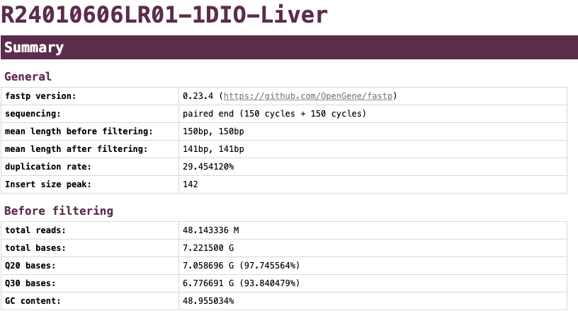
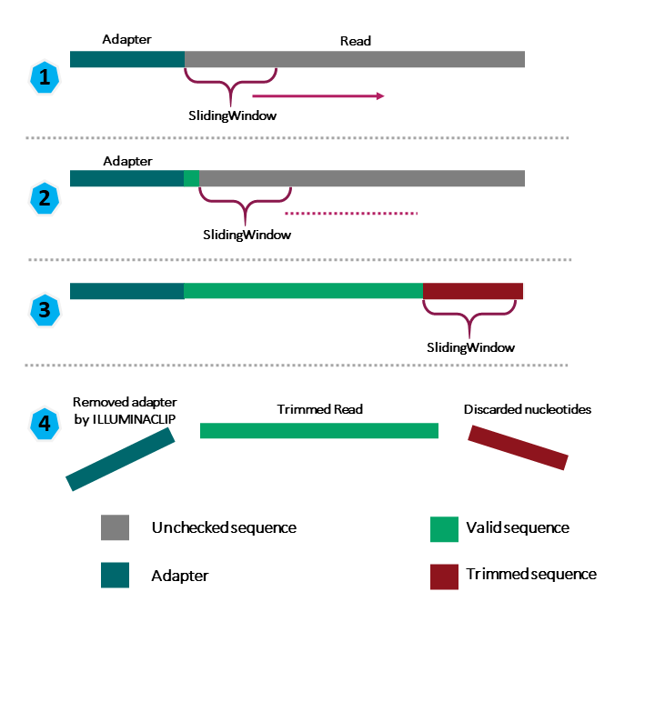
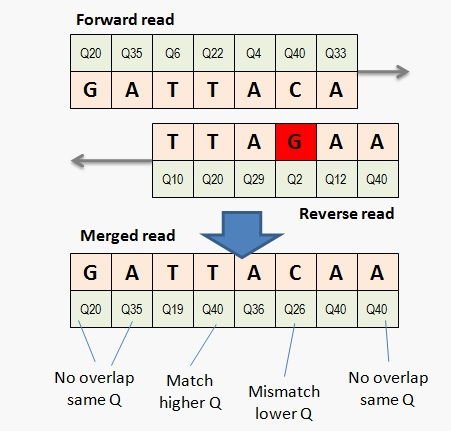
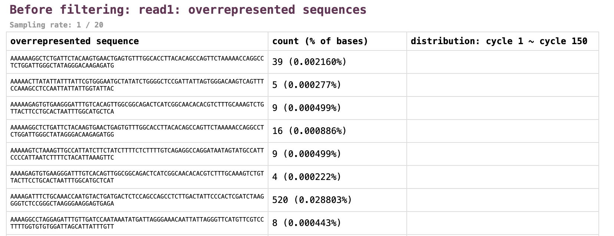

# fastp

## 目录

- [1 Introduce](#1-Introduce)
  - [1.1 fastp](#11-fastp)
  - [1.2 Function](#12-Function)
- [2 Install](#2-Install)
- [3 Tutorial](#3-Tutorial)
  - [3.1 PE & SE](#31-PE--SE)
    - [3.1.1 fastp parameter](#311-fastp-parameter)
  - [3.2 fastp](#32-fastp)
  - [3.3 Advance Parameter](#33-Advance-Parameter)
    - [3.3.1 Quality filter](#331-Quality-filter)
    - [3.3.2 Length filter](#332-Length-filter)
    - [3.3.3 Low complexity filter](#333-Low-complexity-filter)
    - [3.3.4  Adapters](#334--Adapters)
    - [3.3.5 Per read cutting by quality score (sliding window cutting)](#335-Per-read-cutting-by-quality-score-sliding-window-cutting)
    - [3.3.6 Base correction for PE data](#336-Base-correction-for-PE-data)
    - [3.3.7 Global trimming](#337-Global-trimming)
    - [3.3.8 polyG tail trimming & polyX tail trimming](#338-polyG-tail-trimming--polyX-tail-trimming)
    - [3.3.9 UMI](#339-UMI)
    - [3.3.10 Output splitting](#3310-Output-splitting)
    - [3.3.11 Overrepresented sequence analysis](#3311-Overrepresented-sequence-analysis)
    - [3.3.12 Merge paired-end reads](#3312-Merge-paired-end-reads)
    - [3.3.13 Duplication rate and Deduplication](#3313-Duplication-rate-and-Deduplication)
- [4 Source](#4-Source)
- [5 Reference](#5-Reference)

***

***Author***\*\* : zhang jian\*\*​

***Date***\*\* : 2025-9-30\*\*​

***Version***\*\* : 1.0v\*\*​

***

## 1 Introduce

### 1.1 fastp

**FASTP : *An ultra-fast all-in-one FASTQ preprocessor***

`fastp`是基于C++编写的可以对**FASTQ**数据进行**超快**预处理和质量控制的软件。其可以在一次运行中执行Adapter去除、全局或质量修剪、read过滤、UMI处理、基因型修正等多个操作[^1]

### 1.2 Function

> **`fastp`**\*\* 作为NGS领域最常用的质控软件，其可以完成以下分析：\*\* ​
>
> 1. **全面质量分析**：在过滤数据前后进行质量曲线、碱基含量、KMER、Q20/Q30、GC比率、重复度、接头含量等的综合质量分析。
> 2. **过滤不良读段**：过滤掉质量过低、过短或含有太多N的读段。
> 3. **基于滑动窗口评估每个读段的5'和3'端低质量碱基并进行修剪**：类似于Trimmomatic，但速度更快。
> 4. **修剪所有读段的前导和尾随碱基**。
> 5. **剪切接头**：接头序列可以自动检测，这意味着您不需要输入接头序列来修剪它们。
> 6. **校正配对端读段重叠区域中不匹配的碱基对**：如果一个碱基质量高而另一个质量极低。
> 7. **修剪3'端的多聚G序列**：这在`NovaSeq/NextSeq`数据中常见。修剪3'端的多聚X序列以去除不需要的多聚X尾（例如mRNA-Seq数据中的多聚A尾）。
> 8. **预处理带有唯一分子标识符（UMI）的数据**：将UMI信息添加到序列名称中。
> 9. **以JSON格式报告结果**：以便在下游使用相关脚本进行处理。
> 10. **在单个HTML页面上可视化质量控制和过滤结果**：类似于FASTQC，但速度更快，信息更丰富。
> 11. **将输出拆分为多个文件**：以支持并行处理。可以使用两种模式，限制总拆分文件数量或限制每个拆分文件的行数。
> 12. **支持长读长测序数据**：来自PacBio/Nanopore设备的数据处理。
> 13. **支持从STDIN读取和向STDOUT写入**。
> 14. **支持交错输入**。
> 15. **支持超快速的FASTQ级别的去重**。

> **NOTE** : 虽然`fastp`也可以对三代测序下机数据进行分析，但是相关结果可能并不能较好的对三代测序的质量进行展示，如果想使用适用于三代测序的软件可以使用\*\*`fastplong`\*\*[^2]。

## 2 Install

> **NOTE** : `conda` (`manba`)是最简单的安装方法。

> `fastp` 可以使用多种方法进行安装包括：
>
> 1. `conda` (推荐使用`manba`):
>    ```bash title="install fastp by mamba"
>    mamba install bioconda::fastp -y 
>    ```
>
> 2. 直接使用编译行的CentOS/Ubuntu版本软件
>    ```bash title="binary for Linux users"
>    # download the latest build
>    wget http://opengene.org/fastp/fastp
>    chmod a+x ./fastp
>    # or download specified version, i.e. fastp v0.23.4
>    wget http://opengene.org/fastp/fastp.0.23.4
>    mv fastp.0.23.4 fastp
>    chmod a+x ./fastp
>    ```
>
> 3. 从源码直接进行编译
>    > **NOTE** : `fastp`依赖于`libdeflate`和`libisal`，而`libisal`与`gcc 4.8`不兼容。如果你使用`gcc 4.8`，你的`fastp`将无法运行。
>    ```bash title="install isa-l"
>    git clone https://github.com/intel/isa-l.git
>    cd isa-l
>    ./autogen.sh
>    ./configure --prefix=/usr --libdir=/usr/lib64
>    make -j
>    sudo make install
>    ```
>
>    ```bash title=" install libdeflate"
>    git clone https://github.com/ebiggers/libdeflate.git
>    cd libdeflate
>    cmake -B build
>    cmake --build build
>    cmake --install build
>    ```
>
>    ```bash title="download and build fastp"
>    # get source (you can also use browser to download from master or releases)
>    git clone https://github.com/OpenGene/fastp.git
>    # build
>    cd fastp
>    make -j
>
>    # Install
>    sudo make install
>    ```
>

## 3 Tutorial

### 3.1 PE & SE

> **NOTE** : \*\*`fastp`\*\*的默认运行参数已经能够对数据进行较好的处理，如果遇到较为异常的数据，则需要尝试进行手动参数设定。

> \*\*`fastp`\*\***对SE & PE fastq数据的质控命令如下：**
>
> ```bash title="SE data Analysis"
> # SE
> fastp -i XXXX_R1.fastq.gz \
>       -I XXXX_R2.fastq.gz \
>       -w 16 \
>       --adapter_fasta TruSeq3-PE-2.fa \
>       -j XXXX.fastp.json \
>       -h XXXX.fastp.html \
>       -R XXXX \
>       -q 25 \
>       -l 75
> ```
>
>
> ```bash title="PE data Analysis"
> # PE
> fastp -i XXXX_R1.fastq.gz \
>       -I XXXX_R2.fastq.gz \
>       -o XXXX_R1.trim.fastq.gz \
>       -O XXXX_R2.trim.fastq.gz \
>       --unpaired1 XXXX_R1.PASS.fastq.gz \
>       --unpaired2 XXXX_R2.PASS.fastq.gz \
>       -w 16 \
>       --adapter_fasta TruSeq3-PE-2.fa \
>       -j XXXX.fastp.json \
>       -h XXXX.fastp.html \
>       -R XXXX \
>       -q 25 \
>       -l 75
> ```
>

#### `3.1.1 fastp` parameter

> \*\*NOTE \*\*: fastp 最多支持16核！
>
> ```bash title="fastp threads"
> WARNING: fastp uses up to 16 threads although you specified 20
> ```
>

> \*\*`fastp`\*\***常用的参数如下：**
>
> - `-i` : R1待处理fastq文件名称；
> - `-o` : R1质控输出fastq文件名称；
> - `-I` : R2待处理fastq文件名称；
> - `-O` : R2质控输出fastq文件名称；
> - `--unpaired1` : 如果`read1`通过了质量控制，但`read2`段没有，那么它将被写入`unpaired1`文件中;
> - `--unpaired2` : 如果`read2`通过了质量控制，但`read1`段没有，那么它将被写入`unpaired2`文件中;
> - `-w` : 质控使用的线程数；
> - `-j` : `json`格式的报告输出名称；
> - `-h` : `html` 格式的报告输出名称；
> - `-R` : 输出报告的标题名；
> - `-q` : 使用碱基Q过滤阈值；
> - `-l` : read 长度过滤阈值（经质控后read长度短于cutoff的将会被删除）；
> - `--adapter_fasta` : 提供要移除的接头信息的fasta文件（PS:一次性可以移除多种接头）；
>
>   [TruSeq3-PE-2.fa](file/TruSeq3-PE-2_c1b63R2q7h.fa "TruSeq3-PE-2.fa")
> - `--failed_out` : 输出质控失败的read;
>   - **failed\_out (输出fastp失败的read会在seqname处进行标记📌)**
>     ```r title="failed_out"
>     # failed_out
>     1 @A00583:1308:HWWTTDSX7:3:1101:17924:1313 2:N:0:CTGAAGCT+AGGATAGG  failed_quality_filter 
>     2 GGGGTGTGGGGGTGGCTGCCGGTTGCCTCGGGGGTGGGGGCAGCATGGGGGGTCCACGTCGTGTAGATCAGAGCGGGGGGGGGGGGGGAGTCGCTCTGTGGGGACTGCTGGGGGGGGGGC
>     3 +
>     4 ,,,,,,,:F:FF,FF:,F,,,F,,,F,F,FF,,F,F,:FF,,,,,,:,F,,F:,,,,:,,,,:,,F,,,,F,F,,:F,,,:FFF,FF,,F,,,,,,,F,,:F,,,::,:F,,,,F:F,F,
>     5 @A00583:1308:HWWTTDSX7:3:1101:25446:1595 2:N:0:CTGAAGCT+AGGATAGG  failed_quality_filter 
>     6 GATTCTTTTTTTTTTTTTTTTTTTATTTTTAAATGGGGTAGCAGCTGGAACCATTAACATATAAAGCCCACACCCCACCATCCCATAACAAGGCTTCCCACCCCATGGGTATATGGAAAAACAAAGCCCCAAGTACAGAAAAAGCAGGCC
>     7 +
>     8 FFFFFFFFFFFFFFFFFFFFFF:F::FFFFFF,,::F:F,,,:,:,,F,,FF,F,:::,F,:,F,,,:F:,,:,,,:F,,,,FF,,,,:,:,,:,,:FF:,,F:,,,FF:,:,,:F,F,:F,,,F,F,FF,F,:FF,,FF,F,,,,,F:F
>     9 @A00583:1308:HWWTTDSX7:3:1101:4227:2049 2:N:0:CTGAAGCT+AGGATAGG  failed_quality_filter 
>     10 CACACAATTCACCGATTTCGAGGGCAAGACATCATTTGCGATGTAAGTGTTCAATCTCAGCAACGCCATCATCGGCAGTGGAATTATGGTGCTCGCCTACGCCAAGTCAAAAACGGGCAACATCCTTATCCTGTTCCTGCTAACATCGGA
>     11 +
>     12 ,,::,F,,F,FF,,:,,,F,FF:,,FF,,FFFFF,F:,,,,F:,,F,,,F:FF:,F:,F,FF,,,F,F,,FF,,,,,,FF,F,,,,F,,,:F,:FF,:,:,FF,,,,,,F:,FF,,,,,,:FF,:FF:FF:FF,F:F,,:,,:FF,F,,,
>     13 @A00583:1308:HWWTTDSX7:3:1101:24686:2691 2:N:0:CTGAAGCT+AGGATAGG  failed_quality_filter 
>     14 GGGGGGTGCGGGGCGGGGTGCGGGTCGGGGGCGTCGTGTCTCTGGGGGGCGCCGCCGTCTCCGCTCGCGGGGTGCGGCGCCTTCGGCGGCTGGGGGTCTGGGGGGGGGAGCAGGGTGGTAAGCGAGGGGGGGGCGTCGGGGGAGATGGGC
>     15 +
>     16 FF,,F,,F,F,,,,F,F,,,,,,,:,FF,FF,,,:,,,,,,,,FF,,FF,F,,F,,,:,,,,,,,,,,,,,,:,,FF,,,,,,,,F,FF,,FF,,F,,,,,,,F,,FF,F,,FF,,F,,,,,,F,F,,FF,,,,F:,,,FF,,F,,F,F, 
>     ```
>
> - `--reads_to_process`: 对fastq子集进行快速处理 **(以快速查看数据质量)**；
> - `--dont_overwrite` : 不覆写已经存在的fastp结果；

### `3.2 fastp`

`fastp`除了输出质控后的fastp文件外，还可以输出对应的质控报告（HTML & JSON）




- **`fastp`**\*\* 示例报告：\*\* ​

  [XXX.fastp.html](file/XXX.fastp_LPdf39Z2vJ.html "XXX.fastp.html")

  [XXX.fastp.json](file/XXX.fastp_6GIUYdcd93.json "XXX.fastp.json")

> **Tips** : JSON格式的结果可以很方便的使用下游分析软件对其进行读取与重新进行可视化！
>
> 

### 3.3 Advance Parameter

#### 3.3.1 Quality filter

`fastp`根据**fastq**文件中的碱基质量对`read`进行过滤，如果`read`的碱基质量不符合标准，则将其移除！

> **`fastp`**\*\* Quality filter相关参数：\*\* ​
>
> 1. `-Q` or `disable_quality_filtering` : 关闭碱基质量过滤；
> 2. `-n, --n_base_limit` : 如果read中的N碱基的数量超过cutoff就将其移除(`Default:5`)；
> 3. `-q, --qualified_quality_phred`: read 碱基质量cutoff (`Default >=Q15`)；
> 4. `-u, --unqualified_percent_limit`:碱基质量不符合的比例cutoff（`Default:40%`) ;
> 5. `-e, --average_qual` : 碱基质量的均值如果低于 cutoff 就整体移除( `Default 0`)。

#### 3.3.2 Length filter

`fastp` 可以根据经read low qc base & remove dapter & UMI 等处理后保留的read长度对read进行过滤。

> **`fastp`**\*\* Length filter相关参数：\*\* ​
>
> 1. &#x20;`-L` or `--disable_length_filtering` : 关闭长度过滤;
> 2. `-l` or `--length_required` : 如果read的长度 < cutoff 则将其移除(`default:15`)；
> 3. &#x20;`--length_limit` : read的长度 >  cutoff 则将其移除；(这个参数可以在ribo-seq等small RNA-seq中使用！[ribo-seq](https://www.wolai.com/fRVbNqNvQAuBb33f3v5s6E "ribo-seq"));

#### 3.3.3 Low complexity filter

> **NOTE** : Low-complexity : 低复杂序列是简单序列的重复序列，fastp默认情况不进行移除！

`fastp`可以对read中的低复杂度区进行检查与过滤，低复杂度区通常被定义为含有简单序列重复的、成分有偏差的区域[^3]。

`fastp` 复杂度被定义为一个特定参数。这里的复杂度是指序列中相邻元素不同的情况所占的百分比。具体来说，就是序列中当前元素（`base[i]`）与下一个元素（`base[i+1]`）不相等的比例。这个比例用来衡量序列的复杂性，即序列中变化的频繁程度。

```r title="complexity"
# a 51-bp sequence, with 3 bases that is different from its next base
seq = 'AAA A TTTTTTTTTTTTTTTTTTTT T GGGGGGGGGGGGGGGGGGGGG G CCCC'
complexity =  3 /(51-1) = 6%
```


> **`fastp`**\*\* low complexity filter相关参数：\*\* ​
>
> 1. &#x20;`-y` or `--low_complexity_filter`: 开启低复杂度过滤；
> 2. &#x20;`-Y` or `--complexity_threshold`：低复杂度过滤的cutoff(`Default:30`);

#### 3.3.4  Adapters

`fastp`可以对fastq文件中可能含有的adapter进行检测，以此实现对于fastq文件的自动移除接头。（对于**SE**数据，通过分析前约100万条读段的尾部来评估接头序列。这种评估可能不准确，你可以通过`-a`或`--adapter_sequence`选项指定接头序列。如果指定了接头序列，将禁用单端数据的自动检测功能）

> **NOTE** : `fastp` 对于双端数据fastp可以根据指定的read1或者read2接头自动判断对应没有提供read接头信息。

> **`fastp`**\*\* Adapters相关参数：\*\* ​
>
> 1. `-A` or `--disable_adapter_trimming` ： 关闭移除接头；
> 2. `-a` or `--adapter_sequence` ： 手动指定R1序列的接头信息；
> 3. &#x20;`--adapter_sequence_r2` ： 手动指定R2序列的接头信息；
> 4. &#x20;`--detect_adapter_for_pe` ：启用 PE 数据的自动检测；
> 5. &#x20;`--adapter_fasta` ：通过指定特定fa文件移除多种接头。

> **NOTE** : 如果测序是使用的Illumina平台，可以将下面的文件中的adapter指定为需要移除
>
> ```bash title="Illumina Universal Adapter"
> >Illumina Universal Adapter
> AGATCGGAAGAG
> >Illumina Small RNA 3' Adapter
> TGGAATTCTCGG
> >Illumina Small RNA 5' Adapter
> GATCGTCGGACT
> >Nextera Transposase Sequence
> CTGTCTCTTATA
> >PolyA
> AAAAAAAAAAAA
> >PolyG
> GGGGGGGGGGGG
> ```
>

```r title="adapter_sequence"
# auto detection for PE data
# Example : Illumina TruSeq adapters
--adapter_sequence=AGATCGGAAGAGCACACGTCTGAACTCCAGTCA
--adapter_sequence_r2=AGATCGGAAGAGCGTCGTGTAGGGAAAGAGTGT
```


#### 3.3.5 Per read cutting by quality score (sliding window cutting)

`fastp`也提供了`Trimmomatic` sliding window cutting一样的read质控方式，具体质控流程如下图[^4]。



> **`fastp`**\*\* sliding window cutting相关参数：\*\* ​
>
> - `-5, --cut_front ` : 从前端（5'）向尾部移动滑动窗口，如果窗口内碱基的平均质量低于阈值，则丢弃该窗口内的碱基，否则停止。
> - `-3, --cut_tail` : 从尾部（3'）向前端移动滑动窗口，如果窗口内碱基的平均质量低于阈值，则丢弃该窗口内的碱基，否则停止。
> - `-r, --cut_right` : 从前端向尾部移动滑动窗口，如果遇到一个平均质量低于阈值的窗口，则丢弃该窗口内的碱基及其右侧部分，然后停止。
> - `-W, --cut_window_size` : 由cut\_front、cut\_tail或cut\_sliding共享的窗口大小选项。范围：1\~1000，默认值：4（整数 \[=4]）
> - `-M, --cut_mean_quality` : 由cut\_front、cut\_tail或cut\_sliding共享的平均质量要求选项。范围：1\~36，默认值：20（Q20）（整数 \[=20]）
> - `--cut_front_window_size` : cut\_front的窗口大小选项，默认为cut\_window\_size（未指定时）（整数 \[=4]）
> - `--cut_front_mean_quality` : cut\_front的平均质量要求选项，默认为cut\_mean\_quality（未指定时）（整数 \[=20]）
> - `--cut_tail_window_size` : cut\_tail的窗口大小选项，默认为cut\_window\_size（未指定时）（整数 \[=4]）
> - `--cut_tail_mean_quality`: cut\_tail的平均质量要求选项，默认为cut\_mean\_quality（未指定时）（整数 \[=20]）
> - `--cut_right_window_size` : cut\_right的窗口大小选项，默认为cut\_window\_size（未指定时）（整数 \[=4]）
> - `--cut_right_mean_quality`  : cut\_right的平均质量要求选项，默认为cut\_mean\_quality（未指定时）（整数 \[=20]）

- **NOTE** : **`--cut_front`** & **`--cut_tail`** & **`--cut_right`**` `模式下滑动窗口前后的部分会有不同的处理方式
  1. **--cut\_front**：如果使用这个选项，滑动窗口从序列的前端（5'端）向尾部移动。如果当前窗口的碱基被移除，那么：
     - **之前的部分**：已经处理过并且质量合格的窗口之前的碱基会被保留。
     - **之后的部分**：窗口移动到下一个位置，继续评估新窗口的平均质量。如果新窗口的平均质量合格，则保留；如果不合格，则重复移除过程。
  2. **--cut\_tail**：如果使用这个选项，滑动窗口从序列的尾部（3'端）向前端移动。如果当前窗口的碱基被移除，那么：
     - **之前的部分**：已经处理过并且质量合格的窗口之前的碱基会被保留。
     - **之后的部分**：窗口移动到前一个位置，继续评估新窗口的平均质量。如果新窗口的平均质量合格，则保留；如果不合格，则重复移除过程。
  3. **--cut\_right**：如果使用这个选项，滑动窗口从前端向尾部移动。如果遇到一个平均质量低于阈值的窗口，那么：
     - **之前的部分**：已经处理过并且质量合格的窗口之前的碱基会被保留。
     - **之后的部分**：不仅移除当前窗口内的碱基，还会移除该窗口之后的所有碱基，然后停止处理。

#### 3.3.6 Base correction for PE data



如果PE数据具有重叠部分`fastp` 会尝试找到每对读段之间的重叠部分。如果找到了合适的重叠，它可以在配对端读段的重叠区域中纠正不匹配的碱基对，如果一个碱基的质量很好而另一个碱基的质量极低。如果一个碱基被纠正，其配对碱基的质量将被赋予它，以便它们共享相同的质量。

> **`fastp`**\*\* Base correction for PE data相关参数：\*\* ​
>
> 1. &#x20;`-c, --correction` : 开启PE数据碱基校正！
> 2. `--overlap_len_require ` : PE 数据中重叠部分长度要求(`default:30`)
> 3. `--overlap_diff_limit`: 重叠部分检测到的碱基错配cutoff (重叠部分错配碱基的数量不能超过 > cutoff ) (`default:5`)
> 4. `--overlap_diff_percent_limit`:重叠部分检测到的碱基错配比例cutoff (重叠部分错配碱基的比例不能超过 > cutoff )(`Default:20`)

#### 3.3.7 Global trimming

> **NOTE** : 如果PE数据没有指定R2序列的修剪信息，会根据R1的设置自动确认！

`fastp`支持全局修剪，这意味着可以修剪所有读段的前端或尾部。这个功能很有用，因为有时你可能想要丢弃测序运行中的一些循环。

> **`fastp`**\*\* Global trimming相关参数：\*\* ​
>
> 1. `-f, --trim_front1` ： 修剪**R1 front**端X个碱基；
> 2. `-F, --trim_front2` ：修剪**R2 front**端X个碱基；
> 3. `-t, --trim_tail1`：修剪**R1 tail**端X个碱基；
> 4. `-T, --trim_tail2`：修剪**R2 tail**端X个碱基；
> 5. `-b, --max_len1` ：如果`read1`的长度超过了`max_len1`，则将其尾部修剪到与最大长度`max_len1`一样长；
> 6. `-B, --max_len2`：如果`read2`的长度超过了`max_len2`，则将其尾部修剪到与最大长度`max_len2`一样长；

#### 3.3.8 polyG tail trimming & polyX tail trimming

对于**Illumina NextSeq/NovaSeq**数据，由于G在**Illumina**双色系统中表示无信号，因此在读取尾部可能会出现**polyG（连续的G碱基）**。`fastp`可以检测到读取尾部的**polyG**并将其修剪。对于**NextSeq/NovaSeq**数据，默认启用此功能，您可以通过指定`-g`或`--trim_poly_g`来启用它，或者通过指定`-G`或`--disable_trim_poly_g`来禁用它。

> **NOTE** : 是否为**NextSeq/NovaSeq**数据是通过FASTQ记录中的机器ID来检测的。

> **`fastp`**\*\* polyG tail trimming相关参数：\*\* ​
>
> 1. `-g` or `--trim_poly_g` ： 修剪read中的ploy\_G (`default:10`);
> 2. `-G` or `--disable_trim_poly_g` ： 不修剪read中的ploy\_G;

**polyX tail trimming**与**polyG tail trimming**相似，默认情况下是禁用的。使用`-x`或`--trim_poly_x`来启用它。可以设置最小长度`<poly_x_min_len>`，以便fastp检测polyX。

> **`fastp`**\*\* polyX tail trimming相关参数：\*\* ​
>
> 1. `-x` or `--trim_poly_x` ： 修剪ploy\_x(`default:10`);

#### 3.3.9 UMI

UMI对于基于生成来自同一DNA片段的读取的共识的重复消除和错误校正是有用的。它通常用于深度测序应用，如ctDNA测序。对于Illumina平台，UMI可以集成在两个不同的地方：索引或读取的头部。要启用UMI处理，你必须在命令行中启用`-U`或`--umi`选项。

> `--umi_loc`来指定UMI的位置，它可以是以下之一：
>
> 1. **`index1`**：第一个索引用作UMI。如果数据是成对末端（PE），则该UMI将用于read1/read2。
> 2. **`index2`**：第二个索引用作UMI。仅PE数据，此UMI将用于read1/read2。
> 3. **`read1`**：read1的头部用作UMI。如果数据是成对末端（PE），则该UMI将用于read1/read2。
> 4. **`read2`**：read2的头部用作UMI。仅PE数据，此UMI将用于read1/read2。
> 5. **`per_index`**：index1\_index2用作read1/read2的UMI。
> 6. **`per_read`**：定义umi1为read1的头部，umi2为read2的头部。umi1\_umi2用作read1/read2的UMI。

> **NOTE** : 如果在命令行参数--umi\_loc时，指定了read1、read2或per\_read中的任何一个选项，那么你还需要使用另一个参数--umi\_len来指定唯一分子标识符（Unique Molecular Identifier，简称UMI）的长度。

> **`fastp`**\*\* polyG tail trimming相关参数：\*\* ​
>
> 1. `-U` : 启用UMI序列移除
> 2. `--umi_loc` : UMI的位置
> 3. `--umi_len` : UMI的长度

> **NOTE** : fastp 将提取 UMIs（Unique Molecular Identifiers，独特的分子标识符），并将它们附加到read名称的第一部分，因此 UMIs 也会出现在 SAM/BAM 记录中。
>
> > **Tips** : 可以指定一个前缀，使用`--umi_prefix`参数。如果指定了前缀，将会使用下划线将其与UMI连接起来。例如，`UMI=AATTCCGG`，前缀=UMI，那么最终在名称中呈现的字符串将是`UMI_AATTCCGG`
>
> ```r title=" UMIs"
> fastp -i R1.fq -o out.R1.fq -U --umi_loc=read1 --umi_len=8
> # 移除UMI前 read
> @NS500713:64:HFKJJBGXY:1:11101:1675:1101 1:N:0:TATAGCCT+GACCCCCA
> AAAAAAAAGCTACTTGGAGTACCAATAATAAAGTGAGCCCACCTTCCTGGTACCCAGACATTTCAGGAGGTCGGGAAA
> +
> 6AAAAAEEEEE/E/EA/E/AEA6EE//AEE66/AAE//EEE/E//E/AA/EEE/A/AEE/EEA//EEEEEEEE6EEAA
> # 移除UMI后 read
> @NS500713:64:HFKJJBGXY:1:11101:1675:1101: AAAAAAAA  1:N:0:TATAGCCT+GACCCCCA
> GCTACTTGGAGTACCAATAATAAAGTGAGCCCACCTTCCTGGTACCCAGACATTTCAGGAGGTCGGGAAA
> +
> EEE/E/EA/E/AEA6EE//AEE66/AAE//EEE/E//E/AA/EEE/A/AEE/EEA//EEEEEEEE6EEAA
> ```
>

#### 3.3.10 Output splitting

对于FASTQ文件的并行处理（即并行比对），\*\*`fastp`\*\*支持将输出分割成多个文件。分割功能可以通过两种不同的模式进行：一种是通过限制文件数量，另一种是通过限制每个文件的行数。

这些分割文件的文件名将有一个顺序编号前缀，添加到由 `--out1` 或 `--out2` 指定的原始文件名上，前缀的宽度由 `-d` 或 `--split_prefix_digits` 选项控制。例如，`--split_prefix_digits=4, --out1=out.fq, --split=3`，那么输出文件将是 `0001.out.fq`, `0002.out.fq`, `0003.out.fq`。

> **`fastp`**\*\* Output splitting相关参数：\*\* ​
>
> 1. `-s` or `--split` ：splitting by limiting file number;
> 2. `-S` or `--split_by_lines` ：splitting by limiting the lines of each file;

#### 3.3.11 Overrepresented sequence analysis

Overrepresented sequence analysi 默认是禁用的，你可以通过指定`-p`或`--overrepresentation_analysis`来启用它。考虑到速度和内存，fastp只统计长度为10bp、20bp、40bp、100bp或(循环数 - 2)的序列。

> **`fastp`**\*\* Overrepresented sequence analysis相关参数：\*\* ​
>
> 1. `-p, --overrepresentation_analysis` : 启用过表达序列分析
> 2. `-P, --overrepresentation_sampling` : 过表达分析read的比例（过大的比例会使得分析速度变慢，默认20%）



#### 3.3.12 Merge paired-end reads

对于双端测序（Paired-End, PE）数据输入，`fastp`支持通过指定`-m`或`--merge`选项来合并。

```r title="merge paired-end reads"
fastp -i XXXX_R1.fastq.gz \
      -I XXXX_R2.fastq.gz \
      -o XXXX_R1.trim.fastq.gz \
      -O XXXX_R2.trim.fastq.gz \
      --unpaired1 XXXX_R1.PASS.fastq.gz \
      --unpaired2 XXXX_R2.PASS.fastq.gz \
      -m \
      --merged_out XXX.merge.fastq.gz \
      -w 16 \
      --adapter_fasta TruSeq3-PE-2.fa \
      -j XXXX.fastp.json \
      -h XXXX.fastp.html \
      -R XXXX \
      -q 25 \
      -l 75
```


1. `--merged_out`

   fastp的最新参数可以对质控合格的read 进行合并 → one fastq文件
   ```r title="--merged_out"
   fastp -i R1.fastq.gz \
         -I R2.fastq.gz \
         -m \
         --merged_out R12.clean.fastq.gz
   ```


#### 3.3.13 Duplication rate and Deduplication

对于单端测序（SE）和双端测序（PE）数据，`fastp`能够评估数据中的重复率，并移除重复的读段（reads/pairs）。fastp将一个读段视为重复的，仅当这个读段的所有碱基对与另一个读段完全一致时。

> **`fastp`**\*\* duplication rate and deduplication相关参数：\*\* ​
>
> 1. `--dedup` : 启用dedup;
> 2. `--dup_calc_accuracy` : 移除dedup的准确率 （1-6:越大约准确） higher level uses more memory (1G, 2G, 4G, 8G, 16G, 24G);

## 4 Source

> **`fastp paper`** :&#x20;
>
> [Ultrafast one‐pass FASTQ data preprocessing  quality control  and deduplication using fastp.pdf](<file/Ultrafast one‐pass FASTQ data preprocessing  quali.pdf> "Ultrafast one‐pass FASTQ data preprocessing  quality control  and deduplication using fastp.pdf")

## 5 Reference

[^1]: Ultrafast one‐pass FASTQ data preprocessing, qualitycontrol, and deduplication using fastp

[^2]: [https://github.com/OpenGene/fastplong](https://github.com/OpenGene/fastplong "https://github.com/OpenGene/fastplong")

[^3]: Complexity: an internet resource for analysis of DNA sequence complexity

[^4]: [https://github.com/OpenGene/fastp/issues/122](https://github.com/OpenGene/fastp/issues/122 "https://github.com/OpenGene/fastp/issues/122")
