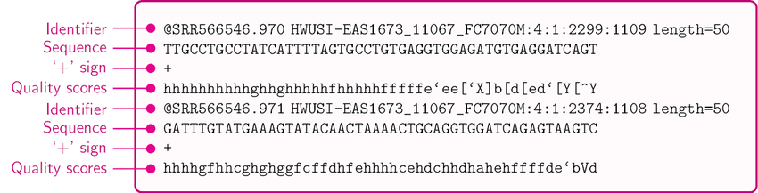
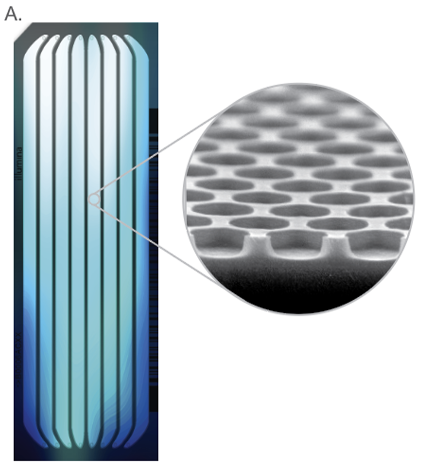
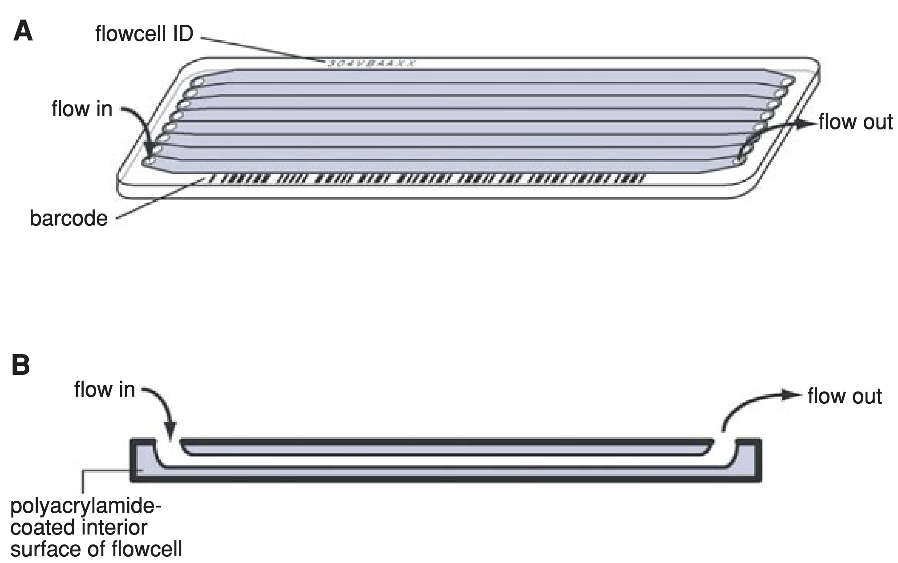
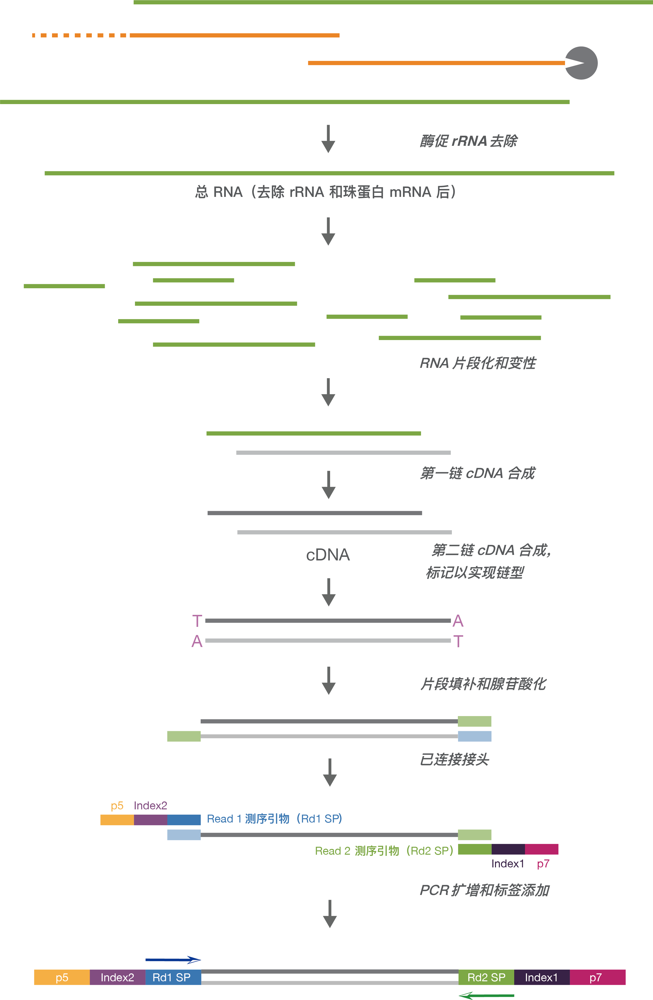

# fastq

## 目录

- [FASTQ](#FASTQ)
- [Phred quality score Q](#Phred-quality-score-Q)
- [3 flowcell](#3-flowcell)
- [illumina FASTQ](#illumina-FASTQ)
- [5 QC by fastq](#5-QC-by-fastq)
- [6 Sequence fastq example](#6-Sequence-fastq-example)
- [illumina Sequence Library Structure:](#illumina-Sequence-Library-Structure)
- [8 Toolkit for fastq processing](#8-Toolkit-for-fastq-processing)
- [9 reference](#9-reference)

***

### **FASTQ**

**FASTQ format** is a \*\*text-based \*\*[**format**](https://en.wikipedia.org/wiki/File_format "format") for storing both a biological sequence (usually [nucleotide sequence](https://en.wikipedia.org/wiki/Nucleotide_sequence "nucleotide sequence")) and its corresponding quality scores. Both the sequence letter and quality score are each encoded with a single [ASCII](https://en.wikipedia.org/wiki/ASCII "ASCII") character for brevity[^1].

***Fastq format structure*** [^2]:&#x20;



> Fastq是用来存储碱基序列的文本文件，其中每一个read由以下4部分组成：
>
> 1. **Field 1 **begins with a '**@**' character and is followed by a sequence identifier and an *optional* description；
>
>    第一部分，以@为开头后面跟着仪器ID & 序列ID & UMI信息等
>    - FASTQ Format @ infor  :&#x20;
>      - @后面接的的相关的描述信息；
>      - SRR2176360.1这个是fastq文件的名称；
>      - HWI-ST1085这个是测序设备的唯一🆔
>      - 243这个是run 🆔
>      - C42G3ACXX这个是flowcell 🆔
>      - 2这个是flowcell的lane（一个flowcell差不多是有8个lane的）
>      - 1101这个是lane中的tile🆔
>      - 1164这个是tile的x轴坐标
>      - 2101这个是tile的y轴坐标
>      - 1是read1（在这里如果有一个文件后面是2，就说明这是一个PE数据）
> 2. \*\*Field 2 \*\*is the raw sequence letters.
>
>    碱基序列（ATCG）
> 3. \*\*Field 3 \*\*begins with a '+' character and is *optionally* followed by the same sequence identifier (and any description) again.
>
>    固定字符 +
> 4. \*\*Field 4 \*\*encodes the quality values for the sequence in Field 2, and must contain the same number of symbols as letters in the sequence.
>
>    每一个碱基的质量编码
>    > **NOTE** : 测序碱基质量编码主要有两种 ： 1.Phred+33；2.Phred+64 ；但是现在主要用碱基质量编码为Phred+33
>
> ```bash title="FASTA Sample"
> @SRR2176360.1 HWI-ST1085:243:C42G3ACXX:2:1101:1164:2101/1
> GNGANNNNNNNNNTGNNCATGCGGTAAGACAACCACCANNNNNNNNNNATTNGACTANNNNNAANNNNNNNCANCCNNATCTTCATTTGGGGGCTGGAGGA
> +
> <#08#########22##23<???@@9=>???<>;????###############################################################
> ```
>

### ***Phred quality score*** Q

> ***Phred quality score***是对自动DNA 测序生成的核碱基鉴定质量的衡量标准。 它最初是为计算机程序Phred开发的，旨在帮助人类基因组计划中的 DNA 测序自动化。 Phred 质量分数分配给自动测序仪轨迹中的每个核苷酸碱基调用。 FASTQ 格式将 **phred 分数**与读取序列一起编码为 **ASCII 字符**[^3]。

***Phred 质量分数 𝑄 与******碱基识别错误******概率呈对数关系：***&#x20;

$$
Q=-10 \log _{10} P
$$

***错误概率 ：***

$$
P=10^{\frac{-Q}{10}}.
$$

| **Phred Quality Score** | **Probability of incorrect base call** | **Base call accuracy** |
| ----------------------- | -------------------------------------- | ---------------------- |
| 10                      | 1 in 10                                | 90%                    |
| 20                      | 1 in 100                               | 99%                    |
| 30                      | 1 in 1000                              | 99.9%                  |
| 40                      | 1 in 10,000                            | 99.99%                 |
| 50                      | 1 in 100,000                           | 99.999%                |
| 60                      | 1 in 1,000,000                         | 99.9999%               |

FASTQ 文件中phred 分数使用字符表示。键盘上的每个字符都可以用一个数字来表示，称为ASCII码。

有几种不同的方法可以使用 ASCII 字符对 phred 分数进行编码。最常见的两个称为\*\*\* phred+33\*\*\* 和 ***phred+64***

- **phred33**\*\*  &  ****phred64****?\*\*

  **phred33** & **phred64**是不同的测序质量编码形式，

  在 FASTQ 文件中，phred 分数使用字符表示。键盘上的每个字符都可以用一个数字来表示，称为ASCII码。

  **NOTE** : 现在第二代测序技术（NGS）一般是用的Illumina的测序，所以一般都是Phred33，如果是很久之前的数据，就可能为Phred64编码的测序质量。

```bash title="error_prob"
def error_prob(quality):
    qval = quality
    return 10**(qval/-10.0)
print ("{0:^5}  {1:^8}  {2:^8}  {3:^8}".format("Phred",  "Prob of", "Phred+33", "Phred+64"))
print ("{0:^5}  {1:^8}  {2:^8}  {3:^8}".format("score",  "Error", "Ascii", "Ascii"))
for phred in range(0,42):
    print ("{0:^5}  {1:03.5f}  {2:^8}  {3:^8}".format(phred, error_prob(phred), chr(phred+33), chr(phred+64)))
```


```bash title="Phred score & ASCII"
Phred  Prob of   Phred+33  Phred+64
score   Error     Ascii     Ascii  
  0    1.00000     !         @    
  1    0.79433     "         A    
  2    0.63096     #         B    
  3    0.50119     $         C    
  4    0.39811     %         D    
  5    0.31623     &         E    
  6    0.25119     '         F    
  7    0.19953     (         G    
  8    0.15849     )         H    
  9    0.12589     *         I    
 10    0.10000     +         J    
 11    0.07943     ,         K    
 12    0.06310     -         L    
 13    0.05012     .         M    
 14    0.03981     /         N    
 15    0.03162     0         O    
 16    0.02512     1         P    
 17    0.01995     2         Q    
 18    0.01585     3         R    
 19    0.01259     4         S    
 20    0.01000     5         T    
 21    0.00794     6         U    
 22    0.00631     7         V    
 23    0.00501     8         W    
 24    0.00398     9         X    
 25    0.00316     :         Y    
 26    0.00251     ;         Z    
 27    0.00200     <         [    
 28    0.00158     =         \    
 29    0.00126     >         ]    
 30    0.00100     ?         ^    
 31    0.00079     @         _    
 32    0.00063     A         `    
 33    0.00050     B         a    
 34    0.00040     C         b    
 35    0.00032     D         c    
 36    0.00025     E         d    
 37    0.00020     F         e    
 38    0.00016     G         f    
 39    0.00013     H         g    
 40    0.00010     I         h    
 41    0.00008     J         i    
```


***

### 3 flowcell

> illumina flowcell（流动池）
>
> flowcell 是指**Illumina测序时，测序反应发生的位置**，1个flowcell含有8条lane. lane 每一个flowcell上都有8条泳道，用于测序反应，可以添加试剂，洗脱。





***

### **illumina FASTQ**

> **illumina** 测序获得的fastq文件具体格式如下[^4]：

> **illumina FASTQ** file consists of four lines :
>
> 1. Sequence identifier
> 2. Sequence identifier
> 3. Quality score identifier line (consisting only of a +)
> 4. Quality score

> **Each entry in a FASTQ file consists of four lines:**
>
> **The first line, identifying the sequence, contains the following elements.**

`@<instrument>:<run number>:<flowcell ID>:<lane>:<tile>:<x-pos>:<y-pos>:<UMI> <read>:<is filtered>:<control number>:<index>`

| **Element**        | **Requirements**                                 | **Description**                                                                                                                                        |
| ------------------ | ------------------------------------------------ | ------------------------------------------------------------------------------------------------------------------------------------------------------ |
| `@`                | @                                                | Each sequence identifier line starts with @.                                                                                                           |
| `<instrument>`     | Characters allowed: a–z, A–Z, 0–9 and underscore | Instrument ID.                                                                                                                                         |
| `<run number>`     | Numerical                                        | Run number on instrument.                                                                                                                              |
| `<flowcell ID>`    | Characters allowed:a–z, A–Z, 0–9                 | Flow cell ID                                                                                                                                           |
| `<lane>`           | Numerical                                        | Lane number.                                                                                                                                           |
| `<tile>`           | Numerical                                        | Tile number.                                                                                                                                           |
| `<x_pos>`          | Numerical                                        | X coordinate of cluster.                                                                                                                               |
| `<y_pos>`          | Numerical                                        | Y coordinate of cluster.                                                                                                                               |
| `<UMI>`            | Restricted characters: A/T/G/C/N                 | Optional, appears when UMI is specified in the sample sheet. UMI sequences for Read 1 and Read 2, separated by a plus \[+].                            |
| `<read>`           | Numerical                                        | Read number. 1 can be single read or Read 2 of paired-end.                                                                                             |
| `<is filtered>`    | Y or N                                           | Y if the read is filtered (did not pass), N otherwise.                                                                                                 |
| `<control number>` | Numerical                                        | 0 when none of the control bits are on, otherwise it is an even number.For systems that do not perform control specification, this number is always 0. |
| `<index>`          | Restricted characters: A/T/G/C/N                 | Index of the read.                                                                                                                                     |

***

### 5 QC by fastq

> fastq 文件可以使用以下软件对其进行质控：
>
> [FastQC](https://www.wolai.com/5KXW8jvs7jmtTLvsLwTxAR "FastQC")
>
> [falco](https://www.wolai.com/hneXkziE8Ncs7B9KA7LwJk "falco")
>
> [fastp](https://www.wolai.com/6brAAPGTibG1xkRZez9S92 "fastp")

***

### 6 Sequence fastq example

> 下面的为SRR13016548测序数据R1部分测序数据示例：

**AGATCGGAAGAG** & **AGATCGGAAGAG**部分为测试使用到的接头

```bash title="SRR13016548 R1"
@SRR13016548.47 47/1
GCCCCACTAAAAGGAATGACCAAGGCGCCTGGGTCATACTTGTCCACCCACTCTTTAATTTTTA AGATCGGAAGAG CACACGTCTGAACTCCAGTCACCTT
+
AAFFFJJJJJJJJJJJJJJJJJJJJJJJJJJJJJJJJJJJJJJJJJJJJJJJJJJJJJJJJJJJJFJJJJJJFJJJJJFJJJJJJJJJJJJJJJJ<FJJJJ
@SRR13016548.1662 1662/1
GCCCTCTTGAACTCTCTCTTCAAAGTTCTTTTCAACTTTCCCTTACGGTACTTGTTGACT AGATCGGAAGAG CACACGTCTGAACTCCAGTCACCTTGTAA
+
AAFFFJJJJJJFFJJJFJJJJJJJJJJJJJJJJJJJJJJJJJJJFJJJJFJJJJJJJAFFF7FJJFJJJJJJJFJJFJJJJJJJJJJJFJJJFJJJJJJ
```


> PS :  根据下面的 Truseq Single Index Library & **Truseq Dual Index Library** 文库结果很容易的得知测序获得的read需要移除的部分AGATCGGAAGAGCACACGTCTGAACTCCAGTCAC （一般将其前12nt作为要移取的adapter）

- **Truseq Single Index Library:**
  ```bash title="Truseq Single Index Library:"
  5'-  AATGATACGGCGACCACCGAGATCTACAC TCTTTCCCTACACGACGCTCTTCCGATCT -insert- AGATCGGAAGAGCACACGTCTGAACTCCAGTCAC NNNNNNNN ATCTCGTATGCCGTCTTCTGCTTG  -3'
  3'-  TTACTATGCCGCTGGTGGCTCTAGATGTG AGAAAGGGATGTGCTGCGAGAAGGCTAGA -insert- TCTAGCCTTCTCGTGTGCAGACTTGAGGTCAGTG NNNNNNNN TAGAGCATACGGCAGAAGACGAAC  -5'
            Illumina P5                   Truseq Read 1                        Truseq Read 2                 i7        Illumina P7
  ```

- **Truseq Dual Index Library:**
  ```bash title="Truseq Dual Index Library"
  5'-  AATGATACGGCGACCACCGAGATCTACAC NNNNNNNN ACACTCTTTCCCTACACGACGCTCTTCCGATCT -insert- AGATCGGAAGAGCACACGTCTGAACTCCAGTCAC NNNNNNNN ATCTCGTATGCCGTCTTCTGCTTG  -3'
  3'-  TTACTATGCCGCTGGTGGCTCTAGATGTG NNNNNNNN TGTGAGAAAGGGATGTGCTGCGAGAAGGCTAGA -insert- TCTAGCCTTCTCGTGTGCAGACTTGAGGTCAGTG NNNNNNNN TAGAGCATACGGCAGAAGACGAAC  -5'
            Illumina P5               i5            Truseq Read 1                          Truseq Read 2                 i7        Illumina P7
  ```


***

### **illumina**\*\* Sequence Library Structure\*\*:



> Illumina测序的本质仍然是合成测序（Sequencing by Synthesis, SBS）。任何SBS方法都需要适配体的存在，这些适配体是我们知道序列的短的双链DNA寡核苷酸。这些适配体是由科学家设计的，并且在下一代测序（NGS）领域中有一些流行的适配体序列。以下三种（**实际上主要是两种类型**）是最流行的[^5]。
>
> [Illumina Stranded Total RNA Prep, Ligation with Ribo-Zero™ Plus.pdf](<file/Illumina Stranded Total RNA Prep- Ligation with Ri.pdf> "Illumina Stranded Total RNA Prep, Ligation with Ribo-Zero™ Plus.pdf")

- **Truseq Single Index Library:**
  ```bash title="Truseq Single Index Library:"
  5'-  AATGATACGGCGACCACCGAGATCTACAC TCTTTCCCTACACGACGCTCTTCCGATCT -insert- AGATCGGAAGAGCACACGTCTGAACTCCAGTCAC NNNNNNNN ATCTCGTATGCCGTCTTCTGCTTG  -3'
  3'-  TTACTATGCCGCTGGTGGCTCTAGATGTG AGAAAGGGATGTGCTGCGAGAAGGCTAGA -insert- TCTAGCCTTCTCGTGTGCAGACTTGAGGTCAGTG NNNNNNNN TAGAGCATACGGCAGAAGACGAAC  -5'
            Illumina P5                   Truseq Read 1                        Truseq Read 2                 i7        Illumina P7
  ```

- **Truseq Dual Index Library:**
  ```bash title="Truseq Dual Index Library"
  5'-  AATGATACGGCGACCACCGAGATCTACAC NNNNNNNN ACACTCTTTCCCTACACGACGCTCTTCCGATCT -insert- AGATCGGAAGAGCACACGTCTGAACTCCAGTCAC NNNNNNNN ATCTCGTATGCCGTCTTCTGCTTG  -3'
  3'-  TTACTATGCCGCTGGTGGCTCTAGATGTG NNNNNNNN TGTGAGAAAGGGATGTGCTGCGAGAAGGCTAGA -insert- TCTAGCCTTCTCGTGTGCAGACTTGAGGTCAGTG NNNNNNNN TAGAGCATACGGCAGAAGACGAAC  -5'
            Illumina P5               i5            Truseq Read 1                          Truseq Read 2                 i7        Illumina P7
  ```

- **Nextera Dual Index Library:**
  ```bash title="Nextera Dual Index Library"
  5'-  AATGATACGGCGACCACCGAGATCTACAC NNNNNNNN TCGTCGGCAGCGTCAGATGTGTATAAGAGACAG -insert- CTGTCTCTTATACACATCTCCGAGCCCACGAGAC NNNNNNNNA TCTCGTATGCCGTCTTCTGCTTG  -3'
  3'-  TTACTATGCCGCTGGTGGCTCTAGATGTG NNNNNNNN AGCAGCCGTCGCAGTCTACACATATTCTCTGTC -insert- GACAGAGAATATGTGTAGAGGCTCGGGTGCTCTG NNNNNNNNT AGAGCATACGGCAGAAGACGAAC  -5'
             Illumina P5              i5             Nextera Read 1                                Nextera Read 2        i7         Illumina P7
  ```


***

### 8 Toolkit for fastq processing

[SeqKit](https://www.wolai.com/hudaohzNiWL8UMdBnfKEQW "SeqKit")

[Seqtk](https://www.wolai.com/7V5n473UWfUksPmqeDpT1E "Seqtk")

***

### 9 reference

[^1]: The Sanger FASTQ file format for sequences with quality scores, and the Solexa/Illumina FASTQ variants

[^2]: **A Survey on Data Compression Methods for Biological Sequences**

[^3]: [https://en.wikipedia.org/wiki/Phred\_quality\_score](https://en.wikipedia.org/wiki/Phred_quality_score "https://en.wikipedia.org/wiki/Phred_quality_score")

[^4]: [https://sapac.support.illumina.com/help/BaseSpace\_Sequence\_Hub\_OLH\_009008\_2/Source/Informatics/BS/FileFormat\_FASTQ-files\_swBS.htm](https://sapac.support.illumina.com/help/BaseSpace_Sequence_Hub_OLH_009008_2/Source/Informatics/BS/FileFormat_FASTQ-files_swBS.htm "https://sapac.support.illumina.com/help/BaseSpace_Sequence_Hub_OLH_009008_2/Source/Informatics/BS/FileFormat_FASTQ-files_swBS.htm")

[^5]: [https://teichlab.github.io/scg\_lib\_structs/methods\_html/Illumina.html](https://teichlab.github.io/scg_lib_structs/methods_html/Illumina.html "https://teichlab.github.io/scg_lib_structs/methods_html/Illumina.html")
