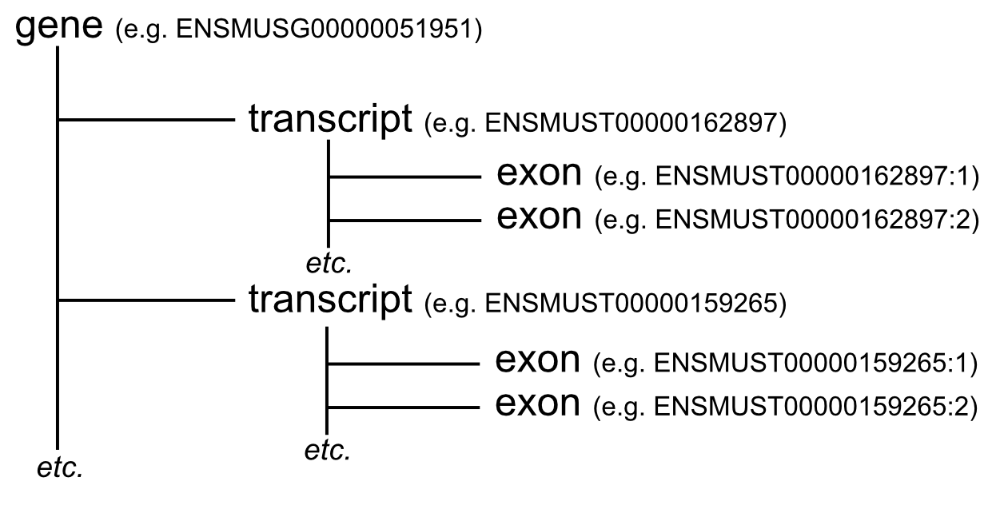

# gff/gtf

GFF files are hierarchical in nature. There can be many levels in this hierarchy. Parents have children, grandchildren, and so on. For our purposes, the top level feature will be a gene. Genes have children transcripts which in turn have children exons.

