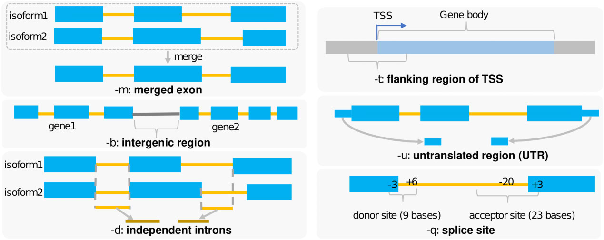

# gtftools

## 目录

- [1 Introduce](#1-Introduce)
  - [GTFtools](#GTFtools)
- [2 Source](#2-Source)

## 1 Introduce

### **`GTFtools`**

**`GTFtools`** 是一个独立的命令行软件，它提供了一套功能来计算各种基因特征，包括剪接位点、独立内含子、转录起始位点（`TSS`）侧翼区域、非翻译区（`UTR`）、同种型协调和长度、不同类型的基因长度等。它接受 **`ENSEMBL`** 或 **`GENCODE`** 的 GTF 文件作为输入，并且可以应用于人类和非人类基因模型，例如实验室小鼠[^1]。

## 2 Source

> GTFtools: a software package for analyzing various features of gene models
>
> [GTFtools- a software package for analyzing various features of gene models.pdf](<file/GTFtools- a software package for analyzing various.pdf> "GTFtools- a software package for analyzing various features of gene models.pdf")

[^1]: [https://academic.oup.com/bioinformatics/article/38/20/4806/6674500](https://academic.oup.com/bioinformatics/article/38/20/4806/6674500 "https://academic.oup.com/bioinformatics/article/38/20/4806/6674500")
