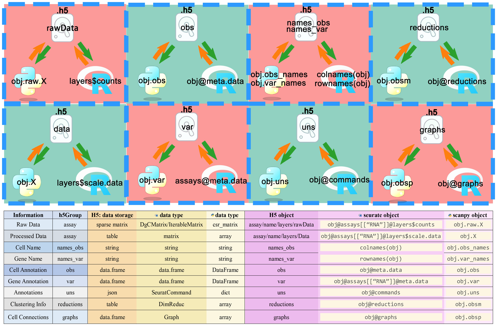

# hdf5

> \*\*`HDF5`\*\***具有以下几个优点：**
>
> 1. **分层数据管理** ：HDF5 格式允许在单个文件内创建复杂的分层结构，将数据组织为组和子组。这特别适合存储单细胞 RNA 测序数据，促进高效管理和访问。
> 2. **数据存储效率** ：HDF5 是一种高效的数据存储格式，专为处理大规模数据集而设计。其结构化数据存储方法可以在同一文件中存储大量不同的数据集，同时确保快速的数据读写速度。
> 3. **跨平台兼容性**：HDF5 格式支持多种编程语言，可以跨不同软件环境无缝读写。这极大地方便了 Seurat 和 Scanpy 之间的数据转换。研究人员可以使用 Seurat 在 R 环境中对数据进行预处理和分析，然后使用 Scanpy 将数据转换为 HDF5 格式以便在 Python 环境中进一步分析，反之亦然。
