# mermaid

## 目录

- [1 Introduce](#1-Introduce)
  - [Mermaid](#Mermaid)
  - [1.2 Diagram Types](#12-Diagram-Types)
    - [1.2.1 Flowcharts](#121-Flowcharts)
    - [1.2.2 Sequence diagrams](#122-Sequence-diagrams)
    - [1.2.3 Class diagrams](#123-Class-diagrams)
    - [1.2.4 State diagrams](#124-State-diagrams)
    - [1.2.5 Entity Relationship Diagrams](#125-Entity-Relationship-Diagrams)
    - [1.2.6 User Journey Diagram](#126-User-Journey-Diagram)
    - [1.2.7 Gantt diagrams](#127-Gantt-diagrams)
    - [1.2.8 Pie chart diagrams](#128-Pie-chart-diagrams)
    - [1.2.9 Quadrant Chart](#129-Quadrant-Chart)
    - [1.2.10 Requirement Diagram](#1210-Requirement-Diagram)
    - [1.2.11 GitGraph](#1211-GitGraph)
    - [1.2.12 Mindmap](#1212-Mindmap)
    - [1.2.13 Timeline Diagram](#1213-Timeline-Diagram)
    - [1.2.14 Sankey diagram](#1214-Sankey-diagram)
    - [1.2.15 Block Diagrams Documentation](#1215-Block-Diagrams-Documentation)
    - [1.2.16 Packet Diagram ](#1216-Packet-Diagram-)
    - [1.2.17 Kanban Diagram](#1217-Kanban-Diagram)
    - [1.2.18 Architecture Diagrams](#1218-Architecture-Diagrams)
- [2 Reference](#2-Reference)

***

***Author***\*\* : zhang jian\*\*​

***Date***\*\* : 2025-4-27\*\*​

***Version***\*\* : \*\***`1.0v`**

***

## 1 Introduce

### **Mermaid**

`Mermaid` 允许你使用文本和代码创建图表和可视化。`Mermaid`是基于 `JavaScript` 的图表绘制工具，可渲染 `Markdown`启发的文本定义以动态创建和修改图表[^1]。

图表和文档会耗费开发者宝贵的时间，并且很快就会过时。但是，没有图表或文档会破坏生产力并损害组织学习。  `Mermaid`通过使用户能够创建易于修改的图表来解决这个问题，它也可以成为生产脚本（和其他代码片段）的一部分。

> **NOTE** : 现阶段大部分在线文档工具，差不多都支持在文档中使用`Mermaid`添加图表。

```html title="Mermaid HTML示例"
<!DOCTYPE html>
<html>
<head>
  <script type="module">
    import mermaid from 'https://cdn.jsdelivr.net/npm/mermaid@11.6.0/+esm';
    mermaid.initialize({ startOnLoad: true }); // 初始化 Mermaid，自动渲染图表
  </script>
</head>
<body>
  <div class="mermaid">
    graph TD;
      A[Client] --> B[Server];
  </div>
</body>
</html>
```


### 1.2 Diagram Types

#### 1.2.1 Flowcharts

**流程图(Flowcharts)** 由节点（几何形状）和边（箭头或线条）组成。Mermaid 代码定义了如何制作节点和边，并适应不同的箭头类型、多方向箭头以及任何与子图的链接。

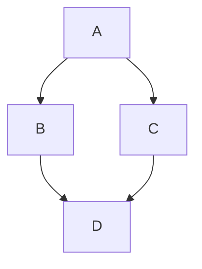


#### 1.2.2 Sequence diagrams

**时序图(Sequence diagrams)** 是一种交互图，显示进程如何彼此运行以及以什么顺序运行。

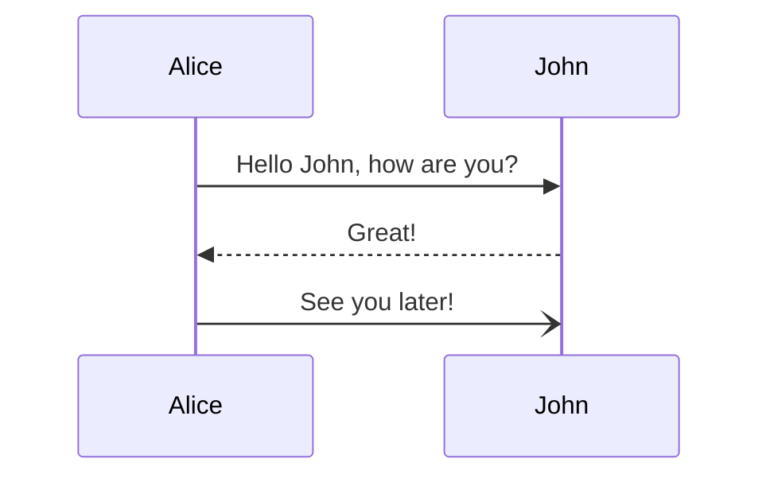


#### 1.2.3 Class diagrams

**类图(Class diagrams)** 是面向对象建模的主要构建块。它用于应用结构的一般概念建模，以及将模型转换为编程代码的详细建模。类图也可用于数据建模。类图中的类表示主要元素、应用中的交互以及要编程的类。

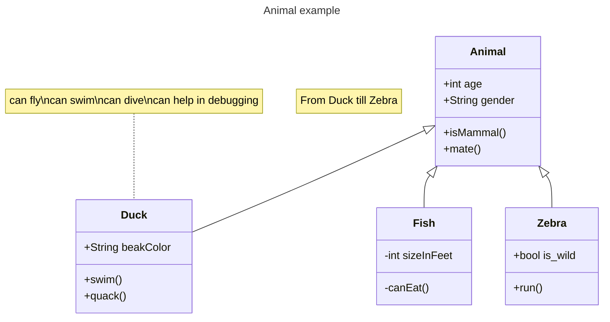


#### 1.2.4 State diagrams

**状态图(State diagrams)** 是计算机科学及相关字段中用于描述系统行为的一种图表。状态图要求所描述的系统由有限数量的状态组成；有时，情况确实如此，而有时这是一个合理的抽象。

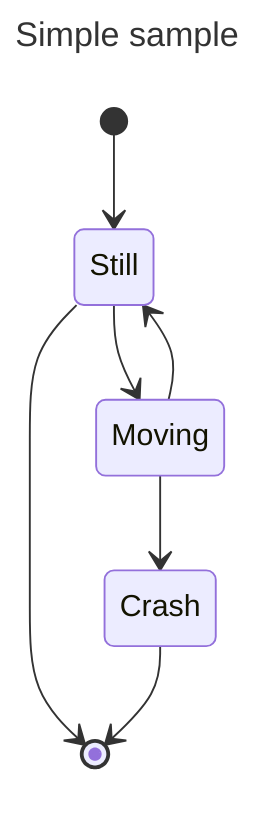


#### 1.2.5 Entity Relationship Diagrams

**实体关系模型（Entity Relationship Diagrams,或 ER 模型**）描述特定知识字段中相关的感兴趣的事物。基本 ER 模型由实体类型（对感兴趣的事物进行分类）组成，并指定实体（这些实体类型的实例）之间可以存在的关系。

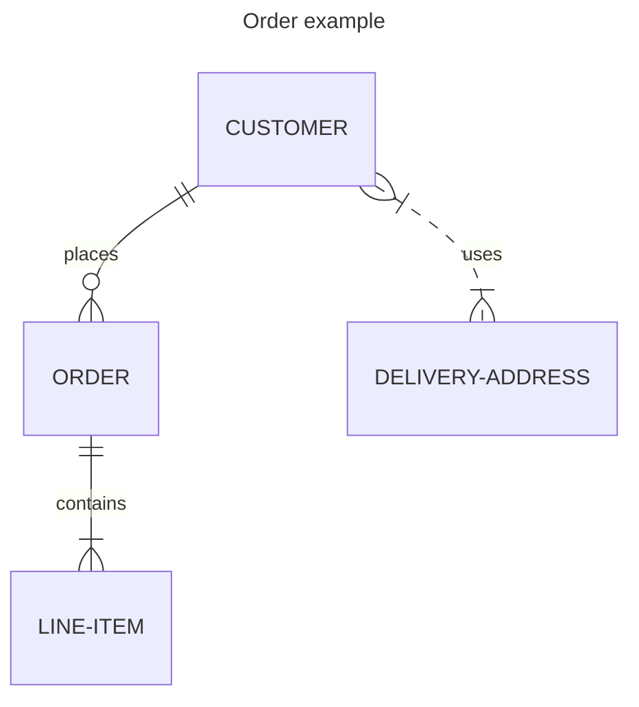


#### 1.2.6 User Journey Diagram

**用户旅程(User Journey Diagram)** 高度详细地描述了不同用户在系统、应用或网站内完成特定任务所采取的步骤。该技术显示当前（原样）用户工作流程，并揭示未来工作流程的改进字段。

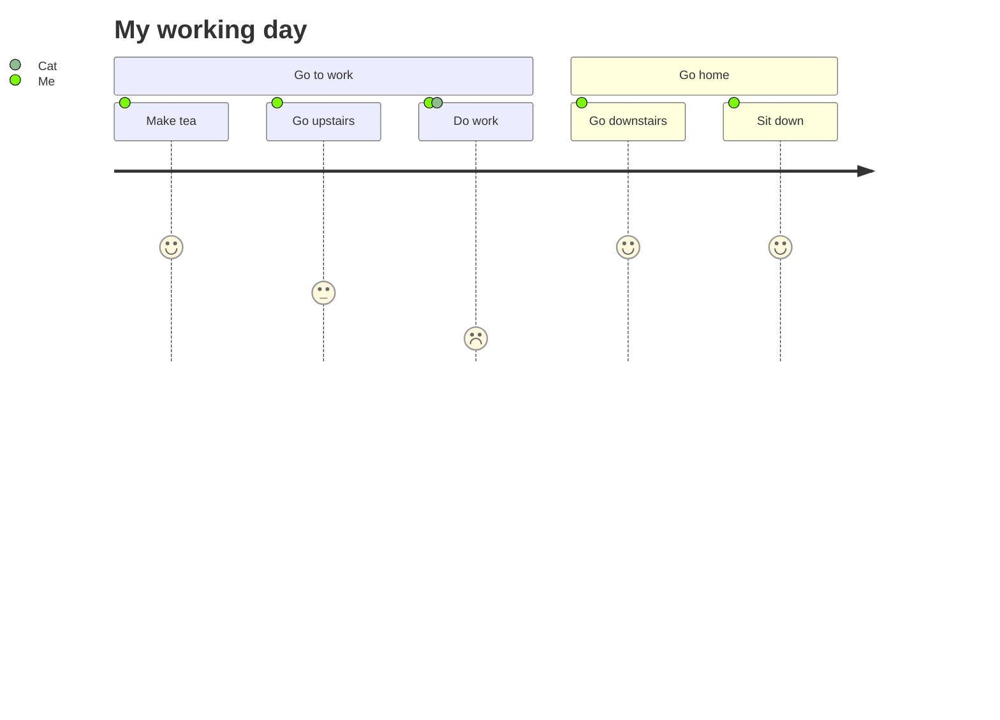


#### 1.2.7 Gantt diagrams

**甘特图(Gantt diagrams)** 是一种柱状图，最初由 Karol Adamiecki 于 1896 年开发，并由 Henry Gantt 在 1910 年代独立开发，它说明了项目进度表以及任何一个项目完成所需的时间。甘特图显示了项目的终端元素和摘要元素的开始日期和完成日期之间的天数。

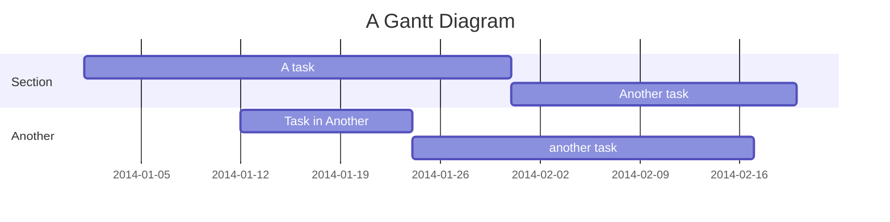


#### 1.2.8 Pie chart diagrams

**饼图（Pie chart或圆形图）** 是一种圆形统计图形，将其划分为多个切片以说明数字比例。在饼图中，每个切片的弧长（及其中心角和面积）与其表示的数量成正比。虽然它因其类似于切片的馅饼而得名，但它的渲染方式却有多种变化。

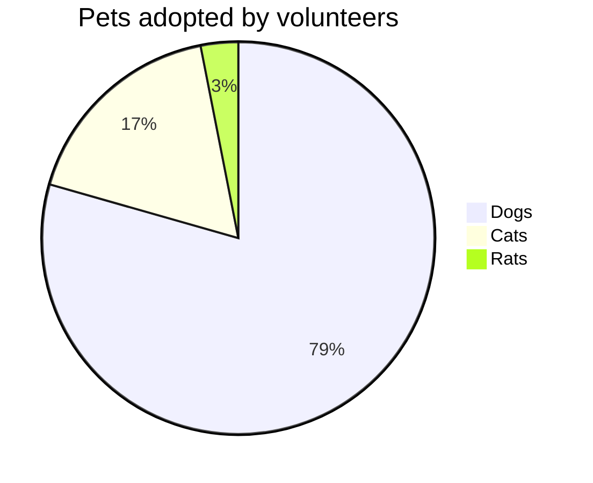


#### 1.2.9 Quadrant Chart

**象限图(Quadrant Chart)** 是分为四个象限的数据的直观表示。它用于在二维网格上绘制数据点，其中一个变量表示在 x 轴上，另一个变量表示在 y 轴上。象限是通过根据一组特定于所分析数据的标准将图表分为四个相等部分来确定的。象限图通常用于识别数据的模式和趋势，并根据图表中数据点的位置确定操作的优先级。它们通常用于商业、营销和风险管理等字段。

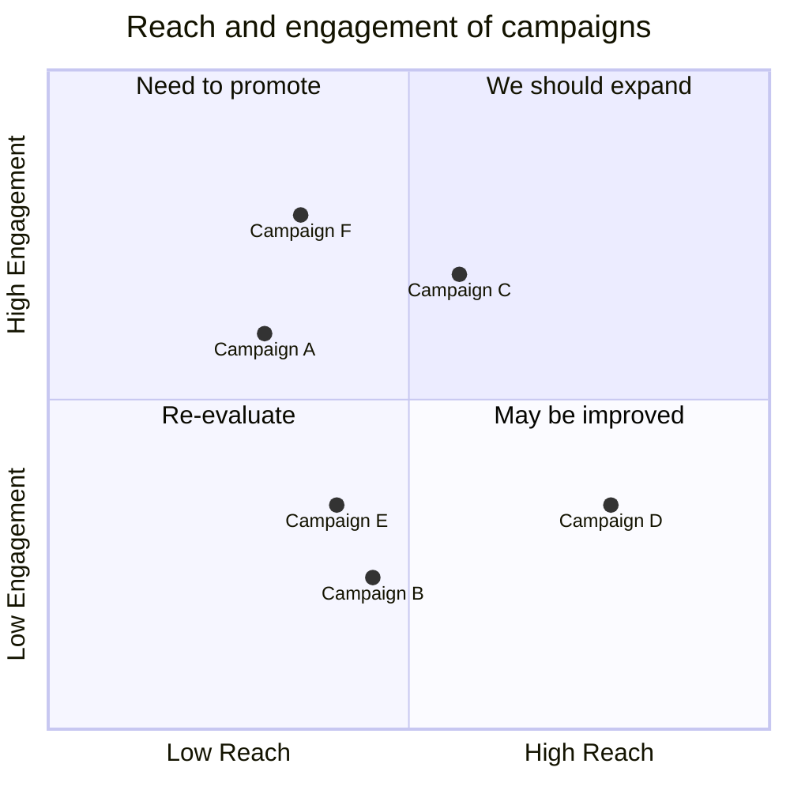


#### 1.2.10 Requirement Diagram

**需求图(Requirement Diagram)** 提供了需求及其相互之间以及其他记录元素之间的联系的可视化。建模规范遵循 SysML v1.6 定义的规范。

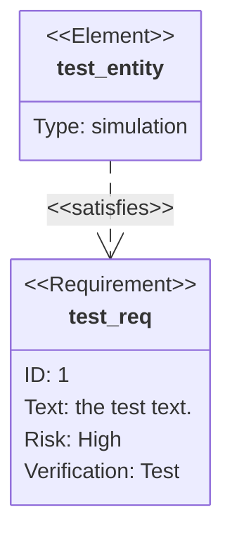


#### 1.2.11 GitGraph

Git 图表(GitGraph)是各个分支上 git 提交和 git 操作（命令）的图形表示。

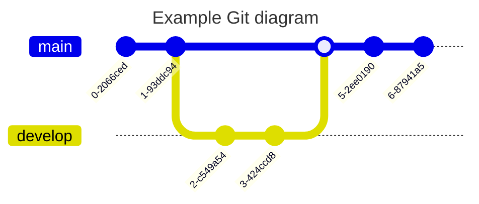


#### 1.2.12 Mindmap

**思维导图（Mindmap）** 是一种图表，用于将信息直观地组织成层次结构，显示整体各个部分之间的关系。它通常是围绕一个概念创建的，在空白页面的中心绘制为图片，并在其中添加相关的想法表示，例如图片、单词和单词的一部分。主要思想与中心概念直接相关，而其他思想则从这些主要思想中分支出来。

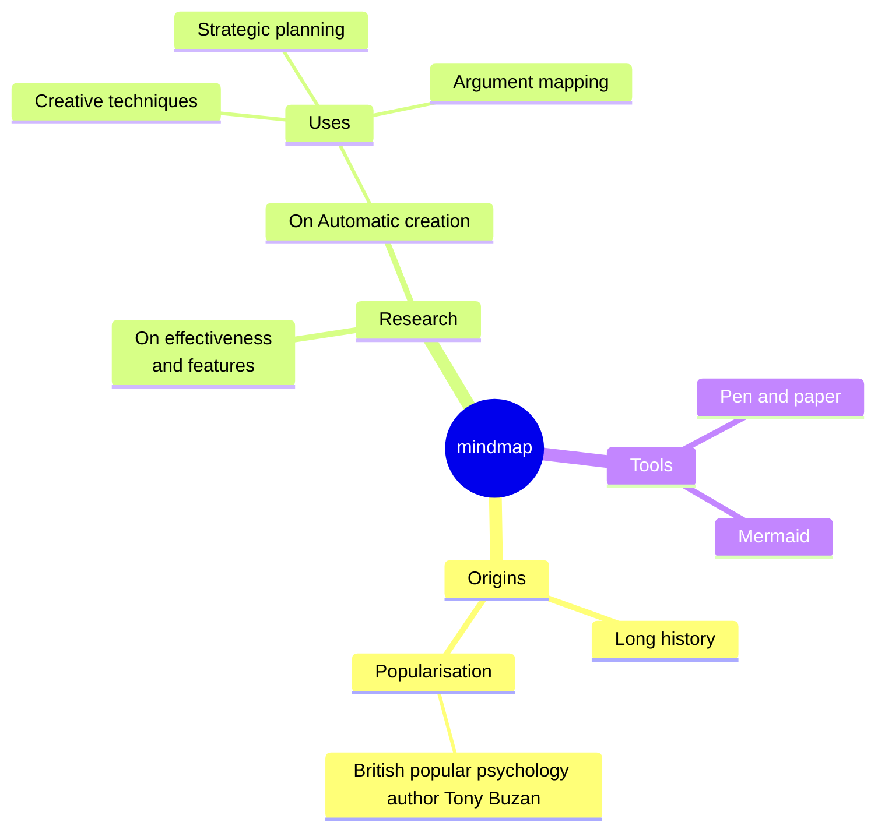


#### 1.2.13 Timeline Diagram

时间线是一种图表，用于说明事件、日期或时间段的年表。它通常以图形方式渲染以指示时间的流逝，并且通常按时间顺序组织。基本时间线按时间顺序渲染事件列表，通常使用日期作为标记。时间线还可以用来展示事件之间的关系，比如一个人一生中的事件之间的关系

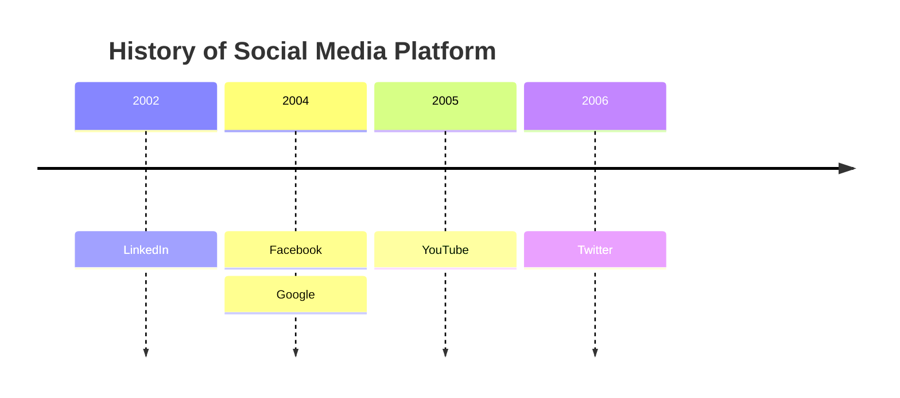


#### 1.2.14 Sankey diagram

桑基图是一种可视化，用于描述从一组值到另一组值的流动。

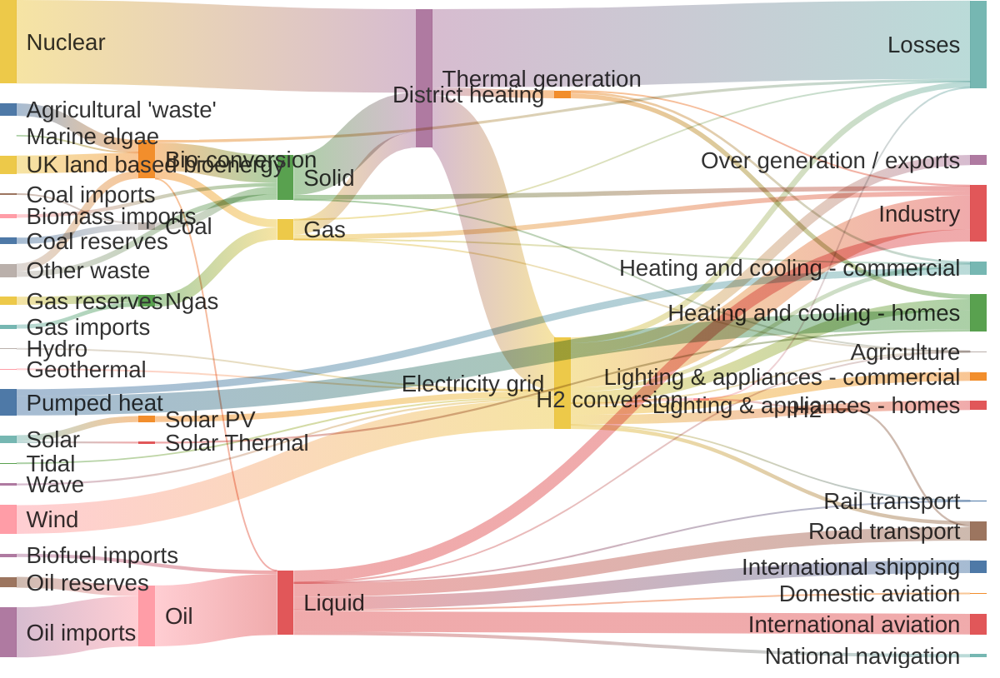


#### 1.2.15 Block Diagrams Documentation

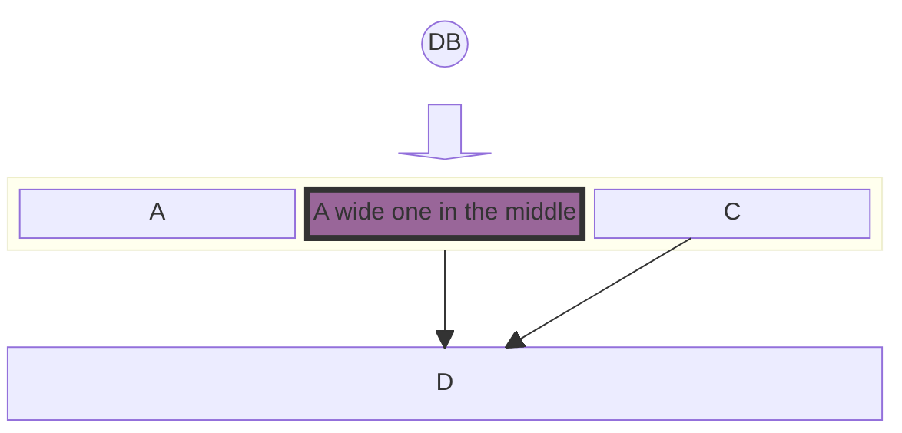


#### 1.2.16 Packet Diagram&#x20;

数据包图是用于说明网络数据包的结构和内容的可视化表示。网络数据包是通过网络传输的数据的基本单位。

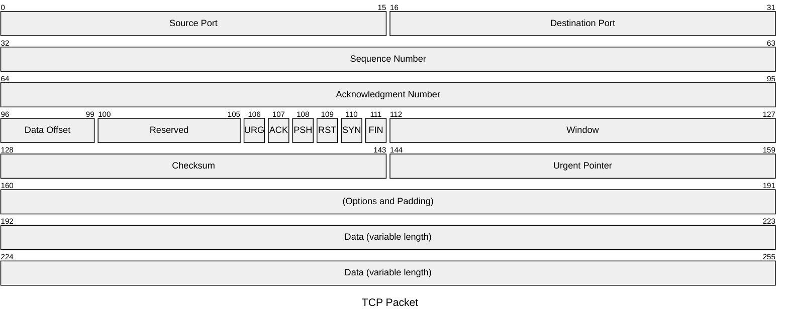


#### 1.2.17 Kanban Diagram

Mermaid 的看板图允许你创建在工作流程的不同阶段移动的任务的可视化表示。本指南根据提供的示例解释了如何使用看板图语法。

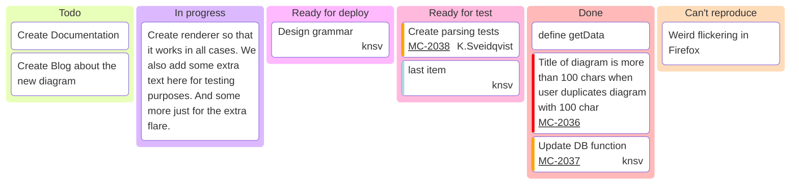


#### 1.2.18 Architecture Diagrams

在 mermaid-js 的上下文中，架构图用于显示云或 CI/CD 部署中常见的服务和资源之间的关系。在架构图中，服务（节点）通过边连接。相关服务可以放在组中，以更好地说明它们的组织方式。

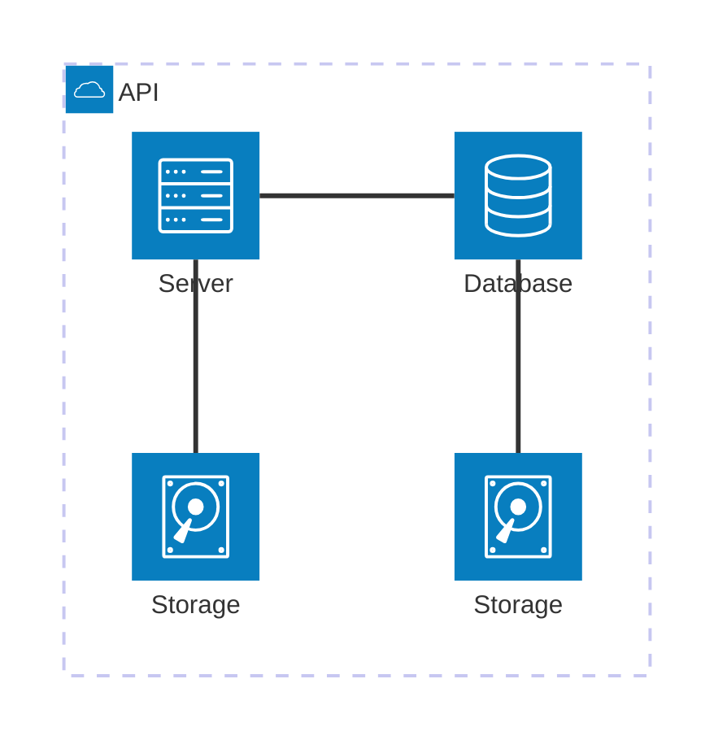


***

## 2 Reference

[^1]: [https://mermaid.nodejs.cn/](https://mermaid.nodejs.cn/ "https://mermaid.nodejs.cn/")
