# multiqc

## 目录

- [1 Introduce](#1-Introduce)
  - [1.1 multiqc](#11-multiqc)
  - [1.2 merge plot](#12-merge-plot)
  - [1.3 multiqc module](#13-multiqc-module)
    - [1.3.1 qc](#131-qc)
    - [1.3.2 featurecount](#132-featurecount)
    - [1.3.3 bisulfite-DNA-seq](#133-bisulfite-DNA-seq)
    - [1.3.4 mapping ](#134-mapping-)
    - [1.3.5 metagenomics](#135-metagenomics)
    - [1.3.6 scRNA-seq](#136-scRNA-seq)
    - [1.3.7 mutation](#137-mutation)
    - [1.3.8 hi-c](#138-hi-c)
    - [1.3.9 PDX](#139-PDX)
- [2 Install](#2-Install)
- [3 tutorial](#3-tutorial)
  - [3.1 quick start](#31-quick-start)
  - [3.2 multiqc parameter ](#32-multiqc-parameter-)
    - [3.2.1 Overwrite](#321-Overwrite)
    - [3.2.2 outdir](#322-outdir)
    - [3.2.3 template](#323-template)
    - [3.2.4 pdf](#324-pdf)
    - [3.2.5 title ](#325-title-)
    - [3.2.6 -p ](#326--p-)
    - [3.2.7  --replace-names](#327----replace-names)
    - [3.2.8 module](#328-module)
  - [3.3 ymal](#33-ymal)
- [4 Example](#4-Example)
  - [4.1 Cellranger](#41-Cellranger)
- [5 Reference](#5-Reference)

***

## 1 Introduce

### 1.1 multiqc


multiqc[^1]是NGS测序中最常用的对测序结果进行整合的软件之一，其可以对[RNA-seq](https://multiqc.info/example-reports/rna-seq "RNA-seq") & [Bisulfite-seq](https://multiqc.info/example-reports/bisulfite-seq "Bisulfite-seq") & [Hi-C](https://multiqc.info/example-reports/hi-c "Hi-C")  & [WGS](https://multiqc.info/example-reports/whole-genome-seq "WGS")中获得的相关结果进行统计，其能够快速的对批量获得的结果进行统计与可视化！

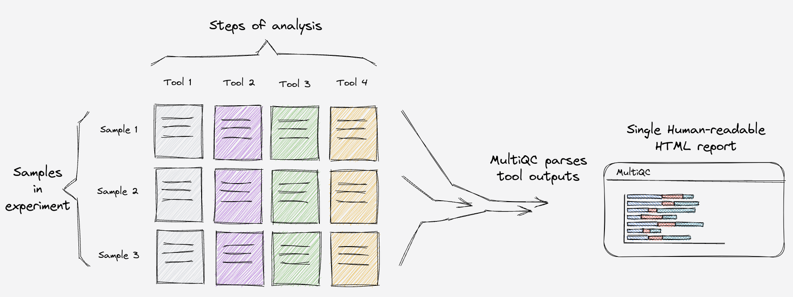

> **NOTE** : multiqc 是对已经完成分析的相关结果进行汇总的软件，其不会在进行进一步分析，其只会生成 nice reports!

In addition to the HTML report, MultiQC generates a directory of parsed data files with consistent data structure. This can be useful for further downstream analysis.

> multiqc 的报告为html 和对应的数据结果文件，可以直接进行下游分析！

### 1.2 merge plot

multiqc 可以对***fastqc*** & \*\*\*Cutadapt \*\*\*& ***STAR*** & ***featureCounts*** 的分析结果进行整合并生成网页报告！[^2]

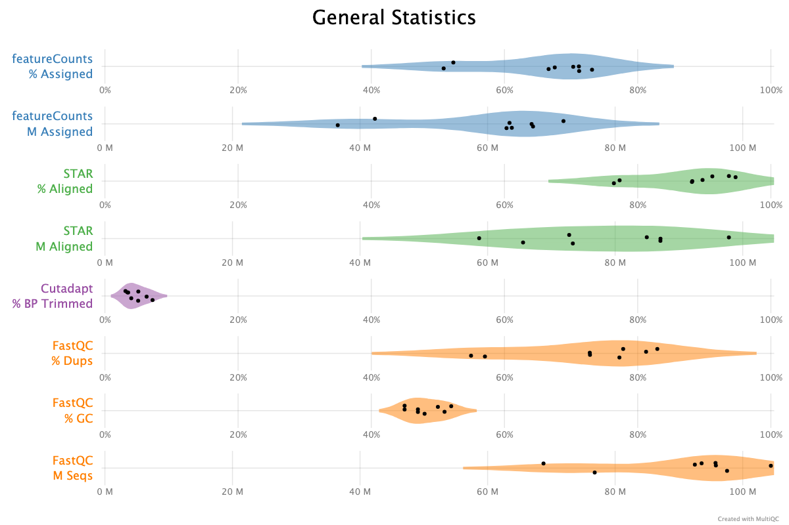

### 1.3 multiqc module

`multiqc` 可以汇总很多软件的结果

#### 1.3.1 qc

**Cutadapt** : Cutadapt is a tool to find and remove adapter sequences, primers, poly-A tails and other types of unwanted sequence from your high-throughput sequencing reads.

**Trimmomatic** : Trimmomatic is a flexible read trimming tool for Illumina NGS data

**Fastp** : An ultra-fast all-in-one FASTQ preprocessor

\*\*FastQ Screen \*\*: FastQ Screen allows you to screen a library of sequences in FastQ format against a set of sequence databases so you can see if the composition of the library matches with what you expect.

**FastQC** : FastQC is a quality control tool for high throughput sequence data, written by Simon Andrews at the Babraham Institute in Cambridge.

**RSeQC** : RSeQC is a package that provides a number of useful modules that can comprehensively evaluate high throughput RNA-seq data.

**Skewer** : Skewer is an adapter trimming tool specially designed for processing next-generation sequencing (NGS) paired-end sequences.

#### 1.3.2 featurecount

**featureCounts** : featureCounts is a highly efficient general-purpose read summarization program that counts mapped reads for genomic features such as genes, exons, promoter, gene bodies, genomic bins and chromosomal locations.

**Kallisto** : kallisto is a program for quantifying abundances of transcripts from RNA-Seq data.

\*\*Salmon \*\*: Salmon is a tool for quantifying the expression of transcripts using RNA-seq data.

**RSEM** : RSEM (RNA-Seq by Expectation-Maximization) is a software package for estimating gene and isoform expression levels from RNA-Seq data.

#### 1.3.3 bisulfite-DNA-seq

**BISCUIT** : BISCUIT is a software tool suite for analyzing bisulfite-converted DNA sequencing.

\*\*Bismark \*\*: Bismark is a tool to map bisulfite converted sequence reads and determine cytosine methylation states.

#### 1.3.4 mapping&#x20;

**Bowtie 1** : Bowtie 1 is an ultrafast, memory-efficient short read aligner.

**Bowtie 2** : Bowtie 2 is an ultrafast and memory-efficient tool for aligning sequencing reads to long reference sequences.

\*\*HISAT2 \*\*: HISAT2 is a fast and sensitive alignment program for mapping NGS reads (both DNA and RNA) to reference genomes.

**STAR** : STAR is an ultrafast universal RNA-seq aligner.

**TopHat** : TopHat is a fast splice junction mapper for RNA-Seq reads. It aligns RNA-Seq reads to mammalian-sized genomes.

#### 1.3.5 metagenomics

**Bracken** : is a highly accurate statistical method that computes the abundance of species in DNA sequences from a metagenomics sample

\*\*Kraken \*\*: is a taxonomic classification tool that uses exact k-mer matches to find the lowest common ancestor (LCA) of a given sequence.

#### 1.3.6 scRNA-seq

**Space Ranger** : Summarise quality metrics from 10x Genomics Space Ranger count.

**Cell Ranger** : Summarise quality metrics from Cell Ranger count and vdj.

#### 1.3.7 mutation

\*\*Picard \*\*: Picard is a set of Java command line tools for manipulating high-throughput sequencing data.

**GATK** : Variant Discovery in High-Throughput Sequencing Data

#### 1.3.8 hi-c

**HiCExplorer** : HiCexplorer addresses the common tasks of Hi-C analysis from processing to visualization.

**HiC-Pro** : HiC-Pro is an optimized and flexible pipeline for Hi-C data processing.

**HiCUP** : HiCUP (Hi-C User Pipeline) is a tool for mapping and performing quality control on Hi-C data.

#### 1.3.9 PDX

\*\*xengsort \*\*: Fast xenograft read sorter based on space-efficient k-mer hashing

\*\*Xenome \*\*: Xenome is a tool for classifying reads from xenograft sources.

***

## 2 Install

```bash 
# install multiqc by pip
pip install Pandoc
pip3 install multiqc
# install multiqc by conda
conda install multiqc
# install TeX
sudo apt-get install texlive-xetex texlive-fonts-recommended texlive-plain-generic

```


> \*\*NOTE \*\*: 最新版的multiqc 需要 python > 3.9

***

## 3 tutorial

### 3.1 quick start

```r 
# multiqc 最简单的用法
multiqc ./
```


### 3.2 multiqc parameter&#x20;

#### 3.2.1 Overwrite

`multiqc`可以使用`--force`强制覆盖已有报告。

```r 
multiqc ./ -f
# parameter
# --force : -f  Overwrite any existing reports
```


#### 3.2.2 outdir

```r 
multiqc ./ -o ./<multiqc-path>
# parameter
# --outdir : -o  Create report in the specified output directory.
```


#### 3.2.3 template

> multiqc 还可以直接DIY 结果！

`(default|gathered|geo|highcharts|sections|simple) `

```r 
multiqc ./ -t simple
# parameter
# --template : -t  Report template to use. (default|gathered|geo|highcharts|sections|simple)  
```


#### 3.2.4 pdf

> multiqc 还可以生成PDF报告，但是该报告的格式很难看！

```bash 
--pdf  # Creates PDF report with the 'simple'template. Requires Pandoc to be installed.
```


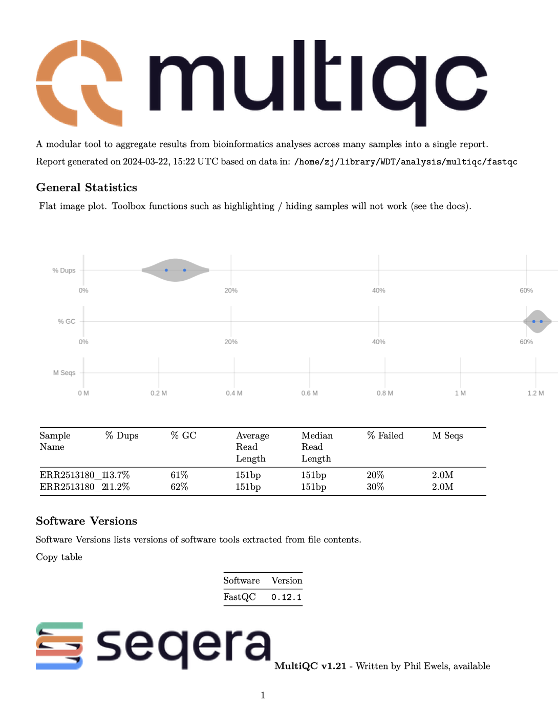

#### 3.2.5 title&#x20;

```r 
multiqc ./ -t simple -i "multiqc-title"
# parameter 
# --title  : -i  Report title. Printed as page header, used for filename if not otherwise specified.  
```


#### 3.2.6 -p&#x20;

> multiqc可以除了生成网页报告外，还可以生成对于的结果照片！

> `pdf `  &  `png`  &  `svg` : multiqc可以生成PDF & PNG & SVG 格式的结果文件！

```r 
multiqc --export -f -i "multiqc_fastq_screen" --template simple  ./
```


> **NOTE** : `--export` 参数只有使用模板为simple时，才会生成对应图片，其他模板不会生成图片！

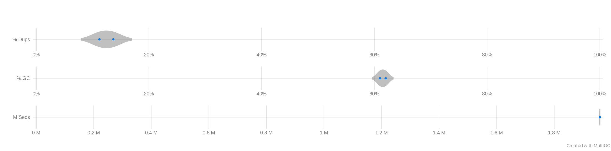


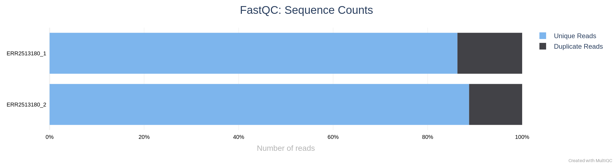

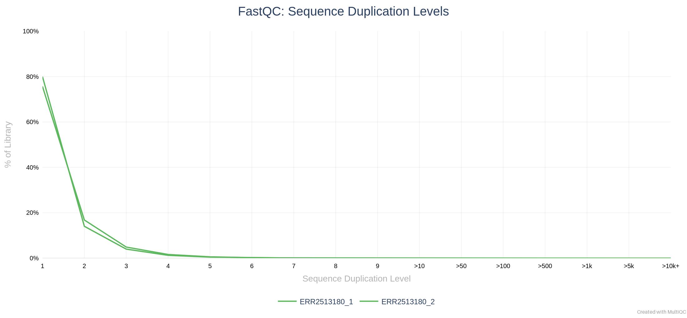

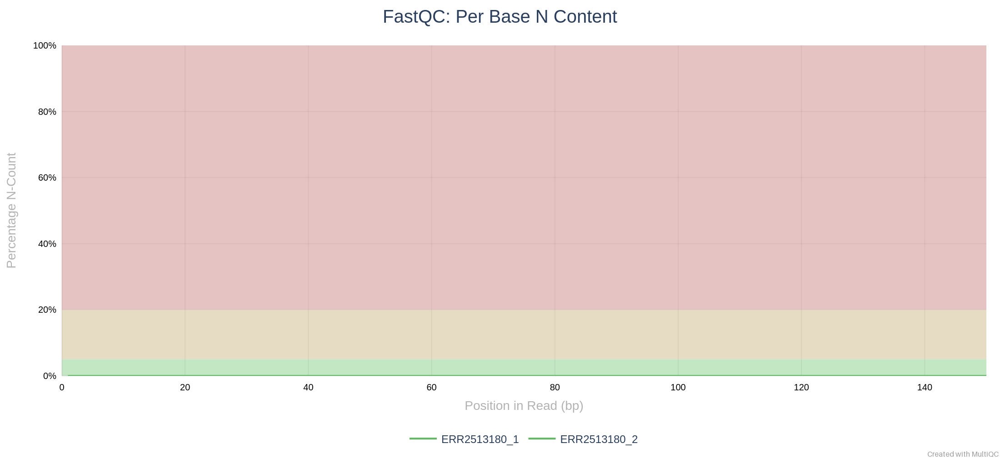

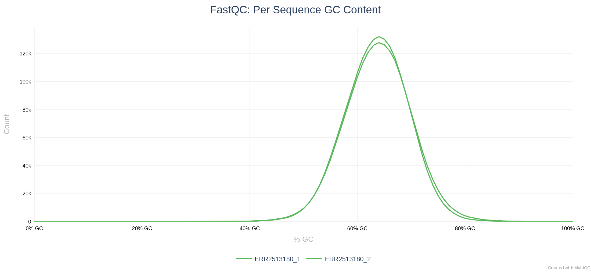

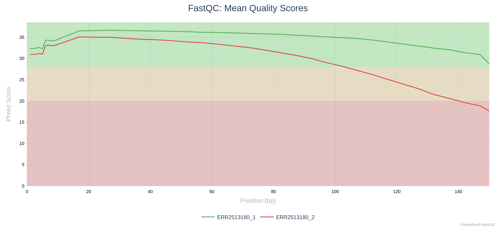

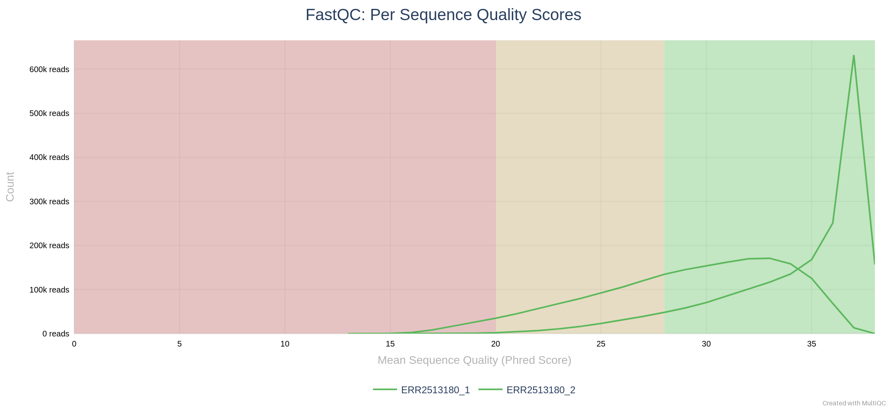

#### 3.2.7  --replace-names

> multiqc 可以使用`--replace-names`对样本名称进行修改！

```python 
multiqc --export -f \
        -i "multiqc_fastqc" \
        --replace-names replace_name.tsv
```


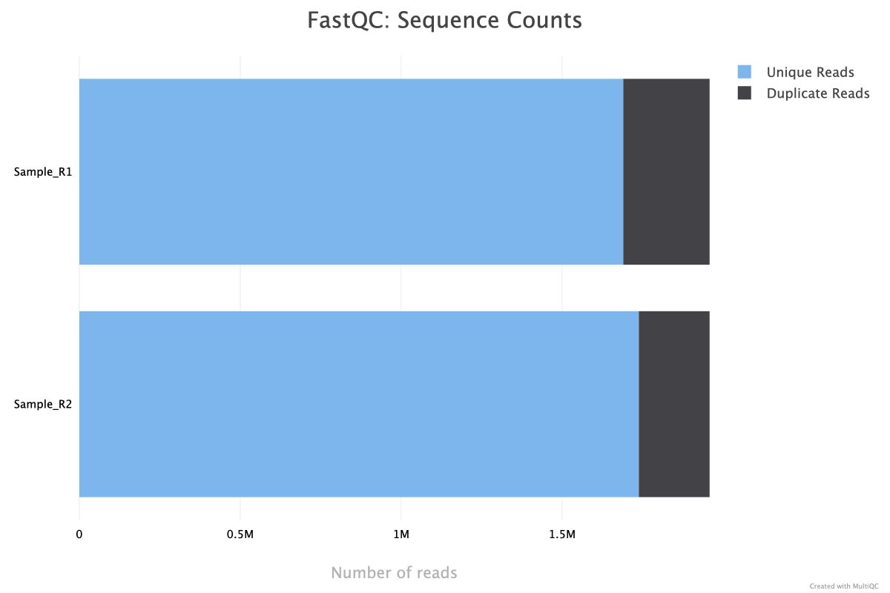

```python 
#   ERR2513180_1  : 原始样本名称 
 # Sample_R1  ： 修改后样本名称
ERR2513180_1  Sample_R1
ERR2513180_2  Sample_R2
```


***

#### 3.2.8 module

> multiqc 可以使用`--module` & `--exclude`对报告中的模块进行选择，主要为要(`--module`)显示什么模块与(`--exclude`)在报告中移除什么模块

```python 
╭─ Choosing modules to run ─────────────────────────────────────────────────────────────────────────────╮
│ --module   -m  Use only this module. Can specify multiple times. (MODULE NAME)                        │
│ --exclude  -e  Do not use this module. Can specify multiple times. (MODULE NAME)                      │
╰───────────────────────────────────────────────────────────────────────────────────────────────────────╯
```


### 3.3 ymal

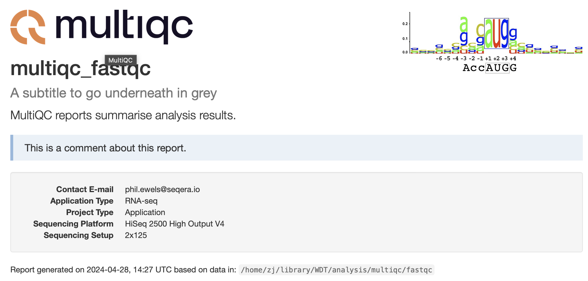

> multiqc 还可以通过对yaml 文件的修改来快速实现对于报告中信息的替换！

```python 
#######################
# multiqc report title
title: "My Title"
subtitle: "A subtitle to go underneath in grey"
intro_text: "MultiQC reports summarise analysis results."
report_comment: "This is a comment about this report."
#######################
# add logo infor
custom_logo: "/home/zj/library/WDT/KozakConsensus.jpg"
custom_logo_url: "https://www.example.com"
custom_logo_title: "Our Institute Name"
#######################
# report header info
report_header_info:
  - Contact E-mail: "phil.ewels@seqera.io"
  - Application Type: "RNA-seq"
  - Project Type: "Application"
  - Sequencing Platform: "HiSeq 2500 High Output V4"
  - Sequencing Setup: "2x125"
```


[multiqc\_config.yaml](file/multiqc_config_1JTxRbbKNO.yaml "multiqc_config.yaml")

> NOTE : **multiqc\_config.yaml** 文件可以放在 `~/.config/multiqc_config.yaml`

***

## 4 Example

### 4.1 Cellranger

> multiqc 可以对scRNA-seq Cellranger 分析结果进行快速汇总！

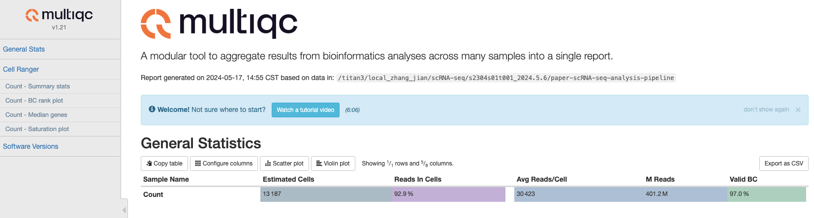

> \*\*NOTE \*\*: Cellranger 需要注意如果Cellranger 报告的名称一样可能只会上传其中一个的报告！

***

## 5 Reference

[^1]: [https://multiqc.info/](https://multiqc.info/ "https://multiqc.info/")

[^2]: [https://seqera.io/blog/multiqc-plotly/](https://seqera.io/blog/multiqc-plotly/ "https://seqera.io/blog/multiqc-plotly/")
