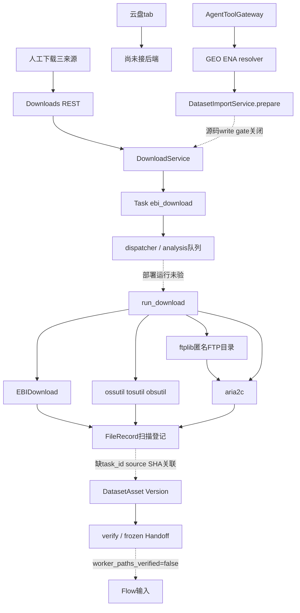
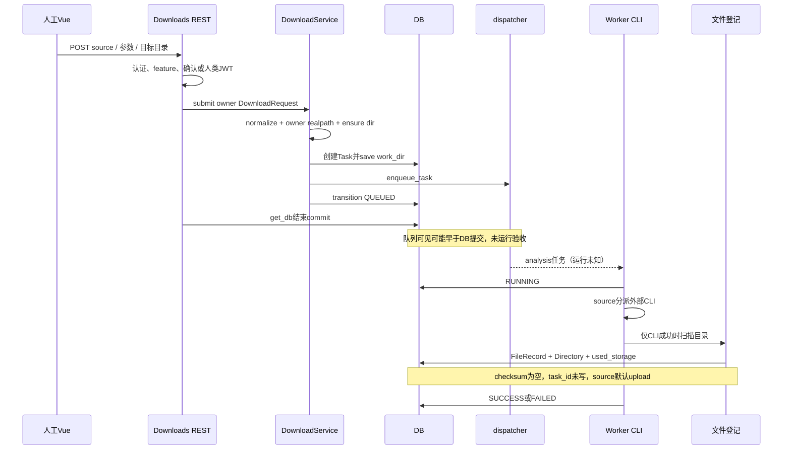
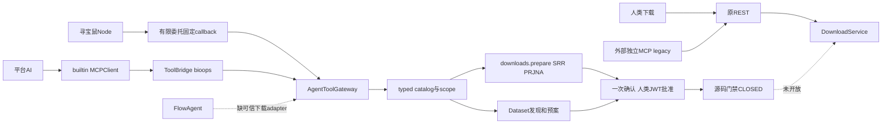
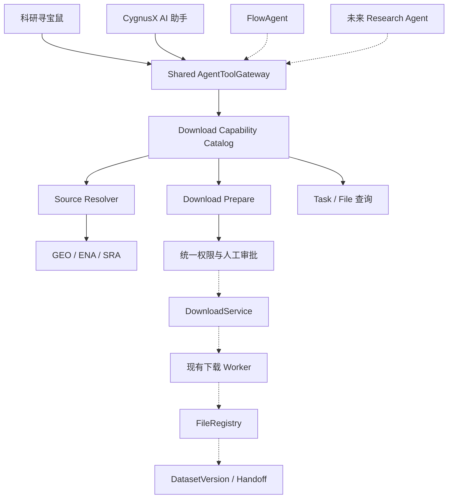

# CygnusX 下载与公共数据接入架构

类型：as-built 活动基线；核实日期：2026-10-16。描述当前工作树代码，不代表生产部署或任何协议已验收。调查快照、D01–D16、D-T01–44、DL-RG01–15 及原始证据定位见 [专项调查](../docs/audits/cygnusx-platform-download-capability-and-agent-tool-readiness-audit-2026-10-16.md) 与 [证据索引](../docs/audits/appendix-download-evidence-index.md)。

**本文是"平台下载模块"的单一权威架构文件**。下载模块的完整细节——四阶段边界、三条传输实现、Worker 与 CLI 分发、FileRegistry 登记、源码门禁与验收——一律以本文为准；其余文档只在各自域内保留接入点与回指链接：

- 共享 Agent 工具层（catalog/身份 scope/审批/恢复）：[CygnusX_agent_tool_gateway.md](CygnusX_agent_tool_gateway.md)
- 寻宝鼠端到端链路（下载 Prepare→审批→执行段）：[CygnusX_treasure_mouse_architecture.md](CygnusX_treasure_mouse_architecture.md)
- Dataset 资产与 Flow 输入接入：[CygnusX_dataset_architecture.md](CygnusX_dataset_architecture.md)
- 路径与共享盘：[CygnusX_storage_architecture.md](CygnusX_storage_architecture.md)

旧文档若将图中Download→Dataset边画为完整可运行链，以本次明确核实的task_id登记断点为限制，不把目标关联当成运行事实。

## 1. 模块职责与真实边界

下载有四个不同阶段：发现来源、执行传输、登记文件、审阅科研资产。前端「数据下载与聚合」的公共数据库/云存储/直链三tab共用一条Task链；云盘tab仅占位。下载文件落服务端用户空间，用户浏览器不承载远程传输。平台MinIO/S3存储、向浏览器生成presigned下载URL和拉取外部对象存储是不同功能。

| 层 | 当前职责 | 关键代码 |
|---|---|---|
| UI | 三来源POST、下载Task列表、跳转Task详情；云盘warning | frontend/src/views/DownloadsView.vue:193/217 |
| REST | 认证、按source开关、links数量、API-Key写门禁/确认消费 | api/v1/downloads.py:38/59；api/deps.py:47 |
| DTO | sra/cloud_storage/direct_link、协议与线程范围、浅层URL检查 | application/schemas/download.py:46/95 |
| Service | 用户目录/目录链、通用Task提交、队列调度 | application/services/download_service.py:48 |
| 队列 | 默认Celery analysis；settings可换RocketMQ | infrastructure/task_queue/dispatcher.py:22；celery_app/celery.py:78 |
| Worker | source三分派、CLI日志进度、按退出码判终态、文件扫描登记 | infrastructure/celery_app/tasks/download.py:145/444/633/740 |
| 传输器 | EBI/SRA公共镜像或ENA；三家云CLI；aria2c与FTP目录ftplib | 同上；pipelines/EBIDownload/crates/ebidownload-cli/src/main.rs:347 |
| 文件注册 | storage_path幂等、Directory登记、used_storage累加 | download.py:740；database/repositories/file_repository.py:143 |
| 科研治理 | 真实项目权限、Source/Run选择、预案、Asset/Version、SHA/科学输入审阅 | dataset_import_service.py:136/343/426；dataset_handoff_service.py:52/158 |
| Agent工具 | typed catalog、身份scope、确认、关联恢复、禁止执行 | agent_tool_gateway.py:47/77/167/761 |

## 2. 组件关系图

实线是源码关系，不代表运行认证；虚线是受门禁或断链阻断的关系。

## 3. 三条传输实现

公共数据库：DownloadRequest.source=sra，原accession交EBIDownload `download -A`。人工表单不经过GeoMetadataAdapter。CLI用ENA filereport获取read_run；FTP分支经wget -c下载FASTQ并核MD5，AWS分支获取SRA再fasterq-dump转换/压缩。GSE/GSM的科学解析在独立Dataset resolver中；不承诺CLI原样GSE能展开。UI/API method=aws/aspera/ftp；已核宿主CLI选项=ftp/prefetch/aws/auto，Aspera有明确契约漂移。

云存储：source=cloud_storage；aliyun/volc/huawei及别名→OSS/TOS/OBS scheme→对应CLI cp。CLI配置/IAM从实际运行环境供给，不由前端传AK/SK。没有通用s3://或COS适配，也没有云盘解析器；presigned HTTPS只能按普通直链理解，未完成签名时效/日志脱敏认证。

直链：source=direct_link，http/https/ftp，URL作为argv交aria2c，无shell。recursive FTP尾斜杠先ftplib匿名遍历，后aria2批量。FTPS在DTO不接受，没有FTP_TLS或登录参数。--continue、split、max-tries等CLI参数是局部恢复机制，不证明Task跨Worker crash可靠恢复。

## 4. 一次请求的实现时序

## 5. 来源与科研资产接入

GeoMetadataAdapter固定HTTPS主机、禁重定向/trust_env、限制响应/样本/Run与缓存；输出SOFT/ENA来源证据、候选文件及未知项，不下载科研文件。DatasetImportService.prepare以真实owner Project、显式选择、source snapshot与预算建立Ingestion与一次确认，不创建目录/Task。raw仅已解析SRR；processed权威附件→direct_link请求。

execute仍被源码门禁阻断。代码意图是重验来源与配额→消费批准→持久SUBMITTING→Version/source_snapshot→同一DownloadService→task_ids。reconcile不重投，从Task→FileRecord.task_id取产物。当前登记函数、DataFile、FileRepository没有写task_id，且source默认upload/checksum空，这是确定的契约断点。不能把测试double中人为正确写task_id当作Worker已实现。

人工下载无自动Dataset创建；已有合法FileRecord可经DatasetService.attach_asset显式关联。验证计算实际SHA-256、检查FASTQ/矩阵与安全归档，审阅样本/单位后冻结manifest_hash。source MD5、实际文件SHA和manifest hash分别存语义，不等价。worker_paths_verified固定false，因此Dataset READY文本不是Worker执行准入。

归档接入已有 `GeoProcessedDataService.expand:65`：写门禁后保留原archive、核SHA、受限展开、使用FileRegistry注册子文件并保存parent archive ID/SHA；失败保留staging对账。FileRegistry.register:74已经支持task_id/source/checksum，而下载Worker当前绕过此注册器。最小修复应优先复用这个现成入口；已有ORM列不需要为此再建表（证据E46/E47，隔离I05通过）。

## 6. Agent与人工入口

下载页人类JWT可直接提交；API-Key写REST先过Agent gate。Gateway read默认关闭；上下文从active user/session/project派生而非模型输入，模块与scopes交集裁剪。Node有限委托不能approve/execute；批准端点用CurrentJwtUserId。模型user_confirmed布尔不能自证。

downloads.prepare仅SRR/PRJNA候选，预算未知；dataset.prepare_import拥有权威来源与科研选择/预算，内部不再调用downloads.prepare，所以当前没有嵌套双确认。跨入口重复请求仍缺统一去重。外部MCP legacy不是所有Gateway能力的等价投影；FlowAgent当前仅submit_plan适配Snakemake计划端点，下载Gateway尚未接通。

## 7. 配置、部署与观测

- 下载配置：tool_configs/download/download_config.yaml，mtime热重载；显式binary路径优先Settings。YAML三features=false；REST按YAML OR Settings。本地进程仅EBI开，其他download/read/import/Agent download关，非容器证据。
- Worker声明：deploy/docker/docker-compose.worker.yml worker image cygnusx-worker:v0.0.2dev，源码、tool_configs、共享盘与pipelines挂载；Dockerfile.worker未构建Rust downloader/安装aria2与三云CLI，依赖运行数据盘供给。
- 版本：子模块EBIDownload1.4.0；独立旁仓Polariseq1.4.3；宿主binary1.4.0/hash见调查；socket被拒，当前容器版本/digest/UID/挂载UNKNOWN。
- SRA逐Run进度：CLI本地加密Progress API→轮询解密→Redis→REST；缺失返回unavailable。Task状态与日志回写DB+PubSub。HTTP/云CLI百分比日志不代表逐文件完整性。
- Task状态只有pending/queued/running/success/failed/cancelled；Ingestion另有PREPARED/SUBMITTING/QUEUED/RUNNING/VERIFYING/PARTIAL/COMPLETED/RECONCILIATION_REQUIRED。不可混合成单一枚举。

Web与Worker共享盘分别由CYGNUSX_DATA_ROOT/WORKER_SHARED_DATA_DIR供给，同目标路径不证明同一物理内容。Worker entrypoint声明PUID/PGID默认1000降权，真实UID未知；Studio沙箱uid10001与出站proxy不是下载Worker的运行基线。证据见E49/E50。

## 8. 修改本域前应保持的边界与验证

本次调查没有修改下列问题：Task关联/SHA与source断点、通用URL/DNS/redirect/FTP出站防护、传输硬预算与配额预留、普通submit先排队后commit竞态、cancel未连接子进程、控制文件全目录扫描、Aspera选项漂移。它们是开放Agent执行的先决缺口，而非本基线宣称已经修复。

未来最小演进应扩展现有catalog、Transport策略和FileRecord→Dataset关联，不重复建下载器/Gateway/Task表；源码写禁和worker_paths_verified在运行认证前继续有效。验收按专项报告DL-RG01–15逐协议/逐Agent执行，真实PG/Redis/队列/小文件/故障恢复不得用SQLite/mock替代。云盘/FTPS/通用S3/COS不因HTTP通过而放开。

本轮隔离验证：65 passed/5 deselected；另组38 passed/1 failed（动态MCP fixture缺legacy_pipeline_tools）。另组审阅/归档8 passed；合计111 passed/1 failed/5 deselected，无真实下载。文档调查不修复现有失败，也不触发部署。

---

## 附录 A：目标态参考（提案，非现状依据）

> 本节是"数据下载与多 Agent 工具化"的**目标架构**，用于规划方向与对齐长期愿景；**不得当作现状证据**。现状以实现 §1–§8 与源码为准。与现状的差距见 §8（开放缺口清单）与专项调查 DL-RG01–15。

**与现状的关键差距**（对照 §1–§8）：

| 目标态节点 | 现状 | 差距 |
|---|---|---|
| A/B → E（寻宝鼠 / 平台 AI 共用 Gateway） | 已接通 | 无（实线即现状） |
| C → E（FlowAgent） | `CygnusX_download_architecture.md` §6：FlowAgent 仅 `submit_plan` 适配 Snakemake 计划端点，**下载 Gateway 尚未接通** | 缺可信下载 adapter |
| D → E（未来 Research Agent） | 未落地 | 待规划 |
| K → L（统一权限与人工审批 → DownloadService） | 源码门禁 `WRITE_RUNTIME_ACCEPTED=False` CLOSED | 开放 Agent 执行的前置 |
| L → M（DownloadService → Worker） | Worker 部署运行未验收 | Dockerfile.worker 未装下载器/aria2/三云 CLI |
| M → N（Worker → FileRegistry） | 下载 Worker **绕过** `FileRegistry.register`，task_id 未写、source 默认 upload、checksum 空 | 确定的契约断点，最小修复应复用现成 `register:74` 入口 |
| N → O（FileRegistry → DatasetVersion/Handoff） | 缺 task_id/source/SHA 关联 | 同上，属 §8 开放缺口 |
